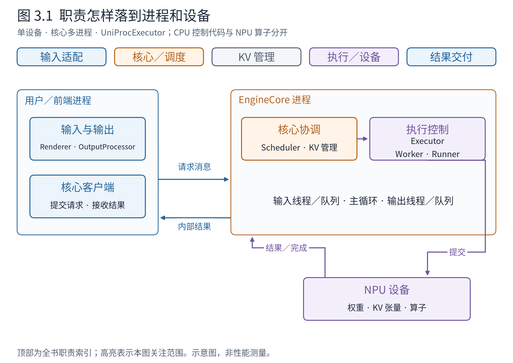
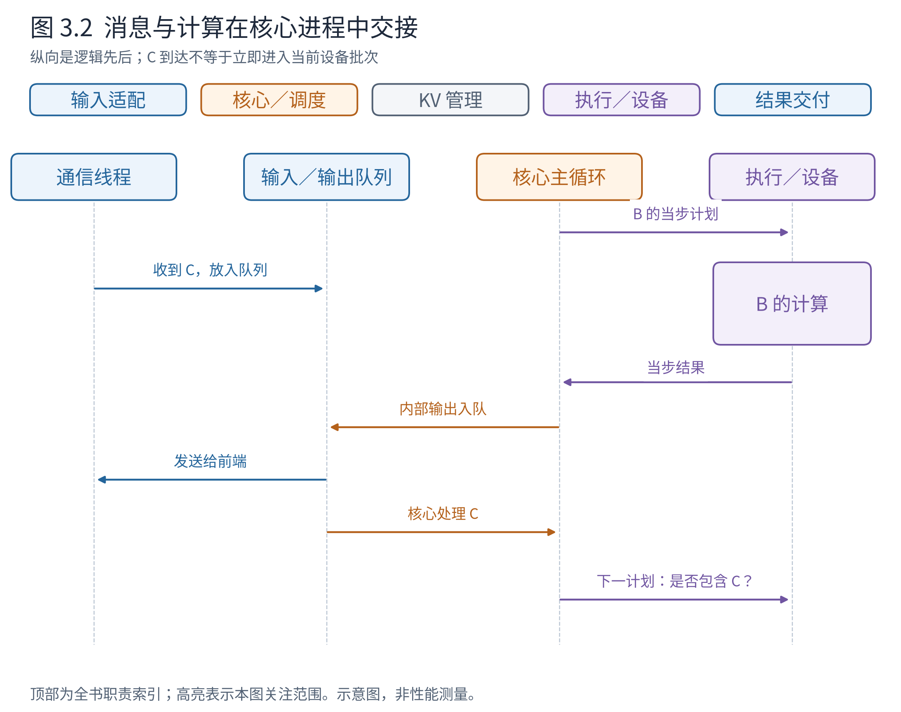
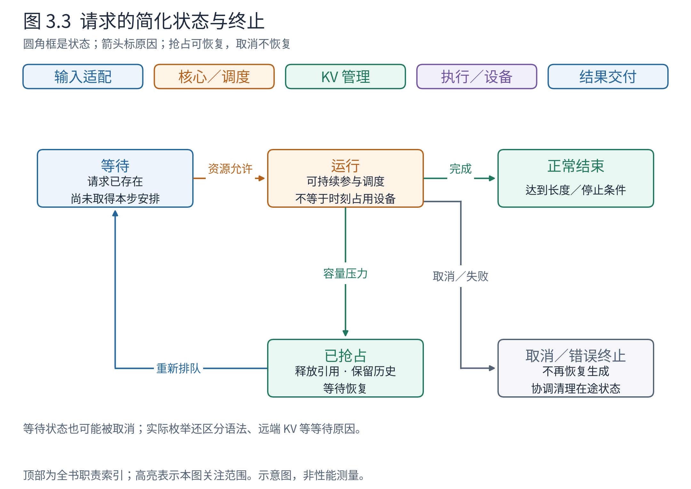

# 第 3 章 这些组件在哪里运行

上一章中，请求越过前端与核心之间的边界，又沿相反方向返回。这条边界首先是一份责任约定：一侧理解调用者，另一侧组织计算。但在实际程序里，它也可能成为进程边界。此时，“把请求交给核心”就不再只是调用一个本地函数，而要把信息送到另一个运行中的程序。

理解这个变化，才能回答一些看似矛盾的问题：用户的离线调用还在等待，为什么核心已经继续计算？NPU 正在执行时，新请求怎样被接收？一个 Worker 对象是否就意味着又多了一个进程？本章把第 1 章的职责地图放到运行环境中，并追踪请求如何在这些位置之间推进。

## 3.1 先区分四种“装东西的盒子”

阅读软件图时，最危险的误会不是漏记一个名称，而是把不同层次的盒子当成同一种东西。

**模块（module）**是组织代码的单位，例如一个 Python 文件。它说明实现放在哪里，不说明运行时有多少份。**进程（process）**是操作系统管理的运行实例，拥有自己的地址空间；一个进程里的普通 Python 对象，另一个进程不能直接当成本地对象使用。**线程（thread）**是进程内的执行活动，多个线程可以共享该进程的内存。**设备（device）**则是实际执行算子、存放设备张量的计算资源。

因此，一个模块可以被多个进程加载；一个进程可以创建多个线程；一个 Worker 的 CPU 控制代码可以通过设备运行时向 NPU 提交工作。把 Worker 框放进“NPU 内部”，会混淆控制程序和设备算子。同样，两个类之间有接口，也不意味着它们必须跨进程通信。



**图 3.1　职责怎样落到进程和设备。** 采用单设备、前端与 EngineCore 分进程、UniProcExecutor 的教学部署：Worker 与 Runner 的控制代码放在核心所在进程，NPU 另画为设备。大容器表示进程，内部小框表示职责，设备边界不与进程混用。依据 v0.30.0 的 EngineCoreClient、EngineCoreProc 和 UniProcExecutor；这是声明配置后的源码示意，并非本机进程采样。

先沿图上方找到熟悉的蓝色前端和橙色核心，再看它们现在被放进不同进程。最后看紫色执行代码与设备的关系：发出执行指令的代码运行在主机，模型计算运行在设备。第 10 章把单设备扩成多设备时，这个区分仍然成立，只是执行端可能拥有更多进程。

同进程模式也存在。那时前端通过本地核心客户端推进引擎，少了一次进程间交接，但职责仍可分开。**职责边界回答“谁负责”，部署边界回答“在哪里运行”。** 两张图可以相互映射，不能相互替代。

## 3.2 为什么把前端与核心分开

假设 B 正在连续解码，这时 C 提交了一段较长文本。前端需要处理输入，之后又可能把许多 token 转成文本。如果这些 CPU 工作与核心的每一步组织工作紧紧串在一起，核心准备下一轮的时机就可能被文本处理拖延。即使模型算子很快，设备仍可能等待主机把下一批工作准备好。

将前端和核心分开，使两侧能够独立推进，降低文本处理与核心循环之间的直接干扰。这正是 V1 设计中关注 CPU 开销与模块分工的一条动机，而不是“进程越多越快”的一般规律。[V1 设计说明](https://vllm.ai/blog/2025-01-27-v1-alpha-release)

分开也产生了真实成本。请求需要被编码成双方认识的消息，结果需要关联到正确的请求；启动时要确认另一侧已经就绪，退出或失败时要发现对端不再可用。消息传递还有时间和内存开销。如果工作量很小，或者两侧本来都不繁忙，这些成本未必能被重叠收益抵消。

这里的**进程间通信（inter-process communication，IPC）**，就是不同进程交换信息的机制。v0.30.0 的核心客户端路径使用 ZeroMQ 等设施传送控制和结果。读架构时先抓住消息内容和生命周期即可，无须先学完整的通信库 API。更不能把“使用消息”推导为“每一步都复制模型权重和 KV 张量”：普通生成时，权重和大部分 KV 保留在执行侧，跨前端边界的是请求与结果信息。

这也解释了为何第 2 章强调身份与双侧状态。跨越进程以后，A 不再是两侧可以随意共同修改的同一个 Python 对象。它是一项由身份关联起来的工作，各组件维护自己负责的信息。

具体到离线多进程客户端，`LLMEngine.engine_core` 是 `SyncMPClient`。它将上一章的请求对象包装成发送消息；下面节选的两行保留真实调用，`request` 就是 A 的 EngineCoreRequest：

```python
msg = (self.core_engine, request_type.value, *self.encoder.encode(request))
self.input_socket.send_multipart(msg, copy=False)
```

第一项是目标核心的路由身份，第二项表示动作，剩余项是序列化后的数据帧。`EngineCoreRequestType.ADD.value` 为 `b"\x00"`，`ABORT.value` 为 `b"\x01"`：同一通信通道因此既能传新增请求，也能传取消命令。ADD 的载荷是 EngineCoreRequest，ABORT 的载荷则可以是 `["1-b2c3d4e5"]` 这样的内部 ID 列表。它们不是两份结构相同的业务请求。

这些对象采用支持按字段位置编码的消息结构，不能把上一章为阅读展开的 Python 对象视图误当成实际发送的 JSON。这里的字节类型码和帧包装来自 [SyncMPClient._send_input](https://github.com/vllm-project/vllm/blob/ced6857afa0ea7b2e3f0846a62e1394e90f15607/vllm/v1/engine/core_client.py#L956) 与 [EngineCoreRequestType](https://github.com/vllm-project/vllm/blob/ced6857afa0ea7b2e3f0846a62e1394e90f15607/vllm/v1/engine/__init__.py#L284)；编码后的原始字节没有在本例伪造。

## 3.3 消息到达，与请求被计算，是两件事

核心进程不只包含调度代码。它还要收消息、发结果，并让这些活动与执行循环配合。v0.30.0 的 EngineCoreProc 使用输入、输出线程与队列连接通信路径和核心循环。

队列是一种有顺序的交接结构：生产者把事项放入，消费者在合适的时机取出。输入线程收到 C，并不等于 C 已经获得计算预算；它只是让核心有机会处理 C。随后核心接纳请求，调度器才决定哪一步把它纳入计划。用队列明确交接点，可以避免把通信回调写成直接改动所有调度状态的入口。



**图 3.2　消息与计算在核心进程中交接。** 横向是责任泳道，纵向表示因果先后。C 在 B 的某轮设备工作期间到达，经输入队列等待核心处理；当轮结果经输出队列交给发送线程。依据 EngineCoreProc 的输入／输出线程、run_busy_loop 与队列处理代码。图展示允许的协作，不保证每次都发生重叠，也不按纵向距离表示耗时。

读图时先看 C 的箭头停在哪里：它先到队列，没有越过队列直接落进正在计算的批次。再看结果的箭头：核心完成状态更新后，交付工作可以继续由输出路径处理。新消息、调度计划、设备结果各有自己的到达时机，架构必须把它们组织成一致的请求进度。

用 A 的消息替换图中的新请求，就能看见交接对象在队列前后的变化。输入线程先解码得到 EngineCoreRequest，再调用 `preprocess_add_request` 转为核心 Request；向主循环交付的队列项有这样的嵌套形态：

```python
# 队列项视图；req_a 是核心 Request 对象，不是 ID 字符串
(EngineCoreRequestType.ADD, (req_a, 0))
# 相应取消消息的队列项
(EngineCoreRequestType.ABORT, ["1-b2c3d4e5"])
```

ADD 内层的 `0` 是本例的请求波次 `request_wave`；普通单副本无需借它学习 DP 协调，先注意它与请求对象一起传递。主循环取到 ADD 后经 `_handle_client_request` 调用 `EngineCore.add_request(req_a, 0)`，再交给 Scheduler。收到 ABORT 时则按另一分支处理列表。这是“已经收到消息”和“调度器已经处理请求”之间可具体定位的队列边界。依据 [EngineCoreProc._handle_client_request](https://github.com/vllm-project/vllm/blob/ced6857afa0ea7b2e3f0846a62e1394e90f15607/vllm/v1/engine/core.py#L1532)。

返程也有路由包装：核心把 `(client_index, engine_core_outputs)` 放入输出队列。本例 `client_index=0`，`engine_core_outputs.outputs` 中则装有 A、B 的新增 token；输出线程据客户端编号送回前端。前端 `get_output()` 取到的才是上一章展开的 EngineCoreOutputs。请求 ID 解决“属于哪条工作”，客户端编号解决“送给哪一侧”，不能相互替代。

核心循环的朴素读法是：处理输入，检查可做的工作，生成当步计划，组织执行，消费结果，再继续。没有工作时可以等待输入；有活跃请求时持续推进。真实实现还有异步批次队列等路径，因此这个顺序是逻辑依赖，不是对所有 CPU 与设备活动的严格串行承诺。

尤其要避免一个常见误读：多进程离线前端每次“取结果”，不等于向核心发送一次“现在运行一步”的命令。后台核心有自己的执行循环。前端等待结果与核心运行工作是通过消息联系的两个活动，这与同进程客户端主动推进核心不同。

## 3.4 一条请求的状态如何跨越这些位置

为了避免把运行位置图变成静态摆放图，我们再问：C 到达后，会经历什么？最初它等待被安排；获得资源后，它可以参与计算；完成生成后，它结束。如果资源不足，它还可能暂停、释放部分占用并回到等待。这里的“参与计算”是持续的一段生命周期，不意味着设备在每个瞬间都在算 C。



**图 3.3　请求的简化状态与终止。** 箭头上的文字说明状态改变的原因，回边表示抢占后的恢复。图折叠了 v0.30.0 RequestStatus 中等待语法、等待远端 KV 等细分状态，也合并了多种完成原因；它不是枚举值的逐项复制。终止后的资源清理是后续动作，不能从箭头推断设备算子被瞬间打断。

设 C 已被接纳，但容量还不够。它等待期间，前端仍然知道结果应交给谁，核心仍然知道它的输入和要求，却未必已经为全部未来 token 分配好设备存储。由此可见，“请求存在”“拥有执行资源”“正在设备上执行”不是三个等价判断。

如果 C 被抢占，它的生成任务仍可继续；如果用户取消 C，任务就不应再恢复。二者可能都涉及释放块引用，但目的不同。第 5 章会解释抢占如何帮助容量周转，第 6 章解释释放后的块还能保留什么。

终止同样跨越组件。核心停止为请求安排新的工作，执行端清理持久状态，前端完成或丢弃相应输出。异步情况下还可能收到先前已提交工作的晚到结果，需要按请求状态处理，不能把它误认成一个新请求的结果。这里的关键原则是：**消息可能晚到，身份和生命周期不能含糊。**

## 3.5 并发的收益依赖边界是否清楚

现在回看开篇的三个问题。离线调用阻塞，只说明调用者尚未得到最终返回；内部的进程、线程与设备工作仍然可以推进。新请求经通信与队列进入系统，参与计算的时机由核心和调度决定。Worker 是执行职责，不与进程数量一一对应。

这种运行组织换来了重叠机会和更清楚的职责，也带来了队列、消息、就绪握手、异常和资源清理。并发不是把顺序箭头随意拉成平行线，而是找出哪些工作可以独立进行，哪些状态必须按因果顺序更新。

阅读后可以尝试画两张图：一张只放前端、核心、执行层与设备，另一张为它们加上所选部署的进程边界。如果换一种 Executor，第二张图可能变化，第一张职责图仍应大体成立。下一章要解决的是这些盒子如何先被建立起来：模型尚未加载、缓存尚未分配时，引擎怎样走到能够接纳请求的状态？

## 章末源码导航

带着“谁推进循环、谁只搬运消息”的问题阅读，先不要沿通信辅助函数无限展开。

<!-- NAVIGATION -->

| 要回答的问题 | 固定版本入口 | 读到哪里即可停止 |
|---|---|---|
| 部署形态怎样选择？ | [EngineCoreClient.make_client](https://github.com/vllm-project/vllm/blob/ced6857afa0ea7b2e3f0846a62e1394e90f15607/vllm/v1/engine/core_client.py#L91) | 区分同进程与多进程客户端后停止 |
| 谁持续推进核心？ | [EngineCoreProc.run_busy_loop](https://github.com/vllm-project/vllm/blob/ced6857afa0ea7b2e3f0846a62e1394e90f15607/vllm/v1/engine/core.py#L1403) | 看输入处理与引擎步的交接 |
| 消息何时变成核心事件？ | [EngineCoreProc._process_input_queue](https://github.com/vllm-project/vllm/blob/ced6857afa0ea7b2e3f0846a62e1394e90f15607/vllm/v1/engine/core.py#L1429) | 看等待与取队列，不深入套接字工具 |
| 等待、抢占、终止怎样区分？ | [RequestStatus](https://github.com/vllm-project/vllm/blob/ced6857afa0ea7b2e3f0846a62e1394e90f15607/vllm/v1/request.py#L364) | 对照本章简化状态图即可 |
