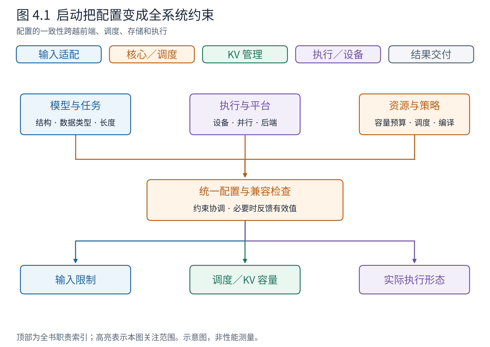
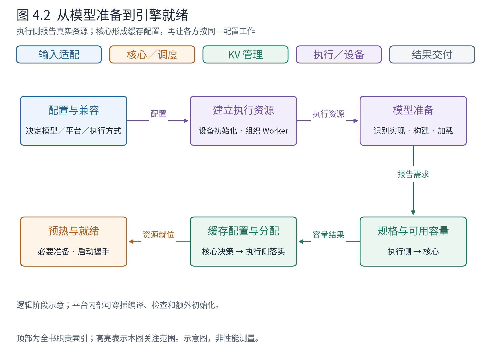
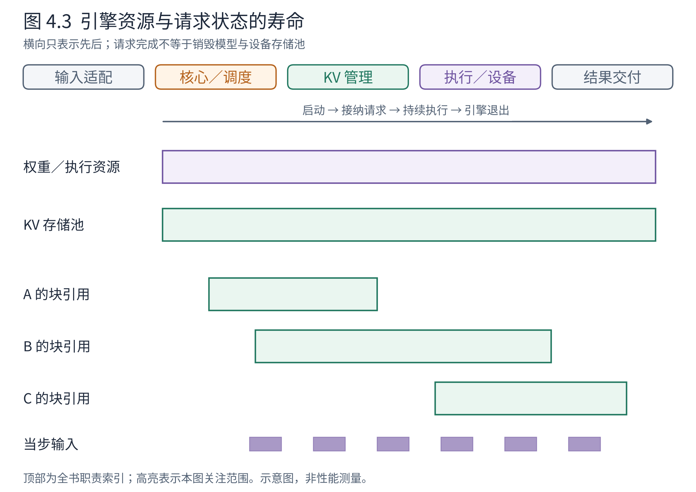

# 第 4 章 引擎如何准备好一次推理

前面三章让请求进入了一台已经工作的引擎。但用户第一次创建引擎时，模型权重还在文件中，执行设备尚未组织起来，KV 容量也不是一个已经知道的数字。若直接跳到调度器，读者会遇到许多“突然出现”的配置和资源。

本章补上请求之前的那段过程。启动并非一串初始化函数，而是逐步兑现承诺：系统先判断要运行什么模型、采用什么执行方式，再知道能够提供多少资源，最后确认这些资源可以协同工作。只有这时，运行期的调度才有可信的边界。

## 4.1 配置是各组件必须共同遵守的约束

假设我们希望运行一个文本生成模型，使用一张 NPU，允许请求达到某个上下文长度。三个看似简单的选择已经关联多个组件。模型结构决定权重和状态类型；设备与执行方式决定如何加载、调用和通信；长度限制影响请求检查，也影响缓存和计算资源的准备。

**配置（configuration）**不是仅供入口打印的参数集合。它是这些决定被整理、补默认值并检查兼容性后的系统约束。vLLM 用 VllmConfig 组织模型、缓存、并行、调度、编译等配置，平台也可在启动时检查和调整相关项。



**图 4.1　启动把配置变成全系统约束。** 上方是配置来源，下方仍是前端、核心、执行与状态管理这张全景。箭头表示约束的使用关系，不表示每个组件都独自重新解析命令行。依据 v0.30.0 VllmConfig、EngineCore 初始化与平台接口；为阅读省略部分配置组。

从图中任选一个约束追踪。例如，最大上下文长度不能只在前端检查，却让执行缓冲区和 KV 准备仍按另一个值理解。某些资源探测还可能反过来影响有效配置；当前源码在自动适配长度发生变化时，会将变化同步给已创建的 Worker。这个细节背后的原则是：**启动的产物是相互一致的配置，而不是许多组件各自得到一个局部合理的数。**

下面把这份约束展开成实际对象中的字段路径。数值是一个小型教学配置片段，并非可直接启动的完整配置或本机实测：

```python
vllm_config.model_config.max_model_len       # 16
vllm_config.scheduler_config.max_num_seqs    # 3
vllm_config.scheduler_config.max_num_batched_tokens  # 8
vllm_config.parallel_config.tensor_parallel_size    # 1
vllm_config.parallel_config.pipeline_parallel_size  # 1
vllm_config.cache_config.block_size          # 4（教学块长）
```

16 限定单条请求的上下文范围，3 限定可容纳的序列数量，8 限定一轮 token 工作量；它们不是同一个“批大小”。EngineCore 将这份 VllmConfig 交给执行器和调度器等组件，使本章的启动准备与第 5 章的预算判断使用相同字段。块长还必须经过具体后端的支持检查，不能把这里的 4 当成任意设备都能直接使用的参数。

这种一致性也有代价。配置不能任意组合：模型支持某项能力，不保证选定后端、并行方式和图执行模式支持同样的组合。尽早拒绝不兼容配置，会增加启动检查，却能避免把错误拖到某个请求执行一半时才暴露。

## 4.2 模型识别、模型实例与权重是三件事

“加载一个模型”在架构上至少包含三种责任。

首先要识别模型结构。模型配置提供架构信息，注册表（registry）帮助系统找到相应的模型实现，并识别它支持的任务和接口。这里得到的是“应该采用哪种实现”，还不是一份已经装有权重的模型。

随后需要构建模型实例。执行侧依据模型与并行配置创建网络层；如果模型被切到多卡，各执行位置只负责相应部分。最后，加载器（loader）读取权重，把文件中的参数映射到模型实际使用的参数。文件命名、层内融合和分片方式可能不同，因此“权重文件中有这些 tensor”并不自动意味着“模型实例已经正确接收它们”。

用阅读锚中的 Llama 实现看一次交接。注册表接收 `architectures=["LlamaForCausalLM"]` 与模型配置，在选择相应原生实现的条件下返回 `(LlamaForCausalLM, "LlamaForCausalLM")`：前者是 Python 类，后者是解析成功的架构名，还不是已加载权重的对象。

模型建好后，以 DefaultModelLoader 为例，它负责读取权重文件，将 `(权重名, tensor)` 的可迭代数据交给 LlamaForCausalLM 实例的 `load_weights(...)`，再由内部 LlamaModel 等组件落实参数映射。加载器负责提供文件数据，模型对象负责解释自己的参数结构。Llama 的映射中包含以下真实键片段：

```python
# LlamaModel.hf_to_vllm_mapper.orig_to_new_stacked 节选
{
    ".q_proj": (".qkv_proj", "q"),
    ".k_proj": (".qkv_proj", "k"),
    ".v_proj": (".qkv_proj", "v"),
}
```

例如层 0 的 Q 权重可由 `model.layers.0.self_attn.q_proj.weight` 对应到融合参数的 Q 分片；K、V 分别对应另两个分片。只看一个不分片的小型线性投影，设输入维为 4、Q/K/V 输出维都为 2，则三份权重各为 `(2,4)`，融合存储为 `(6,4)`。这些形状是构造值；键映射来自 [LlamaModel](https://github.com/vllm-project/vllm/blob/ced6857afa0ea7b2e3f0846a62e1394e90f15607/vllm/model_executor/models/llama.py#L347)，并非声称真实 Llama 就采用这些小尺寸。识别决定使用哪个实现，构建决定参数结构，加载接口才把文件数据送到正确位置。

读者因此无需先做完整注册项目，也能理解它为何需要多步验证。注册表能找到类，只证明第一道连接建立了；权重形状、前向接口、Attention 后端与数值结果仍各有责任。这些完整实践放在附录，正文继续关注启动的整体闭环。

## 4.3 为什么模型装得下，仍不代表请求跑得起来

模型权重常驻设备，但它不是唯一占用。执行还需要临时张量、算子工作空间、通信资源以及可能的图执行资源，运行中的请求还需要 KV。若把“设备容量减去权重大小”全部宣布为 KV 空间，就可能挤掉计算时必须使用的内存。

v0.30.0 的核心会向执行侧取得 KV 规格与可用容量信息，再生成缓存配置。执行侧知道模型真正怎样运行，因而适合报告资源需求；核心需要把这些信息转成可以交给调度器的容量边界。最后，执行侧按配置创建实际缓存，调度侧使用与之匹配的管理信息。



**图 4.2　从模型准备到引擎就绪。** 顺着主箭头读配置、执行初始化、模型、容量、缓存、预热与就绪。支线强调“执行侧提供规格和容量，核心形成一致配置”的协作。依据 EngineCore.__init__、_initialize_kv_caches 和 Executor 接口。图为逻辑阶段，某些编译、模型检查和平台处理会穿插其中，不宣称所有后端内部调用顺序完全相同。

把这次交接落实到类对象：EngineCore 调用其 Executor 实例的 `get_kv_cache_specs()`，Executor 再调用各 Worker 的 `get_kv_cache_spec()`，将返回值收集为列表。Worker 代表一个执行位置，知道该位置的模型需要怎样的状态；Executor 封装执行位置的调用与结果收集；EngineCore 则据此形成全局一致的容量安排。假设只有一个 Worker、一个全注意力层，块长 4、KV 头数 2、头维 8、数据类型 float16，无额外页填充：

```python
# get_kv_cache_specs() 的返回视图：外层按 Worker，内层按层名
[
    {"model.layers.0.self_attn.attn": FullAttentionSpec(
        block_size=4, num_kv_heads=2, head_size=8, dtype=torch.float16,
    )}
]
# determine_available_memory() 的返回视图，单位为字节
[4096]
```

层名和值是教学构造，类型与外层组织来自启动接口。这个规格的一页包含 K、V、4 个位置、2 个头、每头 8 个数，每个数 2 字节，即 256 字节。这里的 4096 是已经扣除其他需求后可用于 KV 的预算，不是设备总内存；单层简化下可对应 16 页。真实计算依据 [AttentionSpec](https://github.com/vllm-project/vllm/blob/ced6857afa0ea7b2e3f0846a62e1394e90f15607/vllm/v1/kv_cache_interface.py#L479) 的页大小属性，额外填充或不同状态类型会改变结果。

返程得到规格与容量后，EngineCore 形成各 Worker 的配置列表，调用 `Executor.initialize_from_config(kv_cache_configs)`；执行器经 Worker 包装层将各自的配置交给 `Worker.initialize_from_config(...)`，由 Worker 协调 ModelRunner 初始化缓存。下面是列表中一份 `KVCacheConfig` 的字段视图，展示单层、层优先布局；省略布局枚举等选项：

```python
KVCacheConfig(
    num_blocks=16,
    kv_cache_tensors=[KVCacheTensor(
        size=4096, layers=["model.layers.0.self_attn.attn"],
        layer_stride=4096, block_stride=256, offset=0,
    )],
    kv_cache_groups=[KVCacheGroupSpec(
        layer_names=["model.layers.0.self_attn.attn"],
        kv_cache_spec=full_spec,  # 上面的 FullAttentionSpec
    )],
)
```

`num_blocks` 给出容量，`size` 和两个 stride 告诉执行侧如何准备和解释存储，`kv_cache_groups` 连接层与规格。调度侧由各 Worker 配置生成对应管理配置，执行侧按各自配置初始化张量。于是同一个“16 块”在两侧都有了落点。字段依据 [KVCacheConfig](https://github.com/vllm-project/vllm/blob/ced6857afa0ea7b2e3f0846a62e1394e90f15607/vllm/v1/kv_cache_interface.py#L1414)、[KVCacheTensor](https://github.com/vllm-project/vllm/blob/ced6857afa0ea7b2e3f0846a62e1394e90f15607/vllm/v1/kv_cache_interface.py#L1361)。

这个例子展示接口数据和单层容量推算，没有执行真实内存探测；实际容量是多个资源共同约束后的结果。实际还涉及数据类型、层类型、并行分片和平台行为。尤其不能拿一个容量数字推导固定并发数：短请求和长请求的状态占用不同，前缀复用也会改变所需新增块数。

当我们在第 5 章讨论“是否接纳 C”时，调度器使用的正是启动阶段建立的这种容量事实。它无须每次重新加载模型或测量设备总内存。

## 4.4 预热究竟在准备什么

资源已经创建，为什么还不能简单宣布就绪？因为某些执行准备要在实际走过计算路径后才完成，例如触发编译、选择执行形态、准备图捕获或确认相关缓冲区。**预热（warm-up）**就是在正式服务之前有计划地走过必要路径，把一部分首次执行成本与检查提前。

预热不是训练，不在这里更新模型权重；也不是性能达标证明。即使预热完成，不同长度、后端或功能组合仍可能触发不同路径。某些配置不启用编译或图执行，也就不能把“预热”一概翻译成“捕获完整设备图”。第 9 章会分别解释这些机制。

就绪还有系统层含义。前端需要知道核心已经准备好，核心需要知道所依赖的执行资源可用。多进程启动中的握手，正是把“子进程已创建”进一步变成“它已经能够承担约定职责”。进程存在只是必要条件；模型加载失败、容量不足或通信初始化失败都可能使引擎无法进入就绪状态。

就绪响应也携带有效配置。核心进程中的 EngineCoreProc 用 `_make_ready_response()` 构造消息，前端的 MPClient 在启动握手中收到并解码，通过 `_apply_ready_response(...)` 同步相关有效配置。前者报告“核心实际准备成什么样”，后者负责让前端认识这份启动结果。沿用本章的小模型，`EngineCoreReadyResponse` 的字段节选可以写成：

```python
EngineCoreReadyResponse(
    max_model_len=16, num_gpu_blocks=16, block_size=4,
    max_num_seqs=3, max_num_batched_tokens=8,
    tensor_parallel_size=1, pipeline_parallel_size=1,
    # 其余就绪字段省略
)
```

前端拿到这些有效值，才能把自身限制与核心实际容量对齐。`num_gpu_blocks` 是这个通用消息的真实历史命名，不意味着这一字段本身证明执行设备是 CUDA GPU。结构见 [EngineCoreReadyResponse](https://github.com/vllm-project/vllm/blob/ced6857afa0ea7b2e3f0846a62e1394e90f15607/vllm/v1/engine/__init__.py#L73)。

所以观察启动日志时，应按阶段问问题：模型实现是否找到？权重是否加载？缓存配置是否形成？预热是否完成？前端是否收到就绪信号？这样才能区分下载慢、容量不够和运行期排队慢，而不是把一切归为“推理速度慢”。

## 4.5 哪些东西随引擎存在，哪些随请求存在

启动完成后，许多资源会被重复使用。模型权重通常跨请求保留；KV 存储池也通常先建立，再由请求获得其中的块。请求结束时归还的是使用关系，不必每次销毁整池存储。这是启动期与运行期分开的重要价值。



**图 4.3　引擎资源与请求状态的寿命。** 横轴只表示先后，长条不是实测耗时。权重和缓存池跨越 A、B、C 的生命周期；请求占用和当步输入分别在更短范围内有效。依据核心、KV 管理器与执行层的初始化／释放职责；省略卸载、休眠与动态重配置路径。

沿图想象 A 先结束、B 仍在生成。A 的引用被释放，不意味着模型权重应卸载，也不意味着 B 的 KV 应重建。再看当步输入：它们为本轮执行服务，不能随意覆盖仍被异步设备任务读取的缓冲区。不同寿命的资源放在同一执行系统里，要求组件清楚知道自己拥有的是存储本体、引用还是临时视图。

启动期集中准备，可以摊薄重复成本，但会增加启动时间和常驻资源需求；提前准备得越多，也可能保留越多暂时用不到的容量。因此“提前一切”不是无条件原则，合适的准备范围取决于模型、请求形态与平台能力。

现在这台引擎终于具备了运行的前提：模型和执行资源已准备，核心知道可用容量，前端能够接纳符合约束的需求。下一章进入它持续作出的决策：在这一轮，应该推进谁，各推进多少？

## 章末源码导航

从资源怎样在组件间交接入手，暂不展开各模型的完整权重键名。

<!-- NAVIGATION -->

| 要回答的问题 | 固定版本入口 | 读到哪里即可停止 |
|---|---|---|
| 配置怎样组织跨组件约束？ | [VllmConfig](https://github.com/vllm-project/vllm/blob/ced6857afa0ea7b2e3f0846a62e1394e90f15607/vllm/config/vllm.py#L358) | 先识别配置组及初始化检查，不逐参数背诵 |
| 架构怎样找到模型实现？ | [_ModelRegistry.resolve_model_cls](https://github.com/vllm-project/vllm/blob/ced6857afa0ea7b2e3f0846a62e1394e90f15607/vllm/model_executor/models/registry.py#L1371) | 识别候选与解析结果即可 |
| 文件权重交给谁？ | [DefaultModelLoader.load_weights](https://github.com/vllm-project/vllm/blob/ced6857afa0ea7b2e3f0846a62e1394e90f15607/vllm/model_executor/model_loader/default_loader.py#L415) | 看加载器与模型权重接口的交接 |
| 资源怎样成为缓存容量？ | [EngineCore._initialize_kv_caches](https://github.com/vllm-project/vllm/blob/ced6857afa0ea7b2e3f0846a62e1394e90f15607/vllm/v1/engine/core.py#L254) | 走完规格、容量、配置、初始化与预热 |
