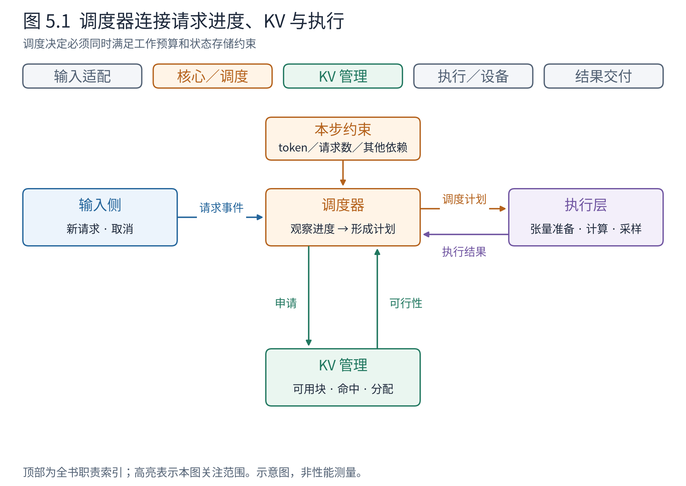
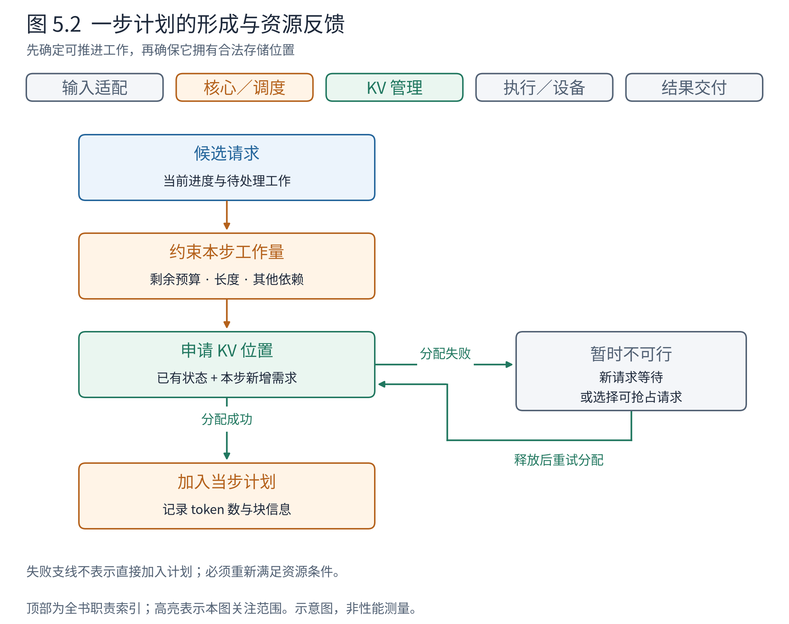

# 第 5 章 调度器：下一步算谁、算多少

启动阶段建立了设备与缓存容量，入口不断送来请求。现在出现了引擎每天都要重复解决的问题：设备即将开始下一轮计算，应该把什么工作交给它？

Book6 已经解释，固定地等一整批请求全部结束，会浪费先结束请求留下的空间；连续批处理允许批次成员随迭代变化。但理论上的“可以变化”，还需要一个组件在每一步作出具体决定。调度器就是这个决定的承担者。它输出可执行的计划，并根据结果更新进度，而不是只维护一个先来后到的名单。

## 5.1 调度器在两种约束之间作决定

一条请求有工作待做，还不意味着本轮就能计算。首先，本步处理能力有预算；其次，计算依赖的历史状态必须可访问，新状态也需要存储位置。前者约束本步工作量，后者约束请求能否安全继续。

**图 5.1　调度器在全景中的位置。** 高亮橙色调度与绿色 KV 管理；蓝色入口继续提供请求，紫色执行层接收计划、返回结果。箭头标的是协作事项，不表示各框独占一个进程。依据 v0.30.0 Scheduler、KVCacheManager 与 EngineCore 的关系。

先从左侧读：请求带来待完成的需求。再看中间：调度器结合进度与资源判断能否推进。最后看右侧：执行层收到的是已经作出的安排，不需要重新判断哪个用户应该先服务。调度器也不应自己构造每个 Attention 算子的张量布局，那属于执行层。

这样的边界使策略与执行可以分别演进，但绝不是双方互不关心。执行层能够支持的形态会限制计划；KV 管理器的分配结果会影响选择；异步结果到达后还要修正相应状态。调度器的核心价值，是在这些约束之间维护一份一致的工作安排。

## 5.2 用“已经处理到哪里”统一看待请求

普通自回归生成有两个常见情景。新请求的提示词尚未处理，可能一下需要推进很多输入 token；正在解码的请求已有历史 KV，通常只需处理上一轮产生的一个 token，就能选出下一个。

从调度角度看，两者都有一个已处理进度，以及一段尚待处理的 token。v0.30.0 的设计用这类进度差统一表达工作，能够容纳分块预填充、前缀命中和投机等情况。它不需要先把所有请求永久归为两种互不相交的队列，再为每一类构造完全不同的工作语言。

以 A 为例：提示词长 3，尚未计算时，待处理的是这 3 个 token。第一轮处理完并选出一个输出 token 后，已知序列长 4，但最后这个新 token 还没作为输入建立自己的 KV。下一步处理它，就能选出第二个输出 token。**已生成的长度、已处理的长度和本步要处理的长度，分别回答不同问题。**

这里按逻辑完成后的状态叙述。真实源码为支持重叠，会在安排工作后推进部分进度计数，并另行管理在途、占位与拒绝校正。因此看到 `num_computed_tokens` 时，不能仅凭名字断言设备已经完成对应工作；必须同时看它在哪个阶段更新。正文的小例子先关闭这些额外复杂性，以免把一条设计主线淹没在记账细节中。

统一表达减少了主循环中特例分叉的需要，代价是计数语义必须更精确。只有明确“已知哪些 token、安排过哪些、哪些结果仍待返回”，统一才不会变成混淆。

## 5.3 当 C 到达，长提示怎样插进解码之间

沿用前两章的 A、B：提示词分别长 3、5，输出上限分别为 2、3。第一轮处理 8 个输入 token，各得到一个输出。现在 C 到达，它有 7 个提示词 token。假设本步预算仍为 8，可容纳至少三条请求，KV 充足，允许分块预填充；不启用前缀复用、投机或异步调度。下面给出一条教学安排，不承诺所有默认配置都会选到同一路径。

**表 5.1　新请求加入后的工作分配**

| 迭代 | A | B | C | 输入 token 合计 | 本轮之后 |
|---|---|---|---|---:|---|
| 1 | 提示词 3 | 提示词 5 | 未到达 | 8 | A、B 各生成 1 个 |
| 2 | 新输入 1 | 新输入 1 | 提示词前 6 | 8 | A 生成第 2 个并结束；B 生成第 2 个；C 尚未完成提示词 |
| 3 | 已结束 | 新输入 1 | 提示词剩余 1 | 2 | B 生成第 3 个并结束；C 获得首个输出 |

第二轮最能说明设计思想。A、B 需要很少的新增计算来继续生成，C 则有较长输入。将 C 切成一块，能让它利用本轮剩余预算，同时不要求把整段 7-token 提示词一次放进去。C 的前 6 个 token 虽然已产生中间状态，却还没有完成整个提示词，因此本例不会向用户交付续写 token。

这种安排不是免费午餐。块较小，长请求首 token 可能等待更多轮；块较大，单轮工作更重，其他请求的输出间隔可能受影响。仅凭“每步不超过 8”也不能推导固定毫秒数：处理同样数量的 token，历史长度、后端和批次形态仍可能改变耗时。

还有一个容易漏掉的限制：token 预算不等于请求数量预算。允许处理 8 个 token，并不必然允许 8 条请求同时处于执行集合。vLLM 还有活跃请求数、编码器计算、状态对齐等其他约束。对于当前纯文本例子，先把“算多少”和“容纳多少请求”分开，就能避免把一个参数当成整个调度策略。

## 5.4 调度计划怎样得到 KV 管理器的许可

如果预算够，但 C 需要的块不够，调度器不能先执行，再指望后来有地方保存状态。它需要和 KV 管理器协商：当前已命中多少、还要追加多少、是否能取得相应块。

**图 5.2　一步计划的形成。** 从候选请求出发，经工作量约束与 KV 分配判断，成功后才加入当步计划；失败分支进入等待或抢占处理。依据 Scheduler.schedule 与 KVCacheManager.allocate_slots。图省略编码器、连接器与异步分支，表示决策依赖，不是完整函数流程图。

读失败分支时，需要区分两种情况。新来的 C 暂时进不去，可以继续等待；已经运行的 B 要增长却无法获得容量，则可能需要从其他请求回收资源，甚至让某条运行中请求暂停。这种把资源让给其他工作的动作称为**抢占（preemption）**。

v0.30.0 普通路径采用重计算思路：被抢占请求释放相应块引用，计算进度被重置，回到等待队列；其提示词与已生成 token 的历史仍可用于之后恢复。它不等于默认把整份 KV 搬到 CPU 再搬回来。恢复时能否命中尚存的缓存，取决于缓存状态与配置，不能保证总是免重算。

考虑一个只剩 0 个空闲块的教学池。A 需要新增 1 块，B 当前持有 2 块且可被抢占。若策略选择暂停 B，释放使容量可用于 A，A 才能继续。B 的用户并未要求取消，它只是付出了等待和重新建立状态的代价。这也说明为什么高抢占频率可能损害有效吞吐：设备的一部分工作是在重做已有历史，而不是产生新输出。

## 5.5 排队顺序是一种策略，资源可行性是另一回事

先到先服务有直观公平性，但推理请求的成本和长度不同。一个早到的长请求可能占据大量预算；一个当前无法分配资源的请求，也不应被想当然地视为永远挡住所有后继工作。固定源码中的不同分支会结合可行性与策略进行处理，并非每一处都严格保证绝对先到先执行。

优先级策略同样不能脱离资源讨论。高优先级请求仍需要模型支持和 KV 空间；把低优先级工作不断抢占，还可能导致后者等待过长。因而阅读策略时至少要问三件事：候选如何排序，不可行时怎样处理，已经运行的请求是否会被牺牲。

策略取舍最终反映在不同体验上：尽快给新请求首 token、稳定已有请求的输出间隔、尽量提高整体吞吐，不总能同时最大化。本书不提供脱离负载的“最优参数”，而是帮助读者知道需要观察哪条因果链。C 首 token 慢，可能是排队，也可能是长提示被分块；A 输出间隔变长，可能与本轮混入的工作或设备执行有关，不能只看队列长度下结论。

## 5.6 计划发出去以后，调度工作还没结束

执行结果返回后，请求进度、完成状态与可用资源都会改变。第 2 轮 A 结束，第 3 轮就不应再为 A 预算计算；A 的释放可能让其他请求入场。执行失败、取消和投机验证修正也都可能改变后续安排。

因此，调度不是“请求来时排一次序”。它是运行中的闭环：观察状态，形成计划，执行，再根据新事实调整。计划越允许并发和重叠，就越需要区分已经承诺的工作和已经完成的工作。

回到全景图，调度器既不拥有用户文本处理，也不直接保存设备 KV；它拥有的是推进请求的决策责任。下一章进入它最紧密的协作者，解释“一个请求拥有某些块”究竟意味着什么，以及块为何能够既被释放，又在之后帮助另一个请求。

## 章末源码导航

先阅读普通文本、无连接器的路径，识别预算、分配、抢占和结果更新四个位置后即可停下。

<!-- NAVIGATION -->

| 要回答的问题 | 固定版本入口 | 读到哪里即可停止 |
|---|---|---|
| 一步计划怎样形成？ | [Scheduler.schedule](https://github.com/vllm-project/vllm/blob/ced6857afa0ea7b2e3f0846a62e1394e90f15607/vllm/v1/core/sched/scheduler.py#L561) | 先读普通请求的预算与分配分支 |
| 抢占究竟保留和清除什么？ | [Scheduler._preempt_request](https://github.com/vllm-project/vllm/blob/ced6857afa0ea7b2e3f0846a62e1394e90f15607/vllm/v1/core/sched/scheduler.py#L1477) | 看引用释放、进度与重入队列 |
| 进度何时记账？ | [Scheduler._update_after_schedule](https://github.com/vllm-project/vllm/blob/ced6857afa0ea7b2e3f0846a62e1394e90f15607/vllm/v1/core/sched/scheduler.py#L1520) | 区分安排后的推进与完成后的校正 |
| 结果怎样影响下一轮？ | [Scheduler.update_from_output](https://github.com/vllm-project/vllm/blob/ced6857afa0ea7b2e3f0846a62e1394e90f15607/vllm/v1/core/sched/scheduler.py#L1874) | 找到请求更新与终止处理即可 |
