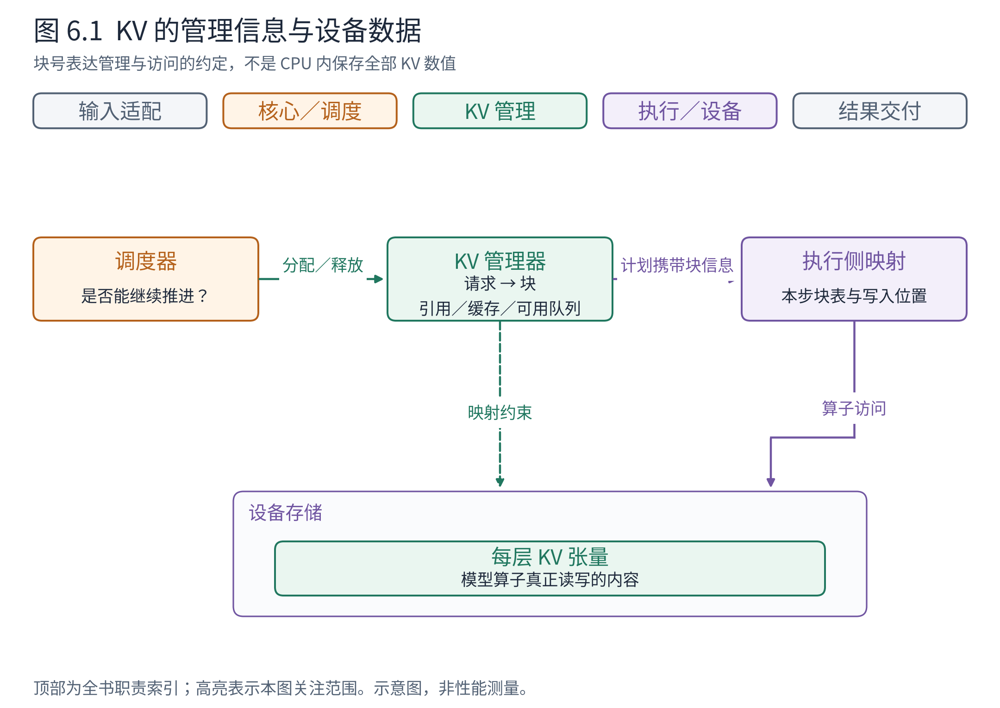
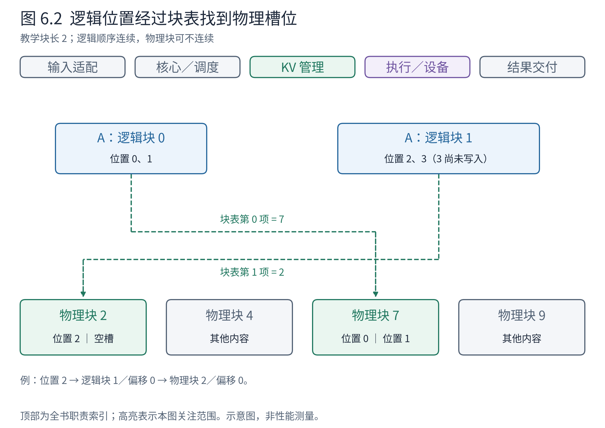
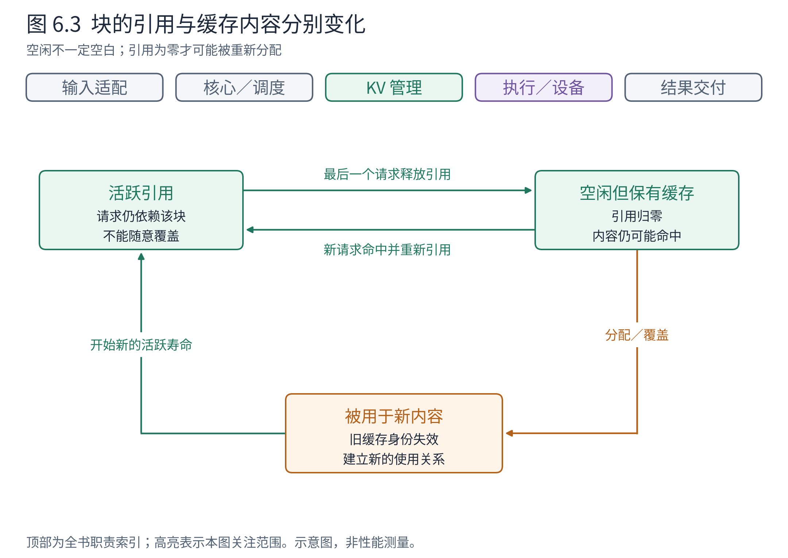

# 第 6 章 KV 管理：让状态跨越多次计算

调度器可以每轮重新组合请求，但模型的历史不能每轮丢失。A 与 B 共享模型权重，却各自带着不同的 KV；A 结束后，B 的历史必须继续存在。正是这些跨越多轮的状态，使推理系统不同于一次输入、一次输出的普通批处理程序。

Book6 已解释分页存储和前缀缓存为什么有用。本章把它们放回 vLLM 的责任边界：谁知道块属于谁，谁存储张量，谁将逻辑 token 位置变成设备可访问的位置，以及释放与复用怎样同时成立。

## 6.1 同一份 KV，有管理关系也有数据本体

**KV 管理器**负责回答请求持有哪些块、还能分配多少、哪些内容可复用。**执行侧**负责按照计划访问和更新设备上的 KV 张量。二者通过块标识、映射和缓存配置协作。



**图 6.1　KV 状态的两侧。** 上方绿色区域是核心侧的归属与分配信息，下方是执行侧的映射与设备张量；橙色调度器查询资源，紫色执行层读写数据。虚线表示映射关系，实线表示调用或数据处理。依据 v0.30.0 KVCacheManager、BlockPool、SchedulerOutput 与执行层，先限于完整注意力的分页情景。

读图时不要把“请求 A 指向块 7”理解成“CPU 对象里存有块 7 的全部 K、V 数值”。块号是管理与访问之间的一种约定。真正计算时，执行侧需要结合每层缓存、块表和后端布局找到数据。

这样的分工让调度器能以较小的管理信息判断容量，无须为了排队决策搬运大张量。但它也提出一致性要求：CPU 侧刚分给 A 的块，执行侧必须按同一映射写入；A 结束后，如果某个异步操作仍在使用该块，就不能提前把它无条件覆盖成 B 的内容。第 9 章会再次讨论这类寿命约束。

## 6.2 连续的 token 历史，为什么可以放在不连续的块里

本章为了把块内偏移画清，把第 1 章的教学块长 4 改为 2；它是独立的映射示例，不是运行中修改同一块池。假设每个教学块容纳 2 个 token。A 有 3 个已处理 token，则需要两个逻辑块：第一个容纳位置 0、1，第二个容纳位置 2，并留一个槽位。逻辑块可以映射到物理块 7、2，无须在设备池中连续。



**图 6.2　逻辑块与物理块。** 上排按请求顺序排列，下面按物理块号排列，连线表示块表映射。例子块长为 2、块号为构造值；真实后端的块长与张量布局另有约束。依据 KV 管理和 Attention 元数据的共同契约，不表示整个缓存只有图中的几个块。

沿 A 的位置 2 读图：它属于逻辑块 1、块内偏移 0；块表告诉我们逻辑块 1 对应物理块 2，所以访问物理块 2 的第一个槽位。位置 3 可以写入同一物理块的第二个槽位，而位置 4 才需要新的逻辑块与物理映射。

这个例子揭示了两个独立维度。模型看到的是按位置组织的因果历史；存储池提供的是可组合的物理块。分页使引擎无需提前为每条请求预留最大长度的一整段连续空间，也更容易回收、共享和重新分配。

代价则是映射和间接访问。Attention 后端不能只得到一个“请求的连续大数组”，还必须理解块表、长度和当前写入位置。后端可能采用不同物理布局，因此本章只确立逻辑契约，第 8 章再把它落实到 Attention 的输入。

块还有内部空隙。A 只有 3 个 token 时，第二块空一个槽位，这个槽位并不自动能分给任意其他请求。块大一些，管理条目可能更少，但最后一块可能浪费更多；块小一些，管理和后端支持成本可能上升。不能脱离硬件与实现任意选择教学例子里的块长。

## 6.3 分配、增长与释放是怎样一段生命周期

请求第一次被安排时，管理器确认可复用的部分并为新增工作准备块。之后请求继续增长，只有跨过相应边界或需要额外预留时，才需要追加分配。请求结束或被抢占时，则释放相关引用。

把本节的协作者明确到对象：Scheduler 持有一个 KVCacheManager。Scheduler 负责判断要推进多少 token，调用管理器申请位置；管理器维护分配与引用关系，返回 KVCacheBlocks 或分配失败。沿用本章块长 2 的设定，A 第一次处理 3 个提示词时，一次交接可以展开为：

```python
# Scheduler → KVCacheManager：request_a 是核心 Request 对象
allocated = self.kv_cache_manager.allocate_slots(
    request=request_a, num_new_tokens=3,
)
# 成功返回对象的结构视图；块号为教学构造
KVCacheBlocks(blocks=(
    [KVCacheBlock(block_id=7, ref_cnt=1),
     KVCacheBlock(block_id=2, ref_cnt=1)],
))
# Scheduler 从返回对象提取可传给执行层的块号
allocated.get_block_ids()  # ([7, 2],)
```

KVCacheBlocks 在核心侧装的是块管理对象，`get_block_ids()` 才将它们转为按 KV 组排列的整数列表元组。Scheduler 将这份块号放入 NewRequestData，交回 EngineCore，再由 Executor 传给执行侧；Runner 取得的是访问位置，不需要共享 CPU 上的引用计数对象。接口定义见 [KVCacheBlocks](https://github.com/vllm-project/vllm/blob/ced6857afa0ea7b2e3f0846a62e1394e90f15607/vllm/v1/core/kv_cache_manager.py#L35) 和 [KVCacheBlock](https://github.com/vllm-project/vllm/blob/ced6857afa0ea7b2e3f0846a62e1394e90f15607/vllm/v1/core/kv_cache_utils.py#L176)。

A 下一轮只增长到第 4 个位置时，原有块足够，分配接口可以成功返回没有新增块的 `KVCacheBlocks(blocks=([],))`，其块号视图为 `([],)`；容量不足才返回顶层 `None`。调度器必须区分“无需新增，继续使用旧块”和“无法分配，本轮不能照此推进”。结束时调用 `kv_cache_manager.free(request_a)`，移交的是请求身份及其管理状态，而不是要求模型执行一次张量清零。

“释放”最容易被误解。它通常不表示立刻清零每个设备字节，也不表示把整段设备内存归还给通用内存分配器。启动时建立的池仍然存在；变化的是其中某些块不再被这个请求持有。



**图 6.3　块的生命周期。** 图按是否被请求引用、是否仍保有可识别的缓存内容区分状态。引用归零后可进入空闲队列，内容仍可能命中；若块被改用于新内容，则旧缓存身份必须失效。依据 v0.30.0 BlockPool 的引用、缓存索引和分配／释放逻辑。省略空块哨兵及特殊缓存类型。

一个具体过程是：A 持有块 7，引用计数为 1；另一个请求 D 命中并共享它，引用变为 2；A 结束后变为 1，块仍不能被覆盖，因为 D 还依赖它；D 也结束后变为 0，该块可用于后续分配。若其缓存内容仍有效，新的请求还可能重新引用它。

因此，两个判断必须分开：**当前有没有请求使用这块，以及这块里是否仍有可复用内容。** “空闲”不一定“空白”，“缓存命中”也不一定需要额外复制一整块内容。

实现为了减少管理开销，可以把这些信息放在紧密协作的对象与队列中；教学上分开它们，是为了让读者在看到 ref count、free queue、hash map 时知道各自在表达什么事实。

## 6.4 前缀复用怎样保持正确

两条请求文本相似，不足以证明其 KV 可以共享。对于因果注意力，同一个 token 放在不同历史后面，会得到不同状态；模型、适配器以及其他影响输入或计算的条件也需要兼容。

vLLM 的前缀缓存使用块级身份，把当前块的内容与此前上下文联系起来，并纳入必要的额外信息。这样寻找的是同一计算前缀的可复用状态，而不是仅凭某几个 token 相同就共享。具体哈希与附加键属于版本化实现，理解原则后再去章末导航查看。[官方前缀缓存设计](https://docs.vllm.ai/en/v0.30.0/design/prefix_caching/)

继续使用块长 2 的构造例。此前请求处理过 `[11,12,21,22]`，两块 KV 仍可复用。新请求 U 的提示词是 `[11,12,21,22,31]`。若计算条件一致且查找命中，前四个 token 可由两块已有状态代表；U 仍需处理最后的 `31`，取得自己的首个输出。复用节省的是重复前缀的计算，不是免除后续所有计算。

Scheduler 先向 KVCacheManager 查询历史命中；两者仍分别负责推进决策与状态位置。读取锚的查询返回三项，不能只看一个命中长度：

```python
cached_blocks, hit_tokens, shared_boundary = (
    self.kv_cache_manager.get_computed_blocks(request_u)
)
# 本例条件下的返回视图
cached_blocks.get_block_ids()  # ([7, 2],)
hit_tokens                    # 4
shared_boundary               # 0：本例无稀疏保留组的共享边界需求

# 查询之后再申请最后一个待处理位置，接纳命中的块
self.kv_cache_manager.allocate_slots(
    request=request_u, num_new_tokens=1,
    num_new_computed_tokens=hit_tokens,
    new_computed_blocks=cached_blocks,
)
```

查找让 Scheduler 知道“已有四个位置可以复用”，分配才进一步落实本次使用关系和新增空间。只有这两次交接完成，Scheduler 才能在计划里把 U 的计算起点设到复用前缀之后。返回值依据 [KVCacheManager.get_computed_blocks](https://github.com/vllm-project/vllm/blob/ced6857afa0ea7b2e3f0846a62e1394e90f15607/vllm/v1/core/kv_cache_manager.py#L265)；块号与命中内容仍是构造例。

即使提示词完全命中，也不能简单宣称首 token 零前向。KV 不是最后位置的 logits。固定源码的普通查找路径会限制可复用长度，为取得输出所需信息保留重新计算的部分，还可能受块对齐影响。把缓存看成“历史状态复用”就能自然理解这一点；把它看成“整个回答缓存”则会得出错误结论。

共享还要求写入边界清楚。已计算的公共前缀可以被多个请求读取，各自新生成的后缀必须有正确的独立状态安排。不能把一个请求继续增长，理解为允许它随意改写另一请求仍在使用的公共历史。

## 6.5 为什么缓存命中率不能独自解释系统性能

缓存首先改变的是新增计算和新增状态需求。它是否明显改善整体体验，还取决于请求是否真的共享长前缀、这些块是否仍驻留，以及系统当前瓶颈在哪里。若主要时间花在后续长解码，减少少量重复 prefill 的作用可能有限。

缓存还要面对容量竞争。保留的内容有价值，但运行中的请求需要增长空间；空闲缓存块可以被淘汰以满足新分配。所有引用和缓存选择最终都要反馈给调度器：某请求能否入场，是否需要抢占，以及恢复时要重做多少工作。

本章的简化页模型针对普通完整注意力。滑动窗口只需保留部分历史，循环状态模型可能保存压缩状态，不同层也可能采用不同规格。vLLM 用缓存规格和分组等机制协调这些差异；第 11 章说明它们改变哪些架构条件，具体算法交给 Book8。

回到整机，KV 管理使多轮执行可以连续，也使不同请求的资源可以周转。调度器决定谁推进，管理器保证状态有合法位置，执行层真正读写这些位置。下一章就从这份已经合法的计划出发，看看它怎样变成连续张量、一次模型前向和正确归属的输出。

## 章末源码导航

先找清“命中、分配、引用、回收”四种动作，再研究特殊缓存分组。

<!-- NAVIGATION -->

| 要回答的问题 | 固定版本入口 | 读到哪里即可停止 |
|---|---|---|
| 哪些历史可以命中？ | [KVCacheManager.get_computed_blocks](https://github.com/vllm-project/vllm/blob/ced6857afa0ea7b2e3f0846a62e1394e90f15607/vllm/v1/core/kv_cache_manager.py#L265) | 看查找条件、命中长度和返回值 |
| 新增工作如何取得块？ | [KVCacheManager.allocate_slots](https://github.com/vllm-project/vllm/blob/ced6857afa0ea7b2e3f0846a62e1394e90f15607/vllm/v1/core/kv_cache_manager.py#L370) | 辨认需求、可行性与分配结果 |
| 块被重新使用时发生什么？ | [BlockPool.get_new_blocks](https://github.com/vllm-project/vllm/blob/ced6857afa0ea7b2e3f0846a62e1394e90f15607/vllm/v1/core/block_pool.py#L664) | 看空闲队列和旧缓存身份处理 |
| 释放为何不等于擦除？ | [BlockPool.free_blocks](https://github.com/vllm-project/vllm/blob/ced6857afa0ea7b2e3f0846a62e1394e90f15607/vllm/v1/core/block_pool.py#L770) | 看引用变化与回空闲队列 |
