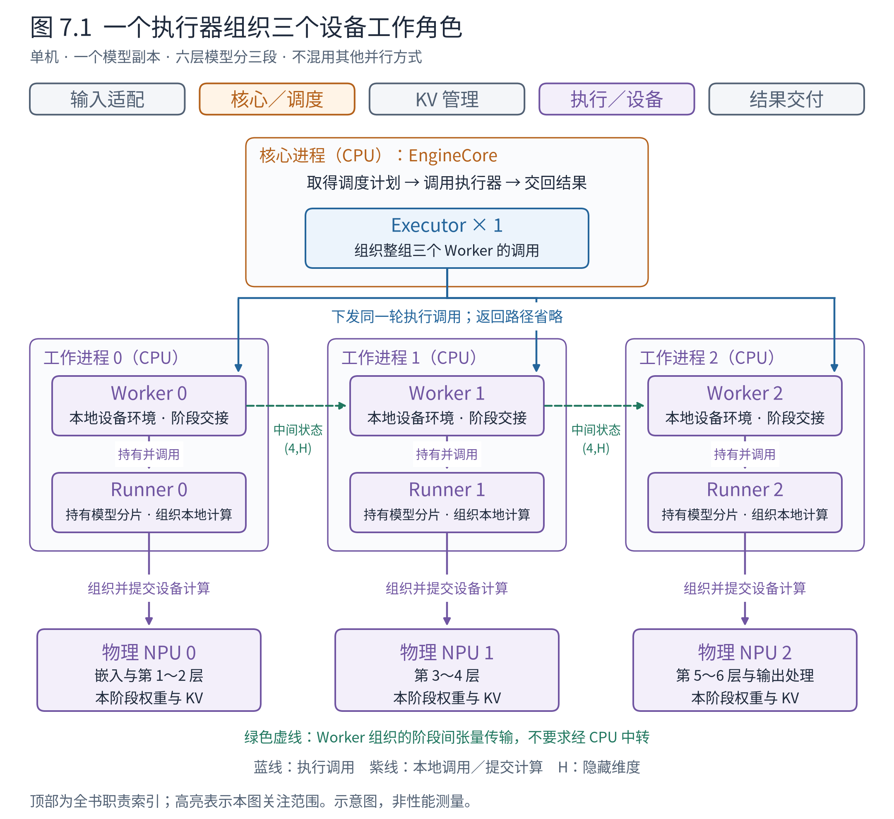
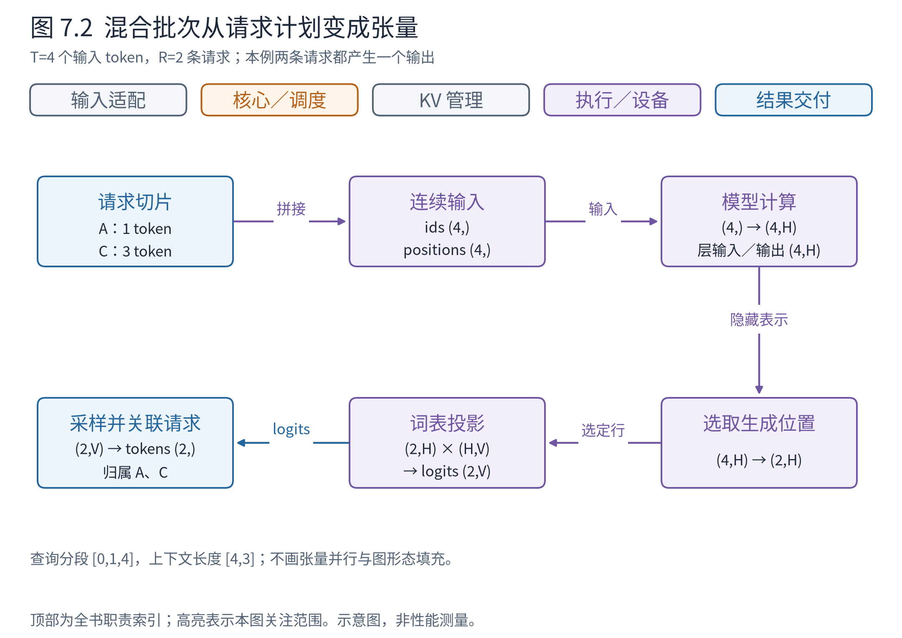
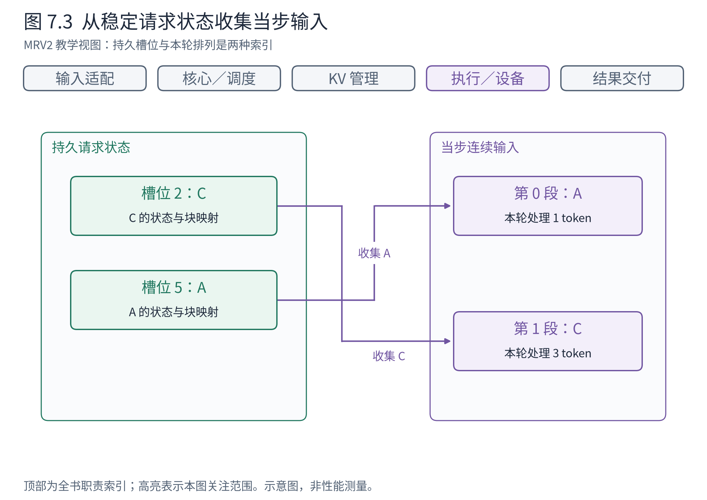
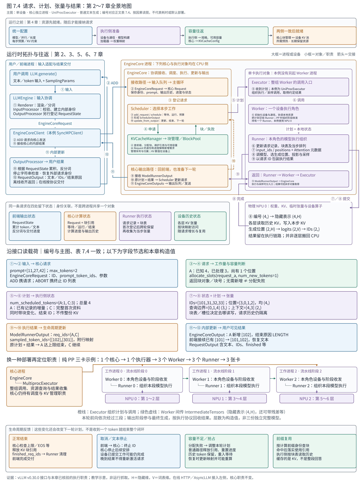

# 第 7 章 执行层：把调度决定变成模型计算

现在调度器已经决定：本步推进 A 的一个 token，同时处理 C 的三个提示词 token；KV 管理器也给出了合法的存储安排。设备却不能直接执行一句“让 A 和 C 各向前走一点”。它需要具体的输入编号、位置、张量、映射，以及适合当前后端的计算形态。

执行层承担这种翻译。它把请求世界中的计划，转换为模型世界中的计算，再将输出转回请求世界。若只把它理解成“调用 model.forward”，就会漏掉批次组织、持久状态、采样与结果归属这些同样关键的工作。

## 7.1 三个执行角色，各自靠近什么问题

一份计划要变成计算，先要找到执行它的设备与工作单元，再把请求状态整理成模型输入。**执行器（Executor）**封装整组工作单元的调用，**工作单元（Worker）**代表其中一个使用本地设备的执行角色，**模型运行器（Model Runner）**组织这个角色承担的模型计算。三者是不同对象，覆盖的范围也不同。

先用一幅具体拓扑把范围画出来。假设单机运行一个模型副本，模型有六个 Transformer 层，分到三张 NPU 上：第 1～2 层在卡 0，第 3～4 层在卡 1，第 5～6 层在卡 2。这种沿层序分段的方式称为**流水线并行（pipeline parallelism，PP）**，每段称为一个阶段。这里的阶段是模型的一段，不是第几轮生成；一次前向仍须依次经过三段。本例采用多进程执行器，暂不混用其他并行方式，层数和设备安排均为教学构造。



**图 7.1　从核心到三张设备的执行拓扑。** 蓝色实线表示执行调用，紫色实线表示本地调用或提交计算，绿色虚线表示 Worker 组织的阶段间张量传输；返回路径省略。进程框内均为 CPU 上的软件对象，底部才是物理设备。中间状态的隐藏表示为 `(4,H)`：沿用章首 A、C 共四个输入位置，H 为隐藏维度；实际传输还可包含同形状的残差状态，图中合并表示。依据 v0.30.0 Executor、Worker 与分段模型的协作关系，以 NPU 示意，非硬件实测；虚线不表示张量必须经 CPU 中转。

从上往下读，EngineCore 持有调度器与一个 Executor；Executor 对接三个 Worker；每个 Worker 持有一个 Runner，并使用一张卡。Runner 持有本角色的模型分片，组织对应层段的计算。数量关系与各自的工作对象可以合在一起看：

**表 7.1　三卡流水线例子的对象与设备对应关系**

| 对象或设备 | 数量 | 直接关联 | 负责的范围与具体工作 |
|---|---:|---|---|
| EngineCore | 1 | 调度器、一个 Executor | 串起一轮：取得调度计划，调用执行器，把结果交回调度器更新 |
| Executor | 1 | 三个 Worker 的调用入口 | 面向整组工作单元：组织启动、下发执行调用、取得结果并报告执行失败 |
| Worker | 3 | 各持有一个 Runner，各使用一张卡 | 面向本地设备与自身并行角色：初始化环境、组织资源准备、接收和发送阶段间数据 |
| Runner | 3 | 各持有本阶段模型及执行状态 | 面向本地模型运行：更新请求状态、准备输入与元数据、调用模型、整理本阶段输出 |
| 物理 NPU | 3 | 各由相应 Worker 使用 | 存放本阶段权重与 KV，执行提交的算子 |

沿一次启动看分工：多进程 Executor 建立三个工作进程，传入角色编号与配置，等待它们就绪。每个 Worker 选择自己的设备、建立所属通信环境并创建 Runner，再通过 Runner 加载对应模型分片、准备执行资源。Executor 管的是这一组工作单元能否被正确调用；Worker 落实的是自己这个角色能否在本地运行。因此不是每张卡各配一个 Executor，而是本例的一个 Executor 组织三张卡上的三个 Worker。

再沿一次计算看两种交接。EngineCore 将调度计划交给 Executor，Executor 把 `execute_model(plan)` 调用送到三个 Worker。这条调用链传的是“本轮执行什么”；模型前一段算出的数值，则沿 Worker 之间的通信路径传递。Worker 1 即使已经收到执行调用，也必须取得 Worker 0 的计算结果，才能继续自己的层段。

例如 Runner 0 组织第 1～2 层计算，得到隐藏表示 `(4,H)`；Worker 0 将中间状态发给 Worker 1。Worker 1 接收后，把计划与中间状态一同交给 Runner 1，后者组织第 3～4 层计算，仍得到 `(4,H)` 的隐藏表示。Worker 1 再把结果发给 Worker 2，由最后一段衔接最终输出处理。各 Transformer 层在这里都保持 `(4,H) → (4,H)`，数值随计算变化。Worker 还要跟踪未完成的发送，避免下一轮提前覆盖仍被通信使用的缓冲区；Executor 则按输出协议取得本轮结果，交回核心。执行与采样可以分为两次方法调用，不要求一次 `execute_model` 就返回生成 token。

由此也能看清两个边界。Executor 不逐层中转隐藏表示；Worker 也不决定本轮选择 A 还是 C，那已经由调度器决定。Runner 可以不亲自收发流水线数据，但仍须知道自己负责哪一段：首段接收 token 编号并做嵌入，中间段接着处理隐藏表示，末段衔接最终输出。若再使用张量并行，模型层或算子还可能发起通信，不能把所有跨卡操作都归入 Worker。组织调用与阶段交接分别可对照 [MultiprocExecutor.execute_model](https://github.com/vllm-project/vllm/blob/ced6857afa0ea7b2e3f0846a62e1394e90f15607/vllm/v1/executor/multiproc_executor.py#L340) 和 [Worker.execute_model](https://github.com/vllm-project/vllm/blob/ced6857afa0ea7b2e3f0846a62e1394e90f15607/vllm/v1/worker/gpu_worker.py#L1149)；后者为上游 GPU 实现入口。

回到第 3 章的单卡配置，这个拓扑就收缩为一个 Executor、一个 Worker、一个主 Runner 和一张卡；采用 UniProcExecutor 时，调用还可以发生在同一进程内。没有相邻模型阶段，Worker 的当步方法可能主要委托 Runner，但设备初始化与资源准备仍由它承接。Ascend 路径中的具体类是 NPUWorker 和 NPUModelRunner；上游 GPU 路径对应 Worker 和 GPUModelRunner。第 10 章再展开多设备策略，下面回到单卡，打开 Runner 收到的计划，看它怎样从已有状态中准备本轮输入。

## 7.2 同一条请求，第一轮与第二轮分别传什么

沿上一节的调用链，Scheduler 产生本轮计划 SchedulerOutput，EngineCore 将它交给 Executor，经 Worker 送到 Runner。同一条请求会连续参与多轮计算，Runner 也会跨轮保存它的状态。因此，第一轮需要登记请求，第二轮就可以利用已有记录，只传变化与当步安排。

单独观察 A：提示词为 `[11, 27, 42]`，最多生成 2 个 token。采用单卡、普通文本生成，不启用前缀复用、投机、流水线并行或异步调度；A 连续参加两轮，中间没有抢占。沿用每块容纳 4 个位置的教学设定，块号在本例中取 7。下面的计划只展示 A，编号和输出均为构造值，字段节选不是可直接运行的完整构造代码。

第一次安排 A 时，Runner 尚未登记它。调度器既要传“这是谁、提示词是什么、怎样采样、KV 写到哪里”，也要传“此前处理了多少、本轮处理多少”：

```python
# 第一轮：首次登记 A，并安排处理三个提示词 token
SchedulerOutput(
    scheduled_new_reqs=[NewRequestData(
        req_id="A",
        prompt_token_ids=[11, 27, 42],
        sampling_params=SamplingParams(temperature=0, max_tokens=2),
        block_ids=([7],),
        num_computed_tokens=0,
        # 其他首次信息省略
    )],
    scheduled_cached_reqs=CachedRequestData.make_empty(),
    num_scheduled_tokens={"A": 3},
    total_num_scheduled_tokens=3,
    # 其他计划字段省略
)
```

Runner 收到后建立 A 的记录，保存提示词、采样参数与块映射，再组织三个输入位置的计算。假设首个输出为 `101`，本例路径还会保留这个采样结果，供下一轮使用。与此同时，设备上块 7 的前三个槽位已有提示词的 KV，第四个槽位尚未写入。第一轮结束后的执行侧可以分成两部分看：

```text
Runner 保留的请求信息与执行状态：
    A 的提示词       [11, 27, 42]
    A 的采样参数     temperature=0，max_tokens=2
    A 的已有块映射   [7]
    上一轮采样结果   101

设备上的块 7（每块四个位置）：
    [11 的 KV] [27 的 KV] [42 的 KV] [尚未写入]
```

这里传递的是块号，KV 数值由模型计算产生并留在设备上。一轮调用结束后，请求记录、块映射和设备 KV 都不会因此自动清空。

第二轮继续 A 时，Runner 已经认识这条请求。此时只需告诉它：A 已处理前三个位置、已生成一个输出，本轮再处理一个位置，块映射没有新增项：

```python
# 第二轮：更新已登记的 A，安排处理上一轮生成的 token
SchedulerOutput(
    scheduled_new_reqs=[],
    scheduled_cached_reqs=CachedRequestData(
        req_ids=["A"],
        resumed_req_ids=set(),       # 本轮没有从抢占中恢复的请求
        num_computed_tokens=[3],
        num_output_tokens=[1],
        new_block_ids=[None],       # A 无新增块，保留已有映射
        new_token_ids=[],           # 此路径不必重新传回 101
        all_token_ids={},           # 不必补发完整 token 序列
    ),
    num_scheduled_tokens={"A": 1},
    total_num_scheduled_tokens=1,
    # 其他计划字段省略
)
```

Runner 用请求 ID 找到 A 的已有记录：下一输入是保留的 `101`，它位于序列位置 3；历史 KV 在块 7 的前三个槽位，新 KV 可以写入第四个槽位，采样继续使用原来的参数。这样，第二轮消息虽然没有重新携带提示词和 `101`，执行侧仍能准备完整的模型输入，再选出第二个输出，例如 `102`。

**表 7.2　A 的两轮计划：哪些重传，哪些沿用**

| 信息 | 第一轮 | 第二轮 | 第二轮仍能取得信息的原因 |
|---|---|---|---|
| 请求 ID | 发送 `"A"` | 仍发送 `"A"` | 用它找到要更新的记录 |
| 完整提示词 | 发送 `[11,27,42]` | 不重传 | Runner 已保存 |
| 采样参数 | 发送 | 不重传 | 已保存，本例没有变化 |
| 完整块映射 | 发送 `[7]` | 只说明没有新增块 | 原有映射仍保留 |
| 上一轮输出 `101` | 尚未产生 | 不经核心传回来 | Runner 自己采样得到并保留 |
| 已处理进度／已生成数量 | 首次登记时建立初始状态 | 发送 3／1 | 同步本轮开始前的进度 |
| 本轮处理数量 | 发送 3 | 发送 1 | 每轮都需要明确安排 |

所以，`new_token_ids=[]` 表示消息没有重传 token ID，不表示模型没有输入；`new_block_ids=[None]` 表示 A 无新增块，不表示它没有 KV 空间。第 5 章的 `cached_ab` 就是按同样规则把 A、B 的更新放进一个 CachedRequestData，各列表按 `req_ids` 的顺序对应。这些请求信息已经保存在执行侧，“cached”在这里也不等同于前缀 KV 命中。字段与发送条件见 [NewRequestData](https://github.com/vllm-project/vllm/blob/ced6857afa0ea7b2e3f0846a62e1394e90f15607/vllm/v1/core/sched/output.py#L37)、[CachedRequestData](https://github.com/vllm-project/vllm/blob/ced6857afa0ea7b2e3f0846a62e1394e90f15607/vllm/v1/core/sched/output.py#L131) 和 [Scheduler._make_cached_request_data](https://github.com/vllm-project/vllm/blob/ced6857afa0ea7b2e3f0846a62e1394e90f15607/vllm/v1/core/sched/scheduler.py#L1613)。

这些跨轮保留的执行侧记录称为**持久状态（persistent state）**；这里的“持久”是相对于一轮计算而言，并不表示写入磁盘或永不释放。省去重复传输的前提，是接收方仍持有正确状态。请求结束要通知清理，抢占恢复要按协议更新块映射；同步流水线并行等路径还可能需要重新传回生成 token，不能把本例的空列表推广到所有配置。

下一节回到 A 第二轮开始前，再加入一条新请求 C，看看“沿用 A 的记录、首次登记 C”怎样共同形成一批模型输入。那里 C 的提示词长 3，是本章的局部快照，不接作第 5 章 7-token C 的下一轮。

## 7.3 一批长短不同的请求如何变成连续张量

我们使用一个完整的小例子。A 已处理 3 个提示词 token，并已生成第一个输出；本轮要将这个输出作为新输入。新请求 C 的提示词长 3，本轮一次处理完。两者都不投机，也没有额外输出要求。于是本步输入 token 总数为 4，但参与请求数是 2。

为了方便设备计算，输入可以按当步顺序拼成连续序列。令 A 的新增输入 a=101，C 的提示词 c0、c1、c2 分别为 31、32、33。Runner 整理好数据后，在普通文本、非 PP、即时执行路径下交给模型对象的主要参数是：

```python
# Runner → 模型对象：device 表示本例选定的执行设备
input_ids = torch.tensor([101, 31, 32, 33], device=device)  # (4,)
positions = torch.tensor([3, 0, 1, 2], device=device)       # (4,)
# 模型调用关键参数节选；Attention 元数据另由执行上下文提供
hidden_states = model(input_ids=input_ids, positions=positions)
# hidden_states: (4, H)
```

Runner 负责把请求与持久状态整理成这些参数；模型对象负责按网络结构完成前向计算。形状由 `(4,)` 的输入编号，经嵌入变为 `(4,H)`，各层继续处理 `(4,H)`；采样在后续环节进行。数字是教学构造，参数名可对照 [LlamaForCausalLM.forward](https://github.com/vllm-project/vllm/blob/ced6857afa0ea7b2e3f0846a62e1394e90f15607/vllm/model_executor/models/llama.py#L534)。A 的位置 3 接续历史，C 从 0 开始；拼接后的行号没有取代各自的序列位置。



**图 7.2　两条请求、四个输入 token。** 从左到右读请求切片、连续输入、模型隐藏表示、选取输出位置与采样。图中总 token 数 T=4，请求数 R=2，隐藏维 H、词表维 V 保持符号表示。示例为普通文本生成的逻辑数据流，未画并行分片和图执行填充；依据 SchedulerOutput 与执行层输入／采样接口。

仅有输入编号还不够。执行侧还需要知道第一段属于 A，第二段属于 C。查询起始位置可以表示为 `[0,1,4]`，形状为 `(R+1,)=(3,)`：A 占 `[0,1)`，C 占 `[1,4)`。本步之后的上下文长度为 `[4,3]`，形状为 `(R,)=(2,)`。再结合块表和写入槽位，Attention 才能分别读取 A 的历史与 C 的当前提示词。

**表 7.3　从输入到输出的关键形状（教学逻辑视图）**

| 环节 | 输入 | 输出 | 需要注意的边界 |
|---|---|---|---|
| 输入嵌入 | token 编号 `(T,)` | 隐藏表示 `(T,H)` | T 是本步 token 总数，不是请求数 |
| 模型层 | 隐藏表示 `(T,H)` 与位置／状态元数据 | 隐藏表示 `(T,H)` | 不同请求的注意力历史必须隔离 |
| 选取生成位置 | 全部隐藏表示 `(T,H)` | 待采样隐藏表示 `(R,H)` | 本例选 A 的一行和 C 最后位置的一行 |
| 词表投影 | `(R,H)` 与逻辑权重 `(H,V)` | logits `(R,V)` | 真实实现可融合或分片，本表为完整逻辑形状 |
| 采样 | logits `(R,V)` 与逐请求参数 | 新 token 编号 `(R,)` | 本例每请求产生一个新 token |

这里 R 恰好等于 2，是因为两条请求本轮都来到一个生成位置。如果 C 只是长提示词的中间块，就不应直接把每条参与请求都当作有用户输出；投机验证也可能改变候选位置数量。表格不是所有模式的万能形状，而是帮助读者看懂“输入总数”和“输出行数”为何不同。

连续张量也不意味着历史混在一起。请求边界、上下文长度与块表共同决定每个 query 可以看到的状态。真正高效的执行往往需要把这些逻辑关系转成紧凑的元数据，这也是下一章的主题。

## 7.4 持久位置与当步排列为什么要分开

若 A 的状态长期放在槽位 5，而本步 A 排在批次第 0 行，这两者是否矛盾？没有。持久槽位回答状态存在哪里，当步行号回答本轮如何组织计算。只要保留正确映射，就可以从稳定的状态位置收集出本轮连续输入。



**图 7.3　状态槽位与当步输入。** A、C 在持久表中分别占用构造槽位 5、2，本轮按 A、C 排列；连线表示收集而非迁移请求身份。依据官方 Model Runner V2 设计与 v0.30.0 对应实现，是对 MRV2 设计的示意，不表示所有 Runner 都使用同样布局。

官方 MRV2 设计将持久状态与当步输入进一步分开，使请求在活跃期拥有稳定位置，按本轮顺序收集需要的数据。这有助于减少为了满足输入排列而反复重排整个状态表。收益来自避免重复整理，成本则是多一层索引与收集，且需要管理加入、离开、抢占后的槽位寿命。[Model Runner V2 设计](https://docs.vllm.ai/en/v0.30.0/design/model_runner_v2/)

这也是为什么本书先讲职责，再讲实现代际。v0.30.0 同时存在两代 GPU Runner，它们在状态布局与组织方式上有差异，但都要完成计划到计算的翻译。NPU 插件还可以选择自己的实现。看到 MRV2 的一个优化，不能立即把它当作当前 NPU 运行路径的事实。

## 7.5 前向、采样与回传构成怎样的闭环

模型前向给出可用于选择后续 token 的信息，采样依据每条请求的生成参数作出选择。输出还要附带能让核心识别请求与更新进度的信息。核心据此判断下一轮安排；前端则把新 token 转成用户结果。

这条逻辑链可以由不同方法和异步返回对象实现。固定源码中的部分 Runner 将执行与采样分成入口，某些模式还包含投机验证、流水线中间张量和远端传输。因而不应把“执行层返回结果”理解成所有 Worker 都各自独立采样并向用户发文本。

回到本例，输入的四行计算最终对应 A、C 各一个新 token。执行侧必须记得这两个结果的请求归属，即使本步顺序与上一步不同。A 若因此达到输出上限，核心下一轮就不再安排 A，执行状态也会随终止信息清理。返回不是调用链的尾声，而是下一轮决策的输入。

例如从模型隐藏表示 `(4,H)` 中取第 0、3 行，得到 `(2,H)`，再经词表投影与采样，假设得到 A 的 102、C 的 301。Runner 向执行组织返回的对象可以展开为：

```python
ModelRunnerOutput(
    req_ids=["A", "C"],
    req_id_to_index={"A": 0, "C": 1},
    sampled_token_ids=[[102], [301]],
)
```

这是经过主机侧结果整理后的列表视图，不能据此推断设备内部采样张量也采用嵌套 Python 列表。Executor 将结果交回 EngineCore，EngineCore 再调用 Scheduler 的 `update_from_output(plan, result)`。Runner 给出“谁产生了哪些 token”，Scheduler 判断“谁达到上限、下一轮还算谁”；前端随后才接收 EngineCoreOutputs 并反分词。结构见 [ModelRunnerOutput](https://github.com/vllm-project/vllm/blob/ced6857afa0ea7b2e3f0846a62e1394e90f15607/vllm/v1/outputs.py#L324)。

执行层至此完成了一轮翻译：依据合法计划和持久状态准备输入，调用模型及后端，再将结果交回请求生命周期。现在把镜头拉远，将这轮计算接回第 2 章的入口和出口，就能看见前六章逐段展开的完整系统。

## 7.6 阶段回望：从请求进入到结果交付的全景地图

一条请求走过系统，并不是同一个对象从头传到尾。文本先变成核心请求，核心请求参与调度后变成当步计划，计划与执行侧保留的状态一起变成张量；设备计算得到的新 token 又经过核心更新和前端处理，才成为用户结果。每次交接都改变了表示，也把下一项责任交给了另一个对象。

图 7.4 将第 2～7 章放回同一张地图。先沿主图的编号看一次往返，再读下方的交接内容；最后用启动、三卡拓扑和生命周期三个区域检查主线成立的条件。主图选择**单设备、核心独立进程、UniProcExecutor、普通文本生成**，按完成一轮再解释下一轮的顺序展开；它是职责与因果地图，不是设备耗时图，也不表示每支箭头都对应一次同步函数返回。三卡区域是另一种部署，不与主图混算进程数量。



**图 7.4　请求、计划、张量与结果的完整往返。** 大框标运行位置，小框标对象及职责；编号箭头与表 7.4 对应。蓝色为入口和交付，橙色为核心决策，绿色为 KV 管理，紫色为执行；虚线用于生命周期反馈或流水线阶段通信，含义在所在区域注明。主图中 Worker 与 Runner 都是核心进程中的 CPU 对象，NPU 单独画在设备区。下方三卡例子则采用 MultiprocExecutor，每个 Worker 在独立工作进程中。来源为 vLLM v0.30.0 的前端、EngineCore、Scheduler、KVCacheManager 和执行接口，以及本章已经核验的 Ascend 执行职责；数值沿用本章教学构造，非运行抓取。可打开 [SVG 矢量原图](figures/fig-7-4-panorama.svg) 放大查看；可编辑图源 `render_full_figures.py` 中的 `ch7_panorama()` 保存全部布局与文字，随本书制图工具一同提供。

### 7.6.1 先认位置：谁拥有对象，谁真正执行计算

主图左侧是用户与前端进程。`LLM.generate()` 承接离线调用，LLMEngine 协调输入处理、核心客户端与输出处理。Renderer 和 InputProcessor 把用户输入整理成可计算的请求；OutputProcessor 保留反分词和交付状态。它们关心输入是否合法、结果属于谁以及何时可以交付，不负责决定设备本轮算哪几条请求。

中间与右侧共处一个 EngineCore 进程。EngineCore 持有 Scheduler 和 Executor，Scheduler 持有 KVCacheManager；本例的 UniProcExecutor 通过 Worker 包装层组织一个 Worker，Worker 持有一个 Runner。因而，**一个核心、一个执行器、一个 Worker、一个 Runner、一张物理卡，是五个不同层次的对象与资源，并不是五个进程。** 核心进程里的接收线程、输入队列、主循环和发送路径，使“已经收到请求”与“本轮选择执行它”可以发生在不同时间。

EngineCore 的视野是一套计算请求的推进闭环：接收、调度、交给执行器、拿结果更新，再把内部输出送回前端。Executor 的视野是它管理的整组 Worker：启动时组织初始化和资源查询，运行时发起执行、采样等调用并收集约定的结果。Worker 的视野是一个设备执行角色及其通信关系：选设备、建立通信环境、协调本地资源，并把计划交给自己的 Runner；需要流水线通信时，还组织接收前段、发送后段的中间张量。

Runner 的视野是这个角色承担的模型执行：保存请求记录、更新块表、组织输入与 Attention 元数据、调用模型、处理采样和输出归属。Runner 与模型的 Python 对象仍在 CPU 侧；权重、KV 数据、设备张量和提交后的算子位于 NPU。图中的“Runner 到卡”因此展开为模型与后端调用、张量准备和算子提交；“卡返回”则表示计算结果完成后可供后续步骤使用，不表示每层都把隐藏张量复制回 CPU。

图的三卡区域把同一组职责换一种放置方式：一个 EngineCore 持有一个 MultiprocExecutor，后者组织三个工作进程；每个进程一个 Worker、一个 Runner，分别使用一张 NPU。六层模型按两层一段分开，同一份当步安排由 Executor 组织各角色执行，隐藏表示沿阶段顺序流转。**执行器组织整组调用，Worker 组织其角色所需的阶段交接，Runner 组织本阶段计算。** 图中只画纯流水线并行；张量并行的层内通信还可由模型层和后端发起，不能据此认为 Runner 所调用的计算完全不涉及跨卡协作。

### 7.6.2 再认交接：同一条请求怎样逐次换一种表示

沿图中编号走一遍，最值得检查的不是函数名有多少，而是接收方凭什么能够继续工作。下面沿用 A 的提示词 `[11,27,42]`、生成上限 2，以及本章局部快照中的 C；A、C 是内部请求 ID 的简写。表中列出关键字段，不是完整消息 schema。

**表 7.4　全景图中的交接内容与接收方动作**

| 图中接口 | 生产者 → 接收者 | 交接的内容 | 接收后发生什么 |
|---|---|---|---|
| ① 用户输入 | LLM → LLMEngine 的输入处理组件 | 文本或 token 输入、SamplingParams、请求身份 | 渲染／分词、校验，建立内部 ID；输出侧另行登记 RequestState |
| ② 核心请求 | 前端 → EngineCoreClient → 核心接收路径 | ADD 消息中的 EngineCoreRequest：ID、`prompt_token_ids`、生成参数、客户端路由等 | 转为核心 Request，再经输入队列交给主循环；计算侧开始维护状态与进度 |
| ③ 登记与选取 | EngineCore → Scheduler | `add_request(request)`；每轮调用 `schedule(...)` | 请求进入等待集合，按策略、token 预算与活跃请求数等约束选择工作 |
| ④ 容量协商 | Scheduler ↔ KVCacheManager | `get_computed_blocks(request)` 查询可复用前缀；`allocate_slots(request, num_new_tokens, ...)` 申请位置 | 返回命中长度与块、可用的新块或分配失败；块号表示位置，块数才表示数量 |
| ⑤ 当步计划 | Scheduler → EngineCore → Executor | SchedulerOutput：新请求资料、已有请求增量、逐请求处理数量、块号、结束 ID 等 | 执行器组织相应 Worker 执行；计划不是用户原始文本，也不携带整份 KV 数值 |
| ⑥ 本地执行 | Executor → Worker → Runner | 计划及执行所需参数；PP 非首阶段另有 IntermediateTensors | Worker 协调本地执行和必要通信；Runner 更新已有记录，准备这一轮输入 |
| ⑦ 模型输入 | Runner → 模型／Attention 后端 | `input_ids`、`positions`、请求边界、上下文长度、块表和写入槽位 | 模型按结构计算；后端据边界分别读写各请求的 KV |
| ⑧ 设备计算 | 模型／后端 ↔ NPU | 设备张量、权重、KV、算子调用；本例隐藏表示 `(4,H)` | 完成前向，选取 `(2,H)` 的生成位置，得到 `(2,V)` 的 logits 并采样；逻辑新 token 形状为 `(2,)` |
| ⑨ 执行结果 | Runner → Worker／Executor → EngineCore | ModelRunnerOutput：`req_ids`、`req_id_to_index`、`sampled_token_ids` 等 | 核心取得按请求关联的新 token；必要时通过单独的 `sample_tokens(...)` 调用完成采样与结果收集 |
| ⑩ 生命周期更新 | EngineCore → Scheduler | `update_from_output(plan, result)`，同时提供原计划和执行结果 | 更新生成历史、校正进度、检查结束条件、释放结束请求的块引用，形成核心输出 |
| ⑪ 内部输出 | 核心输出路径 → 客户端 → OutputProcessor | EngineCoreOutputs 中的逐请求 EngineCoreOutput：ID、新 token、结束原因等 | 按前端 RequestState 累积结果、反分词、检查停止字符串并形成可交付结果 |
| ⑫ 用户结果 | 前端 → 调用者 | RequestOutput／CompletionOutput：文本、token IDs、结束原因等 | 离线 `generate()` 收齐整组结果再返回；在线则由协议层按相应策略交付 |

这十二次交接不是十二种相互独立的请求。身份把它们接在一起，接口则只传下一段所需的信息。例如 A 首次进入执行侧时带完整提示词和采样参数；下一轮只更新进度、当步数量及变化的块。单卡连续执行时，Runner 已保留自己采样的 101，所以它可以从旧记录与新计划恢复输入，不必让核心把整个历史再发一遍。这正是 7.2 节的首次登记与后续更新在全景中的位置。

返程也要经历三次不同的整理。ModelRunnerOutput 回答“计算产生了什么”；EngineCoreOutput 回答“这条请求新增了什么、是否结束”；RequestOutput 回答“调用者现在可以拿到什么”。它们既不相互等同，也不携带相同体积的数据。KV 留在设备池内，模型隐藏表示通常供执行侧继续使用，前端得到的是生成结果和生命周期信息。

### 7.6.3 沿 A 的第二轮走通去程与返程

现在将接口表代入本章已经算过的状态。A 已处理三个提示词位置，已生成 101，因而已知 token 共四个，计算进度为三个；两者之差为一个。Scheduler 还要结合预算和 KV 容量，才能决定本轮处理这个待推进位置。与此同时，新来的 C 有三个提示词 `[31,32,33]`。资源允许时，计划给 A 分配 1 个输入位置、给 C 分配 3 个，总量是 4。

Runner 收到 A 的增量和 C 的首次资料，组织出 `input_ids=[101,31,32,33]`、`positions=[3,0,1,2]`，形状均为 `(4,)`；查询边界为 `[0,1,4]`，形状为 `(3,)`，上下文长度为 `[4,3]`，形状为 `(2,)`。这些长度连同块表，将连续的输入张量解释成两条互相隔离的请求。以单个注意力头为例，A 的本轮 Q 形状为 `(1,d)`，历史与当前 K 的转置形状为 `(d,4)`，相乘得到 `(1,4)` 的分数；C 则由 `(3,d)` 的 Q 与 `(d,3)` 的 K 转置得到 `(3,3)` 的分数，并遵守因果可见性；d 为头维度。跨请求的分数没有语义，但这不要求先完整算完 A 再算 C：后端可以按请求、头和计算分块组织任务，实际执行并发由实现与硬件决定。

模型将四行输入变为 `(4,H)` 的隐藏表示，Runner 在生成路径选第 0、3 行，得到 `(2,H)`，再经词表投影得到 `(2,V)` 的 logits，采样出构造值 `[102,301]`。设备完成计算后，执行侧把这两个值关联回 A、C，经接口⑨送回核心；它不会直接给用户发送两段文本。

Scheduler 对照原计划和结果，知道 A 本轮推进一个位置且新增 102，C 本轮处理完三个提示词且新增 301。A 达到生成上限 2，结束并释放相应块引用；C 尚未结束，保留其状态供下一轮继续。前端收到 A 的新增 `[102]` 和长度结束原因，把它接到已有 `[101]` 后，形成含 `[101,102]` 的最终结果。若这次离线调用还有未完成请求，外层调用继续收集，直到整组完成才返回。

沿这条路径反看图，Scheduler 处理的是请求和预算，KVCacheManager 处理的是块归属与容量，Runner 处理的是批次和张量，设备处理的是数值运算，OutputProcessor 处理的是文本和交付。一个生成 token 要经过这些责任的衔接，才真正完成从计算结果到用户结果的转换。

### 7.6.4 把启动与结束也放进同一张地图

运行主线依赖图顶端的启动准备。统一配置先确定模型、并行、预算和缓存约束；执行侧识别并构建模型、加载权重、准备设备与通信环境；核心经 Executor 取得各执行位置的 KV 规格和可用容量，形成配置，再让执行侧建立缓存张量、让调度侧建立匹配的管理信息。经过所需预热后，这些长期资源才能支持图中的一轮轮请求。权重和设备池通常随引擎存在，无须在每次 ADD 时重建。

跨轮保留的状态则分处三侧：前端保存输出状态，核心保存 Request 与块引用关系，Runner 保存执行记录和访问映射，设备保存 KV 数据。批次排列只是本轮如何组织输入，不能替代这些状态的身份。图底端的几条反馈路径，就是用来保持它们一致的：

- **正常结束**：核心停止后续安排并释放块引用，后续计划通过 `finished_req_ids` 通知执行侧清理；前端依据结束信息完成交付。释放引用不要求立刻擦除所有 KV 字节。
- **取消或文本停止**：前端将终止 ID 反馈给核心，核心结束相应生命周期；已经提交的设备工作可能仍会完成，晚到结果不能重新激活已结束请求。
- **容量不足与抢占**：Scheduler 根据分配失败调整计划；普通重计算路径释放被抢占请求的块引用、重置计算进度并让它重新等待，保留的 token 历史用于恢复。恢复不能盲用旧块表。
- **前缀命中**：查询发现仍可复用的计算前缀，分配过程落实引用，Runner 按新的计划访问相应位置。复用的是 KV 历史，不是前端保存的回答，也不等于免除取得新输出所需的计算。

第 2 章的在线入口也能放在这张图左侧：HTTP 协议层先接收和校验协议请求，再由 AsyncLLM 协调引擎前端；返程把 RequestOutput 变成协议响应或流式片段。协议层扩大了入口与交付的责任，却没有让 Scheduler 开始处理 HTTP，也没有让 Runner 开始拼接用户文本。

至此，第 2 章的进入与返回、第 3 章的运行位置、第 4 章的启动资源、第 5 章的推进决策、第 6 章的 KV 生命周期和本章的执行翻译，都落在了同一个闭环内。下一章沿图中的接口⑦和⑧继续放大：模型交出的语义与元数据，怎样由不同硬件后端落实成正确的计算？

## 章末源码导航

先看计划中哪些是初次信息、哪些是变化，再看执行侧如何消费。GPU 与 Ascend 路径分开阅读，不跨版本拼接调用链。

<!-- NAVIGATION -->

| 要回答的问题 | 固定版本入口 | 读到哪里即可停止 |
|---|---|---|
| 一轮执行怎样接回请求生命周期？ | [EngineCore.step](https://github.com/vllm-project/vllm/blob/ced6857afa0ea7b2e3f0846a62e1394e90f15607/vllm/v1/engine/core.py#L589) | 对照图 7.4 找到调度、执行／采样与结果更新三次交接 |
| 核心交给执行层什么？ | [SchedulerOutput](https://github.com/vllm-project/vllm/blob/ced6857afa0ea7b2e3f0846a62e1394e90f15607/vllm/v1/core/sched/output.py#L225) | 区分新请求、更新信息与本步安排 |
| 核心依赖什么执行契约？ | [Executor](https://github.com/vllm-project/vllm/blob/ced6857afa0ea7b2e3f0846a62e1394e90f15607/vllm/v1/executor/abstract.py#L38) | 识别初始化、执行、采样和结果接口 |
| MRV2 如何消费计划？ | [GPUModelRunner.execute_model](https://github.com/vllm-project/vllm/blob/ced6857afa0ea7b2e3f0846a62e1394e90f15607/vllm/v1/worker/gpu/model_runner.py#L1631) | 沿状态更新到输入与执行主干，跳过专题分支 |
| 前向之后如何得到请求结果？ | [GPUModelRunner.sample_tokens](https://github.com/vllm-project/vllm/blob/ced6857afa0ea7b2e3f0846a62e1394e90f15607/vllm/v1/worker/gpu/model_runner.py#L1997) | 看采样与结果包装，不进入各采样内核 |
