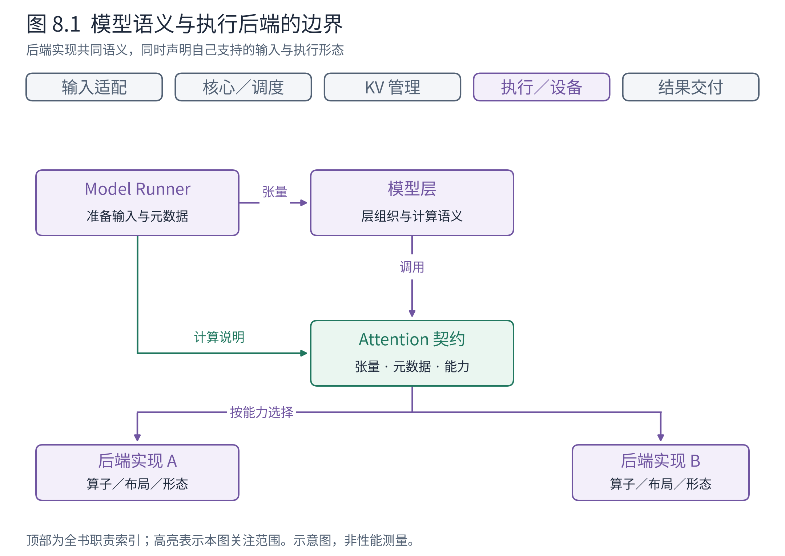
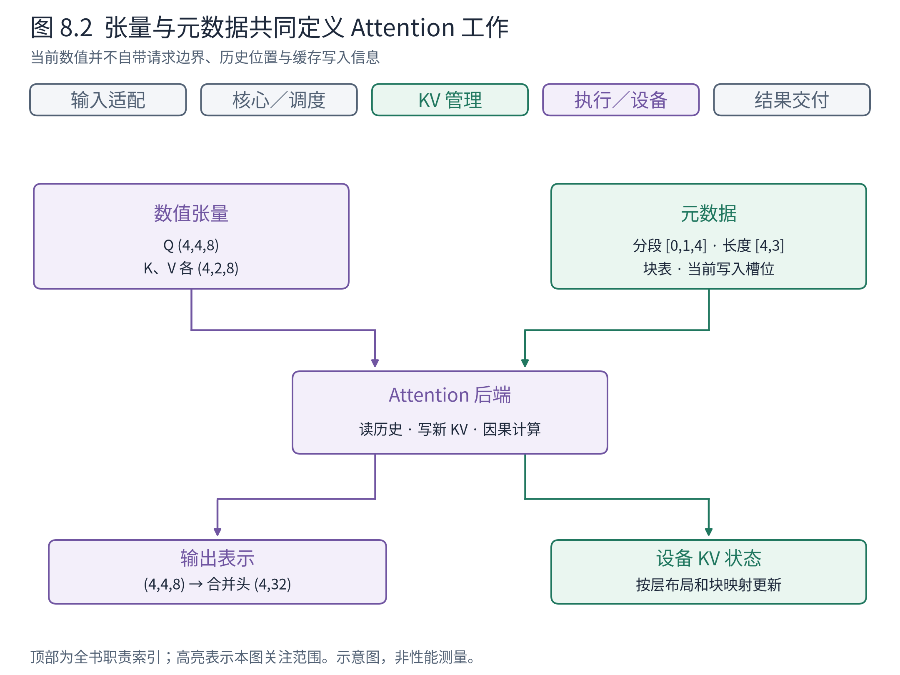
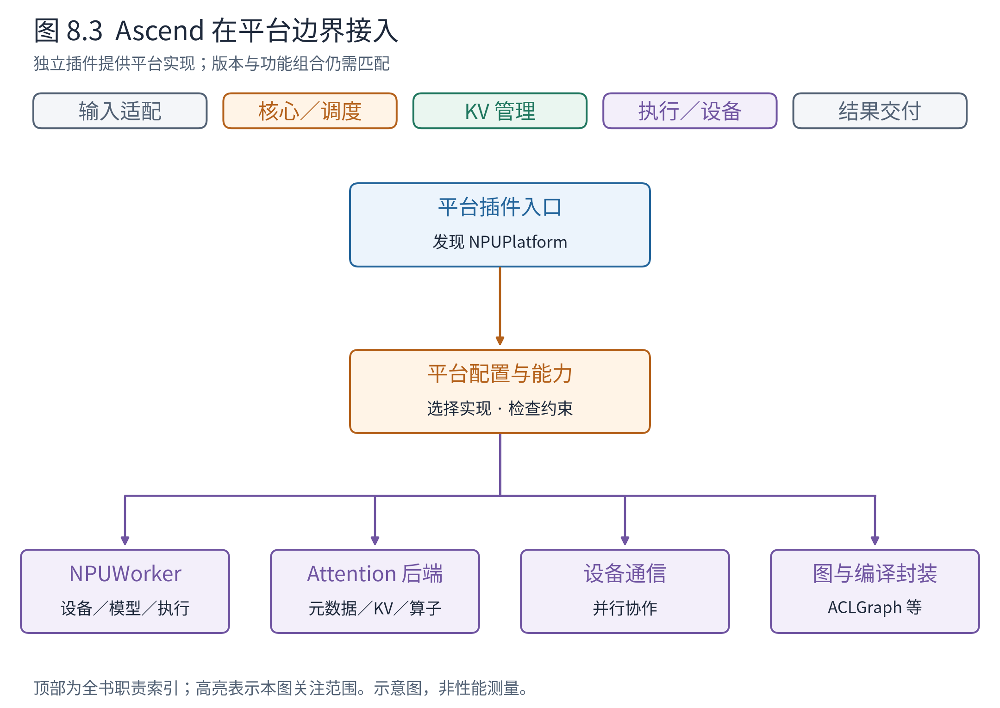

# 第 8 章 模型与硬件之间的适配边界

第 7 章把请求变成了张量，但张量形状正确还不足以保证高效执行。Attention 必须知道历史放在哪里、每条请求能看到什么；不同设备支持的算子、存储布局和图执行方式也不同。如果把所有差异直接写进每个模型，模型实现与设备变化就会彼此牵连。

本章解释 vLLM 如何在模型语义与硬件实现之间建立边界。我们不列出全部后端的能力表，而是先弄清一份后端契约需要表达什么，再看 Ascend 如何接到这套架构中。

## 8.1 模型层决定算什么，后端落实怎样算

模型实现描述层的组织、参数与计算语义；执行后端（backend）提供满足该语义的具体实现。后端不是另一套业务入口，它位于模型执行内部，承担贴近设备与算法实现的工作。



**图 8.1　模型、Runner 与后端的协作。** Runner 准备输入与元数据，模型层连接 Attention 等计算，后端在能力约束下使用具体算子和缓存布局。蓝色入口、橙色调度仍在图外沿，不因后端变化而消失。依据 v0.30.0 模型、AttentionBackend 与平台接口；图为接口关系，不是继承层次的完整 UML。

例如同样处理一组 query，有的后端适合某种头维、数据类型和块长，有的支持特定图执行形态。仅仅把函数命名成 `attention`，并不能抹掉这些差异。接口既要说明输入输出，也要让系统判断某个配置组合能否被支持。

因此，后端选择是一项受约束的适配，而不是给设备名称换一个字符串。稳定接口减少了模型与硬件之间的直接耦合；能力检查、版本兼容和元数据转换则是它付出的成本。

## 8.2 Attention 为何还需要一份“计算说明”

沿用 A 解码一个 token、C 预填充三个 token 的例子，当前输入总数 T=4。设 query 头数为 4，KV 头数为 2，头维为 8。在已经完成投影与必要位置处理的逻辑视图中，Q 形状为 `(4,4,8)`，当前 K、V 各为 `(4,2,8)`。输出每个 query 头的表示形状为 `(4,4,8)`，合并头后为 `(4,32)`，后续输出投影可映射回模型隐藏维。

这些形状仍没有说明 A 应读哪些历史、C 的三个 query 怎样施加因果约束，也没有说明新的 K、V 写到哪里。因此需要**元数据（metadata）**：它描述数据应怎样解释，本身不替代模型的数值张量。



**图 8.2　Attention 的数值输入与解释信息。** 左侧 Q/K/V 是当前计算内容，右侧请求边界、历史长度、块表和写入槽位说明怎样访问；后端共同消费它们。T=4、query 头数 4、KV 头数 2、头维 8 均为教学设定。依据 v0.30.0 CommonAttentionMetadata 与 AttentionMetadataBuilder；不表示每个后端都使用相同字段布局。

沿 A 看，元数据告诉后端当前 query 只有一个，但上下文还包括此前三个位置。沿 C 看，当前 query 有三个，彼此仍须遵守因果限制。若只有一段拼接的四行 Q/K/V，而没有请求边界，系统就无法仅凭行号推断这些差别。

此处的交接方是 Runner 与 AttentionMetadataBuilder 的具体实现对象：Runner 提供公共批次信息，调用 builder 的 `build(...)`，后者把它转为该后端实现所需元数据。例如 Ascend 普通路径可选 AscendAttentionMetadataBuilder；它封装元数据转换，AscendAttentionBackendImpl 则负责实际 Attention 运算，两者不是同一职责。沿用第 6 章的教学块长 2，设 A 使用块 `[7,2]`，C 使用块 `[5,9]`，这份公共对象可以具体写成：

```python
CommonAttentionMetadata(
    query_start_loc=torch.tensor([0, 1, 4], dtype=torch.int32, device=device),
    query_start_loc_cpu=torch.tensor([0, 1, 4], dtype=torch.int32),
    seq_lens=torch.tensor([4, 3], dtype=torch.int32, device=device),
    num_reqs=2, num_actual_tokens=4,
    max_query_len=3, max_seq_len=4,
    block_table_tensor=torch.tensor([[7, 2], [5, 9]],
                                    dtype=torch.int32, device=device),
    slot_mapping=torch.tensor([5, 10, 11, 18],
                              dtype=torch.int64, device=device),
    causal=True,
)
```

这是无填充、普通全注意力的构造视图。两个 `query_start_loc` 形状均为 `(3,)`，分别在设备和 CPU；`seq_lens` 为 `(2,)`，块表为 `(2,2)`，写入槽位为 `(4,)`。A 的本步位置是 3，落在物理块 2 的偏移 1，所以槽位是 5；C 的位置 0、1、2 分别落在块 5 的两个位置与块 9 的第一个位置，所以是 10、11、18。这里使用“块号乘块长再加偏移”的槽位编号，实际张量的维度顺序另由后端解释。

Q 的四行由 `[0,1,4]` 划成 A 的一行和 C 的三行；`seq_lens=[4,3]` 则说明包含历史后的可访问长度。builder 消费这些信息后产生具体 AttentionMetadata，Attention 实现再结合当前 Q/K/V 与缓存完成读写。两条请求隔离的依据由此落实在数据上。字段见 [CommonAttentionMetadata](https://github.com/vllm-project/vllm/blob/ced6857afa0ea7b2e3f0846a62e1394e90f15607/vllm/v1/attention/backend.py#L385)，小头维和小块长只用于解释映射，不承诺任何后端接受这组运行参数。

块表与槽位映射也回答不同问题。块表帮助找到整段历史的存储，槽位映射帮助确定当前 token 的新 KV 应写到哪里。后端据此读历史、写新状态，并产生 Attention 输出。实际实现可融合操作或采取特定布局，不必先物化一个巨大稠密注意力矩阵；本书不把概念上的注意力公式误写成所有后端的内存行为。

vLLM 将公共元数据与后端专用构建过程区分开。元数据构建器（builder）把 Runner 已知的请求、长度和映射信息整理成后端需要的形式。这样，模型层不必学会每种设备的调度元数据细节，但执行路径必须保证这份说明与真实张量一致。

## 8.3 KV 布局为什么也是接口的一部分

第 6 章只规定逻辑位置可以映射到物理块，并没有规定设备张量的维度顺序。现在进入后端，就必须回答某层的 K、V 如何排列、一次块访问对应多少数据，以及哪些维度与头数、块长相关。

以本地 Ascend 源码观察点 `3b31886` 的普通 Attention 后端为例，其缓存形状接口返回逻辑形状 `(2,N,P,Hkv,D)`：2 区分 K/V，N 为块数，P 为块长，Hkv 为 KV 头数，D 为头维。若构造 N=10、P=2、Hkv=2、D=8，则接口形状为 `(2,10,2,2,8)`。这只是该接口的例子，不代表所有 Ascend 模型、所有设备后端都使用相同布局。

这里的双方是准备缓存的 NPUModelRunner 对象与声明布局的 AscendAttentionBackend 类。运行器询问“给定这些规格，应创建什么形状”，后端通过一个静态接口返回维度元组；这里使用的是后端类提供的接口，不需要假设存在一个参与调度的后端对象：

```python
AscendAttentionBackend.get_kv_cache_shape(
    num_blocks=10, block_size=2, num_kv_heads=2, head_size=8,
)
# 返回：(2, 10, 2, 2, 8)
```

返回的是形状约定，不是已经分配或填好 KV 的张量。执行侧随后准备存储，后端算子才在推理过程中写入数据。这使第 4 章“规格与初始化”的交接，与本章“访问布局”的交接能够对上。

这个边界影响多个环节：启动时要按规格准备内存，KV 管理要提供匹配的块，Runner 要形成相应映射，算子要按正确布局访问。布局一旦变化，只修改图中的一个框往往不够。

所以“替换后端”的正确理解是替换一套满足共同语义、并声明自身约束的实现。模型可以保持大部分不变，但缓存规格、元数据构建和执行模式可能必须共同调整。高层抽象让差异集中，而不是让差异消失。

## 8.4 平台插件怎样接入整台引擎

Attention 只是设备适配的一部分。设备初始化、通信、模型执行器件、编译与自定义算子也可能不同。**平台插件（platform plugin）**为这些选择提供一个接入位置，使硬件实现可以在独立项目中维护。



**图 8.3　Ascend 的适配位置。** 平台选择影响 Worker、Attention、通信与图执行等部件，这些实现继续服务于同一套请求与调度职责。依据 vLLM 固定锚的插件接口与 vllm-ascend `3b31886` 的平台、Worker、Attention 和 ACLGraphWrapper 源码；两个源码观察点不是本轮验证过的运行组合。

从图上方读，Python 包的入口点机制让 vLLM 发现插件。可以把入口点理解为包对外登记的一份“扩展功能在哪里”的目录。平台实现随后检查配置、提供 Worker 和后端等实现位置。Ascend 的 NPUWorker 再承担设备初始化、加载模型与执行等责任。

这份交付有时甚至是一个类的导入路径。以普通非 MLA、非稀疏、无压缩且未选择特殊硬件分支的配置为例，通用后端选择代码询问 NPUPlatform，`get_attn_backend_cls(...)` 返回：

```python
"vllm_ascend.attention.attention_v1.AscendAttentionBackend"
```

NPUPlatform 负责按平台条件选实现，通用选择代码据路径解析后端类，再由该类提供实现与 builder 等接口。这个字符串交付的是“使用哪个实现”的决定，尚未携带 A、C 的任何计算数据。它与上一节的元数据交付处于不同阶段。分支依据 [NPUPlatform.get_attn_backend_cls](https://github.com/vllm-project/vllm-ascend/blob/3b31886237ed65c435e0965b10e8002ff5769766/vllm_ascend/platform.py#L233)。

为何不只在主仓库中增加越来越多的设备条件分支？独立插件使平台实现有自己的维护节奏，减少通用路径不断增加分支的压力。但上游接口变化仍然需要插件适配，功能组合仍然要验证；插件不是一次注册之后永久兼容的承诺。[官方插件设计](https://docs.vllm.ai/en/v0.30.0/design/plugin_system/)

多进程又增加一层要求。某项注册若只在用户进程执行，子进程未必拥有相同注册结果；需要根据插件类型在实际使用它的进程中完成加载。这里正好回扣第 3 章：代码可导入、对象可构建和运行位置正确，是不同检查项。

## 8.5 怎样阅读平台差异而不失去主线

本书的 vLLM 阅读锚为 v0.30.0，Ascend 使用另行标注的源码观察点，工作区历史运行基线则是 vLLM 0.27.1 与 vllm-ascend 0.27.1rc1。三个标签回答不同问题：主架构在哪里读，插件实现在哪里观察，已有实验曾在哪个环境运行。不能拼成一条未经验证的兼容声明。

尤其遇到文件名中的 `gpu`、配置中的 `cudagraph` 时，需要看它承担的职责及平台映射。通用配置保留某种历史命名，不等于 NPU 在执行 CUDA；反过来，存在 ACLGraph 封装，也不等于所有 CUDA 图功能在 NPU 上一一等价。下一章会用这条纪律分析性能优化。

本章最后可以做一次替换推演：若某个新 Attention 后端不支持选定头维，应该在能力检查或选择阶段暴露，而不是让调度器修改用户业务；若它要求不同缓存布局，就要让规格、分配和元数据共同匹配，而不是只替换一个算子名字。

回到整体，入口决定怎样表达需求，核心决定怎样安排工作，模型定义计算语义，后端与平台让语义在具体设备上成立。掌握这几层之后，阅读设备代码时就能知道它是在实现什么承诺，而不只是辨认另一个目录里的类名。

## 章末源码导航

先读接口声明与能力判断，再选择一个后端追踪。Ascend 链接使用独立提交，避免把平台源码当成主锚的一部分。

<!-- NAVIGATION -->

| 要回答的问题 | 固定版本入口 | 读到哪里即可停止 |
|---|---|---|
| 后端怎样声明能力？ | [AttentionBackend](https://github.com/vllm-project/vllm/blob/ced6857afa0ea7b2e3f0846a62e1394e90f15607/vllm/v1/attention/backend.py#L59) | 找到布局／dtype／头维及实现选择接口 |
| 执行需要哪些解释信息？ | [CommonAttentionMetadata](https://github.com/vllm-project/vllm/blob/ced6857afa0ea7b2e3f0846a62e1394e90f15607/vllm/v1/attention/backend.py#L385) | 对照分段、长度、块表与槽位 |
| NPU 平台接入哪些配置？ | [NPUPlatform.check_and_update_config](https://github.com/vllm-project/vllm-ascend/blob/3b31886237ed65c435e0965b10e8002ff5769766/vllm_ascend/platform.py#L442) | 找到 Worker、后端及执行模式相关选择 |
| 普通 NPU 后端声明何种缓存形状？ | [AscendAttentionBackend.get_kv_cache_shape](https://github.com/vllm-project/vllm-ascend/blob/3b31886237ed65c435e0965b10e8002ff5769766/vllm_ascend/attention/attention_v1.py#L110) | 看该接口返回值，不推广到全部后端 |
