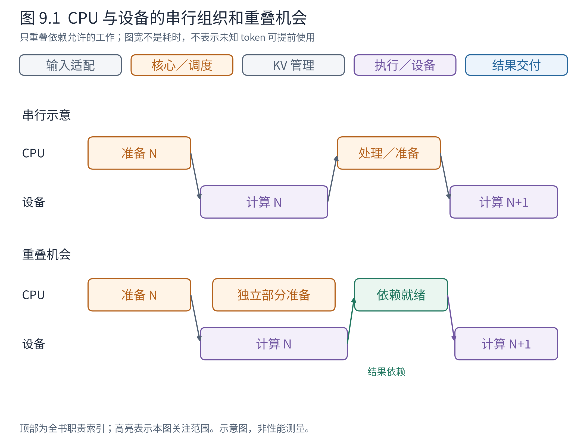
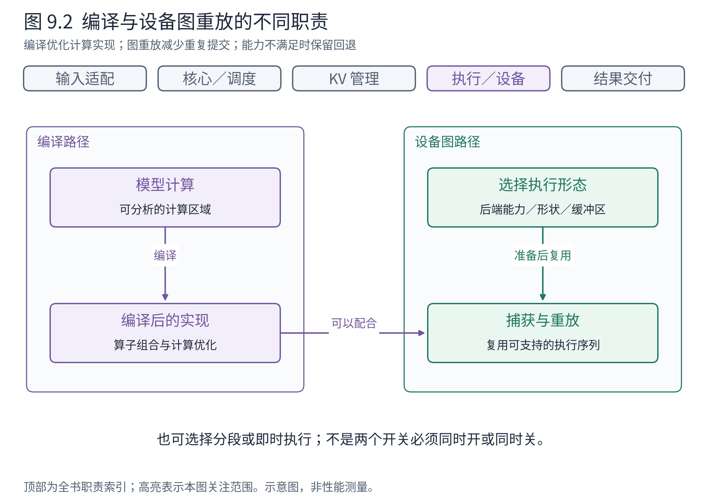
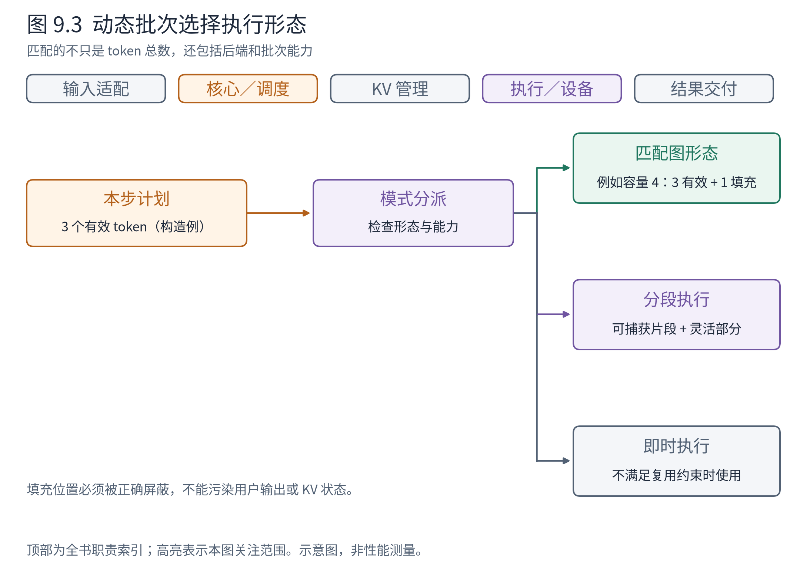

# 第 9 章 性能优化如何嵌入架构

现在已经能从用户请求追踪到设备算子。下一步自然会问：既然模型在 NPU 上计算，为什么 vLLM 还如此关心 Python 状态、消息传递、输入准备和结果处理？

原因在于生成会反复经历主机准备与设备执行。单轮计算越短，反复付出的组织成本就越可能显眼。本章不追求给出一组万能加速开关，而是解释优化分别缩短哪段路径，以及它们怎样改变状态和执行的约束。

## 9.1 先把等待放回时间线上

一次生成的耗时不只包含算子。CPU 需要接收请求、形成计划、准备元数据并提交工作；设备完成后，结果又要被处理。如果下一轮必须等这些步骤全部结束才能开始，设备会出现等待主机的间隙。

**图 9.1　优化针对哪段等待。** 上半是便于理解的串行路径，下半展示部分 CPU 准备与设备计算重叠。块宽为构造示意，不是硬件耗时；箭头仍保留数据依赖。依据 v0.30.0 核心异步批次队列及 MRV2 设计，不意味着两条相邻生成步骤可以无条件并行计算。

沿下半图看，某些与最终采样值无关的工作可以提前准备，但下一 token 的真正计算仍依赖正确输入。异步系统必须通过设备侧数据传递、在途状态或延后消费等具体机制满足依赖，不能把未知 token 当成已经知道。

因此有两条不同的优化方向：减少总工作量，例如不再重复构建未变化的块表；重叠可以独立进行的工作，减少关键路径上的等待。二者可以同时使用，但重叠没有消灭工作本身，还可能增加缓冲区和同步管理。

## 9.2 为什么“只更新变化”会影响整个接口

第 7 章已经看到，连续批次的大部分请求可能相同。若每轮重新构造完整状态，重复成本随活跃请求和块表规模增长。增量更新使核心只报告必要变化，执行端保留可复用状态，再收集当步输入。

考虑 4 条教学请求中只有 A 结束、E 加入的一轮。重建方案可能重新组织 4 条请求的大量未变信息；增量方案保留其中 3 条，处理一次移除和一次加入。这里不声称固定节省比例，因为实际还需要当步长度、排列与设备拷贝，但可以看出优化来自哪里。

代价同样具体：执行端不能成为完全无状态的函数。它必须识别结束、抢占、恢复以及块表变化。若某项状态已经在设备侧更新，CPU 的副本也不能擅自覆盖它。MRV2 的阶段化写入等机制正是为了组织这种变化，而不是仅仅把 Python 循环换成另一个语法。

性能设计由此反过来塑造架构接口：首次信息与后续变化分开，状态寿命与当步输入分开，哪些事实由 CPU 还是设备产生也需要明确。它们既是优化点，也是后续功能能否安全组合的前提。

## 9.3 异步带来的首要问题是缓冲区寿命

设 CPU 把输入缓冲区 X 交给设备异步读取。提交函数返回，只表示工作已被排入执行路径，不表示设备已经读完 X。如果 CPU 立即把 X 改写成下一轮内容，设备可能读到混合数据。这类问题称为**竞争条件（race condition）**：结果取决于两个执行活动碰到同一状态的具体时机。

有两类基本处理思路。一类是在可安全覆盖前等待相应完成事件，确保读写有序；另一类让本轮设备读取拥有独立寿命的快照或缓冲区，CPU 更新另一份状态。两者都要支付成本：等待可能削弱重叠，额外缓冲会增加拷贝或内存。

官方 MRV2 文档用临时固定页内存副本解释消除共享 CPU 缓冲竞争的思路，并讨论大状态的增量写入。固定页内存有利于特定异步传输路径，但并不是“只要 pin_memory 就不会竞争”：真正关键的是被读取内容在所需期间保持有效且稳定。[MRV2 设计](https://docs.vllm.ai/en/v0.30.0/design/model_runner_v2/)

这也说明第 4 章的资源寿命图不只是初始化知识。异步优化把“本轮结束”拆成提交、计算、结果可用、资源可复用等时刻。若只有一个模糊的完成标志，性能越激进，正确性越难保证。

## 9.4 编译与图执行分别减少什么

**编译（compilation）**把可分析的计算转换为更适合执行的形式，例如优化算子组合、减少中间处理。**图执行（graph execution）**则把一段可重复的设备执行组织记录下来，后续以重放方式减少重复提交成本。两者可以配合，但不能视为同一件事。

**图 9.2　两条可配合的优化路径。** 左侧从模型计算到编译后的计算实现，右侧从适合的执行形态到捕获与重放；下方保留即时执行回退。依据 v0.30.0 torch.compile 与 CUDA Graphs 设计。CUDA 部分为上游实现分析，NPU 由平台的编译／图封装承接相应职责，不能据图推断功能等价。

一个直观区别是：即使把模型中的一段计算编译得更快，CPU 仍可能逐次提交许多设备工作；使用图重放可以减少其中部分提交成本，却不自动改变模型需要完成的数学计算量。

真实模型还有不适合一起捕获的部分。于是 vLLM 支持按能力选择整图、分段图或即时执行等形态。分段允许把可复用片段加速，同时在片段之间处理需要灵活性的工作；整图可以进一步减少交接，但对参与算子和执行形态提出更强约束。官方设计将编译与完整图执行的选择解耦，正是为了不把两种不同条件绑成一个全有或全无的选项。

这些准备通常要花启动时间，并可能占用额外内存。若服务频繁重启、请求形态分散，或者主要瓶颈并不在提交侧，不能仅凭“启用了图”判断整体收益。

## 9.5 动态请求怎样适应相对稳定的执行形态

调度器每轮都可能改变请求数量和 token 数，图重放却希望执行形态可复用。这不是偶然冲突：前者追求灵活地利用资源，后者希望减少重复组织工作。

**图 9.3　从当前批次到可用执行模式。** 先检查后端及形态约束，再选择匹配的图、分段方式或即时执行；构造例把 3 个有效 token 放入容量为 4 的准备形态。依据固定锚的图分派设计；数值只是解释填充，不表示默认捕获大小或所有模式的匹配条件。

填充（padding）是一种常见办法：准备一个容量为 4 的形态，当轮只有 3 个有效 token 时，将其放入该形态并用正确的长度与屏蔽信息忽略额外位置。这样减少形态种类，代价是可能做一些无效工作，并必须保证填充位置不污染输出或 KV 状态。

但匹配条件不只有 token 总数。均匀解码与混合预填充可能需要不同能力；后端、适配器和模型路径也会影响选择。图分派器需要结合这些条件决定，而不是看到相同的数组长度就盲目重放。无法满足约束时回到可支持路径，是正确执行的一部分，并非架构失败。

Ascend 源码中的 ACLGraphWrapper 提供 NPU 图封装的观察入口。本书据此说明职责落点，不报告本轮并未测量的速度提升，也不把 CUDA 特定能力直接移植成 NPU 结论。读者若要比较性能，应在附录实践框架中固定设备、版本、请求分布和实际模式后再测。

## 9.6 每个优化都应能指出它减少的成本

回到整机，增量更新主要减少重复状态组织，异步主要减少可重叠工作的等待，编译优化计算实现，图重放减少部分重复提交。它们针对的成本不同，也分别引入状态协议、寿命管理、编译约束和形态选择。

因此，看到一项性能变化时，先问它影响哪段时间线，而不是先寻找一个总能提高速度的开关。如果设备长时间满负荷运行，缩短少量 Python 工作未必明显改善吞吐；如果设备频繁等输入，优化模型中的一个局部算子也未必解决主因。

这些判断不替代测量，但让测量有方向。接下来把执行范围从单设备扩展到多设备：原本一条设备时间线变成多条，需要通信与协调。哪些职责保持稳定，哪些成本会新出现？

## 章末源码导航

按要解释的成本选入口：CPU 状态、在途结果、编译、图分派分别阅读；不要把不同后端的实现细节拼成一条默认路径。

<!-- NAVIGATION -->

| 要回答的问题 | 固定版本入口 | 读到哪里即可停止 |
|---|---|---|
| 核心怎样处理在途批次？ | [EngineCore.step_with_batch_queue](https://github.com/vllm-project/vllm/blob/ced6857afa0ea7b2e3f0846a62e1394e90f15607/vllm/v1/engine/core.py#L630) | 区分提交、队列与结果消费 |
| 状态更新与模式选择在哪里？ | [GPUModelRunner.execute_model](https://github.com/vllm-project/vllm/blob/ced6857afa0ea7b2e3f0846a62e1394e90f15607/vllm/v1/worker/gpu/model_runner.py#L1631) | 找到状态差量及图分派位置 |
| NPU 图封装承担什么？ | [ACLGraphWrapper](https://github.com/vllm-project/vllm-ascend/blob/3b31886237ed65c435e0965b10e8002ff5769766/vllm_ascend/compilation/acl_graph.py#L60) | 辨认捕获与重放，不推断 CUDA 等价性 |
