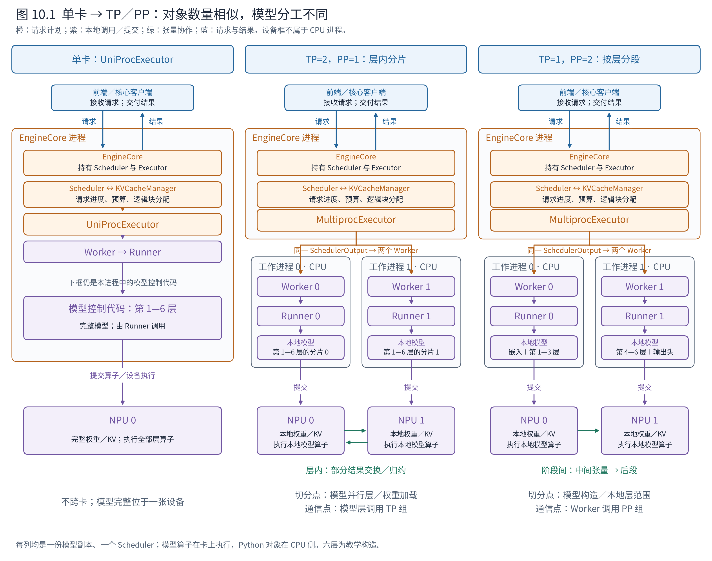
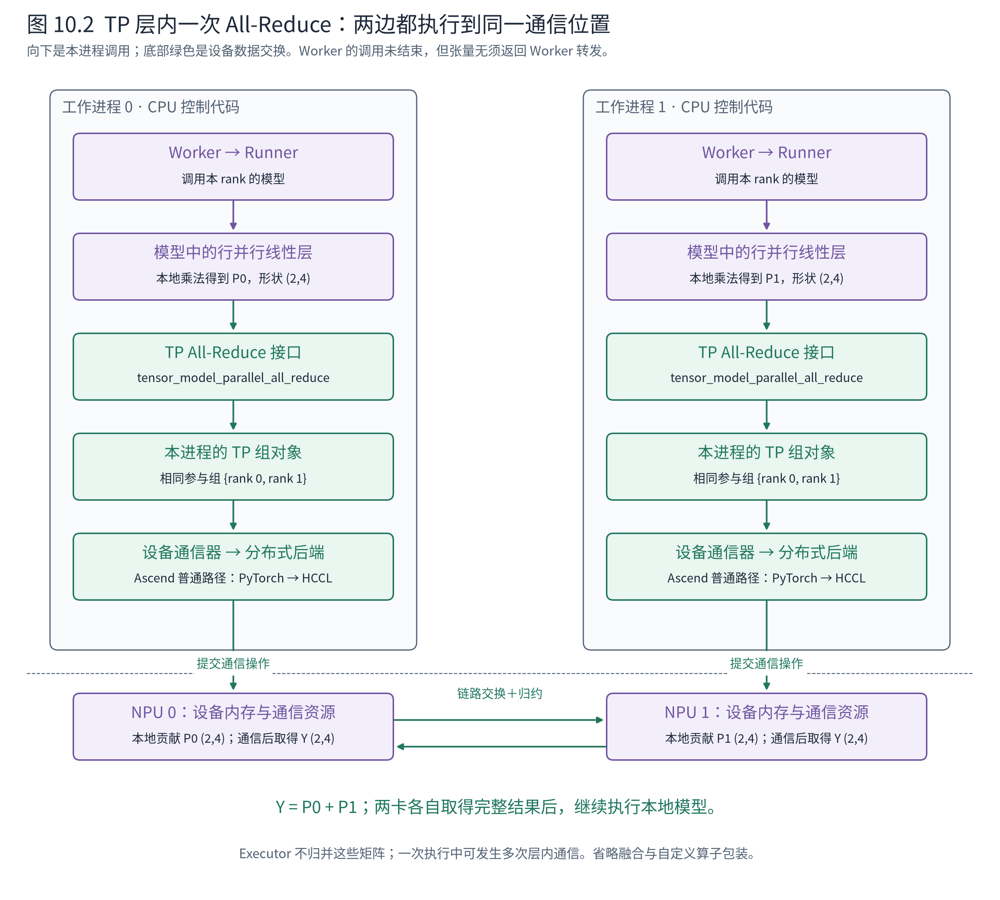
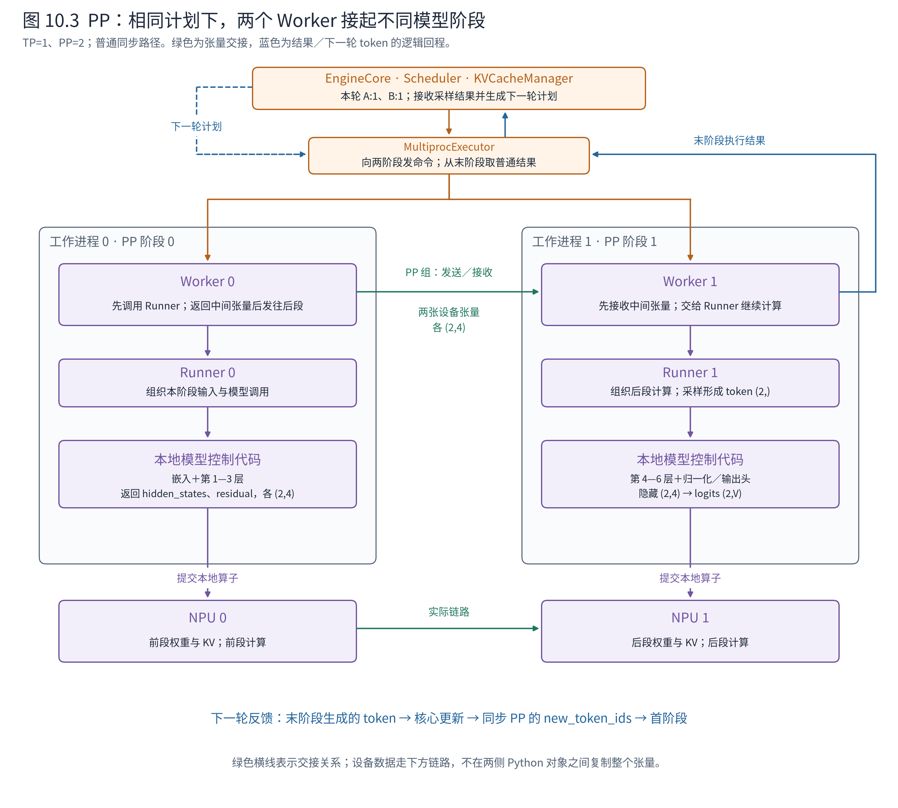
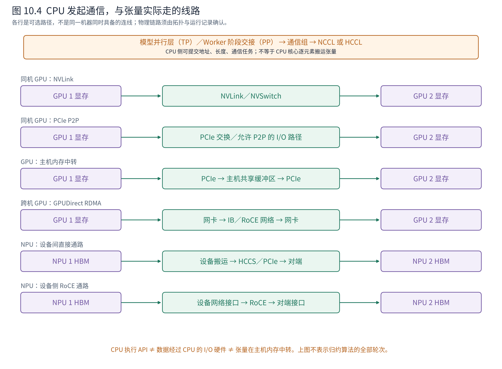
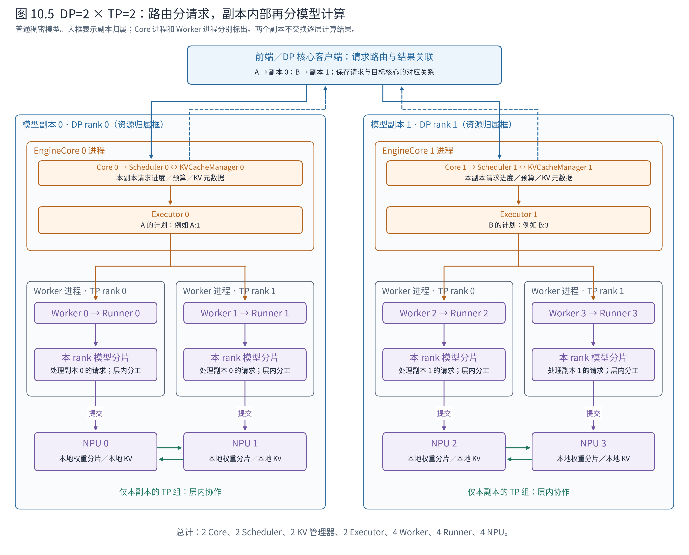

# 第 10 章 从单卡扩展到多卡

第七章已经把一轮生成串成闭环：Scheduler 决定推进哪些 token，EngineCore 把计划交给 Executor，Worker 调用 Runner，Runner 组织模型计算，结果再回到核心和前端。第八、九章补上了模型与设备的适配和执行优化。现在增加设备，究竟要改这条链的哪一段？

本章以单卡为基线，分别展开三种变化：TP 将同一层的计算分到多卡，PP 将模型的不同层段放到多卡，DP 将不同请求交给不同模型副本。相同的输入处理与结果交付只简短带过，重点追踪分工在哪里确定、通信由谁发起、数据实际走哪条线路，以及结果如何形成下一轮输入。

正文使用普通稠密模型，先分别讨论 TP、PP，再讨论 DP 与它们的组合。阅读锚为 vLLM v0.30.0；NPU 执行以 vllm-ascend 的对应路径辅助说明。两条请求 A、B、本轮各处理一个 token，故实际 token 行数 $T=2$。层数、维度、token 编号均为教学构造，不是硬件运行记录。为便于追踪回程，主例采用同步调度，无投机解码；异步、图执行和融合算子的差异在相关位置说明。

## 10.1 先画单卡，再确定扩展的是哪一层

**模型副本（replica）**是一套能协同完成模型推理的执行资源。一份副本可以放在单卡，也可以由多卡共同承载。**rank**是某个通信组内参与者的逻辑编号；同一参与者可能同时具有 TP rank、PP rank 等身份，不能把所有 rank 都当作物理卡号。

先看图 10.1 的左列。这里显式选择 UniProcExecutor：核心进程持有 EngineCore，后者持有 Scheduler 与 Executor；Scheduler 协作的 KVCacheManager 管理块元数据，Worker 持有 Runner。Worker、Runner 和模型的 Python 控制代码在 CPU 侧运行；权重、KV 张量以及算子计算位于 NPU。它们之间的包含关系不意味着“一个对象就是一个进程”。



**图 10.1　从一条执行路径到两条执行路径。** 蓝色表示输入与交付，橙色表示核心调度与计划分发，紫色表示本地执行，绿色箭头标张量协作；进程框标出 CPU 运行边界，底部设备框独立于进程。TP、PP 两列选择 MultiprocExecutor，每个工作进程一个 Worker、一个 Runner、一张 NPU。六层模型为构造；TP 标出层内切分，PP 标出层段切分。依据固定版本的 Executor、模型并行层及 NPUWorker；图源为 `render_ch10.py`，非部署实测。

右侧两列都仍是一份副本。增加的是执行参与者，没有增加接纳这份请求的核心。这里先把对象数量数清楚：

**表 10.1　显式选择的三种部署形态**

| 对象 | 单卡 | TP=2、PP=1 | TP=1、PP=2 |
|---|---|---|---|
| EngineCore | 1 | 1 | 1 |
| Scheduler / KVCacheManager | 各 1 | 各 1 | 各 1 |
| Executor | 1 个 UniProcExecutor | 1 个 MultiprocExecutor | 1 个 MultiprocExecutor |
| Worker / Runner | 各 1 | 各 2 | 各 2 |
| 物理 NPU | 1 | 2 | 2 |
| 模型计算分工 | 完整模型 | 同一层中参与 TP 的参数和运算分片 | 不同阶段各负责一段网络 |
| 新增的张量交接 | 无跨卡交接 | 层内部分结果交换、归约等 | 阶段边界的隐藏表示等 |

分工的落点还要补一层：Runner 调用的**模型对象及其并行层**。TP 权重分片与 PP 层段归属主要在模型构造和加载时落实，不能在图上省掉模型对象，再把所有分工都归给 Worker。Executor 组织多个执行参与者，模型实现规定每个参与者具体算什么。

DP 则会连同 Core、Scheduler 和 KV 管理一起增加。我们先走完一份副本内部的 TP、PP，再在 10.6 节展开副本之间的请求分流。

## 10.2 TP：同一批 token，分担同一层的计算

**张量并行（tensor parallelism，TP）**保持同一批请求的共同推进，把参与并行的参数和运算分给多个 rank。与单卡相比，最先改变的不是逐轮调度，而是启动后每个 rank 持有什么模型资源。

### 10.2.1 启动时分的是参数与运算，不是请求

单卡模型加载完整权重。TP=2 时，两个 Worker 分别绑定设备并参与建立 TP 通信组，各自的 Runner 构造本 rank 的模型。模型并行层根据 TP 大小与本 rank 编号确定本地权重形状，加载器把对应分片装入本地设备。某些参数和计算仍可复制，不能把 TP 理解为每个对象都机械地一分为二。

例如六层模型采用 TP 后，两边都执行第 1—6 层，但每层中参与 TP 的线性投影只持有各自的分片。Attention 也可能按头划分工作；KV 张量随本地负责的 KV 头布局存储，特定 GQA/MQA 配置还可能复制 KV 头。因此，两卡的 KV 都服务于 A、B，却不必是同一份完整张量。核心侧的块元数据协调逻辑分配，各设备上的实际缓存存放各自需要的内容。

这一步已经把“谁算哪部分”固化到模型及权重布局中。随后每轮，Scheduler 无须重新发送矩阵切分方案。

### 10.2.2 一份 SchedulerOutput 怎样让两张卡工作

请求进入、核心建账和调度进度的含义沿用前文。Scheduler 本轮给出 `{"A": 1, "B": 1}`，表示整个副本处理两行 token。TP=2 不会把它解释成“卡 0 处理 A，卡 1 处理 B”。两个 rank 都参与 A、B，只承担不同的计算份额。

Core 把计划交给 MultiprocExecutor。后者需要让其他进程里的 Worker 执行方法，因此使用**远程过程调用（remote procedure call，RPC）**：把方法名和参数封装成消息，接收进程找到相应方法并执行。“远程”可以只跨同一台机器的进程，并不要求跨服务器。

以下是普通无连接器聚合分支的消息结构视图，`plan` 是字段节选所对应的 SchedulerOutput：

```python
# Executor 向两个工作进程广播；指定 rank 0 返回普通结果
("execute_model", (plan,), {}, 0)

# plan 字段节选：两个 rank 收到内容一致的请求级计划
plan.num_scheduled_tokens        # {"A": 1, "B": 1}
plan.total_num_scheduled_tokens  # 2
```

四项依次是方法名、位置参数、关键字参数和返回 rank。`(plan,)` 是只有一个元素的元组；`{}` 表示没有额外关键字参数。各进程得到自己的本地对象，不共享同一个 Python 对象地址。两个 Worker 都调用自己的 `execute_model`；最后的 `0` 只选择普通回复的来源，不会让 rank 1 跳过计算。

每个 Worker 随后调用自己的 Runner。两个 Runner 为同一批 A、B 组织本地输入、位置和 Attention 元数据，再调用各自的模型分片。到此，单卡的一条本地执行链变成了两条配合的执行链；真正新增的层内配合，从模型并行层开始。

### 10.2.3 部分结果为什么有时保留、有时求和

用一个简化的两层网络看清这个变化。设输入 $X$ 的形状为 $(2,4)$，第一层把特征扩展到 8 维，第二层压回 4 维；中间使用逐元素激活 $\phi$，省略偏置。这个构造解释线性层组合，不把真实 Llama 的门控 MLP 简化为完全相同的结构。

第一层完整权重 $W\in\mathbb{R}^{4\times8}$ 沿输出特征维分为 $W_0,W_1\in\mathbb{R}^{4\times4}$。两卡都使用输入 $X$，分别计算：

$$
U_0=XW_0\in\mathbb{R}^{2\times4},\qquad
U_1=XW_1\in\mathbb{R}^{2\times4}.
$$

这里 $U_0$ 是两个 token 的前四个特征，$U_1$ 是后四个特征。逻辑上的完整结果为 $(2,8)$，但下一层若能接收这种分片，就不必立刻收集到一起。各卡执行激活后，$\phi(U_i)$ 的形状仍为 $(2,4)$。

第二层权重 $V\in\mathbb{R}^{8\times4}$ 沿输入特征维分成上下两块 $V_0,V_1\in\mathbb{R}^{4\times4}$。两卡得到的局部结果分别是：

$$
P_0=\phi(U_0)V_0\in\mathbb{R}^{2\times4},\qquad
P_1=\phi(U_1)V_1\in\mathbb{R}^{2\times4}.
$$

这次不能把两份结果并排拼接，因为完整乘法满足：

$$
Y=[\phi(U_0)\;\phi(U_1)]
\begin{bmatrix}V_0\\V_1\end{bmatrix}
=P_0+P_1\in\mathbb{R}^{2\times4}.
$$

换成数值看，若 A 对应的一行局部贡献分别为 `[10,20,30,40]` 和 `[1,2,3,4]`，本层完整输出就是 `[11,22,33,44]`。第一层分担的是不同输出特征，第二层分担的是同一输出的不同贡献；需要哪种通信，由这种数学关系决定。

本例第二层可执行**全归约（All-Reduce）**：把两个 rank 的对应元素相加，让两个 rank 都取得形状为 $(2,4)$ 的 $Y$，然后继续下一层。其他布局可能需要收集、归约后分发，或保持分片；不是每层都固定执行同一个操作。

### 10.2.4 一轮结果怎样回到核心

层内的局部结果在模型执行过程中已经按需协作，Executor 不收集每层矩阵再替模型求和。后续词表投影也遵守自身的并行约定，形成采样所需结果；Runner 最终形成带请求对应关系的 ModelRunnerOutput。

`execute_model` 与 `sample_tokens` 可以是两次执行调用：前向返回 `None` 时，核心可继续发起采样。普通返回分支从选定 rank 取得结果，沿 Executor → Core → Scheduler 更新请求，再交给前端。这仍是第七章的闭环。指定回复 rank 与层内的 All-Reduce 是两件事，前者不代替后者。

TP 让模型参数和部分计算分摊到多卡，也增加了执行中的通信依赖。一个 rank 的结果尚未就绪时，依赖它的后续计算就不能完成。这解释了为什么增加卡数不保证单请求延迟按比例下降。

## 10.3 一次 TP 通信，从模型层走到设备

上节在第二个线性层停下：两张设备各有一个 $(2,4)$ 的局部贡献，需要求和。现在只展开这一次通信。图 10.2 的两列是不同工作进程，下半部是物理设备；两边都必须参与匹配的操作。



**图 10.2　通信在模型执行内部发起。** 紫色向下箭头是本进程的方法调用，绿色箭头是设备张量交换；灰色虚线分开 CPU 软件对象与设备。图中为未融合的普通通信路径，省略编译用自定义算子包装，非严格时间线。依据 RowParallelLinear、TP 通信接口、GroupCoordinator 及 Ascend 通信后端；$P_0,P_1,Y$ 均为 $(2,4)$。

在 rank 0，Worker 调用 Runner，Runner 调用模型，模型执行到行并行线性层。线性层先在本卡算出 $P_0$，再调用 `tensor_model_parallel_all_reduce(P_0)`。这个接口取得本进程的 TP 组对象，调用它的 `all_reduce`，随后由设备通信器接入分布式后端。在普通 Ascend 路径上，可继续进入 PyTorch 分布式接口及 HCCL 后端；融合或专用通信路径可能合并其中的步骤。

rank 1 同样算出 $P_1$，在对应位置参加同一 TP 组的归约。两边的组对象是各进程的本地对象，描述相同的参与者集合，并不是两卡之间又多出一个中央调度进程。通信后端根据组、操作顺序与张量规格完成配合；不能让一边做这次求和，另一边跳过或执行不匹配的操作。

**Worker 的调用尚未结束，不等于张量必须返回 Worker 再转发。** 此时的通信发生在它调用的模型内部。局部结果不必沿“模型 → Runner → Worker → Executor”退回去，也不必由 Executor 再发给另一张卡。通信完成后，本地模型取得 $Y$，沿原来的前向继续执行。

Worker 在启动时建立设备和分布式环境；并行层决定执行中何时需要通信；通信组和后端完成操作的组织。CPU 主机线程是否等待、设备计算如何与通信重叠，是更下一层的执行问题。这里先确定因果：后续消费 $Y$ 的运算必须等归约结果可用。

这也限定了“Runner 专注本地执行”的含义：Runner 组织本 rank 的执行，但它调用的模型可以发起跨卡通信。TP 中的 Runner 不是与其他卡完全隔绝的计算盒子。PP 则会把另一种通信放到 Worker 的阶段边界上。

## 10.4 PP：模型分段后，Worker 接起阶段边界

**流水线并行（pipeline parallelism，PP）**沿网络深度分工。仍用六层模型，设 TP=1、PP=2：设备 0 负责嵌入和第 1—3 层，设备 1 负责第 4—6 层、最终归一化及输出头。两张卡共同完成一份模型，同一请求要经过两个阶段。

### 10.4.1 与 TP 相同的拓扑，不同的模型归属

Core、Scheduler、Executor 的数量与双卡 TP 相同，仍各一个；两个 Worker 各持有一个 Runner。变化发生在 Runner 调用的模型：TP 两边都执行各层的分片，PP 两边分别执行不同层段。启动构造时，每个 PP rank 确定本地层范围；权重加载和 KV 张量准备对应本地负责的层。

因此，设备 0 保存前半段层的 KV，设备 1 保存后半段层的 KV。下一轮每个阶段复用自己的历史缓存，通常没有必要在阶段交接时把全部历史 KV 搬到下一卡。阶段交接主要传递本步网络计算的中间表示。

Scheduler 仍产生同一份 `A:1、B:1` 的计划。Executor 仍把本轮执行命令发给两个 Worker；它不需要等第一段算完，才通过另一条 RPC 临时启动第二段。第二阶段的 Worker 可以先进入接收路径，等待前一阶段的输入。



**图 10.3　同一计划，两段网络，一次结果回程。** 上方橙色箭头同时分发计划；绿色路径表示阶段间设备张量的发送与接收，由两侧 Worker 调用通信组发起，正文列出调用顺序。两段的模型控制代码处于各自 CPU 工作进程，实际计算与张量位于各自 NPU。蓝色回程来自末阶段，下一轮 token 通过同步调度的计划回到首阶段。依据 NPUWorker.execute_model、LlamaModel.forward 和 Scheduler._make_cached_request_data；六层、$T=2,H=4$ 为构造。

### 10.4.2 走完一次前向交接

首阶段 Worker 没有前驱阶段，直接调用 Runner。Runner 按计划准备 A、B 的 token ID，嵌入将 $(2,)$ 的 ID 转为 $(2,4)$ 的隐藏表示，模型执行本地三层。对于本例关注的 Llama 普通路径，非末阶段的模型返回 IntermediateTensors，Runner 将其交回 Worker。

下面是返回对象的教学结构视图，数值不代表真实模型输出：

```python
IntermediateTensors(tensors={
    "hidden_states": hidden_states,  # NPU 0 张量，形状 (2, 4)
    "residual": residual,            # NPU 0 张量，形状 (2, 4)
})
```

它们是中间隐藏表示和残差，不是采样后的 token ID。Worker 0 接到这种返回对象后，通过 PP 组的 `isend_tensor_dict` 提交张量发送。Worker 1 此前通过 `irecv_tensor_dict` 接收前驱阶段的张量；接收结果组织成中间张量包装，再作为 `intermediate_tensors` 参数传给 Runner 1。异步包装负责在实际消费前满足数据就绪依赖，不代表 Python 接收调用返回时所有设备传输都已完成。

一次交接的模块顺序因此是：

```text
前段模型 → Runner 0 → Worker 0 → PP 通信组／设备通信后端
                                      ↓
                           设备 0 内存 → 实际链路 → 设备 1 内存
                                      ↓
后段模型 ← Runner 1 ← Worker 1 ← PP 通信组／设备通信后端
```

Python 包装对象本身不是跨进程共享的对象。两侧通信约定对齐张量键、形状、类型和必要的控制信息，接收侧使用自己进程中的包装和设备缓冲区。这里把逻辑交接和数据路线一起列出，但设备数据不会先拷进 Worker 的 Python 容器才发走。

Runner 1 得到中间表示后，后段模型直接继续第 4—6 层，无须重新对 token 做一次嵌入。末阶段产生最终隐藏表示 $(2,4)$，选择采样所需行后经词表投影得到 $(2,V)$ 的 logits，其中 $V$ 为词表大小；采样产生本轮 A、B 各一个 token，即 $(2,)$。这一路普通 PP 前向无须对每个阶段分别生成一份答案。

### 10.4.3 回程还必须接上下一轮

在本例的普通分支中，最终采样结果由末阶段形成。Executor 的普通输出 rank 选择“最后一个 PP 阶段中的 TP rank 0”；纯双卡 PP 对应全局执行 rank 1，双卡 TP 则对应 rank 0。结果直接经执行回复交给 Executor 和 Core，不需要作为隐藏表示倒着通过每一个 PP 阶段。

但请求尚未结束时，首阶段下一轮要处理刚采样出的 token。假设末阶段生成 A 的 `102`、B 的 `202`，首阶段并没有因为参加了前向就自动拥有这两个编号。本章采用的同步 PP 路径会由 Scheduler 在后续 CachedRequestData 的 `new_token_ids` 中带回所需 token，随下一轮计划送到执行侧。这个变化正好解释了第七章的限定：单卡连续执行可以省略的新增 token 载荷，在同步 PP 中可能必须发送。

异步 PP 可通过专门的设备广播等路径传回采样 token，不能把同步路径当成所有配置的唯一实现。无论具体路径如何，首阶段取得下一步输入的依赖不能消失。

单份工作经过 PP 时，后段必须等前段输出。要让不同阶段持续忙碌，需要在合法依赖下交错多份工作，执行层及调度的在途管理也相应复杂。空闲等待形成流水线气泡；“有两个 Worker”不自动保证两卡同时满载。与 TP 相比，PP 的主要张量交接集中在阶段边界，但又引入阶段先后依赖和采样反馈。

## 10.5 张量离开一张卡后，实际走什么线路

前两节解决了软件在哪里发起通信，还没有回答数据经过什么硬件。TP 的归约与 PP 的阶段传输都需要底层通路；它们的数学语义不同，却可能使用同一类物理互连。

先拆开“经过 CPU”的三种含义：CPU 执行通信 API，是发起任务；数据经过 CPU 内部的 PCIe 根复合体，是经过 I/O 硬件；张量先落入主机内存，再送到另一张卡，才是主机内存中转。三者并不等价。即使 CPU 提交了源地址、长度和通信描述，实际数据也可以由设备与通信硬件搬运。



**图 10.4　发起通信不等于在主机内存中转张量。** GPU 为 NVIDIA 对照示意，主线 NPU 为昇腾。绿色线表示可能的数据通路，橙色框说明操作的提交层；每条路线都有硬件与软件支持条件，不是本机拓扑探测。依据 NVIDIA 官方 NCCL／GPUDirect 文档和昇腾官方 HCCL 文档，来源见下文。SDMA 是设备侧数据搬运机制，RDMA 是远程直接内存访问；它们与链路名称属于不同层次。

同机 GPU 若有 NVLink，可以经直接链路，或经 NVSwitch 到达另一 GPU；支持 PCIe P2P 时，也可由 PCIe 链路、交换机或允许该访问的 I/O 路径直接访问另一设备显存。这两类路径都不要求先落到主机内存。如果设备间直接访问不可用，NCCL 的共享内存传输是一种备选方式，此时数据可能经“GPU 显存 → 主机共享缓冲区 → 另一 GPU 显存”。PCIe 本身不意味着一定要绕主机内存。[NCCL GPU 通信说明](https://docs.nvidia.com/deeplearning/nccl/user-guide/docs/troubleshooting/gpu_troubleshooting.html)、[共享内存与 P2P 配置说明](https://docs.nvidia.com/deeplearning/nccl/user-guide/docs/env.html)

跨机 GPU 采用 GPUDirect RDMA 时，典型路径是“GPU 显存 → 本机 RDMA 网卡 → InfiniBand 或 RoCE 网络 → 对端 RDMA 网卡 → 对端 GPU 显存”。网卡能够直接访问 GPU 显存，主要张量数据无需先经两端主机内存。CPU 仍可能参与连接建立、任务提交和通信进度管理，不能从数据直达推导出 CPU 完全不工作。[NVIDIA GPUDirect RDMA](https://network.nvidia.com/products/GPUDirect-RDMA/)

昇腾侧，HCCL 是集合通信软件库，HCCS 是设备互连，二者不是同一种东西。具备相应连接时，同机数据可由设备侧搬运机制经 HCCS 或 PCIe 在设备内存间传递；跨机可经设备侧 RDMA／网络接口走 RoCE。设备侧网络接口的集成方式取决于产品，不能照搬独立 GPU 网卡的物理外观。官方性能字段也将 SDMA、RDMA 等传输类型与 HCCS、PCIe、RoCE 等链路类型分开记录。[昇腾 HCCL 通信说明](https://www.hiascend.com/doc_center/source/zh/Pytorch/60RC1/ptmoddevg/trainingmigrguide/performance_tuning_0034.html)、[通信性能字段](https://www.hiascend.com/doc_center/source/en/CANNCommunityEdition/900/devaids/Profiling/atlasprofiling_16_1144.html)

因此，两卡之间画一条通信箭头，并不代表一根固定直连线，也不代表经过 Executor 转发。具体使用哪条线路，要结合设备拓扑、平台能力、驱动与通信配置、运行记录判断。All-Reduce 还可能分块、多轮交换与求和；PP 发送的张量也可能分块传输。模型提出通信需求，后端负责把它落实到可用链路，Worker 不逐块选择电气线路。

## 10.6 DP：分流请求，复制完整的核心与执行资源

**数据并行服务（data parallel deployment，DP）**改变的边界更靠前：让不同模型副本处理不同请求。这里讨论推理服务，不是训练时多卡交换梯度。普通稠密模型的两个副本可以分别推进 A、B，无须为了计算 A 的某一层，等待处理 B 的副本提供部分结果。

### 10.6.1 增加的是整套副本，不只是第二个 Worker

若每份模型能放在单卡，DP=2、TP=PP=1 可以形成两套 Core、Scheduler、KV 管理和执行资源。若一份模型需要两卡，则可以采用 DP=2、TP=2、PP=1。图 10.5 展开后者，以免将“DP rank”误认为“一张卡”。



**图 10.5　两个副本，每个副本内部两卡 TP。** 本例一个逻辑前端／路由入口、两个 EngineCore、两个 Scheduler、两个 KVCacheManager、两个 Executor、四个 Worker、四个 Runner、四张 NPU。副本大框表示资源归属，不是进程；Core 与 Worker 进程另外标出。蓝色箭头分流请求并返回结果，橙色箭头在副本内分发计划，绿色箭头只连接同一 TP 副本中的设备。普通稠密模型，不含跨副本专家通信；依据固定版本 DP 部署文档与核心客户端。

在这个布局里，DP rank 0 的 TP rank 0 与 DP rank 1 的 TP rank 0 是不同参与者，它们属于不同 TP 组。物理卡编号只是图中的绑定示例。一个副本内部的两张卡共同承载完整模型；两个副本之间复制了这套能力。

**表 10.2　从一份双卡副本扩展为两份双卡副本**

| 对象 | 单副本、TP=2 | 双副本、每副本 TP=2 | 变化原因 |
|---|---|---|---|
| 请求路由 | 只有一个目标核心 | 从两个核心中选目标 | 需要先决定请求归属 |
| Core / Scheduler / KVCacheManager / Executor | 各 1 | 各 2 | 每个副本独立管理请求与资源 |
| Worker / Runner / NPU | 各 2 | 各 4 | 每个副本仍需两卡完成模型 |
| SchedulerOutput | 一个核心产生自己的计划 | 两个核心各自产生计划 | 两边可以推进不同请求、不同 token 数 |
| KV 张量与块元数据 | 一套副本内布局 | 两套独立布局 | 缓存不会因权重相同而自动共享 |

### 10.6.2 一条请求怎样找到自己的副本

用户请求仍先经过输入适配。新增的决定发生在送入核心之前：路由层选择将 EngineCoreRequest 交给哪个 EngineCore。这里有两个不同尺度的调度问题：路由层决定“请求归哪个副本”，副本内部的 Scheduler 决定“本轮推进多少 token”。

用在线内部负载均衡的一条分支说明接口。DPLBAsyncMPClient 可读取请求中显式指定的 DP rank，或在未指定时按自己的负载策略选择核心；选择结果是核心的通信身份，而不是物理卡地址。下面是教学字段视图及调用节选：

```python
# 前端形成的 EngineCoreRequest；构造例：把 A 指定给副本 0
request.request_id          # "A"
request.data_parallel_rank  # 0

chosen_engine = self.get_core_engine_for_request(request)
# 通过 ADD 消息把请求交给选定核心；此处还没有逐轮 SchedulerOutput
```

客户端记录请求与目标核心的对应关系，后续取消也需要找到这份请求所在的核心。这次发过去的是完整生成需求，不是“为卡 0 安排某个矩阵乘法”的指令。内部负载均衡也不是所有部署的唯一入口：可以在多个独立服务外放置路由器，或采用节点间路由与节点内选择相结合的形态。无论路由在哪里，它都先选择副本，再由该副本自己推进请求。

### 10.6.3 从调度到结果，各副本分别走自己的闭环

假设路由将 A 交给副本 0，将 B 交给副本 1。Core 0 只为自己接纳的请求建账，Scheduler 0 可以产生 `{"A": 1}`；Core 1 的 Scheduler 1 可以产生 `{"B": 3}`，因为 B 可能仍处于分块 prefill。这两份计划不要求 token 行数相同，也不要求迭代边界完全同步。

接下来复用已经讲清的副本内流程：Executor 0 把 A 的计划发给自己的两个 TP Worker，Executor 1 把 B 的计划发给自己的两个 TP Worker。每个 TP 组内部仍需按模型要求通信；普通稠密模型并不需要将 A 的局部结果与另一副本中 B 的局部结果求和。

结果分别回到各自 Core，更新各自请求，再通过核心客户端交给前端按请求 ID 交付。即使两个副本的内部输出在同一个前端汇合，汇合的也是不同请求的结果记录，而不是把它们的 logits 拼成一次答案。A 可以先结束，B 继续执行；取消 A 也只需把取消意图送达持有 A 的核心及其执行资源。

普通 DP 不引入副本间逐层张量协作，但部署仍可能有负载统计、状态协调等控制通信。“模型前向可以独立”不能扩大成“两个副本之间绝无任何消息”。MoE 是更重要的例外：若专家层采用跨 DP rank 的 TP 或 EP，前向需要对齐，空闲 rank 也可能执行空工作参与集体操作。此时应在图 10.5 的副本框之间另加专家通信线；第十一章和 Book8 再展开。

### 10.6.4 请求分流也分开了缓存与容量

副本 0 的前缀缓存不会因为副本 1 加载同一模型，就自动出现在副本 1。两个 KVCacheManager 都可能出现块号 `7`，但这不是同一个设备地址，也不是同一份缓存内容。除非另有明确的缓存传输、共享或迁移机制，不能直接把请求换到另一副本并假定历史状态仍然可用。

路由因此面临实际取舍：队列较短的副本可能没有该请求可复用的前缀，缓存有利的副本又可能更忙。本章只说明这两种信息为什么影响选择，不声称某个默认策略已经同时做到了最优。各副本的 KV 容量与排队预算也分别约束各自调度，新增一个副本不会把另一副本的设备内存变成可直接使用的公共池。

DP 主要扩展处理独立请求的资源。一份权重放不进单卡时，复制两个仍然放不下的单卡副本不能解决问题，需要先用 TP、PP 等方式让一个副本能够承载模型，再考虑复制。固定版本的部署设计及 MoE 例外见 [DP 部署文档](https://github.com/vllm-project/vllm/blob/ced6857afa0ea7b2e3f0846a62e1394e90f15607/docs/serving/data_parallel_deployment.md)。

## 10.7 回到整机：沿着三处变化读多卡系统

三种方式可以组合。设 DP=2、PP=2、TP=2，在本章每 Worker 对应一张卡的布局中，共需八张卡：两个 Core 各管理一个副本，每个副本的 Executor 组织四个 Worker；副本内部有两个 PP 阶段，每阶段两卡 TP。每个阶段先通过层内通信完成自己的计算，再向下一阶段交接。增加的是两个维度的协作，不是让八个 Worker 各自接纳一条独立用户请求。

**表 10.3　从单卡变化到多卡，沿哪里继续追踪**

| 观察点 | TP | PP | 普通稠密模型 DP |
|---|---|---|---|
| 分工在何处确定 | 模型并行层与权重布局 | 模型阶段划分与本地层范围 | 进入核心前的请求路由 |
| Core 与 Scheduler | 一份副本仍各一个 | 一份副本仍各一个 | 每个副本各有一套 |
| 当步计划 | 同一计划交给参与 rank | 同一计划协调各阶段 | 每个核心产生自己的计划 |
| Runner 的新增处境 | 调用会跨卡协作的模型分片 | 消费／产出阶段中间张量 | 只处理本副本接纳的请求；副本内部可再用 TP／PP |
| 主要张量通信发起处 | 模型并行层、算子或后端 | 本文路径的 Worker 阶段边界 | 副本间不需要为稠密前向逐层交换结果 |
| 结果如何成为答案 | 层内按需归并后形成执行输出 | 末阶段完成输出，接上下一轮输入反馈 | 各副本结果按请求 ID 分别交付 |
| 主要新增代价 | 层内交换与同步 | 阶段传输、等待与流水线气泡 | 权重复制、缓存分散与负载不均 |

读一张多卡架构图，可以从请求入口沿三处变化往下找：先确定路由选了哪个副本，再确定该副本把网络划成哪些阶段，最后确定每个阶段内哪些运算由多个 rank 共同完成。软件调用落到设备之后，还要另看物理拓扑，才能知道数据走 HCCS、PCIe、NVLink 还是网络。

用户的生成需求、核心的请求进度和前端的结果关联仍贯穿这张地图。改变的是模型资源如何分布、请求归属如何选择，以及完成一步计算所需的协作。下一章沿这些既有边界观察高级功能：它们究竟增加了什么状态，又在什么位置接入新的数据与通信。

## 章末源码导航

先用图判断自己在追踪请求分流、层内协作还是阶段交接，再选入口。以下行号指向固定版本的定义；Ascend 条目补充本文 NPU 路径，不把平台分支混成统一调用栈。

<!-- NAVIGATION -->

| 要回答的问题 | 固定版本入口 | 读到哪里即可停止 |
|---|---|---|
| 同一计划怎样发给多个 Worker？ | [MultiprocExecutor.execute_model](https://github.com/vllm-project/vllm/blob/ced6857afa0ea7b2e3f0846a62e1394e90f15607/vllm/v1/executor/multiproc_executor.py#L340) | 看 collective_rpc 的方法名、参数和返回 rank |
| RPC 包装与回复怎样处理？ | [MultiprocExecutor.collective_rpc](https://github.com/vllm-project/vllm/blob/ced6857afa0ea7b2e3f0846a62e1394e90f15607/vllm/v1/executor/multiproc_executor.py#L375) | 分开广播调用与接收返回，不把它当作张量归约 |
| 层内局部结果在哪里求和？ | [RowParallelLinear.forward](https://github.com/vllm-project/vllm/blob/ced6857afa0ea7b2e3f0846a62e1394e90f15607/vllm/model_executor/layers/linear.py#L1757) | 找本地矩阵乘法和 TP all-reduce |
| TP 通信怎样进入组对象？ | [tensor_model_parallel_all_reduce](https://github.com/vllm-project/vllm/blob/ced6857afa0ea7b2e3f0846a62e1394e90f15607/vllm/distributed/communication_op.py#L12) | 追到 GroupCoordinator 与设备通信器 |
| PP 模型在哪里接收和返回中间表示？ | [LlamaModel.forward](https://github.com/vllm-project/vllm/blob/ced6857afa0ea7b2e3f0846a62e1394e90f15607/vllm/model_executor/models/llama.py#L406) | 看首阶段、层范围、非末阶段的返回分支 |
| NPU Worker 怎样承接阶段收发？ | [NPUWorker.execute_model](https://github.com/vllm-project/vllm-ascend/blob/c09d3e20b9c45c80b34ae3781440d90904a44023/vllm_ascend/worker/worker.py#L774) | 对照接收、Runner 调用、发送三个位置 |
| 同步 PP 如何把新 token 带回首阶段？ | [Scheduler._make_cached_request_data](https://github.com/vllm-project/vllm/blob/ced6857afa0ea7b2e3f0846a62e1394e90f15607/vllm/v1/core/sched/scheduler.py#L1613) | 看 use_pp 与 async_scheduling 条件，不泛化到所有分支 |
| DP 请求如何选择并记录目标核心？ | [DPLBAsyncMPClient.get_core_engine_for_request](https://github.com/vllm-project/vllm/blob/ced6857afa0ea7b2e3f0846a62e1394e90f15607/vllm/v1/engine/core_client.py#L1546) | 看指定 DP rank、负载选择和请求路由记录 |
