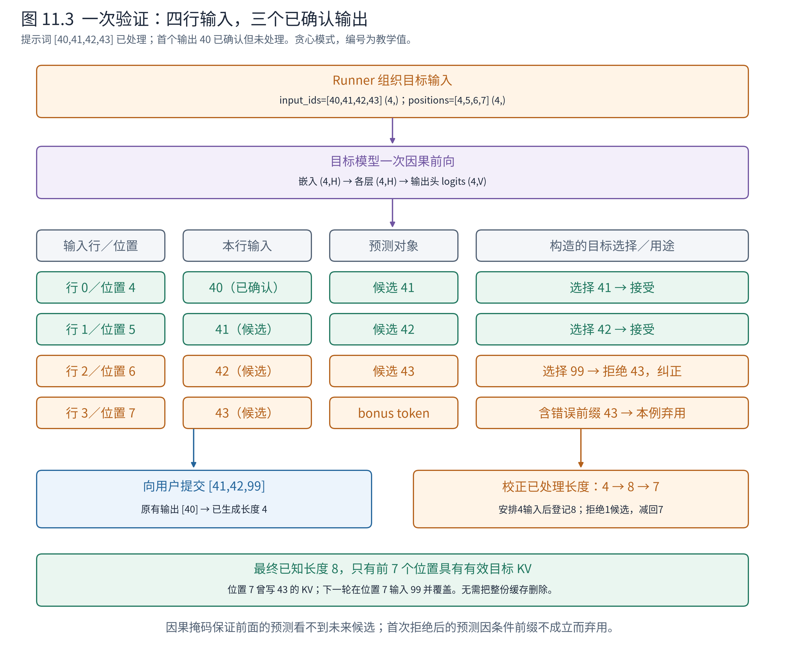
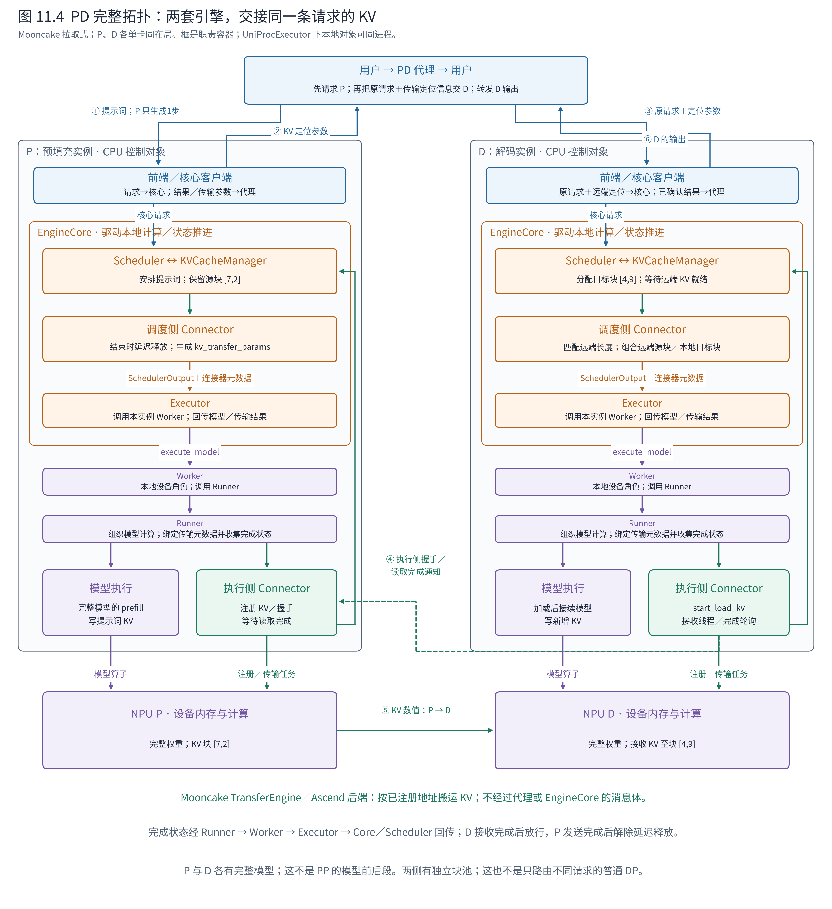
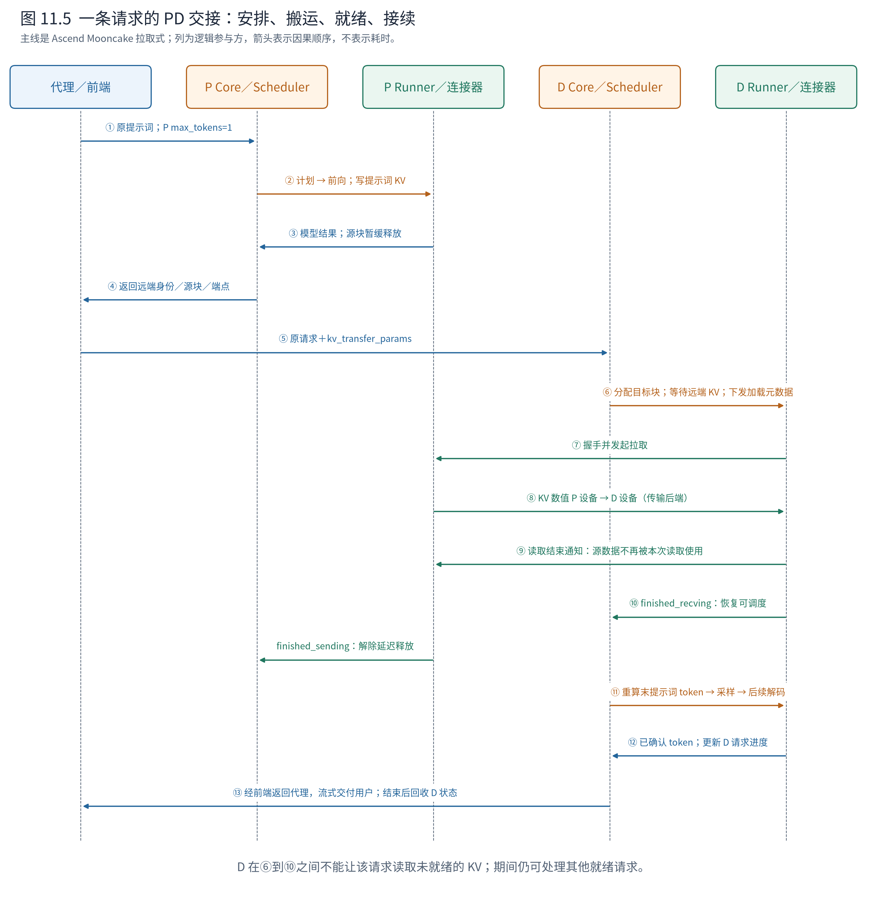
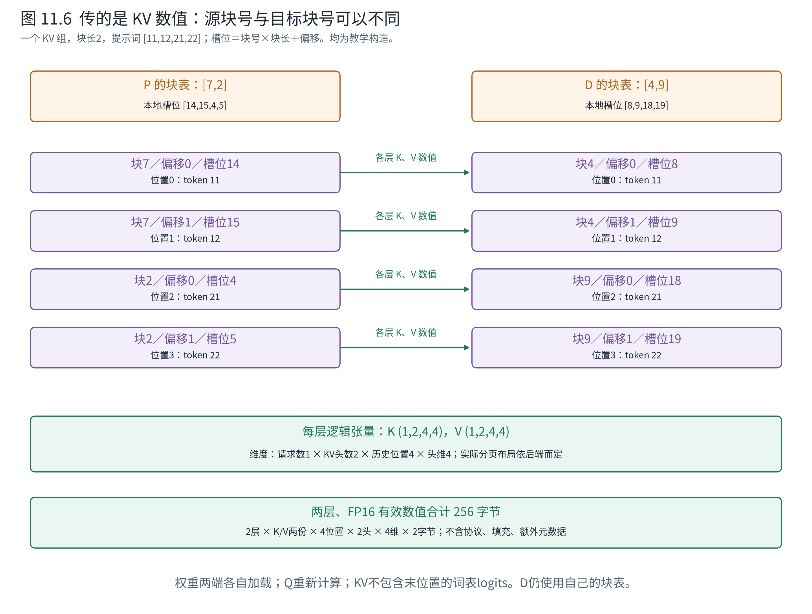

# 第 11 章 扩展功能如何接入这套架构

到这里，我们已有一台完整的文本生成引擎：入口统一需求，核心调度工作，KV 管理状态，执行层落实计算，前端交付结果。接下来遇到投机解码、多模态或 PD 分离时，不必重新记一套互不相干的名词。更有效的起点是问：这个功能新增了什么状态，改变了哪份接口，又要求谁与谁多一次协作？

本章从扩展接入点出发，重点打开两种改变执行闭环的机制：投机解码让一轮计算包含暂未确认的未来，PD 分离让同一请求的历史状态跨越两台引擎。我们沿完整请求逐步追踪对象、数据与进度，再回到结构化输出、多模态等扩展，观察它们怎样复用或改变同一套边界。具体部署调优和更多源码分支留到 Book8；理解这些机制所需的模块协作在本章展开。

## 11.1 用状态和接口识别扩展点


**图 11.1　扩展点总图。** 中间保留输入、调度／KV、执行、输出的主链，周围标出新增责任。连线表示影响范围，不代表某项功能只属于一个组件。依据 v0.30.0 结构化输出、投机、混合缓存及连接器接口，图将具体实现归纳为教学责任域。

先找熟悉的中央闭环，再沿一条支线思考。例如投机看似只在模型之前加一个小模型，但它产生的候选会改变调度预算、KV 预留、验证和最终提交。反过来，某个功能跨越很多组件，也不等于原有架构失效；需要检查的是新状态有没有明确所有者，接口能否表达所需信息。

## 11.2 投机解码：一次验证怎样接进原来的执行闭环

普通解码中，一条请求每轮通常只把一个尚未处理的 token 交给目标模型，得到一个新 token。即使设备还有余力，也不能直接把未来三个 token 一起输入，因为它们尚未生成。**投机解码（speculative decoding）**先用便宜的方法提出候选，让目标模型在一次前向中处理一小段假定的未来，再决定其中哪段能够成为真正的输出。省下的是多轮目标模型执行的开销，付出的是提议、验证和无效候选的计算。

要把它接入第 7 章的引擎，必须区分三种东西：已经交付的 token、暂未确认的候选，以及设备已经为这些位置写入的 KV。候选可以进入计算批次，却不能因此进入用户答案；设备算过某个位置，也不代表这个位置最终属于正确的序列。

### 11.2.1 拓扑先不扩张，Runner 内部先增加两个角色

先固定一个可以走完整流程的例子：单卡 NPU、普通因果注意力模型、同步调度、贪心选择、每次最多提议 3 个 token；不含 TP、PP、PD、结构化约束，也没有提前停止。提议方法采用 **n-gram 匹配**：从已有 token 历史中查找当前结尾曾经出现的位置，把当时紧随其后的 token 作为候选。它只查历史，不加载另一个语言模型。


**图 11.2　普通单卡执行如何增加投机职责。** 左列保留普通执行基线，右列打开投机后的同一套对象。橙色是调度计划，紫色是本地执行，蓝色是已确认结果，绿色虚线是供下一轮使用的候选。单卡 UniProcExecutor 下这些控制对象可以处于同一核心进程；图中的职责框不代表新增进程。依据 vLLM v0.30.0 和 Ascend 对应版本的 Runner、n-gram proposer 与拒绝采样接口绘制，未作硬件实测。

图右侧仍然只有一个 EngineCore、一个 Scheduler、一个 Executor、一个 Worker、一个 Runner 和一张卡。变化集中在 Runner 的内部：**提议器（proposer）**负责产生候选，目标模型负责计算候选条件下的预测，**拒绝采样器（rejection sampler）**负责选择可以提交的结果。目标模型输出 logits，接受判断由采样逻辑完成，不能把“验证”理解成目标模型自己返回一个真假标记。

本例的 AscendNgramProposer 在 CPU 上读取历史序列；目标模型前向和 AscendRejectionSampler 的张量操作在 NPU 上执行。若换成小草稿模型，提议器会增加模型权重、前向计算及相应状态；这仍不自动增加第二套 EngineCore 和 Scheduler。EAGLE、MTP 等方法还可能消费目标模型隐藏状态或使用额外预测模块，不能统一画成“另起一台小模型服务”。

**表 11.1　相对普通解码，各对象具体多做什么**

| 对象 | 普通解码 | 开启本例投机后 |
|---|---|---|
| EngineCore | 驱动调度、执行、采样和结果更新 | 同步路径还取回候选并交给 Scheduler，连接前后两轮 |
| Scheduler／Request | 依据已知 token 和已处理长度决定本步输入量 | 另存 `spec_token_ids`，选择本步验证的候选，按实际接受量校正进度 |
| KVCacheManager | 为本步输入安排槽位 | 还需满足候选及 lookahead 预留；预留容量不等于已确认历史 |
| Executor | 调用本执行后端并取结果 | 继续传递计划和结果，另提供 `take_draft_token_ids`；不判断候选是否正确 |
| Worker | 调用本地 Runner，管理设备执行角色 | 本例仍承担这一职责，不逐个核对候选，也不需要跨卡通信 |
| Runner | 组织输入、前向、普通采样、持久批次更新 | 增加候选输入、验证行索引、拒绝采样、下一轮提议及本地状态校正 |
| 模型／设备 | 一次处理一个待推进位置 | 一次处理一个待推进位置加多个候选，产生多行 logits，并写入暂时性 KV |
| 前端 | 交付已确认输出 | 可以一次收到多个已确认 token；仍看不到未接受候选 |

### 11.2.2 候选怎样从上一轮进入下一份 SchedulerOutput

设请求 A 的提示词为 `[40,41,42,43]`，预填充已经完成，并采样得到第一个输出 `40`。此时已知序列为 `[40,41,42,43,40]`：已生成长度是 1，已知总长度是 5，已处理长度是 4。最后的 `40` 还没有作为输入走过目标模型。

n-gram 提议器在本例允许用 1 个 token 匹配历史，发现当前结尾 `40` 曾在提示词开头出现，其后是 `[41,42,43]`，于是提出这三个候选。这里的编号和匹配长度是教学构造，不对应真实词语或默认配置。候选只是“历史曾这样接下去”的猜测，当前上下文下目标模型完全可能作出不同选择。

在这条同步路径中，Runner 在上一轮采样后产生候选。EngineCore 的 `post_step` 经 Executor 调用 `take_draft_token_ids()`，取得如下对象，再调用 Scheduler 的 `update_draft_token_ids(...)`：

```python
# 执行侧 → EngineCore → Scheduler；教学值，类型与字段来自源码
DraftTokenIds(req_ids=["A"], draft_token_ids=[[41, 42, 43]])
# Scheduler 将其保存到核心 Request；候选尚不属于 output_token_ids
request_a.spec_token_ids  # [41, 42, 43]
```

下一轮，Scheduler 看到：A 有一个已知但尚未处理的 `40`，又有三个可以尝试的候选。如果 token 预算、上下文上限和 KV 容量都允许，就安排 4 个输入位置，并把候选放进计划：

```python
# SchedulerOutput 字段节选；本例预算充足，完整验证三个候选
plan.num_scheduled_tokens           # {"A": 4}
plan.total_num_scheduled_tokens     # 4
plan.scheduled_spec_decode_tokens   # {"A": [41, 42, 43]}
```

这里的 4 不是“承诺生成 4 个 token”，而是“本步目标模型处理 4 个输入位置”。`scheduled_spec_decode_tokens` 也不能替代已有请求信息：Runner 仍靠本地请求缓存、增量更新和块表找到 A 的已确认历史与待处理的 `40`，再把三个候选接上。若预算不足，实际验证的候选可以少于提议数量；计划中的数量才是本步执行依据。

### 11.2.3 为什么一次前向可以验证三个尚未确认的 token

Runner 为 A 组织输入 `input_ids=[40,41,42,43]`，形状为 $(4,)$，对应序列位置 `[4,5,6,7]`，形状也为 $(4,)$。第一个 `40` 是上一轮确认的输出，后三个才是候选。模型嵌入把 $(4,)$ 变为 $(4,H)$，各层继续处理这四行，输出头把最终隐藏状态 $(4,H)$ 变为 logits $(4,V)$；$H$ 是隐藏维度，$V$ 是词表大小。

不能只说“目标模型同时检查三个答案”，还要知道**每一行到底在预测谁**。因果模型的一行输入预测它后面的 token，因此对应关系如下。

**表 11.2　输入位置、预测条件与验证对象**

| 输入行 | 本行输入及位置 | 本行 logits 的条件前缀 | 本行预测用于什么 |
|---|---|---|---|
| 0 | 已确认的 `40`，位置 4 | 原提示词＋`40` | 检查第一个候选 `41` |
| 1 | 候选 `41`，位置 5 | 原提示词＋`40,41` | 检查第二个候选 `42` |
| 2 | 候选 `42`，位置 6 | 原提示词＋`40,41,42` | 检查第三个候选 `43` |
| 3 | 候选 `43`，位置 7 | 原提示词＋`40,41,42,43` | 只有三个候选全被接受时，才可提供额外的 bonus token |

这四行能在同一次前向中计算，是因为候选值已经给出。注意力的因果约束仍然有效：行 0 看不到后面的三个候选，行 1 只能看到第一个候选，以此类推。设本层有 $h_q$ 个查询头、$h_{kv}$ 个 KV 头、头维 $d$，新 Q 的逻辑形状为 $(1,h_q,4,d)$，历史与新增 KV 的逻辑形状各为 $(1,h_{kv},8,d)$。按查询头到 KV 头的对应关系计算，概念上的注意力分数形状为 $(1,h_q,4,8)$，未来位置被屏蔽；实际后端无须物化这张完整分数矩阵。



**图 11.3　预测行对齐与拒绝后的状态。** 本例目标模型的贪心选择依次为 `41、42、99`，所以前两个候选被接受，第三个被替换。位置 7 虽然算过候选 `43`，却不属于最终历史；下一轮要在该位置处理 `99`。形状与编号均为教学构造，依据因果注意力、SpecDecodeMetadata 和结果更新逻辑推演。

Runner 用 SpecDecodeMetadata 保存候选编号、每条请求的候选数量、目标 logits 行索引和 bonus 行索引。本例前三行用于候选接受判断，末行是 bonus 行。它解决的是“批次里哪几行属于谁、在验证哪个位置”，不负责生成模型预测。多请求混排时，这层索引尤其重要：不能把 B 的 logits 用来检验 A 的候选。

### 11.2.4 接受判断为何必须在第一个拒绝处截断

在本例的贪心模式中，拒绝采样器逐位置检查目标模型的最大概率 token：行 0 选择 `41`，与候选一致，接受；行 1 选择 `42`，继续接受；行 2 选择 `99`，与候选 `43` 不同，于是返回 `[41,42,99]`。

此时不能再采用行 3 的预测。那一行的条件前缀含有被拒绝的 `43`，真实前缀却应该以 `99` 结尾；其计算条件已经不成立。若第一个候选就被拒绝，本轮只提交纠正 token；若三个全部被接受，则可再提交行 3 提供的 bonus token，本轮最多推进 4 个输出。停止词和生成上限还可能进一步截短可交付序列。

随机采样时，接受规则不能照搬“与最大概率 token 相同”。标准拒绝采样利用目标分布与提议分布的关系决定接受概率，并在拒绝处从校正后的分布采样，以保持目标采样分布；没有显式草稿概率的提议器有对应的处理分支。这里选贪心案例是为了把模块和位置关系看清，不将它当作所有采样模式的算法。NPU 路径由 Runner 的 `_sample` 选择 AscendRejectionSampler；普通解码则进入普通 Sampler。

### 11.2.5 输出提交、计算进度和 KV 怎样一起纠正

验证结果经 Runner → Worker → Executor 返回 EngineCore。EngineCore 把它和本轮计划一起交给 Scheduler 的 `update_from_output`，后者才知道“安排了三个候选，最终接受了几个”：

```python
# ModelRunnerOutput 字段节选；99 是纠正 token，43 没有交付
ModelRunnerOutput(
    req_ids=["A"], req_id_to_index={"A": 0},
    sampled_token_ids=[[41, 42, 99]],
    # logprobs、连接器输出等其他字段省略
)
```

返回 3 个 token，其中两个来自候选，另一个是纠正 token，所以接受候选数为 2，拒绝候选数为 1。Scheduler 在安排这轮计算时已把计算进度从 4 向前登记到 8；收到结果后，依据拒绝数量减回 7。这里的登记是调度记账，不能脱离执行完成时序理解为设备已经写好所有状态。

把最终序列逐位写出，就能检查这个数字：

```text
位置：             0   1   2   3 |  4   5   6 |  7
最终已知 token：  40  41  42  43 | 40  41  42 | 99
有效目标 KV：      有  有  有  有 | 有  有  有 | 尚未计算 99
本轮曾写的位置7：                            43 的 KV，已失效
```

已知总长度现在是 8，已生成长度是 4，已处理长度是 7。下一轮仍差一个已确认位置：把 `99` 输入模型，才会产生 `99` 的 KV 和它之后的预测。如果下一轮又有候选，就把它们接在 `99` 后面一起验证。

**校正不要求立刻把错误 KV 的物理字节擦成零。** 对普通注意力缓存，关键是有效长度、位置和块表不能把被拒绝的后缀当成可读历史；后续处理正确 token 时覆盖相应槽位。整块是否保留为预留容量、何时回收，仍由缓存策略决定。因此拒绝一个 token 不等于释放一个物理块，更不等于整个请求的 KV 都要重算。Runner 也要更新自己的批次状态和提议输入，使下一次提议基于已经接受的序列；核心记账与执行侧记账必须一致。

循环状态模型不能简单照搬这段“截短可见 KV 后缀”的处理，因为它的状态可能已被候选整体更新，需要额外的状态快照、恢复或专门支持。第 11.5 节的状态类型差异，在投机中同样构成实现约束。

### 11.2.6 回到整机：多推进几个 token 的收益从哪里来

本例用一次目标前向确认了 `41、42、99`。普通解码需要三轮目标前向，分别处理 `40`、`41`、`42` 才能得到这三个输出；投机把它们组织成一个较大的批次，还额外算了最终无用的候选 `43`。能否更快，要看减少的轮次开销能否覆盖提议和额外计算，而不是看返回列表变长了多少。

因此，投机越长不一定越好：候选不准会增加无效计算，草稿模型会占用权重和缓存空间，验证输入也占用全局 token 预算，可能挤压其他请求。本例 n-gram 提议成本较小，但是否能猜中依赖文本的重复性。

把图 11.2 合起来看，新增的是同一请求内部的一条“候选 → 计划 → 验证 → 提交／校正”反馈环。同步路径用 DraftTokenIds 把两轮接起来；异步调度可由执行侧保存、填入候选，并用占位进度解耦 CPU 往返，不能强制套用本节的同步时序。若目标模型使用 TP，验证前向仍按第 10 章执行层内通信；提议方法与并行配置能否组合，还须检查具体支持路径。Book8 第 2 章再沿这些分支展开源码，本节的对象、输入位置与提交边界则保持成立。

## 11.3 结构化输出：约束必须进入 token 选择之前

若用户要求符合某种 JSON schema，仅在最终输出后检查文本，会发现错误却无法保证生成过程遵守结构。结构化输出把约束转成可以随生成推进的状态，在选择后续 token 时限制允许的集合。

例如期望一个包含 `name` 字段的对象。生成走到某个语法位置后，接下来哪些 token 合法，取决于已接受前缀和语法状态。概念上可以形成词表维度的允许掩码，再应用到采样候选；真实实现可采用紧凑位表示，不必物化一个普通浮点矩阵。

vLLM 的结构化输出管理器组织语法准备、掩码以及接受 token 后的状态推进。语法准备可能需要等待，因此请求除了等待计算容量，还可能等待约束就绪。采样端消费约束，核心根据最终接受的 token 推进语法状态，输出端交付结果。

这里的类对象分工是：StructuredOutputManager 根据请求的语法状态生成掩码，Scheduler 将请求身份与掩码组织为 GrammarOutput，EngineCore 经 Executor 的采样接口将它交给 Runner。Runner 负责把掩码对应到正确的 logits 行，语法管理器不替模型计算 logits。以一条请求、无投机、仅 32 个词项的教学词表为例，假设当前只允许编号 1、4，则一个紧凑位掩码可以表示为：

```python
GrammarOutput(
    structured_output_request_ids=["A"],
    grammar_bitmask=np.array([[18]], dtype=np.int32),  # (1, 1)
)
```

18 的二进制是 `00010010`，表示这两个编号对应的允许位；32 个词项装入一个 int32 字。本例仅解释位表示，不声称真实模型的某个 JSON 位置恰好允许这两个 token。第 0 行属于 A，由 `structured_output_request_ids` 确定；不能因为 A 本轮在另一张批次表中排第 2 行，就直接把掩码第 0 行施加给别的请求。真实词表更大、投机时可能有多行，具体宽度与填充由语法后端决定。字段见 [GrammarOutput](https://github.com/vllm-project/vllm/blob/ced6857afa0ea7b2e3f0846a62e1394e90f15607/vllm/v1/core/sched/output.py#L323)。

这里的代价是约束构建、状态维护与功能兼容。若与投机组合，还需考虑候选接受顺序怎样推动语法，而不是只在最终字符串上套一次校验。Book8 第 3 章沿这条接口继续深入。

## 11.4 多模态与 LoRA：输入和模型身份不再只有文本

多模态请求可能携带图片、音频等内容。输入侧需要把它们变成模型可接受的表示，执行侧可能运行编码器或使用预计算特征，并把这些特征与文本位置正确关联。调度于是可能多出编码器预算、特征缓存以及输入就绪的约束。

可以想象请求 A 附带一张图片。若只计算文本 token 预算，而忽略尚未完成的图像编码，调度计划就可能缺少真正需要的输入；若图片特征被复用，又要保证其身份和生命周期正确。这里的核心变化是计算与状态类型增加了，不是所有输入都突然变成可以直接送进文本分词器的字符串。

InputProcessor 将这项关系放进 EngineCoreRequest 的 `mm_features`，EngineCoreProc 接收并预处理后保存到核心 Request，Scheduler 再经 EngineCore、Executor 和 Worker 把相关特征和编码安排交给 Runner。输入侧负责表示和位置对应，Scheduler 决定本轮编码哪些特征，Runner 组织模型编码与结果复用。以一条独立多模态请求 M 为例，设图片占据提示词从位置 2 起的 4 个占位位置；若接收侧已有相应处理数据缓存，一项特征可以是：

```python
MultiModalFeatureSpec(
    data=None,  # 此例明确假设接收侧缓存已具备处理数据
    modality="image", identifier="toy-image-01", mm_hash="toy-image-01",
    mm_position=PlaceholderRange(offset=2, length=4),
)
# 本轮需要计算这项编码特征时，SchedulerOutput 的字段节选
plan.scheduled_encoder_inputs  # {"M": [0]}
```

`[0]` 指向 M 的第 0 项多模态特征，不是设备 0；`offset=2,length=4` 把特征与文本序列中的位置 2、3、4、5 关联。处理数据缓存与模型编码结果缓存也不是同一件事：省去传输处理数据，不保证无需执行编码器。无接收侧缓存时必须携带实际的 MultiModalKwargsItem，内容与形状由模型处理器定义，不能把 `data=None` 当作普遍可用的图片请求。字段见 [MultiModalFeatureSpec](https://github.com/vllm-project/vllm/blob/ced6857afa0ea7b2e3f0846a62e1394e90f15607/vllm/multimodal/inputs.py#L347)。

LoRA 则在共享基础模型的同时，为请求选择特定适配器。请求身份除了自己的 token 历史，还要关联正确的适配器；执行侧需要管理适配器权重和批次中的对应关系。不同适配器可能改变计算结果，因此不能仅凭提示词相同就无条件共享其状态，缓存身份也需要包含相关区别。

这项选择以 LoRARequest 沿 InputProcessor、核心 Request 和 NewRequestData 传递，经 EngineCore/Executor/Worker 到执行侧，例如 `LoRARequest(lora_name="adapter-demo", lora_int_id=7, lora_path="/models/adapter-demo")`。名称、编号和路径是教学值；上游采用 LoRAModelRunnerMixin 的运行器持有 LRUCacheWorkerLoRAManager，由后者管理适配器加载与激活，Scheduler 则使用适配器身份与并发限制安排请求。这是“安排哪些请求”与“准备哪些适配器权重”的分工。这个小对象传的是参数选择，不是把整份 LoRA 权重复制进每次调度计划。结构见 [LoRARequest](https://github.com/vllm-project/vllm/blob/ced6857afa0ea7b2e3f0846a62e1394e90f15607/vllm/lora/request.py#L8)。

把两个功能放在一起比较，可以看出它们都要求请求携带更多计算语义，但落点不同：多模态扩展输入与编码路径，LoRA 扩展模型参数选择与管理。二者都可能影响批次组织、缓存与执行模式。Book8 第 4 章进一步讨论服务中的组合约束。

## 11.5 混合状态：不是每层都需要保存完整历史

第 6 章以完整注意力讲分页 KV。对于滑动窗口层，只需一定范围的近期历史；对于循环或状态空间模型，历史可能被压缩到某种递推状态；混合模型把这些层放在同一个网络中。

于是“请求已经处理 100 个 token”不再意味着每一层都必须保存 100 个位置的同型 K、V。启动需要识别不同状态规格，缓存管理需要按组安排资源，前缀复用还需要满足各类状态自己的有效条件。

例如一个教学模型同时含完整注意力层和只保留最近 4 个位置的窗口层。请求推进到位置 8 后，前者仍可能需要全部相关历史，后者不必继续保留最早位置。但这不等于整个请求的早期状态都能释放，因为完整注意力层仍然依赖它。缓存分组就是把“同一请求、不同层的不同需要”纳入管理的一种组织办法。

与第 4 章一样，规格先由执行侧报告，EngineCore 形成 KVCacheConfig，再分别交给 Worker 和 Scheduler/KVCacheManager。双组配置中，这一差异可以落为如下字段节选；小块长、头维和层名仅供教学：

```python
KVCacheConfig(
    kv_cache_groups=[
        KVCacheGroupSpec(layer_names=["full_layer"],
            kv_cache_spec=FullAttentionSpec(
                block_size=2, num_kv_heads=2, head_size=8,
                dtype=torch.float16)),
        KVCacheGroupSpec(layer_names=["window_layer"],
            kv_cache_spec=SlidingWindowSpec(
                block_size=2, num_kv_heads=2, head_size=8,
                dtype=torch.float16, sliding_window=4)),
    ],
    # num_blocks、实际张量布局等由初始化另行确定，此处省略
)
```

同一条请求的块号因此需要按组排列，不能只交付一条没有组语义的平面列表。Worker 据组规格准备相应执行状态，KV 管理据各组需求判断保留与回收；窗口的具体 token 可见范围还必须遵守模型及后端语义。字段见 [KVCacheGroupSpec](https://github.com/vllm-project/vllm/blob/ced6857afa0ea7b2e3f0846a62e1394e90f15607/vllm/v1/kv_cache_interface.py#L1392) 与 [SlidingWindowSpec](https://github.com/vllm-project/vllm/blob/ced6857afa0ea7b2e3f0846a62e1394e90f15607/vllm/v1/kv_cache_interface.py#L807)。

具体分组、页大小和状态复制方式随模型及实现演进。官方 Hybrid KV 文档也标明其历史设计基线；本书只将经源码核验的规格、分组与协作原则作为主线，不把其中某个早期例子的算法当成所有混合模型的现行规则。Book8 第 1 章继续展开。

## 11.6 PD 分离：两台完整引擎怎样交接同一条请求

在普通单卡引擎里，提示词预填充和后续逐 token 解码使用同一套 EngineCore、Scheduler、Runner 与 KV 存储。预填充写出的 KV 留在原卡上，解码直接读取；两阶段之间无需传输缓存，也无需重新建立请求。

**预填充与解码分离（prefill–decode disaggregation，PD 分离）**把这两个阶段交给不同引擎实例：P 侧集中处理提示词，D 侧接续生成。长提示词计算与持续解码因此可以使用不同的实例数量和并行配置，分别调节首 token 时延与后续 token 时延。但原来“KV 已经在本地”的前提消失了：D 必须取得正确的历史状态，P 必须在状态交接完成前保住源数据。

### 11.6.1 完整拓扑：P 和 D 各有一套引擎，并不共享 Scheduler

先选一个具体实现走到底：vllm-ascend 的 **MooncakeConnector 拉取式 PD**，一个 P 实例、一个 D 实例，各用一张 NPU，TP=PP=1；模型、权重、tokenizer、位置编码和 KV 规格一致，普通文本模型、无投机、无本地前缀命中。部署入口使用在线代理。这里的“拉取”指 D 发起读取，实际 KV 数据仍然从 P 流向 D。



**图 11.4　两个本地闭环，加上跨实例交接。** 每侧都展开 EngineCore、Scheduler、KVCacheManager、Executor、Worker、Runner 和设备。橙色连接器位于调度侧，绿色连接器位于执行侧；二者是不同角色的对象，不是共享一个跨进程实例。蓝色为请求／结果，橙色为本轮计划，绿色实线为 KV 数值的传输，绿色虚线为握手／完成消息。单卡采用 UniProcExecutor 时，执行侧对象可以与核心同进程，框线表示职责边界。依据固定版本的 Ascend MooncakeConnector、示例代理和上游 KV Connector V1 接口绘制。

这张图与第 10 章有两个重要区别。PP 是一个引擎的不同 rank 分别执行模型前段和后段，逐轮传递中间隐藏状态；这里 P、D 都拥有完整模型，按请求的时间阶段分工，交接的是历史 KV。DP 通常把不同请求分给不同副本；PD 则让同一用户请求先后经过两个引擎，两边有各自的内部 Request 和调度进度，必须通过协议关联身份。

**表 11.3　本例对象数量与归属**

| 对象 | 普通单卡 | 一个 P＋一个 D | 归属与关系 |
|---|---:|---:|---|
| EngineCore | 1 | 2 | P、D 各一个，分别驱动本地循环 |
| Scheduler／KVCacheManager | 各 1 | 各 2 | 分别管理本地请求、预算、块池；不共享空闲块表 |
| Executor | 1 | 2 | 每个 Core 持有一个，只组织本实例执行资源 |
| Worker／Runner | 各 1 | 各 2 | 每侧一个 Worker 持有一个 Runner，服务本地卡 |
| 物理 NPU | 1 | 2 | 各放一份完整权重和本地 KV 存储 |
| 调度侧／执行侧连接器角色 | 无 | 各 2 | 每侧各一份调度角色与执行角色，协作安排、搬运和完成通知 |
| PD 代理 | 无此职责 | 1 | 为同一请求选择 P、D，转交请求与远端缓存定位信息 |

**表 11.4　熟悉的模块在 P、D 两侧分别多做什么**

| 模块 | P 侧 | D 侧 |
|---|---|---|
| 前端／核心客户端 | 接收预填充子请求，把传输参数带回代理 | 接收原请求及远端 KV 信息，最后把生成结果返回代理 |
| EngineCore | 驱动本地预填充和结果处理，传递连接器握手信息 | 驱动加载等待与后续解码，收取执行侧完成状态 |
| Scheduler | 安排提示词计算；计算结束后询问连接器能否释放块 | 查询远端可复用长度、申请目标块；KV 未就绪时阻止该请求进入前向 |
| KVCacheManager | 管理源块，遵守延迟释放要求 | 分配本地目标块，加载完成后才允许作为有效历史使用 |
| Executor／Worker | 沿既有接口调用 Runner、返回结果 | 同样调用本地 Runner；不把 P 的整个调度计划接过来执行 |
| Runner | 执行预填充，配合连接器生命周期和完成轮询 | 绑定加载元数据；可只推进传输而不跑模型，就绪后准备解码输入 |
| 调度侧连接器 | 生成远端定位信息，表达“暂缓释放” | 把远端块与本地块对应，生成本轮加载元数据 |
| 执行侧连接器 | 注册本地 KV 内存，服务握手并等待读取完成 | 启动读取，组织地址和长度，完成后上报接收结果 |
| 模型／NPU | 计算提示词各层 KV | 从本地目标块读历史，继续生成并写入新 KV |

### 11.6.2 请求开始之前：权重、缓存和传输端点都要准备好

两侧仍按第 4 章完成模型加载、KV 容量规划、缓存分配和执行预热。PD 新增的准备是：执行侧连接器要知道本地 KV 张量究竟位于哪些内存区域，注册这些区域，并准备对端能发现的传输端点与布局描述。

在所选实现中，MooncakeConnectorWorker 的 `register_kv_caches` 接收各层 KV 张量，记录内存地址、块大小、层／组关系等信息。底层 TransferEngine 使用 Ascend 传输后端；控制侧再汇集 Worker 提供的握手信息，使请求结果中能够给出正确的远端引擎身份和连接位置。

所以“P 的块号 7”尚不足以发起读取。D 还需要知道是哪台引擎、哪个 rank、哪种布局下的块 7，以及那个块对应的已注册内存区域。对于本例的单卡同布局，这个对应关系简单；多卡或不同布局下，连接器还要把各源分片映射到各目标分片。

### 11.6.3 第一段行程：P 算完后，代理拿到的是定位信息

设用户请求 A 的提示词是 `[11,12,21,22]`，要求继续生成。代理先选 P，把同一提示词交给它，并把这次 P 子请求限制为生成 1 个 token，设置 `do_remote_decode=True`。意思是：本端完成预填充，后续生成将由远端接续。P 的 Scheduler 为提示词安排 4 个输入，假定块长为 2，分配本地块 `[7,2]`。

随后仍是熟悉的路径：P EngineCore → Executor → Worker → Runner → 模型／NPU。模型算完四个位置，P 卡中已有每一层对应的历史 KV，并采样出一个 token，例如 `31`。P 子请求到达长度上限时，Scheduler 调用调度侧连接器的 `request_finished`。普通请求此时可以释放状态；本例连接器返回“延迟释放”，同时生成 `kv_transfer_params`。

```python
# P 的连接器 → P 核心/前端 → 代理 → D 请求；字段节选、教学值
kv_transfer_params = {
    "do_remote_prefill": True, "do_remote_decode": False,
    "remote_engine_id": "P-engine",
    "remote_request_id": "A-P",  # P 内部身份；D 用它关联源请求
    "remote_host": "192.0.2.10", "remote_port": 14579,
    "remote_block_ids": ([7, 2],),  # 一个 KV 组中的两个源块
    "remote_block_size": 2, "num_prompt_blocks": 2,
    "last_token_id": 31,
    # TP/PCP/DCP 规模与多节点位置等字段省略
}
```

这份对象没有 K、V 数值，只描述从哪里取得状态。`remote_block_ids` 也不是“有 7 页和 2 页”，而是源引擎块池中的两个块编号。外层元组保留 KV 组的维度，不能把组编号和设备编号混为一谈。

这里还要分清**通用接续思想与本例代理的具体行为**。所选示例代理把 P 返回的传输参数附到原请求，再交给 D；首次转发时并未把 P 采样的文本追加到 D 的提示词，也没有把它先交付给用户。虽然元数据带有 `last_token_id`，也不能据此推断 D 一定从该 token 开始前向。D 怎样产生自己的首个输出，要等第 11.6.7 节走到加载完成后才能确定。

### 11.6.4 第二段行程：D 先分配目标块，再等待数据到齐

D 的前端把原提示词和 `kv_transfer_params` 转成自己的核心请求，交给 D EngineCore。两边不是共享同一个 Python Request；`remote_request_id` 等字段把 D 的请求与 P 保留的状态联系起来。

D Scheduler 查询调度侧连接器的 `get_num_new_matched_tokens`。在本例无本地命中的条件下，连接器回答“有 4 个提示词位置可以从远端取得，且需要异步加载”。这不是模型已经在 D 算过 4 个位置，而是一项待完成的远端复用安排。

Scheduler 随即让 KVCacheManager 分配接收位置，例如 D 本地块 `[4,9]`，并调用 `update_state_after_alloc` 把分配结果交给连接器。请求进入 `WAITING_FOR_REMOTE_KVS`，暂不作为可计算请求推进。实现可能在等待阶段先登记外部进度，因此必须把进度值与请求状态一起理解：一个长度数字不能代替“传输已完成”的事实。

调度侧连接器再通过 `build_connector_meta` 把远端定位信息和本地目标块组合，放入 `SchedulerOutput.kv_connector_metadata`。其内容可观察为：

```python
# MooncakeConnectorMetadata 内 requests["A-D"] 的 ReqMeta 字段视图
# 不是完整构造调用；省略连接位置、布局和并行规模等必要字段
{
    "local_block_ids": ([4, 9],),
    "remote_block_ids": ([7, 2],),
    "num_external_tokens": 4,
    "num_computed_tokens": 0,  # 本次查询时已有的本地前缀长度
    "remote_engine_id": "P-engine",
    "remote_request_id": "A-P",
}
```

这份计划经 D EngineCore → Executor → Worker 到 Runner。**即使这一轮没有任何模型输入 token，也可能有必须执行的传输任务。** Runner 的 `kv_connector_no_forward` 就用于在不运行模型的情况下绑定元数据、启动加载、收集完成情况。否则会出现循环等待：Scheduler 在等 KV，执行侧因为没有 token 而永远不开始搬运 KV。



**图 11.5　请求可结束，缓存却未必可立即回收。** 顺序图沿代理、两侧核心与两侧执行层展开；“读取 KV”期间，D 的该请求处于等待状态，P 的源块仍受保护。完成后两侧分别更新自己的生命周期，不要求同时更新。箭头表示协议因果，非耗时比例；依据所选拉取实现及 Scheduler 的远端等待状态推演。

### 11.6.5 真正的 KV 怎样从 P 卡到 D 卡

现在沿一次读取向下追。D Runner 绑定本轮元数据，调用执行侧连接器的 `start_load_kv`；MooncakeConnectorWorker 将请求交给接收线程。接收线程取得 P 侧的握手元数据，按层、KV 组和块映射计算源地址列表、目标地址列表、每段字节长度，再调用 TransferEngine 的 `batch_transfer_sync_read`。

这里的 `sync` 约束这次传输调用所在的后台线程，不等于 EngineCore 必须停在原地等待整段传输。相对于引擎调度循环，这是一项在途任务；其他已就绪请求仍可按预算推进。

把实际数据与控制消息分开，路径就清楚了：

- **本地安排路径**：D Scheduler → D EngineCore／Executor／Worker → D Runner → D 执行侧连接器，交付远端身份、本地块与读取任务。
- **跨端控制路径**：两侧执行侧连接器通过侧通道交换已注册区域、布局等握手信息，并发送读取完成通知；所选实现使用 ZeroMQ 消息。
- **大块数据路径**：P 的已注册 KV 设备内存 → Mooncake 的 Ascend 传输后端与可用硬件链路 → D 的已注册目标内存。这里复制的是 K、V 数值，不经过代理 HTTP 响应，也不先把它们装入 EngineCore 的 Python 请求对象。

因此，不能把图画成 P EngineCore 把 KV 发送给 D EngineCore，也不能把 PD 数据交换一概叫作 HCCL All-Reduce。第 10 章的 TP 在层内归约计算结果；本例连接器按地址复制已有状态，使用的是自己的传输引擎。CPU 会建立连接、提交任务和处理完成消息；数据是否经主机内存暂存，则取决于传输模式和硬件路径，不能仅凭“CPU 发起”判断。

同一套 Ascend 接口还存在 D2RH 模式，明确走 P HBM → D 主机内存 → D HBM；本节主图选择普通拉取模式，不把这条两跳路径混进去。逐层推送模式则由 P 在层 KV 就绪后向 D 发送，需要更早获得 D 的接收位置，时序也与本例不同。

### 11.6.6 传输内容不是块号：把两个块逐位置对齐

回到块长 2 的例子。块号用于定位，传输要复制的是每个块中各层、各位置的实际 K、V。本例的对应关系为：

**表 11.5　同一历史位置在两台设备上的地址映射**

| 提示词位置／token | P 源块／偏移 | P 槽位 | D 目标块／偏移 | D 槽位 |
|---|---|---:|---|---:|
| 0／11 | 块 7，偏移 0 | 14 | 块 4，偏移 0 | 8 |
| 1／12 | 块 7，偏移 1 | 15 | 块 4，偏移 1 | 9 |
| 2／21 | 块 2，偏移 0 | 4 | 块 9，偏移 0 | 18 |
| 3／22 | 块 2，偏移 1 | 5 | 块 9，偏移 1 | 19 |

槽位由“块号乘块长，再加块内偏移”得到。请求的历史顺序没有改变，物理地址却完全不同。D 继续使用自己的块表 `[4,9]`，不能把 P 的块表 `[7,2]` 原样当成本地地址使用。



**图 11.6　同一份历史，两个块池中的不同位置。** 上部逐位置对齐；下部展开逻辑张量和字节量。模型层数、头数、块长均是教学构造，实际张量的分维顺序、填充和量化元数据由后端决定；本图不代表传输性能。

为看见“到底传多大的一份东西”，设模型有 2 层，每层 2 个 KV 头，头维 4，K、V 都用 2 字节元素表示。每层需要传递的逻辑 K、V 各为 $(1,2,4,4)$，四个维度依次为请求数、KV 头数、历史长度和头维。两层的有效历史数值合计为：

$$
2\text{ 层}\times 2\text{（K、V）}\times 4\text{ 位置}\times 2\text{ 头}\times 4\text{ 维}\times 2\text{ 字节}=256\text{ 字节}.
$$

用人话说，一个 token 在每一层都留下 K 和 V，传输量是这些历史状态的总和。这里没有传模型权重，因为两端启动时各自加载；没有传 Q，因为后续查询会重新计算；也没有传最终词表 logits。实际块传输可能包含填充、尾块的未用区域或量化辅助数据，所以 256 字节只计算本例有效数值，不是网络报文长度。

由此也能看出布局兼容为什么是正确性条件：双方要对模型身份、层、KV 头、元素类型、位置语义和有效长度达成一致。若 P、D 使用不同 TP 规模，源 KV 分片与目标分片可能需要重组；这项工作属于连接器支持范围，不能因为两个模型名称相同就假定可以逐块原样拷贝。

### 11.6.7 完成通知如何让 D 开始计算，让 P 释放源块

D 的接收线程完成所需读取及必要的布局整理后，记录完成，并向 P 发送读取结束消息。Runner 在本轮或后续轮询中取到完成情况，将其放入 `ModelRunnerOutput.kv_connector_output`，经 Worker／Executor 回到 D EngineCore，再由 Scheduler 消费。例如完成通知的字段节选为：

```python
# D 执行侧 → D Scheduler
KVConnectorOutput(finished_recving={"A-D"})
# P 执行侧确认源请求不再被本次传输使用后 → P Scheduler
KVConnectorOutput(finished_sending={"A-P"})
```

D Scheduler 收到的是自己请求的接收完成，随后把它从远端等待状态恢复到可调度状态。P Scheduler 收到的是自己源请求的发送完成，随后解除延迟释放；如果块还有前缀缓存或其他引用，是否回到空闲池仍按本地引用规则处理。**P 子请求的生成结束、D 的传输完成、P 的源块可复用，是三个不同事件。**

现在还差一个容易漏掉的步骤：D 已经拿到全部 4 个提示词位置的 KV，为什么不能立刻采样？因为 KV 记录注意力历史，没有保存“提示词最后一行经过完整模型后得到的 logits”。所选代理又没有把 P 的采样结果当成 D 已提交的输出。因此上游 Scheduler 在全提示词远端命中后，把待执行边界退到最后一个提示词位置。

本例中，D 把已处理长度由 4 调整到 3，安排输入 `22`，位置为 3。Runner 使用前面三个位置的有效历史，重新处理这个末提示词 token，得到 logits $(1,V)$，再采样出 D 的第一个输出。这个小步重算不是整段 prefill 重跑；随后才进入每轮输入上一个生成 token 的普通解码。即使 P 曾得到 `31`，随机采样下也不能假定 D 必须重复同一个样本。

若协议明确把 P 的首 token 纳入 D 的已确认序列，则接续位置会不同：D 可以处理该首 token，而不是重新产生它。那需要同时处理采样历史、停止条件和对用户的交付边界，不能只在图上画一根“首 token”箭头便认为已实现。本节以核验过的示例代理路径为准。

异常也要沿同一条状态链处理。传输失败时，执行侧可报告失败请求或无效块，Scheduler 按仍有效的前缀修正进度，决定后续重算或错误处理；不同连接器并不承诺相同重试策略。尤其不能只收到“任务结束”就把未成功写入的目标块当成命中，也不能因为用户已取消就立即覆盖仍被读取的源块。

### 11.6.8 两端继续扩成多卡时，哪些关系保持不变

把本例每侧改成 TP=2，便有两个 EngineCore、两个 Scheduler、两个 Executor、四个 Worker、四个 Runner 和四张卡。P 的两个 rank 协作计算提示词，D 的两个 rank 协作解码；两侧各自的 TP 通信仍由模型层触发。跨 P／D 的 KV 搬运则由各执行侧连接器根据分片关系完成。两类通信可以同时存在，却服务不同目的。

同 TP、同布局时可以按相应分片理解传输；不同 TP 时不能先假定“一张 P 卡只对应一张 D 卡”，必须由连接器核对并映射头分片、层和块。再增加多个 P 或 D 副本，代理负责选择哪一对实例接这条请求，本地 Scheduler 仍只决定本实例如何推进，不会变成跨整个集群的统一调度器。

PD 的收益来自独立安排两类负载，代价来自额外权重副本、传输带宽、在途 KV 占用、就绪等待和跨端故障处理。传输期间源块与目标块可能同时占用容量；如果交接比省下的排队干扰更贵，分离就未必划算。回看图 11.4，原来的引擎闭环保留了两份，真正新增的是它们之间完整的状态交接协议：请求身份能关联、目标位置已准备、数值搬运已完成、计算边界可接续、源状态可安全释放。

## 11.7 用一张影响矩阵保持全局认识

**表 11.6　扩展改变什么，以及接着去哪里读**

| 功能 | 新增或改变的状态 | 关键协作边界 | 深入阅读 |
|---|---|---|---|
| 投机解码 | 候选、接受数量、预留／在途进度 | 提议、调度、验证、KV 校正 | Book8 第 2 章 |
| 结构化输出 | 语法对象与生成位置 | 约束管理、采样、接受结果 | Book8 第 3 章 |
| 多模态 | 特征、编码器状态、模态位置 | 输入、编码预算、模型执行 | Book8 第 4 章 |
| LoRA | 适配器身份与权重驻留 | 请求、缓存身份、批次与模型 | Book8 第 4 章 |
| 混合状态 | 多种状态规格及有效历史 | 启动规格、分组、回收与命中 | Book8 第 1 章 |
| PD 分离 | 远端位置、就绪、在途传输 | 两端调度、连接器、设备传输 | Book8 第 7 章 |

这张表不是兼容性矩阵，不表示所有功能可任意组合。它是一张调查地图：组合两个功能时，寻找它们共同修改的状态和接口，就知道哪里最需要核查。比如投机与结构化输出都关心接受 token 的顺序，PD 与缓存回收都关心块何时可复用。

高级功能没有使核心原则失效，反而检验它们是否足够清楚。最后一章将整张地图收拢，练习从设计问题和运行症状出发选择源码入口。

## 章末源码导航

投机与 PD 可沿下列入口复查完整闭环，其余功能先识别状态的生产者与消费者。上游固定于 vLLM v0.30.0（ced6857），NPU 实现固定于本册对应的 Ascend 提交（c09d3e2）；这些是源码阅读依据，本章构造例没有作为多卡实测执行。

<!-- NAVIGATION -->

| 要回答的问题 | 固定版本入口 | 读到哪里即可停止 |
|---|---|---|
| 候选验证位于哪里？ | [RejectionSampler](https://github.com/vllm-project/vllm/blob/ced6857afa0ea7b2e3f0846a62e1394e90f15607/vllm/v1/sample/rejection_sampler.py#L45) | 识别候选与验证结果接口 |
| 语法约束怎样进入采样？ | [StructuredOutputManager.grammar_bitmask](https://github.com/vllm-project/vllm/blob/ced6857afa0ea7b2e3f0846a62e1394e90f15607/vllm/v1/structured_output/__init__.py#L314) | 看请求状态到掩码的转换 |
| 不同层的状态需求如何表达？ | [KVCacheSpec](https://github.com/vllm-project/vllm/blob/ced6857afa0ea7b2e3f0846a62e1394e90f15607/vllm/v1/kv_cache_interface.py#L156) | 看规格接口，再选一类派生规格 |
| 远端状态怎样跨两侧协作？ | [KVConnectorBase_V1](https://github.com/vllm-project/vllm/blob/ced6857afa0ea7b2e3f0846a62e1394e90f15607/vllm/distributed/kv_transfer/kv_connector/v1/base.py#L185) | 区分调度侧与执行侧接口 |
| 候选怎样跨两轮返回调度器？ | [EngineCore.post_step](https://github.com/vllm-project/vllm/blob/ced6857afa0ea7b2e3f0846a62e1394e90f15607/vllm/v1/engine/core.py#L621) | 沿 take_draft_token_ids 到 update_draft_token_ids |
| NPU 的候选生成消费什么？ | [NPUModelRunner.propose_draft_token_ids](https://github.com/vllm-project/vllm-ascend/blob/c09d3e20b9c45c80b34ae3781440d90904a44023/vllm_ascend/worker/model_runner_v1.py#L1896) | 先看 n-gram 分支，再比较模型型提议器输入 |
| 四行 logits 如何对应候选与 bonus？ | [NPUModelRunner._calc_spec_decode_metadata](https://github.com/vllm-project/vllm-ascend/blob/c09d3e20b9c45c80b34ae3781440d90904a44023/vllm_ascend/worker/model_runner_v1.py#L1769) | 核对 logits_indices、target_logits_indices 与 bonus_logits_indices |
| NPU 普通采样与投机采样在哪分叉？ | [NPUModelRunner._sample](https://github.com/vllm-project/vllm-ascend/blob/c09d3e20b9c45c80b34ae3781440d90904a44023/vllm_ascend/worker/model_runner_v1.py#L2972) | 看到 Sampler／AscendRejectionSampler 的选择 |
| 拒绝后怎样校正核心进度？ | [Scheduler.update_from_output](https://github.com/vllm-project/vllm/blob/ced6857afa0ea7b2e3f0846a62e1394e90f15607/vllm/v1/core/sched/scheduler.py#L1874) | 定位 num_accepted、num_rejected 与 num_computed_tokens |
| 代理究竟向 D 转交了什么？ | [assign_instances](https://github.com/vllm-project/vllm-ascend/blob/c09d3e20b9c45c80b34ae3781440d90904a44023/examples/disaggregated_prefill_v1/load_balance_proxy_server_example.py#L943) | 确认原请求和 kv_transfer_params 的转交，勿推断首 token 已提交 |
| P 为何不能立即释放块？ | [MooncakeConnectorScheduler.request_finished](https://github.com/vllm-project/vllm-ascend/blob/c09d3e20b9c45c80b34ae3781440d90904a44023/vllm_ascend/distributed/kv_transfer/kv_p2p/mooncake_connector.py#L2007) | 看 delay_free_blocks 和返回的远端定位字段 |
| 远端请求怎样变成本地加载任务？ | [MooncakeConnectorScheduler.build_connector_meta](https://github.com/vllm-project/vllm-ascend/blob/c09d3e20b9c45c80b34ae3781440d90904a44023/vllm_ascend/distributed/kv_transfer/kv_p2p/mooncake_connector.py#L1978) | 结合 update_state_after_alloc 与 ReqMeta 对齐源／目标块 |
| 没有模型 token 时谁推进传输？ | [KVConnectorModelRunnerMixin.kv_connector_no_forward](https://github.com/vllm-project/vllm/blob/ced6857afa0ea7b2e3f0846a62e1394e90f15607/vllm/v1/worker/kv_connector_model_runner_mixin.py#L27) | 沿绑定元数据、start_load_kv 到 get_transfer_results |
| 真正的数据读取发生在哪里？ | [KVCacheRecvingThread._transfer_kv_cache_all_groups](https://github.com/vllm-project/vllm-ascend/blob/c09d3e20b9c45c80b34ae3781440d90904a44023/vllm_ascend/distributed/kv_transfer/kv_p2p/mooncake_connector.py#L789) | 定位 src_list／dst_list／length_list 与 batch_transfer_sync_read |
| 远端全部命中后为什么仍重算一个位置？ | [Scheduler._update_waiting_for_remote_kv](https://github.com/vllm-project/vllm/blob/ced6857afa0ea7b2e3f0846a62e1394e90f15607/vllm/v1/core/sched/scheduler.py#L2919) | 看全 prompt 命中时退回最后一个 token 的分支 |
| 两端完成通知如何影响生命周期？ | [Scheduler._update_from_kv_xfer_finished](https://github.com/vllm-project/vllm/blob/ced6857afa0ea7b2e3f0846a62e1394e90f15607/vllm/v1/core/sched/scheduler.py#L2998) | 分别追踪 finished_recving 与 finished_sending |
