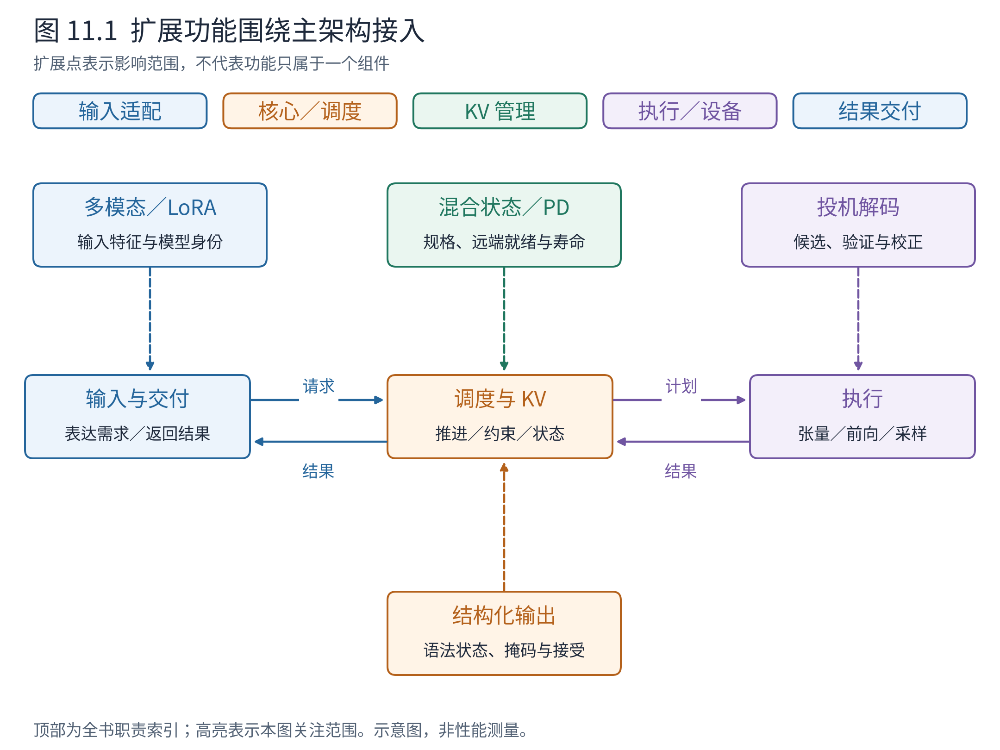
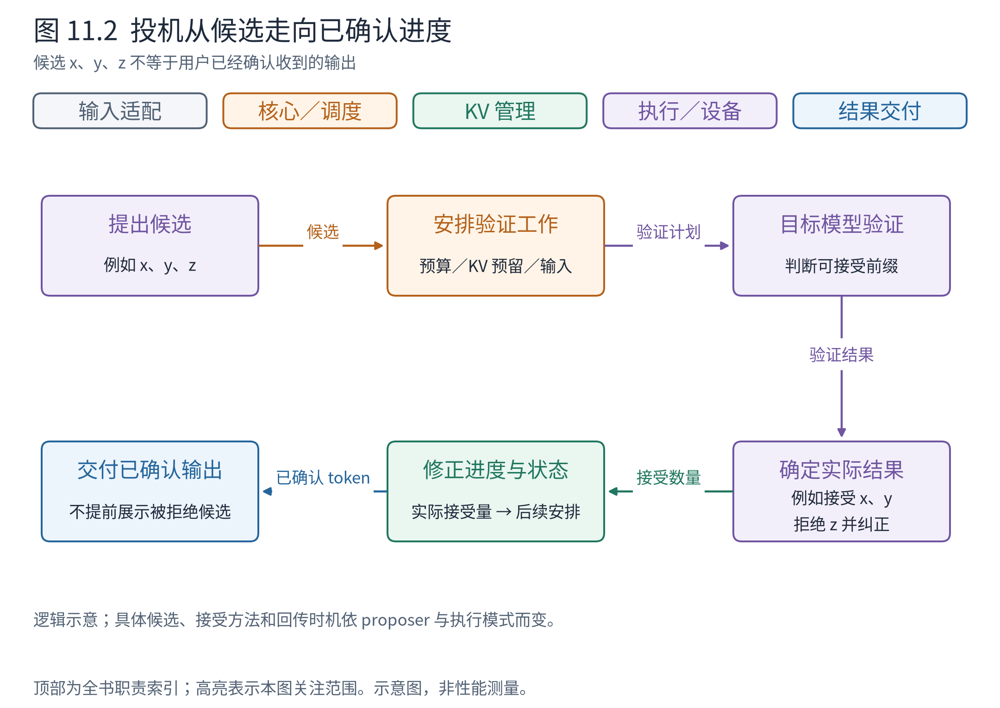
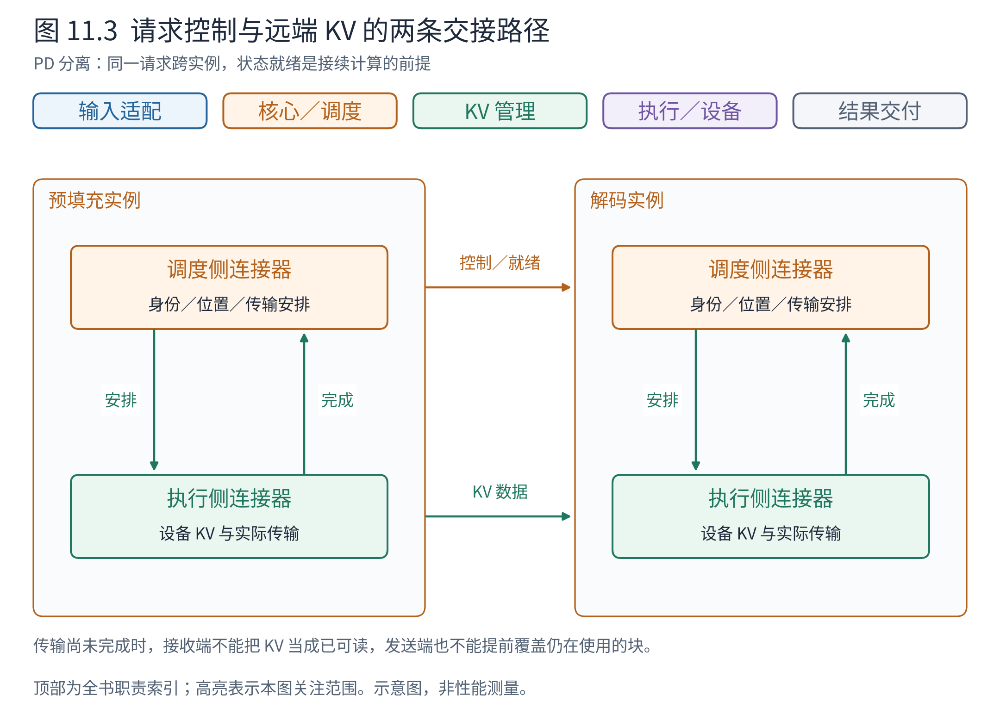

# 第 11 章 扩展功能如何接入这套架构

到这里，我们已有一台完整的文本生成引擎：入口统一需求，核心调度工作，KV 管理状态，执行层落实计算，前端交付结果。接下来遇到投机解码、多模态或 PD 分离时，不必重新记一套互不相干的名词。更有效的起点是问：这个功能新增了什么状态，改变了哪份接口，又要求谁与谁多一次协作？

本章给出六类扩展的架构地图。它们的算法和生产配置在 Book8 深入讨论；这里仍要把基本机制讲清，使读者能够判断扩展不是简单挂在某个类后面的孤立开关。

## 11.1 用状态和接口识别扩展点



**图 11.1　扩展点总图。** 中间保留输入、调度／KV、执行、输出的主链，周围标出新增责任。连线表示影响范围，不代表某项功能只属于一个组件。依据 v0.30.0 结构化输出、投机、混合缓存及连接器接口，图将具体实现归纳为教学责任域。

先找熟悉的中央闭环，再沿一条支线思考。例如投机看似只在模型之前加一个小模型，但它产生的候选会改变调度预算、KV 预留、验证和最终提交。反过来，某个功能跨越很多组件，也不等于原有架构失效；需要检查的是新状态有没有明确所有者，接口能否表达所需信息。

## 11.2 投机解码：候选不等于已经提交的结果

Book6 已介绍投机的核心直觉：先低成本提出若干候选，再由目标模型验证，希望一次较大的目标计算推进多个输出。架构上的新问题是，系统同时存在“可能采用的 token”和“已确认的 token”。

以构造例说明：请求 A 生成候选 `x,y,z`，验证后只有前两个被接受，随后得到纠正或补充的 token。候选占用过的计算和状态，不能全部无条件写入最终进度；用户也不应先看到后来被拒绝的 `z`。



**图 11.2　候选、验证与提交。** 从候选向验证推进，再将接受结果反馈给请求进度、缓存与输出；拒绝分支强调修正。x、y、z 为符号化教学候选，接受数量不是实测。依据 v0.30.0 Scheduler 的投机相关计划、RejectionSampler 和执行结果更新，不展开具体 proposer 算法。

读这张图应关注三件事：调度器为验证安排的输入可能多于普通解码的一步一个；执行层需要候选与接受结果；核心要按实际结果调整进度和资源。候选生成方法可以变化，但候选与提交之间的边界不能消失。

现在把 x、y、z 换成候选编号 41、42、43。为避免与第 2 章“两 token 即结束”的 A 冲突，这里是另一个生成上限充足的 A 快照。在非异步调度的这条路径中，EngineCore 调用 `Executor.take_draft_token_ids()` 取得执行侧提议结果，再调用 `Scheduler.update_draft_token_ids(...)` 交给调度器；Scheduler 将候选放入下一份计划，Runner 组织验证与 RejectionSampler 的接受判断，返回已确认结果：

```python
# 执行侧 → 核心：提议结果
DraftTokenIds(req_ids=["A"], draft_token_ids=[[41, 42, 43]])
# SchedulerOutput 的候选字段：核心 → 执行侧
plan.scheduled_spec_decode_tokens  # {"A": [41, 42, 43]}
# 验证后执行侧 → 核心：假设接受前两个，第三个换成 99
ModelRunnerOutput(
    req_ids=["A"], req_id_to_index={"A": 0},
    sampled_token_ids=[[41, 42, 99]],
)
```

候选由提议实现产生，验证端决定能提交什么，Scheduler 依据实际返回结果校正进度。99 是构造的纠正 token，不是第三个候选被接受；用户结果也不应包含被拒绝的 43。这条接口关系由 [DraftTokenIds](https://github.com/vllm-project/vllm/blob/ced6857afa0ea7b2e3f0846a62e1394e90f15607/vllm/v1/outputs.py#L430)、SchedulerOutput 的候选字段和 ModelRunnerOutput 共同表达。

收益取决于候选生成成本、接受情况与目标执行效率，代价则包括额外模型或计算、预留状态以及复杂的回滚／校正。Book8 第 2 章继续解释具体实现与适用条件；本书先确保读者不会把它看成“输出层一次多返回几个 token”。

## 11.3 结构化输出：约束必须进入 token 选择之前

若用户要求符合某种 JSON schema，仅在最终输出后检查文本，会发现错误却无法保证生成过程遵守结构。结构化输出把约束转成可以随生成推进的状态，在选择后续 token 时限制允许的集合。

例如期望一个包含 `name` 字段的对象。生成走到某个语法位置后，接下来哪些 token 合法，取决于已接受前缀和语法状态。概念上可以形成词表维度的允许掩码，再应用到采样候选；真实实现可采用紧凑位表示，不必物化一个普通浮点矩阵。

vLLM 的结构化输出管理器组织语法准备、掩码以及接受 token 后的状态推进。语法准备可能需要等待，因此请求除了等待计算容量，还可能等待约束就绪。采样端消费约束，核心根据最终接受的 token 推进语法状态，输出端交付结果。

这里的类对象分工是：StructuredOutputManager 根据请求的语法状态生成掩码，Scheduler 将请求身份与掩码组织为 GrammarOutput，EngineCore 经 Executor 的采样接口将它交给 Runner。Runner 负责把掩码对应到正确的 logits 行，语法管理器不替模型计算 logits。以一条请求、无投机、仅 32 个词项的教学词表为例，假设当前只允许编号 1、4，则一个紧凑位掩码可以表示为：

```python
GrammarOutput(
    structured_output_request_ids=["A"],
    grammar_bitmask=np.array([[18]], dtype=np.int32),  # (1, 1)
)
```

18 的二进制是 `00010010`，表示这两个编号对应的允许位；32 个词项装入一个 int32 字。本例仅解释位表示，不声称真实模型的某个 JSON 位置恰好允许这两个 token。第 0 行属于 A，由 `structured_output_request_ids` 确定；不能因为 A 本轮在另一张批次表中排第 2 行，就直接把掩码第 0 行施加给别的请求。真实词表更大、投机时可能有多行，具体宽度与填充由语法后端决定。字段见 [GrammarOutput](https://github.com/vllm-project/vllm/blob/ced6857afa0ea7b2e3f0846a62e1394e90f15607/vllm/v1/core/sched/output.py#L323)。

这里的代价是约束构建、状态维护与功能兼容。若与投机组合，还需考虑候选接受顺序怎样推动语法，而不是只在最终字符串上套一次校验。Book8 第 3 章沿这条接口继续深入。

## 11.4 多模态与 LoRA：输入和模型身份不再只有文本

多模态请求可能携带图片、音频等内容。输入侧需要把它们变成模型可接受的表示，执行侧可能运行编码器或使用预计算特征，并把这些特征与文本位置正确关联。调度于是可能多出编码器预算、特征缓存以及输入就绪的约束。

可以想象请求 A 附带一张图片。若只计算文本 token 预算，而忽略尚未完成的图像编码，调度计划就可能缺少真正需要的输入；若图片特征被复用，又要保证其身份和生命周期正确。这里的核心变化是计算与状态类型增加了，不是所有输入都突然变成可以直接送进文本分词器的字符串。

InputProcessor 将这项关系放进 EngineCoreRequest 的 `mm_features`，EngineCoreProc 接收并预处理后保存到核心 Request，Scheduler 再经 EngineCore、Executor 和 Worker 把相关特征和编码安排交给 Runner。输入侧负责表示和位置对应，Scheduler 决定本轮编码哪些特征，Runner 组织模型编码与结果复用。以一条独立多模态请求 M 为例，设图片占据提示词从位置 2 起的 4 个占位位置；若接收侧已有相应处理数据缓存，一项特征可以是：

```python
MultiModalFeatureSpec(
    data=None,  # 此例明确假设接收侧缓存已具备处理数据
    modality="image", identifier="toy-image-01", mm_hash="toy-image-01",
    mm_position=PlaceholderRange(offset=2, length=4),
)
# 本轮需要计算这项编码特征时，SchedulerOutput 的字段节选
plan.scheduled_encoder_inputs  # {"M": [0]}
```

`[0]` 指向 M 的第 0 项多模态特征，不是设备 0；`offset=2,length=4` 把特征与文本序列中的位置 2、3、4、5 关联。处理数据缓存与模型编码结果缓存也不是同一件事：省去传输处理数据，不保证无需执行编码器。无接收侧缓存时必须携带实际的 MultiModalKwargsItem，内容与形状由模型处理器定义，不能把 `data=None` 当作普遍可用的图片请求。字段见 [MultiModalFeatureSpec](https://github.com/vllm-project/vllm/blob/ced6857afa0ea7b2e3f0846a62e1394e90f15607/vllm/multimodal/inputs.py#L347)。

LoRA 则在共享基础模型的同时，为请求选择特定适配器。请求身份除了自己的 token 历史，还要关联正确的适配器；执行侧需要管理适配器权重和批次中的对应关系。不同适配器可能改变计算结果，因此不能仅凭提示词相同就无条件共享其状态，缓存身份也需要包含相关区别。

这项选择以 LoRARequest 沿 InputProcessor、核心 Request 和 NewRequestData 传递，经 EngineCore/Executor/Worker 到执行侧，例如 `LoRARequest(lora_name="adapter-demo", lora_int_id=7, lora_path="/models/adapter-demo")`。名称、编号和路径是教学值；上游采用 LoRAModelRunnerMixin 的运行器持有 LRUCacheWorkerLoRAManager，由后者管理适配器加载与激活，Scheduler 则使用适配器身份与并发限制安排请求。这是“安排哪些请求”与“准备哪些适配器权重”的分工。这个小对象传的是参数选择，不是把整份 LoRA 权重复制进每次调度计划。结构见 [LoRARequest](https://github.com/vllm-project/vllm/blob/ced6857afa0ea7b2e3f0846a62e1394e90f15607/vllm/lora/request.py#L8)。

把两个功能放在一起比较，可以看出它们都要求请求携带更多计算语义，但落点不同：多模态扩展输入与编码路径，LoRA 扩展模型参数选择与管理。二者都可能影响批次组织、缓存与执行模式。Book8 第 4 章进一步讨论服务中的组合约束。

## 11.5 混合状态：不是每层都需要保存完整历史

第 6 章以完整注意力讲分页 KV。对于滑动窗口层，只需一定范围的近期历史；对于循环或状态空间模型，历史可能被压缩到某种递推状态；混合模型把这些层放在同一个网络中。

于是“请求已经处理 100 个 token”不再意味着每一层都必须保存 100 个位置的同型 K、V。启动需要识别不同状态规格，缓存管理需要按组安排资源，前缀复用还需要满足各类状态自己的有效条件。

例如一个教学模型同时含完整注意力层和只保留最近 4 个位置的窗口层。请求推进到位置 8 后，前者仍可能需要全部相关历史，后者不必继续保留最早位置。但这不等于整个请求的早期状态都能释放，因为完整注意力层仍然依赖它。缓存分组就是把“同一请求、不同层的不同需要”纳入管理的一种组织办法。

与第 4 章一样，规格先由执行侧报告，EngineCore 形成 KVCacheConfig，再分别交给 Worker 和 Scheduler/KVCacheManager。双组配置中，这一差异可以落为如下字段节选；小块长、头维和层名仅供教学：

```python
KVCacheConfig(
    kv_cache_groups=[
        KVCacheGroupSpec(layer_names=["full_layer"],
            kv_cache_spec=FullAttentionSpec(
                block_size=2, num_kv_heads=2, head_size=8,
                dtype=torch.float16)),
        KVCacheGroupSpec(layer_names=["window_layer"],
            kv_cache_spec=SlidingWindowSpec(
                block_size=2, num_kv_heads=2, head_size=8,
                dtype=torch.float16, sliding_window=4)),
    ],
    # num_blocks、实际张量布局等由初始化另行确定，此处省略
)
```

同一条请求的块号因此需要按组排列，不能只交付一条没有组语义的平面列表。Worker 据组规格准备相应执行状态，KV 管理据各组需求判断保留与回收；窗口的具体 token 可见范围还必须遵守模型及后端语义。字段见 [KVCacheGroupSpec](https://github.com/vllm-project/vllm/blob/ced6857afa0ea7b2e3f0846a62e1394e90f15607/vllm/v1/kv_cache_interface.py#L1392) 与 [SlidingWindowSpec](https://github.com/vllm-project/vllm/blob/ced6857afa0ea7b2e3f0846a62e1394e90f15607/vllm/v1/kv_cache_interface.py#L807)。

具体分组、页大小和状态复制方式随模型及实现演进。官方 Hybrid KV 文档也标明其历史设计基线；本书只将经源码核验的规格、分组与协作原则作为主线，不把其中某个早期例子的算法当成所有混合模型的现行规则。Book8 第 1 章继续展开。

## 11.6 PD 分离：一条请求的状态需要跨引擎交接

**预填充与解码分离（prefill–decode disaggregation，PD 分离）**把两个阶段放在不同引擎实例中。目的之一是分别组织首 token 阶段和后续输出阶段的资源，减少二者相互干扰。它与第 10 章“把 A 与 B 分给两个独立副本”不同：这里同一条请求的计算状态需要交接。



**图 11.3　PD 分离的架构边界。** 上方控制路径协调请求身份、状态位置与就绪，下方数据路径传输 KV。调度侧连接器处理可用性与元数据，执行侧连接器参与实际数据操作。依据 v0.30.0 KV Connector V1 接口与官方 PD 设计；省略具体代理协议和传输库，非吞吐承诺。

沿一条请求观察：预填充实例产生历史状态，解码实例为它准备合法位置，传输完成后才能正确接续计算。仅仅把提示词转发过去，并不能保证解码端已经拥有 KV；仅仅有一块设备数据，也不足以知道它属于哪个请求、在哪一层和哪个位置。

因此需要**连接器（connector）**，把控制侧的安排与执行侧的数据传输联系起来。远端状态未就绪时请求可能等待；传输仍在使用某些块时，释放也需要遵守完成条件。若某次加载失败，如何恢复或终止，必须是协议的一部分。

连接器不是一个位于两端中间的单例对象。KVConnectorBase_V1 区分调度侧与执行侧角色：调度侧的 `build_connector_meta(plan)` 形成元数据，经 `SchedulerOutput.kv_connector_metadata` 交给 Runner；执行侧连接器绑定这份数据，再按约定进行读写。

为避免编造一套通用传输字段，我们选择上游用于调试、借助文件保存和加载的 ExampleConnector，打开它的真实 ReqMeta。设只传递完整的 4-token 前缀，目标块为 `[7,2]`、块长 2，则调度侧准备的加载元数据可以是：

```python
ExampleConnectorMetadata(requests=[ReqMeta(
    token_ids=torch.tensor([11, 12, 21, 22]),       # (4,)
    slot_mapping=torch.tensor([14, 15, 4, 5]),     # (4,)
    is_store=False, mm_hashes=[],
)])
```

执行侧 ExampleConnector 消费 `is_store=False` 的加载安排，并用槽位列表把取回的 KV 放入目标存储。这个元数据不包含 KV 数值本体，也不是生产网络连接器都使用的格式；它让“传什么位置、做保存还是加载”第一次具有可检查的对象形状。依据 [ReqMeta](https://github.com/vllm-project/vllm/blob/ced6857afa0ea7b2e3f0846a62e1394e90f15607/vllm/distributed/kv_transfer/kv_connector/v1/example_connector.py#L33) 与 [ExampleConnectorMetadata](https://github.com/vllm-project/vllm/blob/ced6857afa0ea7b2e3f0846a62e1394e90f15607/vllm/distributed/kv_transfer/kv_connector/v1/example_connector.py#L69)。异步传输连接器还可经 ModelRunnerOutput 中的 KVConnectorOutput 返回 `finished_recving` 等完成信息；不能将本例的文件式调试实现与这些生产传输行为混为同一条实测路径。

分离换来独立组织资源的机会，同时支付传输、同步、更多部署与故障处理成本，不能笼统承诺吞吐提高。Book8 第 7 章继续讲传输与所有权交接。

## 11.7 用一张影响矩阵保持全局认识

**表 11.1　扩展改变什么，以及接着去哪里读**

| 功能 | 新增或改变的状态 | 关键协作边界 | 深入阅读 |
|---|---|---|---|
| 投机解码 | 候选、接受数量、预留／在途进度 | 提议、调度、验证、KV 校正 | Book8 第 2 章 |
| 结构化输出 | 语法对象与生成位置 | 约束管理、采样、接受结果 | Book8 第 3 章 |
| 多模态 | 特征、编码器状态、模态位置 | 输入、编码预算、模型执行 | Book8 第 4 章 |
| LoRA | 适配器身份与权重驻留 | 请求、缓存身份、批次与模型 | Book8 第 4 章 |
| 混合状态 | 多种状态规格及有效历史 | 启动规格、分组、回收与命中 | Book8 第 1 章 |
| PD 分离 | 远端位置、就绪、在途传输 | 两端调度、连接器、设备传输 | Book8 第 7 章 |

这张表不是兼容性矩阵，不表示所有功能可任意组合。它是一张调查地图：组合两个功能时，寻找它们共同修改的状态和接口，就知道哪里最需要核查。比如投机与结构化输出都关心接受 token 的顺序，PD 与缓存回收都关心块何时可复用。

高级功能没有使核心原则失效，反而检验它们是否足够清楚。最后一章将整张地图收拢，练习从设计问题和运行症状出发选择源码入口。

## 章末源码导航

本章只确认接入点。每次选一个功能，找出其新增状态、生产者和消费者后停止，再按 Book8 的专题深入。

<!-- NAVIGATION -->

| 要回答的问题 | 固定版本入口 | 读到哪里即可停止 |
|---|---|---|
| 候选验证位于哪里？ | [RejectionSampler](https://github.com/vllm-project/vllm/blob/ced6857afa0ea7b2e3f0846a62e1394e90f15607/vllm/v1/sample/rejection_sampler.py#L45) | 识别候选与验证结果接口 |
| 语法约束怎样进入采样？ | [StructuredOutputManager.grammar_bitmask](https://github.com/vllm-project/vllm/blob/ced6857afa0ea7b2e3f0846a62e1394e90f15607/vllm/v1/structured_output/__init__.py#L314) | 看请求状态到掩码的转换 |
| 不同层的状态需求如何表达？ | [KVCacheSpec](https://github.com/vllm-project/vllm/blob/ced6857afa0ea7b2e3f0846a62e1394e90f15607/vllm/v1/kv_cache_interface.py#L156) | 看规格接口，再选一类派生规格 |
| 远端状态怎样跨两侧协作？ | [KVConnectorBase_V1](https://github.com/vllm-project/vllm/blob/ced6857afa0ea7b2e3f0846a62e1394e90f15607/vllm/distributed/kv_transfer/kv_connector/v1/base.py#L185) | 区分调度侧与执行侧接口 |
