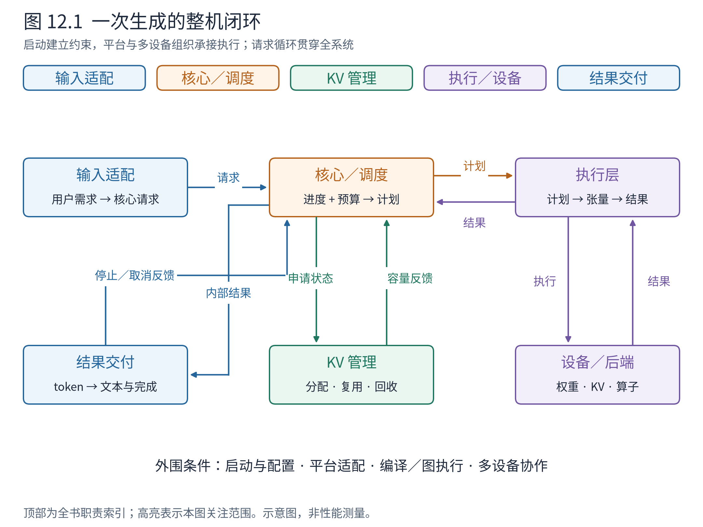
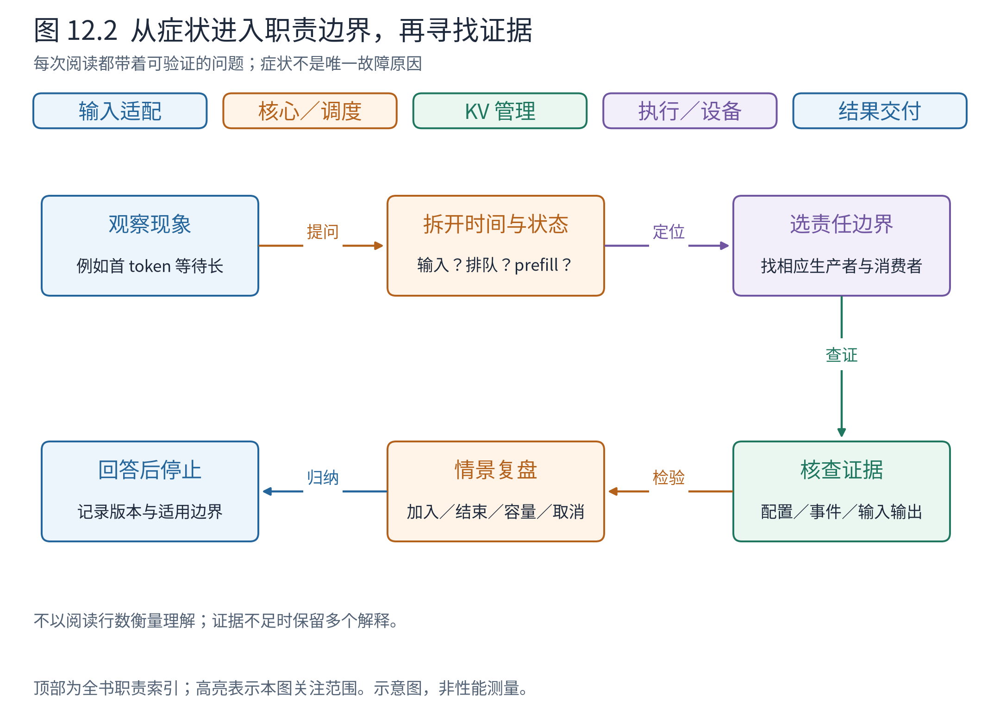

# 第 12 章 带着架构地图阅读源码

我们从“模型前向之外还缺什么”出发，已经建立了三张互相对应的地图：职责图说明谁负责，部署图说明在哪里运行，交互图说明它们怎样随请求推进。现在回到本书最初的目标：打开一个陌生源码文件时，如何知道自己正在整台系统的哪个位置？

答案不是先背完目录。先提出一个能够验证的问题，再找到相应状态与接口，往往能以更少的阅读得到更稳固的理解。本章用完整请求和几种情景，把前面的地图变成可反复使用的阅读方法。

## 12.1 再走一次请求，这次看清每次交接

**图 12.1　全书回望。** 蓝色连接用户表达与结果，橙色组织请求推进，绿色安排状态，紫色落实设备计算。细箭头表示返回与生命周期反馈，外围标记启动、平台和多设备对主链的支持。按 v0.30.0 固定源码归纳，沿用前文颜色与边界，省略扩展功能内部细节。

从一条普通离线请求 A 出发。用户提交文本与生成要求，输入适配将其整理成模型可理解的 token 和参数。前端为输出登记身份，核心收到请求并维护计算状态。调度器结合进度、预算和 KV 约束形成当步计划，执行侧根据计划与已有状态准备张量。模型和后端完成计算与采样，结果再推动核心状态更新和前端文本交付。

这里没有哪个组件独自拥有“请求的全部意义”。前端关心怎样解释和返回，调度器关心怎样推进，KV 管理关心状态位置，Runner 关心当步执行。请求身份使这些责任联系起来，接口使它们交换足够的信息。

如果 A 尚未结束，这个闭环继续；如果 A 完成，资源与执行状态逐步清理；如果前端发现文本停止条件或用户取消，还会产生反向的终止控制。一个只画去程的理解，无法解释这些行为。

再把图放回运行位置：前端与核心可能跨进程，执行层可能跨多设备，消息和结果可能异步到达。但跨越边界后，谁负责什么仍须成立。架构知识的价值，就在于它能帮助我们理解部署变化，而不被变化淹没。

## 12.2 先找到状态的主人，再跟踪函数

假设打开 Scheduler 文件，看到一个不熟悉的计数。不要马上向下连续阅读几百行。先问：它描述待处理 token、已安排工作还是已完成结果？谁初始化它，谁在结果返回时修正它，抢占和取消会怎样改变它？

再假设打开 Model Runner，看到一张块表。先判断它是核心的分配账本，还是为设备执行准备的映射；它跨多少轮存活，当步排列变化时是否重排或收集，结束请求的槽位何时释放？这些问题把一个字段放回了状态生命周期。

这种方法比“找到同名类”多走一步。同一个概念可能在不同层拥有不同表示，例如核心请求、前端输出状态和设备侧请求槽位都关联 A，却不是同一对象。若只按名字跳转，很容易跨过表示转换而不自知。

**表 12.1　看到对象时，先恢复哪种认识**

| 对象 | 在系统中的位置 | 优先观察的协作 |
|---|---|---|
| InputProcessor／Renderer | 面向输入的适配范围 | 用户表达怎样形成核心请求 |
| EngineCore | 请求计算的协调范围 | 输入事件、一步计划、执行结果怎样汇合 |
| Scheduler | 计算工作分配 | 进度与资源如何产生当步安排 |
| KVCacheManager／BlockPool | 状态位置与引用管理 | 分配、共享、回收和容量反馈 |
| Executor／Worker | 执行组织与设备资源 | 计划如何到达实际执行单元 |
| Model Runner | 请求状态到计算张量的转换 | 持久状态、当步输入与输出归属 |
| Attention Backend | 模型语义的具体实现 | 数值张量、元数据和缓存布局 |
| OutputProcessor | 内部结果到用户结果的转换 | 文本、停止、聚合与交付 |

表格不是要求背诵类名；它提供一组定位提示。未来版本改变文件名或拆分类，只要责任和契约仍可辨认，已有心智就仍然有用。

## 12.3 用五种情景检验地图是否真的建立

**新请求 C 加入。** 输入适配和前端登记先发生，核心接纳后，调度器在某次迭代中决定是否安排。执行侧接收新请求信息，准备状态与当步输入。若你能指出“消息到达”与“进入计算”之间的间隔，就没有把入口和调度混在一起。

**KV 容量不足。** 调度器的计算预算可能仍有剩余，但块分配不可行；新请求等待，或已有请求被抢占。恢复时可能需要重建历史状态。若你能解释为什么设备池仍然存在、请求的块引用却发生变化，就理解了资源本体与使用关系。

**A 正常结束。** 本轮输出使它达到停止条件，后续不再为其安排新计算，前端完成交付，核心与执行侧清理各自状态。其他请求继续使用同一模型。若你不再把请求结束等同于卸载模型，就看清了不同寿命。

**A 被取消。** 前端将不再等待结果转化为核心终止事件；在途工作可能晚到，清理须遵守使用中的资源边界。若能说明取消不是一条强制打断任意算子的指令，就理解了控制请求与设备执行的区别。

**模型改为双卡执行。** 用户表达与前端输出可保持相似，Executor、Worker、模型分片和通信发生变化。若改为两个服务副本，则还会多出路由和独立调度／KV。能分别画出两种部署，说明你没有用卡数替代副本概念。

这些情景比复述术语更能检验理解。回答时不需要记住行号，只需要说清状态在谁那里、经过哪次交接才发生变化。

## 12.4 从运行症状选择调查入口

实际阅读往往始于一个问题：“为什么请求慢了？”架构可以缩小调查范围，但不能仅凭症状给出唯一诊断。

**图 12.2　问题驱动的源码阅读。** 症状先转成可观察问题，再定位责任边界，最后检查输入、状态与输出；不把箭头画成确定故障原因。此图为基于全书职责划分的阅读方法，不是 vLLM 内置诊断器。

**表 12.2　症状到证据的起点**

| 现象 | 先区分什么 | 可进入的子系统 |
|---|---|---|
| 启动很久没有结果 | 尚未就绪，还是请求已开始执行？ | 模型加载、容量探测、预热与握手 |
| 首 token 等很久 | 排队长、输入处理慢，还是 prefill 工作重？ | 前端、调度、执行分开观察 |
| 输出间隔不稳 | 单轮计算变化，还是主机准备／交付间隙？ | 调度计划、设备时间线、输出处理 |
| 抢占增加 | 活跃状态增长，还是容量与缓存策略改变？ | 调度事件、块占用与释放 |
| 命中率高但收益小 | 省掉多少 prefill，主要成本是否仍在 decode？ | 前缀复用与请求长度分布 |
| 流式文本看起来聚集返回 | 内部结果、文本片段、网络块是否一一对应？ | OutputProcessor、服务交付 |
| 多卡扩展不理想 | 计算分摊被通信、气泡或负载不均抵消了吗？ | Executor、并行组、路由与队列 |

表中每一行都刻意保留多个可能来源。正确做法是先找到能区分原因的事实，例如请求何时接纳、何时进入计划、设备何时执行和结果何时交付，再沿相关源码验证。只看一个总耗时或一个类名，就把问题归咎于某个组件，会丢失系统视角。

## 12.5 一次有边界的源码阅读应怎样结束

可以为每次阅读写一张简短记录：问题是什么，使用哪个提交，入口在哪，输入与输出是什么，谁拥有状态，哪个情景能检验理解。然后只沿必要的生产者与消费者追踪。

例如要理解“C 为什么没进入本轮”，先看 Scheduler 形成计划的条件，再看 KV 分配结果以及请求的等待状态。当你已经能区分预算不足、资源不足和依赖未就绪，就可以停止本轮阅读；无须为了证明认真而继续进入所有 Attention 内核。

停止点不是回避细节，而是把细节留给明确的问题。若后来需要研究后端内存访问，再从第 8 章的契约进入相应实现。这样每一次深入都接在已有地图上，不会把刚看到的局部误当整个系统。

本书章末导航都按同样方式组织：带着问题进入，找到关键交接，理解到足以回答问题即可停止。附录的源码地图把这些入口集中，便于跨章选择。

## 12.6 带走有条件的设计原则

最后回顾几条贯穿全书的思想。它们的价值在于解释因果，而不在于成为设计口号。

**按职责分离，使变化有相对清楚的落点。** 输入协议变化不必直接改调度，硬件差异集中到执行与平台。但分离会增加接口、通信与一致性责任；边界划错或契约不足，分层本身不会救场。

**以请求进度和资源约束组织持续计算。** 统一的工作表达让长短请求、分块和扩展有共同基础，但预算并不能替代全部策略，进度计数也必须区分已安排与已完成。

**把状态本体、引用和视图区分开。** 这使缓存可以共享、请求可以结束而资源池继续服务，也使执行输入可以从持久状态收集。代价是寿命、映射和异步安全需要被明确管理。

**减少重复工作，并在真实依赖允许处重叠。** 增量更新、编译和图执行各减少不同成本，不能相互代替。越依赖重用和重叠，就越要承认形态约束、缓冲区占用和回退路径。

**让扩展说明新增状态，而不是只增加开关。** 投机的候选、语法的进度、远端 KV 的就绪都必须有所有者与协议。功能组合的难点，常在多个功能同时改变的接口上。

现在即使忘掉具体类和函数，也应留下这一幅图景：vLLM 是一套围绕请求推进、状态管理和设备执行建立闭环的系统。你可以先判断正在读哪种责任，再决定向哪一层深入。Book8 接着研究专题机制与生产约束；本书则作为那张可以反复返回的地图。

## 章末源码导航

下面提供几条完整闭环的起点；更细入口集中在附录 B，按问题选读即可。

<!-- NAVIGATION -->

| 要回答的问题 | 固定版本入口 | 读到哪里即可停止 |
|---|---|---|
| 前端怎样消费内部结果？ | [LLMEngine.step](https://github.com/vllm-project/vllm/blob/ced6857afa0ea7b2e3f0846a62e1394e90f15607/vllm/v1/engine/llm_engine.py#L304) | 找到核心客户端、输出处理与终止反馈 |
| 一次核心计算怎样闭环？ | [EngineCore.step](https://github.com/vllm-project/vllm/blob/ced6857afa0ea7b2e3f0846a62e1394e90f15607/vllm/v1/engine/core.py#L589) | 识别调度、执行与状态更新 |
| 内部 token 怎样成为用户结果？ | [OutputProcessor.process_outputs](https://github.com/vllm-project/vllm/blob/ced6857afa0ea7b2e3f0846a62e1394e90f15607/vllm/v1/engine/output_processor.py#L629) | 识别身份、文本、停止与交付边界 |
