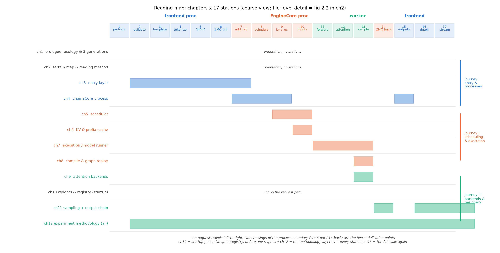

# 第 0 章 导览：从推理物理学到源码

## 0.1 接棒：Book6 交来的是什么

Book6《推理系统导论》以三问开卷（慢在哪/能救多少/钱从哪来）、四问交卷：模型在服务里是 **workload**（权重账+KV 账+token 流）；引擎是把这三本账付得最便宜的机器（批处理摊权重、连续调度消浪费、分页消碎片、缓存消重复、分块消干扰，五件工具各付一笔账）；我们亲手造出了它——四版进化的 mini 引擎（naive→连续批→分页 KV→前缀缓存），并与真实引擎做了 8.9 ms 水位的趋势级对拍；**第四问的答案是欠账单：引擎实现层的全部**。册末十八笔旧钩逐行销项、B6 系九条新钩点好名册，其中五条（B6-1/3/4/6/9）押给了本册——台账预览见 0.6，读到时自会兑现。

本册接的就是第四问的欠账单。Book6 收束章为此留了「三扇门」的说法：主链路门（每个算法在 vLLM 里有点名到类的模块）、专题门（投机 proposer、KV offload、并行与 PD 分离等——Book8 的领土）、系统视角门（八册地图——你算得出的账，去看工业界怎么付）。本册推开的是第一扇门，顺手在门缝里看清第二扇的轮廓。但先说清一条边界：Book6 教的是**引擎无关**的推理物理学——调度、分页、批处理这些机制，放在任何引擎里都成立；本册教的则是**一个具体引擎的全部血肉**——vLLM 的 V1 架构，行级到文件与行号。前者的价值是判断力，后者的价值是判断力落地的地方：读完这两册，你看到任何推理引擎的任何行为，既有理论坐标、也有工程参照。

## 0.2 本册要造什么：沿一条请求把 V1 读穿

Book6 收束时留下的许诺是「沿一条请求的生命周期把源码读穿」。这句话定义了本册的主线：**一条 HTTP 请求从进门（协议解析）到出门（流式返回），在 vLLM V1 源码里要穿过十七个站、跨过两个进程边界、被一束配置对象（二十一份子 config——最要紧的是模型/缓存/调度/并行/编译五份——组成的 `VllmConfig`，正身在第 3 章开箱）管着走**——把这十七站逐站拆开，V1 的全部主链路就自然铺开。先用一段话把这条旅程预走一遍，让你带着全景进正文：请求以 JSON 进门，被协议层校验、套上 chat 模板（站 1-3，前端进程）；前端引擎接手——建输出收集器、切成 token id、序列化过 ZMQ（ZeroMQ）桥（站 4-6）；引擎核进程收下它，调度器在 token 预算与 KV 余量之间做本轮决策、给块账、装配输入（站 7-10）；跨过进程边界后 worker 进程执行——前向、attention、采样（站 11-13）；产物打包回桥（站 14）；前端进程把 token id 解码成文字、按 SSE（server-sent events）流式推回用户（站 15-17）。每章认领一段站段（图 0.1），每章开篇都回答同一个问题：**请求现在在哪**。

还有一条岔路要在图上先标出：离线链。`LLM` 类的批量推理不经过 HTTP 与队列，从前端直接走进引擎核——图 0.1 里站 1-6 的上半段有个虚线分岔指的就是它。离线链少了协议与流式的包裹，是观察引擎裸行为的最佳入口（本册多个实验件走的就是这条路），在线链则教全须全尾的服务形态——两条链在站 7 汇合之后走的是完全相同的路。

图 0.1 本册读法地图（按 v0.30.0 源码自绘，示意级）：横轴=一条请求的 17 站（表头三色=所属进程：蓝前端/橙引擎核/青 worker）；纵轴=章，色块=该章覆盖的站段；右侧三段=旅程分组。站 6/14 是两次进程越界（序列化点）；ch10 是启动相（不在请求路径上）、ch12 是覆盖全部站的元层章——文件级细节版地图在 ch2（图 2.2）。

教学立场先立住：本册**不是 API 使用手册**。你已经手造过调度、分页、图执行、投机解码的玩具版——本册的每一章都在做同一件事：指着工业源码说「**你手造过的那个算法，在这里长成了这个类**」，然后把玩具版回避掉的真实问题（进程边界、序列化、内存预算、平台差异）一一补上。所以读本册的正确姿势是带着 Book6 的账本读：每看到一个工程结构，先问它付的是哪笔账。

## 0.3 卷间契约：已知/新增/不改

**已知基础**（拿来就用，不再重教）：推理物理学全家——roofline 与三本账（Book6 ch2-3）、批处理五部曲与分页 KV（ch4-5）、调度折中（ch7）、kernel/采样/投机/量化/图执行五个深化项（ch8-12）；架构面——RMSNorm/SwiGLU/RoPE/GQA（Book3）、MoE 与 MLA（Book4）、混合架构（Book5）。本册正文引用这些知识时只点名加回指，例如「连续批处理（Book6 ch4）」——不回教的纪律与全丛书一致。**新增知识**：源码阅读方法学（三层法：先问它在哪→它在动吗→我理解对了吗）、V1 主链路的模块地图与机制、vllm-ascend 平台插件机制、以及一个大项目。**架构修改：无**——模型在本册冻结为 workload（DESIGN-207M 与 Qwen3-0.6B），全部新增知识长在引擎侧；这是与 Book3-5「每册改架构」节奏的显式分野，也是「从造模型的人换边到伺候模型的人」这个 Book6 转身在源码册的延续。

## 0.4 口径声明：双轨、纪律换血与符号约定

四件事在开卷就说清，正文不再重复。**其一，双轨口径**：源码引用锚定 v0.30.0（ced6857），实验观察落在运行栈 vllm 0.27.1+vllm-ascend 0.27.1rc1（Atlas 910B3）——两轨各自的适用范围与「不混引」纪律在第 1 章正式立轨。举个双轨日常：读到「调度器把请求赶回 waiting」时，机制走查看 `repos/vllm` 的 `scheduler.py` 抢占分支（带版本框注），行为证据看运行栈周期统计行的 `Preemptions:` 段与 Running/Waiting 轨迹——两者版本不同但结论互证，这就是「不混引、可互证」的操作形态。**其二，术语解禁**：Book6 期间被雪藏的 vLLM 实现层词汇（EngineCore/ZMQ/BlockPool/MRV2/ACLGraph……）本册全部解禁为正菜；新的禁词是 Book8+ 的概念（投机解码机制深讲/结构化输出管线/多模态与 LoRA 服务/可观测生态/PD 分离工程）——正文遇到只点名给地址，不展开。**其三，硬件口径**：本册全 NPU（Book6 起的既定方针）；CUDA 专属项显式标注「本机不可直接做」并给替代口径（源码阅读/NPU 等价路径）。

**其四，符号与体例约定**（读正文前认一遍记号）：源码引用有两种锚——`文件#L行`（行级锚，如 `vllm/v1/core/sched/scheduler.py#L748-753`）与 `文件::符号`（符号锚，给函数/类定位，如 `Scheduler::schedule`）；引用一律带版本框注（阅读锚 v0.30.0），运行栈专属引用标「运行栈」。数字与事实的证据等级沿全书制度标注：{官方论文 > 官方技术报告 > config 逆向 > 第三方复测 > 厂商自报}，凡 {厂商自报} 一律明示；本机实测一律给底档地址（`log/book7-chNN/`——每个数字都可回查原始 JSON/日志）。章型体例：正文章（ch2-11）各含实验件与「动手验证」（可复现命令+验收行）；每章末欠账框交代移交给后续章的账目；「考据框」收版本考古与文档-代码漂移，不占主叙事线。

## 0.5 大项目：把自训模型注册进真引擎

本册的毕业设计是完整交付的大项目：把 Book3 终态、Book6 消费线服役的**自训 DESIGN-207M 注册进 vllm-ascend 运行栈**，与 mini 引擎、Qwen3-0.6B 做三方对照读数。两条路线全部真跑：**C 路**（HF 封装直载——验的是「引擎怎么认出一份新权重」）与 **A 路**（自写模型类五件套、经 `model_class_overrides` 外部注册——验的是「不进引擎源码树也能接入」）；判据三层（编译级/结构级/运行级——运行级判据由冒烟档执行，教学档另配手写五件套正身），最硬的一条是「同权重跨路线生成逐字一致」的端到端证明。教学档还配一份手写五件套正身（`__init__(*,vllm_config,prefix)`/`embed_input_ids`/`forward`/`compute_logits`/`load_weights`）——第 10 章是交付现场，第 12 章合总账。它为什么配当大项目：注册要穿过引擎的**四道门**（内置注册表/平台插件/运行时注册/transformers 回退），每一道门都是本册某几章的正菜——大项目是把主链路知识串成一条线的那个针。

## 0.6 旅程地图：三段旅程与三条贯穿线

正文十一章按三段旅程展开。**第一段「入口与进程」（ch2-4）**：第 2 章画地形——十五个子包各守什么、一条请求的十七站文件链，顺带立全册的阅读方法（三层法）；第 3 章进第一站——两条入口（`LLM` 类与 `vllm serve`）怎么汇成同一条内部路，tokenize 与模板在哪发生（本册第一个实验件：三档入口的逐字一致探针）；第 4 章立进程账——EngineCore 为什么是独立进程、ZMQ 桥上跑什么、启动的 55 秒都花在哪（日志时间戳逐段拆账；55.1 s 定版读数【本机实测，底档见第 4 章】）。**第二段「调度与执行」（ch5-8）**：第 5 章拆调度器的决策循环（admission/抢占/token 预算）——B6-4 在此兑现，抢占三跑的曲线是它的实验件；第 6 章管 KV 的块账与哈希前缀缓存——B6-3 的树 vs 链之争在此定谳，APC（automatic prefix caching，自动前缀缓存）命中率 56.0% 与手算天花板逐位咬合是招牌读数【本机实测，底档见第 6 章】；第 7 章下到执行层——model runner 怎么把一批 token 喂进模型、MRV1/MRV2 双轨的取舍（NPU 的例外答案在此展开）；第 8 章讲编译与图执行——B6-6 的 NPU 对照在此兑现，ACLGraph 对拍 6.15× 是它的实测锚【本机实测，底档见第 8 章】。**第三段「后端与外围」（ch9-12）**：第 9 章选 attention 后端——模型侧的接口承诺与平台侧的实现矩阵（NPU 侧为什么只有一条路有明确答案）；第 10 章是大项目主场（权重加载与模型注册四门——C+A 双档全绿的交付现场）；第 11 章走输出链（采样出口九步管线+增量解码+SSE 流式——12 个 token 15 个事件的实测原文逐行可数）；第 12 章收拢实验方法学——B6-1 的 bench 三件套与参数扫描在此兑现，全册实验线一表收账。ch13 收束：十七站重走、算法→模块对照总表、移交 Book8。

三条纵向线贯穿全程。**生命周期坐标线**：每章开篇报「请求现在在哪」（图 0.1 的横轴就是它的母图）——读到任何一页都知道脚下是哪一站、进程边界在身后还是眼前。**算法→模块对照线**：Book6 的每个算法在本册有一个点名到类的模块（调度折中→`Scheduler`、分页→`BlockPool`、前缀缓存→哈希链实现、图执行→`CompilerManager`/ACLGraph、采样→九步管线）——这条线的意义在收束章兑现：凭前册账本能直接说出引擎里「谁管这件事」，是判断力落地的最终检验（表 13.1 总账）。**双轨对拍线**：每个关键机制至少一处「阅读锚源码走查 × 运行栈实测行为」的互证——第 5 章的抢占（日志三跑对 `scheduler.py` 抢占分支的走查）、第 6 章的 APC（手算天花板对引擎计数器）、第 8 章的图执行（对拍 6.15×）——源码与运行互相作保，这是「读穿」的操作性定义：不是看完，是两轨都对得上。

给两类读者的快速通道：**工程背景强**的读者可以从 ch2 的地形图直接进入，遇到 Book6 账本引用再回翻（0.3 列了全部回翻地址）；**沿书单一路读上来**的读者按序走即可——每章开篇的「上一章留下什么」会替你背着行李。实验件全部标 fast/full 档：fast 档在单卡 Atlas 910B3 上分钟级可复现（起服+一请求），full 档扩到分位读数与参数扫描——选卡纪律、一臂一进程等 NPU 工程约定随实验件就地教（第 12 章收拢）。

Book6 押向本册的五钩台账见表 0.1（收束章决算，兑现段见各落点章）：

表 0.1 B6 系五钩台账（Book6→Book7；另有 B6-2/5/7 归 Book8、B6-8 不埋——Book6 表 13.2 原档）

| 钩 | 内容一句话 | 本册落点 |
|---|---|---|
| B6-1 | 自写压测→真实引擎 bench 三件套与参数扫描 | ch12（§12.5-12.6 实测兑现） |
| B6-3 | 哈希前缀 vs radix 之争的引擎答案 | ch6（树 vs 链对照） |
| B6-4 | 调度折中的引擎正身（决策循环） | ch5（预算+抢占的结构账） |
| B6-6 | 图执行原理层的源码与 NPU 对照 | ch8（ACLGraph 对拍 6.15×） |
| B6-9 | mini 引擎与真实引擎的终局对照（注册大作业） | ch10+ch12（三方对照表） |

## 0.7 本章小结与动手准备

一句话重述本册：**Book6 手造机制，本册读穿实现**——同一条请求的生命周期，从玩具账本走进十七万行的工业源码（`vllm/v1` 一包在 ced6857 的实数），行级锚定、双轨口径、真跑真验。三层结构供你随时定位：导览（本章）给全景、十二章正文沿请求走站、收束章合账交棒。出发前的准备清单：`repos/vllm`（阅读锚 v0.30.0）与 `repos/vllm-ascend` 两个浅克隆在手、`source env.sh` 激活环境（Atlas 910B3/运行栈）、Book6 的账本心态（每个数字背后都有机制）、以及一张空闲 NPU 卡——本册的每个实验件都从「选卡」这一步开始。

现在，进城之前的第一课：这座城是谁、它在 2026 年的推理引擎版图上站在哪——第 1 章。

**动手验证**（开卷三件，五分钟建立体感；选卡纪律照 CLAUDE.md）：
① `git -C repos/vllm log --oneline -1 && git -C repos/vllm describe --tags`——确认阅读锚正身：应显示 ced6857 起头的提交，describe 输出 v0.30.0；
② `pip show vllm vllm-ascend | grep -E "Name|Version"`——确认运行栈双版本（0.27.1/0.27.1rc1）；
③ `npu-smi info | head -8`——看一眼本册全部实验要打交道的那张卡（Atlas 910B3）。
