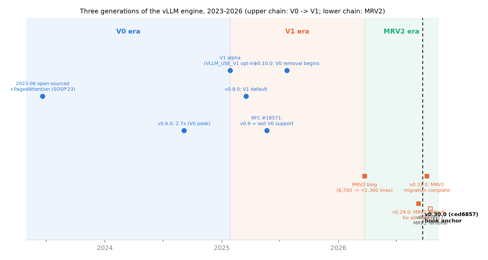

# 第 1 章 总起：vLLM 的生态位与三代引擎演进

## 1.1 进城之前：三块奠基石

导览章收尾那句原话是：「进城之前的第一课：这座城是谁、它在 2026 年的推理引擎版图上站在哪——第 1 章。」【Book7 ch00-导览.md §0.7 章末原文】本章补齐这一课。从 Book6 的推演桌前起身——那里你已经手工造过调度、分页、图执行、投机解码的全部玩具版本——走进一座真正的工业引擎之前，先立三块奠基石：**它处在什么生态**（1.2-1.3）、**它怎么变成今天这样**（1.4-1.7，三代引擎的演进史）、**我们用什么口径读它**（1.8，双轨与版本锚）。

为什么把演进史放在地形图之前？因为源码城里每一条街道的走向都是历史的产物——不知道 EngineCore 为什么被隔离成独立进程，你会在第 4 章把进程边界当成理所当然；不知道 MRV1（Model Runner V1，初代模型执行器）还活着，你会在第 7 章对着两代 model runner（模型执行器）疑惑为什么有两套代码。先读史，后进城，路线不走回头路。本章没有实验件——它是史料课与地图课；但每一块史料都是能敲出声音的源码实物（`repos/vllm` 浅克隆在手即可复敲），不是转述。本章要回答两个问题：**这座城凭什么值得用一整册书来读？我们用什么办法保证读到的是真东西？**产出三样：一张全家福坐标表（表 1.1）、一条三代引擎时间线（图 1.1）、一套双轨阅读口径——分别是后面十二章的「为什么读」「读什么」「怎么读」。

> **最小背景栏**：本章前置全部来自旧册指回——分页 KV 与连续批处理（Book6 ch4-5）、GGUF 量化档位与 FP8 口径（Book6 ch11）、CUDA Graph 原理与 NPUGraph 读数（Book6 ch12）；SGLang/TensorRT-LLM 的机制点到即止，深对照在第 9 章。

## 1.2 生态位：2026 年的推理引擎全家福

先认人。推理引擎的世界在 2026 年大致是四个名字加一个学派，而它们分住两层：**服务引擎**层（vLLM/SGLang/TensorRT-LLM——多请求、批处理、常驻服务）与**单机运行时**层（llama.cpp——一台机器一个用户）。本册讲的是前者。

**vLLM**：2023 年 6 月开源首发，SOSP'23 论文《Efficient Memory Management for Large Language Model Serving with PagedAttention》的开源实现（arXiv 2309.06180——Book6 第 4-5 章教过的分页 KV 与连续批处理就是它的立身之本，此处不重教）。Apache 2.0 协议。它现在是事实上的社区默认：模型 Day 0 支持、多硬件、双周 release——v0.31.0 单个版本 717 个提交、307 位贡献者（官方 release 页），这个演化速度既是它的护城河，也是本书必须冻结版本锚的原因：不冻结，行号三个月就漂没了。

**SGLang**：2024 年 1 月由 lmsys 团队发布（论文 arXiv 2312.07104），立身之本是 RadixAttention——用基数树（radix tree）组织的前缀复用（与 vLLM 的哈希链之争是第 6 章的正菜，此处只记「树 vs 链」四个字）——与 overlap scheduler（调度决策与 GPU 计算重叠）。生态位数字一组（v0.3/v0.4 发布博客，均{厂商自报}）：MLA 场景 7×、overlap scheduler 1.1×、cache-aware 路由 3.8×——数字要看语境，但「调度与计算重叠」这条线它先走了一步，vLLM V1 的 async scheduling 与之思想同型。Apache 2.0。值得中国读者多看一眼的是它的昇腾路线：SGLang 在 NPU 上走 **MindSpore 原生后端**【证据等级：官方文档（docs.sglang.io ascend-npus/mindspore_backend.md，直读 2026-10-10）】，与 vllm-ascend 的 torch-npu+平台插件路线正交——同一块硬件、两条国产软件栈，路线选择本身即是生态事实。

**TensorRT-LLM**：NVIDIA 的官方推理库，自我定位原文「NVIDIA's comprehensive open-source library for accelerating and optimizing inference performance」。它的 in-flight batching（原句「In-flight batching eliminates wait times by dynamically managing request execution」）就是 continuous batching 的 NVIDIA 命名——同一思想、两家词汇（读各家文档先对词表，是竞品调研的第一课）。量化故事你在 Book6 第 11 章听过它的 FP8 官方口径「double performance and halve memory consumption compared to 16-bit floating point」{厂商自报}（H100+）；模型面它承诺「strives to support the most popular models on Day 0」。真正值得记的是它的**转向**：现已 PyTorch 原生（"Architected on Pytorch"，TensorRT engine 后端已移除）且 API 面镜像 vLLM（LLM/AsyncLLM 类）——连 NVIDIA 也在向 PyTorch+vLLM 式形态靠拢。

**llama.cpp**：2023 年由 Georgi Gerganov 发起的 C/C++ 自研推理栈（ggml 后端），本地与消费级硬件优先（CPU/Apple/消费 GPU）。它代表生态的另一层：**单机运行时**。它的 GGUF 量化档位体系你在 Book6 第 11 章已经逐档拆过（Q4_K 的「32 权重一块、均摊 4.5 bit」结构注释是当时的一手实物），此处只回指、不重复。

第五个名字是**学派**而非引擎：DistServe（OSDI'24，arXiv 2401.09670）把 prefill 与 decode 拆成两个部署角色的 PD（prefill-decode）分离路线。它不发布软件、只发布论证——prefill 吃吞吐（批越大越好）、decode 吃时延（批小才快），两者的硬件口味相反，挤在一张卡上必然互相打架。这个论证影响了全家的产品线（各家都长出了 PD 分离的部署形态），但把「拆开部署」做成可运维的工程（**显存怎么传、路由怎么写、故障怎么算**）是另一回事——工程生态的完整拆解归 Book8 第 7 章，本章只立此存照。

表 1.1 推理引擎全家福对照（2026-10 口径；数字凡引用厂商材料一律{厂商自报}）

| 引擎 | 出身/协议 | 核心机制 | 调度与批处理 | KV/缓存 | 硬件路线 | 与本书关系 |
|---|---|---|---|---|---|---|
| vLLM | 2023-06/SOSP'23 论文；Apache 2.0 | 分页 KV+连续批处理（Book6 ch4-5）；V1 起 phase-less+默认全开（四目标 L19-22） | phase-less 决策字典（例 1.1） | 哈希链满块 APC（automatic prefix caching，自动前缀缓存，第 6 章） | 平台插件化（官方硬件插件博文 2025-05-12；vllm-ascend=参考实现） | 主角 |
| SGLang | 2024-01/lmsys；Apache 2.0 | RadixAttention（基数树前缀复用） | overlap scheduler（1.1×{厂商自报}） | 树形部分块复用 vs 满块（ch6 对照） | 昇腾走 MindSpore 原生后端（docs 直读 2026-10）——与 torch-npu 路线正交 | 主要对照 |
| TensorRT-LLM | NVIDIA；Apache 2.0 | in-flight batching（=continuous batching 改名）；FP8「double performance and halve memory」{厂商自报} | in-flight 动态管理 | paged KV+block reuse（与 vLLM 同型） | NVIDIA 栈；现已 PyTorch 原生+API 镜像 vLLM | 形态收敛证据 |
| llama.cpp | 2023/ggerganov；MIT | 本地/消费级优先；GGUF 39 档（Book6 ch11 一手） | 单机运行时（无服务批） | 单请求为主 | CPU/Apple/消费 GPU | 生态分层反衬 |

竖着读这张表，结论有点反直觉：推理引擎的竞争远没有到机制分化的程度——批处理思想趋同（continuous/in-flight 是一件事）、KV 管理思想趋同（分页+复用人人在做）、连硬件抽象都在趋同（插件化/多后端）。真正分胜负的是工程完成度（谁的调度更稳、谁的 kernel 更快）与生态位（谁先支持新模型、谁的社区大）——这也是本书把力气花在「读懂取舍」而不是「评测排名」上的原因。模型侧的接口承诺（attention 后端四十余种实现怎么选、NPU 侧为什么只有一条路）是第 9 章的地界。

## 1.3 本书的三个差异化

在这个格局里，本书的位置用三句话说清。

**其一，供给空白**。英文世界至今没有一本逐文件走读 vLLM V1 源码的书——最接近的 O'Reilly 部署书（2026-04）只用一章讲 internals 且不锚引擎版本；两篇最深的英文长文（Gordić 的 Anatomy 系列、Ubicloud 的请求生命周期）是概念级解剖，没有行级锚。中文纸质书只有一本 V0.8.x 时代的双引擎使用书；中文在线最强的源码级手册（49 章）无 license 且原仓已消失。「需求信号强、严肃供给弱」【证据等级：第三方检索（notes/04 §1 阴性扫描，2026-10）】——而「沿一条请求的生命周期、每一论断落到 `文件#L行`、版本冻结在一个具体 tag 上」的 V1 源码册，截至我们 2026-10 的检索，中英文市场都没有先例。本书来补这个空白。

**其二，造物课**。本书不是「第五本 vLLM 使用书」。你在第 6 册已把推理物理学手工推演过一遍——调度五部曲、分页、图执行、投机解码——本书要做的是逐项指着工业源码说：**你手造过的那个算法，在这里长成了这个类**。调度折中对应 phase-less（无相——不分 prefill/decode 阶段）的 `Scheduler` 决策循环（例 1.1 就是它的最小形态），分页对应 `BlockPool` 的块账，图执行对应 ACLGraph 的捕放（Book6 的 NPUGraph 11.4× 在第 8 章续算），投机解码的两段式验证在第 7 章的执行层落地——凭机制心智直接读懂工业代码的每一个取舍，这是「怎么用」的书给不了的。

**其三，NPU 双轨**。源码引用锚定 v0.30.0，实验观察全部落在 vllm 0.27.1+vllm-ascend 运行栈——vllm-ascend 正是官方硬件插件体系的参考实现之一。CUDA 专属机制显式标注「本机不可直接复现」并给 NPU 等价路径（ACLGraph/npugraph）。市面同类材料全部是 CUDA 单一口径——**带昇腾双轨的源码剖析，这是第一份**。

## 1.4 V0→V1：病理报告与代换口径

第二块基石是历史。2025 年 1 月 27 日，vLLM 官方博客发布 V1 alpha 公告，标题自我定义为「A Major Upgrade to vLLM's Core Architecture」。要理解这次升级的分量，先看官方的病理报告——V1 用户指南开篇对 V0 的判词：

```text
We have fully deprecated V0. Please read RFC #18571 for more details.
```

【源码：`docs/usage/v1_guide.md`#L5（announcement 块内，链接纯文本化），阅读锚 v0.30.0（ced6857）】这是死亡宣告；病因在同文件第九行，设计文档里罕见的一整段坦白：

```text
vLLM V0 successfully supported a wide range of models and hardware,
but as new features were developed independently, the system grew
increasingly complex. This complexity made it harder to integrate new
capabilities and introduced technical debt, revealing the need for a
more streamlined and unified design.
```

【源码：`docs/usage/v1_guide.md`#L9（直引，折行重排），阅读锚 v0.30.0】用人话说：**V0 不是输在功能，是赢着赢着把自己赢复杂了**——每个新功能各自打补丁，直到没人敢动整体。alpha 公告给了数字层面的动机：V0 末期 H100 上单步 GPU 执行已低至约 5 ms{厂商自报}——**GPU 快到 CPU 调度开销成了瓶颈**，旧架构里每步的 Python 调度开销吃掉了性能预算的大头。

但「推倒重来」这个大众叙事需要当场校准。官方口径其实是「保留+核心重架构」：

```text
Building on V0's success, vLLM V1 retains the stable and proven
components from V0 (such as the models, GPU kernels, and utilities).
At the same time, it significantly re-architects the core systems,
covering the scheduler, KV cache manager, worker, sampler, and API
server…
```

【源码：`docs/usage/v1_guide.md`#L11-15（直引，折行重排、截尾标 …），阅读锚 v0.30.0】用人话说：**推倒的是五个核心系统**（调度器、KV 管理、worker、采样器、API server），**留下的是模型库、GPU kernel 与工具层**——代码证据在 1.6 的目录体检里会亲眼看到。V1 的四个设计目标也值得原文背下来，它们是全书每一章的隐性纲：

```text
- Provide a **simple, modular, and easy-to-hack codebase**.
- Ensure **high performance** with near-zero CPU overhead.
- **Combine key optimizations** into a unified architecture.
- Require **zero configs** by enabling features/optimizations by default.
```

【源码：`docs/usage/v1_guide.md`#L19-22（直引），阅读锚 v0.30.0】看什么：四个 bullet 各是一个承诺形容词——简单易改、近零 CPU 开销、优化合并、零配置；后面十二章的每一章都能对回其中一条。四个目标各牵着一串章节：目标一（简单、模块、易改）是第 2 章地形图能画成「十五子包各守一摊」的原因；目标二（近零 CPU 开销）解释了 EngineCore 的进程隔离与调度器的极简决策对象（第 4-5 章）；目标三（关键优化合并进统一架构）解释了前缀缓存与 chunked prefill 为什么不再是互斥选项而是同一调度循环的两面（第 5-6 章）；目标四（零配置）解释了这些优化为什么默认全开——**读 V1 的每一章，都在读这四行字的某个投影**。

## 1.5 承诺与兑现：一张两年期的对账单

alpha 公告的承诺清单与缺失清单，两年后在 v0.30.0 可以逐项对账——对账是读演进史的正确工具：**不看承诺看兑现，兑现方式比承诺本身信息量更大**。承诺的五项全部兑现：吞吐 up to 1.7×{厂商自报}（引用必须带括号限定「without multi-step scheduling」——V0 靠 multi-step scheduling 也能压 CPU 开销，V1 用进程隔离与异步替代之；快是事实，怎么快才是教学内容）；prefix caching 默认开（公告理由原话 "we now enable prefix caching by default in V1"，0% 命中率下性能损失小于 1%——默认开的前缀缓存哈希链正身在第 6 章）；EngineCore 隔离进程+消息层重叠 tokenize/detokenize/流式（「隔离」与「重叠」是同一枚硬币的两面：分词留在前端进程、调度与执行进子进程，两条时间线才能并行——ZMQ（ZeroMQ）IPC 自 v0.6.0 就在，V1 延伸了它，第 4 章正菜）；调度决策简化为 `{request_id: num_tokens}` 字典；chunked prefill 默认开。缺失的七项也一件不剩——兑现方式各有故事，见考据框 1.1。

> **考据框 1.1：alpha 缺失清单的兑现方式（2025-01-27 承诺缺失 vs v0.30.0 现状）**
>
> | alpha 缺失 | v0.30.0 现状 | 兑现方式里的故事 |
> |---|---|---|
> | logprobs | `logprobs_mode` 四档、默认 `raw_logprobs`（`vllm/config/model.py`::logprobs_mode#L259） | **带着语义变化回来**：默认返回处理前的原始值——与 V0 语义不同（第 11 章考据框） |
> | pipeline parallelism | `use_pp` 布尔标志在位（`vllm/v1/core/sched/scheduler.py`::use_pp#L322） | 最后补齐的大件之一，支持面仍在扩张 |
> | structured decoding | `vllm/v1/structured_output/` 四后端并列（xgrammar/outlines/guidance/lm-format-enforcer） | 机制深讲=Book8 第 3 章 |
> | speculative decoding | `vllm/v1/spec_decode/` 18 项：ngram/eagle/medusa/draft_model/dflash/suffix_decoding/… | **变成一族 proposer 回来**；draft-model 在 MRV2 的补齐晚至 v0.31（#43091）——proposer 机制=Book8 第 2 章 |
> | Prometheus metrics | `vllm/v1/metrics/` 子包在位 | 观测生态栈=Book8 第 9 章 |
> | LoRA | `lora_model_runner_mixin.py` 300 行内建进 runner | LoRA **服务**工程=Book8 第 4 章 |
> | 硬件面=仅 Ampere+ NVIDIA | `vllm/platforms/` 六平台+插件生态；TPU 后端外置为 `tpu_inference` 插件（`vllm/platforms/tpu.py`#L9-20 try-import 块） | **超额兑现=插件化**：TPU 是变成插件回来的——vllm-ascend 正是这条路线的参考实现 |
>
> 教学读法：缺失的七件事两年后一件不剩，但对账单更值钱的地方是**兑现的方式**——logprobs 改了语义、TPU 换了形态、投机解码长成了一族。读演进史要读到这一层：承诺会被兑现，但兑现方式常常改写承诺本身。

承诺清单里「调度决策简化为 `{request_id: num_tokens}`」值得当场拆开看——它是全书第一个 toy 例，也是第 5 章整章的种子。

**例 1.1（toy：一个调度决策的最小形态）** 构造：3 条请求——R1 新到（prompt 300 token）、R2/R3 生成中（各需 1 token）；本步 token 预算 256。四步走：

1. 调度器扫 waiting+running，**running 先付账**（第 5 章的语义）：R2、R3 各排 1——预算用去 2；
2. R1 的 prompt 300 超过剩余预算 254——本步只排 254（输入：追赶量 300、剩余预算 254；输出：排入 254）。**chunked prefill 由此自然发生**：没有「prefill 阶段」的切换，只有「这步算多少」；
3. 合计 1+1+254=256，预算恰好装满；
4. 产出决策字典 `{'R1': 254, 'R2': 1, 'R3': 1}`（外加每条请求的 KV 块账，第 6 章）。

效果读法：**同一个字典同时表达了「新请求的首段」与「老请求的步进」**——prefill/decode 的区分在决策对象里消失，这就是 phase-less（无相）的直观形态：调度器不再问「现在是哪个阶段」，只问「谁要几个 token」。位置（这个字典在源码里的正身）：`vllm/v1/core/sched/output.py`#L235-237——字段 `num_scheduled_tokens: dict[str, int]`，其上方注释块首行（#L235）就写着 `# req_id -> num_scheduled_tokens`【源码：阅读锚 v0.30.0】。版本口径注记一句：例里的块尺寸等细节双轨有差（CUDA 侧默认 16、NPU 侧 128——1.8 立的差异清单范畴），第 5/6 章展开。这本「谁要几个 token」的账，完整的决策循环在第 5 章。

升级也有隐性代价——官方把代价写进了用户指南「Differences from V0」节，两笔账立此存照。第一笔：

```text
Chunked prefill is enabled by default whenever possible, unlike in V0
where it was conditionally enabled based on model characteristics.
```

【源码：`docs/usage/v1_guide.md`#L37-39（直引，折行重排），阅读锚 v0.30.0】chunked prefill 从「按模型特性条件启用」变成「默认尽可能开」——零配置目标的代价是用户交出了这个开关的默认权。第二笔：

```text
CUDA graph capture takes up more memory in V1 than in V0.
```

【源码：`docs/usage/v1_guide.md`#L41-43（直引），阅读锚 v0.30.0】图捕获比 V0 **多吃显存**——第 8 章会在这行官方自白的延长线上算本机实测的账（捕获价签 11 s/0.42 GiB）。第三笔已在考据框 1.1 第一行：logprobs 默认语义变了。三笔账都不大，但方向一致——**升级从来不是免费的**，而官方把代价写进用户指南这件事本身，是工程诚实的样本。

## 1.6 V0 的遗体：亲手做一次目录体检

承诺兑现了，旧机器去哪了？「V0 已死」不是修辞——它在 v0.30.0 的源码树里是可以亲手敲出来的实物。第一件：两张旧门牌。`vllm/engine/llm_engine.py` 全文 7 行：

```python
# SPDX-License-Identifier: Apache-2.0
# SPDX-FileCopyrightText: Copyright contributors to the vLLM project

from vllm.v1.engine.llm_engine import LLMEngine as V1LLMEngine

LLMEngine = V1LLMEngine  # type: ignore
"""The `LLMEngine` class is an alias of [vllm.v1.engine.llm_engine.LLMEngine][]."""
```

【源码：`vllm/engine/llm_engine.py`#L1-7（全文），阅读锚 v0.30.0】看什么：2 行版权头、1 行 import、1 行赋值、1 行 docstring——**V0 引擎的「正身」已不存在，只剩一张钉在新厂房门上的旧门牌**：名字还能 import（下游代码不断裂），实体已换成 V1 的类。隔壁 `async_llm_engine.py` 是同一个模子的第二张门牌（`AsyncLLMEngine = AsyncLLM`，同为 7 行，#L1-7）。读者可以一行验证（非实验件）：`python -c "from vllm.engine.llm_engine import LLMEngine; print(LLMEngine)"`——打印出的类路径落在 `vllm.v1…`。

第二件：目录体检。`ls vllm/engine/` 只剩五件——两张 7 行门牌、一个 **0 字节的 `__init__.py`**、两个幸存实体（`arg_utils.py` 3030 行与 `protocol.py` 298 行：EngineArgs 与协议对象还被全系统使用）。而 V0 的两间车间连房子都拆了：`vllm/executor/`（V0 执行器族）顶层已无此目录，`vllm/attention/`（V0 attention 层）同样已删——V1 的对应物住在 `vllm/v1/executor/` 与 attention backend 体系里（第 9 章）。倒是机床库原样留在院里：`csrc/attention/` 的 V0 paged attention CUDA 内核仍在仓——**V1 留用了 V0 验证过的 kernel**，这正是「保留+重架构」口径的目录学证据。`vllm/sequence.py` 从 V0 的序列状态机大厦缩成 62 行、只剩 `IntermediateTensors`——连这个幸存者身上都有故事：它的注释自述为什么不用 msgspec（Dynamo 编译器不支持），V1 对序列概念的瘦身连数据结构选型都重新议过。

还有一处更彻底的消亡值得考据一句：`grep -rn "VLLM_USE_V1" vllm/ --include="*.py"` 零命中——**连「怎么选 V1」的开关都已被删**（唯 `.buildkite/` 的 CI 脚本残存 2 处无效引用——连 CI 都没跟上这次删除，恰是删除之彻底的旁证）。引擎史上没有 V0/V1 并存的当代，只有 V1。

退场有官方时间线：2025-03（v0.8.0，2025-03-18）V1 成为默认引擎（PR #13726）→ 2025-05-22 RFC #18571 判定 v0.9 为 V0 末代支持版 → v0.10.0（2025-07-24）起移除 V0 代码（CPU/XPU/TPU/HPU 后端 #20412、长上下文 LoRA #21169、Prompt Adapters）。这段历史的完整时间轴见图 1.1。在 alpha 与默认之间，V0 时代自己也在挣扎：v0.6.0（2024-09）的 2.7× 吞吐战报{厂商自报}是 V0 工程期的巅峰——那一代优化靠的是调度器内外的补丁式叠加（multi-step scheduling、各硬件后端各自为政的执行器），也正是 v1_guide.md#L9 病理报告里「新功能各自独立开发、技术债累积」的直接来源。**V1 的 1.7× 不是在一个干净房间里跑赢的，是在替 V0 还债的同时跑赢的**——这句话是读下一代（MRV2）故事的钥匙。

## 1.7 V1→MRV2：model runner 的二代演进

V1 稳定一年多后，第二代演进从 model runner（模型执行器）开刀。2026-03-24 的 MRV2 博文给出三原则：**be modular / be GPU-native / be async-first**（模块化/对 GPU 原生/异步优先——零 CPU-GPU 同步），战报数字两组：最大单文件从 6,700+ 行拆到 <1,300 行{厂商自报}；Qwen3-0.6B 在 1×GB200 上输出吞吐 +56.2%（25K vs 16K output tok/s）、GLM-4.7-FP8（MTP=1）在 4×GB200 上 TPOT −6.3%{厂商自报}——小模型吃吞吐、大模型吃时延，两个数字各证一半。这三原则不是口号——async-first 在代码里的形状是「调度器备步 N+1 时 GPU 执行步 N」（第 7 章 §7.6 逐行看过），modular 的形状是 6,700 行巨石被拆成可独立测试的层。6,700 行怎么拆成 1,300——**拆法本身是第 7 章的正菜**，那里也会展开 NPU 的例外：运行栈 vllm-ascend 的 NPU 自有 runner 仍在 MRV1 形态，「MRV2 已默认」是 CUDA 主线口径。



图 1.1 vLLM 三代引擎演进时间线（2023-06 至 2026-10）：色带=V0/V1/MRV2 三个时代；上链=V0→V1 六事件、下链=MRV2 事件；黑虚线=本书阅读锚 v0.30.0（ced6857）。事件全部有官方一手锚（vllm.ai 博客/GitHub releases/RFC #18571）；唯 v0.32 时点为节奏推算（非官方）。按 notes/04+notes/05 数据自绘。

读图 1.1 的正确姿势是看**节奏**：V0 从出生（2023-06-20）到 alpha 判死（2025-01-27）约 19 个月；V1 从 alpha 选入到成为默认只隔约 7 周（2025-01-27→2025-03-18{官方 releases}）——官方对它的信心一开始就拉满；V0 从 RFC 判定到代码开始移除约 2 个月（2025-05-22→2025-07-24{官方 releases}）；MRV2 从官宣到全模型默认约 5 个半月、再到「迁移实质收尾」约一个月——**引擎内部的代际更换在加速**；但退役都非即时（V0 判死到拆完跨了数个版本、MRV1 计划拖三个版本），因为每一代接手的生态都比上一代大。四段换挡口诀收束这段史：「**0.29 默认/0.30 锚/0.31 补齐/0.32 将删**」——v0.29.0（2026-09-09）MRV2 成为全模型默认并宣告 MRV1 弃用（release notes 原文「Model Runner V2 is now the default for all models」#53183）；v0.30.0（2026-09-22，ced6857）是本书阅读锚；v0.31.0（2026-10-05）补齐 draft-model 与 custom logits，MRV2 迁移实质收尾；v0.32 预计删除 MRV1（时点为双周 release 节奏的第三方推算，非官方承诺——图上以空心点标注）。

MRV1 的弃用期长达三个版本，这本身有生态成本，两说并陈：正方说拆分换可维护性——6,700 行巨石谁也不敢碰，1,300 行的分层各层可测；反方指出弃用期的真实伤疤——功能长期双轨（draft-model 至 v0.31 才在 MRV2 补齐 #43091；MRV1+PP>1+async+结构化输出的组合启动即拒 #56250）、下游插件（vllm-ascend 就是其一）长期跟着两条 runner 跑。推倒重来的账，每一次都要这么算——这也是为什么 vLLM 团队把 MRV2 的三原则写成一篇官宣博文而不是藏在 changelog 里：**代换的正当性要在拆之前说清楚**。

## 1.8 口径先行：双轨、版本锚与行级锚

第三块基石是口径——全书第一次正式立轨。**双轨口径**：源码引用一律锚定 `repos/vllm` 的 **v0.30.0（commit ced6857）**，行级到 `文件#L行`；实验观察一律落在**运行栈 vllm 0.27.1+vllm-ascend 0.27.1rc1**（Atlas 910B3 本机实测）。两轨不混引：拿运行栈的行为去注 v0.30.0 的行号、或拿 v0.30.0 的行号去解释运行栈日志，都是口径事故。两版差异已全量核对并冻结——语义变化以正文版本框注就地处理、其余收书末差异附录（附录 C），重大差异为零，故**不 rebase**；两轨同构或逐字节一致的部分（「免框注正面清单」——调度四参数默认、bench 三件套、detokenizer 整文件等）引用时不加版本框注、读者可放心「按 v0.30.0 的行号讲、按 0.27.1 跑」，其余 v0.30.0 引用一律带版本框注。为什么选 v0.30.0 而不是当期 v0.31.0？因为它落在「MRV2 已默认」与「迁移实质收尾」之间——主链路双 runner 并存的最完整截面，教学价值最大；v0.31 的增量收进书末差异附录。

**行级锚制度**：每个论断落到文件与行号——这不是拘谨，是可复核性：你在日志里看到的 `[scheduler.py:…]` 行号与本书引用的锚是同一个坐标系——但注意日志只印文件基名：起服日志里 49 处的 `[scheduler.py:242]`（Chunked prefill enabled…）其实是**配置侧** `config/scheduler.py` 打的，与调度器正身 `v1/core/sched/scheduler.py` 同姓异文件——这个歧义本身是第 12 章日志分流手艺的第一课。装了当期版本的读者不必慌：v0.30.0→v0.31.0 的差异在书末附录逐条可查，主链路的行锚在你手上的新版大概率只整体漂移几十行——拿 `git log --follow <文件>` 找到行锚所在函数的变更提交、或用 GitHub 的 blame 视图顺着函数名定位，锚就对上了；真正会迷路的场景只有「整文件被搬家」——0.27.1↔v0.30.0 之间就有过一例（openai/api_server.py 804 行单体重组为 launchers/ 包，卷首差异清单 A 级#2），那类变化差异附录里单独列行。双轨口径怎么落成可观测的手艺（断点跟跑/日志分流/对拍验证），第 12 章收全册实验线。

## 1.9 本章小结

回到开篇的两个问题。**凭什么值得读**：生态位上「逐文件、行级锚、版本冻结」的 V1 源码册是中英文市场的空白，而 Book6 攒下的机制心智恰好是读工业取舍的通行证——例 1.1 那本 `{'R1': 254, 'R2': 1, 'R3': 1}` 的账，就是你手造过的调度折中在工业源码里的最小投影。**怎么保证读的是真东西**：双轨口径（v0.30.0 阅读锚+0.27.1 运行栈）+行级锚制度，两轨不混引。三块奠基石至此立完，检验标准很直接：读完本章，你应该能不看书画出图 1.1 的三色带、说清每张门牌文件里那 7 行各是什么、并解释为什么本书敢把行号写进正文。

**带走的心智**是两幅画。**其一，读引擎演进史要读「兑现方式」而不是「承诺清单」**——logprobs 带着语义变化回来、TPU 变成插件回来、投机解码长成一族 proposer 回来；每一次架构代换（V0→V1→MRV2）都在「推倒什么、留下什么」上做选择题。**其二，目录体检是最硬的实物**——`ls`+`wc -l` 两个命令就能验证官方口径的真伪（五件套遗存、两个已拆目录、7 行门牌），任何架构叙事都经得起这一敲。

镜头拉回全书：Book6 收束时留下一句许诺——「沿一条请求的生命周期把源码读穿」【Book6 ch13-收束.md#L68，「Book7 主链路门」段原文】。兑现它的第一步是拿地图：下一章把这座十七万行的城画成一张可复核的地形图——十五个子包各守什么、一条请求从 HTTP 到 token 要穿过哪十七个文件。但历史课留下的东西也有个「不够」：它解释了街道为什么这么弯，却没有给你任何一个路口的行车规则——引擎此刻对你仍是一座静物城，没有任何一条请求真正动起来过。

**动手验证**（非实验件，史料的三行复敲）：
① 1.6 的那行 `python -c` 别名验证再敲一遍——旧门牌一敲就到新厂房；
② `ls vllm/engine/ && wc -l vllm/engine/*.py`——五件套遗存与两张 7 行门牌亲手数一遍；
③ `grep -rn "VLLM_USE_V1" vllm/ --include="*.py" | wc -l`——零命中，选 V1 的开关已死。

> **【欠账】** 本章无新账；两条展望已在正文落位（MRV1 移除时点框注→第 7 章；PD 分离工程生态→Book8 第 7 章）。
