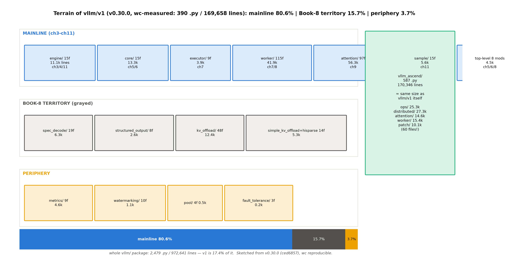
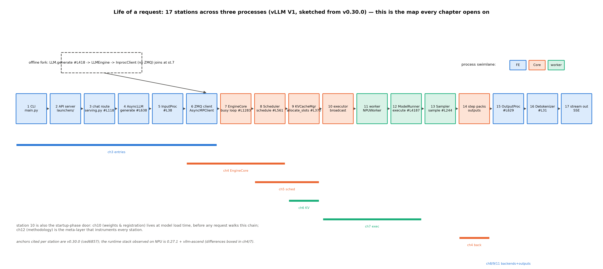

# 第 2 章 仓库地形图与阅读路径

## 2.1 拿到一座十七万行的城

上一章结束时我们立好了版本锚（v0.30.0=ced6857）与双轨口径（源码引用看阅读锚、实验观察看运行栈），并留下一个具体的许诺：Book6 收束时说「本册每个算法，在那里有一个**点名到类**的模块等着——调度折中→`Scheduler`、分页与容量→`KVCacheManager`、图执行→`CompilerManager`……沿一条请求的生命周期把源码读穿」【Book6 ch13-收束.md#L68，「Book7 主链路门」段原文；模块名经 repos/vllm v0.30.0 核对】。兑现这个许诺的第一步，是把这座城的地形画出来——先知道每个模块住在哪，再逐门逐户地读。

> **最小背景栏**：读懂本章只需两样——Book6 收束章「Book7 主链路门」那句许诺（「沿一条请求的生命周期把源码读穿」——本章的地图就是给这句许诺画的路线图）与 `grep`/`wc` 两条命令行手艺（本章 2.5 节自教，无需前置）。

先看几个能校准敬畏心的数字。整个 `vllm/` 包：2,479 个 Python 文件、**972,641 行**——近百万行。本册的主叙事线住在其中的 `vllm/v1/` 子树：390 个文件、169,658 行，只占全仓的 17.4%；其余八成以上是 `model_executor`（每代模型一个实现文件）、`config`、`distributed` 这些周边。而 `vllm/v1/` 本身又是十五个子包加八个顶层模块的城中之城——没有地图的读者面对它，就像没有索引地读一本散页的百科全书。

对照一下你手里已有的东西，差距就具体了：Book6 的四版 mini 引擎，最大的一版（v4 带前缀缓存）也就**单文件数百行**——一个类管调度、一个类管块账、一个主循环串起来，全部逻辑一眼望穿。工业引擎把同样的机制做到了十五个子包十七万行，多出来的部分是什么？一部分是本册要教的（进程拓扑、执行层、后端体系——每层解决一个教学引擎回避了的真实问题），一部分是 Book8 的专题（投机、结构化输出、卸载），还有一部分纯粹的工程血肉（metrics、容错、兼容补丁）。**地图的价值就是把这三部分标出不同颜色**——你此刻该读什么、暂缓什么、永远不必碰什么，一眼可判。十五个子包按本册的路线分三层（图 2.1）：主线六包加顶层模块占 80.6% 的行数（ch3-ch11 的全部地界）、五包是 Book8 的领土（15.7%，本册地图上先标灰）、四包外围路过即可（3.7%）。



图 2.1 `vllm/v1/` 地形分层（按 v0.30.0 源码 wc 实测自绘，示意级）：上泳道=主线六包+顶层模块（蓝），每框标文件数/行数/章地界；中泳道=Book8 地界（灰）；下泳道=外围（黄）；右侧占比条与 vllm-ascend 姊妹城。数据可用一条 `wc` 命令复现（图注末的纪律：地图的数据是可复核的）。

主线六包逐个立门牌——每包记「主类+一句话职责」，第 3-11 章逐包深读时你会反复回到这张名单。**engine/**（15 文件/11.1k 行）是进程模型核心：`async_llm.py`（1,268 行，在线前端 `AsyncLLM`#L78——add_request/generate/output_handler 三件套）、`core.py`（2,578 行，引擎核 `EngineCore`#L105 与它的子进程形态 `EngineCoreProc`#L1019——全册最重的单文件之一）、`core_client.py`（1,969 行，进程间客户端族：InprocClient 同进程直连、MPClient 走 ZMQ）、`llm_engine.py`（469 行，离线同步引擎）、`input_processor.py`/`detokenizer.py`/`output_processor.py`（前端三件：进 token 化、出反 token 化、中间聚合）、`__init__.py`（322 行——不是空文件，是 msgspec 线协议结构 `EngineCoreRequest`/`EngineCoreOutputs` 的家）——ch3、ch4、ch11 的地界。**core/**（15 文件/13.3k 行）是调度与 KV：`sched/scheduler.py`（3,250 行，决策循环）、`kv_cache_manager.py`（941 行）、`block_pool.py`（892 行）、`kv_cache_coordinator.py`（1,072 行）、`single_type_kv_cache_manager.py`（2,725 行）、`kv_cache_utils.py`（2,882 行）——后五个是第 6 章五层结构的正身，`sched/` 下还有 `async_scheduler.py`（异步调度器，ch12 可观测）——ch5、ch6。**executor/**（9 文件/3.9k 行）把调度决策广播到每卡：uniproc/multiproc/ray 三态——ch7。**worker/**（115 文件/41.9k 行）是执行层，每卡一进程：`gpu_model_runner.py` 是全仓最大单文件 **7,664 行**（MRV1 单体）、`gpu/` 分包是它的二代（MRV2，model_runner.py 2,345 行+状态族子包——**双轨并存的演进化石**，同一层两种组织哲学，深讲归 ch7 §7.5）、`gpu_worker.py`（1,557 行，worker 正身）、`gpu_input_batch.py`（InputBatch——持久批的数据结构）；vllm-ascend 侧还有平行的 `vllm_ascend/worker/`（44 文件/15.4k 行，NPUWorker 与 NPU 版 runner）——ch7、ch8。**attention/**（97 文件/56.3k 行）是后端族：`selector.py`（统一选择入口）、`backends/` 27 文件加 `mla/` 子目录 33 文件（FA/FlashInfer/MLA/linear/gdn/mamba——第 9 章按族清点）——ch9。**sample/**（15 文件/5.6k 行）是采样器：`sampler.py` 加 logits_processor 家族（penalties 全家）——ch11。

顶层八个模块（合计 4,548 行）里值得先记名的五个：`request.py`（406 行——`Request`#L59 与 `RequestStatus`#L364，调度器的核心数据对象，第 5 章结构账从它起步）、`kv_cache_interface.py`（KV 的 spec 族——启动期 worker 自报每层形状的数据结构，第 6 章启动管线用到）、`kv_cache_layout.py`（58 行，v0.30.0 新增的布局枚举）、`cudagraph_dispatcher.py`（350 行，图模式分派中枢，ch8）、`utils.py`/`serial_utils.py`（序列化与杂项——msgpack 编解码器就住后者）。

地图右侧那座绿色的城同样值得行注目礼：`vllm_ascend/` 全包 587 个文件、**170,346 行——与 `vllm/v1/` 几乎同体量**（170,346 对 169,658）。平台插件不是薄壳，是一座与主城同尺寸的姊妹城。它的分区与主城镜像对应：`ops/`（110 文件/25.3k 行——把 CANN 算子包装成 torch 可调的接口，外加 `_cann_ops_custom/` 自定义算子的 C++ 源码）、`distributed/`（65 文件/27.3k 行——NPU 侧的进程组与通信）、`attention/`（18 文件/14.6k 行——NPU 的注意力后端族，第 9 章正身）、`worker/`（44 文件/15.4k 行——NPUWorker 与 NPU 版 model runner 双轨）、`quantization/`（量化接入，第 10 章）、`spec_decode/`（投机 proposer 的 NPU 分支，Book8）——**主城有的区，姊妹城大都有对应的馆**。最值得记住的是 `patch/` 目录：60 个文件、10,071 行，每个文件对上游的一处改写都带官方注释——为什么改（Why）、怎么改（How）、等上游哪个 PR 合入后撤（第 11 章兼容层的现成地图，也是「平台插件怎么伺候上游漂移」的活档案）。本册从下一节起会反复在这两座城之间往返。

## 2.2 一条请求的十七站

地形是静态的；本册的主线是动态的——一条请求从进门到出门的完整穿越。把 lifecycle 上的每个关键文件按穿越顺序排开，得到十七站的文件链（图 2.2）——这张图是全书每章开篇「本章在哪」的母图，也是 ch13 收束时重走的对象。



图 2.2 一条请求的 17 站穿越（按 v0.30.0 源码自绘，示意级）：十七站横向串接、按进程三色（蓝=前端进程、橙=EngineCore 进程、青=worker 进程）；上方虚线框=离线链分岔（无 ZMQ，站 7 汇合）；下方色带=站与章的对应（ch3=站 1-6、ch4=站 6-8 及站 14、ch5=站 8-9、ch6=站 9、ch7=站 10-12、ch8/9=站 12 内部、ch11=站 13 与 15-17）。站内锚为行级锚的样例。

在线链（`vllm serve`）的走读从左到右，**每一站的进出都是一次「变形」**——盯住数据形状的变化，穿越图就成了形状流转图。站 1-3 是协议层——CLI 入口、API server、chat 路由（`chat_completion/serving.py::OpenAIServingChat`#L118，chat 模板在这层换装：messages 列表拼成 prompt 字符串）；站 4-6 是前端引擎——`AsyncLLM.generate`（async_llm.py#L638）建输出收集器、`InputProcessor`（input_processor.py#L38）把文本变成 token id 列表、`AsyncMPClient` 把请求**打包过进程边界**（ZMQ+msgpack——Python 对象在这里序列化成字节帧，第 4 章的正菜）；站 7-9 是引擎核——忙循环（busy loop，core.py#L1283）收包还原成对象、调度器决策（scheduler.py#L561，产出 `SchedulerOutput`）、KV 管理器分块（kv_cache_manager.py#L370，请求从此携带块号账本）；站 10-13 是执行——executor 广播、worker（NPU 上由 vllm-ascend 的 `NPUWorker` 顶岗，§2.4）、model runner 组输入跑前向（gpu_model_runner.py#L4187——此为 MRV1 单体锚，MRV2 正身锚见第 7 章；输入是 InputBatch 张量，输出是 logits $(B,V)$）、采样器出 token（sampler.py#L244，logits 变 token id）；站 14-17 是回程——`step` 把输出打包回传（又是字节帧过边界）、前端 `OutputProcessor`（output_processor.py#L629）聚合、detokenizer（detokenizer.py#L31）把 token id 变回文字增量、流式协议送回用户。**一条 prompt 的四次变形**——文本、token id、块号账本、又回文本——就是这本「生命周期」的情节主线；后面每章各领一段。

离线链是同一条路的一个分岔：`LLM.generate`（llm.py#L418）→ `LLMEngine` → **InprocClient**——同进程直连、无 ZMQ 无 asyncio，在站 7 汇入主路。注意一个容易想当然的细节（第 3 章会实测给你看）：离线 `LLM` 类**默认也走子进程形态**——InprocClient 是显式关掉多进程后的选择，不是默认。两条入口的分工与差异先立一张表（表 2.1），后面各章随用随指：

表 2.1 两条入口对照（在线链 vs 离线链）

| 维度 | 在线链（`vllm serve`） | 离线链（`LLM` 类） |
|---|---|---|
| 入口 | CLI → API server → chat/completion 路由 | `LLM.generate`（llm.py#L418） |
| 前端引擎 | `AsyncLLM`（asyncio） | `LLMEngine`（同步） |
| 进程边界 | ZMQ+msgpack（AsyncMPClient） | 默认同样走子进程（SyncMPClient）；显式单进程才用 InprocClient |
| 协议层 | chat 模板/OpenAI 格式/SSE 流 | 无——prompt 直进、结果直出 |
| 典型用途 | 服务、压测（第 12 章 bench 三件套打它） | 批处理、实验脚本（本册各章实验件多用它） |

**例 2.1（构造例：你要看的代码住在哪个进程）** 拿三个符号做一次「落籍」练习——每个符号各住图 2.2 的哪个进程？①`AsyncLLM.generate`（async_llm.py#L638）；②`EngineCore.step`（core.py#L589）；③`Sampler.sample`（sampler.py#L244）。答案：①前端进程（站 4）；②引擎核进程（站 7/14）；③worker 进程（站 13）。这个练习为什么值得第一个做：后面第 12 章会教断点跟跑，**断点打不打得中，第一道判断就是「代码在哪个进程」**——前端进程里的 `breakpoint()` 直接停给你看，引擎核子进程里的会静默失效（`bdb.BdbQuit`）。三色泳道是那张更大地图（第 4 章进程拓扑）的预览。

进程的数量本身也有一笔可算的账。设计文档给了公式与两个例：单机 4 卡 TP（`-tp=4`）= 1 API server+1 engine core+4 workers=**6 进程**；`-tp=2 -dp=4`（8 卡）= 4+4+8+1（DP coordinator）=**17 进程**【官方设计文档 docs/design/arch_overview.md#L107-113 表+#L117/L125 例；验算：$N=\mathrm{DP}\times\mathrm{PP}\times\mathrm{TP}$，DP>1 时 $+1$】。留一算给读者：`-tp=2 -dp=2`（4 卡）该有几个进程？（答案 9——第 4 章用 `ps` 实测对公式。）

十七站里还有三站的「门牌号」值得现在就记住，因为后面各章会反复指回：**站 7** 的 `EngineCore`（core.py#L105）是引擎核正身——本册第 4 章整章住在它里面；**站 12** 的 model runner 是执行层的心脏——第 7 章的主战场、第 8 章（编译/图模式）与第 9 章（attention 后端）都从它内部往外拆；**站 9** 的 `KVCacheManager`（kv_cache_manager.py#L134）管着全部块号——第 6 章的五层结构以它为门面。发现规律了吗：**章号与站号大体同步推进**（ch3=站 1-6、ch4=站 7、ch5-6=站 8-9……），这不是巧合，是本册的写作路线就选在生命周期上走——每章认领一段路，章与章用请求的行程缝合。

站与进程的对应也一并立住（图 2.2 的三色底色）：**站 1-6 与 15-17 住前端进程**（蓝）——协议、tokenize、输出聚合全在这；**站 7-10 与 14 住引擎核进程**（橙）——调度与账本；**站 11-13 住 worker 进程**（青）——前向与采样。两次越界都发生在橙蓝之间：站 6 的 ZMQ 出、站 14 的回——**越界处就是序列化处**（Python 对象变字节帧再变回来）。为什么这三件事要分三个进程？第 4 章会给出完整论证（GIL 与开销分层），此处先记一个由地图可见的粗账：三个进程各有一个「忙的原因」——前端忙在协议与 IO、引擎核忙在决策、worker 忙在计算——**忙的原因不同，就不该互相等待**。

## 2.3 文档是代码的投影

读这么大的仓，官方设计文档（`docs/design/`，30 篇）是最可靠的向导——但先要学会分辨两种文档。看 attention 后端特性表的自我声明：

```markdown
# Attention Backend Feature Support

The priority and feature tables on this page are auto-generated from the
attention backend registry by
`docs/mkdocs/gen_files/generate_attention_backends.py`, based on the checks in
`AttentionBackend.validate_configuration()`.
```
【源码：`repos/vllm/docs/design/attention_backends.md#L1-6` 全文，阅读锚 v0.30.0】看什么：**这张表不是人写的，是脚本读着注册表生成的**——文档在这里是代码的投影，代码变表就变，永不撒谎（生成脚本 `generate_attention_backends.py` 在仓可查，投影的源头是 `vllm/v1/attention/backends/registry.py`——一手源码，证据等级高于文档）。

同目录里的手写文档就是另一种命运了。架构总览 `arch_overview.md` 是全仓最好的叙事文档，但它内嵌的行级锚已经烂了两处：L157/L169 指向的 `vllm/engine/llm_engine.py` 在 v0.30.0 已是 7 行的别名文件（V0 遗体）；L202 引的 `vllm/config.py#L2036` 已不存在——config 早已拆成 34 个文件的包。那 7 行的别名文件值得全文一睹（它是第 1 章 V0 消亡史的主实物，此处先见为敬）：

```python
# SPDX-License-Identifier: Apache-2.0
# SPDX-FileCopyrightText: Copyright contributors to the vLLM project

from vllm.v1.engine.llm_engine import LLMEngine as V1LLMEngine

LLMEngine = V1LLMEngine  # type: ignore
"""The `LLMEngine` class is an alias of [vllm.v1.engine.llm_engine.LLMEngine][]."""
```
【源码：`vllm/engine/llm_engine.py` 全文 7 行，阅读锚 v0.30.0】看什么：**V0 的遗体只有 7 行——名字还在，身体已是 V1**。曾经千行的 V0 引擎被删空后留下一张便利贴：老 import 路径指路新家、一行 docstring 交代身份。第 1 章会拿它讲 V0→V1 的演进史，本章先记结论：**手写文档会烂，生成的不会**——这不是文档作者的失职，是两种文档的物理性质（手写的内容一旦引用了会移动的代码，腐烂只是时间问题）。本书行级锚制度的由来正在于此：引文档时行号一律回源码复核，源码是唯一不会撒谎的底档。

30 篇文档的全景收进表 2.2——精读 12 篇（每篇在各章就位时展开）、速览 18 篇（索引级登记），另按「生成式/手写式」标一列：生成式的表格可信直引，手写式的叙事可引但行号回源码核。

文档之外还有两个「第 0 号文件」的主张值得现在立起来（第 12 章方法学的种子）：读任何引擎，先读 `envs.py`（全部环境变量开关的地名录——本书后面反复出现的 `VLLM_LOGGING_LEVEL`、`VLLM_ENABLE_V1_MULTIPROCESSING` 都住在那）与 `logger.py`（日志怎么装配）——**开关面是引擎的神经系统索引**，先读它，后面每个机制出现时你都知道「它有哪些可观察的旋钮」。本册各章实验用的环境变量，全部出自这两个文件的地名录。

表 2.2 docs/design/ 30 篇地图（★=精读；生成/手写按 §2.3 判据；章对应=本册地界）

| 文档 | 性质 | 章对应 |
|---|---|---|
| arch_overview ★ | 手写 | ch1/ch2/ch4（进程拓扑总纲） |
| paged_attention ★ | 手写（历史文档，开篇自警横幅） | ch6（V0 时代参照） |
| prefix_caching ★ | 手写（六时刻例） | ch6 |
| model_runner_v2 ★ | 手写 | ch7 |
| cuda_graphs ★ | 手写 | ch8 |
| torch_compile ★ | 手写 | ch8 |
| vllm_ir ★ | 手写 | ch8（IR 节） |
| multiprocessing ★ | 手写（自注 2024-12 时点） | ch4 |
| attention_backends ★ | **生成式** | ch9 |
| huggingface_integration ★ | 手写 | ch3/ch10 |
| plugin_system ★ | 手写 | ch10 |
| metrics ★ | 手写 | ch12 |
| hybrid_kv_cache_manager | 手写（早期时点自注） | ch6 总览/Book8 ch1 |
| optimization_levels / fusions / custom_op / debug_vllm_compile | 手写 | ch8/ch12 |
| cuda_graphs_multimodal / torch_compile_multimodal | 手写 | 边缘（多模态=Book8） |
| dbo / fused_moe_modular_kernel / moe_kernel_features / hisparse / nixl 系两篇 / logits_processors / lora_resolver | 手写 | Book8 地界 |
| endpoint_plugins / io_processor_plugins / mm_processing | 手写 | ch11 边缘/ch3 |

## 2.4 姊妹城的三级链：vllm-ascend 怎么接管

NPU 读者此刻该问的问题：那座 17 万行的姊妹城，是怎么接到主城上的？答案是一条只有三环的链——而它的第一环甚至不在任何 `.py` 文件里，在打包清单里：

```python
    entry_points={
        "vllm.platform_plugins": ["ascend = vllm_ascend:register"],
        "vllm.general_plugins": [
            "ascend_kv_connector = vllm_ascend:register_connector",
            "ascend_model_loader = vllm_ascend:register_model_loader",
            "ascend_service_profiling = vllm_ascend:register_service_profiling",
            "ascend_model = vllm_ascend:register_model",
        ],
        "ms_service_metric.providers": [
            "vllm-ascend = vllm_ascend.observability:get_metric_provider",
        ],
    },
```
【源码：`repos/vllm-ascend/setup.py#L516-529`，vllm-ascend 0.27.1rc1（安装包与构建源逐字节一致，引用无需版本框注）】看什么：核心是 #L519 一行——pip 安装 vllm-ascend 的那一刻，「世界上有个叫 ascend 的平台插件，入口是 `vllm_ascend:register`」这条记录就写进了 Python 发行版元数据。vLLM 主城启动时扫描 `vllm.platform_plugins` 组（`vllm/platforms/__init__.py#L270-272`——就是打出 `logger.info("Platform plugin %s is activated", …)` 那三行的代码），命中即激活。

「一个发行版五把钥匙」还藏着插件体系的分组语义，值得多看一眼：`vllm.platform_plugins`（平台——决定 worker 类、后端、设备的一切平台行为）与 `vllm.general_plugins`（通用——模型加载器、KV connector、服务画像、模型注册四件套）是**两组不同的插座**，激活时机与信任级别都不同：平台插件全局只许一个（多装直接 RuntimeError「Only one platform plugin」——两个平台抢 device_type 没法调和），通用插件按名各自注册、互不排斥。第三组 `ms_service_metric.providers` 更边缘（指标供应商——华为云观测生态的钩子）。**分组=把扩展点按「能改什么」分级**：能改设备语义的最严格（唯一）、能加组件的宽松（可叠加）——这个分级思想在你自己设计插件系统时可以直接借用。顺带看见的这五把钥匙，也是第 10 章大项目的伏线（A 路注册用的 `vllm.general_plugins` 里就有一把 `ascend_model`）。

第二环是平台类——`NPUPlatform` 的自报家门：

```python
class NPUPlatform(Platform):
    _enum = PlatformEnum.OOT
    device_name: str = "npu"
    device_type: str = "npu"
    simple_compile_backend: str = "eager"  # Disable torch.compile()
    ray_device_key: str = "NPU"
    device_control_env_var: str = "ASCEND_RT_VISIBLE_DEVICES"
    ray_noset_device_env_vars: list[str] = [
        "RAY_EXPERIMENTAL_NOSET_ASCEND_RT_VISIBLE_DEVICES",
    ]
    dispatch_key: str = "PrivateUse1"
```
【源码：`repos/vllm-ascend/vllm_ascend/platform.py#L87-97`，运行栈 vllm-ascend 0.27.1rc1】看什么：一个平台插件的身份卡——**我是谁**（`device_type="npu"`，torch 的 dispatch 靠它把算子路由到 NPU 后端）；**走哪条路**（`dispatch_key="PrivateUse1"`，torch 为第三方后端预留的私有调度键）；**怎么选卡**（`device_control_env_var="ASCEND_RT_VISIBLE_DEVICES"`——全书 NPU 选卡纪律用的那个环境变量，源码正身在此）；**编译怎么退**（`simple_compile_backend="eager"`，行内注释就是官方原文「Disable torch.compile()」——第 8 章的门牌，此处只指门）。第三环是 worker：图 2.2 站 11 的 GPU Worker 在 NPU 上由 `vllm_ascend/worker/worker.py::NPUWorker`#L114 顶岗——它与官方插件开发清单的最小实现怎么逐条对应，第 7 章的表 7.1 展开。

这条链的末端，你自己的机器上就能看见。起一次引擎（比如第 0 章冒烟用过的 `vllm_smoke.py`），日志前几行里有：

```text
INFO [__init__.py:52] Available plugins for group vllm.platform_plugins:
INFO [__init__.py:54] - ascend -> vllm_ascend:register
INFO [__init__.py:237] Platform plugin ascend is activated
```
【本机实测（Atlas 910B3，运行栈 0.27.1+vllm-ascend 0.27.1rc1），`log/book7-00/vllm_smoke_eager1.log` 原行；复现命令见 `code/00-feasibility/vllm_smoke.py`】三级链在这五行日志里走完了最后一环——打包元数据、平台类、worker 接管，全部具体可触。

最后留一份「双城通信录」——本册后面会反复引用的姊妹城关键文件，先在这里挂上号（每个文件一行：它是谁、第几章出场）：`platform.py`（1,598 行——平台插件的身份卡与全部配置改写，第 3/10 章）；`worker/worker.py`（NPUWorker——第 7 章与官方最小清单逐条对照）；`attention/attention_v1.py`（NPU 主后端四件套——第 9 章）；`ascend_config.py`（NPU 配置树——第 3 章）；`quantization/`（量化接入六法——第 10 章）；`patch/__init__.py`（42 项补丁索引——第 11 章）；`utils.py`（block 128 的两行正身——第 6 章）。读完本册你会发现：**这七个文件就是 NPU 读者与主城之间的全部桥梁**——主城的通用机制（调度、KV、执行）不用改，改的是这些接入点的行为。地图画到这里算是画完了。

## 2.5 阅读的三层法与你的第一个 grep

地图和文档都齐了，收束成本章的方法论：**读引擎源码的三层法——先问它在哪，再问它在动吗，最后问我理解对了吗**。三层各自回答一个失败模式：第一层防「迷路」（在错的文件里找对的逻辑——十七万行城里最常见的死法）；第二层防「想当然」（代码读着像那么回事，跑起来根本没走这条路——死分支、配置开关、平台分叉都会骗静态阅读）；第三层防「自欺」（看见了它跑，但理解错了它为什么跑——对拍就是拿读数逼你把理解说清楚）。本章交出第一层的全部家当（三张图、一张表、一条 grep 手艺）；后两层是第 12 章的正菜——到那时给引擎接上仪表、把地图上的每条路跑亮、用读数证明你没看错。本册各章的节奏就是三层法的循环使用：每章先读静态结构（源码摘录）、再跑一次动态观察（实验件）、最后对拍（读数对预言）。你现在读的第 6 章就是这么写出来的：五层结构图先立、块账手算先做、命中率 56.0% 的实测最后把「满块原则+断链即停」的预测钉死——三层一层不少。

第一层的手艺只有一条命令，但值得现场用三遍——这就是你的第一个动手。在 `repos/vllm` 顶层执行：

```bash
grep -n "async def generate" vllm/v1/engine/async_llm.py
```
预期输出（实测）：`638:    async def generate(`——站 4 的主入口，行级锚的样子。第二遍找引擎核正身：

```bash
grep -n "class EngineCore" vllm/v1/engine/core.py
```
预期输出四行：`105:class EngineCore:`、`1019:class EngineCoreProc(EngineCore):`、`2398:class EngineCoreActorMixin:`、`2553:class EngineCoreActor(…)`——一条 grep 打出一串亲属：L105 是类正身、L1019 是它的子进程形态、后两个是 ray 演员（Book8 地界）。**grep 多命中不是噪音，是地形的等高线**。第三遍找调度器：

```bash
grep -n "def schedule" vllm/v1/core/sched/scheduler.py
```
预期输出：`561:    def schedule(self, throttle_prefills: bool = False) -> SchedulerOutput:`——这一站下面几行就是 Book6 第 7 章整句引用过的那条 NOTE 注释（「There's no "decoding phase" nor "prefill phase"…」），当时许诺「行级锚在 Book7」——你刚刚亲手兑现了这个许诺的第一半（找到了门牌；进门精读是第 5 章）。地图的每个数字都可复核——一条命令的事：`find repos/vllm/vllm/v1 -name '*.py' | xargs wc -l | tail -1` 给出全子树行数、`for d in repos/vllm/vllm/v1/*/; do echo "$(basename $d): $(find $d -name '*.py' | xargs wc -l | tail -1)"; done` 逐包打印（图 2.1 就是这么算出来的）。

## 2.6 本章小结

回到开篇的问题：怎么在近百万行的仓里不迷路。本章给了三件套：**地形图**（十五子包三层分层，主线 80.6%——注意力预算表）、**穿越图**（17 站文件链，每章开篇的坐标母图）、**文档观**（生成式可信、手写式行号回源码核——行级锚制度的由来）；外加姊妹城的三级链（打包元数据→平台类→worker）与三层法的第一层手艺。Book6 收束时那句「每个算法都有一个点名到类的模块等着」，现在已经能把每个类名安到站点上。

**带走的心智**是一句话加一幅画。一句话：**地图是注意力预算表**——十七万行里八成属于五站地界，知道自己在哪，就知道哪些代码现在不必读。一幅画：**请求的十七站三色穿越**——蓝（前端）打包、橙（引擎核）记账、青（worker）计算，站 6 与站 14 是两个进程边界；以后读到任何一段 vLLM 代码，先在心里给它标一个站号。

zoom out 回全书：地图在手，旅程可以开始了。下一章（第 3 章）我们从站 1 进城——请求从命令行与 HTTP 进来，第一次变形（文本变 token、对象变消息）发生在哪、谁经手，入口层的故事从这开始。

> **【欠账】** 断点跟跑的手艺（第二层「它在动吗」的完整工具箱——单进程模式、子进程断点、日志体系）→ 第 12 章。
