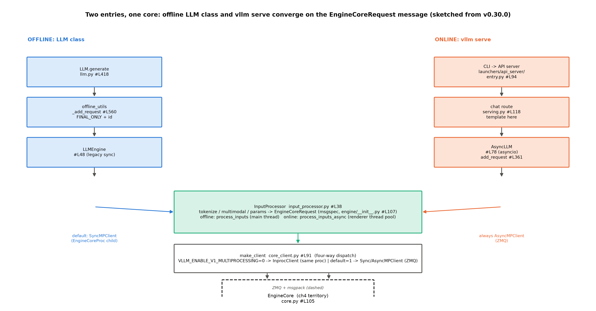

# 第 3 章 入口层：请求从哪进引擎

## 3.1 两件外套，一颗心脏

上一章的地图把十七站铺开；本章从站 1 进城。Book6 结束时，真实引擎对我们还是一个「有读数的黑盒」——第三层对拍里那个 8.9 ms/token 的 vLLM，我们只写过 `llm = LLM(model=…, dtype=…)`【Book6 ch07 的 `bench_vllm_tpot.py`（书仓 `../book6-inference-systems-intro/code/ch07/`）黑盒用法】，从没问过这句构造之后发生了什么。现在拆盒：从命令行与 HTTP 进来的请求，第一次变形（文本变 token、对象变消息）发生在哪、谁经手。本章产出四样：一张双入口总图（图 3.1）、三个走查例（分派真值表/字段流转/配置一滴水）、一组七判据的三档入口对拍实验、两张考据框。

先立全章的地图（图 3.1）：vLLM 有**两条入口、一颗心脏**——离线的 `LLM` 类（批处理与实验脚本的入口，本册各章实验件用它）与在线的 `vllm serve`（服务与压测的入口，第 12 章 bench 三件套打它）。两条链各自走三跳，在 `InputProcessor` 处汇成同一种消息（`EngineCoreRequest`），再过同一道分派门（`make_client`）进入同一个引擎核——**入口层的一切设计，都是为了让这两件外套共享一颗心脏**。两条外套的剪裁差异先立一张表（表 3.1），后面各节随用随指：

表 3.1 双入口对照（离线 LLM 类 vs 在线 vllm serve）

| 维度 | 离线链（LLM 类） | 在线链（vllm serve） |
|---|---|---|
| 入口签名 | `LLM.generate(prompts, sampling_params)`#L418 | HTTP POST → serving.py#L242 |
| 引擎对象 | `LLMEngine`#L48（同步；docstring 自认 legacy） | `AsyncLLM`#L78（asyncio 包裹） |
| 客户端（默认） | SyncMPClient（多进程默认开）；置 0 时 InprocClient | AsyncMPClient（恒 ZMQ） |
| 输入处理 | process_inputs 同步（主线程） | process_inputs_async（渲染进线程池（thread pool）——事件循环（event loop）不被 tokenize 阻塞） |
| 输出形态 | FINAL_ONLY+tqdm 聚合 | 流式 RequestOutputCollector（第 11 章） |
| request_id 源 | Counter"0"+随机后缀 | 协议层生成（chatcmpl- 域）+external_req_id |
| 典型用途 | 批处理、实验脚本 | 服务、压测 |



图 3.1 双入口总图（按 v0.30.0 源码自绘，示意级）：左泳道=离线 LLM 类、右泳道=在线 vllm serve，各自三跳后汇入 InputProcessor 产出 EngineCoreRequest 消息；make_client 的进程开关门（`VLLM_ENABLE_V1_MULTIPROCESSING`）决定同进程直连还是 ZMQ 跨进程；EngineCore 是第 4 章的地界。

> **最小背景栏**：本章只需要两件旧资产——Book6 的 TTFT 定义（首 token 时延，Book6 ch01 的 TTFT 定义式 $\mathrm{TTFT}=t_{queue}+t_{prefill}$——未编号式：从前端 arrival_time 起算）与 mini 引擎 v1/v2 的主循环形态（Book6 书仓 `../book6-inference-systems-intro/code/ch04/engine_v1.py`——调度粒度从批到步的那次进化）。ZMQ 消息系统的机制图像不需要前置——第 4 章从零教。

## 3.2 离线链：LLM 类的三跳

离线链第一跳在 `llm.py::LLM`（#L67）——`generate`（#L418）收下 prompt 列表后立刻转手。真正的登记发生在第二跳 `offline_utils.py`，值得看全文：

```python
    def _add_request(
        self,
        prompt: EngineInput,
        params: SamplingParams | PoolingParams,
        lora_request: LoRARequest | None = None,
        priority: int = 0,
    ) -> str:
        if isinstance(params, SamplingParams):
            # We only care about the final output
            params.output_kind = RequestOutputKind.FINAL_ONLY

        request_id = str(next(self.request_counter))

        return self.llm_engine.add_request(
        …
```
【源码：`vllm/entrypoints/offline_utils.py#L560-573`（截尾标 …，return 语句未完），阅读锚 v0.30.0】看什么：两件事——**输出形态被钉死为 FINAL_ONLY**（离线批处理只要终态结果，不要流式中间态——这个开关一路传到输出处理器，决定它怎么收割）；**请求 id 从字符串 "0" 起步**（一个 Counter，`str(next(...))`——离线 id 为什么长成 `0-1a2b3c4d` 的样子，3.4 节给答案）。

第三跳是 `LLMEngine`（`vllm/v1/engine/llm_engine.py#L48`——docstring 自认「Legacy LLMEngine for backwards compatibility」，名字的历史包袱）。它做的一件要事是**一进两登记**：`add_request` 把请求同时记进两本账（#L270-279 起的流程，`assign_request_id` 先落 id）——前台账给 `RequestOutputCollector`（输出处理器从此盯着它收割，`vllm/v1/engine/output_processor.py#L51`）、后台账经 `InputProcessor` 打包发给引擎核（调度器从此盯着它排程）。**一本对用户、一本对引擎**——这个双层结构是 V1 前后端分工在入口处的投影：前台进程管「用户看到了什么」（聚合、指标、流式切分），引擎核管「引擎算了什么」（调度、执行、KV），两本账各查各的、互不阻塞。采样参数 `n>1` 时还有一步扇出（#L280-297：一个父请求展开成 n 个子请求共享 prompt 块——第 6 章 CoW 故事的调度侧入口，此处点名不展开）。

> **【考据框】为什么叫 Legacy？**`LLMEngine` 的 docstring 全文只有一句自白：「Legacy LLMEngine for backwards compatibility.」（llm_engine.py#L49）。V1 的正统前端是 `AsyncLLM`（asyncio 原生）；离线同步引擎是兼容老 API 保留的旧外套——但讽刺的是，实验脚本与 bench 工具几乎全用它（同步写起来简单），「Legacy」反而成了最常用的入口。读引擎源码的一课：**类名里的历史标签说的是出身，不是使用频率**。

顺带把 FINAL_ONLY 的另一半也说全：它属于 `RequestOutputKind` 枚举——全族恰好三员（`sampling_params.py#L198-204`）：CUMULATIVE/DELTA/FINAL_ONLY，流式语义的两种口径（累计 vs 增量）加离线的终态档，离线链钉死 FINAL_ONLY 意味着**中间态根本不出引擎核的回程消息**——线协议上每个请求只在完成时出现一次。在线链正相反：每个 token 一条增量消息（第 11 章的 SSE 流就是把它翻译成 HTTP chunk）。同一个引擎核伺候两种输出语义，靠的是输出形态这个开关在**入口处**（而不是出口处）声明——进什么门、说什么话。

离线链的收尾是那个熟悉的主循环：

```python
        outputs: list[_O] = []
        total_in_toks = 0
        total_out_toks = 0
        while self.llm_engine.has_unfinished_requests():
            step_outputs = self.llm_engine.step()
```
【源码：`vllm/entrypoints/offline_utils.py#L599-603`，阅读锚 v0.30.0】看什么：这三行就是 Book6 ch04 我们手写的主循环的工业形态——`while 有没做完的：step()`，外面套的 tqdm 只是进度条。**你已经懂这个循环**；本章到第 5 章要补的，是 `step()` 里面那套调度决策。值得对比的是两版循环的「胖瘦」：Book6 的 mini 引擎每步在主线程里调度+执行一起做（mini `engine_v1.py` 的 step 是个真函数调用），这里的 `llm_engine.step()` 则是**跨进程遥控**——它把「跑一步」的指令发进 EngineCore、等结果回来（3.3 的分派门决定走哪条线）。同一个 while 骨架，胖瘦差出一层进程边界——这正是下一章要解释的：为什么值得为这层边界付出进程间通信的代价。

## 3.3 在线链与分岔点

在线链（`vllm serve`）的前三跳换了个世界：CLI 解析参数后，API server 在 `launchers/api_server/entry.py#L94` 诞生在线引擎（`AsyncLLM.from_vllm_config(...)`——注意 v0.30.0 的这个路径；运行栈 0.27.1 还是 `openai/api_server.py` 804 行单体的旧家，**这是两版差异清单的 A 级第一条**，起服栈以运行栈为准）。第三跳的协议层 `chat_completion/serving.py::OpenAIServingChat`（#L118）做 OpenAI 格式与引擎格式的翻译——chat 模板在这层换装（messages 列表拼 prompt 字符串），交接行是 #L368 的 `generator = self.engine_client.generate(engine_input, ...)`。第 11 章会从这层接着讲流式返回；本章只递到门口。

在线链有一处异步工程细节值得停一秒：`AsyncLLM.add_request` 对裸 prompt 走 `process_inputs_async`（async_llm.py#L452-455——动机注释与调用行）——**渲染与 tokenize 被放进 renderer 线程池**，事件循环不被阻塞（`input_processor.py#L70-75` 的 make_async 装配与动机注释（L70-72 原文「Raw-prompt preprocessing … is blocking, so async callers should run it on the renderer's thread pool to keep their event loop responsive.」）说明了这个动机）。这个设计正在向全库蔓延成一个**过渡期标本**：三处 deprecation warning（llm_engine.py#L241-247、async_llm.py#L423-427、input_processor.py#L315-319）都在说「Passing … is deprecated … instead pass the outputs of `Renderer.render_cmpl()`」（前两处说的是 EngineCoreRequest 直传、第三处是裸 prompt——两型警告同一个去向）——输入处理正从「引擎代劳」迁往「调用方先渲染」，在线链已走新路、离线链还在旧路。读引擎源码会常遇到这种**同一过渡期的两种活法并存**：deprecated 不等于已删除，新路线也不等于全覆盖——判断某段代码走哪条路，看 warning 而不是看文档。

两条链在引擎侧的分岔点，是 `make_client` 的四路分派——这个函数值得整段读，它一张表说清了「进程形态」的全部合法组合：

```python
        if asyncio_mode and not multiprocess_mode:
            raise NotImplementedError(
                "Running EngineCore in asyncio without multiprocessing "
                "is not currently supported."
            )

        if multiprocess_mode and asyncio_mode:
            return EngineCoreClient.make_async_mp_client(…)
        …
        if multiprocess_mode and not asyncio_mode:
            return SyncMPClient(…)
        …
        return InprocClient(vllm_config, executor_class, log_stats)
```
【源码：`vllm/v1/engine/core_client.py::EngineCoreClient.make_client`#L107-129（骨架节选），阅读锚 v0.30.0】看什么：先拒绝一个不可能组合（同进程+异步——源码自认不支持），再按「多进程×异步」两开关落三路：在线链恒走 `AsyncMPClient`（ZMQ）；离线链的默认与例外是下一句要讲的故事；兜底的 `InprocClient` 是同进程直连。官方博客对这个兜底类有句直白的话：「engine core client (in our running example we're using `InprocClient` which is basically == `EngineCore`; we'll gradually build up to `DPLBAsyncMPClient` which allows serving at scale)」【官方博客 Anatomy of vLLM，vllm.ai/blog/2025-09-05，基于 2025-08-09 快照——引用按快照等级】。

**例 3.1（构造例：一次 LLM 构造落进哪个客户端）** 拿「多进程×异步」两开关做真值表：①离线默认（`VLLM_ENABLE_V1_MULTIPROCESSING` 未设=1，asyncio=否）→ (1,0) → **SyncMPClient**——起一个 EngineCoreProc 子进程、走 ZMQ；②显式置 0（调试形态）→ (0,0) → **InprocClient**——引擎核就在本进程；③在线链 → (1,1) → AsyncMPClient。效果读法：**同进程不是离线的默认、而是它的例外**——想当然的「离线=同进程」恰是反的（本章实验档 A/B 会实测印证：默认档日志里看得到 `(EngineCore pid=…)` 子进程前缀，置 0 后消失）。教学上仍按 InprocClient 讲机制——它「basically == EngineCore」，没有 IPC 噪音；机器上的默认形态用版本框注与实验说清。**「书上的最简形态」与「机器上的默认形态」分开说**，这是读一切引擎文档的通用姿势。

## 3.4 InputProcessor 与线协议（wire protocol）：消息长什么样

两链汇流处，`InputProcessor`（`vllm/v1/engine/input_processor.py#L38`）把杂七杂八的输入统一成**一种消息**。消息正身是 msgspec 结构（选运行栈版本印——实验可直接对照；阅读锚同构在 #L107 起）：

```python
class EngineCoreRequest(
    msgspec.Struct,
    array_like=True,  # type: ignore[call-arg]
    omit_defaults=True,  # type: ignore[call-arg]
    gc=False,
):  # type: ignore[call-arg]
    request_id: str
    prompt_token_ids: list[int] | None
    mm_features: list[MultiModalFeatureSpec] | None
    sampling_params: SamplingParams | None
    …
    arrival_time: float
    lora_request: LoRARequest | None
    cache_salt: str | None
    …
```
【源码：`vllm/v1/engine/__init__.py#L97 起`（两处 `…` 节选：sampling_params 后还有 pooling_params——池化任务走它、生成任务恒 None；cache_salt 后还有 data_parallel_rank 与结构尾部的混合输入/DP/会话等精细字段），运行栈 0.27.1（阅读锚 v0.30.0 同构，另多 `session_id` 字段——版本差异框注：印字段表以运行栈为准并注追加）】看什么：**结构头的三个装饰参数比字段还值得看**——`array_like=True` 让序列化按位置传值不传字段名、`omit_defaults=True` 只传改过默认值的字段、`gc=False` 免垃圾回收追踪：**线协议的每一字节都在省钱**（这条 ZMQ 线上每秒要过成千上万条消息）。字段侧三个值得停的：`prompt_token_ids`——**tokenization 在前端完成**，引擎核收到的已是 token id（「prompt 的第二次变形」在前端进程结束）；`arrival_time`——到达时间戳在消息里出生，它是 **TTFT 的起点**（这笔 TTFT 账从这一刻起算——第 12 章 metrics 的五类区间全部锚在这个时间戳上）；`external_req_id`（结构尾部）——用户自带的 id 只做标签，内部 `request_id` 才做键（源码里对重复外部 id 的运行时警告原文值得一看：「Duplicate externally-provided request IDs may cause failures and/or subtle correctness errors」——`logger.warning_once`，仅在关闭 id 随机化时打印——两层 id 制的权衡）。

其余字段用「谁会带着它进门」读一遍，顺便把请求的形态光谱看全：`mm_features` 只有**多模态请求**携带（图片/视频的特征规格——本册不讲多模态，但你要能在字段表里认出它的存在，第 11 章协议层会再遇到）；`pooling_params` 与 `sampling_params` 二选一——**嵌入/池化模型**（做 embedding 服务的）走前者、生成模型走后者（同名引擎伺候两类任务，字段面先分家）；`lora_request` 挂 LoRA 适配器（Book8 第 4 章）；`cache_salt` 是多租户的缓存隔离盐（第 6 章哈希链的附加键——它在**消息层**就有席位，预告了它将进入块哈希）；`data_parallel_rank` 与 `current_wave` 服务 DP 扩展（第 4 章拓扑的伏笔）；尾部的 `prompt_is_token_ids`/`client_index`/`resumable` 都是混合输入与 scale-out 的精细位。**一张消息结构就是一份「引擎认为自己会收到什么请求」的完整自白**——比任何文档都诚实地暴露了功能面。

> **【考据框】线协议用 msgspec，配置用 pydantic——为什么不用同一家？**本章出现了两套数据类体系：消息（`EngineCoreRequest`）是 `msgspec.Struct`，配置（VllmConfig/AscendConfig）是 pydantic dataclass。分工的逻辑在**性能面与校验面的取舍**：线协议消息每秒过万条，msgspec 的编码器比通用方案快一个量级、还支持 `array_like`/`omit_defaults` 这种字节级省钱开关（但校验能力弱）；配置对象一生只构造一次，值得用 pydantic 换来严格校验与宽松类型矫正（3.6 那句字符串布尔陷阱修补正是 pydantic 能力面的收益）。**热路径选快、冷路径选稳**——同一个仓库里两套体系并存不是混乱，是对「每条数据被处理多少次」的诚实回答。

**例 3.2（构造例：一条 prompt 的字段流转）** 拿本章实验用的 prompt「The capital of France is」走五步：①`LLM.generate` 收字符串；②`InputProcessor` tokenize——LlamaTokenizer（sp32k）切出 **[349, 2487, 290, 4020, 323]** 五个 token id（`add_special_tokens=True` 但 `add_bos_token=False`——Book3 语料协议「无 BOS」在 tokenizer 配置里的固化；这组 id 是本章实验 J6 判据的预注册基准）；③组装 `EngineCoreRequest`：`prompt_token_ids=[349,…]`、`arrival_time=time.time()`、此刻 id 还是外部序号 "0"；④`assign_request_id` 做**两层 id 分工**（#L279：`request.request_id = f"{request.external_req_id}-{random_uuid():.8}"`）：用户侧的 "0" 被挪进 `external_req_id` 做标签、内部键换成 `0-1a2b3c4d` 式（原 id+随机后缀 8 位，唯一性由随机段保证）；序列化时其余默认字段不上线（omit_defaults 生效）；⑤两登记（前台账+后台账），消息上线。效果读法：**一条 prompt 的前两次变形（文本→token→消息）全部发生在前端进程**——引擎核永远收不到字符串；而你最后在 `RequestOutput.request_id` 里看到的 "0" 是外部标签（本章实验 J4 实测：输出 id 恰为 "0","1","2" 纯序号——内部随机 id 不出引擎）。

## 3.5 配置对象的河流

入口层还流着一条河：配置。`LLM(...)` 的每个关键字参数与 `vllm serve` 的每个旗标，汇进同一份数据类 `EngineArgs`（`vllm/engine/arg_utils.py#L432`——0.27.1 有 227 个字段、v0.30.0 涨到 243），再经 `create_engine_config` 沉淀成全局唯一的 `VllmConfig`：

```python
    def create_engine_config(
        self,
        usage_context: UsageContext | None = None,
        headless: bool = False,
    ) -> VllmConfig:
        """
        Create the VllmConfig.

        NOTE: If VllmConfig is incompatible, we raise an error.
        """
        current_platform.pre_register_and_update()

        device_config = DeviceConfig(device=cast(Device, current_platform.device_type))
```
【源码：`vllm/engine/arg_utils.py#L2040-2052`，阅读锚 v0.30.0】看什么：`current_platform.pre_register_and_update()`——**平台插件比配置先到家**：在 `VllmConfig` 尚不存在时就先请平台来注册/改写（这是 NPU 接管的第一道闸口；第二道在 3.6 的十步改写）。`VllmConfig`（`vllm/config/vllm.py::VllmConfig`#L358）是带 31 个字段的 dataclass——其中 26 个是 `*Config` 子配置对象、外加一个收平台扩展的 `additional_config` 字典（运行栈 0.27.1 为 25 个子配置——版本差一行带过），它的地位官方一句话定谳：「In summary, the complete config object `VllmConfig` can be treated as an **engine-level global state** that is shared among all vLLM classes」【证据等级：官方设计文档（arch_overview.md#L299-300 直引）】——用人话说：全引擎人手一份同一本字典，谁都不许自己另抄小抄。

这本字典的二十六个抽屉按「问什么」分三组读得快：**模型侧**（model/tokenizer/dtype/量化——「伺候谁」）、**执行侧**（parallel/scheduler/compilation/attention/worker 相关——「怎么算」）、**外围侧**（lora/speculative/observability/structured_outputs——「附加能力开关」）。对照记忆法：第 2 章图 2.1 的十五个子包，几乎每个都在字典里有对应的抽屉——**配置树的形状就是代码城的形状**。这条不变量的收益官方也有论证（arch_overview.md L204-211）：加一个功能只需在 VllmConfig 加一个字段、不用改任何构造函数签名——243 个旗标面（0.30.0）能长到这么宽而不散架，靠的就是单对象这一根龙骨。这本字典的宽度值得亲眼看一次：`vllm serve --help` 一屏翻完约 **80 行帮助面**（本机实测，分组折叠后；EngineArgs 的字段全在其中（运行栈 0.27.1 实测 227 个；v0.30.0 已涨到 243））——一屏翻完，你对「这台引擎有多少个可调旋钮」就有了物理直觉；而其中 NPU 会改写或忽略哪些，3.6 的十步清单就是导读。

> **【版本差异框注】**CLI 子命令集在两版间有增补：v0.31.0 新增 `vllm preload`（weight-cache 守护进程，预热与 serve 分离，#56680）与实验态的 `vllm snapshot create/restore`（CRIU 进程级冻结恢复，#51360）——阅读锚（v0.30.0）与运行栈都没有这两个子命令，正文 CLI 地图按锚画、此处一句框注。

**例 3.3（构造例：一滴水的旅行）** 跟踪 `dtype="bfloat16"` 这一个参数的全程：①`LLM(dtype="bfloat16", …)` → `EngineArgs.dtype` 字段；②`create_engine_config` 把它沉进 `ModelConfig.dtype`；③起服日志的整行 config dump 里找到它（冒烟日志实见 `dtype=torch.bfloat16`——`core.py#L121` 的这行 dump 是 VllmConfig 全字段最好的运行实物）；④（NPU 钩子）若与平台冲突，3.6 的第 4 步 `_fix_incompatible_config` 会改写它。效果读法：**配置是单河流——一个参数从 CLI 到日志只走一条水路**，中途任何改写都有日志可查。

## 3.6 NPU 侧配置面：两道闸口与一棵配置树

NPU 读者此刻的问题：那颗心脏怎么被接上 NPU 的？第 2 章讲过三级链（打包元数据→平台类→worker）；本章看它在**配置河流**上的投影——两道闸口。第一道就是 3.5 的 `pre_register_and_update`（配置出生前）。第二道是 `NPUPlatform.check_and_update_config`（`vllm_ascend/platform.py#L442-499`）——源码自带十步编号注释，值得按顺序走一遍，因为**每一步的产物都打印在你自己的起服日志里**：第 1 步配日志（你看到的每行 NPU 前缀日志的祖先）；第 2 步早退校验（device_type 不是 npu 就整个跳过——平台改写只对自己人动刀）；第 3 步量化方法自动探测（第 10 章量化接入的前哨）；第 4 步 `_fix_incompatible_config` 修不兼容配置——起服日志实见「GPU-specific parameter is not supported on Ascend. parameter=disable_cascade_attn … resetting to False」，**上游旗标在 NPU 上的第一场遭遇战**：GPU 专属参数被温和地改写而不是粗暴报错；第 5 步 `init_ascend_config`——AscendConfig 的诞生地（3.6 后半的正主）；第 6/7 步更新编译与图模式（`AscendCompiler` 后端装配——第 8 章的门牌）；第 8 步装配 worker 类与调度器（`worker_cls` 设定点——第 7 章表 7.1 的伏线：平台告诉引擎「这一卡用哪个 worker」）；第 9 步一致性校验（SFA/DCP/KV/SP 的组合矛盾在此拦截）；第 10 步设 NPU 分配器环境变量——日志实见「Set PYTORCH_NPU_ALLOC_CONF=expandable_segments:True」（显存分配策略的运行时开关）。第 8 步装配 worker 类之余还刷新块大小——那行 Book6 见过的「Block size is set to 128…」（`utils.py#L1219`，第 6 章的正菜）就在这一步打出。**十步读法：平台插件对 VllmConfig 的全部改写点，一段函数走完**——第 2 章「姊妹城怎么接管主城」的配置侧答案。

NPU 特有配置住哪？不住 EngineArgs，住 **AscendConfig 树**（`vllm_ascend/ascend_config.py#L226`）——经 `--additional-config '<json>'` 直通车传入，带十个子配置对象（ascend_compilation_config/ascend_fusion_config/eplb_config/…，#L426-439）。它的 docstring 有一段值得整句引的工程自述：迁移到 pydantic dataclass 后「User-input switches are now typed fields with lax bool/int coercion (`"false"`→False, `"2"`→2), fixing the `bool("false")`/`"2"`==2 pitfalls」——**字符串布尔陷阱的修补自述**，JSON 配置面的经典坑与对策都在这一句里。

「主干旗标 vs JSON 直通车」是平台配置面的一个真取舍，两边的账都值得摆一下：进主干（像 `--block-size` 那样成为 EngineArgs 一等旗标）的好处是可发现性（discoverability）——`--help` 可见、shell 补全可用、类型检查免费；代价是**每加一个开关都要过上游评审**、且枝干参数会把主干旗标面撑爆（vllm-ascend 已有几十个 NPU 特有开关，全进主干不现实）。JSON 直通车反过来：灵活、随平台自演化（AscendConfig 树想加几层加几层），代价是配置不可发现、字符串类型要自己消毒（pydantic 修补的正是这个）。vLLM 的现行答案按归属分流：**与硬件语义强相关、所有平台都会实现的**（块大小、显存利用率）进主干；**平台私有的**（NPU 的图模式细节、EPLB、多流开关）走枝干。你在第 6 章会看到这个分流的活例：块大小是主干旗标，但 NPU 在它之上叠了一道平台覆写——主干与枝干在配置河流的下游还会相遇。

最后把本章的运行实物放上——起服日志头四行：

```text
INFO 10-10 22:54:08 [__init__.py:52] Available plugins for group vllm.platform_plugins:
INFO 10-10 22:54:08 [__init__.py:54] - ascend -> vllm_ascend:register
INFO 10-10 22:54:08 [__init__.py:57] All plugins in this group will be loaded. Set `VLLM_PLUGINS` to control which plugins to load.
INFO 10-10 22:54:08 [__init__.py:237] Platform plugin ascend is activated
```
【本机实测（Atlas 910B3，运行栈 0.27.1+vllm-ascend 0.27.1rc1），`log/book7-00/vllm_smoke_eager1.log` 原行；复现：`code/00-feasibility/vllm_smoke.py`】第一行问「有哪些插件」、第二行答「ascend」、第三行交代加载策略（VLLM_PLUGINS 可控）、第四行宣布激活——第 2 章三级链的运行时投影，而且**这条链在你的 NPU 上每次起服都会重演**（包括 EngineCore 子进程里再来一遍——「每进程加载插件」的实证，本章实验 J3 的判读点）。

## 3.7 实验：三档入口对拍

本章实验（`code/ch03/entry_probe.py`）把三条入口各跑一遍同一份 207M 权重、同一组 prompt、贪心解码，判据预注册七条（J1-J7，读数收进表 3.2）：三档生成逐字一致（J1 双入口单核心的端到端证明）、分派可观察（J2）、每进程插件激活（J3）、request_id 形态（J4）、在线 id 前缀（J5）、token ids 对拍（J6）、平台改写可观察（J7）。

表 3.2 entry_probe 三档结果（Atlas 910B3，读数：`log/book7-ch03/entry_probe_summary.json`）

| 判据 | 结果 | 读法 |
|---|---|---|
| J1 三档 completion 逐字一致 | **AB ✓ / AC ✓** | 双入口单核心的端到端证明——同一份权重经三条路径生成逐字相同 |
| J2 档 A 含 `(EngineCore pid=`、档 B 不含 | **✓ / ✓** | make_client 分派的日志侧实证（默认子进程、置 0 同进程） |
| J3 激活行：档 A 两份、B 一份、C 两份 | **2 / 1 / 2** | 「每进程加载插件」——档 A 主+EngineCore 子进程各一遍、档 C API server+EngineCore 各一遍 |
| J4 输出 request_id | **"0","1","2"** | **两层 id 制的实证**：输出携带外部 id（Counter 序号）；内部随机化 id 不出引擎（预注册判据原期望输出显示内部 id——实测揭示正确分层，预注册分支「不符则排查」兑现：两版 `assign_request_id` 逐行同构，非版本差） |
| J5 在线响应 id 前缀 | **`cmpl-985eba…`** | 协议层 id（chatcmpl/completion 域）与引擎 id 分层 |
| J6 档 A prompt_token_ids | **== [349,2487,290,4020,323] ✓** | 前端 tokenize 的引擎侧复核（例 3.2 预注册基准逐位咬合） |
| J7 档 C 起服日志 | **✓ / ✓** | 「Block size is set to 128」覆写行与 `PYTORCH_NPU_ALLOC_CONF` 行均在——十步改写的可观察产物 |

七条判据六过一修正——J4 的「不符」恰恰是本实验最有价值的读数：它逼我们把「外部 id 做标签、内部 id 做键」从源码注释读成了实测事实。而 J1 的两行 ✓ 值得多说一句它证明了什么：三条路径——同进程直连、ZMQ 子进程、HTTP 服务端——经过各自的 tokenize、序列化、反序列化、调度、执行、回传，最后**逐字节相同的输出**。这条链上任何一环有非确定性（采样温度没对齐、模板注入、数值漂移），逐字一致都会碎掉——所以 J1 不是「三段一样的文本」，而是**「双入口单核心」这句架构主张在数据上的等价表述**。也说说它的边界：贪心解码（temperature=0）是这条判据的前提，采样解码下三档只会分布一致而非逐字一致——对拍纪律的老朋友了（Book6 vllm_smoke 的 determinism 判据同款）。

## 3.8 本章小结

回到开篇的问题：请求从哪进引擎。答案是两条外套一颗心脏：离线链三跳（LLM→offline_utils 登记 FINAL_ONLY 与 Counter id→LLMEngine 一进两登记）、在线链三跳（API server→协议层换装→AsyncLLM），在 InputProcessor 汇成 `EngineCoreRequest`——例 3.2 的五步走查里，"The capital of France is" 变成 [349, 2487, 290, 4020, 323] 再变成一条 omit_defaults 省字节的线协议消息；分岔点 `make_client` 的真值表（例 3.1）说清了进程形态的全部合法组合——**离线的默认是子进程，同进程是它的调试例外**（实验 J2 实证：默认档日志有 `(EngineCore pid=`、置 0 后消失）。配置走单河流：例 3.3 跟踪的 `dtype="bfloat16"` 从 EngineArgs 的一格沉进 VllmConfig 单对象——243 个字段、一本字典，平台插件在河上有两道闸口，NPU 特有配置住 AscendConfig 树。实验的账面：七条判据六过一修正，J1 三档 completion 逐字一致（双入口单核心的端到端证明）、J6 五个 token id 逐位咬合、J4 的「不符」反而把两层 id 制读成了实测事实。

**带走的心智**是两幅画。**其一，前端的变形车间**：文本进、token 出、消息上线——三次变形全部发生在前端进程，引擎核见到的永远是干净的 token id 与参数；想知道 TTFT 为什么从 arrival_time 起算，看消息的第一站。**其二，字典只有一本**：VllmConfig 是全引擎共享的全局状态，任何组件的行为差异要么在字典里、要么在平台对字典的改写里——排障时先 dump 字典（起服日志那行 config dump），比读十段代码快。

zoom out 回全书：站 1-6 走完，消息已经在线协议上。本章把 Book6 的黑盒拆成了可复现的三条路，但留一个明摆着的「不够」：**消息发出之后就是黑箱**——`SyncMPClient.send` 之后的那一跳（ZMQ 怎么走、EngineCore 怎么收、消息在队列里等多久）本章只递到门口，它整个是下一章的地界：EngineCore 进程怎么收包、它的 busy loop 为什么忙、一颗心脏怎么在多进程拓扑里跳。

**动手验证**（Atlas 910B3；选卡纪律照 CLAUDE.md）：
① `source env.sh && ASCEND_RT_VISIBLE_DEVICES=<卡> python code/ch03/entry_probe.py --arm A > log/book7-ch03/armA.log 2>&1`——再跑 `--arm B`、`--arm C`（C 起服约 1 分钟）、最后 `--analyze`——验收行：J1 两组 true、J2 true/false、J6 逐位等于例 3.2 的五个 token id；
② 眼见为实版：跑完档 A 后 `grep -c "(EngineCore pid=" log/book7-ch03/armA.log`——子进程前缀行数；对照档 B 同命令得 0；
③ `sed -n '107,133p' repos/vllm/vllm/v1/engine/core_client.py`——make_client 四路分派的原文，把例 3.1 的真值表逐行对上。

> **【欠账】** 流式返回链（collector→detokenizer→SSE，站 15-17）→ 第 11 章；ZMQ 消息系统与进程拓扑的机制层 → 第 4 章。
