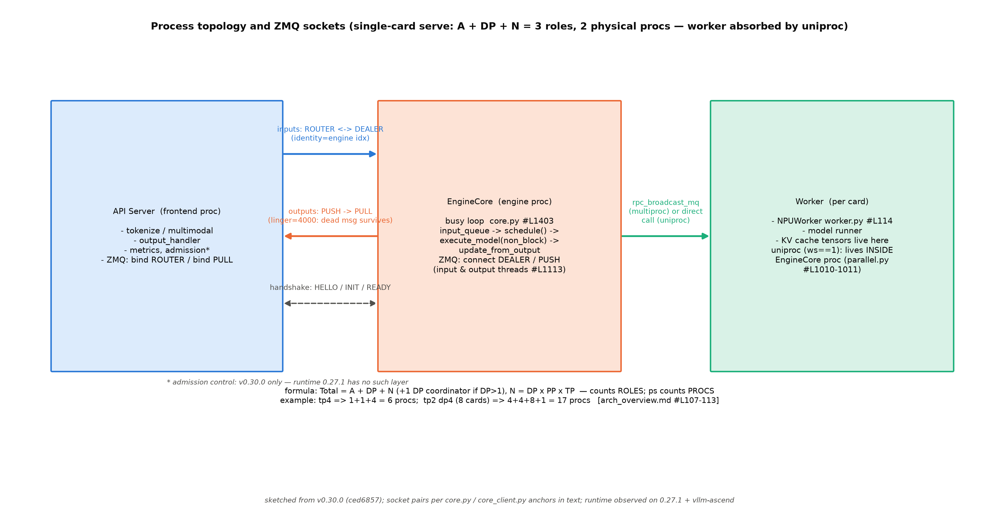
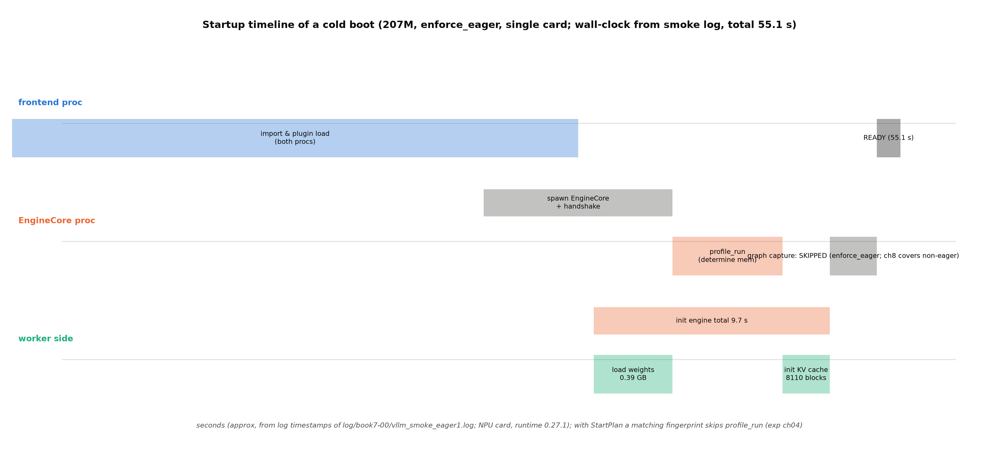

# 第 4 章 EngineCore 进程模型：一颗心脏的独立宣言

## 4.1 为什么调度值得一个进程

上一章结束时，请求已经变成消息、消息已经上了线；本章看它落地的那个进程。Book6 导览纪律段当年把「引擎源码里的调度器、块池、**进程模型**」点名为本册地界【Book6 ch00-导览.md#L101】——现在我们进的就是当年隔玻璃看的那间工厂。而入口层的最后一幕留了一个问题：`llm_engine.step()` 只是把「跑一步」的指令发出去等结果，为什么值得为这一步维护一层进程边界、付出通信的代价？

答案分两层。**机制层是 GIL（全局解释器锁）**：Python 的全局解释器锁让同一进程内的 tokenize、detokenize、HTTP 处理与调度循环互相踩脚——调度器算一步的间隙里若插进一次 JSON 解析，那一步就晚了；fork 出去是老办法，但 CUDA/NPU 上下文一初始化，fork 就会踩坏设备状态（vLLM 的多进程文档 docs/design/multiprocessing.md#L100-124 花了整节讲这对矛盾——现行「best effort」策略：默认 fork、CLI 控制主进程时 spawn、检测到设备已初始化强制 spawn）。设计文档把这层账算得很直白：「vLLM V1 uses a multi-process architecture **to separate concerns and maximize throughput**」【官方设计文档 arch_overview.md#L69】。**工程层是开销分层**，metrics 设计文档有一段堪称 V1 宣言的文字：「**EngineCore is the inner loop. Performance is most critical here**…AsyncLLM is the outer loop. This is overlapped with GPU execution (ideally), so this is where any "overheads" should be if possible」【官方设计文档 metrics.md#L155-161】——用人话说：**性能关键路径上的每一微秒都留在引擎核（内循环），其余一切开销（tokenize/解码/指标/协议）外推到前端（外循环），因为外循环与 GPU 执行重叠、内循环不重叠**。类 docstring 只有一句自证：`EngineCore` 的第一行是「Inner loop of vLLM's Engine.」（core.py#L105-106）——设计与代码互为回声。

「busy loop」这个词容易误导——它不是死循环烧 CPU，而是**park-and-go**：队列空时阻塞在 `input_queue.get()` 上（一微秒不烧），消息一到立刻全速处理。这个「忙」字说的是**一旦有活绝不谦让**：内循环不进任何事件调度器、不等任何回调，每一步的微秒级抖动因此可控。对照组就在身边：Book6 的 mini 引擎把调度与执行放在主线程里串行做（`engine_v1.py` 的 step 是个老实巴交的函数调用），读到 8.9 ms/token 的工业引擎把同一件事做成独立进程的忙循环——「框架开销」层的差距（Book6 ch13 的三层分解）从进程模型这层就开始拉开。

> **最小背景栏**：本章需要 Book6 的三件旧资产——TP/PP/EP/DP 四字母的切分视角（ch12：静态切分换通信账——本章给同一组字母换进程拓扑视角）、Orca 章的交互协议视角（ch04 末句「引擎的聪明，一半长在协议里」——ZMQ 线协议正是它的工业形态）、8.9 ms 对 59 ms 的趋势级对照口径（ch13）。ZMQ 消息系统不需要前置——4.3 节从零教到「能画出 socket 拓扑」。

## 4.2 进程拓扑：公式数角色，ps 数进程

先看全景（图 4.1）。三类主角进程：**API Server**（前端——tokenize、多模态装载、输出聚合、指标；一切「不重叠也没关系」的活）、**EngineCore**（引擎核——调度器+KV 管理+执行协调，忙循环）、**Worker**（每卡一个——模型前向与 KV 张量的家）。DP>1 时再加一个 **DPCoordinator**（负载均衡）。数量公式官方一张表：「Total = `A + DP + N` (+1 if DP>1)」，其中 $N=\mathrm{DP}\times\mathrm{PP}\times\mathrm{TP}$、A 默认=DP【官方设计文档 arch_overview.md#L107-113】；两个官方算例：单机 4 卡 tp4 = 1+1+4 = **6 进程**；8 卡 tp2dp4 = 4+4+8+1 = **17 进程**【同文档 #L117/#L125】。



图 4.1 进程拓扑与 ZMQ 通道（按 v0.30.0 源码自绘，示意级）：三列进程框；输入通道 ROUTER↔DEALER（前端 bind、引擎核 connect，identity 标身份）、输出通道 PUSH→PULL（linger=4000 让死讯活过关 socket）、握手三步、核→Worker 的广播（multiproc 实线/uniproc 进程内直调）；底部公式与算例。admission 层为 v0.30.0 新增（星注——版本框注见 4.7）。

但这里有一个**公式没告诉你的事实**，也是本章实验①的预注册判据：单卡起服时你 `ps` 数出来的进程比公式算出的角色少一个。源码两行是谜底：`world_size == 1` 时 `distributed_executor_backend` 自动落 `"uni"`（`vllm/config/parallel.py#L1010-1011`）——**worker 不再是独立进程，它住进 EngineCore 进程里**（driver_worker 形态）。所以「3 个角色、2 个物理进程」：公式数的是逻辑角色，ps 数的是物理进程，worker 是角色不是进程。本章实验①在 NPU 上实测印证（`code/ch04/exp_ch04.py::ps_topology`）：起服就绪后进程表里恰好两个——`vllm serve …` 主进程（前端，title 未改写）与 `VLLM::EngineCore`（引擎核，pid 是前端的子进程）【本机实测，`log/book7-ch04/exp_ch04_summary.json`】——第三个角色（worker）如判据预期被吸收。进程拓扑在**日志里**同样可数：冒烟日志里 `(EngineCore pid=` 前缀的行有 52 行、插件激活行恰好 2 次（主进程+EngineCore 各一遍）【本机实测，`log/book7-00/vllm_smoke_eager1.log` grep 计数】——第 12 章要教的「用前缀分流多进程日志」在单卡场景就已经能用：`grep "(EngineCore pid=" ` 一刀切出引擎侧说了什么。四字母在 Book6 是算力切分视角（TP 切权重、DP 切请求），本章换成进程拓扑视角——同一个 N，既是「权重切成几份」也是「几张卡各有几个 worker 进程」（multiproc 时）。

进程的名字也有正身可查：四类进程出生时都 `set_process_title` 打上 `VLLM::` 前缀（`vllm/v1/utils.py#L529` 的 "APIServer"、`v1/engine/utils.py#L184-190` 的 "EngineCore"、`v1/executor/multiproc_executor.py#L1066` 的 "Worker"、`v1/engine/coordinator.py#L153` 的 "DPCoordinator"）——`ps` 实验的 grep 靶子就是这串前缀。

第四类角色 DPCoordinator 值得多看一眼，因为它是「拓扑随规模变形」的注脚：DP=1 时它不存在（公式里那个 +1 条件）；DP>1 时前端有 A=DP 个、引擎核也有 DP 个，**谁把请求派给哪个核**就成了新问题——Coordinator 就是为这件事存在的（负载均衡：把新请求发给队列最短的核；出生时也是一个带 title 的独立进程）。把三档部署并排看最直观：单卡（2 进程，worker 被吸收）→ 4 卡 tp4（6 进程，一个核带 4 个 worker）→ 8 卡 tp2dp4（17 进程，4 前端+4 核+8 worker+1 协调者，前端与核之间 many-to-many）——**同一套代码，三种舰队形状**，形状全部由公式与 executor 形态两个变量决定。官方设计文档为后两档配了拓扑原图（`docs/assets/design/arch_overview/` 下 tp4 与 tp2dp4 两张 PNG，Apache 2.0 文档资产）；本书图 4.1 的自绘版承担的是另一件事——把 socket 类型标到每条通道上（原图不画这个）。

## 4.3 线协议：前后端只经 ZMQ 说话

现在把图 4.1 里那几条通道拆开看。先用三十秒把 ZMQ（ZeroMQ）的 socket 语义教到「能画出拓扑」——它不是消息队列中间件（没有 broker、没有服务端进程），是一套**进程间通信的 socket 模式库**：每个 socket 有一个类型，类型决定「消息怎么流」。本册要用的四种：**PAIR** 是一根对讲机（一对一、双向）；**PUSH→PULL** 是传送带（PUSH 端发的消息均匀分给所有连着的 PULL，单向）；**DEALER→DEALER** 是匿名群聊（双向、负载均衡）；**ROUTER↔DEALER** 是带门牌的群聊——ROUTER 记着每个相连 DEALER 的 **identity**（自定义短 id），因此能**指定收件人**发消息（也能广播）。一对 socket 里谁 `bind` 谁 `connect` 灵活（bind 方占住地址、connect 方找上门），消息帧是二进制的 multipart（几帧拼一条消息）。有了这五个词，vLLM 的通道选择就能逐跳读懂了。

「前后端只经 ZMQ+msgspec 说话」这条不变量的精确形态是：**一切跨进程消息都是 msgspec 结构→msgpack 字节帧→ZMQ multipart**；EngineCore 的主循环从不直接碰 socket。通道逐跳走一遍（行锚全部阅读锚 v0.30.0）：

**输入通道 ROUTER↔DEALER。**前端 bind 一个 ROUTER socket（`core_client.py#L601-604`）；EngineCore 侧 connect 一个 DEALER、带两字节的 identity（`core.py::process_input_sockets`#L1705——`zmq.DEALER, identity=identity`，identity 即 engine_index 的两字节码，构造在 #L1045）。为什么输入用这对而不是简单的 PAIR？因为 ROUTER 能按 identity 寻址——DP 扩展时一个前端要跟多个引擎核说话，输入需要**路由**（前端还可能不止一个：多前端对多核的 many-to-many 里，DEALER 的 identity 同时是回信地址）。**输出通道 PUSH→PULL。**引擎核 connect PUSH（`core.py#L1809`，linger=4000）、前端 bind PULL（`core_client.py#L606`）。输出不需要寻址、只需要分发——多前端场景由消息里的 `engine_index` 字段在接收端过滤。**输入要寻址、输出只要分发**——同一套系统里两种 socket 哲学并存，取舍干净利落。

**握手三步。**EngineCore 出生时并不知道自己的 ZMQ 地址——地址是握手时问前端要的：①核用 DEALER 连上握手 socket 发 `{"status": "HELLO", ...}`（`core.py::startup_handshake`#L1249-1256）；②前端 ROUTER 回一份 `EngineHandshakeMetadata`（含各通道地址——`#L1258-1272`）；③核再发 READY（DP 时附 `parallel_config_hash` 校验）。这个设计呼应 spawn 传参最小化：子进程启动时只带身份、不带配置，一切地址运行时协商。

**地址三态。**本机引擎一律 `ipc://`（Unix domain socket，`get_engine_zmq_addresses` 的 `client_local_only` 分支——`v1/engine/utils.py#L1063-1074`），跨机走 `tcp://`，`inproc://` 只用于前端进程内部的辅助小通道。主链四跳之外还有一小族辅助通道值得点名（它们会在第 12 章观测时露面）：shutdown 的 PAIR（优雅关闭的专线）、DP 首请求的 PAIR、以及 **stats 的 XSUB**——引擎核的统计走一条独立的发布/订阅通道（`core_client.py#L1380` 一带），前端订阅它拿 `SchedulerStats` 喂指标层。把 stats 单独走一条线而不搭输出通道的便车，又是「内循环零开销」哲学的注脚：统计的订阅者可以慢，但不许拖住 token 的回程。**这一条顺带解释了第 12 章会用到的观测事实：tcpdump 抓不到本地引擎的包**——ipc 不走内核网络栈，抓包工具无靶子（源码根因就在这四行地址决策）。

socket 与主循环之间的桥是**两个 daemon 线程**（`core.py::EngineCoreProc.__init__`#L1113-1130）——一个收输入塞 `input_queue`、一个从 `output_queue` 拿结果发出去。源码注释把动机说透：「overlap ZMQ socket IO with GPU since they release the GIL, and to overlap some serialization/deserialization with the model forward pass」——socket IO 与序列化都和前向重叠。于是 EngineCore 内部是三层结构：**socket（线程）↔queue（线程安全）↔busy loop（主线程）**——queue 是唯一的门，主循环因此永远不必等网络。

消息本身长什么样？第 3 章已经把 `EngineCoreRequest` 的字段表读过了；线上的形态再补一笔：每个消息帧前面还有一个**类型字节**——`EngineCoreRequestType` 六型（ADD/ABORT/START_DP_WAVE/UTILITY/EXECUTOR_FAILED/WAKEUP，`engine/__init__.py#L284-297` 的 hex 值）。「消息类型即一个字节」——连 enum 都不肯多花一个字节上线，与 msgspec 的三开关（array_like/omit_defaults/gc=False）是同一种抠法。

## 4.4 busy loop 正身：构造、心跳、一步

进进程内部。先看它出生时的**构造 wiring**（启动序列的代码索引）：

```python
        # Setup Model.
        self.model_executor = executor_class(vllm_config)
        …
        # Setup KV Caches and update CacheConfig after profiling.
        kv_cache_config = self._initialize_kv_caches(vllm_config)
        self.structured_output_manager = StructuredOutputManager(vllm_config)
```
【源码：`vllm/v1/engine/core.py#L133-146`（节选，中段以 … 略），阅读锚 v0.30.0；后续 #L149/L162-170 组装 Scheduler】看什么：三行赋值的顺序——**先有执行器（executor 创建，worker 在此出生）、再有 KV 预算（profiling 在其内）、最后才轮到调度器**。图 4.2 的启动时序按这个顺序展开；第 6 章「spec→池」的启动管线正是第二行的放大。

心跳的骨架（`run_engine_core`#L1283 进程入口→`run_busy_loop`#L1403）：

```python
    def run_busy_loop(self):
        """Core busy loop of the EngineCore."""
        while self._handle_shutdown():
            # 1) Poll the input queue until there is work to do.
            self._process_input_queue()
            # Publish request counts before and after GPU step to ensure freshness.
            self._maybe_publish_request_counts()
            # 2) Step the engine core and return the outputs.
            self._process_engine_step()
            self._maybe_publish_request_counts()
```
【源码：`vllm/v1/engine/core.py#L1403-1412`，阅读锚 v0.30.0】看什么：两层循环——外层问「还活着吗」（shutdown 也是消息进队列唤醒的，4.7 节），内层两拍：**收活（问 queue）→干活（step）**；`_process_input_queue` 阻塞在 `get()` 上等活（park-and-go 的 park 在这）。请求计数在 GPU 步前后各发布一次「to ensure freshness」——为 admission 层（v0.30.0）与观测准备的刷新点。

一步的正身是全章最重要的一段（docstring 三个动词对应站 8/10-12/回传）：

```python
    def step(self) -> tuple[dict[int, EngineCoreOutputs], bool]:
        """Schedule, execute, and make output.
        …
        if not self.scheduler.has_requests():
            return {}, False
        scheduler_output = self.scheduler.schedule(self._should_throttle_prefills())
        future = self.model_executor.execute_model(scheduler_output, non_block=True)
        …
            model_output = future.result()
        …
        self._process_aborts_queue()
        engine_core_outputs = self.scheduler.update_from_output(
            scheduler_output, model_output
        )
```
【源码：`vllm/v1/engine/core.py#L589-617`（骨架节选），阅读锚 v0.30.0】看什么：六步一台戏——①空转检查（没请求就空手而归）；②`schedule()`（**第 5 章的正门**——phase-less 决策循环就在这个调用里）；③`execute_model(non_block=True)` 返回 future（异步发射——调度器立刻去做别的）；④`future.result()` 等前向完成；⑤处理执行期间到达的中止（**步是原子单位**：执行期间新到的 ADD 要等下一轮）；⑥`update_from_output`（把结果记回账本、查完成条件）。③④两行之间的空隙就是 CPU/GPU 重叠的窗口：future 发射后 EngineCore 先把 grammar 位掩码算好（④前的 `get_grammar_bitmask`）、把观测上下文备齐，GPU 在前向、CPU 在备料——「调度器备步 N+1 时 GPU 执行步 N」的重叠（第 7 章 model runner 的正菜）在这里已经初见形态。这一步在单进程模式下的实测我们已经有底：**25 步=1 次 prefill+24 次 decode，与 max_tokens=24 精确互证**（notes/06 的本机实证——「一步=一波 token」的最小验证；prefill 一步 + 每个 decode token 一步，一步不多一步不少）。

**例 4.1（构造例：两条请求的一次 step）** 设 block_size=2、预算充足；甲（prompt 4、max_tokens=3）已 prefill 完在 decode，乙（prompt 3、max_tokens=2）刚到达。走这一步：①**消息进**——input 线程的 DEALER 收到 `[b"\x00", <msgpack(乙)>]`（类型字节 \x00=ADD），还原后 `input_queue.put((ADD, 乙))`，阻塞中的 busy loop 立刻醒来；②**入队**——`preprocess_add_request` 把消息翻译成 `Request` 对象（EngineCore 进程内的翻译层，`core.py#L980`）、乙进 waiting 队列；③**step②**——`schedule()`：甲（差 1 个 token）进 running，乙首块 prefill 3 token——SchedulerOutput 说「这步共 4 个 token」；④**step③④**——worker 前向+采样，返回两个请求的新 token；⑤**step⑥**——甲乙的 `num_computed_tokens` 各自+1/+3、都未到终点、无 finished；⑥**消息出**——`EngineCoreOutputs`（信封：engine_index+两个 `EngineCoreOutput`+scheduler_stats）经 output 线程的 PUSH 发回前端。效果读法：**一步之内 prefill 与 decode 混跑**（乙的 prefill 与甲的 decode 同批）——phase-less 的第一直觉，第 5 章从这里开门；主循环全程没碰 socket、没碰 HTTP、没碰 tokenizer——queue 是唯一的门。回程也值得多说一句：前端的 `output_handler` 后台任务（AsyncLLM#L194/#L198 启动）从 PULL 收到信封后做三件事——按 request_id 分发到各请求的 `RequestOutputCollector`、把 scheduler_stats 喂给指标层、把请求完成状态通知等待者——**回程的聚合也是外循环的活**，EngineCore 发完信封就回去睡它的 queue 了。

## 4.5 启动序列：55.1 秒去哪了

把 EngineCore 从出生到 READY 的全程摊开（图 4.2）：import 与插件加载（两个进程各自一遍——「every process needs to load the plugin」的运行正身，冒烟日志里两个 plugin 块相隔 36 秒就是两个进程的出生间隔）→ spawn 与握手 → 权重加载（207M 只要 0.39 GB、1.6 s）→ **profile_run**（空跑一次前向量出激活峰值，回答「KV 能用多少显存」——第 6 章块池容量的资金来源）→ 建池（8110 块，23.76 GiB）→ 热身 →（eager 模式下**图捕获被跳过**——那条空条带是第 8 章实验的伏笔）。日志侧的计时锚：`init engine (profile, create kv cache, warmup model) took 9.70 s`【运行栈实测，冒烟日志；构成拆解的方法学归第 12 章】。



图 4.2 冷启动时序（运行栈 0.27.1 实测时间戳，Atlas 910B3，总 55.1 s）：三泳道（前端/EngineCore/worker 侧）八段；eager 模式下图捕获为空条带（第 8 章非 eager 档在此处填实）。

启动序列里最年轻的一件机制是 **StartPlan**——「测量一次，重启复用」。先看它优化的那步有多贵：profile_run 要**真跑一次前向**（用一个 dummy 批量把模型执行一遍，量出激活显存峰值），加上图捕获的显存估计 pass——一次冷启动里这两步占了大头（55.1 s 里 init engine 段 9.7 s，NPU 上插件加载与进程 spawn 又占去 36 s 级）。而这些测量对固定组合是**确定性的**：同模型、同配置、同卡、同库，量一百次结果一样——「yet it is re-measured on every boot」，docstring 的第一段就在为这件事抱不平。StartPlan 的解法是标准的缓存键思维：把测得的 KV 预算值持久化到 `{VLLM_CACHE_ROOT}/startup_plan/`（与 torch.compile 缓存做邻居——同类状态放同一屋檐），键是「该值依赖的一切」的指纹（配置哈希+设备名+总显存+计算能力+torch 构建+rank——rank 单独进键，因为 TP/PP 下每卡的答案不同），命中且当前空闲显存不小于记录时才应用。docstring 值得整段读：

```text
On startup, vLLM measures how much GPU memory the KV cache can use and
computes the ``--kv-cache-memory`` value that reproduces that allocation.
For a fixed (model, config, hardware, library) combination the result is
deterministic, yet it is re-measured on every boot.

When ``VLLM_ENABLE_STARTUP_PLAN=1``, each worker persists that value under
``{VLLM_CACHE_ROOT}/startup_plan/`` (regenerable derived state, alongside
the torch.compile cache), keyed by a fingerprint of everything the value
depends on, and later boots apply it automatically -- skipping the
memory-profiling measurement and the CUDA-graph memory estimation pass --
if and only if the fingerprint matches and the device has at least as much
free memory as when the plan was recorded. On any mismatch the worker
falls back to full profiling, so a stale plan costs nothing and is never
trusted.
```
【源码：`vllm/v1/worker/startup_plan.py#L4-18` docstring，阅读锚 v0.30.0——与运行栈 0.27.1 逐字节一致（diff 实测 0 行）】看什么：缓存键思维的标准范本——确定性测量本可复用，但任何环境漂移都会让旧值危险，于是**指纹（配置+设备+版本的全哈希）+空闲显存双闸门**兜底、失配即回退。最后一句是缓存安全的金句：「a stale plan costs nothing and is never trusted」。vllm-ascend 已经接线（`worker.py#L550/#L829` 的 apply/save，`platform.py#L214-227` 为指纹放行设备查询）。

本章实验②（`exp_ch04.py` 三连跑：落 plan→用 plan→关 plan）在本机上交出的是一个**比成功更有意思的负结果**：第一跑 59.1 s 落下 plan；第二跑（`VLLM_ENABLE_STARTUP_PLAN=1`、指纹命中）日志打出——「Startup plan not applied: current free memory (60.60 GiB) is below the recorded baseline (60.60 GiB); falling back to full memory profiling」【本机实测，`log/book7-ch04/startplan_run2_reuse.log`】——**显示值相等的两个 60.60 GiB，在字节级略低**（两次启动间设备上的零头占用漂移），第二道闸门（当前空闲 ≥ 记录时）以严格不等式判定、未放行；第三跑（关 plan）55.6 s，与第二跑 56.0 s 同为噪声档。三行读数合起来是一堂「保守缓存的现场课」：机制在 NPU 上接线完好、回退路径精确按文档工作（「never trusted」不是修辞，是真的不信任到字节级）；但收益为零——双闸门的严格性加上单卡小模型的探测占比，使 reuse 在这台机器的这个场景里没有兑现。负结果按预注册纪律如实入档；plan 文件仍在缓存目录里，未来任何一次「空闲显存更充裕」的启动才会真正吃到它。

## 4.6 分岔收拢：client 族谱

第 3 章的 `make_client` 四路分派，在这里拿到完整的族谱：`EngineCoreClient`（抽象基类，`core_client.py#L79`）下两支——**InprocClient**（同进程直连，docstring 自白「EngineCore setup in this process (**no busy loop**)…pushes EngineCoreRequest directly into the EngineCore…pulls EngineCoreOutputs by stepping the EngineCore」，`core_client.py#L333-341`：没有循环、没有桥，`get_output` 就是直接踩一脚 `step_fn`）与 **MPClient**（ZMQ 跨进程，#L545）。MP 支再分两形态：**SyncMPClient**（#L869——`add_request` 发完就返回、`step()` 里同步收输出的老式握手，离线链默认）与 **AsyncMPClient**（#L1046——全 asyncio：发送/接收都是 await，前端事件循环永不被阻塞，在线链用它）。DP 再往上叠两级：DPAsyncMPClient（多核 DP，#L1323）与 DPLBAsyncMPClient（前端侧再加负载均衡路由，#L1507——Anatomy 文那句「we'll gradually build up to `DPLBAsyncMPClient` which allows serving at scale」说的就是族谱的顶端的这个）。族谱的读法：**越往上走，进程拓扑越宽、单客户端的职责越重**——从「踩一脚」到「路由一个舰队」，六级台阶每级都对应一种部署形态。

有一个不对称值得立成考据：**离线可单进程、在线必跨进程**——AsyncLLM 的 asyncio 事件循环与 EngineCore 的阻塞忙循环不能共存于一进程，这是架构决定而非配置项（`make_client` 对「同进程+异步」组合直接 `NotImplementedError`，第 3 章摘录过的那条自认）。所以「同进程直连」是离线调试的特权形态；你的实验脚本可以享受它（第 12 章断点跟跑法②正是它），服务永远不行。

## 4.7 死亡也走协议

本章最后一段留给进程的死亡——它是「只经 ZMQ 说话」不变量的最强证据。EngineCore 崩溃时，`run_engine_core` 的异常分支先做一件事：**发死亡消息**（哨兵字节串 `ENGINE_CORE_DEAD`，`core.py#L1022/#L1630-1634`），然后才 raise。output 线程收到死讯向所有 socket 广播、前端由此知道引擎没了。一个细节见真章：输出 PUSH 的 `linger=4000` 不是随手设的——源码注释自认「We must set linger to ensure the ENGINE_CORE_DEAD message is sent prior to closing the socket」（#L1804-1805）：ZMQ 默认关闭时立即丢弃未发消息，**死讯必须活过 socket 的关闭**。优雅关闭同理走协议：SIGTERM 经信号回调转成 WAKEUP 哨兵消息进 input_queue（`#L1334-1350` 的 wakeup_engine——信号也变成消息，与 ADD 同一条队列排队）、三态状态机（RUNNING/REQUESTED/SHUTTING_DOWN）排空在途请求。连接断开检测、死亡通知、优雅排空——**全部用消息而非共享状态实现**；正因内循环零共享，进程才能随时死、死了能被发现。

> **【版本差异框注】**v0.30.0 在 API server 与 EngineCore 之间新增了**准入闸门**（admission control：`async_llm.py::check_admission`#L297 起，配 `max_num_queued_reqs`/`max_num_queued_tokens` 两参数，超限 HTTP 503）；运行栈 0.27.1 **无此层**——请求经校验后直接进引擎。框注本身是教具：准入闸门放前端还是不放，是活的设计争论（它要动 503 与负载均衡重试的语义，属外环职责；而跨进程计数滞后换简单性是自认代价）。另：DP finish-sync 频率 0.27.1 硬编码 32 步、v0.30.0 起可配 `--dp-sync-interval`。

## 4.8 本章小结

回到开篇的问题：为什么值得为「跑一步」维护一层进程边界。因为 GIL 与开销分层——内循环独占一进程换每步抖动可控，一切不重叠的开销外推给前端；因为隔离——进程可以随时死、死了用一条 linger 保命的消息通知世界；也因为拓扑的弹性——同一颗心脏，单卡时把 worker 吸收进自己（uniproc），八卡时展开成十七个进程的舰队（A+DP+N(+1)）。线协议是边界的法律：ROUTER↔DEALER 走输入（要寻址）、PUSH→PULL 走输出（只分发）、握手协商地址、类型字节省到一位；EngineCore 主循环只认 queue 这扇门。

**带走的心智**是两幅画。**其一，三层一门**：socket 线程 ↔ queue ↔ 忙循环——读任何 EngineCore 侧代码，先问「这句在门内还是门外」；门内（调度、执行、记账）是第 5-9 章的地界，门外（收发、序列化）本章已经走完。**其二，公式数角色、ps 数进程**：worker 是角色不是进程——拿到任何部署，先算角色再问 executor 形态，才数得出物理进程。

zoom out 回全书：消息落地、心脏跳了、一步的六拍看清了。本章还给两个后面要用的事实上了户口：其一，**步是原子单位**——执行期间到达的 ADD 等下一轮、中止走专门的队列（③④之间处理），EngineCore 的时间以步为粒度离散前进；其二，**双轨 runner 的并存**（7,664 行单体与 gpu/ 分包同层而居——第 2 章地图上的化石层，第 7 章讲它的演进与分派）。下一步（第 5 章）走进 `step()` 的第二个动词——`schedule()` 那扇门里，是 Book6 调度折中三角的工业正身：phase-less 决策循环。

**动手验证**（Atlas 910B3；选卡纪律照 CLAUDE.md）：
① `source env.sh && ASCEND_RT_VISIBLE_DEVICES=<卡> python code/ch04/exp_ch04.py`——两实验连跑：ps 拓扑（验收：`VLLM::` 前缀进程=API server+EngineCore 两个，worker 被吸收）与 StartPlan 三连跑（验收：reuse 档 ready 快于 off 档）；
② `grep -c "Platform plugin ascend is activated" log/book7-00/vllm_smoke_eager1.log`——两个进程各交一遍插件学费的计数；
③ `sed -n '589,618p' repos/vllm/vllm/v1/engine/core.py`——step 六拍的原文，把例 4.1 逐行对上。

> **【欠账】** 调度器的决策细节（`schedule()` 门内的 phase-less 循环、抢占、预算）→ 第 5 章。
