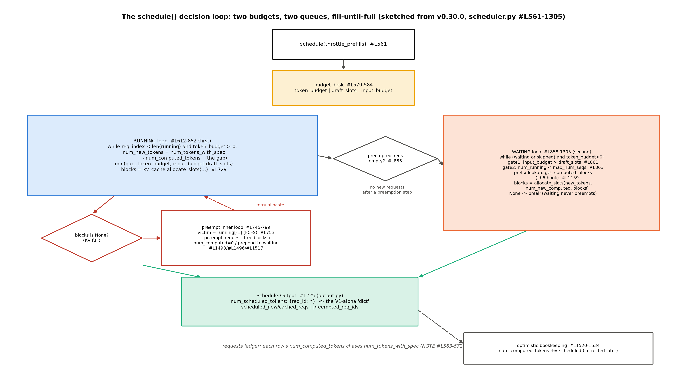

# 第 5 章 调度器：phase-less 决策循环

## 5.1 调度折中的正身开题

上一章末我们把 `step()` 的六个动词数到了②——`schedule()` 这扇门后面是 Book6 留下的一笔大账。章末欠账框的原文：「本册的调度折中在真实引擎里是一个每步都跑的 phase-less 决策循环（预算、抢占、缓存感知的取舍代码化）——V1 调度器的源码正身。→ Book7 第 5 章」【Book6 ch07 章末欠账框，B6-4】。你在 Book6 已经把这套折中手工推演过一遍：连续批处理（ch04，Orca 的迭代级调度）、分块预填与调度折中三角（ch07，预算/抢占/缓存感知三件套，配 SARATHI 的搭车批与 mini 引擎 v4 的双档实验）。本章不重讲机制——我们看它「代码化」之后长什么样。产出四样：决策循环的源码走查（两级预算双队列）、两个逐格可验的走查例（表 5.1/例 5.2）、抢占三跑的实验曲线、Ascend 定制调度器的点名。

开题先做一个对齐：Orca 论文的调度三步（「selects requests to run next …; invokes the engine to execute one iteration …; receives execution results」——Book6 ch04 直引的缩节）在上一章的 `step()` 里一一对应成了三个调用（`schedule()`#L600/`execute_model`/`update_from_output`#L614）——**论文循环就是 step 的三个动词**。而调度器自己的账本，是一个我们已经在两章里反复照面的数据对象：

**结构账先行：`Request` 是调度器的最小台账**（`vllm/v1/request.py`）。每条请求一行，核心字段：`prompt_token_ids`（#L132，输入侧）、`_output_token_ids`（#L144，输出侧——只读视图 `output_token_ids` 是 ConstantList 封装，**防旁路追加**的写权设计）、**`num_computed_tokens = 0`**（#L182 初值——本章的主角）、`num_tokens`（#L287 属性=prompt+output 总长）、`num_tokens_with_spec`（#L291——再加投机草稿位，追赶模型的被追赶方正身）、`num_preemptions`（#L210，抢占计数）。状态机 `RequestStatus`（#L364-380）有个巧设计：WAITING/RUNNING/PREEMPTED 在前、六种 FINISHED* 在后，`is_finished` 就是「序号 > PREEMPTED」——**用整数序做状态分类**。调度器的全部工作可以先立成一句话：**让每行的 `num_computed_tokens` 追上 `num_tokens_with_spec`**——这句话的官方原声，在下一节。

> **最小背景栏**：本章直接使用 Book6 的三件旧资产——调度折中三角与两把旋钮（ch07 §7.5：token 预算/chunk 大小，「预算就是在『新请求的等待』与『在途请求的平稳』之间按 token 数划线」）、抢占的进度账/占用账判断力（ch07：V1 默认重算、逐运行队列尾）、8.9 ms/token 的趋势级读数（ch13——「Book6 量过它一步多快，本章看一步内部干了什么」）。Orca/SARATHI 的论文叙事不再重述。

## 5.2 phase-less：追赶模型

进 `Scheduler.schedule`（`vllm/v1/core/sched/scheduler.py::Scheduler.schedule`#L561）的门，先看到的是一段没有出现在任何设计文档里的注释——V1 调度器的心智模型，官方放在了源码里：

```python
        # NOTE(woosuk) on the scheduling algorithm:
        # There's no "decoding phase" nor "prefill phase" in the scheduler.
        # Each request just has the num_computed_tokens and
        # num_tokens_with_spec. num_tokens_with_spec =
        # len(prompt_token_ids) + len(output_token_ids) + len(spec_token_ids).
        # At each step, the scheduler tries to assign tokens to the requests
        # so that each request's num_computed_tokens can catch up its
        # num_tokens_with_spec. This is general enough to cover
        # chunked prefills, prefix caching, speculative decoding,
        # and the "jump decoding" optimization in the future.
```
【源码：`vllm/v1/core/sched/scheduler.py::Scheduler` 的 NOTE#L563-572，阅读锚 v0.30.0——运行栈 0.27.1 同文逐字一致（#L441-450），两轨 NOTE 零漂移】看什么：**调度器没有 prefill 相与 decode 相**——每条请求只有两个数（已算多少、该算多少），每步做的就是在预算内让前者追赶后者。这个抽象的威力在最后一句自评：「general enough to cover chunked prefills, prefix caching, speculative decoding」——Book6 分三章讲的三个机制（ch07 分块预填、ch06 前缀缓存、ch10 投机解码）加上它们共同的归宿「完成」，在调度器眼里是**同一个追赶问题的四种形态**（下一段逐条展开）。Book6 ch07 曾整句引用过这段注释的后半（当时的身份是黑盒文档），现在它有了行号与上下文——「行级锚在 Book7」的许诺在此兑现。

对照官方公告的说法：调度上「It removes the traditional distinction between 'prefill' and 'decode' phases」——prompt token 与输出 token 同等对待；而「Scheduling decisions are represented as a simple dictionary」——`{request_id: num_tokens}`, which specifies the number of tokens to process for each request at each step【V1 alpha 公告，vllm.ai/blog/2025-01-27 两段原句；那个字典的正身就是 5.3 末尾要见的 `num_scheduled_tokens` 字段】。

四种形态逐条读开，phase-less 的抽象力就具体了：**分块预填**=一步追不完就下步接着追（追赶量被预算截断——5.5 的刀口）；**前缀缓存**=起步就领先（命中段的 token 不用追、直接记入已算——第 6 章的命中账在这接入）；**投机解码**=被追赶方临时变大（草稿位计入 `num_tokens_with_spec`，验证被拒再缩回——`update_from_output` 的回滚账）；**完成**=追上即退场（FINISHED 状态序列在 `RequestStatus` 的整数序上）。Book6 分开教的东西，在调度器这里共用一套账本语法——这就是「general enough」的分量：**一个好的抽象让四个特性不用改调度器主干**。反过来说，读调度器代码时不要去找「分块在哪处理」「缓存命中在哪处理」的独立分支——它们都藏在追赶量与已算量的加减法里。

给追赶模型一个最小数字直觉：一条 prompt 3 token 的请求进门时「该算 3、已算 0」，一步排 3 个追平——这就是 prefill 在这本账上的全部含义；此后每生成一个 token、该算就涨 1，每步排 1 个再追平——这就是 decode。**prefill 与 decode 在这本账里没有名字，只有「一步追几个」的数量差**——这正是 phase-less 的字面意思。

## 5.3 决策循环：两级预算、双队列、装满为止

追赶模型怎么落成循环？`schedule()` 的出纳台先摆三个钱袋：

```python
        req_to_new_blocks: dict[str, KVCacheBlocks] = {}
        num_scheduled_tokens: dict[str, int] = {}
        token_budget = self.max_num_scheduled_tokens
        spec = self.vllm_config.speculative_config
        draft_slots = spec.max_num_new_slots_for_drafting if spec is not None else 0
        input_budget = self.scheduler_config.max_num_batched_tokens
```
【源码：`vllm/v1/core/sched/scheduler.py#L579-584`，阅读锚 v0.30.0】看什么：三个预算变量——`token_budget`（可排 token 总额，上界 `max_num_batched_tokens`）、`input_budget`（实际进批的输入上限）、`draft_slots`（留给投机草稿的名额）。

> **【版本差异框注】**`input_budget` 与 `draft_slots` 是 v0.30.0 的新面：运行栈 0.27.1 是单级预算（只有 `token_budget`）。**无投机时两级合流**（draft_slots=0，input_budget 不再约束）——本章的 toy 例与多数单卡场景即此情形，先按一级理解、二级差异记住「为投机而设」即可。

然后是双队列的两段循环（图 5.1）。**第一段先跑运行队列**（`running`——老面孔优先续命）：

```python
        # First, schedule the RUNNING requests.
        req_index = 0
        while req_index < len(self.running) and token_budget > 0:
            request = self.running[req_index]
```
【源码：`vllm/v1/core/sched/scheduler.py::Scheduler.schedule` running 循环#L610-613，阅读锚 v0.30.0；循环体内 #L656-665 算追赶量】循环条件自己就是预算方程：队列没走完、钱没花光，就继续装。每条请求的追赶量一行算完：`num_new_tokens = request.num_tokens_with_spec - request.num_computed_tokens`（完整式还有一项 async 调度的输出占位 `num_output_placeholders`，常规为 0——#L657-659），再过一道 `min(追赶量, token_budget, input_budget - draft_slots)` 的三重小扣（#L663-665）——**追赶量×预算余量，谁小听谁的**。**第二段再跑等待队列**（`waiting`——新客进门），进门前三道闸：

```python
        # Next, schedule the WAITING requests.
        if not preempted_reqs and self._pause_state == PauseState.UNPAUSED:
            step_skipped_waiting = create_request_queue(self.policy)

            while (self.waiting or self.skipped_waiting) and token_budget > 0:
                if input_budget <= draft_slots:
                    break
                …
                num_running = len(self.running) + self.num_waiting_for_streaming_input
                if num_running >= self.max_num_running_reqs:
                    break
```
【源码：`scheduler.py#L854-866`（节选），阅读锚 v0.30.0】看什么：第一道闸最值得停——`if not preempted_reqs`：**本步发生过抢占，就整段跳过等待队列**。这是一个隐性设计：刚赶走了老客又放新客进来，容易触发「新客→又挤兑→再赶走」的颠簸循环；宁可这一步少赚点吞吐。第二三道闸是 token 预算余量与序列预算（`max_num_seqs`——房号数）。

队列家族其实有三条，第三条容易漏：`waiting`（正主，deque 封装）之外还有 **`skipped_waiting`**——本步因 KV 不足被跳过的等待者暂存（#L856 建 `step_skipped_waiting`、#L1290-1292 **回插队头**）。为什么跳过的要单独放、下步还插队头？因为「装不下」是本步的瞬时状态（下一步可能有块归还），跳过者不该丢优先级——它是「想进没进来」而不是「排在后面」。加上 5.4 的抢占插回队头（`prepend_request`），**队头位置有两种常客：刚被抢占的老面孔与上步没挤进去的 skipped**——两者的共通点是「已经等过了」，调度器用队头维护他们的资历。官方配置文档对这段结构的口径：「the scheduling policy prioritizes decode requests. It batches all pending decode requests before scheduling any prefill operations. When there are available tokens in the `max_num_batched_tokens` budget, it schedules pending prefills. If a pending prefill request cannot fit into `max_num_batched_tokens`, it automatically chunks it.」【官方文档 docs/configuration/optimization.md——「running 先于 waiting」的结构在文档口径里读作 decode 优先；装不下的自动切块】。



图 5.1 `schedule()` 决策循环（按 v0.30.0 源码自绘，示意级）：出纳台三钱袋→RUNNING 循环（含 allocate_slots 失败的抢占内环）→`not preempted_reqs` 闸→WAITING 循环（三道闸+前缀命中查找侧挂——第 6 章的接口）→SchedulerOutput 出账+乐观记账回箭头。

循环走完，出账是一个 `SchedulerOutput`（`output.py#L225`）：`num_scheduled_tokens`（**每条请求排了几个 token**——V1 alpha 说的「调度决策=`{request_id: num_tokens}`」正身）、`scheduled_new_reqs`（首登记者附全量数据——worker 侧每进程缓存一份）、`scheduled_cached_reqs`（老面孔**只发 diff**——「we only send the diff to minimize the communication cost」）、`preempted_req_ids`。还有一笔账值得记：**乐观记账**——`schedule()` 收尾就把 `num_computed_tokens += num_scheduled_tokens` 记上（`Scheduler._update_after_schedule`#L1520-1534，注释说明为什么：让被抢占的分块预填请求下一步能立即重新调度），等 `update_from_output` 再用真实结果对账（投机被拒的 token 在那里回滚）。**先记账后对账**——这是「调度器备步 N+1 时 GPU 执行步 N」的重叠设计在调度器侧的代价。

**例 5.1（构造例：三条异长请求的逐 iteration 走查）** 预算 `max_num_batched_tokens=8`、`max_num_seqs=2`、无投机、KV 充足（变量集中在预算上）。请求 A（prompt 5、输出上限 3）、B（prompt 4、**输出上限 3**）、C（prompt 10、一开始就在 waiting）；D（prompt 6、第 4 步执行期间到达）。waiting 头→尾 = A,B,C：

表 5.1 逐 iteration 走查（V1 语义：prefill 完成的同一步采样出第 1 个 token）

| 步 | running 循环（先） | waiting 循环（后） | 步末 running | token 账 |
|---|---|---|---|---|
| 1 | （空） | A 进 min(5,8)=5，**prefill 完采样①**；B 进 min(4,3)=**3（切成 3+1）** | [A,B] | 5+3=8 满载 |
| 2 | A decode 1（采样②）；B 续 1（完，采样①） | C：房号 2 已满 → **break** | [A,B] | 2/8 |
| 3 | A decode 1（采样③=达上限→FINISHED）；B decode 1（采样②） | C 仍被房号挡住 | [A,B] | 2/8 |
| 4 | （A 在 update_from_output 退场）B decode 1（采样③=达上限→FINISHED） | C 进 min(10,7)=**7（切成 7+3）** | [C] | 1+7=8 满载 |
| 5 | （B 退场）C 续 3（完，采样①） | D 进 min(6,5)=**5（切成 5+1）** | [C,D] | 3+5=8 满载 |

这个例子让你看见五件事：**分块自然发生**（B 的 4 被切成 3+1、C 的 10 被切成 7+3、D 的 6 被切成 5+1——没有显式的 chunk 参数，预算余量就是刀口，5.5 节正身）；**序列预算独立起作用**（C 在步 2/3 被 `max_num_seqs` 挡在门外——token 预算明明只用了 2/8；D 同样要等 B 退场才进门）；**完成退场与新房入住同框两次**（步 4 的 A 走 C 进、步 5 的 B 走 D 进）；**running 永远先跑**（decode 优先的结构性来源）；**每步的账都合得上**（token 账一列可逐行验算——步 2 的 2/8 是 A、B 各 decode 1；步 4 的 8 满载是 B 的 1 加 C 的 7）。

## 5.4 抢占正身：逐尾牺牲的三步

预算内装不下、KV 又满了怎么办？running 循环里 `allocate_slots` 返回 None 时，进入抢占内环。受害者怎么选——Book6 ch07 按黑盒引用过的那段，现在给完整上下文：

```python
                    # The request cannot be scheduled.
                    # Preempt the lowest-priority request.
                    if self.policy == SchedulingPolicy.PRIORITY:
                        preempted_req = max(
                            self.running,
                            key=lambda r: (r.priority, r.arrival_time),
                        )
                    else:
                        preempted_req = self.running[-1]

                    # A deferred free will not help with immediate allocation.
                    if not self._request_blocks_can_be_freed(preempted_req):
                        break
```
【源码：`vllm/v1/core/sched/scheduler.py::Scheduler.schedule` 抢占选尾#L745-757，阅读锚 v0.30.0——Book6 ch07 引用的 #L748-753 即此段核心】看什么：注释自己说了算法定义——逐的是「最低优先级」；PRIORITY 策略下按 `(priority, arrival_time)` 取 max（优先级最低+最晚到达），**FCFS 下它恰好是队尾**（`running[-1]`=最新进房的客人）。这正是 Book6 立过的判断力——**进度账>占用账**：直觉想赶走占块最多的，引擎赶走进度最少的（最新客累计投入最小、重算浪费最小；`running` 用裸 list 而非队列封装，尾=最新准入这个结构细节就是为这一刀）。末尾那个 `can_be_freed` 检查也有讲究：延迟释放的块救不了急，这种受害者跳过。

三步正身（Book6 的口语版各有一行签名）：

```python
        assert request.status == RequestStatus.RUNNING, (
            "Only running requests can be preempted"
        )
        self._free_request_blocks(request)
        self.encoder_cache_manager.free(request)
        self._inflight_prefills.discard(request)
        request.status = RequestStatus.PREEMPTED
        request.num_computed_tokens = 0
```
```python
        # Put the request back to the waiting queue.
        self.waiting.prepend_request(request)
        self.reset_preempted_req_ids.add(request.request_id)
```
【源码：`vllm/v1/core/sched/scheduler.py::Scheduler._preempt_request`#L1490-1497 与 #L1516-1518，阅读锚 v0.30.0——步一=释放全部 KV 块（#L1493）、步二=已算清零（#L1496-1497）、步三=**插回等待队列头**（#L1517，`prepend_request`=appendleft）】注意第三步的方向：**插回队头而不是排到队尾**——受害者下一轮优先重新调度，不让它真的掉队。

**例 5.2（构造例：逐尾牺牲的完整五步）** 块大小=2 token、KV 总容量=6 块（12 token）、token 预算=12、`max_num_seqs=2`、无 APC。A（prompt 8、输出上限 4）、V（prompt 4、受害者候选人），waiting=[A,V]：

| 步 | 事件 | KV 块账 |
|---|---|---|
| 1 | waiting：A 进 8（4 块，prefill 完**采样①**）；V 进 4（2 块，**采样①**）——预算 12 恰好同step装下两条 | **6/6 满载** |
| 2 | running：A decode 1 → 位置 8 越界需**第 5 块 → allocate_slots=None → 抢占 running[-1]=V**（不是触发者 A！）：V 释放 2 块、已算清零、插回 waiting 头（三步正身）；A 得第 5 块、decode 采样②；**本步 waiting 循环整段跳过（5.3 第一道闸）** | 5/6 |
| 3 | running：A decode 1（块内，采样③）；waiting：**V 想 重 prefill 4（需 2 块）→ free=1 → 装不下 → break（等待侧不抢占）** | 5/6 |
| 4 | running：A decode 1（块内，采样④=达上限→FINISHED）；V 仍被 1 块的缺口挡着 | 5/6 |
| 5 | （A 在 update_from_output 退场、归还 6 块）waiting：**V 重 prefill 5**（prompt 4+已采样①共 5 token=3 块，num_computed 从零重算——步 1 已算的 4 个 token 作废）；**采样②** | 3/6 |

这个例子证明四件事：**受害者≠触发者**（缺块的是 A、被赶的是 V——逐尾的「牺牲最新客」；触发时 A 已算 9 个 token、V 只算 5 个，弃 V 重算浪费最小——进度账>占用账的活算术）；**三步正身逐格可对**（步 2 的三个动作对照 #L1493/#L1496/#L1517）；**等待侧不抢占的语义看得见**（步 3/4 的 V 明明排在队头，free 只有 1 块、装不下 2 块，就是进不来——要等 A 归还）；**RECOMPUTE 的代价可见**（V 步 1 算的 4 个 token 白算、步 5 从头再来——这就是「重算式抢占」名字里那笔账）。

> **【考据框】RECOMPUTE 为什么赢了 SWAP？**官方口径一句话：「In vLLM V1, the default preemption mode is `RECOMPUTE` rather than `SWAP`, as recomputation has lower overhead in the V1 architecture.」【官方文档 optimization.md】淘汰史更生动：swap（CPU 换出）是 beam search 时代的分支共享设计，V1 直接移除了它，理由是**前缀缓存证明自己是更好的选项**——「blocks can be evicted slowly on demand and the part of the prompt that was evicted can be recomputed」【官方设计文档 metrics.md 淘汰史段】。争论内核是两条出路的价格：显存压力要么**算力买**（重算）要么**带宽买**（换出）——前缀缓存让算力这条路线变便宜了（被逐的部分大概率还命中着），带宽路线就输了。Book6 ch07 例 7.3 的三路价格签（recompute≈0.94 s 批发算力对 swap 3.2 GB PCIe 往返）是这笔账的量化底档。辅线一笔：`watermark` 参数（KV 留水位比例，默认 0.0=**不留冗余、靠抢占兜底**——`config/scheduler.py#L178-183`；Book6 ch07 已黑盒引用过字段名，此为其正身）。

## 5.5 chunked prefill 的预算实现

例 5.1 里「预算余量就是刀口」的切法，配置面正身只有两行：`long_prefill_token_threshold: int = Field(default=0, ge=0)`——「For chunked prefill, a request is considered long if the prompt is longer than this number of tokens. 0 disables the cap (default).」【源码：`vllm/config/scheduler.py#L70-72`，阅读锚 v0.30.0】；`enable_chunked_prefill: bool = True`（#L116-122，默认开）。**没有独立的 chunk size 旋钮**——Book6 ch07 的「两把旋钮」在 V1 里合成了一把：块的上限就是预算的剩余量（threshold 只给「长预填」一个特判帽，默认关）。这解释了例 5.1 的观察：B 被切成 3+1 不是谁配置的，是第 1 步预算只剩 3。关掉分块的代价文档也写了：「When chunked prefill is disabled, `max_num_batched_tokens` must be greater than `max_model_len`.」——不分块，预算就必须装得下整条请求。

> **【版本差异框注】**0.31.0 重做了长预填语义：`--long-prefill-token-threshold` 从「孤立请求也分块」改为按等待 prefill 数自适应（#57951/#58459），waiting queue 也重做（已持有 KV 块的请求优先，#58947）——阅读锚按 v0.30.0 语义讲，两条框注记入差异附录。

## 5.6 调度与 KV 的接口：一个 `allocate_slots`，两种用法

调度循环里对 KV 管理器的调用只有一个方法、两个调用点，参数面不同——这个不对称是 5.3 与第 6 章之间的桥。**running 侧**（#L729-733）：只传「再要几个块」——running 者已持有自己的块，没有前缀查找；返回 None 进抢占内环（5.4 的故事）。**waiting 侧**（#L1159-1171）：多传 `num_new_computed_tokens` 与 `new_computed_blocks`——**前缀命中的块在这里被认领**（第 6 章哈希链查出来的块，经这个参数过户给新请求）；返回 None 则**直接 break——等待侧不抢占，装不下就等**。两侧行为不对称的原因一句话：running 者的块是它已算成果的载体（赶走它才有块可还），waiting 者还没有块（等就是了）。

APC（automatic prefix caching，自动前缀缓存）与调度的交互浓缩在 waiting 侧这一个参数里，但它的**调度学后果**值得单独看清：命中段直接记入 `num_computed_tokens`——追赶量变小——同一条请求更快追完、占用块更少。这解释了两件 Book6 量过的事：为什么命中率高时 TTFT 折扣那么大（要追的少），为什么前缀缓存能替代 swap（被逐的部分重算便宜——5.4 考据框的机制侧注脚）；也预演了本章实验①的乌龙正结果（同前缀请求共享块、KV 池压不满、零抢占）。**缓存是调度器的隐形盟友**：它不改调度器一行代码，却改变每条请求的追赶起点。反方向的耦合也有：调度器的 free 时机决定块何时回池、何时可被再次命中——第六章讲块的一生时会看到这对同盟的另一半。

## 5.7 Ascend 定制调度器：插件口的六件套

调度器的「谁先跑」讲完了 FCFS 的默认故事；NPU 读者此刻该问的问题与第 2 章同款——姊妹城在这层长了自己的东西吗？长了。上游只内置两种调度策略（fcfs 默认/priority，`config/scheduler.py#L141-147`），把扩展留给 `scheduler_cls` 插件口（#L159-162——「Can be a class directly or the path to a class」）。vllm-ascend 从这个口长出了**六件**定制调度器（`vllm_ascend/core/` 五件+`patch/platform/` 的 balance 补丁一件【源码：运行栈 vllm-ascend 0.27.1rc1】），逐件一句点名：**short_request_first**（短请求优先——排队论里 SPT（shortest processing time，最短处理时间优先）策略的工程化，压平均时延牺牲长尾）；**recompute**（PD 分离场景：远端 KV 到货的请求按整段重算处理）；**dyntra_lb**（动态负载均衡——多卡场景把请求按负载重派）；**profiling_chunk**（画像引导的分块——用历史画像预测 chunk 大小，就是那个自注「Compatible with vLLM v0.15.x」的漂移税典型）；**batch_job_aware**（批作业感知——离线批场景的吞吐优先策略）；外加一个 balance 补丁。装配在 `platform.py#L996/#L1056/#L1281-1303` 三处、由 AscendConfig 的六组开关控制——**默认全关**（不改变默认行为，「存在性点名」的安全口径——与第 2 章 patch/ 60 文件同一个道理：平台能改的不等于平台改了的）。这套六件套与上游两策略的关系是本节真正的教学点：**上游把「谁先跑」留给一个可替换的类，平台就能长出自己的排队哲学**——但副本改写型子类的代价是漂移税（profiling_chunk 的自注「When the upstream `schedule()` method is refactored, this override should be updated accordingly」——上游一重构、覆盖即失配，作者把维护条件写在了门口）。插件自由度与维护税的权衡，第 11 章兼容层还会回到这个话题。

## 5.8 实验读数

FCFS 的故事讲完了，实验把它跑成读数——本章实验两件（`code/ch05/exp_ch05.py`），读数合账于表 5.2。**实验①抢占场景构造**走了一条诚实的三跑曲线，每跑一个教训。首跑：固定种子生成「随机」prompt——8 条实际完全相同——APC 命中率稳态 76.6%、KV 需求塌缩、零抢占（读数底档 `log/book7-ch05/apc_same_seed.{json,log}`——重跑落盘，8/8 完成、TTFT 0.265-0.275 s）。这个乌龙是「**前缀缓存防抢占**」的漂亮意外实证（同前缀共享块，池压不满——5.6 的运行级注脚）。二跑换异种子与更长 prompt（配方见脚本注释——过程记录、未定档落盘）：KV 池逼近满载但**仍零抢占**，调度器用 waiting 侧「装不下就等」消化了压力（**准入可推迟时优先等、不赶人**——5.6 两侧行为不对称的实测版）。三跑定稿（v2 配方）：prompt 1024×8=8.2k 先全部进 running，每条 max_tokens=1000 让它们**自己长大**到 16.2k 撞 12,672 的池壁——抢占终于现身：运行轨迹 `Running: 8 → 7+Waiting: 1 → 6+Waiting: 2`（KV 同期 92.9%→91.8%，一度 100.0%）【本机实测，`log/book7-ch05/preempt_run.log` 周期统计行】——**完成者只进 Finished 不进 Waiting，运行队列的请求「回」等待队列只有一条路：被抢占**。三跑合起来比一次成功更教学：抢占的触发条件不是「KV 满」而是「**running 者生长撞墙**」——waiting 侧有阀门（装不下就等），running 侧没有（要么给块要么赶人）。

表 5.2 抢占场景与预算两档读数（Atlas 910B3；`log/book7-ch05/`）

| 实验 | 读数 | 判读 |
|---|---|---|
| ① preemption（v2） | 8/8 完成、wall 38.1 s、TTFT 0.19-0.199 s；队列轨迹 8→7+1→6+2 @KV 92-100% | 抢占证据=运行者回流等待队列；重算的代价含在 wall 里（被赶者从零重 prefill）；TTFT 早于压力期（全部秒进） |
| ① 意外档（同种子） | hit rate 76.6%（稳态）、零抢占、8/8 完成 | 前缀缓存防抢占的实证（`apc_same_seed` 底档） |
| ② mnbt=512 | wall 0.5 s；TTFT 长 0.322 s / 短三条全 0.333 s | 长请求预填被切 4 段（$2040/512\approx4$）——TTFT 变长 ✓（对 2048 档 +53%） |
| ② mnbt=2048 | wall 0.4 s；TTFT 长 0.21 s / 短三条全 0.221 s | 预算一次装下整条预填（2040<2048）——两步内全员首 token |

**实验②预算两档**（同 workload：一条 2040-token 长预填+三条 64-token 短请求；TTFT 取 `first_token_latency`，`log/book7-ch05/budget_{512,2048}.json`）。判据预注册三条兑现两条、**一条方向反了**——而这恰恰是最有价值的读数。兑现的：512 档长请求被切成约 4 段、TTFT 显著变长（0.322 对 0.21）。反向的：预注册预期「512 档短请求首 token 提前」（notes/14 设计时的直觉——小预算似乎该让短请求早点插队），**实测短请求反而更晚**（0.333 对 0.221）。机制一推就清：V1 的「装满为止+FCFS」下，512 档的长预填分段**连续霸占**每步全部预算（2040=3×512+504：前三段各 512、末段 504——每步余量都容不下 64 token 的短请求），短请求要等第 4 步长预填走完才进门；2048 档第一步装完长预填（2040<2048）、第二步短请求全进。这与 Book6 的 sched_v4 双档读数（chunked 档长请求 TTFT 反多等约 20%）不矛盾——v4 的 chunked 循环每迭代「256 块+decode 搭车」留了搭车位，短请求与 decode 能插进块间；V1 的装满为止+FCFS 没有这辆车。**两台引擎的调度语义不同，同一个旋钮的效应可以反向**。这是「机制红利看语义、语义要看源码」的活例，也是两层账方法学的又一课：跨引擎对拍读数，先对拍调度语义。

## 5.9 本章小结

回到开篇：调度折中的三角在源码里长成了一个函数。**phase-less**：没有 prefill/decode 相，每条请求只是一对数字（已算/该算）——例 5.1 的五步走查里，B 的 4 被切成 3+1、C 的 10 被切成 7+3，没有谁下令切块，预算余量自己就是刀口；C 被 `max_num_seqs` 挡在门外的两步证明序列预算独立起作用。**两级预算双队列装满为止**：running 先（decode 优先的结构性来源）、waiting 后（三道闸：不颠簸、token 余量、房号）。**抢占是重算式的**：例 5.2 的五步里缺块的 A 触发、最新的 V 被逐（受害者≠触发者），三步正身（释放/清零/插回队头）逐格对得上 #L1493/#L1496/#L1517；本步不再收新客。RECOMPUTE 赢 SWAP 因为前缀缓存让算力变便宜了。实验的账面：抢占三跑曲线的终跑看见运行队列 8→7+1→6+2 回流等待队列（完成者只进 Finished——回等待队列只有被抢占一条路）；实验②的判据一半兑现一半反转——512 档短请求 TTFT 0.333 s 反而比 2048 档的 0.221 s 晚，机制在「装满为止+FCFS」的连续霸占里；同种子乌龙档 76.6% 命中零抢占，是「缓存是调度器的隐形盟友」的意外实证。**调度与 KV 只在一个方法上握手**——`allocate_slots` 的两种用法（running 续块/waiting 认领命中块），下一章进门。

**带走的心智**是两幅画。**其一，「追赶」是调度的全部语法**：读任何调度代码，先把每条请求折成两个数（已算/该算），再看这段代码怎么让前者追后者——phase、阶段、批这些词都是追赶量的别名；一个 `max_num_batched_tokens`（本机实验里 512 与 2048 两档）同时决定长请求被切成几段（TTFT 0.322 对 0.21）、短请求等多久才进门（公平——0.333 对 0.221 的反转）、每步批多满（吞吐）。**其二，预算是刀口也是天平**：Book6 的「折中三角」在源码里就压在这一个参数上，调它就是同时在调三件事——这也是跨引擎对拍读数前先对拍调度语义的原因（同一旋钮在 mini 引擎 v4 与 V1 上效应可以反向）。

zoom out 回全书：`step()` 的第二个动词读完了，`SchedulerOutput` 里已经装着块号与追赶量。但本章留一个「不够」：**块号只是一串整数**——它凭什么对应显存里的某段 KV、两个请求怎么会共享同一块、被逐的块去哪了，这些 `allocate_slots` 门内的问题一句都没答。下一章（第 6 章）进第 9 站——块池、哈希链与命中，Book6 分页 KV 与前缀缓存两章账本的共同正身。

**动手验证**（Atlas 910B3；选卡纪律照 CLAUDE.md）：
① `source env.sh && ASCEND_RT_VISIBLE_DEVICES=<卡> python code/ch05/exp_ch05.py`——两实验连跑：验收行=①的日志出现抢占队列轨迹（`grep -c "Running: 6 reqs, Waiting: 2 reqs" log/book7-ch05/preempt_run.log` ≥1、`grep -c "Running: 7 reqs, Waiting: 1 reqs"` ≥1）且 8/8 完成；②的 512 档 ttft_long 显著大于 2048 档；
② `sed -n '563,572p' repos/vllm/vllm/v1/core/sched/scheduler.py`——phase-less 注释原文（Book6 兑现的最后一步：亲手找到它）；
③ 对照例 5.1 手推一遍表 5.1 的 token 账列——五步全部合账后再读 5.4 的例 5.2。

> **【欠账】** 块的世界（`allocate_slots` 门内的五层结构与哈希命中）→ 第 6 章；async scheduler 的可观测（`async_scheduling` 开关）→ 第 12 章。
