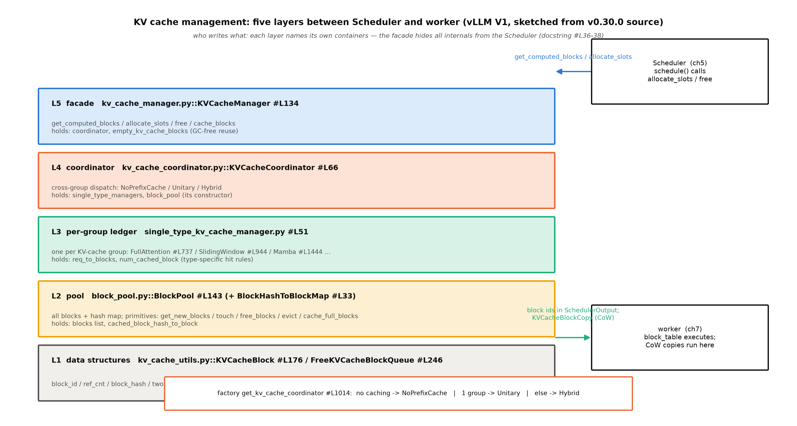
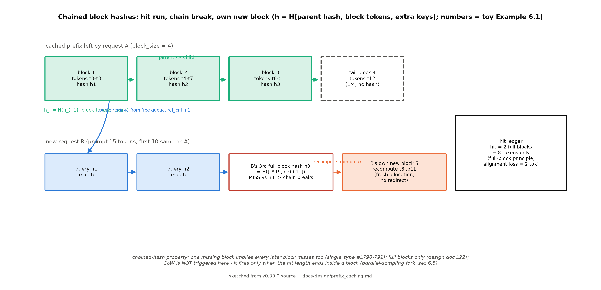
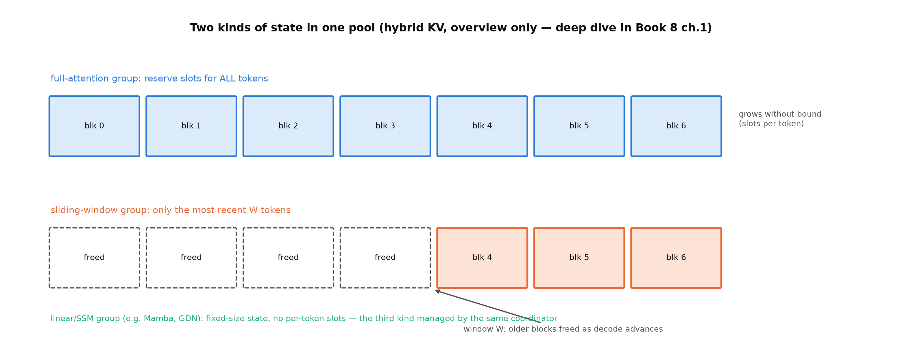

# 第 6 章 KV cache 管理全景：块池、哈希与命中

## 6.1 两本账，到了对账的时候

上一章结束时，我们把调度器读到了它的决策循环：每一步，它都要问同一个问题——「这条请求已算多少 token、还能不能给它块」。这个问题的被问方，正是本章的主角：调度器手里那本「块账」的记账户。在生命周期的地图上，我们站在第 9 站：`schedule()` 决策之后、executor 广播之前；进站的是一条请求（带着它的 token 与哈希），出站的是一组块号（`SchedulerOutput` 里的 block table，下一章它们会变成前向的输入）。

而 Book6 留给本章的，是两笔写明地址的账。第 5 章分页 KV 的账说：块表、块池、写时复制这些机制的「实现正身与 NPU 侧等价口径——阅读锚 v0.30.0 的 block 管理与 CoW 注释已在此埋点。→ Book7 第 6 章」【Book6 ch05 章末欠账框】。第 6 章前缀缓存的账更直接：**「哈希前缀与 radix 之争在真实引擎的最终答案（块粒度 16/128 的取舍、驱逐与调度的工程化）落在引擎配置层——机制本册已教完。→ Book7 第 6 章」**【Book6 ch06 章末欠账框，B6-3】。你在 Book6 手造过这两件东西：`engine_v3.py` 的块表与按页借还、`engine_v4.py` 的 `PrefixCache`（键→物理块+引用计数）。本章的任务不是重学机制，而是看它们在工业引擎里长成了什么形状——**你已经懂机制，现在看它的工业长相**。

> **最小背景栏**：读懂本章需要 Book6 的三件旧资产——块表与定位式 $\mathrm{locate}(p)=\big(p\div b,\ p\bmod b\big)$（第 5 章式 (5.1)）、前缀缓存的哈希链推导与「只认满块」原则（第 6 章 §6.2-6.3）、v4 引擎的命中走查（第 6 章实物 6.1：多轮 66.7%/few-shot 86.6% 命中率）。虚拟内存分页的机制图像（第 5 章 5.2 节从零教过）按已知用，不再重教。

本章的路线一节一问：这套管理器由哪几层零件组成、谁持有写权（6.2）→ 哈希前缀缓存怎么从链式哈希里找出可复用的块（6.3）→ 一个块从出生到死亡要经历哪些动作、每个动作在账本上留下什么（6.4）→ 共享的尾块在什么条件下需要复制（6.5）→ 同一套机制在 NPU 上有哪些差异（6.6）→ 两类不同寿命的住客怎么同池（6.7）。产出三样：一张五层结构图、一本四动作块账、一组 NPU 实测读数。

## 6.2 五层结构：谁持有写权

仍在第 9 站——调度器刚做完决策，我们钻进它调用的那套管理器内部。先用 30 秒建立全景：V1 的 KV 管理不是一个大类，而是五层各司其职的栈（图 6.1）——自下而上：**数据结构层**（`KVCacheBlock` 与空闲队列——块的元数据）、**池层**（`BlockPool`——全部块与哈希表、分配原语）、**组记账层**（`SingleTypeKVCacheManager`——每类 KV 组一份「请求→块」账本）、**协调层**（`KVCacheCoordinator`——跨组协调与命中归并）、**门面层**（facade，`KVCacheManager`——对调度器的唯一接口）。自下而上读是「构造的逻辑」：先有块对象，块凑成池，池按组记账，组由协调者调度，最后包一个门面交给调度器。



图 6.1 KV 管理五层结构（按 v0.30.0 源码自绘，示意级）：左侧五层纵向栈标各自持有的容器与关键行号；右侧 Scheduler（上游，第 5 章）与 worker（下游，第 7 章）两个外部角色；底部是协调器的三态分派工厂。

从最底层的块对象看起——这是一切账目的原子。

```python
class KVCacheBlock:
    """KV-cache block metadata."""

    # Block ID, ranging from 0 to num_gpu_blocks - 1.
    block_id: int
    # Reference count.
    ref_cnt: int = 0
    …
    # The hash key (block hash + group id) of the block, only available
    # when the block is full and cached.
    _block_hash: BlockHashWithGroupId | None = None
    …
    # Used to construct a doubly linked list for free blocks.
    # These two attributes should only be manipulated by FreeKVCacheBlockQueue.
    prev_free_block: "KVCacheBlock | None" = None
    next_free_block: "KVCacheBlock | None" = None
```
【源码：`vllm/v1/core/kv_cache_utils.py#L176-197`，阅读锚 v0.30.0】看什么：**块的五个核心身份字段**——物理块号、引用数、哈希身份、两个链表指针（节选以 `…` 略去的还有 `pool` 反向指针与 `_block_hash_num_tokens` 两个记账字段——后者的注释「partial entries can end inside a cache block」恰是 6.5 节「命中停在块中间」的伏笔）。KV 数据本身不在这里：块对象是账本页，真正的 K/V 张量住在 worker 的显存里（6.5 节会看到账与货分家的深意）。注意那行注释的措辞：链表指针「只许 `FreeKVCacheBlockQueue` 操纵」——写权从字段声明起就划清了。

池层把所有块一次造齐（摘录保持原缩进，中段注释以 `…` 略）：

```python
        self.blocks: list[KVCacheBlock] = [
            KVCacheBlock(idx, pool=self) for idx in range(num_gpu_blocks)
        ]
        …
        self.free_block_queue = FreeKVCacheBlockQueue(self.blocks)
        …
        self.cached_block_hash_to_block: BlockHashToBlockMap = BlockHashToBlockMap()
        …
        # To represent a placeholder block with block_id=0.
        # The ref_cnt of null_block is not maintained, needs special care to
        # avoid freeing it.
        self.null_block = self.free_block_queue.popleft()
        self.null_block.is_null = True
```
【源码：`vllm/v1/core/block_pool.py#L178-194`，阅读锚 v0.30.0】看什么：三件事——**初始化即全量建池**（设计文档的原话：「We allocate all KVCacheBlock when initializing the KV cache manager to be a block pool. This avoids Python object creation overheads」【官方设计文档 docs/design/prefix_caching.md#L123】——运行期零对象创建，教学引擎 `engine_v3.py` 的块号栈同款思想）；**空闲块本身串成双链表**（队首=最久未用，块内嵌指针使「从中间摘除」是 O(1)——这是 6.3 节 touch 动作的物理基础）；**block 0 出厂即被扣为哨兵**（sentinel，`null_block`，占位用、引用数不维护——一个工程细节，后面各摘录里反复出现的 `not block.is_null` 判空都在防它）。

组记账层与协调层先各记一句，深讲分别留给自己（6.3 的命中规则）与 hybrid（6.7）：每类 KV 组（全注意力组、滑窗组、Mamba 组……）各有一份 `SingleTypeKVCacheManager`，持有自己的 `req_to_blocks` 账本与类型特化的命中规则；协调层在多组之间归并出「这条请求到底命中了多少」。**门面层**的动机，源码 docstring 写得直白：「The allocation result of KVCacheManager, work as the interface between Scheduler and KVCacheManager, to **hide KVCacheManager's internal data structure** from the Scheduler」【源码：`vllm/v1/core/kv_cache_manager.py#L38-40` docstring，阅读锚 v0.30.0】——调度器只认四个方法（`get_computed_blocks`/`allocate_slots`/`free`/`cache_blocks`），五层内部结构对它不可见。对比 Book6 的 `engine_v4.py`：教学引擎把块账直接记在 `PrefixCache` 一个类里——工业版把同一个职责拆成了五层，**分层的依据不是功能而是写权**：每层独占自己的容器，跨层只经方法调用说话。

这套栈是谁建的、什么时候建的？启动期有一条短管线值得记全：worker 按模型结构自报每层组的 `KVCacheSpec`（NPU 侧入口 `vllm_ascend/worker/worker.py::NPUWorker.get_kv_cache_spec`#L994）→ EngineCore 拿 profiling 测出的可用显存算出块数（`vllm/v1/engine/core.py#L318/#L333`——第 4 章 StartPlan 优化的正是这一步）→ Scheduler 构造 `KVCacheManager`（`vllm/v1/core/sched/scheduler.py#L299`）。块池的容量因而不是配置死的，是「显存预算 ÷ 每块字节」算出来的——本章实验③会把这笔账在 NPU 上实算一遍。

## 6.3 哈希链与命中：B6-3 的答案

还在第 9 站的查命中环节：调度器拿着带哈希的请求，问管理器「它的前缀能复用多少」。块有了，怎么判断「新请求的前缀能不能复用旧请求算过的块」？Book6 第 6 章教过两派：哈希派与 radix 树派，并留下一句判断——「哈希派的键链，悄悄长成了一棵树」【Book6 ch06-前缀缓存.md#L51 原文】。现在看引擎的答卷。

设计文档开宗明义：「vLLM chooses a hash-based approach. Specifically, we hash each kv-cache block by the tokens in the block and **the tokens in the prefix before the block**」【官方设计文档 docs/design/prefix_caching.md#L5】。把这句话写成公式，块的哈希身份是：

$$h_i = H\big(h_{i-1},\ t_i,\ e\big),\qquad h_{-1}=\text{NONE\_HASH}\tag{6.1}$$

| 符号 | 含义 | 量纲/形状 |
|---|---|---|
| $h_i$ | 第 $i$ 块的哈希身份 | 定长摘要（sha256 默认档 32 B） |
| $h_{i-1}$ | 父块哈希（前一块的身份） | 同上；首块取全局哨兵 NONE_HASH |
| $t_i$ | 本块 token 元组 | $b$ 个 token id |
| $e$ | 附加键（extra keys） | 元组：LoRA 请求 id、多模态哈希、cache_salt（LoRA 服务本册不讲，→Book8 第 4 章） |

用人话说：**每块的身份 = 「我的内容 + 我的全部来历」的指纹**——父块哈希把前缀的完整历史压进了一个定长值，所以两个块哈希相等，几乎等于断言「从序列开头到这两块为止，token 逐位相同」。代码正身只有三行：

```python
    if not parent_block_hash:
        parent_block_hash = NONE_HASH

    curr_block_token_ids_tuple = tuple(curr_block_token_ids)
    return BlockHash(
        hash_function((parent_block_hash, curr_block_token_ids_tuple, extra_keys))
    )
```
【源码：`vllm/v1/core/kv_cache_utils.py::hash_block_tokens`#L659-665，阅读锚 v0.30.0】看什么：哈希输入是三元组——父哈希、本块 token、附加键；首块的「父」是一个全局哨兵值。（运行栈 0.27.1 同函数在 #L596，行号漂移约 42 行——本册源码引用一律用阅读锚行号。）

三个工程决策把这个公式落到地上。**其一，哈希是请求侧预计算的**：`Request` 对象创建时就算好整条 prompt 的块哈希序列、每生成若干 token 增量补算（`vllm/v1/request.py#L219-224/#L276-281`）——调度进程查命中时零哈希开销，哈希成本被挪到了请求进门的时刻。**其二，只缓存满块**：「We only cache full blocks.」【官方设计文档 prefix_caching.md#L22】——尾块没写满，它的哈希就不会进缓存表（命中长度只到整块边界；「命中停在块中间」会发生什么，6.5 节专门讲）。**其三，命中查找=断链即停**：

```python
        # Phase 1: longest run of cached full blocks from the start. A missing
        # block implies every later block misses too (chained hashes).
        for block_hash in itertools.islice(full_block_hashes, max_length // block_size):
            cached_block = block_pool.get_cached_block(block_hash, kv_cache_group_ids)
            if not cached_block:
                break
            for computed, cached in zip(computed_blocks, cached_block):
                computed.append(cached)
```
【源码：`vllm/v1/core/single_type_kv_cache_manager.py#L790-797`（截尾标 …），阅读锚 v0.30.0】看什么：从块 0 逐哈希查表，**第一个 miss 就 break**——注释把理由说透了：链式哈希保证后面的必 miss。对照 Book6 `engine_v4.py::PrefixCache` 的八行走查循环：教学版逐键查 dict、查到没有就停——与这里 Phase 1 的循环逐行同构，工业版多出的只是「组维度」（同一哈希按组各查各的）与满块截断的精确化。这就是「你已经懂机制，现在看工业长相」的具体含义（图 6.2）。



图 6.2 链式哈希与断链（按 v0.30.0 源码+设计文档自绘，示意级）：上排=请求 A 遗留的缓存链（三个满块带哈希 h1/h2/h3、尾块虚框无哈希）；下排=请求 B 的查询路径——h1/h2 命中（touch），h3 处 B 的满块哈希对不上、链断即停，B 从断点起自己新分块重算。

**例 6.1（构造例：六时刻的块账）** 块大小 $b=4$、池 8 块（编号 0-7；block 0 实为哨兵不参与，教学例从 1 起用）。构造三条请求：A 的 prompt 10 token（$t_0$-$t_9$）随后解码 3 步；B 的 prompt 15 token 且**前 10 个与 A 相同**（$t_0$-$t_9$ 后接自有 token $b_{10}$-$b_{14}$）；C 的 prompt 20 token、**前 12 个与 A 相同**。逐步走（每步标事件与三本账）：

| 时刻 | 事件 | 块表与内容 | 空闲表全序（左=队首） | 哈希表键集 |
|---|---|---|---|---|
| 1 | A 进门，prefill 10 tok | A:[1(满 $t_0$-$t_3$), 2(满 $t_4$-$t_7$), 3($t_8$-$t_9$ 2/4)]；满块随分配入册 | 4-5-6-7 | {h1,h2} |
| 2 | A 解码 3 步 | 块 3 写满（$t_8$-$t_{11}$）入册 h3；$t_{12}$ 开块 4（1/4） | 5-6-7 | {h1,h2,h3} |
| 3 | B 进门（前 10 同） | 查链：h1✓h2✓；B 的第 3 块 $[t_8,t_9,b_{10},b_{11}]$ 哈希 $h_3'\neq h_3$——**断链**。touch 块 1,2；B 新分块 5（写满入册 $h_3'$）、块 6（$b_{12}$-$b_{14}$ 3/4） | 7 | {h1,h2,h3,h3'} |
| 4 | A 结束，free | 块 4（无哈希→队首）、块 3（有 h3→队尾）；**块 1,2 被 B 持有（ref 2→1），不入队** | 4-7-3 | {h1,h2,h3,h3'} |
| 5 | B 结束，free | 块 6（无哈希→队首）；块 5,2,1（有哈希→队尾，逆序传入故 5 最先） | 6-4-7-3-5-2-1 | {h1,h2,h3,h3'} |
| 6 | C 进门（前 12 同） | h1✓h2✓h3✓——touch 块 1,2,3（**块 3 从中段、块 2/1 从队尾一并摘出**——touch 对一切 ref_cnt=0 的命中块生效）；C 新分块 6、4（各写满入册 h4/h5） | 7-5 | {h1,h2,h3,h3',h4,h5} |

每一步都能手算复核，六个时刻各藏一个机制看点。**其一，分配即入册**——时刻 1 的哈希表不是空的：满块在分配收尾就进缓存（`allocate_slots` 的 cache 步），不是等请求结束。**其二，满块原则与断链**——时刻 3 的 B 前缀与 A 相同到第 10 个 token，却只命中 2 块 8 个 token：B 的第 3 块内容 $[t_8,t_9,b_{10},b_{11}]$ 哈希后对不上 A 的 $h_3$，链在此断掉（B6-3 的答案在一张表里；Book6 few-shot 例子的「对齐损耗」在源码层的出处就在这）。**其三，共享块不还账**——时刻 4 只回收了块 3,4：块 1,2 的引用数从 2 减到 1（B 还在用），**ref_cnt 没归零就不入空闲表**——「free 是减引用、不是收房子」。**其四，free 的双桶**——无哈希块（4、6）插队首（下次优先复用，GPU 局部性）、带哈希块（3、5、2、1）排队尾（成全 LRU）；「逆序传入」让链更深的块排得更靠前（先被逐）。**其五，touch 的中摘**——时刻 6 的块 3 呆在队列中段、块 1/2 呆在队尾，被 touch 一并摘出（三个命中块全部离队），队列不重排。这套账本走完，你对「命中=把别人算过的块摸热」这句话的每个词都有了行号级的着落。

链式哈希还有一个不显眼但意味深长的副产品：**重复块**。设计文档举的例子：block_size=4、请求解码到 EFGH 时块 3 内容与块 1 相同（同一哈希键）——「the block table in vLLM v1 is **append-only**, meaning that changing the block table from `[0, 3]` to `[0, 1]` is not allowed. As a result, we will have duplicated blocks for the hash key E-H. This duplication will be eliminated when the request is freed」【官方设计文档 prefix_caching.md#L194】。代码侧的同款自白：「We currently don't de-duplicate the blocks in the cache…This is because we want to make sure the allocated block IDs won't change so that **block tables are append-only**」【源码：`vllm/v1/core/block_pool.py#L47-51` NOTE #1，阅读锚 v0.30.0】。

> **【考据框】去重还是 append-only？**V0 检测到重复块会释放新块、改指旧块（设计文档同一节的对照叙述）；V1 选了容忍重复——块表一旦写下不许改，冗余块活到请求 free 时自然消除。为什么方向反了：块表 append-only 换来的是 worker 侧执行的简单性（块号序列只追加不重写，6.5 节 CoW 的拷贝对下发依赖这一点）——**为执行层的简单付一点内存冗余**，这是 V0→V1 不变量迁移的一个典型样本，与第 1 章那两个 7 行别名文件讲的是同一个故事的两面。

最后把 Book6 的两派之争收口。哈希派 vs radix 树派，争的是「复用键怎么组织、驱逐谁先走」。vLLM 的答卷是第三条路：**哈希表查命中 + 空闲双链表管驱逐**——LRU 语义不需要显式的树，它被编码进了队列的不变量里：「The least recent used block is at the front (LRU). If two blocks have the same last accessed time…the one with more hash tokens (the tail of a block chain) is at the front」【源码：`vllm/v1/core/kv_cache_utils.py#L256-260` docstring，阅读锚 v0.30.0】。radix 派「叶子先逐」的驱逐语义，在这里由 free 的入队顺序实现——叶子（哈希链最深的尾块）被排到最先被逐的位置。Book6 那句「哈希派的键链，悄悄长成了一棵树」的判断，在工业答卷里得到了一个精确的注脚：**树没有消失，它变成了队列序**。

## 6.4 块的一生：四动作的账

仍在第 9 站，但从「查命中」移到「块本身」的纵向视角。一个块从出生到死亡，全部人生经历就是五个字段的变化史——归纳为四个动作（教学分组：进来、出去、挤兑、上册；源码原语实为六个，表注声明口径）：

表 6.1 块账：四动作六原语，每行的账目效果（行锚全部为阅读锚 v0.30.0）

| 动作 | API 正身 | 空闲表效果 | ref_cnt | 哈希表效果 | 一句设计理由 |
|---|---|---|---|---|---|
| allocate（进） | `vllm/v1/core/block_pool.py::get_new_blocks`#L664 | 队头弹出 n 块 | +1/块 | **弹出即驱逐**（若带缓存身份） | 弹到的块若还顶着缓存身份，当场销户 |
| touch（摸热） | `vllm/v1/core/block_pool.py::touch`#L749 | 命中块**从表中 O(1) 中摘** | +1/块 | 不动 | 命中的块必须立刻离开驱逐候选集 |
| free（出） | `vllm/v1/core/block_pool.py::free_blocks`#L770 | **双桶**：无哈希块→队首(LIFO)；有哈希块→队尾(FIFO) | −1/块 | 不动（身份保留） | LIFO 换 GPU 局部性；FIFO 成全 LRU |
| evict（挤兑） | `vllm/v1/core/block_pool.py::_maybe_evict_cached_block`#L726 | （块已在被分配路径上） | 不动 | **删键**+`reset_hash()` | 驱逐只删缓存身份，不释放块 |
| cache（上册） | `vllm/v1/core/block_pool.py::cache_full_blocks`#L231 | 不动 | 不动 | 逐满块**插键** | 只有满块有资格入册 |
| CoW（换装） | `vllm/v1/core/single_type_kv_cache_manager.py::_apply_cow`#L448 | （新块走 allocate） | 新块额外 +1 | 原块身份不动 | 拷贝完成前两端保活（6.5） |

三个动作值得看源码原貌。allocate——「分配即驱逐」：

```python
        ret: list[KVCacheBlock] = self.free_block_queue.popleft_n(num_blocks)
        …
        if self.enable_caching:
            for block in ret:
                self._maybe_evict_cached_block(block)
                assert block.ref_cnt == 0
                block.ref_cnt += 1
```
【源码：`vllm/v1/core/block_pool.py#L678-688`，阅读锚 v0.30.0】看什么：分配就是从队头弹 $n$ 个；弹到的块若带缓存身份，先销户再上岗——**空闲表队首同时是驱逐候选队首**，一张表两个身份，这是「哈希表管命中、队列管驱逐」双结构的合流点。

touch——命中摸热：

```python
        for block in blocks:
            # ref_cnt=0 means this block is in the free list (i.e. eviction
            # candidate), so remove it.
            if block.ref_cnt == 0 and not block.is_null:
                self.free_block_queue.remove(block)
            block.ref_cnt += 1
```
【源码：`vllm/v1/core/block_pool.py#L757-762`，阅读锚 v0.30.0】看什么：touch 只做两件事——从空闲链表中摘下、引用数加一。6.2 节那个「块内嵌双链表指针」的设计，就是为了让这个 `remove` 是 O(1)——被命中的块必须立刻离开驱逐候选集，否则可能出现「正在被新请求使用的块被驱逐」的账目事故。

free——例 6.1 时刻 4/5 那个双桶的谜底：

```python
        # Identify blocks with hash (LRU cache) and without it (never match APC)
        blocks_to_evict_last = []
        blocks_to_evict_first = []
        …
            if block.ref_cnt == 0 and not block.is_null:
                if block.block_hash is None or not self.enable_caching:
                    # LIFO reuse of non-cached blocks for better GPU locality.
                    blocks_to_evict_first.append(block)
                else:
                    # FIFO reuse of cached blocks for LRU eviction behavior.
                    blocks_to_evict_last.append(block)
        # Blocks to reuse first are prepended to the front of the free queue.
        self.free_block_queue.prepend_n(blocks_to_evict_first)
        # Blocks to reuse last are appended to the end of the free queue.
        self.free_block_queue.append_n(blocks_to_evict_last)
```
【源码：`vllm/v1/core/block_pool.py#L778-798`，阅读锚 v0.30.0】看什么：一次 free 分两桶——**无哈希块插队头**（刚释放的裸块物理位置还热着，下一个请求立刻复用它，GPU 局部性更好）、**有哈希块排队尾**（缓存身份的块尽量晚死，成全 LRU）。设计文档对入队顺序的解释则是缓存视角：「the last block of a request must hash more tokens and is less likely to be reused by other requests. As a result, it should be evicted first」【官方设计文档 prefix_caching.md#L198】——尾块哈希覆盖的 token 最多、被完整复用的概率最小，所以该最先被逐。两个视角说的是同一件事：调用方把块**逆序**传进来（`single_type_kv_cache_manager.py#L581` 的 `reversed(...)`），配合双桶，让「最不易复用的排最前」。

> **【考据框】文档单说 vs 代码双桶。**设计文档只讲了「逆序 append 尾部」；代码实际是 prepend/append 双桶。读引擎源码的一课：**设计文档讲语义，代码注释讲动机，两者都读才算读完**——这正是第 2 章「文档=代码的投影」的活例（投影会滞后）。

> **【版本差异框注】**上引 free_blocks 的无哈希桶条件 `block.block_hash is None or not self.enable_caching`（v0.30.0）在运行栈 0.27.1 为 `is None and enable_caching`——缓存全局关闭时两版把同样的块放进了相反的桶（0.27.1 全部 append 尾部、v0.30.0 全部 prepend 头部）。主叙事不受影响，印这段代码时按阅读锚、跑实验看运行栈行为即可。

上册（cache）动作还有一个与投机解码的耦合值得记：`allocate_slots` 收尾时把入册上限压到「已定稿 token」——`vllm/v1/core/kv_cache_manager.py#L590-599` 的 NOTE 注释说明原因：投机解码的 draft token 可能被验证拒绝，**未定稿的 token 不许入册**（入册了就可能被别的请求当作可信前缀复用）。第 5 章说调度器「不区分 prefill/decode」，这里看到 KV 管理器替它把关的另一个维度：**不区分阶段，但区分「定稿与否」**。

**例 6.2（构造例：块 6 的护照）** 把表 6.1 纵过来读——跟踪例 6.1 那个世界里块 6 的一生（同一池子的另一条时间线片段）：

| 时刻 | 动作 | API | ref_cnt | 哈希 | 队列位置 |
|---|---|---|---|---|---|
| t0 | 出生即入空闲表 | （建池） | 0 | — | 队中第 6 位 |
| t3 | 被 B 分配（allocate），装 $b_{12}$-$b_{14}$ 3/4 | `get_new_blocks` | 1 | —（未满不册） | 已摘出 |
| t5 | B 结束（free）——无哈希桶 | `free_blocks` | 0 | — | **队首**（LIFO：刚用过的物理位置还热） |
| t6 | 被 C 从队头弹出（allocate） | `get_new_blocks` | 1 | — | 已摘出 |
| t6' | C 写满 $c_{12}$-$c_{15}$（cache） | `cache_full_blocks` | 1 | $h_4$ | —（在用） |

这个例子让你看见什么：**LIFO 复用不是抽象原则，是时刻 5→6 之间那次「队首直取」**——B 刚放回的块，下一个请求立刻拿来用（GPU 上那块显存的数据通路还是热的）。对照另一个极端：带哈希的块（例 6.1 时刻 5 的块 5,2,1）排在队尾，要等队列几乎耗尽才轮到被弹出——那时「弹出即驱逐」把它们的缓存身份销户（表 6.1 的 evict 行）。**块的「死亡」有两层**：free 只还回使用权（身份还在，等着下一次命中）；驱逐才注销缓存身份。两层分开，正是「释放立刻、驱逐尽量晚」这对矛盾能共存的原因。

## 6.5 命中停在块中间：CoW 的真实触发

第 9 站的最后一个环节：命中长度「停在块中间」时块表怎么处理。先把触发条件钉准——这是容易想当然的地方（笔者初稿就写错过）：**跨请求的部分前缀命中不触发写时复制**。例 6.1 时刻 3 的 B 对 A 的第 3 块只对上 2/4 个 token——链断即停，B 的命中只算到整块边界（8 个 token），断点之后的 token 它**自己新分块重算**（时刻 3 的块 5），与 A 的块 3 再无关系。真正触发重定向的判据在源码里只有一行：

```python
    def _has_partial_local_hit(
        self,
        new_computed_blocks: Sequence[KVCacheBlock],
        num_local_computed_tokens: int,
    ) -> bool:
        # The local prefix-cache hit ends inside one of this manager's
        # blocks: the shared tail block needs CoW.
        return (
            len(new_computed_blocks) > 0
            and num_local_computed_tokens % self.block_size != 0
        )
```
【源码：`vllm/v1/core/single_type_kv_cache_manager.py#L165-179`（截尾标 …），阅读锚 v0.30.0】看什么：**命中长度非整块倍数**才是触发条件——「The local prefix-cache hit ends inside one of this manager's blocks」。什么场景会让命中停在块中间？最典型的是**并行采样分叉**：同一 prompt 的两条采样序列（`n>1`），fork 点落在块中间——第二条序列的「已计算」包含整块的共享 prompt 段加上块中间的分叉点，它的块表里那个分叉块同时挂着两条序列的引用。

重定向的执行约定在 `_apply_cow` 的 docstring 里，值得整段读：

```python
        """Redirect a partial prefix-cache hit to a private CoW block.

        Both copy endpoints stay retained until the copy has run on the worker,
        so a same-step free cannot recycle them: ``source_block`` keeps its
        hit-ref, ``cow_block`` takes an extra ref beyond the one handed to the
        request.
        """
        req_blocks = self.req_to_blocks[request_id]
        assert block_idx < len(req_blocks)
        assert req_blocks[block_idx] is source_block
        assert not source_block.is_null and source_block.ref_cnt > 0
        req_blocks[block_idx] = cow_block
        self._pending_cow_copies.append((source_block, cow_block))
        cow_block.ref_cnt += 1
```
【源码：`vllm/v1/core/single_type_kv_cache_manager.py#L455-468`，阅读锚 v0.30.0】看什么：**两端保活**——源块保留命中引用、新块在请求持有的引用之外**额外多拿一条命**，直到 worker 真的把数据抄过去；这多出的一条命防的是「同一步内 free 把两端的块回收再分配」的竞态。三行 assert 也值得读：要求被顶替的块确实在请求块表的那个位置、确实有人引用——账目对不上直接炸，这是防御式记账。

**例 6.3（构造例：并行采样分叉的 CoW 账）** 沿用 $b=4$ 的世界：请求 S 的 prompt 10 token（$t_0$-$t_9$），采样参数 $n=2$（两条序列 S1/S2 共享 prompt）。走查：①S1 先算——块 1（$t_0$-$t_3$）、块 2（$t_4$-$t_7$）满块，块 3 装 $t_8,t_9$ 2/4；②两序列各自解码：S1 在块 3 续写 $s^{(1)}_{10},s^{(1)}_{11}$ 写满、开块 4；S2 此刻进场——它的「已计算」=共享的 10 个 token（**非整块**，$10\bmod 4=2\neq0$）——partial hit 触发：登记 `(block_idx=2, source=块3)`；③`_apply_cow`：取空闲队首的**新块 5**，`req_blocks[2]=块5`（S2 的块表原地顶替），拷贝对 (块3→块5) 进 pending，块 5 引用数 +2（请求 1 条+保活 1 条）；④worker 执行拷贝——把块 3 全部 4 个 token 的 K/V 抄进块 5（含 S1 写入的两个 token——抄整块，S2 随后会在块 5 覆写自己分叉后的部分）；⑤S2 在块 5 续写 $s^{(2)}_{10},s^{(2)}_{11}$——注意块 5 写满后以**自己的新哈希**入册，块 3 的哈希（若已满入册）原封不动。效果读法：S2 只多付 1 块显存与一次 4-token 拷贝，换来「共享不写、写入私有」两全——**这正是 Book6 例 5.4（并行采样两路共享尾块、只多付 1 块复制）的源码正身**，那时教的「写进新块≠写时复制、尾块续写才是」，现在的行号就是 6.5 节这三段摘录。

最后一笔要特别记：`_pending_cow_copies` 里的拷贝对，由 `KVCacheManager.take_kv_cache_block_copies`（`vllm/v1/core/kv_cache_manager.py#L873-888`）打包成 `KVCacheBlockCopy(src, dst)` 随调度输出下发——**块账记在 EngineCore 进程，KV 数据住在 worker 进程，拷贝对是两者之间唯一的搬运指令**。第 4 章的进程拓扑在这里第一次落到了数据结构上：五层管理器全在调度侧，它们操纵的从来只是「块号与身份」，一字节的 K/V 都没碰过。

## 6.6 NPU 差异面：块 128 与两个补丁

同一套五层结构跑在 NPU 上，差异集中在三个精确的位置——先用一句话立边界：**哈希计算层零改动，块大小协商层与命中查找层有补丁**。

**其一，块默认 128。**CUDA 侧平台默认块 16（Book6 ch05 已按论文口径讲过「大到高效、小到避免碎片」的权衡）；NPU 侧的正身只有两行：

```python
    if cache_config.block_size is None:
        cache_config.block_size = 128
```
【源码：`vllm_ascend/utils.py#L1195-1196`，运行栈 vllm-ascend 0.27.1rc1——vllm-ascend 安装包与构建源逐字节一致，引用无需版本框注】粒度粗 8 倍的账是双向的：块表与哈希元数据省 8 倍（每请求的块表项数÷8），但命中粒度也粗 8 倍（共享前缀须凑满 128 的整数倍才算命中）。而且这两行不孤单——同文件 22 行之后还有一道闸门：**APC（automatic prefix caching，自动前缀缓存——第 5 章调度与缓存交互节展开）或 chunked prefill 开启时（都是默认开），显式指定的块大小被强制覆写回 128**（`vllm_ascend/utils.py#L1217-1222`，本节实验②的负结果正是它现身）。源码没有注释自述选 128 的动机【证据等级：config 逆向——裸赋值无说明】；可作旁证的是 PagedAttention 论文的块大小扫描（ShareGPT 负载下 1-256 全程、16-128 表现最好，但短序列的 Alpaca 负载在 ≥64 已显著恶化——Book6 ch05 已引全文）：**长序列负载下两档都在可接受区**，取舍权在硬件特性（NPU 融合注意力算子按大块访存的效率收益——第 9 章算子层还会回到这点）。

**其二，协调器补丁。**`vllm_ascend/patch/platform/patch_kv_cache_coordinator.py`（654 行）重写了 Hybrid 协调器的命中归并。官方自述的 Why 值得直引：「In PD disaggregation with hybrid Mamba models…the D side receives FullAttention KV blocks from the P side but has no local prefix-cache hit for Mamba groups. **Upstream's min-reduction across all KV groups collapses the FullAttention hit length to 0**」【源码：`vllm_ascend/patch/__init__.py#L193-201` §8 Why】——上游对各组命中取 min，在「Mamba 组无本地命中」的场景把全注意力组的命中也塌缩成 0；补丁改成取 FA 组的命中长。（PD 分离的机制是 Book8 第 7 章的地界，这里只取「平台补丁怎么修上游的边」这个形状。）

**其三，双粒度设计。**v0.30.0 把「块大小」拆成了两个量：`scheduler_block_size`（调度对齐粒度，多组取各有效块大小的最小公倍数）与 `hash_block_size`（哈希计算粒度，多组取最大公约数）——docstring 原文「Multiple groups: LCM of every group's effective block size…else the GCD of group block sizes」（`vllm/v1/core/kv_cache_utils.py#L721-733`，阅读锚 v0.30.0；另含 `prefix_match_unit` 覆写分支）——用人话说：**调度粒度管对齐、哈希粒度管命中**。

> **【版本差异框注】**双粒度是 v0.30.0 的设计；运行栈 0.27.1 是单组口径（`hash_block_size` 恒等于 `block_size`——运行栈 `scheduler.py#L273-274` 的缺省回填）。本节按锚讲思想，运行栈读者知道它是单值即可。

**实验读数（Atlas 910B3，运行栈 0.27.1+vllm-ascend 0.27.1rc1）。**三组实测把上面的结构账落到数字上（表 6.2）。

实验③（形状探针，`code/ch06/exp_ch06.py::kv_probe`）：207M 模型（L=12 层、$h_{kv}=8$、$d_k=64$）、`gpu_memory_utilization=0.4` 起 LLM——`block_size=128`、`num_gpu_blocks=8110`、token 容量 $8110\times128=1{,}038{,}080$、每层形状 $(2,8110,128,8,64)$、全层 KV 字节账 $1{,}038{,}080\times2\times8\times64\times2\times12=23.76$ GiB【本机实测，`log/book7-ch06/kv_probe.json`】——与起服日志的「Current KV cache memory: 23.76 GiB」逐位互证（手算账=引擎账，Book6 三层对拍的最底层在这成立）。每 token 全层 KV 24 KiB，正是 Book2-6 一路沿用的 207M 账本数字——**同一本账，第六册手算、本册从引擎里读出来**。

实验①②（APC 开关与块大小对拍，`exp_ch06.py::run_arm`）：workload 预注册——4 个前缀×每前缀 4 请求、prefix 1000 token（**故意不整除 128**）+suffix 200+输出 32、请求率 2/s。先手算天花板——这就是例 6.4。

**例 6.4（构造例：块对齐损耗小账）** prefix=1000 不整除任一档块大小：命中=每请求 $\lfloor1000/b\rfloor\times b$ 个 token——$b=16$ 档 $\lfloor1000/16\rfloor\times16=992$（损 8）、$b=128$ 档 $\lfloor1000/128\rfloor\times128=896$（损 104）。扣掉每前缀第一条请求（无命中可打），全队列命中率天花板：$b=16$ 档 $\frac{3\times4\times992}{16\times1200}=62.0\%$、$b=128$ 档 $\frac{3\times4\times896}{16\times1200}=56.0\%$。粒度粗 8 倍，对齐损耗从 8 token 放大到 104 token——**块对齐损耗=「凑不满整块」的截断账，例 6.1 时刻 3 的断链在 workload 级的放大**。

表 6.2 APC 开关对拍与块大小负结果（207M/单卡/三臂；读数：`log/book7-ch06/exp_ch06_summary.json` 与 serve 日志统计行）

| 臂 | 旗标 | 命中率 | 天花板 | 均值/中位 TTFT (ms) |
|---|---|---|---|---|
| apc_off_b128 | `--no-enable-prefix-caching` | **0.0%** | ≈0% | 85.11 / 79.18 |
| apc_on_b128 | （默认） | **56.0%** | 56.0% | 82.44 / 75.99 |
| apc_on_b16（名义） | `--block-size 16` | 54.8% | （62.0%@真16） | 79.80 / 68.29 |

三行读数三个故事。**其一，56.0%=56.0%**：APC 开臂的实测命中率与例 6.4 手算天花板**逐位咬合**——命中数 $10752=3\times4\times896$，满块原则、断链即停、每前缀首条不命中，三个机制约束在这一个数字里全部兑现；off 臂 0.0% 负对照成立。**其二，TTFT 的差距是 2.7 ms 而不是几十**——207M 的小模型上 1200-token prefill 本就只要几十毫秒，命中省掉 56% 的 prefill 计算只在这个量级上显形（均值 85.11→82.44、中位 79.18→75.99、P99 219.41→200.67）；Book6 实物 6.1 的稳态 TTFT 折扣 3.4-5.2×（首末任务 732→89 ms 的 8.2× 里混着冷启动——Book6 自己教过的冷热分层读法）出现在 mini 引擎+更慢基线上——**命中率的收益要乘以「被省掉的那段有多贵」**，趋势级对照带四要素（对象/指标/量级/不可比声明）。**其三，b16 臂是一个诚实的负结果**：名义上给了 `--block-size 16`，起服日志却打出「Block size is set to 128 if prefix cache or chunked prefill is enabled」——6.6 节其一那道闸门现身：**平台把显式 16 覆写回了 128**（`vllm_ascend/utils.py#L1217-1222`）。所以「b16 臂」实际跑的仍是 128——它测得的 54.8% 与 b128 臂的 56.0% 之差（1.2pp），恰好给了我们一个**同配置重复读数的噪声档**估计；而 16 vs 128 的对齐损耗对比（天花板 62.0% vs 56.0%）在 NPU 上**不可实测**，只能作为例 6.4 的手算账保留——负结果预注册的判据「若平台干预则如实入档」在此兑现。顺带修正一处调研底档的乐观判断（sources/02 曾列「块 16 vs 128 可实测」——覆写使然不可）：NPU 的 128 不只是默认值，是 APC 语境下的**锁定值**【证据等级：本机实测+源码，运行栈 vllm-ascend 0.27.1rc1】。

## 6.7 两类住客：hybrid 总览（一节即止）

本章至今默认所有层的 KV 都长一样——「每 token 一行、每块 $b$ 行」。但 Book5 的混合架构留下了第三种资产：线性/SSM 层的**状态**不是逐 token 的，是固定大小的。当一台机器里同时住着 full 层、滑窗层与 Mamba 层（gpt-oss、Gemma 3、Bamba 这类混合模型），同一个池子要伺候两类寿命的住客：「Full attention layers: reserve slots for **all** tokens. / Sliding window layers: reserve slots only for the most recent `sliding_window_size` tokens」【官方设计文档 docs/design/hybrid_kv_cache_manager.md#L16-18】——外加线性组的固定状态。协调器为每组各建一个记账者（6.2 的组记账层正是为此存在），命中规则按组特化（图 6.3）。



图 6.3 两类住客同池总览（按设计文档与 v0.30.0 代码面自绘，示意级）：full 组逐 token 保槽无上界；滑窗组只保最近 W 个 token、窗外块随解码释放；线性/SSM 组固定大小状态——三类由同一协调器管理。

算例一笔（B5-8 的三刀机，正文零占位、只引数字）：MLA 3 层 960 元素/token 无界 + GDN 9 层固定 1,317,888——「无界 vs 固定」两条账本线交叉出缓存回收的临界点 $n^*\approx1{,}373$ token【设计文档 `code/Book5-前沿混合架构/ch09/DESIGN-3TO1.md`#L70】。这套「分类型状态账」如何进块池、滑窗层怎么滚、Mamba 状态怎么 checkpoint——**机制深讲唯一归属 Book8 第 1 章**，本节到「同一协调器、各组各账」为止。

> **【欠账】** hybrid KV cache manager 的机制深讲（线性/SSM 固定状态与全注意力 KV 的统一分页、层型特化命中）→ Book8 第 1 章；KV 的第四种省法——把 KV 搬走（CPU offload/分层 tiering，B6-2 的地址）→ Book8 第 9 章。

## 6.8 本章小结

回到开篇的两笔账。块表与块池的正身：五层结构——数据结构、池、组记账、协调、门面，每层写权独占自己的容器，调度器只认门面的四个方法；写时复制的正身：命中停在块中间（典型如并行采样分叉）时共享尾块被原地顶替成私有块，两端保活、拷贝对下发——Book6 第 5 章那句「写进新块≠写时复制、尾块续写才是」的边界判断，现在有了行号。哈希 vs radix 之争的答案：**链式哈希查命中、空闲双链表管驱逐**——树没有显式地存在，它的驱逐语义（叶子先逐）被编码进了 free 的逆序双桶里；满块原则、断链即停、append-only 容忍重复，三个决策共同把「哈希=内容+来历」的契约守住了。还有 Book1 最初那笔账：F4「K/V 的读取语义」一路从 Transformer 原典的注意力账走到这——块粒度的读取（gather 按表逐块拼回逻辑序）在本章的块表与 6.5 的「拷贝对=唯一搬运指令」处落地，欠账链 Book1→Book3→Book6→本章闭合（算子级的读取在第 9 章收最后一环）。

**带走的心智**是两幅画。**其一，块的护照**：每个块的一生只是五个核心字段的变化史——块号生来不变，引用数进出自如，哈希身份写满才有、驱逐即注销，队列位置随摸热与释放起落；KV 数据不在这本护照里，护照只是账。**其二，账与货分家**：五层管理器全在调度进程里拨算盘，一字节的 K/V 都不碰；数据住在 worker 的显存里，CoW 拷贝对是两界之间唯一的搬运指令——读任何 KV 管理代码，先分清「这句在记账还是在搬货」。

zoom out 回全书：生命周期的第 9 站走完，块的世界闭合——请求有了块号、块有了身份与秩序。下一章（第 7 章）这些块号随 `SchedulerOutput` 越过进程边界进入 executor 与 worker，变成前向输入的一部分：**块表怎么被真正的计算消费**，执行层的故事从这开始。

**动手验证**（Atlas 910B3；选卡纪律照 CLAUDE.md）：
① `source env.sh && ASCEND_RT_VISIBLE_DEVICES=<卡> python code/ch06/exp_ch06.py --skip-serve`——形状探针，验收行：`block_size 128 / num_gpu_blocks 8110 / kv_total_gib 23.76`；
② 去掉 `--skip-serve` 全跑三臂——验收行：off 臂 hit rate 0.0%、on 臂 56.0%（对照例 6.4 天花板）、名义 b16 臂 54.8% 且 serve 日志出现覆写行「Block size is set to 128…」；
③ `python code/ch06/fig_ch06.py`——重渲三图；
④ 正身复核：`sed -n '1217,1222p' repos/vllm-ascend/vllm_ascend/utils.py`——6.6 节那道覆写闸门的原文（外层条件 `if cache_config.block_size != 128:` 在 L1217）。
