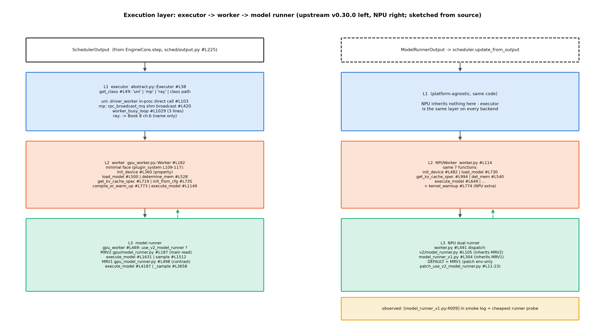
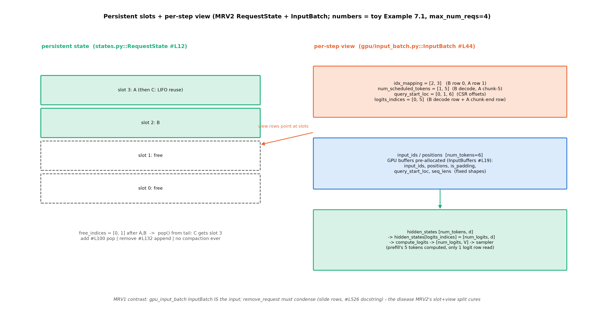

# 第 7 章 执行层：executor→worker→model runner

## 7.1 交接协议：SchedulerOutput 过境

第 6 章收尾时留了一句「下一章这些块号随 `SchedulerOutput` 越过进程边界，变成前向输入的一部分」——现在兑现。生命周期的站 10-12：调度器产出 `SchedulerOutput`（站 8 的出账）→ executor 广播过进程（站 10）→ worker 进程收到（站 11）→ model runner 组张量、跑前向、出结果（站 12）。本章要回答的问题：**一份调度决策，怎么变成一次前向**。

这条边境线上有两样东西在流动。第一样是**块号**——第 6 章的块表（逻辑块→物理块的映射）与 CoW 拷贝对，它们在 scheduler 进程里是账本上的数字、过了边境就成了 worker 显存里的真张量；第二样是**追赶量**——`num_scheduled_tokens` 字典说「这条请求这步要算几个 token」，执行层的全部工作就是把这句话变成一次前向。先看协议本体——`SchedulerOutput`（`vllm/v1/core/sched/output.py#L225`）的字段设计处处是「增量 diff」哲学：`scheduled_cached_reqs` 的注释自证「Since the request's data is already cached in the worker processes, **we only send the diff** to minimize the communication cost」；`num_scheduled_tokens: dict[str, int]` 是 phase-less 调度的最小表达（第 5 章那个「`{request_id: num_tokens}` 字典」的数据结构正身）；`finished_req_ids` 通知 worker 释放缓存状态。消费端的开场五连更值得逐行数——MRV2 的 `execute_model` 一进门就做（`vllm/v1/worker/gpu/model_runner.py#L1641-1648`）：

```python
        if not dummy_run:
            # Update the request states.
            self.update_pp_decode_requests()
            self.finish_requests(scheduler_output)
            self.free_states(scheduler_output)
            self.add_requests(scheduler_output)
            self.update_requests(scheduler_output)
            self.block_tables.apply_staged_writes()
            if scheduler_output.total_num_scheduled_tokens == 0:
                # No need to run the model.
                empty_output = self.kv_connector.no_forward(scheduler_output)
```
【源码：`vllm/v1/worker/gpu/model_runner.py::GPUModelRunner.execute_model`#L1641-1652（截尾标 …），阅读锚 v0.30.0】看什么：**一行一个动作**，逐行数：`update_pp_decode_requests`（PP 场景的解码侧请求同步——单卡时是空操作）；`finish_requests`（完成者退场——消费 SchedulerOutput 的 finished/preempted 两个集合）；`free_states`（状态释放——槽位退池，7.4 的「抢占即完成」走同一扇门）；`add_requests`（新请求入住——首登记者带全量数据，`NewRequestData` 的注释自证「We cache the request's data in each worker process」）；`update_requests`（老面孔逐请求 diff——`num_scheduled_tokens` 字典在这里逐条兑现成张量写）；`block_tables.apply_staged_writes()`（块表落盘——第 6 章的块号账本在这一步变成 GPU 侧的 block_table 张量）。空步语义也在这：`total==0` 直接短路——「没有前向的一步」在执行层的形态。还有一笔第 6 章的账要在这收：**CoW 拷贝对的执行端**——`SchedulerOutput.kv_cache_block_copies`（`sched/output.py#L295`）被 runner 的 `copy_kv_cache_blocks_inplace(self.kv_caches, …)` 消费（MRV1 #L1246-1251 / MRV2 #L1210-1214）：scheduler 进程只发指令，worker 进程的真显存张量执行搬运——「拷贝对是两界之间唯一的搬运指令」的另一半。顺带一个工程细节：`new_block_ids_to_zero`（#L1243-1245）——新分配块先清零「to prevent stale NaN」（块池复用后显存不留脏数据——Book6 ch05「释放≠清除」的工业对应物）。

> **最小背景栏**：本章直接使用第 4 章的进程拓扑（EngineCore/busy loop/`step()` 六拍——本章是 `step()` 第③动词 `execute_model` 的展开）、第 5 章的 SchedulerOutput 生产侧、第 6 章的块表与拷贝对。GPU 张量形状流转沿 Book6 ch02 的 $(B,n,d)$ 口径。

## 7.2 executor 三态：单进程直调的工程化展开

第一层是 executor——它只做一件事：**把一份 SchedulerOutput 发给 N 个 worker 并收一份输出**（图 7.1）。三态的选择权在配置期定：`world_size == 1` 时 `distributed_executor_backend` 自动落 `"uni"`（第 4 章立过的 `config/parallel.py#L1010-1011`——单卡 ps 里数不到第三个进程的原因），字符串→类在 `abstract.py::Executor.get_class`#L49-93 分派（`"uni"`/`"mp"`/`"ray"`，还接受任意全限定类名——插件可注入自定义 executor）。



图 7.1 执行层三层（按 v0.30.0 源码自绘，示意级）：左列上游、右列 NPU；executor 三态、worker 七函数最小面、runner 双代分派各一层；NPU 列的「实跑 MRV1」角标是 7.5 的伏线。

**uniproc 是理解这套抽象的下界**——worker 对象直接住进调度进程：

```python
    def _init_executor(self) -> None:
        """Initialize the worker and load the model."""
        self.driver_worker = WorkerWrapperBase(rpc_rank=0)
        …
        self.driver_worker.init_worker(all_kwargs=[kwargs])
        self.driver_worker.init_device()
        …
            self.driver_worker.load_model()
        current_platform.update_block_size_for_backend(self.vllm_config)
```
【源码：`vllm/v1/executor/uniproc_executor.py::UniProcExecutor._init_executor`#L52-75（中段以 … 略），阅读锚 v0.30.0】看什么：四步——建包装器、init_worker、init_device、load_model；没有进程创建、没有消息队列。执行就是进程内直调 `run_method(self.driver_worker, …)`（#L103）。**对照 mini 引擎**：Book6 的 `engine_v4.py` 单进程内 load 模型→调度→前向→采样一条龙——它不是「缺 executor 层」，而是「executor 恒为 uniproc」（world_size 永远是 1）；UniProcExecutor 把这件事工程化：**executor 三态是单进程直调的工程化展开，展开的方向是进程拓扑，不是抽象层**。uniproc 甚至不需要健康检查——源码自嘲「UniProcExecutor will always be healthy as long as it's running」（#L147-150；对照第 4 章 linger=4000 的死讯保命：没有跨进程就没有死讯问题）。

**multiproc 补齐多卡形态**，三件套。其一，共享内存广播通道：

```python
            self.rpc_broadcast_mq = MessageQueue(
                self.world_size,
                self.local_world_size,
                max_chunk_bytes=max_chunk_bytes,
                connect_ip=mq_connect_ip,
            )
            scheduler_output_handle = self.rpc_broadcast_mq.export_handle()
```
【源码：`vllm/v1/executor/multiproc_executor.py::MultiprocExecutor._init_executor`#L164-170，阅读锚 v0.30.0】看什么：`MessageQueue(world_size, …)` 的构造参数就是它的语义——**一份写者、world_size 个读者**：EngineCore enqueue 一次，每个 worker 进程各自 dequeue（正身在 `vllm/distributed/device_communicators/shm_broadcast.py#L464`——共享内存消息队列，不走内核网络栈）。为什么广播而不是逐个发：调度决策对 N 张卡是同一份（TP 切权重、每卡执行同一步），**同一份数据发 N 次本身就是浪费**——这层广播通道是 TP 并行的通信面基础设施。其二，worker 进程工厂（`WorkerProc.make_worker_process`#L705-757——ready_pipe 报就绪、death_pipe 父退子自杀（#L757 注释「Keep death_writer open in parent - when parent exits, death_reader in child will get EOFError」——第 4 章死讯协议的 executor 侧版本）、进程名 `VllmWorker-{rank}`）；其三，worker 侧的忙循环——**全文只有三行**：

```python
    def worker_busy_loop(self):
        """Main busy loop for Multiprocessing Workers"""
        assert self.rpc_broadcast_mq is not None
        while True:
            self._execute_worker_rpc(self.rpc_broadcast_mq.dequeue(indefinite=True))
```
【源码：`vllm/v1/executor/multiproc_executor.py::WorkerProc.worker_busy_loop`#L1029-1033，阅读锚 v0.30.0】看什么：**与第 4 章 EngineCore 的 `run_busy_loop` 结构对称**——两侧都是「队列出一条、执行一条」；上游自己都在注释里叫它 busy loop（#L736「Run EngineCore busy loop in background process.」）。回程聚合有笔优化值得记：`collective_rpc` 的 `output_rank` 机制让「N 份执行只要一份输出」成为显式选项（take_draft_token_ids#L369-373 注释自证「OPTIMIZATION: Get output only from a single worker」）。ray 一句点名收场：`RayDistributedExecutor`（`ray_executor.py#L67`）是多机拓扑的 actor 化执行器——深讲→Book8 第 6 章。

还有一条藏在构造序列里的对称性：`WorkerProc` 的启动五步（wrapper→init_worker→init_device→load_model→消息队列，#L640-699）与 `UniProcExecutor._init_executor` 的四步**逐字同构**（差异只在消息队列的有无）——**executor 三态共享同一套 worker 生命周期**，变的只是「worker 住哪」。

## 7.3 Worker：每卡一进程的设备管家

第二层是 worker——每卡一进程，设备的一切家务归它。它的接口面官方有最小清单（`plugin_system.md#L109-117` 的七函数），拿它同时对照上游与 NPU 实现，就是表 7.1——**平台插件规范在真实平台插件上逐条兑现**，「接口即契约」在 worker 层的活例：

表 7.1 Worker 最小面七函数对照（官方清单｜gpu Worker 锚｜NPUWorker 锚）

| 函数 | 语义 | gpu Worker（v0.30.0） | NPUWorker |
|---|---|---|---|
| init_device | 设备初始化（@instrument 可观测） | `gpu_worker.py`#L360 | `worker.py`#L482 |
| initialize_cache | 缓存初始化 | （继承链） | #L374 |
| load_model | 权重加载 | #L500 | #L730 |
| get_kv_cache_spec | 每层组自报形状 | #L719 | #L994 |
| determine_available_memory | profiling 测显存 | #L528 | #L540 |
| initialize_from_config | 按 spec 建缓存 | #L735 | #L1020 |
| execute_model | 每步执行 | #L1149 | #L649 |
| （附录行）compile_or_warm_up | 编译预热+图捕获 | #L773 | #L755+NPU 特产 `kernel_warmup`#L774 |

这七函数不是并列的菜单，是**有顺序的启动序列**（第 4 章图 4.2 启动时序的执行层细目）：`init_device` 先行（带 @instrument 装饰——启动时序可观测）→ `load_model`（权重进显存）→ `determine_available_memory`（profile_run 峰值测算——第 6 章「块池容量的资金来源」就是这一步出的钱）→ `get_kv_cache_spec`（每层组自报形状）→ `initialize_from_config`（按 spec 建缓存）→ 之后才进入稳态的 `execute_model` 每步循环。NPU 侧多一件特产：`kernel_warmup`#L774——算子预热（NPU 的算子编译发生在首次调用，预热把这笔税交在启动期而不是第一个请求上——「服务前编译完毕」哲学的算子层版本）。`WorkerWrapperBase` 的角色也值得一句：它记类名、延迟实例化（worker_base.py#L211-215），使 worker 类可由平台插件替换——**NPUWorker 就是这么进来的**（`check_and_update_config` 设 `worker_cls`，plugin_system.md#L105）。

（两 worker 均自 `WorkerBase`；NPUWorker 由平台插件的 `worker_cls` 注入——第 2 章三级链的末端兑现。）`execute_model` 的内部值得看一眼以破除神秘感：上一步 PP 句柄等待→`forward_pass = total>0`→（PP 首卡收中间张量）→`self.model_runner.execute_model(...)`（#L1210）→（末卡发送）——**单卡场景这三层 PP 衣服全部透明穿过，「Worker 是外壳、runner 是芯」**。

## 7.4 MRV2 正身：两段式执行与持久批

第三层是本章的主菜。先立主读轨口径：**主读 MRV2**（`vllm/v1/worker/gpu/model_runner.py::GPUModelRunner`#L187——两版稠密模型默认均 MRV2、v0.30.0 除 ROCm 三架构外全默认）；MRV1（`gpu_model_runner.py`#L498）只作演进对照。MRV2 的设计文档给了持久批三规则：「1. Pre-allocate a fixed-size tensor with `max_num_reqs` rows (1024 by default…). 2. Assign each request a permanent row for its active lifetime (until finish or preemption). 3. **Treat preemption as completion.** On resume, re-add request data as fresh state.」【官方设计文档 model_runner_v2.md#L35-39】

**两段式执行**是 MRV2 的第一个特征。为什么要把「前向」与「采样」拆成两次调用？收益在读 `step()` 的时序里：execute 发射后引擎核**不必等 GPU 跑完**就能去做 CPU 的活（grammar 位掩码、观测上下文），等真需要 token 了才 `future.result()` 收结果——两次调用之间的缝就是重叠窗口。引擎侧协议的正身（第 4 章 step 的 ③④之间）：

```python
        scheduler_output = self.scheduler.schedule(self._should_throttle_prefills())
        future = self.model_executor.execute_model(scheduler_output, non_block=True)
        grammar_output = self.scheduler.get_grammar_bitmask(scheduler_output)
        …
            model_output = future.result()
            if model_output is None:
                model_output = self.model_executor.sample_tokens(grammar_output)
```
【源码：`vllm/v1/engine/core.py::EngineCore.step`#L600-609（中段以 … 略），阅读锚 v0.30.0】看什么：MRV2 的 execute_model 跑完前向**存态返回 None**（`ExecuteModelState`，#L1973-1986），采样延到 `sample_tokens` 单独调用——**前向与采样解耦成两次调用**，中间那行 `get_grammar_bitmask` 就是 CPU 工作塞进 GPU 执行缝的实例（「调度器备步 N+1 时 GPU 执行步 N」的协议层窗口——设计文档的原话：「The scheduler and worker prepare inputs for step `N+1` while the GPU executes step `N`, overlapping CPU and GPU work to maximize utilization.」【model_runner_v2.md#L45——三规则#L35-37】）。

**持久批的槽位力学**是第二个特征——正身三段（`vllm/v1/worker/gpu/states.py::RequestState`）：

```python
        self.req_id_to_index: dict[str, int] = {}
        self.index_to_req_id: dict[int, str] = {}
        self.free_indices = list(range(max_num_reqs))
```
```python
        assert len(self.free_indices) > 0, "No free indices"
        req_idx = self.free_indices.pop()
        self.req_id_to_index[req_id] = req_idx
        self.index_to_req_id[req_idx] = req_id
```
```python
    def remove_request(self, req_id: str) -> int | None:
        """Return the freed slot index, or None if the request was not found."""
        req_idx = self.req_id_to_index.pop(req_id, None)
        if req_idx is None:
            return None
        self.index_to_req_id.pop(req_idx, None)
        self.free_indices.append(req_idx)
        return req_idx
```
【源码：`vllm/v1/worker/gpu/states.py::RequestState`#L27-29/#L99-104/#L126-135（三段节选），阅读锚 v0.30.0】看什么：**入住 `pop()` 从表尾弹、退房 `append()` 回池——无压缩、无搬移**（LIFO：刚退的槽最先被复用）。大张量族（`all_token_ids`/`prompt_len`/`prefill_len`/…）全部按槽位行索引预分配——这就是三规则的规则一与规则二。

**例 7.1（构造例：槽位与行视图的一步）** 设 `max_num_reqs=4`。初始 `free_indices=[0,1,2,3]`。A 入住：`pop()` → **槽 3**（表尾）；B 入住 → 槽 2；`free=[0,1]`。本步视图（图 7.2）：`idx_mapping=[2,3]`（B 排行 0——顺序由 attention 后端定）、`num_scheduled_tokens=[1,5]`（B decode 1、A 走 chunked prefill 5）、`query_start_loc=[0,1,6]`（CSR 偏移）、`input_ids` 长 6；logit 行两枚——B 的 decode 行（行 0，每步必出）与 A 的 chunk 末行（行 5，prefill 段完成即出）→ `logits_indices=[0,5]`。A 完成：槽 3 退池，`free=[0,1,3]`；**C 入住 `pop()` → 又拿槽 3**——LIFO 复用、零搬移。对照 MRV1 的同剧情：`gpu_input_batch.py` 的 `remove_request` docstring 明令「This method **must always be followed by a call to condense()**」（#L526-527）——condense 把非空行滑向低索引补洞（#L704「Slide non-empty requests down into lower, empty indices」）。**V1 的病（张量级搬移）与 MRV2 的药（槽位+视图分离）都有 verbatim 原文**——这是读架构演进最好看的一对锚。



图 7.2 持久槽位+逐步视图（按 v0.30.0 源码自绘，示意级）：左侧槽位表（例 7.1 的 A/B/C 剧情标注 LIFO 复用）；右侧行视图与 InputBuffers 预分配五张量；底部形状流转链——前向算全体、采样只读 logit 行。

持久态与视图之间还有一层**分阶段写**（StagedWriteTensor）值得点名：RequestState 的大张量不是逐步直接写 GPU，而是先攒在 CPU staging 区、每步末 `apply_staged_writes` 一次批量落 GPU（runner 侧四处调用：req_states/model_state/sampler/block_tables 各一次）——设计文档管这叫「CPU staging + 一次批量落 GPU」，是消除异步竞态的手段（上一步的 GPU 读还没完成时，CPU 先写 staging 不碰真张量）。顺带一提 `all_token_ids` 的驻留地：NOTE 自证「can be extremely large (e.g., several GBs）… we use **UVA** instead of GPU」（统一虚拟寻址——CPU 内存当 GPU 可访问的缓冲，省显存）。

**例 7.3（构造例：两段式执行的一步）** 步 N：`execute_model` 跑完前向、存 `ExecuteModelState`（含 hidden_states $(6,d)$——例 7.1 的六行全体）返回 None；EngineCore 在缝里取 grammar bitmask（CPU 工作）；`sample_tokens` 取态 → `hidden_states[logits_indices]` 即 `hidden[[0,5]]` 得 $(2,d)$ → `compute_logits` 得 $(2,V)$ → sampler 出两枚 token（B 一枚、A 一枚）。三步形状流转显式标注——**前向算全体六行、采样只读 logit 两行**（A 的前 4 个 chunk token 只为铺 KV、不算 logit——与第 3 章 chunked prefill 的经济性在执行层对上）。

**「抢占即完成」**是第三个特征，与第 5 章的账直接对上。代码两处证据：SchedulerOutput 专设 `preempted_req_ids` 字段（注释「Only used for v2 model runner」——调度器把被抢请求**当作完成通报** runner、槽位退池）；states.py 的 NOTE 解释恢复语义：「Distinguish clearly between prompt_len and prefill_len … in cases such as **resumption after preemption**, prefill_len may be greater [than prompt_len]」——恢复=以「新请求」身份重新入住、**已生成的输出 token 并入 prefill 重算**。

**例 7.2（构造例：抢占即完成的槽位走查）** 请求 R（prompt 10、已生成 3、住槽 1）被抢占：①调度器发 `preempted_req_ids={R}`（ch5 §5.4 的三步在调度侧：释放块/清零/插回队头）；②runner `finish_requests`/`free_states` 把槽 1 退池——**与正常完成同一代码路径**；③R 重排时以新请求身份 `add_request`：`prompt_len=10`、`prefill_len=13`（10 prompt+3 已生成并入重算）。两本账的分工一眼看清：**调度侧清 `num_computed_tokens`、runner 侧弃槽重住**——两侧对「抢占」的共识就是「当作完成」。

采样链最后走一遍（形状流转的正身）：`sample`#L1512 → `hidden_states[logits_indices]` 得 $(\text{num\_logits},d)$ → `compute_logits` 得 $(\text{num\_logits},V)$ → grammar 位掩码原地贴 → 无 draft 则 `self.sampler(logits, input_batch)`、有 draft 则 `self.rejection_sampler(...)`（#L1554-1566）。**前向算全体、采样只读 logit 行**——prefill 的 511 个 token 只为 1 个 logit 计算（第 3 章 chunked prefill 经济性的执行层呼应）。Sampler 本体是「状态机族」（构造即挂 PenaltiesState/LogitBiasState 等六件，`gpu/sample/sampler.py#L33/#L53-66`）——九步管线与 penalties 全家是第 11 章的正菜，本章只认门。

## 7.5 MRV1 vs MRV2：分派、判据与 NPU 的第三种答案

分派正身在 `gpu_worker.py#L468-487`——「Construct the model runner」注释领起，`if self.use_v2_model_runner:` 分支 import MRV2（`from vllm.v1.worker.gpu.model_runner import GPUModelRunner as GPUModelRunnerV2`——**同一个类名、两个模块路径**，import 即分代）、else import MRV1，中间夹一行自嘲「HACK(woosuk): This is a temporary fix to avoid type errors.」——两代同名类共存期的类型缝合痕迹，也预告了 MRV1 删除日（v0.32 计划）到来时这里的 if 会怎么塌掉。上游判据（v0.30.0 `config/vllm.py` 的 `use_v2_model_runner` 属性#L675-717）是一条五级瀑布：HiSparse 开启强制 V2（env=0 直接 raise，#L676-682）→ Watermark 同样强制 → 环境变量显式值优先（#L693-695）→ ROCm 三架构白名单回 V1（#L698-706）→ 无 Triton 回 V1（#L708-712，警告「Model Runner V2 requires Triton; using the V1 model runner instead.」）→ **不支持特性清单非空回 V1**（#L714-719）→ 兜底默认 True。特性清单（`_get_v2_model_runner_unsupported_features`#L2815-2847）里藏着 7.7 的伏笔：投机方法白名单外的 ngram/draft_model/suffix/medusa 全部 append（#L2839-2849——**ngram 两版都是 MRV1-only**，配了就回 V1）。MRV1 侧也不是死水：v0.30.0 的 execute_model 已长出两段式守卫（#L4192-4196「State error: sample_tokens() must be called after execute_model() returns None.」）——**execute→sample 的分离是协议层先行、runner 内部后到**的演进，MRV1 被拖着一起走。

**NPU 给出第三种答案**——这是本章最重要的双轨事实。分派点在 `vllm_ascend/worker/worker.py#L491-497`（v2 分支自带警告原话「npu model runner v2 is in developing, some features doesn't work for now.」），而判据被一个 patch 整体改写：

```python
def _patched_use_v2_model_runner(self) -> bool:
    """Return VLLM_USE_V2_MODEL_RUNNER env directly.

    The upstream use_v2_model_runner gate-keeps the v2 runner with
    per-model architecture whitelists, Triton availability checks, and
    feature-support inspections. On Ascend the v2 runner is controlled
    purely by the VLLM_USE_V2_MODEL_RUNNER environment variable;
    model-compatibility decisions are deferred to the NPU runner itself.
    """
    use_v2 = envs.VLLM_USE_V2_MODEL_RUNNER
    if use_v2 is not None:
        return use_v2
    return False
```
【源码：`vllm_ascend/patch/platform/patch_use_v2_model_runner.py#L11-23`，运行栈 vllm-ascend 0.27.1rc1】看什么：**未设环境变量 → 恒 False → NPU 默认 MRV1**——上游那条五级判据链（白名单/Triton/特性）被整体旁路（冒烟日志里 grep 不到任何「Model Runner V2 requires Triton」回退警告，正是旁路的负证据）。官方 Why 在 patch 索引里：「On Ascend the NPU v2 runner is not yet compatible with all upstream-defaulted models and features, so enabling by model architecture **can crash**」——方向是**从激进默认收紧为显式 opt-in**。这给第 8 章将立的「平台插件不改默认、只改边界」判断力补一个诚实脚注：不改的是**行为语义**的默认，改的是**启用判据**的默认——两个层次要分开记账。

本章实验①把这个事实跑给你看（`code/ch07/exp_runner_attr.py` 两臂）：臂 A（默认）——`use_v2_model_runner=False`、日志前缀 `[model_runner_v1.py:4009]`（文件名即答案的最廉价探针）【本机实测，`log/book7-ch07/runner_attr_A_base.json`】；臂 B（`VLLM_USE_V2_MODEL_RUNNER=1`）——判据翻转为 True、启动期打出「npu model runner v2 is in developing」警告（`worker.py#L492` 原话在日志实证）且 v2 目录的相对前缀 `[model_runner.py:308]` 接管加载行【`log/book7-ch07/runner_attr_B_base.json` 与 `runner_armB_full.log`】。**一行环境变量决定跑哪代 runner**——patch 的存在本身，比任何文档都直白。

## 7.6 CPU/GPU 重叠与异步调度

重叠的协议层窗口（7.4 的 non_block future）之外，worker 侧还有一条配套：`async_output_busy_loop` 线程（`multiproc_executor.py#L1011-1028`——`async_scheduling` 开启时输出经队列异步搬运，注释解释了为何线程内要重设设备：「a thread will not inherit the context of the main thread」）。runner 侧的不变量则由设计文档一句话钉死：MRV2 假设「the core model execution loop is a CUDA stream with **no CPU synchronization points**. CPU entrypoints queue work onto the stream」【model_runner_v2.md#L47】——CPU 只往流上排队、从不等它。这条不变量的代价由配套机制付：pin_memory 临时副本消竞态（L84-100——CPU staging 与 GPU 读取的内存隔离，7.4 的 StagedWrite 是其实现面）。重叠的收益有多大量级？设计文档自己的数字：Qwen3-0.6B 在 GB200 上吞吐 +56.2%（MRV2 博文【厂商自报】）——「async-first」三原则的量化回报。async scheduler（`async_scheduler.py#L12`，配置默认关）的可观测对拍归第 12 章。

## 7.7 spec 装配链：接线层一瞥（既定放宽位）

本章最后一个环节把 spec decode 的**装配接线**亮出来（机制层零展开——B6-5 的地址在 Book8 第 2 章）。MRV1 的 drafter 装配是一条 if-elif 链（`gpu_model_runner.py#L641-698`）：custom_class=用户类工厂、ngram=纯配置零权重、draft_model=外挂小模型、ngram_gpu、gemma4/step3p5=模型专属 MTP、dflash、suffix、eagle（eagle3 特判）、medusa、extract_hidden_states——**十一枚分支（若按家族归并约五型）同一个语法位**。MRV2 侧换了装配点（`init_speculator`，分支更少且 ngram 不在其列——与 7.5 的白名单互证）。验证侧一句：有 draft 时采样分岔走 `rejection_sampler`（7.4 已见）。NPU 支持面（sources/02 §3）：ngram=`AscendNgramProposer`（继承上游 CPU 版、override dummy_run 为 no-op——图捕获期没有模型可跑的适配，纯配置零权重——**本机可实测**）；eagle/mtp/dflash/dspark/suffix/medusa/draft_model 各有分支（`vllm_ascend/spec_decode/__init__.py#L36-61` 的 if-elif 全读）；gemma4/custom_class 无分支（配了直接 `ValueError: Unknown speculative decoding method`——与上游的差异点）。平台守卫四条也值得一句点名：spec 量化强制继承主模型（`platform.py#L724-732`）、动态投机×DCP 拒绝（#L1531-1560）、capture sizes 计入 spec tokens（#L1430-1445——实验③的判据）。

**例 7.4（构造例：capture sizes 的算术）** 设 `max_num_seqs=256`、ngram `num_speculative_tokens=3`——`decode_query_len=1+3=4`（投机 token 计入捕获尺寸，`platform.py#L1430-1433`），默认捕获上限 `min(256×4, 512)=512`；关投机则 `decode_query_len=1`、上限 `min(256, 512)=256`。两个数一乘一比，机制（spec tokens 计入）与上限（512 硬帽）全在算式里——档表尾从 256 拉到 512 就是这么来的。

本章实验②③（`code/ch07/exp_ngram_capture.py`，Qwen3-0.6B 非 eager 两臂）把上面几条源码事实跑成读数。**K1（叠加验证）✓**：两臂日志前缀都是 `[model_runner_v1.py:`——ngram 配置没有翻转 runner 归属（NPU 恒 MRV1 × ngram MRV1-only，两个「MRV1-only」叠出同一条链——**读的链与跑的链是同一条**）；「Async scheduling not support」警告行同现（spec×async 的互斥守卫）。**实验③（capture sizes 观测）的三组读数**：默认档尺寸表 `1,2,4,8,…,256`（1-2-4 起步、8 倍数步进到 256、16 倍数步进补密——`_set_cudagraph_sizes` 的桶表在 NPU 上的实测形态，35 档）；**ngram k=3 档表尾从 256 拉伸到 512**（51 档）——`decode_query_len = 1+3 = 4`、上限 `min(max_num_seqs×4, 512)=512`，例 7.4 算式的实测版（未截断比是 4×——decode_query_len 1→4；256×4=1024 已超 512 硬帽，min(1024,512)=512 使档表尾恰为 2×256——「恰好翻倍」是 512 帽的巧合，机制里没有 ×2）；**D1 负判据 ✓**：两臂均无「Adjusted ACL graph batch sizes」剪枝告警——910B3（A2 profile）能力集不含 `REDUCED_CUDAGRAPH_CAPTURE_SIZES` 位，`MAX_REDUCED_CAPTURE_SIZES=4` 的剪枝在 A5 才触发（`platform.py#L1230-1232` 的能力位门——同一常量在不同代硬件上行为不同，「能力位」机制的活例）。启动成本顺带入档：默认档 84 s、ngram 档 159 s——**尺寸表翻倍意味着图捕获量翻倍**，opt-in 的价格标签【本机实测，`log/book7-ch07/ngram_capture_summary.json` 与两份 serve 日志】。**四型 proposer 统一成一个接口**的接线层在这——「统一接口」的机制正身（draft 怎么提、怎么验、怎么回滚）→ **Book8 第 2 章**。

> **【考据框】CachedRequestState「已废除」的两说。**设计文档说 MRV2「removes the need for `CachedRequestState`」（model_runner_v2.md#L39）；代码现实是 `gpu_input_batch.py::CachedRequestState`#L35 在 v0.30.0 健在（MRV1 在用；文档自己解释了它为何存在——「rows in persistent tensors can be overwritten while requests are still active」的冗余备份（#L25））。裁：**废除的对象是「MRV2 不再需要」**，物理删除随 MRV1 移除（v0.32 计划，卷级大纲前瞻风险段）才发生；继任者=MRV2 的 RequestState 槽位表（7.4 已拆）。同类时效坑还有一处：Anatomy 博客说「V1 does not support the LLM draft model method」（2025-08-09 快照），而 v0.30.0 的 MRV1 链上 `uses_draft_model()`#L649 → DraftModelProposer 好好的——draft_model 已回归且仍是 MRV1-only。**博客按快照等级引、成书以锚为准**——第 1 章「承诺→兑现」考据框在此续篇。

## 7.8 本章小结

回到开篇的问题：一份调度决策怎么变成一次前向。答案是三层接力：**executor** 决定「worker 住哪」（uniproc 进程内直调=mini 引擎的形态、multiproc 共享内存广播、ray 多机）；**worker** 是每卡一进程的设备管家（七函数最小面——平台插件规范在 NPUWorker 上逐条兑现）；**model runner** 组张量跑前向——MRV2 用**两段式**（前向存态返回 None、采样单独调用）换 CPU/GPU 重叠，用**槽位+视图分离**（pop/append 无搬移）治 MRV1 的 condense 搬移病，用**「抢占即完成」**统一抢占与正常退场的代码路径。NPU 的双 runner 真相：patch 把上游五级判据链改写为 env-only——默认 MRV1、一行环境变量翻转。

这一章还有一个只在 NPU 上才看得见的结构事实值得放大：`vllm_ascend/worker/v2/` 目录是上游 `gpu/` 包的**镜像改写**（input_batch/states/sample/spec_decode/aclgraph_utils 各有对应件，v2/model_runner.py 文件头自注「Adapt from …vllm/v1/worker/gpu/model_runner.py」）——而 model_runner_v1.py 则直接继承上游 MRV1 单体。**平台插件继承上游结构、替换设备相关件**：这是 17 万行姊妹城（第 2 章）在执行层的具体长法——不是另起炉灶，是把上游的骨架描一遍、在设备触点处换肉。读 vllm-ascend 源码的最快路径因此是：先读上游对应件、再 diff 找 NPU 改写点。

**带走的心智**是两句话。**其一，「外壳—芯—槽位」**：Worker 是外壳（PP 衣服透明穿过）、runner 是芯（组张量/前向/采样）、RequestState 是槽位表（pop/append 的入住退房）——读任何执行层代码，先问「这是在外壳、芯、还是槽位上动手」。**其二，「两段式换重叠」**：凡是「前向与后续处理解耦成两次调用」的设计，买的都是同一样东西——CPU 工作塞进 GPU 执行缝；看到 `non_block=True` + `future.result()` 的模式，中间那段就是重叠窗口。

对照一笔：这套三层结构与第 4 章的进程拓扑在同一个 trade-off 谱系上——EngineCore 独立进程买的是「调度纯净性」（GIL 隔离），multiproc 的 worker 进程买的是「每卡一个设备上下文」（NPU/CUDA 上下文不可跨卡共享），uniproc 则证明 world_size=1 时这一切都可以退化为进程内直调而接口不变——**同一个抽象在两个粒度上各买各的隔离**。zoom out 回全书：站 10-12 走完，SchedulerOutput 变成了 hidden_states 与 token。下一章（第 8 章）留在站 12 内部——execute_model 的前向本身：torch.compile 默认开的世界里，一次前向怎么被编译、切图、捕获、回放。

**动手验证**（Atlas 910B3；选卡纪律照 CLAUDE.md）：
① `source env.sh && ASCEND_RT_VISIBLE_DEVICES=<卡> python code/ch07/exp_runner_attr.py --arm A`（再跑 `--arm B`）——验收行：A 臂 `runner_class` 以 `model_runner_v1` 开头且 `use_v2_model_runner=false`；B 臂翻到 `v2` 开头；
② `grep -n "model_runner_v1.py" log/book7-00/vllm_smoke_eager1.log | head -1`——最廉价的 runner 探针（文件名即答案）；
③ `sed -n '99,104p' repos/vllm/vllm/v1/worker/gpu/states.py`——槽位入住的 pop 六行，对照例 7.1 手推；
④ `source env.sh && ASCEND_RT_VISIBLE_DEVICES=<卡> python code/ch07/exp_ngram_capture.py`——实验②③全跑：验收行=两臂 `K1_runner_v1` 皆 true、ngram 臂 `capture_sizes` 尾档 512（对默认臂 256）、两臂 `D1_prune_warn` 皆 false（910B3 能力位负判据）。

> **【欠账】** proposer 全家的机制正身（draft 提案/验证/回滚）→ Book8 第 2 章；编译与图执行（execute_model 内部的 FULL/PIECEWISE 分派）→ 第 8 章。
