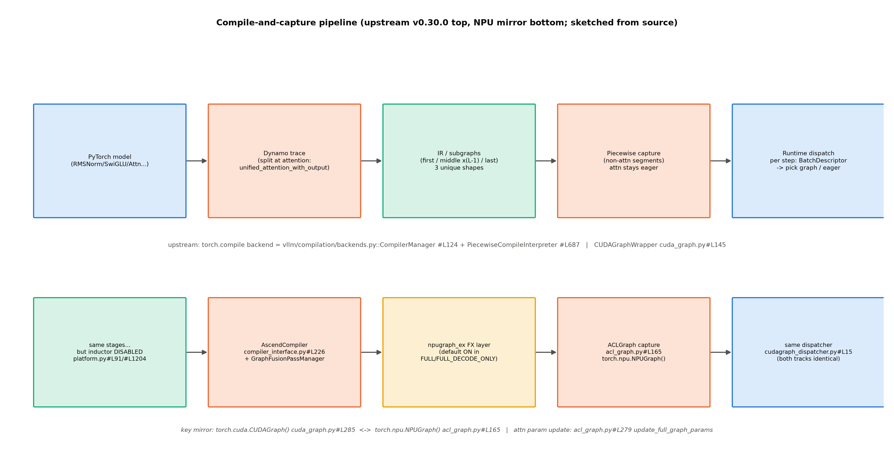
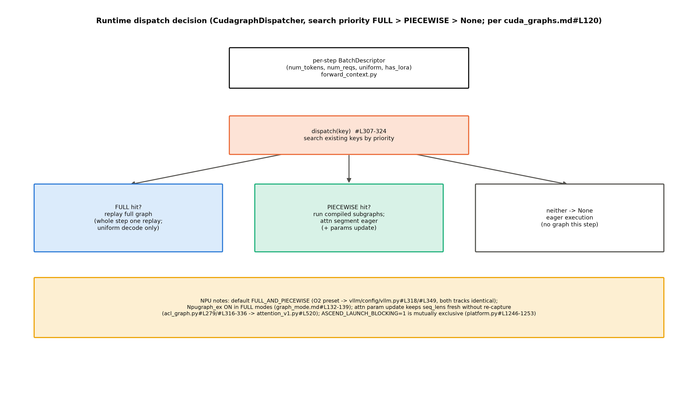

# 第 8 章 编译与执行优化：图执行的正身

## 8.1 承上：发射税的最后一笔账

上一章结束时我们站在站 12 内部——execute_model 组好张量、即将发射前向。Book6 第 12 章在这里埋了本册的图执行欠账：「capture/replay 的源码正身、piecewise 的切分逻辑、NPU 侧 ACLGraph 与 CUDA Graph 的逐项对照（等价性待核验口径）→ Book7 第 8 章」（B6-6）。你在 Book6 已经把原理层讲透了：发射税每算子约 10.6 µs、8 算子链的 0.342→0.030 ms（发射与框架占九成一）、NPUGraph replay 11.4× 的实测（`log/book6-ch12/launch_probe_base.json`）——本章的任务是把那笔账的每一分钱在源码里找到出处。Book6 ch12 的三事实（默认 FULL_AND_PIECEWISE 来自上游继承、breakable opt-in、torch.compile 在 NPU 被禁）在源码层全部已预核。本章的任务是兑现「逐项对照」四个字：**capture/replay 在源码里怎么发生、piecewise 怎么切、NPU 与 CUDA 的镜像差在哪一格**。先回收 Book6 的三件事定个锚（当时的身份是实现对照框内的允许清单——「默认值读数+开关对拍+一句事实句」）：其一，默认档 FULL_AND_PIECEWISE 来自上游继承（本章 8.3 给正身——优化等级预设表）；其二，`VLLM_USE_BREAKABLE_CUDAGRAPH` 是 NPU 侧 opt-in（8.5 给正身——setdefault 反向锁定）；其三，torch.compile 在 NPU 被禁、等价物是 npugraph_ex 的 FX 层（8.5 给正身——`simple_compile_backend="eager"` 那行行内注释）。三件事在三节里各就各位。

> **最小背景栏**：本章直接使用 Book6 ch12 的三件旧资产——CUDA Graph 的 capture/replay 语义（录一次放多次、静态形状约束）、发射税的三段分解（发射/框架/执行）、NPUGraph 11.4× 读数。torch.compile 的 Dynamo/Inductor 分工需要最小补课（8.2 一段自教）。

## 8.2 torch.compile 默认开的世界

V1 的第一个颠覆性默认：「In vLLM's V1 architecture, `torch.compile` is enabled by default and is a critical part of the framework.」【官方设计文档 torch_compile.md#L3】。三十秒补课：`torch.compile` 把 PyTorch 的 eager 执行（每算子逐个发射）换成两步——Dynamo 先把 Python 代码**追踪**成计算图（FX 图），Inductor 再把图**编译**成优化过的算子序列（融合相邻算子、选更快的 kernel）。V1 对这套机制做了两件关键的事。

为什么 V1 敢把这个 2023 年还臭名昭著的「实验性功能」设为默认？因为两条工程纪律兜住了它的两大风险：动态形状风险由三态标记+分派器（dispatcher）兜（UNBACKED 档形状变了退 guard 或走 eager——永不出错只是退速；默认的 BACKED 则是明知故犯的性能取舍——本节末直引）；编译尖刺风险由「服务前编译完毕」兜（L28 的保证）。**「默认开」不是胆大，是把失败模式全部设计成了降级**——这个设计模式值得整体借鉴。

第一件，**在注意力处切图**。注意力算子依赖动态的 seq_lens/block_table——追踪器拿不定它，于是 V1 把它包成一个 custom op（`torch.ops.vllm.unified_attention_with_output`）：

> 「The computation graph is further split into pieces, by the `splitting_ops` (usually this is the attention operation)」【官方设计文档 torch_compile.md#L175】

效果：一张大图被切成**三类唯一子图**——首段、中间段×N、尾段（#L196-200）。注意力段留在图外跑 eager（动态性保住），其余段全进编译——**这就是 piecewise（分段）的字面来源**。

**例 8.1（构造例：4 层模型的切图走查）** 设 Llama 式 4 层（每层一个 attention）、切分点=`unified_attention_with_output`。Dynamo 全图捕获后按切分点切段，子模块序列共 $2L+1=9$ 个：序 0（embedding→第 1 个 attention 前）=**首段**；序 1/3/5/7=**attention 段×4**（图外——动态算子本身）；序 2/4/6（每个 attention 之后的 RMSNorm→MLP→残差）=**中间段×3**——三个中间段**拓扑完全相同**，编译产物只有一份（「唯一子图」的「唯一」就是这个意思——同类段共享编译产物，编译产物从 $O(L)$ 类降到 $O(1)$ 类）；序 8=**尾段**（final norm→lm_head 前的聚合）。尺寸流转一笔：每段输入/输出都是隐藏态 $(1,n,d)$，attention 段内则是 $(1,n,d)$ 的 q/k/v 按 block_table 查页式 KV——形状在段间不变、在段内换轨。效果读法：**12 层的真实模型只有三种编译产物**（首/中/尾各一）——这是「三类唯一子图」设计省下的真金白银（编译时间与编译缓存按类数不按层数计——运行期图捕获的内存另按段数×尺寸表计，8.7 的账单句）。动态形状是编译的天然敌人（批大小每步都变），V1 的应对是三态标记：BACKED（默认——同一段代码只按首次形状编译、其它形状由 guard（守卫）兜住复用）/UNBACKED/BACKED_SIZE_OBLIVIOUS——加上编译缓存目录（`~/.cache/vllm/torch_compile_cache`，hash 覆盖相关配置/PyTorch 配置/模型前向三因子（L20-24））让冷启动也能吃存量（L14-26）。BACKED 做默认是个明知故犯的取舍，官方注释写得坦白：「**BACKED** (default): Use when you're willing to accept potential unsafe dropping of guards for maximal performance. Guard could be unsoundly added and then ignored.」【torch_compile.md#L125-126】——接受「guard 可能被不健全地丢弃」换最大性能；保守的 UNBACKED 则以漏优化为代价。**工程默认值常常不是「安全的那个」，是「两个不完美里更便宜的那个」**——看到默认档先问它的代价表，这是本章反复练的读法。**IR 一瞥**（第 2 章文档地图登记的 vllm_ir.md 在此兑现半页）：切图之后的中间表示是 **vLLM IR**——FX 计算图的函数式方言（`vllm/ir/` 包——「a functional intermediate representation that fills the gap between low-level torch ops and vLLM layers」）；原生 vLLM 算子用 `@register_op` 三合一声明（语义定义+默认实现+测试基准），自定义算子经 `register_impl` 注册多平台实现、按优先级列表选核。本章三处与它握手：切图点本身是个注册过的 custom op（unified_attention）；8.5 的 `GraphFusionPassManager` 是在 IR 层跑的自定义 pass（NPU 的融合走 IR pass 而非 Inductor——替代路线的中间站）；第 10 章将见的注册面同构思想（注册表+懒导入）在这里第二次出现。深讲（算子注册全链）不展开——机制在第 10 章 registration 一节有同型拆解。

第二件，**服务前编译完毕**：

> 「we guarantee all the compilation finishes before we serve any requests. No requests will trigger new compilations. Otherwise, the engine would be blocked on that request, and the response time will have unexpected spikes.」【官方设计文档 torch_compile.md#L28——「意外的响应尖刺」就是编译债的形状】

编译正身的类名（Book6 ch13 移交句「类名就是机制名」的落点）：`vllm/compilation/backends.py::CompilerManager`#L124 与 `PiecewiseCompileInterpreter`#L687——两轨零漂移（运行栈逐字一致，免版本框注）。

把这两件事放进 Book6 的发射税故事里读，管线的因果就活了：eager 执行的每一步，CPU 都要为几十个算子逐个走「Python 调用→框架分发→驱动发射」的长路（Book6 实测每算子约 10.6 µs，8 算子链的 0.342→0.030 ms——发射与框架占九成一，1−0.030/0.342≈91%）；torch.compile 把「Python 调用+框架分发」压成一次编译期决策（融合后的算子序列）；CUDA Graph/ACLGraph 再把「驱动发射」压成一次回放。三层各压一段——**编译买的是算子数、图买的是发射数、分派器管的是哪一步能用这两样**。而这个故事的 NPU 版本有一处换轨：Inductor 不可用，「编译」那段由 npugraph_ex 的 FX 融合顶上——压的账目相同（算子数）、走的路不同（8.5 的对照）。这也是为什么本章实验的判据是「图档对 eager 档的差距在一个数量级内」：11.4× 是 8 算子微链上的纯发射账，引擎级要重新摊上组批/调度/内存的全部开销。

## 8.3 五档模式与运行期分派

编译把算子数压下来之后，哪些批、以哪种图形态吃到这份收益——模式枚举回答这一问。五档（`vllm/config/compilation.py#L53-63`，CUDAGraphMode）：NONE（零图、纯编译或纯 eager）/PIECEWISE（段图——8.2 的默认产物）/FULL（整模型一图、按尺寸对**非均匀批**捕获——uniform decode 批复用同尺寸的非均匀批图，两形态本就兼容；适合小模型/短 prompt 负载）/FULL_DECODE_ONLY（只对 uniform decode 批捕获全图，prefill/混合批走 eager——PD 部署里 decode 侧省显存的选择）/**FULL_AND_PIECEWISE**（FULL+PIECEWISE 双轨并用——uniform decode 走 FULL、其余走 PIECEWISE）。五档不是五个独立开关而是组合代数（`decode_mode` 与 `mixed_mode` 两变量的组合）。默认值的正身是一张预设表：优化等级 O2 → FULL_AND_PIECEWISE（`vllm/config/vllm.py` 的 `OPTIMIZATION_LEVEL_TO_CONFIG`#L349 引 #L318），而 `optimization_level` 默认 O2（#L440）——**默认档是算出来的不是写死的**（换 -O1 就落 PIECEWISE、-O0 全关）。官方对默认档的描述直引：

> 「`FULL_AND_PIECEWISE` — (default mode) full CUDA Graph for uniform decode, piecewise CUDA Graphs for others; generally the most performant setting, especially for low latency with small models or MoEs, but also requires the most memory and takes the longest to capture.」【官方设计文档 cuda_graphs.md#L46】

三组件分工（图 8.1 右端）：`vllm/compilation/cuda_graph.py::CUDAGraphWrapper`（#L145——图的家底管理）+ **`vllm/v1/cudagraph_dispatcher.py::CudagraphDispatcher`**（#L15——docstring 自认「唯一真源」：存 PIECEWISE 与 FULL 两套键表、每步按批形态查表）+ `BatchDescriptor`（`vllm/forward_context.py`——分派键）。键的字段比文档多说一个：五字段 `num_tokens`（padding 后）/`num_reqs`（**None 是 PIECEWISE 的专属宽松值**——段图不关心请求数时用它通配）/`uniform`（纯 decode 或 1+k 的 spec decode 批）/`has_lora`/`num_active_loras`（文档四字段原型之外的第五字段——两版实现都有）——设计文档的 NamedTuple 四字段原型与实现的 dataclass 五字段有一处文档-代码漂移（`cuda_graphs.md#L86-91` 对 `forward_context.py`——又一例「文档会烂」，读代码为准）。

到这里可以立那张「你不动旋钮时你在哪」的配置出生链了——五层 ancestry 从上到下：①`optimization_level` 默认 **O2**（config/vllm.py#L440）→ ②预设表 `OPTIMIZATION_LEVEL_TO_CONFIG`#L349 查 O2 档 → ③注入 `cudagraph_mode=FULL_AND_PIECEWISE`（字段自己的 docstring 写着「(v1 default)」——默认值是算出来的不是写死的）→ ④`--enforce-eager` 总闸一拉全归零——warning 原文「Enforce eager set, disabling torch.compile and CUDAGraphs. This is equivalent to setting -cc.mode=none -cc.cudagraph_mode=none」（#L1546-1552——本册凡 eager 档的起服日志开头都能看到它，实验口径「eager 档」的出处）→ ⑤平台改写层（8.5 的 NPU 三支）。五层读完你会发现：**「默认」在 V1 里是一个五层决策链的终点**——排查「为什么我没走图」要逐层往上问，而不是盯着一个开关。运行期的搜索序一句话钉死：

> 「We basically search the existing keys following the priority: `FULL`>`PIECEWISE`>`None`. If the dispatching key does not exist, default to return `NONE` mode for eager execution.」【官方设计文档 cuda_graphs.md#L120】



图 8.1 编译-捕获-分派管线（按 v0.30.0 源码自绘，示意级）：上排上游五段（模型→Dynamo 切图→IR 三类子图→piecewise 捕获→运行期分派）；下排 NPU 镜像（inductor 禁、AscendCompiler、npugraph_ex、ACLGraph、同一分派器）。

**例 8.2（构造例：同批三种形态各走到哪张图）** 设 `cudagraph_capture_sizes=[1,2,4,8]`（max=8）、无投机无 LoRA、模式 FULL_AND_PIECEWISE。padding 查表（round-up 到下一桶）：bs 3→4、5→8、7→8。同样 8 个 token，三种批形态走三条路：

| 形态 | dispatch 输入 | padded 键 | 查钥匙结果 | 走哪张图 |
|---|---|---|---|---|
| (a) 8 条请求各 decode 1 token | num_tokens=8, uniform=True | (8, num_reqs=8, ∪) | FULL 精确键命中 | 整模型 FULL 图一次回放 |
| (b) 1 条 5-token chunk+1 条 3-token 续算 | num_tokens=8, uniform=False | 宽松化 (8, None, ¬∪) | FULL miss→PIECEWISE 宽松键命中 | 段图回放+attention eager |
| (c) 9 token 混合批 | num_tokens=9 | — | 9>max=8 早退 | NONE：全程 eager |

四点读法：**分派键不是 token 数、是批的形状描述**（同样 8 token 走不同图）；**PIECEWISE 宽松键的抹平动作**（分派树全貌见图 8.2）（num_reqs=None——「段图不关心几条请求、只关心几个 token」的代码化身，BatchDescriptor docstring 自证）；**超桶即回 eager**（Book6「凑桶」与「找不到回 eager」两句在引擎里对上）；**spec 延伸一行**（query_len 变 1+k 时 uniform 批的 num_reqs=num_tokens/(1+k)——第 7 章实验③的 512 表尾就是这么撑大的）。



图 8.2 运行期分派决策树（按 cuda_graphs.md#L120 与 dispatcher 源码自绘，示意级）：BatchDescriptor 成键（图内画的是设计文档的四字段原型；实现为五字段——num_active_loras 是文档原型外的第五字段，见 8.3 漂移注），按 FULL>PIECEWISE>None 搜索；底部黄框为 NPU 三条注记（默认档同构/npugraph_ex 开关/互斥项）。

## 8.4 piecewise 的切分正身

「attention 留 eager 的为什么」——设计文档的回答值得整句引：

> 「by running the attention operation in eager mode while the rest operations in cudagraph, we keep the flexibility of the attention operation.」【官方设计文档 torch_compile.md#L244】

用人话说：注意力是全链路唯一「每步形状都可能在变」的算子（seq_lens 长则数百、短则 1，block_table 每步指向不同的块）——把它关在图外，图的其余部分就能享受纯静态的折扣。但「变长怎么进 FULL 图」有两条工程路线，值得对照着记：**上游把变长吸收进后端**——FA3 走统一的变长例程（表格里标 ALWAYS），FA2 的标注更诚实（「Actually ALWAYS but workaround to fallback … for performance reason」cuda_graphs.md#L179——全图未必更快，先绕开）；**NPU 用参数更新把变长写回图内**——下面这条 handle 链。两条路线的共同底线：**重录图都是最后手段**；分歧在变长住图内（省发射）还是图外（省改写）——目标硬件的发射成本不同，答案就不同，不必判唯一优劣。Book6 ch12 点名过「ACLGraph 对变长的处理用 attention 参数更新机制」（当时是名词级）——正身链在这：`update_full_graph_params`（`vllm_ascend/compilation/acl_graph.py#L279`）→ `GraphParams`/`set_graph_params`（#L316-336）→ `AscendAttentionBackendImpl.update_graph_params`（`attention_v1.py#L520`）——**图不重录，把 seq_lens/block_table 等参数在回放前写进图的输入地址**（捕获期记下的 `input_addresses`，acl_graph.py#L163-165 一带）。这就是「参数原地改、图不重录」八个字的源码。整条链值得念一遍三件套的名字：`NPUTaskGroupHandle`（算子任务组句柄）+ `update_stream`（旁路更新流）+ `events`（同步事件）——**回放之前，把 seq_lens/block_table 的新值经旁路流写进捕获期记下的固定地址，事件保证写在放之前**。对照第 7 章的 `new_block_ids_to_zero`：块表内容变了图不重录，靠的正是这条更新链。它与第 6 章 CoW 的拷贝对是同一设计哲学的两次出场：**账本（块号/参数）可以随时变，贵的东西（图的录制/KV 数据）不跟着重做——用一次廉价的写换一次昂贵的重录/搬运**。

## 8.5 ACLGraph 等价性对照：一对镜像

本章正菜。先看最冲击的一对——两边捕获调用的**镜面**：

```python
            entry.input_addresses = input_addresses
            cudagraph = torch.cuda.CUDAGraph()
```
【源码：`vllm/compilation/cuda_graph.py#L284-285`，阅读锚 v0.30.0】

```python
            input_addresses = [x.data_ptr() for x in args if isinstance(x, torch.Tensor)]
            entry.input_addresses = input_addresses
            aclgraph = torch.npu.NPUGraph()
```
【源码：`vllm_ascend/compilation/acl_graph.py#L163-165`，运行栈 vllm-ascend 0.27.1rc1】看什么：**逐字级的镜像**——同一套「记输入地址→建图对象」的骨架，只换了 `torch.cuda.CUDAGraph()` 为 `torch.npu.NPUGraph()`（Book6 已验过的接口同构性：capture 上下文管理器/graph_pool/replay 方法）。`ACLGraphWrapper`（acl_graph.py#L60）在上游 `CUDAGraphWrapper` 之上加了三件 NPU 工程量：**异常翻译**（#L203-220——ACL 错误码翻成可读消息，NPU 编号的报错不再是不透明数字）、**replay 同步纪律**（#L248-265——回放前显式同步：synchronize 落在 replay 之前（注释自证「we must call synchronize here before replaying」），使参数更新严格落在两次回放之间——Book6 launch_probe 的 `synchronize` 用法在引擎侧的形态）、**回放日志**（#L252「Replaying aclgraph」——INFO 级、每进程一次的回放确认行：最低成本确认「走的是图回放」；逐次观测用 #L159 的 DEBUG 捕获行与 ch12 工具）。三件都不改变语义、只做适配——「镜像+适配层」是读平台插件代码的标准姿势（第 7 章 v2/ 目录的同款结论）。wrapper 的装配两侧也对仗（MRV1 路径：上游 `gpu_model_runner.py#L5455-5490` 对 vllm-ascend `model_runner_v1.py#L4122-4143`）。

**平台在图模式上真正做的三件事**（第 6 章立过的框架，这里给全行锚与原文）。其一，**opt-in 反向锁定**：

```python
# Keep Breakable CUDAGraph opt-in on Ascend. Upstream may auto-enable it
# for selected architectures when the environment variable is absent.
value = os.environ.setdefault("VLLM_USE_BREAKABLE_CUDAGRAPH", "0")
logger.info_once(
    "Breakable CUDAGraph on Ascend is opt-in; using VLLM_USE_BREAKABLE_CUDAGRAPH=%s.",
    value,
    scope="process",
)
```
【源码：`vllm_ascend/platform.py#L67-74`，运行栈 vllm-ascend 0.27.1rc1——Book6 实物 12.2 所引日志的打印者】看什么：注释把动机说明白了——上游可能为部分架构自动开启，NPU 在环境变量缺席时**反向锁定为 0**（「Breakable」图=可中途打断重编译的实验性图，NPU 栈不支持其打断语义——宁关勿错）。其二，**模式分派**（#L1205-1240 四支：NONE 直过/守卫断言/ACLGraph 捕放/不支持的组合回落 NONE 并告警），守卫断言值得看原文：

```python
    elif compilation_config.cudagraph_mode.requires_piecewise_compilation():
        # Our is_cuda_alike is False so we cannot reuse the assertion of upstream
        if compilation_config.mode != CompilationMode.VLLM_COMPILE and not envs_vllm.VLLM_USE_BREAKABLE_CUDAGRAPH:
            raise AssertionError(
                "Compilation mode should be CompilationMode.VLLM_COMPILE "
                "when cudagraph_mode piecewise cudagraphs is used, "
                "cudagraph_mode=%s",
                compilation_config.cudagraph_mode,
            )
```
【源码：`vllm_ascend/platform.py#L1209-1217`，运行栈 vllm-ascend 0.27.1rc1】看什么：注释自己承认了移植的痛——上游的断言依赖 `is_cuda_alike`，NPU 不能复用只好自己写；**fail-fast 而非静默降级**，是平台边界哲学的代码化身（配错了组合，启动即炸并告诉你为什么——比跑起来再出幺蛾子体面得多）。这与上游的处理风格正好构成一组对照——上游对「后端不支持的模式」走自动降档：「We automatically "downgrade" modes to the closest supported mode.」【cuda_graphs.md#L57-58——比如后端只支持 uniform decode 时 FULL 自动转 FULL_AND_PIECEWISE】；vllm-ascend 则对**编译前提**选 raise、对**执行偏好**才降级（enc-dec 的 logger.info_once 温和回落）——**守卫管前提、降级管偏好，两种工具各司其职**。争论的内核是平台对不确定组合该「拒绝服务」还是「猜你想要什么」：NPU 生态小、可诊断性贵，选拒绝；上游生态大、可用性贵，选猜——两种都对，各自服务各自的用户分布。其三，**特例改写**——enc-dec 模型只保 PIECEWISE（#L1133-1148，注释「Encoder-decoder models currently only support PIECEWISE mode」）、`ASCEND_LAUNCH_BLOCKING=1` 与图模式互斥（#L1246-1253——同步发射调试模式与图回放的时序假设不相容，报错文案同时指路 plog 排查）。

**npugraph_ex 一段**（Book6 ch12 那半句「torch.compile 在昇腾被禁——编译优化的等价物是 npugraph_ex 的 FX 层」的机制落点）：torch.compile 的 Inductor 后端在 NPU 不可用（`platform.py#L91` `simple_compile_backend="eager"`——行内注释就是「Disable torch.compile()」——加 #L1204 `use_inductor=False`），替代品是 **npugraph_ex**——FX 层的图融合执行器，与 `GraphFusionPassManager`（graph_fusion_pass_manager.py#L24-30 的 counterpart docstring）配套；编译入口是 `AscendCompiler`（`compiler_interface.py#L226`，#L283-301 的双路编译——与上游 `CompilerManager` 的角色对仗）。融合收益的官方口径在 graph_mode.md#L124：收益主要来自多算子融一（add+rms_norm 融成 npu_add_rms_norm 单 kernel）、以省发射——与 npugraph_ex 的启用档位（L132-139）是两件事。默认开关的官方声明：「Npugraph_ex is **enabled by default** when `cudagraph_mode` is `FULL` or `FULL_DECODE_ONLY`. It is automatically disabled in `PIECEWISE` or `NONE` modes.」【graph_mode.md#L132-139】——注意一个易错点：**默认档 FULL_AND_PIECEWISE 并不在启用列**（`platform.py#L1233` 在 piecewise 分支显式置 npugraph_ex 为 False——走 piecewise 编译+fusion pass 路径）；要吃到 npugraph_ex 需显式 `-cc.cudagraph_mode FULL`。默认档正身的官方一句：「FULL_AND_PIECEWISE: Default mode, **same as the upstream vLLM strategy**.」（graph_mode.md#L35——「same as upstream」四个字就是「平台插件不改默认」的直接证据）。

> **【考据框】「平台插件不改默认、只改边界」的完整版。**第 6 章（块 128 覆写）与第 7 章（runner 判据 patch）各出现过一次要打脚注的张力。三例合起来给这个判断力的诚实版本：平台插件不改**行为语义**的默认（图模式五档语义与上游逐字一致），但要改**执行判据**的默认（块大小锁定 128、V2 runner 收紧为 opt-in）与**边界条件**（breakable 锁死、守卫自写、互斥项）。判别法：问「同一配置在 CUDA 与 NPU 上语义相同吗」——同，则是不改默认；不同，多半是边界或判据。这个判断力第 10 章（量化白名单）与第 11 章（patch 清单）还要用两次。

## 8.6 CUDA 专属项清单

正菜吃完，收一张能力边界表（表 8.1）：哪些实验本机做不了、拿什么代替——写作要求 12 的落地示范：

表 8.1 CUDA 专属项与替代口径对照（本章的不可做/可做清单）

| 项 | 本机可做？ | 替代口径 |
|---|---|---|
| CUDA 原生 capture/replay 实操 | 否（无 CUDA） | NPUGraph 同构接口（Book6 launch_probe 11.4×） |
| Inductor 编译产物检视 | 否（NPU 禁） | npugraph_ex 的 FX 层（graph_fusion_pass_manager） |
| cascade attention 的图行为 | 否 | 源码阅读（attention_backends.md 分段策略） |
| TP>4 图模式同步边界 | 否（单卡） | Book8 第 6 章（云 GPU 选做） |
| 图尺寸表观测 | **是** | 第 7 章实验③已做（35/51 档两表） |
| ACLGraph vs eager 对拍 | **是** | 本章实验 |
| 捕获日志逐条 | **是** | DEBUG 级「Capturing a aclgraph on (…)」（acl_graph.py#L159） |

替代口径的证据等级照规范标——NPUGraph 读数标「本机实测」、源码推演标「阅读锚」、Book8 选做标地址。这张表本身就是教学件：**工程书里「不能做」永远要跟一句「拿什么代替」**。

本章实验（`code/ch08/exp_aclgraph.py`，Qwen3-0.6B 两臂、`vllm bench latency` 同参数）：默认档（FULL_AND_PIECEWISE+图捕获）对 `--enforce-eager`（全 eager、零捕获）。预注册判据：图档稳态延迟显著低于 eager 档；启动时间高于 eager 档（捕获成本）。**读数**【本机实测，Atlas 910B3，`log/book7-ch08/aclgraph_summary.json`】：整批 64-token 生成均值——图档 **0.657 s** 对 eager 档 **4.045 s**，**比值 6.15×**（图档快）；启动墙钟 95.6 s 对 88.0 s（+7.6 s——捕获的价签）。两个判据都兑现。顺带把第 4 章图 4.2 那条空条带填实：graph 档的捕获段日志行——「Graph capturing finished in 11 secs, took 0.42 GiB」（`log/book7-ch07/serve_default.log`——ch07 实验③的默认档起服日志，同一台机器同一模型）。第一档读数值得郑重解读：Book6 的 NPUGraph 11.4× 是 8 算子微链上的纯发射账，引擎级的 6.15× 说明**在这台机器的这个 workload 上，发射与框架开销占了整步延迟的 84%**（$1-1/6.15$）——图执行在引擎级兑现了 kernel 链级收益的大半（组批/调度/内存的开销摊薄后仍留住了 6 倍档）。这正是默认档敢叫「generally the most performant setting」的物理底气；也顺带解释了为什么 `--enforce-eager` 在调试之外几乎不该出现在生产配置里。

## 8.7 本章小结

回到 Book6 的欠账四件套，逐件销项：**capture/replay 正身**——`CUDAGraphWrapper`/`ACLGraphWrapper` 的镜面对（torch.cuda.CUDAGraph()↔torch.npu.NPUGraph()，input_addresses 同记）；**piecewise 切分逻辑**——attention 处切图成三类子图（splitting_ops 机制）、attention 段留 eager 保动态（torch_compile.md#L244）、参数更新机制让全图不重录（`update_graph_params` 链）；**NPU 对照**——三件事（opt-in 锁定/模式分派/特例改写）+npugraph_ex 的 FX 层替代 Inductor + 默认档「same as upstream」；**等价性**——接口逐字镜像+行为语义同构（三例张力打完脚注后的完整判断力）。本章还添了两件方法论收获：配置出生链五层（「默认」是一条决策链的终点，排查要逐层问）与 BACKED 默认的代价表（工程默认值=两个不完美里更便宜的那个）。Book6 的发射税账本至此全部兑现：11.4× 是这条管线在 kernel 链上的产出，引擎级的兑现度由本章实验丈量（B6-6 的最后一笔）。还有一条 Book6 的伏线在此收口：「静态是折扣、动态是税」——本章给了它源码级的完整对应：**静态性是逐批判定的**（例 8.2 的三形态三路）、**动态性有一扇参数更新的活门**（8.4 的 handle 链）、**折扣的账单是显存与启动时间**（捕获量按尺寸表线性涨——第 7 章实验③的 84 s→159 s）。

**带走的心智**是两句话。**其一，「编译买静态、图买回放、分派买兼容」**：三件套各买各的——compile 消融合开销（算子数变少）、graph 消发射开销（发射数变一）、dispatcher 让动态批形态仍能吃到前两样（每步查表选路）；读任何执行优化，先问它买的是哪一样、付的静态性是什么、降级路径长什么样。本章的实验给了三样东西的合订价目：eager 档 4.0 s 是「三样全不买」的价，图档 0.66 s 是「三样都买」的价——中间没有「只买编译不买图」的档（NPU 上 Inductor 禁用，上游有 -O1 档近似它），6.15× 是这台机器上动态性的全部税单。**其二，「attention 是图世界的活口」**：全链路唯一动态算子被切在图外，靠参数更新机制与图共处——记住这个例外，就记住了整条管线的形状。

zoom out 回全书：前向的执行形态（eager/编译/图回放）至此讲完，但前向里最重的那个算子——注意力本身——还是黑盒。下一章（第 9 章）把 `unified_attention` 这个 custom op 拆开：后端注册表怎么按模型架构自动选实现。

**动手验证**（Atlas 910B3；选卡纪律照 CLAUDE.md）：
① `sed -n '283,286p' repos/vllm/vllm/compilation/cuda_graph.py && sed -n '163,166p' repos/vllm-ascend/vllm_ascend/compilation/acl_graph.py`——镜面对并排亲眼确认（只差 cuda/npu 四个字母）；
② `sed -n '67,74p' repos/vllm-ascend/vllm_ascend/platform.py`——opt-in 锁定的原文（你每次起 NPU 引擎看到的那行日志就是它打的）；
③ `source env.sh && ASCEND_RT_VISIBLE_DEVICES=<卡> python code/ch08/exp_aclgraph.py`——对拍实验复跑：验收行=graph 臂 avg_latency≈0.66 s、eager 臂≈4.0 s、ratio≈6.1（引擎级兑现度）；启动差 +7.6 s（捕获价签）。

> **【欠账】** ubatching/dual-batch overlap（调度与计算的正交重叠线）→ Book8 第 5 章；多卡图模式的同步边界 → Book8 第 6 章。
