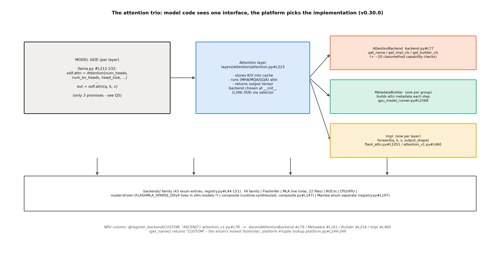
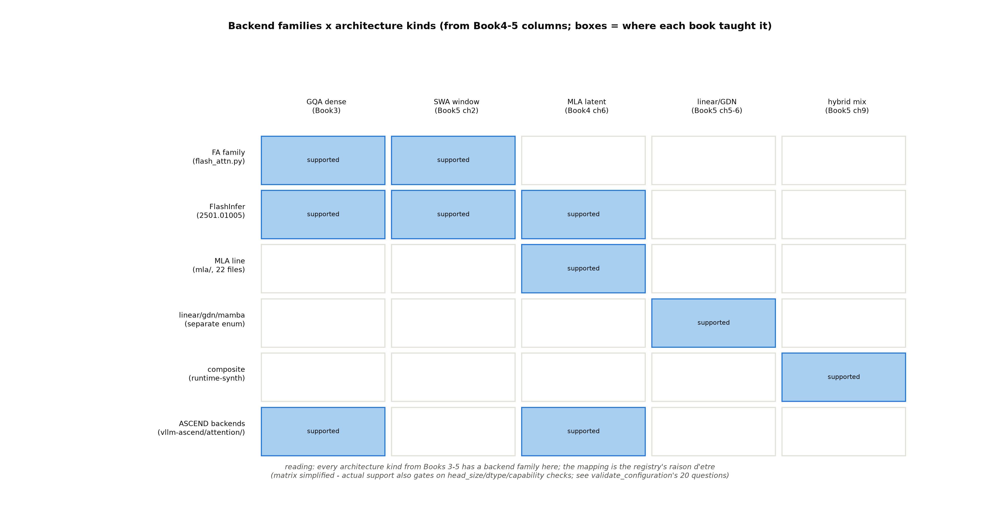

# 第 9 章 Attention 后端体系：一个接口，四十余种实现

## 9.1 三线汇流

第 8 章结束时我们说「前向里最重的算子——注意力——还是黑盒」；本章开箱。而且是三笔旧账的交汇处：**Book4 第 6 章**的 MLA 箱子（章末欠账：「箱子在推理引擎里的落地读取（吸收形态的后端实现）是工程正菜，→ Book7 第 9 章」）；**Book5 第 5 章**的 GDN/线性族（欠账：「→ Book7 第 9 章」）；**Book6 第 8 章**的 kernel 谱系（章末欠账：「attention 后端体系（registry 自动选择、FA/FlashInfer/MLA 系/linear 后端与 Book4-5 架构的一一对应）→ Book7 第 9 章」——另有一句请柬：「寄存器级分块、算子融合、warp 编排——隔着玻璃看到的每一件，都将在 Book7 的源码里拆开」）。三条线各要一个点名到类的落点，本章逐一交割。生命周期的坐标：仍在站 12 内部、`unified_attention` 这个 custom op 的内部——第 8 章把它包在图外（切图的活口），本章拆它自己。这个 op 的调用位置值得先钉住：模型代码里的 `self.attn(q, k, v)`（9.2 的契约）在编译世界里变成 `torch.ops.vllm.unified_attention_with_output`（第 8 章 splitting_ops 的切分点）——**模型侧的三个承诺、编译侧的一个算子、平台侧的四十余种实现，是同一个东西的三张脸**。本章按顺序拆后两张。

> **最小背景栏**：本章需要 Book4 的 MLA 两形态（吸收前/吸收后的数学——式 (6.11)/(6.12)）、Book5 的线性注意力与 GDN（状态型注意力不做 KV cache）、Book6 的 online softmax 与分块（第 8 章的算法底座）。架构侧的知识全部指回，本章只讲「引擎怎么认出并伺候这些架构」。

## 9.2 三件套：接口即契约

整个后端体系的解耦靠三个角色（图 9.1）。基类 `AttentionBackend` 只强制三个静态方法——身份证、执行器厂、账本厂：

```python
    @abstractmethod
    def get_name() -> str:
        raise NotImplementedError

    @staticmethod
    @abstractmethod
    def get_impl_cls() -> type["AttentionImplBase"]:
        raise NotImplementedError

    @staticmethod
    @abstractmethod
    def get_builder_cls():  # -> Type["AttentionMetadataBuilder"]:
        raise NotImplementedError
```
【源码：`vllm/v1/attention/backend.py::AttentionBackend`#L77-90，阅读锚 v0.30.0】看什么：后端的最小自白——你叫什么（get_name）、你拿什么执行（Impl 类）、你拿什么建每步的注意力元数据（Builder 类）。模型侧则只认一份三句契约——`Attention` 层的 docstring：

> 「1. Store the input key and value tensors in the KV cache. 2. Perform (multi-head/multi-query/grouped-query) attention. 3. Return the output tensor.」【源码：`vllm/model_executor/layers/attention/attention.py#L228-234`，阅读锚 v0.30.0】

llama.py 里模型作者的用法就两行：构造 `self.attn = Attention(num_heads, num_kv_heads, head_size, ...)`、调用 `out = self.attn(q, k, v)`（#L212-232 一带）——**后端选择完全藏在构造期**（attention.py#L346-359 调 selector）。第三件套的写权账：**Impl 每层一份**（attention.py#L416）、**Builder 每组一份**（`gpu_model_runner.py#L7143-7151` 初始化 KV 时取、#L2568 每步 build）。三方法之外，基类还挂着约 20 个能力检查 classmethod（`supports_head_size`/`supports_dtype`/`supports_block_size`/…，L96-273）——9.3 的体检表就是逐个调它们。这个分法与第 6 章的五层结构同构——账本（元数据）每步重建、执行器（算子状态）长驻；与第 8 章的对照也现成：BatchDescriptor 是「每步每批」的键，后端选择是「每配置一次」的键——**引擎里有三层粒度的选择**（进程拓扑配置期/后端启动期/图模式每步），一次比一次细。跨后端同构的最后一块拼图是 forward 签名——两块原文并排（上游 FA 对 NPU 主后端）：

```python
    def forward(
        self,
        layer: torch.nn.Module,
        query: torch.Tensor,
        key: torch.Tensor,
        value: torch.Tensor,
        kv_cache: torch.Tensor,
        attn_metadata: FlashAttentionMetadata,
        output: torch.Tensor,
        output_scale: torch.Tensor | None = None,
```
【源码：`vllm/v1/attention/backends/flash_attn.py::FlashAttentionImpl.forward`#L1166-1175，阅读锚 v0.30.0】

```python
    def forward(
        self,
        layer: AttentionLayer,
        query: torch.Tensor,
        key: torch.Tensor,
        value: torch.Tensor,
        kv_cache: tuple[torch.Tensor],
        attn_metadata: AscendMetadata,
        output: torch.Tensor | None = None,
        output_scale: torch.Tensor | None = None,
```
【源码：`vllm_ascend/attention/attention_v1.py::AscendAttentionBackendImpl.forward`#L1705-1714，运行栈 vllm-ascend 0.27.1rc1】看什么：**参数表逐位同构**（layer/query/key/value/kv_cache/attn_metadata/output/output_scale）——差只有类型标注（`torch.nn.Module` 对 `AttentionLayer`、`FlashAttentionMetadata` 对 `AscendMetadata`——后者正是各自的三件套第②件）。**换了后端，模型代码一行不改**不是口号，是签名层的纪律。



图 9.1 三件套接口（按 v0.30.0 源码自绘，示意级）：模型侧只认 Attention 层的三句契约；平台侧 AttentionBackend 三方法+约 20 个能力检查（supports_* classmethod）；底部后端族谱（43 枚举项+独立 Mamba 枚举）与 NPU 列。

三件套什么时候被谁调用？把一条 token 穿越后端的完整调用链走一遍（207M/GQA 在 NPU 运行栈），三件套的「出场时机」就立体了。**启动期**：NPUWorker 装模型时每层构造 `Attention(...)` → get_attn_backend 转交平台 → 查表返回 `"vllm_ascend.attention.attention_v1.AscendAttentionBackend"` → resolve 成类 → 层内挂上 `impl = AscendAttentionBackendImpl(num_heads=16, head_size=64, …)`——**Impl 每层一份**在这出生。**KV 初始化期**：worker 的 `get_kv_cache_spec` 问后端要形状（五维那笔账——运行栈 worker.py#L994→ EngineCore 算 num_blocks → runner 初始化 KV 时取 builder_cls（阅读锚 gpu_model_runner.py#L7143-7151 的同构位）→ `AscendAttentionMetadataBuilder` 挂上——**Builder 每组一份**在这出生。**每步**：scheduler 出 SchedulerOutput → runner 组公共注意力元数据（query_start_loc/seq_lens/block_table/slot_mapping）→ `builder.build(...)` 产出本步的 `AscendMetadata`（五态分类+掩码）→ 模型前向 `self.attn(q,k,v)` → `impl.forward`：先 reshape_and_cache 把新 KV 按 slot_mapping 散射进块（**第 6 章的块表在这里被消费**）→ forward_impl 进 npu_fused_infer_attention_score（下称 FIA）等 CANN 算子 → 输出 `[num_tokens, num_heads*head_size]` 回残差流。收束读法：**一条请求的每个 token 在站 12 的全部工作，就是一次「按表取块+按掩码加权」**——三个阶段（启动/KV 初始化/每步）各造一件套、每步只重复第三件。

## 9.3 registry：自动选择怎么发生

选择入口是 `selector.py::get_attn_backend`#L104——签名收 11 个参数（head_size/dtype/kv_cache_dtype/use_mla/use_sparse/use_mm_prefix/has_sink/…），内部三步：组装组配置（#L155-177 的 18 字段 AttentionSelectorConfig（这个 18 属 selector 的配置问卷，与体检 20 问是两回事））→**委托当前平台**（#L208-212——selector 自己不排优先级，只做转交）→解析 qualname（类的全限定名）成类返回。`@cache` 装饰（#L200）保证同一配置全进程只解析一次——**选择是启动期一次性决策**。

上游 CUDA 平台的选择逻辑文档四步定调：「1. vLLM iterates through backends in **priority order** … 3. The **first compatible backend** is selected 4. If no backend is compatible, an error is raised listing all backends and their incompatibility reasons」【attention_backends.md#L129-133】。这份文档本身还有一层元知识：它的优先级表和特性矩阵**是脚本自动生成的**——「The priority and feature tables on this page are auto-generated from the attention backend registry by `docs/mkdocs/gen_files/generate_attention_backends.py`, based on the checks in `AttentionBackend.validate_configuration()`.」【attention_backends.md#L3-6】——文档=代码的投影在这是字面意义（表格由生成器从 registry 与 validate 检查直接产出，人只写叙述段），与第 2 章「手写文档的行锚会腐烂」互为正反面：**自动生成的表不会腐烂，手写的叙述会**。另一个结构事实要修正直觉：**优先级表不住在 registry、住在平台层**（`platforms/cuda.py#L83` 的 `_get_backend_priorities`（两列优先级在 #L155-179）——Blackwell 一列、Hopper/Ada 一列，每列自排序）——文档把它与注册表并置印在一起，读来像全局属性；投影源=平台层+各后端的 validate。兼容性判定是那 20 问体检（`validate_configuration`#L274-363——head_size/dtype/block_size/mla/sparse/sliding-window/…逐项 20 项+supports_combination 兜底；「18」是另一处的 config 字段数，别混）。

NPU 给出第三种答案——**精确查表**（无优先级迭代）：

```python
        backend_map = {
            (True, False, False): "vllm_ascend.attention.mla_v1.AscendMLABackend",
            (False, False, False): "vllm_ascend.attention.attention_v1.AscendAttentionBackend",
            (True, True, False): "vllm_ascend.attention.sfa_v1.AscendSFABackend",
            (True, False, True): "vllm_ascend.attention.dsa_v1.AscendDSABackend",
        }
```
【源码：`vllm_ascend/platform.py::NPUPlatform.get_attn_backend_cls`#L244-249，运行栈 vllm-ascend 0.27.1rc1】看什么：键是 `(use_mla, use_sparse, use_compress)` 三元组——**四个键、四个后端、零迭代零校验**；缺键直接 KeyError（本章实验①的负例臂实测：`KeyError: (False, True, False)`——非 MLA+稀疏在 NPU 无后端，报错形态如实抄录）。三种答案对照成一组工程文化笔记：上游「迭代取首+全灭报全清单」（友善）、CUDA 平台层排优先级（灵活）、NPU 查表即炸（严格）——「宁可难懂不可错跑」与「报错要能自学」的取舍。

**例 9.1（构造例：一次自动选择的走查）** 输入 head_size=128/dtype=bf16/block_size=None/use_mla=False/设备 SM90（Hopper）。①优先级列=[FLASH_ATTN, FLASHINFER, TRITON_ATTN, FLEX_ATTENTION, …]（cuda.py#L168-176）；②逐项体检：FLASH_ATTN 的 20 问全过（未覆写 get_supported_head_sizes——空表=不设限，head_size=128 直接过；dtype 表含 bf16…）；③**首个兼容者**=FLASH_ATTN → 选中，日志打格式串「Using %s attention backend out of potential backends: %s.」（#L538-545——候选列表实参在 #L541-545 拼成 ['A', 'B'] 形态）。负例：use_sparse=True 且 use_mla=False——MLA 系报「non-MLA not supported」、非 MLA 系报「sparse not supported」（backend.py#L309-320 双向检查）→ 全灭 → ValueError **列出每个后端的拒绝理由**（#L501-506——报错即自学材料）。效果读法：自动选择=「按平台列队体检、取首个全过者」；手动选择（`--attention-backend FLASH_ATTN`）=「指定者单独体检、不过即 ValueError 带具体原因」（cuda.py#L460-479）。

**例 9.2（构造例：NPU 三元组查表走查）** 四组配置各查到哪：Qwen3 型 `(use_mla=F, use_sparse=F, use_compress=F)`→`(F,F,F)`→**attention_v1**（常规 GQA）；DSV3 型 `(T,F,F)`→**mla_v1**；DSV4 型 `(T,F,T)`→**dsa_v1**；K3 sparse 型 `(T,T,F)`→**sfa_v1**。第五组 `(F,T,F)`（非 MLA+稀疏）→ 表里没有这个键 → **KeyError**——不报「不支持稀疏」只报三元组本身（实验① C 臂实测原文）。效果读法：查表的「户口本」就四格，引擎的注意力形态分类学（KV 型/潜向量型/稀疏型/压缩型）浓缩在三个布尔里。诚实边界一句：主线四格之外，这个选择函数还有三道岔——FA3 训练一致性分支（rl_config 门控命中即返回 fa3_v1——9.4 族谱里它的入选门）、310P 兼容族的回退表（COMPATIBILITY 档）、PCP 专用表（#L261 起）——「查表精确」指的是主路径零迭代零校验，岔路各有自己的门（与 PCP/DCP 互斥那行守卫同族）。

本章实验①（`code/ch09/exp_backend_probe.py`——不起引擎的秒级探针）：A 臂（常规 GQA）→ `vllm_ascend.attention.attention_v1.AscendAttentionBackend`；B 臂（use_mla=True）→ `mla_v1.AscendMLABackend`；C 臂（use_sparse=True 负例）→ `KeyError: (False, True, False)`【本机实测，`log/book7-ch09/backend_probe.json`】。探针的写法本身值得一句：直接调平台查表绕过 selector 的懒导入链（纯 CPU 进程里 device_op 有环形导入坑）——**「selector 最终委托平台查表」这条链的代码事实**在探针的构造过程中又验了一遍。

## 9.4 后端族×架构：一一对应的家谱

把 43 项枚举按家族聚类（图 9.2），与 Book4-5 的架构列一一对应——**「每代架构都有一个点名到类的后端」**（Book6 移交句）：GQA 稠密模型→FA 族/FlashInfer；SWA 窗口（Book5 ch2）→FA/FlashInfer（滑窗参数支持）；MLA 潜向量（Book4 ch6）→mla/ 子目录 23 个文件（FLASHMLA/CUTLASS_MLA/TRITON_MLA/AMX_MLA…）；线性/GDN/Mamba（Book5 ch5-6）→**独立枚举** `MambaAttentionBackendEnum`（registry.py#L197-214：MAMBA1/MAMBA2/SHORT_CONV/LINEAR/GDN_ATTN）——「状态型注意力不走主枚举」本身就是「状态型≠KV 型」的注册级证据（与第 6 章 hybrid 总览的 KVCacheSpec 分型互证）；混合架构→**composite**（composite.py#L147 的 `create_composite_attention_backend` 在**函数体内定义并返回新类**——运行时合成：`create(general, causal, routing_policy)` 收两个现成后端加一条路由规则，产出一个新类；实例 TRITON_FLASHINFER=Triton 路径（图像 mask 通用路）+FlashInfer 路径（causal 路）按 metadata 的 `mm_prefix` 标志分流——triton_flashinfer.py#L12-22 的路由器就是这个 policy）。合成的意义：**新组合不需要新 kernel，只需要新路由**——Book5 的混合架构（滑窗+全局交替）在引擎侧的成本因此是「查两次表+一次分流」，不是「等一个专用后端问世」。



图 9.2 后端族×架构种类矩阵（按 v0.30.0 registry 自绘，简化示意级）：Book3-5 的每类架构在本行都有落点；深蓝=支持——实际支持还受 20 问体检（validate_configuration）门控。FlashInfer 论文（2501.01005，CC BY-SA）标禁改绘。

族谱的几张「户口页」值得翻看。**FlashInfer 族**（2501.01005——MLSys 2025 最佳论文；CC BY-SA 4.0 license：**原图禁改绘**，直引或完全自绘）是「注意力引擎库化」的代表——一套 kernel 服务多种解码形态；**Triton attention kernel**（2511.11581）代表另一条路——用 Triton DSL 写可移植 kernel 换掉手写 CUDA（IBM 的深潜博文是它的叙事档）；**FA 族的版本门**是 fa_utils.py#L74-220 的 `get_flash_attn_version`（SM100→FA4、SM90→FA3、否则 FA2——文档口径「Default is FA4 on SM100+ (Blackwell), FA3 on SM90 (Hopper), FA2 otherwise」与代码互证）。族谱的读法提示：**枚举名≈论文/项目名**（FLASH_ATTN/FLASHINFER/TRITON_ATTN…），所以这张表同时是一份社区地图——每个名字背后是一支 kernel 团队，vLLM 的后端体系本质上是**把社区 kernel 装进统一契约**的集成工程。NPU 族谱的七个正身文件（`vllm_ascend/attention/`：attention_v1/mla_v1/sfa_v1/dsa_v1/fa3_v1/indexer/sparse_flash_mla——另有 attention_mask/utils 等辅助件（sfa_kv_offload 一件属 kv offload 专题→Book8 第 9 章）），接入用的正是第 2 章三级链见过的注册装饰器：`@register_backend(AttentionBackendEnum.CUSTOM, "ASCEND")`（attention_v1.py#L78）——注册表条目也能住进模型包（FLASHMLA_SPARSE_DSV4 指向 `vllm.models.deepseek_v4.*`，registry.py#L96-106）——**注册表是开放的**，这正是第 10 章大项目 A 路的先例。

## 9.5 MLA 后端：吸收形态的读取（阅读面）

Book4 教的吸收数学（式 (6.11)/(6.12)——把 $W^{UK}$ 吸进查询、KV 只存潜向量）在引擎里的正身文档就在 mla_attention.py 头部：两种形态的官方名字——「Compute Friendly Approach (forward_mha)」（上投影回逐头 K/V，MHA 形态）对 **「Data-Movement Friendly Approach (forward_mqa)」**（「the attention 'simulates' a multi-head attention, while the compute is similar to multi-query attention」#L28-29——吸收形态）。为什么引擎选 Data-Movement 形态做 decode 默认？账本一算就清：KV 每 token 从逐头 $(h_{kv}\cdot d_h\cdot 2)$ 压到潜向量 $(d_c+d_h^R)$——Book4 账本里的部署口径 −93.3%（MLA 压缩×层数差×6bit KV 的复合数）在服务端就是「同样显存装 N 倍上下文」；代价是查询侧两步 bmm（吸收的计算），而 decode 步是访存受限（Book6 的 decode memory-bound）——**用计算换带宽，在访存墙这边永远划算**。Book4 第 6 章实现对照框「eager 路径没有吸收、它属于 serving 栈」的伏笔（原文大意，见 Book4 ch06 实现对照框），在 NPU 侧的代码账（`mla_v1.py`）兑现：`ql_nope = torch.bmm(q_nope, self.W_UK_T)`#L1025-1038（注释带形状账 $(N,B,P)\times(N,P,L)\to(N,B,L)$）、输出侧 `torch.bmm(x, self.W_UV)`#L1019——**吸收=加载期换权重形状、运行期两次 bmm**：`process_weights_after_loading`#L1040-1073 把 kv_b_proj 拆成 W_UK/W_UV 并预转置 contiguous（第 10 章「启动相」的正主之一）。上游还有一个 prefill/decode 分离选择器（`mla/prefill/selector.py#L93`——显式配置优先、否则按设备能力自动选 prefill 后端；decode 走标准路径）——NPU 侧的 AscendMLABackend 是单一 Impl 形态（无此分离，差异点如实标注）。本机边界如实：MLA 实测需 DeepSeek 系大权重（64 GiB/卡装不下）——本节标**阅读面**，云 GPU 选做一句（欠账框）。

## 9.6 NPU 全链：四件套与 C8 类手术（可实测正菜）

NPU 主后端 `AscendAttentionBackend` 的四件套与上游同构：Backend#L79（`get_name()` 返回 **"CUSTOM"**——枚举名的诚实注脚）/Metadata#L161（含 **AscendAttentionState 五态枚举**#L152-157：PrefillNoCache/PrefillCacheHit/DecodeOnly/ChunkedPrefill/SpecDecoding——**后端自己给批分类**，上游 FlashAttentionMetadata 没有这个字段——NPU 工程的增量）/Builder#L216（每步装配 slot_mapping/block_table/掩码；spec 解码阈值断言「TND layout's limit of 16」#L252-256）/Impl#L460（forward 分派树三条件合取：DecodeOnly **且**无滑窗**且** `using_paged_attention()`——第三条件=FULL_DECODE_ONLY 图档专属且 `pa_shape_list` 白名单命中（head_size=512 回退例外，`attention/utils.py#L205-221`）——才走 `forward_paged_attention`#L1541（其内 L1549 调 `torch_npu._npu_paged_attention` 算子）；**默认档下 decode 也走 `npu_fused_infer_attention_score` 的 block_table 分页形态**#L1318（含 _v2 变体；C8 的 antiquant 入参也喂给它）。第 6 章「块表分页读取」的算子级终点应挂在 FIA 的 block_table 路径上——不是 paged_attention 算子（它要显式 FULL_DECODE_ONLY 档才出现））。`get_kv_cache_shape` 返回 `(2, num_blocks, block_size, num_kv_heads, head_size)`#L110-117——与第 6 章实验③的 `(2,8110,128,8,64)` 逐位互证（前导的 2 是 K/V 两片——第 6 章「块张量形状 $(L,2,h_{kv},b,d_k)$」的 NPU 排布变体：维度次序不同、语义同构）。Builder 的五态批分类值得与第 5 章对读：调度器的 phase-less 是「不分阶段只追差距」，后端的五态是「按缓存与批形态分执行路径」——**同一批 token 在两层眼里是两本账**（调度看 token 数、后端看缓存命中形态）。

`get_kv_cache_shape` 还有一笔形状化石值得记（例 9.3 素材）：标准后端返回**五维** `(2, num_blocks, block_size, h, d)`——前导的 2 是 K/V 两片各自连续；MLA 后端返回**四维**无前导 2（`mla_v1.py#L108-114`——潜向量 KV 不分 K/V 片，$c^{KV}$ 与 $k^{pe}$ 拼在同一块布局里）——**形状签名暴露了架构语义**（K/V 分离的 GQA 对 K/V 合体的 MLA），读者拿到一个未知后端的 shape 函数就能反推它的 KV 语义（与第 6 章 6.6 节的 (2,8110,128,8,64) 互证、与 Book4 表 6.1 的形状级正身对上）。

**例 9.3（toy：slot 三笔小账与两族形状对照）** 槽位公式 $\mathrm{slot}=\mathrm{block\_id}\times 128+\mathrm{offset}$（207M 实参 block_size=128）：slot 0→块 0 位 0；slot 127→块 0 位 127（**一块正好装满**）；slot 128→块 1 位 0（**跨块即换块**——第 6 章「逻辑相邻、物理不相邻」在槽位层的算术）。K 住在 `[0]` 面、V 住在 `[1]` 面（五维的前导 2 就是这两个下标）；对照 MLA 的四维 `(num_blocks, 128, 1, 576)`（$d_c{=}512$ 与 $d_h^R{=}64$ 拼接成 576）——同一位置没有面下标，因为 K/V 合体了。效果读法：**槽位是块表的算术投影**，而形状的前几维是架构立场的自白。

NPU 查表的边界还有一行实物值得抄（platform.py#L239）：`raise NotImplementedError("Ascend MRV2 does not support PCP and DCP simultaneously yet.")`——并行特性（上下文/解码并行）互斥的硬门；「NotImplementedError 而非回退」与 KeyError 同一哲学：**NPU 路线用「明确报错」换「不静默错跑」**。顺带销第 6 章的一句承诺：「NPU 融合注意力算子按大块访存的效率收益——第 9 章算子层还会回到这点」——正身是 `get_supported_kernel_block_sizes` 返回 `[128]`（attention_v1.py#L148-149——算子层声明的 kernel 块，与 `vllm_ascend/utils.py#L1195-1196` 的块大小 128 **双源头互证**：管理层的默认与算子层的约束在此会合，块大小 128 不是拍脑袋是算子的胃口）。

**C8（int8 KV）的五步链**是本章机制正身的压轴（表 9.1；Book6 ch03 那句「机制细节是 Book7 第 9 章的地界」的兑现）：

表 9.1 C8 五步链（检查点到算子入参——行锚全部运行栈 vllm-ascend 0.27.1rc1）

| 步 | 动作 | 正身锚 | 账目效果 |
|---|---|---|---|
| ① | 检查点元数据解析 | `vllm_ascend/quantization/configs/modelslim_config.py#L1108` | `enable_c8_quant =（kv_quant_type=="C8"）` |
| ② | 逐层门控 | #L897-903 | 层号 ∈ c8_quant_layers 才激活（按层非全局） |
| ③ | 方法装配 | #L804-808 | Attention 层装 AscendC8KVCacheAttentionMethod |
| ④ | **类手术** | `kv_c8.py#L126-130` | `layer.impl.__class__ = AscendC8AttentionBackendImpl` |
| ⑤ | antiquant 入参 | `attention_v1.py#L859-862` | key/value_antiquant_scale 喂 FIA——核内反量化 |

①检查点元数据解析（`vllm_ascend/quantization/configs/modelslim_config.py#L1108`：`enable_c8_quant = kv_quant_type=="C8"`）→②逐层门控（#L897-903——层号 ∈ c8_quant_layers 才激活：is_c8_quant_layer 按层号清单判定，清单本身由检查点 quant_description 的逐层 scale 推出）→③方法装配（#L804-808）→④**类手术**（class surgery——源码 docstring 自述的机制名）：

```python
        # Upgrade impl to the C8-specific subclass so the C8 forward path is always used.
        if hasattr(layer, "impl"):
            from vllm_ascend.attention.attention_v1 import AscendC8AttentionBackendImpl

            layer.impl.__class__ = AscendC8AttentionBackendImpl
```
【源码：`vllm_ascend/quantization/methods/kv_cache/kv_c8.py::AscendC8KVCacheAttentionMethod.create_weights`#L126-130，运行栈 vllm-ascend 0.27.1rc1——attention_v1.py#L1781 的 docstring 自述「activated via **class surgery**」】看什么：**直接换 `layer.impl.__class__`**——量化方法（管权重与缓存 dtype）通过「类手术」把 attention 层的执行器换成 C8 特化子类，之后该层前向永远走专用路径。→⑤antiquant 入参（表 9.1 第⑤行）：C8 Impl 前向把逐层 scale 喂给融合算子的反量化参数（`"key_antiquant_scale": c8_k_aq_scale, "key_antiquant_mode": 0`——attention_v1.py#L859-862/#L924-927）——**KV 以 int8 存、算子核内反量化**。五步链的分工正身：「量化方法管权重、attention 后端管前向」——两类组件在 `layer.impl` 这个字段上握手。

## 9.7 FA4 占位销项与兑现边界

Book6 ch08 留了两笔。第一笔「NPU 侧的 fast attention 以 vllm-ascend 内置实现为准（待 Book7 核验）」——**核验完成**：等价路径=AscendAttentionBackend 族+`torch_npu.npu_fused_infer_attention_score(_v2)` CANN 算子（9.6 全链）；torch 侧 FA4 的四条件（外部 flash_attn.cute 包+CUDA+计算能力 9.0/10.0+显式激活）NPU 全不满足（Book6 已核，本章不重查）——且 vLLM 侧的版本门 `get_flash_attn_version`（fa_utils.py#L74-221：SM100→FA4、SM90→FA3、否则 FA2——注释原文「# Hopper (SM90): prefer FA3 … # Blackwell (SM100+, restrict to SM100 for now): prefer FA4」#L100-103）在 NPU 上因 `from vllm.vllm_flash_attn...` ImportError 直接返回 None（#L220-221 的 except 分支——**结构性不可达**，不是能力不够）、平台查表在先 FA 族根本不进候选列。FA4 还有自己的专属细节可窥：hd256 专用核块 128（`FA4_HD256_PAGE_SIZE`=128，fa_utils.py#L14——`get_supported_kernel_block_sizes` 在 FA4-hd256 激活时返回 [128]、否则 [MultipleOf(16)]，flash_attn.py#L313-318——核块门与通用整除门是两套）与七种回落理由（hd 不匹配/TMEM 容量…）——这些门在 NPU 上全是死代码，但读它们能反推 CUDA 侧的设计约束（为什么 256 维头要独立 kernel：张量内存布局的硬件约束）。第二笔是那句请柬（「寄存器级分块、算子融合、warp 编排——…都将在 Book7 的源码里拆开」）——**诚实兑账**：引擎侧可拆的（三件套接口/registry 选择/算子分派/antiquant 入参/图对 attention 的包封——ch8 已拆）本册拆到了底；**核内工程**（寄存器级分块/warp 编排）在 NPU 是 CANN 闭源算子（.so 黑盒）、在 CUDA 属 flash-attn 仓的 warp 级实现（可读不可跑）——「接口即契约、核内是厂商地界」就是这句请柬的最终答案：**拆到了能拆的尽头，剩下的边界本身也是知识**（接口之所以为接口，正因为它圈定了可替换的范围）。

本章实验②（GQA 全链实测）在 ch06/ch03 实验的基础上追加一层观察：`--enable-logging-iteration-details` 打开后的逐 iteration 行（`Iteration(%d): %d context requests, %d context tokens, %d generation requests, %d generation tokens`——notes/06 §3.3 的现成工具）——同一批 token 在 attention 五态里的分类（PrefillNoCache/PrefillCacheHit/DecodeOnly/ChunkedPrefill/SpecDecoding）与调度器眼里的 token 数并读。配合第 6 章 kv_probe 的形状断言与 ch03 的贪心一致性，GQA 全链的「调度账→后端账→算子账」三层闭环在 NPU 上全部可复核【底档：`log/book7-ch09/`（探针）+ 复用 `log/book7-00`/`log/book7-ch06`】。

最后是 Book6 ch08 的 fa1 底档复用（大纲实验③——**同构性注记，不重跑**）：`log/book6-ch08/fa1_base.json` 的教学实现（$(B,h,T,n)$ 分块+online softmax，对拍 sdpa 到 $10^{-7}$）与引擎算子的对照读法——fa1 的循环变量 ↔ FIA 的入参：`T`↔`actual_seq_qlen`（query 段长）、`n`↔`seq_lens`（KV 长度）、分块的外层循环↔`block_table` 的逐行（每行一块）。**你已经手写过算法核，现在看它在引擎里的三个变形位**：分块驻留（片上 vs 显存）、掩码形态（padding mask vs block_table 寻址）、读取路径（连续切片 vs 分页 gather）。对拍不可行性如实（引擎算子无 Python 入口）——同构性是读出来的、不是跑出来的。

## 9.8 本章小结

三线汇流收口：MLA 箱子的读取在 mla/ 子目录找到了吸收形态的正身（bmm 两次+加载期重排）；GDN/线性族在独立枚举里各就各位（状态型不走主枚举）；Book6 的 kernel 谱系升格为 registry 家谱（43 枚举+composite 运行时合成）。选择的机制三种答案并立（上游迭代取首/CUDA 平台排序列/NPU 精确查表）；NPU 全链四件套同构+五态批分类+C8 类手术——「量化管权重、后端管前向」在 `layer.impl` 上握手。一条 token 的完整调用链（启动期造 Impl、KV 期造 Builder、每步 build+forward）把三件套的出场时机串成了可跟跑的时序。

还有一笔 Book6 的隔空对话值得收尾：Book6 ch08 曾断言「NPU 上不能靠后端开关选 kernel——sdpa 是黑盒，想要特定行为要么换输入形状、要么等 Book7 讲的引擎侧 attention 后端配置」。本章的回应是**分层的**：torch 层确实没有开关（sdpa 仍是黑盒）；但引擎层**有**完整的后端契约——`--attention-backend`/`attention_config.backend` 是一等公民，NPU 把它收窄为四元组查表但契约仍在。**「torch 无开关、引擎有契约」**——这两层合起来才是 NPU 读者的完整操作面。

**带走的心智**是两句话。**其一，「接口即契约」**：模型代码只认三句承诺（存 KV、做注意力、还张量），四十余种实现在一个静态方法族后面排队——读任何后端代码，先找它的 get_name/get_impl_cls/get_builder_cls 三件套，就找到了它在这个体系里的户口；三件套的出场时机（启动期造 Impl、KV 初始化期造 Builder、每步 build+forward）则是调试时的路标——**哪一步出问题，就知道该看哪件**。**其二，「架构必有后端」**：Book3-5 的每一代架构在本章都有点名到类的落点——看到新架构问世，可以直接来这张矩阵找（或预言）它的后端族——这是「架构册」与「引擎册」之间最结实的一座桥；而矩阵本身（文档里那张自动生成的表）不会说谎，因为它的每一格都是从 validate_configuration 的检查代码里长出来的。

zoom out 回全书：站 12 的内部（执行→编译→attention）至此拆完。下一章（第 10 章）回到生命周期的「启动相」——权重怎么进显存、模型怎么被认出来、以及本册大项目的主场：把我们自己的模型注册进引擎。

**动手验证**（Atlas 910B3 或 CPU；选卡纪律照 CLAUDE.md）：
① `source env.sh && python code/ch09/exp_backend_probe.py`——秒级探针：验收行=A 臂 `AscendAttentionBackend`、B 臂 `AscendMLABackend`、C 臂 KeyError 三元组；
② `sed -n '244,249p' repos/vllm-ascend/vllm_ascend/platform.py`——三元组四条目查表原文（例 9.2；即图 9.1 底行 NPU 列）；
③ `sed -n '120,130p' repos/vllm-ascend/vllm_ascend/quantization/methods/kv_cache/kv_c8.py`——类手术三行原文（表 9.1 第④步）。

> **【欠账】** MLA/DSA/SFA 实测（需 DeepSeek 系/K3 权重）→ 云 GPU 选做（Book8 开工期随用随补）；sparse/indexer 族与 hybrid 组合后端 → Book8 第 1 章（混合 KV 专题侧）。
