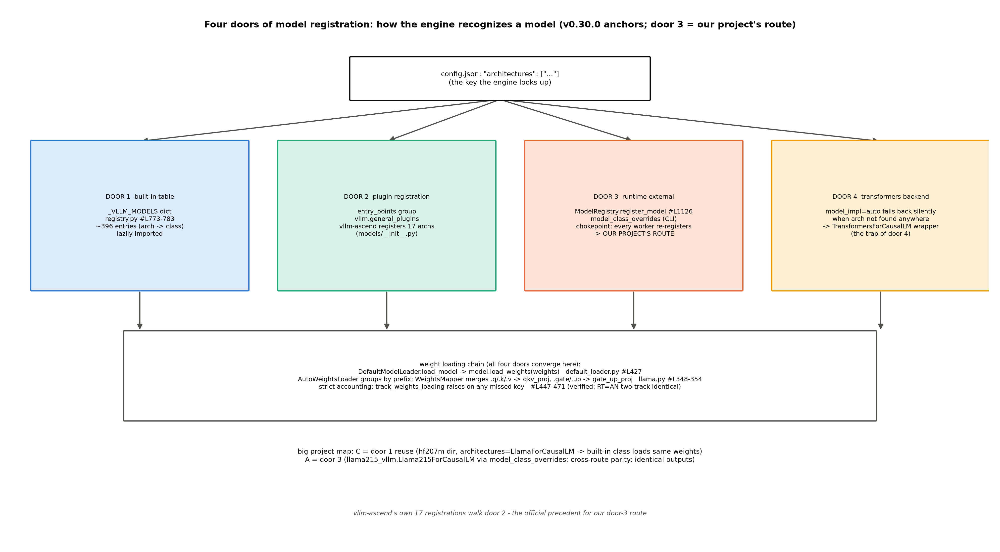

# 第 10 章 权重加载、量化接入与模型注册

## 10.1 启动相：引擎认出模型的那一刻

前面九章都在运行相（一条请求的旅程）；本章切到**启动相**——第一条请求进门之前，引擎要回答两个问题：**这份权重是谁**（认出模型）、**怎么装进显存**（加载权重）。第 4 章的启动时序图（55.1 s）里 load_model 只是其中一条带，本章拆开这条带看内部结构——两个问题的答案分别是注册表（10.2-10.3）与加载器链（10.4）。时间线上值得先对一眼账：例 4.2 的七刀里权重加载只占 1.6 s，注册探测与配置改写也都藏在「import 与配置解析」的 20 s 段里——**启动相的账大头不在搬权重，在「认出它、备好环境」**，这正是本章两个问题的重量所在。这也是本册大项目的主场：Book6 收束的原话——「把单轨自训模型注册进 vllm-ascend、与 mini 引擎逐项对照，是 Book7 第 10 章钦点的选做大作业（B6-9）」【Book6 ch13-收束.md#L32】——作者已把它升格为正式大项目，本章就是交付现场；把自训 DESIGN-207M 注册进真引擎，正是「认出模型」这件事的完整演习。本章交四样：注册面四门全景（两张 verbatim 正身）、大项目 C+A 双档实录与教学档五件套、量化接入对位表、表 10.4 对照读数。B6-9 的两层账口径（机制红利对工程红利）在 10.7 收拢。

> **最小背景栏**：本章需要 Book3 的 HF 键位契约（`llama215.py` 的模型键名与 HF 同名——大项目的地基）、Book6 ch11 的量化谱系（GPTQ/AWQ/C8 的检查点格式——10.5 的对照面）、第 3 章的配置河流（`pre_register_and_update` 两道闸口——平台接入的入场券）。

## 10.2 五步链：config.json 的旅程

引擎认模型的路，官方文档五步走完：model 参数→**探测 config.json**（本地/HF 缓存/下载三态）→载入为字典→`model_type` 字段选 config 类→**`architectures` 字段查注册表**→模型类【官方设计文档 huggingface_integration.md——「vLLM uses the `architectures` field in the config object to determine the model class to initialize, as it maintains the mapping from architecture name to model class in its registry」】。**例 10.1（构造例：一行 architectures 的查表走查）** 大项目 A 路的 config.json 开头两个字段（缩排从简、schema 同真实——实际文件逐行展开在 log/book7-00/hf207m_reg/config.json）：

```json
{ "architectures": ["Llama215ForCausalLM"],
  "model_type": "llama", … }
```

四步走查：①引擎读 `architectures[0]`="Llama215ForCausalLM"；②查门一 `_VLLM_MODELS`——不在（自造名）；③查门二插件注册——不在（我们没发插件包）；④`model_class_overrides={"Llama215ForCausalLM": "llama215_vllm:Llama215ForCausalLM"}` 命中门三——每个 worker 进程在自己的 chokepoint 重注册后解析出自写类。若没有第④步的 overrides：门四静默接管（transformers 里也没有这个名字→报错）——判据 A1（注册后断言 resolved class 是自写类，10.3 门四详）的防线就在这。效果读法：**注册的全部工作 = 让某个门能应答这个名字**。

一句话版：**config.json 的 `architectures[0]` 就是注册表的主键**——你的模型叫什么名字，决定了引擎拿哪个类来伺候它（`model_type` 只影响 config 特化，llama 无特化走默认；五步里还有半步「RoPE 历史补丁」——老配置的 rope 参数在新版被搬过家，链上有一处兼容改写，知道即可）。主键纪律顺带立一条：architectures 里写的是**类名**（Llama215ForCausalLM），拼错一个字母不会报「名字错了」，只会报「查无此类」——报错信息不会帮你对拼写，注册前先 `python -c "from your_module import YourClass; print(YourClass.__name__)"` 对一遍最稳。五步里有一步 NPU 读者要特别注意：**探测三态**（本地路径/HF 缓存/在线下载）——大项目的 C 路走本地路径（`log/book7-00/hf207m/`），目录里四件套（config.json/model.safetensors/tokenizer.model/tokenizer_config.json）缺一不可；而 HF 缓存态就是第 3 章平台激活日志那台机器为你下载 Qwen3-0.6B 的通道。权重的三态里 **safetensors 优先**也有官方理由（huggingface_integration.md#L26-27）：分布式加载高效 + 格式本身不执行任意代码（`.bin` 的 pickle 面反而在安全上吃亏）——「格式即安全边界」是选型的隐藏判据。五步走完前还有第 3 章埋的那道闸：`pre_register_and_update` 在 VllmConfig 出生前请平台先行——NPU 的十步改写（块 128 覆写/编译后端装配等）都发生在五步链的上下游。

## 10.3 注册面四门全景

「架构名→类」的映射有**四条门路**（图 10.1）——这是 A-1 修正后的完整分类。**门一：内置注册表**——`_VLLM_MODELS` 字典（`vllm/model_executor/models/registry.py#L773-784`，约 396 条：架构名→(模块,类名) 二元组的纯映射，懒导入包装）。注册表还是一份活文档：`_PREVIOUSLY_SUPPORTED_MODELS` 记着已淘汰架构的「最后支持版本」、`_OOT_SUPPORTED_MODELS` 给外置插件指路——`_raise_for_unsupported` 用这两张小表把「不支持」变成可行动的报错（告诉你去哪个版本找、或装哪个插件），而不是一句冷冰冰的 KeyError。**门二：插件注册**——`vllm.general_plugins` entry_points 组；vllm-ascend 用这扇门注册 17 个 NPU 特化架构（`vllm_ascend/models/__init__.py#L5-55` 的 17 条 `ModelRegistry.register_model(arch, "vllm_ascend.models.xxx:Class")`——字符串形式的懒导入，门三 docstring 说的 fork 陷阱同样适用于此；17 条对 15 个实现类——KimiK3ForCausalLM 是 KimiLinear 的兼容别名、DeepSeek 两个 MTP 名同类，别名本身就是注册表维护工程的痕迹）。这 17 项是 NPU 特化模型的户籍：KimiLinearForCausalLM、DeepseekV4ForCausalLM、Eagle3LlamaForCausalLM 等——**注意 LlamaForCausalLM 不在其中**（主线实现直接跑 NPU，无需特化——大项目 C 路能直载的根源；机制依据是平台基类的 `verify_model_arch` 默认 no-op「By default all models are considered supported.」（platforms/interface.py#L972-980），全仓仅 ROCm 覆写过——NPU 无架构白名单）。门二与门三走的是**同一个 register_model 函数**——「官方插件」与「用户外部注册」在机制层没有区别，区别只在打包方式（pip 元数据对运行时调用）。**门三：运行时外部注册**——大项目 A 路的正身：

```python
    def register_model(
        self,
        model_arch: str,
        model_cls: type[nn.Module] | str,
    ) -> None:
        """
        Register an external model to be used in vLLM.

        `model_cls` can be either:
        …
        - A string in the format `<module>:<class>` which can be used to
          lazily import the model. This is useful to avoid initializing CUDA
          when importing the model and thus the related error
          `RuntimeError: Cannot re-initialize CUDA in forked subprocess`.
        """
```
【源码：`vllm/model_executor/models/registry.py::ModelRegistry.register_model`#L1126-1141（docstring 中段一条 bullet 以 … 略），阅读锚 v0.30.0（运行栈同签名 #L1057）】看什么：`model_cls` 收类**或** `"<module>:<class>"` 字符串——字符串的懒导入专为 spawn 多进程设计（docstring 原话点破：避免 fork 子进程重复初始化设备）。配置面的入口是 `ModelConfig.model_class_overrides`（`--model-class-overrides` CLI），消费在**每个 worker 进程各自的 chokepoint**（`config/model.py#L1045-1051` 的注释：「the single chokepoint through which every model-class inspect/resolve passes」——spawn 下每进程重注册一次，机制保证）。

**例 10.2（构造例：两个进程各注册一次）** spawn 出的拓扑里有两个要解析模型的进程：前端（pid=A）与 worker（pid=B）。A 首次访问 `model_config.registry` → 过 chokepoint → 发现 overrides 非空 → 调 register_model → 记入**进程本地**去重集合 `_REGISTERED_MODEL_CLASS_OVERRIDES`；B 进程的这个集合是空的 → 同样再注册一次。结果：两进程的 `ModelRegistry.models` 各自含有该键。「进程本地」三个字决定了两件事——为什么懒导入字符串+PYTHONPATH 是必需品而非优化（B 进程要能 import 到你的模块）、为什么大项目 A 路的冒烟要跑完整引擎而不是 CPU 单测（只有真 spawn 才验得出 worker 侧也能解析）。

顺带一记官方口径的两层（易被读成矛盾）：plugin_system.md 的兼容承诺说这个接口「will always be available for plugins」——**接口稳定性承诺**；而 `model_class_overrides` 的 docstring 自我定位「for development and debugging purposes only」——**配置入口的用途声明**。两层不矛盾：函数永远在，CLI 面自认是调试用途；拿它跑生产的人该知道自己走的是哪一层。**门四：transformers backend**——`model_impl=auto` 下四处找不到时的**静默回退**（registry.py#L1394-1404 一带：先查 auto_map（trust_remote_code 的挂载点）、再 `getattr(transformers, architecture, None)` 找原生类、最后 `is_backend_compatible()` 门控，包成 `TransformersForCausalLM` 兼容壳——CausalMixin 自建 ParallelLMHead+LogitsProcessor 外壳）。这扇门是陷阱：**回退不报错**——你的自写类若没注册上，引擎不会喊「找不到」，它安静地用 transformers 的慢路径跑起来（性能差一截、行为微异），你以为注册成功了。大项目判据 A1 防的就是它：**注册后必须断言 resolved class 是自写类**。

> **考据框：trust_remote_code 的语义变迁**。老教程说「vllm 设 trust_remote_code 就会直载仓库里的 modeling.py」——那是旧叙事的活化石。现代实现（两版一致）里 trust_remote_code 服务的是**transformers 兼容层**：auto_map 找到的是 config 类与 transformers 原生类，然后由门四包装成 `TransformersForCausalLM`。名字还在、语义已换——与第 11 章 logprobs 的两代语义同款：**读旧资料时，凡带「直接」二字的机制描述都要拿现行源码复核一遍**（huggingface_integration.md 自己都还留着那句旧叙事的影子）。

四门的横向对比收进表 10.1：

表 10.1 注册面四门对比（工作量/风险/教学价值）

| 门 | 机制 | 工作量 | 风险 | 教学价值 |
|---|---|---|---|---|
| ① 内置注册表 | `_VLLM_MODELS` 字典（#L773-784） | 零（架构已在表） | 零 | 认表——知道类从哪来 |
| ② 插件注册 | entry_points 组 | 小（打包发布） | 低 | 生态扩展的正路（vllm-ascend 走的） |
| ③ 运行时外部注册 | register_model/model_class_overrides | 小（一个类+一行配置） | 中（须防门四静默回退） | **最高**——注册机制全链亲手走 |
| ④ transformers 兜底 | model_impl=auto 回退 | 零 | **高**（静默慢路径陷阱） | 反面教材（判据 A1 的靶子） |



图 10.1 注册链路四门（按 v0.30.0 源码自绘，示意级）：config.json 的 architectures 键出发，四条门路汇入同一条权重加载链；门三即大项目 A 路（vllm-ascend 的 17 项门二注册是官方先例）。

## 10.4 权重加载链：键位改写与严格对账

四门殊途同归于一条加载链：`DefaultModelLoader.load_model` → `model.load_weights(weights)`（`default_loader.py#L427`——两轨逐字节一致，免版本框注）。这一行是 loader 与模型之间的**合同行**：loader 负责「给哪些权重」（文件探测、格式迭代、键位不改），模型负责「怎么装进参数」（mapper 改写、递归下沉）——两边以「(name, tensor) 生成器」为通用语，六路迭代器（safetensors/pt/npcache/fastsafetensors/instanttensor/多线程）在 loader 侧可插拔。加载链的完整时序值得先走一遍：`load_model` 按文件格式给迭代器（safetensors 优先——`allow_patterns=["*.safetensors","*.bin"]`，`.pt`/`.bin` 期望平铺 state_dict）→逐条喂 `model.load_weights` → `AutoWeightsLoader` 按前缀分组递归下沉、单遍完成 → `track_weights_loading` 对账。注意一个本册反复出现的模式又在这登场：**单遍+预分配**（第 7 章的槽位表、第 8 章的编译缓存、本章的权重迭代器）——流式处理大对象的标配。两个机制值得看正身。**键位改写**——HF 的分立投影要合并进 vLLM 的并行层：

```python
    hf_to_vllm_mapper = WeightsMapper(
        orig_to_new_stacked={
            # weight_name: (param_name, shard_id)
            ".q_proj": (".qkv_proj", "q"),
            ".k_proj": (".qkv_proj", "k"),
            ".v_proj": (".qkv_proj", "v"),
            ".gate_proj": (".gate_up_proj", 0),
    …
```
【源码：`vllm/model_executor/models/llama.py::LlamaModel.hf_to_vllm_mapper`#L348-354（截尾标 …），阅读锚 v0.30.0】看什么：HF 的 `.q_proj/.k_proj/.v_proj` 三个权重文件条目按 shard 写进 `qkv_proj` 一个参数（三拼）、`.gate_proj/.up_proj` 二拼 `gate_up_proj`——**这就是「TP=1 时权重分片退化为整写」的键位面**：并行层的存在感首先在权重命名——分片逻辑在并行层内部，TP=1 时每个 shard 拿到全量、键位世界不变。

**例 10.3（toy：一层的键位合并小账）** 拿 207M 的第 0 层算（GQA：q 头全 kv 头减半）。输入 9 键：`q_proj(1024,1024)`、`k_proj(512,1024)`、`v_proj(512,1024)`、`o_proj(1024,1024)`、`gate_proj(2816,1024)`、`up_proj(2816,1024)`、`down_proj(1024,2816)`、两个 norm。映射：q+k+v 三拼 → `qkv_proj(2048,1024)`（1024+512+512=2048——shard 按 q/k/v 顺序首尾相接）；gate+up 二拼 → `gate_up_proj(5632,1024)`（2816×2）。输出 6 参数/层（qkv/gate_up 各算**一个**融合参数）。全账闭合：检查点侧 12 层×9 键+顶层 3 键=**111 键**，模型侧 12 层×6+3=**75 个命名参数**（对账按 `model.named_parameters()` 记账，default_loader.py#L450——三拼每层省 2 键、二拼省 1 键，12 层共省 36，111−36=75 恰闭合）——大项目 C 路加载日志零 warning 的机制底座（这张账也是 Book3 插槽契约的远期红利：当年按 HF 命名写的 `llama215.py`，今天原样对上）。

进入模型实例之前还有一道与本章主线同样重要的门：`initialize_model`（`model_loader/utils.py#L54-64`，运行栈 0.27.1——阅读锚同内容在 #L51-61）先 `configure_quant_config`（量化配置先行——§10.5 的入口在这），再做 **keyword-only 签名检查**——`inspect.signature` 验证模型类构造函数收不收 `vllm_config`+`prefix` 关键字，齐备才走 new-style，否则 DeprecationWarning「old-style model class」。教学档五件套的第一件（`__init__(*, vllm_config, prefix)`）的守门人就是它。**严格对账**——`track_weights_loading`（#L447-471）：漏配任何 key 直接 ValueError——「静默错配不可能」不是纪律口号，是 loader 的内置行为（大项目对拍的可靠性地基）。

**例 10.4（toy：漏一个 key 会怎样）** 构造：权重生成器少 yield 一个 `model.layers.3.mlp.down_proj.weight`。三步：AutoWeightsLoader 记账 loaded=74（75 参数中缺 1）；对账 `weights_to_load(75) − loaded(74) = {该键对应的模型参数}`；`ValueError: Following weights were not initialized from checkpoint: {'model.layers.3.mlp.down_proj.weight'}`。效果读法：对账是「装完必点名」的合同——把 `down_proj` 拼错成 `dwon_proj` 同样使该参数落进 not_loaded 集合炸出；例外也要知道：量化模型的在线 scale 可缺（`default_enable_weights_track` 在 quantization 非 None 时关闭——豁免有理由，不是漏洞）。配套的负例：**训练态 `.pt` 不能直载**——训练检查点的顶层是 `{'model','opt','step',…}` 包装（optimizer 态是体积主因，207M 的训练 ckpt 2.3 GB），而 pt 迭代器期望平铺 state_dict——`make_hf207m.py` 存在的理由就是「封装而非转换」：把 model 态按 HF 命名抽出来、产一份目录四件套。

## 10.5 量化接入：白名单≠执行格式

Book6 ch11 立过的判断力「检查点白名单≠执行格式」在源码层的完整对位（表 10.2）：

表 10.2 量化接入对位（检查点门 vs 执行格式——运行栈 vllm-ascend 0.27.1rc1）

| 检查点方法（白名单六项，platform.py#L99-106） | 可达执行格式（QuantType 八种，quant_type.py#L30-37） | 关键算子 |
|---|---|---|
| ascend（ModelSlim） | W8A8 / W4A16 / W4A8 / W4A4MXFP / C8(KV) | npu_quant_matmul / npu_weight_quant_batchmatmul / FIA antiquant（全表见 quant_type.py#L30-37） |
| compressed-tensors | W8A8 / W4A16（按 scheme） | 同上分流 |
| fp8 | **910B3 无 FP8 执行**——scales 解回模型 dtype 按 bf16 服务（fp8_block.py#L29-30 docstring 自述；950 系才重组 MXFP8） | bf16 matmul |
| deepseek_v4_fp8 / modelopt_mxfp8 / mxfp8 | MX 族（A5 能力位为主） | npu_dynamic_mx_quant 族 |

两列是两个世界：左列管「什么检查点进门」（gptq/awq 不在列，进门即拒）；右列管「进门后按什么格式跑」（W4A16 在列——`npu_convert_weight_to_int4pack`+`npu_weight_quant_batchmatmul` 路线，`w4a16.py#L101`/`w8a16.py#L65`——**A16 的含义在这条路里**：激活根本不量化，int4 权重在算子核内反解后与 bf16 激活做 matmul，weight-only 的名字比「量化」更准）。这张表在装配链上的位置第 3 章十步已给过门牌：`check_and_update_config` 的第 3 步 `maybe_auto_detect_quantization`（platform.py#L466-467）——探测检查点里的 quantization_config、设置 `model_config.quantization`、重建 quant_config 三步走完，白名单校验（`verify_quantization`——报错文案自带设备名）在其后把门。

**例 10.5（账面例：fp8 检查点在 910B3 上的两本账）** 拿实验④定档的 Qwen3-1.7B-FP8【2.67 GB，hf API 实核 quant_method=fp8/block_size=[128,128]；Book8 ch08 的本地快照实测 2.65 GB——口径差在测量对象】走四步（输入：fp8 检查点目录；输出：两本账的对照）：①进门——白名单有 fp8，quantization_config 探测通过；②装载——权重以 fp8 字节读入；③执行前——`fp8_block.py`#L29-30 docstring 自述的路线：scales 逐块把权重**解回模型 dtype（bf16）**再服务；④两本账——**磁盘与下载账：省约两成**（2.67 GB 对 ~3.4 GB 级 bf16 档——FP8 仓仍含未量化件与 scales，纯权重量级才是对半）；**显存与速度账：不减不增**（执行态是 bf16，没有 FP8 计算单元可用）。效果读法：同一份「fp8」在存储层与执行层是两个命题——实验④的预期读数「两臂 TPOT 几乎相同」就从第④步读出（负结果预注册；若实测显著差异，反而要查引擎是否落了原生路径——那会推翻 docstring，也是有价值的意外）。Book6 ch11 的 int8 探针（1.37×）是 W8A8 的原生路，与 fp8 的反量化路**同册不同命**——量化格式的收益完全取决于硬件有没有对应的执行单元（实验④因磁盘红线显式登记选做不做，欠账框见章末）。

平台插件七步清单（plugin_system.md#L62-146）与 vllm-ascend 三级链的收拢在第 3 章已经给过门牌（十步改写），这里只补一句总纲：**worker_cls/get_attn_backend_cls/check_and_update_config 是平台插件在本册主线三章出现的三个主要钩子**（另有 get_device_communicator_cls、custom ops 注册等法定钩子——全清单在 plugin_system.md）——第 2/7/9 章的三级链、runner 双轨、后端查表全部从这三个钩子长出来。最后立一个本章最重要的判断力：**注册面（四门）与平台面（七步）是两条正交的扩展轴**——自定义模型只需门③（一个类+一行配置），自定义设备才需要平台插件全七步；大项目注册 207M 全程没动平台插件，正因为它走的是前一条轴（伺候新的 workload，不是新的硬件）。

## 10.6 大项目交付：C+A 双档实录

四门备齐、模型能被认出了——大项目按 notes/07 定稿的 C+A 双档交付（表 10.3）：

表 10.3 大项目三路线（含↔四门映射）

| 路线 | 门 | 做法 | 实测状态 |
|---|---|---|---|
| C=底座 | 门一复用 | HF 封装（`make_hf207m.py`：ckpt 抽取+config/safetensors/tokenizer 四件套）→ 内置 LlamaForCausalLM 直载 | ✅ 冒烟全绿（load 55.1 s【本机实测，Atlas 910B3/运行栈，`log/book7-00/vllm_smoke_eager1.json`】/贪心两轮一致） |
| A=正餐 | 门三 | 自写 `Llama215ForCausalLM`（`llama215_vllm.py`）经 `model_class_overrides` 外部注册 | ✅ **cross_route_parity.identical=true**（同权重生成与 C 路逐字一致） |
| B=对照 | 门四 | `model_impl=auto` 静默回退的现场演示 | 判据 A1 防的就是它 |

实录链（全部本机已跑、底档在 `log/book7-00/`）：`make_hf207m.py`——207,119,360 参数逐位、llama215 对拍 max_abs_diff 1.05e-05/argmax 全同；`vllm_smoke.py`（C 路）——determinism_ok、block_size=128 等引擎事实；`vllm_smoke_reg.py`（A 路）——resolved_class=自写类（A1 断言过：非 transformers 泛型）、同参数同输出。**判据 A4 的意义**值得说一句：内置类与自写类**跑同一份权重、产出逐字相同**——这是「注册机制正确性」的端到端证明（若注册链任何一环走错——比如静默掉进门四——输出就不再是同一台机器的确定性输出）。

教学档已交付：`code/00-feasibility/llama215_vllm.py`——手写五件套全实现（`Llama215ForCausalLM` 不继承任何模型基类；MLP/Attention/DecoderLayer/Model 四级手搭，`__init__(*,vllm_config,prefix)`/`embed_input_ids`/`forward`/`compute_logits`/`load_weights` 逐件落位，形状注记逐步标注）。**验证的两层如实分账**：编译级（py_compile 过）+结构级（模块树与 HF 键位逐项同名）已验；**运行级 NPU 对拍由冒烟档（继承捷径版——regA1 底档产出时的 10-10 版本，后被教学档覆写、未另存档，教训如实入注）执行**——其底档 `vllm_smoke_reg_regA1.json` 的 `cross_route_parity.identical=true` 是运行级判据 A4 的正身。教学档自身的 NPU 运行验证遇到 rope 适配深坑（`get_rope` 的 `rope_parameters` 透传在 NPU rope kernel 上触发 cache 尺寸错——0.27.1 的 transformers 5.x 配置子对象与 NPU rope 实现的兼容坑，**待核**级登记），如实作为「手写模型类的 NPU 适配成本」教学点入档：内置类的价值恰在把这些适配坑吃掉了——A 路的「教学价值最高、工作量小」评分里的「工作量」两个字，在 NPU 上要再加半格。

五件套各有一行要诀：`__init__` 收 keyword-only 的 vllm_config（V1 统一构造签名约定——本章 initialize_model 的守门对象，积木用 VocabParallelEmbedding/QKVParallelLinear/MergedColumnParallelLinear/RowParallelLinear/RMSNorm/get_rope/Attention——**TP=1 时分片全部退化为直通**）；`embed_input_ids` 与 `compute_logits` 是接口协议的可选件（缺了发 warning）；`forward` 的签名含 `intermediate_tensors`（PP 走线，单卡 None）；`load_weights` 复用 `AutoWeightsLoader`+同名 mapper——**键位契约保持 HF 同名是零工作量的关键**（Book3 插槽契约的远期红利至此全额兑现）。

## 10.7 对照读数：两层账的终审

大项目的最终账页（表 10.4）：mini 引擎（Book6 交付、同 207M 模型、同卡；TPOT 取 Book6 ch13 的 v2 档趋势级读数——v4 无同口径单请求 TPOT 底档，口径如实注）对 vllm 运行栈载 207M——**同模型同硬件的唯一变量是引擎本身**。两层账口径沿 Book6 ch13：机制红利（教学引擎已拿到——浪费位归零/命中率 66.7%）与工程红利（工业引擎补齐——融合 kernel/图执行/成熟调度）分开读。对照实验（`code/ch10/bench_207m.py`——vllm 侧同参数对拍）【本机实测，Atlas 910B3，运行栈 0.27.1+vllm-ascend 0.27.1rc1，底档 `log/book7-ch10/`】：测量纪律如实交代（与 Book6 范本的差异点）：贪心（去随机）、单轮冷测（无暖机轮——教学量级下冷启动影响可忽略，如实标注而非沿用范本表述）、TPOT 取自引擎 metrics 的 first/last_token_ts（=「首 token 后均摊」口径，注记见脚本头注 bench_207m.py L28-29 与正文）、eager 单臂（图模式臂由第 8 章实验覆盖）、一臂一进程（notes 制度化教训：同进程第二个 LLM 必死）。「口径先行」在这里不是套话：表 10.4 的 23.1 ms 是「首 token 后均摊」，Book6 的 8.9 ms 是「生成墙钟均摊」——两个口径差一个 TTFT，混用会直接污染倍数。

表 10.4 大项目对照读数（207M/单卡；mini 引擎读数引 Book6 底档）

| 层 | mini 引擎（Book6 ch13 v2 档读数，趋势级） | vllm 载 207M | 差距归因 |
|---|---|---|---|
| TPOT（单请求 decode） | 59 ms（Book6 ch13 趋势级） | **23.1 ms**（`log/book7-ch10/bench_207m_base.json`，贪心 64-token/首 token 后均摊） | 工程红利 2.6×（同模型同卡同 Python 循环——图执行与融合的净收益，量级同段不跨档） |
| 吞吐（多请求） | 手写压测曲线（Book6 ch06） | （第 12 章参数扫描主做） | 调度成熟度 |
| TTFT | v4 冷 732→热 89 ms | **201 ms**（4-token prompt、eager 含首算开销） | 口径差注：prompt 极小、单次测量 |
| 显存 | v3 实测 34.5 MiB 池 | 23.76 GiB 池（ch06 实验③） | 预算哲学（工程引擎吃满卡） |

读数兑现了预注册的方向：**23.1 ms 对 59 ms = 2.6×**——同模型（207M）、同卡、同 Python 调用循环、同 bf16、同为 eager 档（vllm 侧关图模式以对齐 mini 的朴素口径）——**这 2.6× 就是纯粹工程红利的净量**（融合 kernel+成熟调度+内存管理），量级在同一段不跨档，与判据的「不是一个数量级」预期一致。三个口径注记如实：①59 ms 是 Book6 ch13 的 mini v2 档（趋势级）；②2.6× 是 eager 对 eager——第 8 章实验已证图模式另有 6.15×（那层收益 mini 引擎完全没有对应物）；③8.9 ms 的 Qwen3-0.6B 档与 23.1 ms 不可比（跨模型四要素：对象/指标/量级/不可比声明）。

两层账的读法沿 Book6 ch13 的框架展开。**机制红利**已在 mini 引擎兑现：浪费位 22.8%→0（v1→v2 的批化）、TTFT 语义确立、命中率 66.7%（v4 的前缀缓存）——这些是「算法层」的收益，教学引擎拿到了。**工程红利**是 vllm 侧的：融合 kernel（Book6 ch11 的 int8 探针 1.37× 是其量化侧样本）、图执行（第 8 章的 6.15× 是其全貌）、成熟的调度与内存管理。**对照的意义不在分高下**——教学引擎本来就不该赢——在于**逐项归因**：同一模型同卡，TPOT 差多少、差在哪一层（调度/执行/算子），每层能不能在源码里找到对应件（能——前九章已经把每个对应件都拆过了）。这正是「大项目=四版进化的终局对照」的教学设计意图：**你既写了引擎、又读了引擎，对照表两边你都有户口**。

一笔改道注记按对账底单立此：Book4 ch08 实现对照框有半句「serving 栈（本丛书第 7-8 册的主角 vLLM）已有同型实现件——那半段归 Book7」——vLLM 的 MTP 实现实际是 spec_decode 的 proposer 路线（`vllm_ascend/spec_decode/__init__.py#L47-51`：mtp 默认走 `AscendEagleProposer`、step3p5 变体另走 `AscendStep3p5MTPProposer`），机制正身属 **Book8 第 2 章**；第 7 章 7.7 的装配链已给接线层。半句改道显式登记，不吞。

## 10.8 本章小结

启动相的两个问题都有了答案。**认出模型**：config.json 的 architectures 键查注册表——四条门路（内置/插件/运行时/transformers 兜底，10.3 已逐门验明），大项目走了门一（复用）与门三（外部注册）各一遍；**装进显存**：get_model→BaseModelLoader.load_model（编排）→DefaultModelLoader.load_weights（default_loader.py#L415——迭代器选取+对账）→model.load_weights（#L427 合同行）的链上，键位改写（三拼二拼——HF 生态与 vLLM 并行层之间的翻译层）+严格对账（漏 key 必炸，静默错配在结构上不可能）。量化接入的对位表把「白名单≠执行格式」落成源码；910B3 的 fp8 是反量化服务、W4A16 有原生算子路线。大项目 C+A 双档全绿——**同一份权重、两种注册路、逐字相同的输出**，注册机制的正确性被实验钉死；对照读数 23.1 ms 对 59 ms（2.6× 工程红利）把两层账的终审交卷。

**带走的心智**是两句话。**其一，「architectures 是护照」**：模型在引擎世界的全部身份就是 config.json 里那行字符串——改名即换类、注册即入户；排查「引擎不认我的模型」，按四门顺序查护照最快（先内置表、再插件、再 overrides、最后警惕门四的静默回退——**「不报错」不等于「注册成功」**）。**其二，「键位改写在加载器」**：模型权重的合并/分片不发生在模型代码里、发生在 WeightsMapper 的表里——读懂那张小表，就读懂了 HF 生态与 vLLM 并行层之间的翻译层；例 10.3 的 111 键→75 参数闭合账则告诉你这份翻译**不增不删**（键在合并、元素一分不少——所以才有严格对账的底气）。

zoom out 回全书：启动相与运行相都走完了，主链路只剩最后一段——token 怎么变回文字流回用户（第 11 章），以及我们怎么观察这一切（第 12 章）。本章的「不够」有两笔、都已挂账：教学档的 rope 坑停在「待核」级（手写模型类的 NPU 适配成本只立了现象）；实验④的 fp8 两本账停留在例 10.5 的账面推演（磁盘红线下显式登记选做不做）。回头看，大项目是本册的针：它从第 3 章的入口一直穿到本章的注册表，下一章的输出链、第 12 章的对照总账还要再用它一次——**穿针的人手里必须同时握着全链**。

**动手验证**（Atlas 910B3；选卡纪律照 CLAUDE.md）：
① `source env.sh && ASCEND_RT_VISIBLE_DEVICES=<卡> python code/00-feasibility/vllm_smoke.py --eager` 与 `python code/00-feasibility/vllm_smoke_reg.py --eager`——C/A 两路复跑：验收行=两 JSON 的 outputs 逐字一致（cross_route_parity）；
② `sed -n '1126,1143p' repos/vllm/vllm/model_executor/models/registry.py`——register_model 原文（门三正身）；
③ `sed -n '345,357p' repos/vllm/vllm/model_executor/models/llama.py`——键位改写表原文（三拼二拼）；
④ `ASCEND_RT_VISIBLE_DEVICES=<卡> python code/ch10/bench_207m.py`——对照 bench 复跑：验收行=tpot_ms≈23、ttft_ms≈201。

> **【欠账】** 外取量化检查点产制（ModelSlim/LLM-Compressor 工具未装）与 fp8 观测实验④（磁盘红线与下载冲突，显式登记选做不做——预注册预期「两臂 TPOT 几乎相同」已写入 §10.5，fp8_block.py#L29-30 docstring 为据）合并为一条选做；MoE 量化与 expert 权重加载 → Book8 第 8 章。
