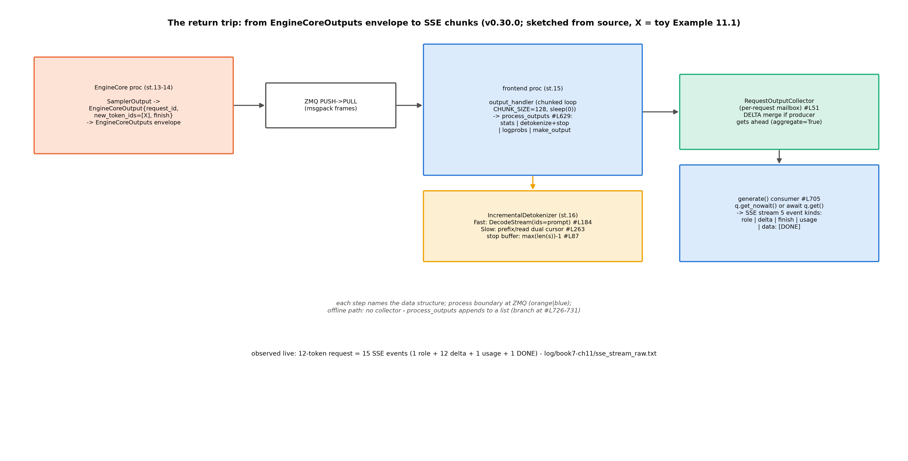

# 第 11 章 OpenAI 兼容层与流式返回链

## 11.1 输出链的第一站，其实在你身后

第 10 章收在启动相；本章回到运行相的最后一程——token 怎么变回文字流回用户。生命周期的坐标是站 15-17（输出处理→增量解码→流回用户），外加一次**回身**：站 13（采样）。为什么采样在输出链章讲？因为 Book6 第 9 章的欠账（「采样管线的真实引擎实现（V1 采样器的九步循环、融合 top-k/top-p kernel、按请求的 seed 管理）」【Book6 ch09-采样与logits处理器.md#L88 章末欠账框】）与 detokenizer 同链——**采样发生在 EngineCore（站 13），它的产物正是站 15-17 的输入**；第 5 章表 5.1 的「prefill 完采样①」与第 7 章的两段式都把采样当黑盒点过名，现在到开箱的时候。这样的章法还有一个实际的收益：输出链的三站全在前端进程，采样与打包在引擎核——**一条章正好把两个进程的协作面完整走一遍**（图 11.1 从左到右跨过 ZMQ 桥），第 4 章立的拓扑在本章再消费一次。结构账先行（图 11.1 的三个容器）：`EngineCoreOutputs`（信封——第 4 章例 4.1 ⑥已见其打包）、`RequestState`（前端每请求台账，output_processor.py#L135）、`RequestOutputCollector`（每请求一只的信箱，#L51）。



图 11.1 输出处理链（按 v0.30.0 源码自绘，示意级）：EngineCore 侧打包信封过 ZMQ→前端 output_handler 分片循环→process_outputs 四步→collector 信箱→SSE 五类事件；detokenizer（站 16）侧挂；离线路在 #L726-731 分岔。

> **最小背景栏**：本章需要第 3 章的 RequestOutputKind（FINAL_ONLY/DELTA——入口声明、本章兑现）、第 4 章的信封与 output_handler、Book6 第 9 章的采样两家对照（temperature/top-k/top-p/penalties 语义已教——本章只看「它们在源码里的长相」）与 Book3 的 BPE「看前缀」（增量解码的算法底座，指回不重教）。

## 11.2 输出处理：唯一的全批循环

站 15 的设计观是第 4 章那句宣言的落地——「AsyncLLM is the outer loop…so this is where any "overheads" should be if possible」（metrics.md#L158-160）。源码层还有一份更硬的合同：

```text
        NOTE FOR DEVELOPERS

        vLLM V1 minimizes the number of python loops over the full
        batch to ensure system overheads are minimized. This is the
        only function that should loop over EngineCoreOutputs.

        If you need to touch every element of the batch, do it from
        within the loop below.
        """
```
【源码：`vllm/v1/engine/output_processor.py::OutputProcessor.process_outputs` docstring#L647-655，阅读锚 v0.30.0】看什么：**「唯一全批循环」的自我约束**——引擎里凡是要遍历整批的地方都被收编到这一个函数；开发者想碰每个元素，只能进这个循环。这条纪律的价值要用反例来读：假设每个模块都自己遍历一批 512 个输出，每个模块收摊都还控制权，事件循环就要在五六个循环之间来回让路、让路的累计开销随循环数线性涨——收编成一个循环，让路只需要发生一次（分片处）。四步主干（#L629-758）：①统计推算（#L666-669——指标全在前端算的机制落点）②detokenize+stop 检查（#L702-708）③logprobs（#L712）④造 RequestOutput——**同一段代码伺候在线离线两链**的分岔就在这（#L726-731：有 queue 则 `queue.put`（在线）、无则 append 返回列表（离线 LLMEngine））。还有一处「前端反过来指挥后端」的唯一场景值得记（#L733-746）：detokenizer 比引擎核更早发现 stop string（跨 token 边界的停止词）时，把 req_id 装进 `reqs_to_abort` **回发引擎核**——输出链不是纯单行道。

collector（站 17 前半）的 docstring 是「信箱+缝合」设计的自述：

```text
    Collects streamed RequestOutputs per individual request,
    for hand-off to the consuming asyncio generate task.

    When streaming deltas, RequestOutputs are merged if the
    producer gets ahead of the consumer.
```
【源码：`vllm/v1/engine/output_processor.py::RequestOutputCollector` docstring#L53-57（正文行，首尾的 `"""` 略），阅读锚 v0.30.0】看什么：**生产者跑赢消费者时不丢不堆、直接缝合**（`put` 的 DELTA 分支 `output.add(output, aggregate=True)`，#L68-78）——流式背压的最小实现。消费侧还有一行热路径手艺：`out = q.get_nowait() or await q.get()`（async_llm.py#L706——队列非空时不 await，免任务切换）。外循环还有两层节奏设计值得合读：分片（`VLLM_V1_OUTPUT_PROC_CHUNK_SIZE` 默认 128、片间 `asyncio.sleep(0)` 让路，#L796-822——一批 512 个输出分四片处理，每片之间把控制权还给事件循环，HTTP 请求的接入不被长批堵死）与 `STREAM_FINISHED` 哨兵（outputs.py#L222——流式输入的终结标记，generate 任务见到它知道该收摊）。**事件循环友好是前端进程的义务**（它还托管着 HTTP 服务——一个进程三件事：收请求、推指标、处理输出，全靠让路纪律才不互相饿死）。第 3 章埋的 RequestOutputKind 在此兑现：`make_request_output` 里 `final_only` 未完成即返 None（#L298-300——离线链「中间态根本不出引擎核」的机制行）。

这一层的数据容器值得一张实物表（表 11.1）——`EngineCoreOutput` 的字段集（信封里每请求一件的「内容物」）：

表 11.1 `EngineCoreOutput` 字段集（两版对照：运行栈 14 字段，v0.30.0 尾加 3——附录级差异，正文只讲核心三件）

| 字段组 | 字段 | 谁消费 |
|---|---|---|
| 核心 | request_id / new_token_ids / finish_reason | process_outputs 四步的主键 |
| 概率 | new_logprobs / new_prompt_logprobs_tensors | 第③步 logprobs 装配 |
| 停止细节 | stop_reason | finish_reason==STOP 时的细分 |
| 事件 | events（§12.2 的时间戳列表挂这里） | 指标推算 |
| 其他 | pooling_output / trace_headers / prefill_stats / routed_experts / num_nans_in_logits / kv_transfer_params / ec_transfer_params | 各专题（多为 Book8 地界点名） |
| 仅 v0.30.0 | mm_cache_miss_hashes / new_sampling_mask / spec_decode_metrics | 尾部追加、注释明言 appended last 保序列化兼容 |

两句话读表 11.1。正向读：核心三件（new_token_ids/finish_reason/events）贯穿 §11.2 的四步主键——每个消费者都从这三件取食；反向读：标「仅 v0.30.0」的三字段是尾部追加层（附录 C 地界），正文不展开、按消费者点名即可。三个名字的消歧在此一并立住（第 4 章的伏笔收口）：**`EngineCoreReadyResponse`**=启动期的能力包（建池完成时引擎核向前端自报家门）、**`EngineCoreOutput`**=逐请求输出（本表）、**`EngineCoreOutputs`**=批级信封（第 4 章例 4.1 ⑥）——同一家族三个容器，各管生命周期的一段。

## 11.3 增量解码：token 出厂最后一道工序

站 16 的输入是 `new_token_ids`（整数列表）、输出是 delta 文本+stop 判定——**采样给 id，detokenizer 给字**。实现三岔口（detokenizer.py#L49-66）：无 tokenizer→空实现（token ids 直达用户——`detokenize=False` 的请求，token ids 本身就是产物）；`USE_FAST_DETOKENIZER`（tokenizers≥0.22.0）且 TokenizersBackend→**Fast**；否则 Slow。本机 tokenizers 0.22.2（实验②探针读数）→ Qwen3 走 Fast。Fast 的机制核心是 `DecodeStream(ids=prompt_token_ids, ...)` 的 **native prefill**（#L180-187——用 prompt 预置解码流状态，第一条 delta 无需从头解码；「预置解码态」是它能快的关键：BPE 的解码依赖 token 边界上下文，prompt 先喂进去就免了逐 delta 重放）；更有工程诚实的一笔：`_protected_step` 的双保险恢复（#L224-248——OverflowError 返 None、invalid prefix 重置流重放——**流式解码器状态会坏、坏了就重置重来**，两个 issue 号在注释里）。Slow 路是双游标状态机（`prefix_offset/read_offset`，#L263-271——Book3 BPE「看前缀」的算法在此，指回）。Fast 路的注释里还埋着一个移植故事：tokenizers 库的 DecodeStream 按**模块**查找打补丁（fastokens shim）——上游库的兼容坑由 vLLM 自己缝，这也是「依赖生态的缝隙自己补」的一笔工程账；它同时解释了三岔口为什么有 `tokenizers≥0.22` 的版本门——Fast 路的存在本身就绑定在这个 shim 能生效的版本区间上。

**例 11.1（实测链上真 token 的返程走查）** 本章实验底档里「好的」（Qwen3 对中文提问的第 3 个生成 token，`log/book7-ch11/sse_stream_raw.txt` 逐行可数——delta 文本序列 `<think>`→`\n`→「好的」→… 与 tokenizer 逐 token 边界吻合）。六步：①站 13 采样出 id（SamplerOutput）；②站 14 打包 `EngineCoreOutput(request_id, new_token_ids=[X])` 入信封过 ZMQ；③前端 output_handler 收信封（分片循环）；④RequestState 台账：`detokenizer.update([X])` 得 delta 文本「好的」、无 stop；⑤造 DELTA 型 RequestOutput → `collector.put`；⑥generate 的 `get_nowait` 收到 → 流生成器 yield `data: {..."delta":{"content":"好的"}...}`。效果读法：**一个 token 的返程横跨两个进程六步变形**——图 11.1 的全链在这一个字上走完；而底档里那 15 个事件的 SSE 原文（30 物理行），就是这条链跑了 12 遍的纸带记录。

**例 11.2（构造例：stop 缓冲的扣留走查）** stop=["END"]（3 字符）→ `stop_buffer_length = max(len(s))-1 = 2`（#L87-90）。两步文本流：第一步 output_text="…AB" 未完成 → 返回 "…"（**扣住 "AB"**——stop 串可能横跨两个 token，宁可晚发不错发）；第二步 output_text="…ABEND" 命中 → truncate 到命中点、返回剩余 delta（不含 "END"）。多命中语义：`check_stop_strings` 取**完成最早者**（#L324-340——投机解码一步多 token 时与逐 token 行为一致）。

stop 扣留这笔账值得多看一眼，因为它是「流式」与「正确性」正面相撞的地方：客户端要的是每个 token 一块的实时流，而 BPE 的 token 边界与字符串边界不对齐——"EN" 和 "D" 完全可能分属两个 token。若不扣留，第一个 token 出来就发，客户端可能已经把 "EN" 渲染给用户、下个 token 才发现是停止词——撤回已显示的文字在流式协议里是灾难。扣留长度也有讲究：取**最长 stop 串减一**（多个 stop 串时按最长的算），恰好覆盖「最后一个不完整候选」的窗口；而 `include_stop_str_in_output=True` 与扣留是耦合的（#L85-90 的分支：include 为真时 `stop_buffer_length` 直接置 0）——逻辑一想就通：一旦停止词本身要显示给用户，「晚发防撤回」就失去了意义（发出去的字符反正都合法）。**扣留是为「可能要撤回」买的保险，显示偏好决定了保险要不要买**——不是两个独立开关，是同一个决策的两端。

## 11.4 采样出口正身与束搜索定谳（两笔欠账兑现）

输出链三站到此走完，现在回身站 13——Book6 第 9 章欠账的主文本文体就是这份 docstring（两版同文）。开题先立一个双轨注：本节锚的 `vllm/v1/sample/sampler.py` 是 MRV1 轨的正身——第 7 章交接句点名的 MRV2 侧在 `worker/gpu/sample/sampler.py`（九步骨架同构、状态机族换轨）；NPU 运行栈实跑的是 MRV1 轨，故本节以它为主轨、MRV2 差异入差异清单。这份 docstring：

```text
    1. If logprobs are requested:
        …
    2. Convert logits to float32.
    3. Apply allowed token ids whitelist.
    4. Apply bad words exclusion.
    5. Apply logit processors which are not argmax-invariant,
       i.e. that can impact greedy sampling.
        …
    6. Apply penalties
        …
    7. Sample the next tokens. `sample` method performs the following steps:
        …
```
【源码：`vllm/v1/sample/sampler.py::Sampler` 类 docstring#L26-59（第 1/5/6 步与第 7 步的子项（7a-7f）及第 8-9 步以 … 略——第 1 步按 logprobs_mode 分 raw_logprobs/raw_logits 两支；第 5 步的子项是 MinTokens/LogitBias；第 6 步的子项是 repetition/frequency/presence 三惩罚；第 7 步先贪心列后温度），阅读锚 v0.30.0——与 Book6 ch09 对照框的九步口径逐位吻合；两处精化：min_p 属第 7c 步非独立步、softmax 重归一在第 7d 步的 TopKTopPSampler 内部】三个源码级发现值得单独指给读者：**其一，penalties 是算子不是处理器**——`apply_logits_processors`（#L373-419）里独立一档直调 `ops/penalties.py#L10-38` 的融合算子（prompt 也计入 repetition 惩罚账——repetition 的「账本」从请求生成历史扩展到 prompt 本身，这是它比 frequency/presence 更重的原因；penalties 的语义口径注释自证「We follow the definition in OpenAI API」（锚在 model_executor/layers/utils.py#L77）——Book6 教过的那套语义在源码里的锚；另有工程诚实的一笔：penalties.py#L26-27 注释自白「The penalties implementation is currently quite inefficient and will be reworked」）。**其二，处理器的 argmax 不变性分栏**（state.py#L148-165）——非不变者（MinTokens/LogitBias）在贪心判定**前**跑（可改变贪心结果）、不变者（MinP）只在随机路径跑（builtin.py#L48 docstring 自述「Min-p never impacts greedy sampling」）——**分栏决定执行时机**，这是 Book6 没教的源码层知识。**其三，混合批的一箭双雕**：

```python
        sampled = torch.where(
            sampling_metadata.temperature < _SAMPLING_EPS,
            greedy_sampled,
            random_sampled,
            out=greedy_sampled,  # Reuse tensor
        )
```
【源码：`vllm/v1/sample/sampler.py::Sampler.sample`#L297-302（骨架节选），阅读锚 v0.30.0】看什么：同一批里贪心请求（温度<ε）取贪心列、随机请求取随机列——**一次算两列、按行取用**（温度为 0 的请求在 apply_temperature 时已被改成 1.0 防零除——argmax 不变性保证这不影响贪心结果）。

还有一处顺序值得点破，它乍看像 bug：**贪心列在温度除法之前就算**（`sample` 的 all_greedy 早退支路 #L261-272 用的是未除温的 logits）。除以一个正常数不改变 argmax——所以先算贪心再除温，结果分毫不差，但省了一次列重算。这与 MinP 的分栏、混合批 torch.where 是同一个思想的三处落点：**argmax 不变性是采样器的免费午餐**，凡是不改变排序的变换，先后顺序都可以按省力来排。读源码时看到「看似乱序」的执行，先查不变性——十有八九是设计而非疏忽。

**例 11.3（构造例：混合批的一次 sample）** 3 条请求同批——A 贪心（T=0）、B 随机（T=0.8/top-p=0.9）、C 随机（T=1.0）。走 apply_temperature（A 的 0 改 1.0 防零除）→ topk_topp（B/C 各按自己的 k/p）→ 终局 `torch.where`（例中摘录）——A 取贪心列、B/C 取随机列，输出形状 $(3,V)\to(3,)$。效果读法：**贪心与随机不是两种模式、是同一批的两列**。

融合 top-k/top-p kernel 的两读（欠账第三件）：`TopKTopPSampler` 的 `forward_cuda` 走 **FlashInfer 融合核**（`flashinfer_sample`，#L174-200）——且有一个诚实的回退支路：per-request generators 在场时直接退 `forward_native`（注释自白「FlashInfer 0.2.3+ does not support per-request generators. Falling back to PyTorch-native implementation.」——**带 seed 的请求连 CUDA 也走朴素路**，「同一接口多档实现」的更强证据）；指数噪声排序+逐行 generator 的正身在 `forward_cpu`（#L222-231——Gumbel-max 思想的采样版，免 softmax 重归一）；NPU 走 `forward_native`（#L150-172——Book6 ch09 附注的引擎版互证）。seed 按请求的正身链（欠账第三件的完整账）：`generators` 字典挂在 InputBatch（gpu_input_batch.py#L265——每请求一个 `torch.Generator`）、构造处 manual_seed（gpu_model_runner.py#L1304-1305——`SamplingParams.seed` 到 generator 的翻译）、采样核里逐行调用（topk_topp#L229 `q[i].exponential_(generator=generator)`——**同批各请求各自的可复现随机流**，这就是第 3 章 J1 判据「三档 completion 逐字一致」能在贪心之外的采样下也成立的机制底座）。

> **考据框：logprobs 的两代语义**。sampler.py 里留着 woosuk 的 NOTE（#L81-84）：「Use the original logits (before any penalties or temperature scaling) for the top-k logprobs. **This is different from the V0 sampler**…」——同一个 API 字段（`logprobs`），V0 返回处理后的值、V1 默认返回处理前的原始值（`logprobs_mode` 四档默认 `raw_logprobs`，config/model.py#L259）。这是「承诺带着语义变化回来」的又一例（第 1 章考据框 1.1 的第一行在源码里的落点）：从 V0 迁移到 V1 的应用若对 logprobs 做了数值假设，升级时这里会静默地错——**版本迁移清单里「同名 API」往往比「删掉的 API」更危险**。

**F8 半句的定谳**（Book1 束搜索欠账的 Book7 落点）：**V1 无原生束搜索**——V0 调度器的分支共享/swap 设计已删（Book6 ch07 教过「前缀缓存证明自己是更好的选项」）；今天的束搜索是**客户端算法**（`entrypoints/generate/beam_search/offline.py::beam_search`#L58）：外循环每步给每条活束发一个 `logprobs=2*beam_width, max_tokens=1` 的普通请求（#L116-125——注释链 HF transformers 惯例）、按返回的 logprobs 展开-剪枝（#L316-339）。长度惩罚是 GNMT α 幂的工程后裔（`BeamSearchParams.length_penalty`+`get_beam_search_score`——Book6 ch09 考据框的血统链在此收口）。边界三件如实：OpenAI completion 面仍收 `use_beam_search`（协议层转发）、**批量 chat 端点明确拒绝**（chat_completion/protocol.py#L1139-1143 校验抛错「Batch chat completions do not support beam search」——新批量端点不背历史包袱；Responses 面更彻底：连 use_beam_search 这个参数都不存在）、bench latency 的 `--use-beam-search` 在（#L44）、throughput 锁 False、stream×beam 在 completion 侧拒绝——**四面楚歌的遗产接口**：旧协议收着、新协议拒绝、工具面半开、流式不通；Book1 的 F8 从「翻译机的解码器」走到今天，在 vLLM 的位置是「一个可以打开但没人维护灯光的房间」——它的「并行验证」思想活在投机解码里（Book6 ch10 教过），本体退休成客户端工具。

**例 11.4（toy：束搜索的一步展开）** beam_width=2、每步取 logprobs 前 4（=2×beam_width）。两步走：①两条活束各发一个一 token 请求，各得 4 个候选（带 logprob）；②客户端把 2×4=8 条新束按 $\mathrm{cum\_logprob}/\mathrm{len}^{\alpha}$ 排序保前 2、命中 EOS 者移入 completed 不再参与。效果读法：**引擎侧只看见 2 个普通的单 token 请求**——展开与剪枝全在客户端循环里，调度器对「这些请求是同一个束搜索的分支」一无所知（分支间的共享前缀靠通用 APC 免重算，这是「束搜索靠前缀缓存借尸还魂」的机制落点）。对照 Book6 ch10 的投机解码：同样「一次验证多条」，一个在引擎核内两段式完成、一个在客户端外循环慢速完成——**机制的位置决定了它的速度上限**。

## 11.5 OpenAI 兼容面：SSE（Server-Sent Events，服务器推送事件）五类事件

站 17 的 HTTP 半段从第 3 章那行交接（`engine_client.generate`，serving.py#L368）**回来**讲流。chat 模板在这层换装：`render_chat_request`（#L219-240）→ `resolve_chat_template` 四级解析（`renderers/hf.py#L263-314`）——四条优先级注释排好队：显式模板参数→processor 内嵌（多模态模型的模板挂在 processor 上；启用工具调用时此档跳过）→tokenizer 内嵌→兜底路径，一级比一级深地找「模板从哪来」；请求级 `chat_template_kwargs` 与引擎默认在这一层合并后透传（含 reasoning parser——模板与解析器共用同一套 kwargs 是个容易踩的耦合点）。SSE 的 wire format 一律 `data: {json}\n\n`，五类事件（源码行+实测底档双正身）：①首块 role（#L530-569）②逐 token delta（#L641-780——**chunked prefill 的空块跳过**#L646-650）③终块 finish_reason（#L780-808）④usage 块 `choices:[]`（#L812-870）⑤`data: [DONE]`（#L910）。错误也走 SSE（error chunk+DONE——连接不断、错误内嵌——**客户端永远能等到一个明确的终结符**，不会吊在半开的连接上）。五类事件的时序快读：role 块在第一个 token 之前就发出（客户端先拿到角色头——UI 可以先把「assistant 正在输入」的光标立起来，不必干等第一个字）、delta 逐 token、finish 带 stop_reason（stop/length/tool_calls…——客户端凭这一个字段区分「说完了」与「被截断」，计费与重试逻辑都挂在它上面）、usage 在 stream_options.include_usage=true 时补一块、DONE 收摊。②类里那处「空块跳过」（#L646-650）值得一句解释：chunked prefill 场景下引擎可能对同一请求走多步，中途的空输出步（没出新 token）在 HTTP 层直接吞掉——**流式语义与调度步进解耦**，客户端看到的是 token 流、不是引擎步数（第 5 章的 chunked prefill 在输出侧的对应守则）。

本章实验的实测互证【运行栈 0.27.1 实测（Atlas 910B3），`log/book7-ch11/` 全套】：max_tokens=12 的请求 = **15 个事件**（role+12 delta+usage+DONE）——「每个 RequestOutput 翻译成一个 SSE chunk」在原文里逐行可数。摘两行实物（首尾各一）：

```text
data: {"id":"chatcmpl-a59f8cf0e6919f53","object":"chat.completion.chunk",…,"choices":[{"index":0,"delta":{"role":"assistant","content":""},"logprobs":null,"finish_reason":null}],…}
…
data: [DONE]
```

【运行栈 0.27.1 实测，`log/book7-ch11/sse_stream_raw.txt`（首末两事件节选、中段截尾标 …，中间 12 条 delta 与 1 条 usage 略）】首行看三件事：`delta.role` 已置位而 `content` 为空（role 头先行）、`logprobs:null`（未请求）、`finish_reason:null`（未终）——**一个字没说，话头已经递到位**。（边界如实：1:1 在 stream_interval>1 或 DELTA 合并触发时打破——前者是引擎级/请求级的降频旋钮、后者是 §11.2 讲过的背压缝合，两处都是**设计**而非缺陷，但拿「事件数÷token 数」做断言时要先排除这两个因子）；chat 模板差的实测——同一 prompt 两种模板模式 token 数 28↔32（enable_thinking 开/关），关思考反而多 4 个：模板注入空 think 块 `[151667,271,151668,271]`（`chat_template_diff.json`——**模板在协议层换装**的 token 级证据，「关掉=省略」的直觉在模板世界里不成立）；guided_json 请求返回合法 JSON（`sse_guided_raw.txt`——NPU 结构化输出的 happy path）。顺带一记 usage 块的搭车设计：开启 usage 上报后，per-request metrics（首 token 时延等）也挂在 usage 事件上一起走（serving.py#L837-840 注释「metrics ride on this final usage chunk」）——**统计与计费走同一班车**，客户端不用多发一个请求。completion 与 responses 两个兄弟面一段带过：completion/ 与 chat 同构（连 use_beam_search 分支都同款——最老的服务面，行为守旧是它的职责）；responses/ 是新协议面（拒绝 beam、结构化输出走 response_format、事件流模型不再是 SSE chunk 而是自带的事件类型体系）——三扇门的代际差本身就是协议演化的地层（chat 最厚、completion 最老、responses 最新），机制层归 Book8 第 3 章，本章只需要知道「三扇门共享同一个引擎出口」。

## 11.6 兼容层地图：名字比家稳定

两件收尾。**V0 别名再访**（第 1 章实物的后故事）：`vllm/engine/llm_engine.py` 全文 7 行把旧名指向新家——OpenAI 层也在经历同款搬家（api_server 804 行单体↔59 行转发壳+launchers/ 包，两轨各执一端——差异表 A 级#2）；搬家的方向与 V0 别名一致：**旧入口名保留、实现体重组**——兼容层的演化律是「名字比家稳定」，升级时代码先搬家、名字后退休，两步之间隔着若干个版本的弃用期。**vllm-ascend patch 清单**：激活机制两级（`vllm_ascend/utils.py::adapt_patch`#L532-536——global 进 platform 批、worker 进 worker 批；`platform.py#L298` 在**每个进程**的 pre_register 里过一遍——「every process created by vLLM needs to load the plugin」的活体证据，本机起服日志里两条 `Platform plugin ascend is activated` 分属 APIServer 与 EngineCore 两个进程），每条五要素（What/Why/How/Related PR/Future Plan——「等上游哪个 PR」写在门口，与第 5 章漂移税合流）。表 11.2 抽样五条：

表 11.2 vllm-ascend patch 清单与平台默认抽样（三条 patch+一项 utils 默认+一项 env 守卫——完整索引 `repos/vllm-ascend/vllm_ascend/patch/__init__.py`）

| # | 改谁 | Why（摘） | Future（移除条件） |
|---|---|---|---|
| §8 | Hybrid 协调器命中归并 | 上游 min-reduction 塌缩 FA 命中（第 6 章） | 上游 PR #42524/#44243 |
| §19 | 结构化输出单后端 | auto 混用后端 grammar 编译期崩溃 | 上游先强制后端一致性再编译（能力成熟型；Related PR #43920/#44401 在档） |
| §22 | use_v2_model_runner env-only | 按架构启用会崩（第 7 章） | v2 全支持后回归上游 |
| 块大小（默认*） | block_size→128 | 算子胃口 [128]（第 6/9 章） | — |
| breakable（守卫*） | opt-in 锁 0（platform.py#L67-72） | 上游可能自动开（第 8 章） | — |

「54 条 patch 各自等谁」读法示范（表 11.2 的用法）：每条的 Future 列就是**移除条件**——上游 PR 合入即撤补丁。样本里 §8 有明确 PR 号（可跟踪）；§19/§22 的条件是能力成熟而非某个 PR。两个带 * 号者都不在 54 条 patch 清单里：breakable 是 platform.py 的 env 守卫、块大小是 utils.py 的默认与锁定——并列进来是为了展示「平台收紧」的三类载体（补丁/默认值/守卫）。**有 PR 号的是「等修复」、没 PR 号的是「等生态」**，两种等待的预期时长不同。这张表因此不只是兼容层地图，还是 NPU 生态与上游收敛速度的仪表盘。

> **考据框：patch 计数三说与清单的地层学**。这条清单的计数在本书写作材料里出现过三个数：42（早期快照）、51（中期任务书）、54（本册实测 `grep -c 'File: '`）——不是谁算错了，而是**清单本身是活文档**：编号有重复（dup 3/dup 18）、有空洞（worker 批缺 3/11/12/13/16）、34/34a 追加在文件尾——每次上游 release 都会沉积一层。读它的正确姿势像读地层：**编号顺序≈入列时间**，追一条 patch 的历史用 `git log -L` 看注册行，比看编号可靠。

结构化输出混用的行为级实证（本章实验③，两级）：级 A 行为级——官方 UT 7/7 过（`patch_structured_output_ut.txt` 存档），报错文案正身是 `VLLMValidationError: ... already using 'xgrammar'... 'guidance'`；级 B 激活探针——import vllm_ascend 后 `SamplingParams` 与 `StructuredOutputManager` 两个类身上都能找到 patch 存的 `_ORIGINAL_*` 属性（双钩子在位），且 auto 模式下首请求把解析出的 "xgrammar" **记到 config 上**（`cfg_backend_recorded_by_patch` 读数——第二条同后端请求即比对通过、异后端请求即触发上面的报错）。`_raise_mixed_backend` 的文案明示解法：**显式配 `structured_outputs_config.backend`**。边界如实：本机只装了 xgrammar 与 lm-format-enforcer，「auto 真解析到异后端」的引擎级混用无法在本地复现——行为级实证以官方 UT 为准（「工具面决定可实测面」的又一例，sources/02 的总口径）。这是「平台收紧上游自由度」家族的又一例（图模式默认/runner 判据/单后端/块协商四例已集齐——第 8 章考据框的判断力在 NPU 侧的完整样本）。

## 11.7 本章小结

输出链走完：信封过 ZMQ→唯一全批循环四步（同一段代码伺候两链）→collector 缝合（背压最小实现）→detokenizer 给字（例 11.1 的「好的」六步返程、例 11.2 的 stop 扣留两步——宁可晚发不错发）→SSE 五类事件（实测 15 事件逐行可数）。回身的采样也开了箱：九步管线与 Book6 对照框逐位吻合，四个源码级新知（penalties 是算子/argmax 不变性分栏/例 11.3 的混合批 torch.where 一箭双雕/贪心列先于温度算——同一不变性的三处落点）；F8 束搜索定谳为客户端算法——例 11.4 的一步展开里，引擎侧只看见 2 个普通单 token 请求、展开剪枝全在客户端（Responses API 已拒绝——方向信号），logprobs 两代语义的 NOTE 是「同名 API 比删掉的 API 更危险」的现成例证。兼容层两课：V0 别名与 api_server 搬家——「名字比家稳定」；patch 清单 54 条各等各的上游——「兼容层的维护费是插件生态的月供」。

**带走的心智**是两幅画。**其一，「开销在前端、token 走单行道、指挥可双向」**：输出处理的全部设计压着「内循环零开销」的宣言；一个 token 从 id 到字只有一条路（collector 不堆、detokenizer 增量、SSE 逐块）；唯一的逆向是 reqs_to_abort——知道哪条路可以反向走，调试时就不会迷路。**其二，「采样是批的、不是请求的」**：贪心与随机是同一批的两列（例 11.3 的 torch.where）、penalties 一次算整批、seed 才是按请求的——Book6 的「采样两家」在源码里是「一家两栏」；而 argmax 不变性是这一家的家规——凡不改排序的变换，顺序按省力排（贪心先算、温度后除、MinP 只在随机路径出现）。

zoom out 回全书：生命周期 17 站全部走完（第 13 章将重走一遍做总测）——输出链是这条线的最后一段，也是最贴近用户的一段：用户看不见调度器与块账，只看得见这一个个 `data:` 块。本章的「不够」在结构化输出：混用报错的行为级实证做到了官方 UT 一级，但「auto 真解析到异后端」的引擎级混用在本机不可复现（只装了两个后端）——机制层的完整拆解归 Book8 第 3 章。下一章（第 12 章）是元层——把前十一章用过的每件观测手艺收拢成方法学：断点跟跑三法、bench 三件套、参数扫描与大项目终审对照。

**动手验证**（Atlas 910B3；选卡纪律照 CLAUDE.md）：
① `sed -n '26,59p' repos/vllm/vllm/v1/sample/sampler.py`——九步 docstring 原文（Book6 欠账的正身亲手找到）；
② 复跑三件：`bash code/ch11/exp_sse_capture.sh sse_repro`（serve+SSE 采集——验收=15 事件）与 `python code/ch11/exp_template_diff.py --out-name tpl_repro`（CPU——验收=delta +4、off 尾含 [151667,271,151668,271]）、`python code/ch11/exp_patch_probe.py --out-name patch_probe_repro`（CPU——验收=双钩子 True/True）；
③ `sed -n '52,58p' repos/vllm/vllm/v1/engine/output_processor.py`——collector 的「信箱+缝合」docstring。

> **【欠账】** 结构化输出管线（xgrammar/guidance 机制层）→ Book8 第 3 章；多模态与 LoRA 服务路径 → Book8 第 4 章。
