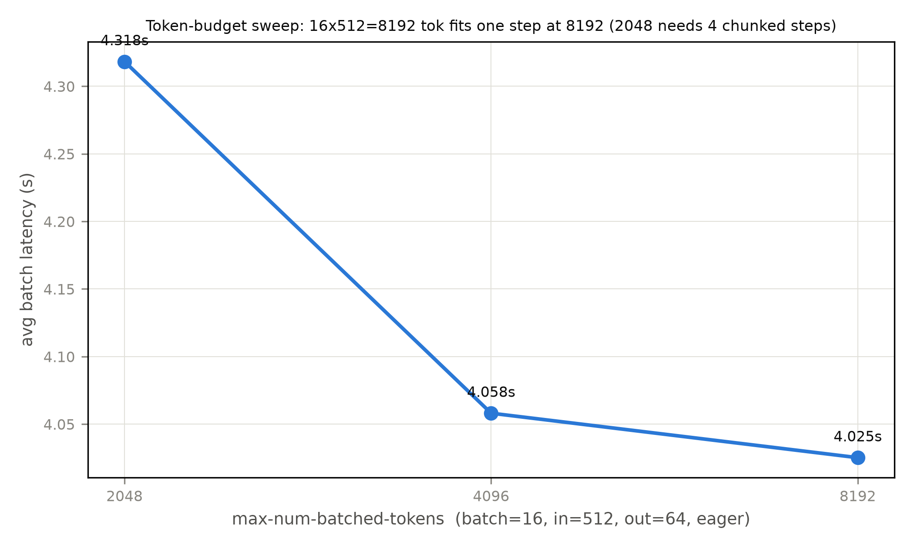
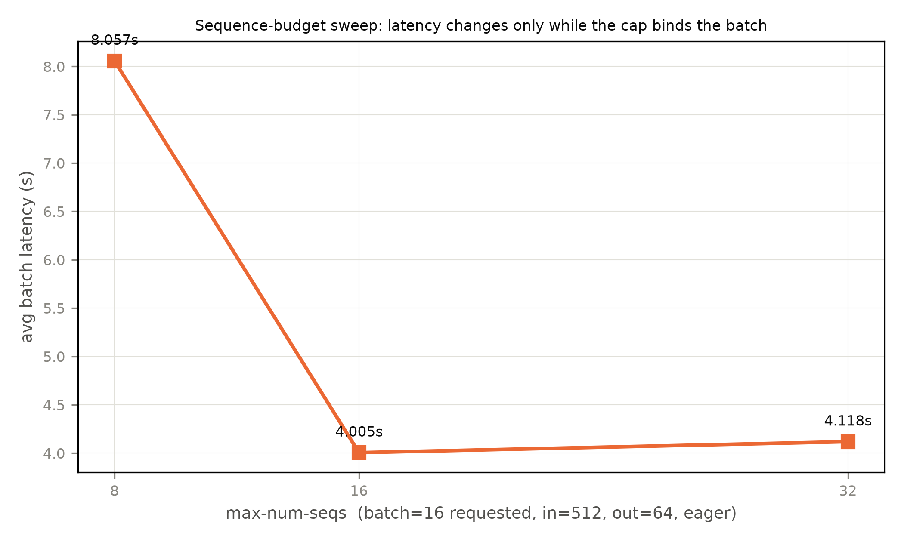
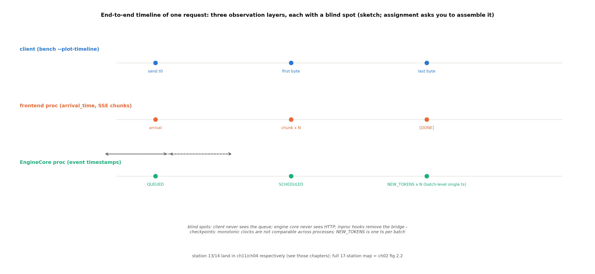

# 第 12 章 实验方法学：把引擎变成可观测的对象

## 12.1 手艺的收拢

Book6 第 1 章的欠账在此到期：「本章的指标全靠自写压测落纸——真实引擎的 bench 三件套（serve/latency/throughput）与 `max-num-batched-tokens` 等参数扫描出的 TTFT/TPOT 曲线，是另一套手艺 → Book7 第 12 章」（B6-1）。而本章还有第二重身份：**全册实验线的收拢**——第 2 章到第 11 章的每个实验件（入口三档探针、ps 拓扑、抢占三跑、APC 对拍、runner 双臂、capture sizes、ACLGraph 对拍、后端三臂、大项目 C+A、SSE 实测）都是本章方法学的一个先例；12.8 的索引表把它们一表收账。第 2 章立的「三层法」在此收口：**先问它在哪（静态地形）→ 它在动吗（动态跟跑）→ 我理解对了吗（对拍验证）**。教学定位收拢成一句话：Book6 教了「怎么测一个引擎」（自写压测、对照组对齐、fast/full 档——把对象当黑盒）；本章教「怎么测这台引擎」——你已经拆过九站，测之前就知道每个数字背后住着哪个类。

> **最小背景栏**：本章是元层章——前十一章的任何一章都可作它的实例；引用最多的是 ch04（进程拓扑/分流）、ch05（调度器结构账）、ch10（大项目对照）。B6-1 的原句与 Book6 ch01 的自写压测是它的起点参照。

## 12.2 观测面：让引擎自己说话

**日志六变量**（两版核验一致——免框注正面清单再添一行）：`VLLM_LOGGING_LEVEL`（根 logger 级别——`dictConfig` 装配的 `"vllm"` 根树下所有子 logger 共享，改一个变量调全部日志）、`VLLM_LOGGING_PREFIX`（行前缀——多实例同终端的唯一区分杠杆，双臂实验给两臂各设前缀）、`VLLM_CONFIGURE_LOGGING`/`VLLM_LOGGING_STREAM`/`VLLM_LOGGING_CONFIG_PATH`/`VLLM_LOGGING_COLOR`。机制一段：格式串带 `%(fileinfo)s:%(lineno)d`（`vllm/logger.py`#L24 的格式串——两轨同文）——**日志行即行级锚**（你在日志里看到的 `[scheduler.py:561]` 就是本书引用的同一个锚——本册行锚纪律与引擎日志格式天然对齐的制度性依据）。另有三个排障开关备查：`VLLM_TRACE_FUNCTION=1`（每函数调用 trace，慢百倍、只用于查 hang）；`ASCEND_LAUNCH_BLOCKING=1`（NPU 的 `CUDA_LAUNCH_BLOCKING` 等价物——与图模式互斥，platform.py#L1246-1252 直接 raise）；`VLLM_EXECUTE_MODEL_TIMEOUT_SECONDS`（默认 300，HCCL 多卡场景建议 3000）。

**进程分流手艺**（ch04 已立，此处收拢为口诀）：`(EngineCore pid=<pid>)` 前缀三段机制——子进程继承标准流（运行栈 `vllm/v1/engine/utils.py#L120-178`）→ 入口 `decorate_logs()` 包 write（运行栈 core.py#L1291）→ 每行加前缀（运行栈 system_utils.py#L199-233）。**`grep "(EngineCore pid=" log` 切引擎侧、`grep -v` 切前端侧**——两个进程的日志混在一个文件里也能一刀分开（ch04 实验①的 52 行前缀计数就是第一个消费者）。免费的崩溃观测：execute_model 炸时自动把当步 SchedulerOutput dump 进 error 日志（运行栈 core.py#L503-507）——断点之外的现场保护，「先去日志找 Dumping scheduler output」。

**指标端点**：`/metrics` 无条件挂载（挂载链 `vllm/entrypoints/serve/__init__.py`→`vllm/entrypoints/serve/instrumentator/metrics.py#L57-82`）。指标名以 `vllm/v1/metrics/loggers.py` 的 `name="vllm:..."` 全集为准，三族各配一句读法：调度族的 `num_requests_running/waiting` 是调度器内态的宏观投影（第 5 章抢占三跑的 Running/Waiting 轨迹就是它的日志形态）、`kv_cache_usage_perc` 是块池水位（第 6 章的容量账挂在这）；**prefix cache 族的 queries/hits 是 token 口径**（与第 6 章 APC 账对上——注意与块口径的换算）；时延族的 TTFT/ITL（inter-token latency，token 间延迟）/E2E（end-to-end，端到端）直方图就是 §12.2 事件区间代数的端点输出。offline 同套：`LLMEngine.get_metrics()`（运行栈 llm_engine.py#L378）。

**周期统计行的陷阱教学**（本机踩坑实录）：offline `LLM` 默认 `disable_log_stats=True`（运行栈 llm.py#L226-227 强制改写）——不开 `disable_log_stats=False` 永远看不到统计行（第一跑 24 s 无一行、钩子拿 `make_stats()` 恒 None 的根因皆此）；serve 无此默认。间隔只有环境变量 `VLLM_LOG_STATS_INTERVAL`（默认 10 s）。迭代级行：`--enable-logging-iteration-details`（每步一行 `Iteration(n): ...`——chunked prefill 的推进肉眼可见，ch09 实验②已用作 GQA 观察的先例——工具章与主线章互证）。

迭代级行之外还有一组低频观测开关收在 `ObservabilityConfig`（`vllm/config/observability.py`#L25-95）：`--kv-cache-metrics`（把第 6 章的块账挂上端点）、`--cudagraph-metrics`（图执行命中统计）、`--show-hidden-metrics-for-version`（跨版本比较时显影被隐藏的历史指标）、`--otlp-traces-endpoint`（OTel（OpenTelemetry）上报——生态欠账归 Book8）。其中 `enable_layerwise_nvtx_tracing` 是 CUDA 专属项（NVTX 标记在 NPU 栈上没有对应物）——本机不可直接做，按写作要求显式标注；它的替代口径是 §12.3 的钩 2/钩 3（层粒度信息在单进程模式里可以直接拿到）。工具面的边界与硬件口径的边界重合，这不是巧合——观测工具生在它要观测的硬件生态里。

### 事件时间戳体系：五类区间怎么算出来（设计文档精读）

TTFT/ITL 这些指标从哪一刻算到哪一刻？metrics.md（`docs/design/metrics.md`，717 行）把答案写成一套**时间戳代数**——这是全册唯一一份「前端算指标、引擎核只记时间戳」的架构决策文档，值得整段精读。它的第一公理（L168-181）：区间必须用 `time.monotonic()`（不受 NTP 影响），且：

```text
It's also important to note that monotonic clocks differ between
processes - each process has its own reference point. So it is
meaningless to compare monotonic timestamps from different processes.
```

【源码：`docs/design/metrics.md`#L176-178（直引），阅读锚 v0.30.0】用人话说：**同进程时间戳才能相减**——前端墙钟减引擎核 monotonic 是无意义算式。这一句是后面所有区间规则的地基，也是 §12.7 端到端大作业第一检查点的出处。

四类事件（L196-207）由引擎核记录：`QUEUED`（请求进调度队列）、`SCHEDULED`（首次被调度）、`PREEMPTED`（被赶回 waiting，将重启 prefill）、`NEW_TOKENS`（本批 token 生成——批级事件，「Since this is common to all requests in a given iteration, we use a single timestamp on `EngineCoreOutputs` to record this event.」L204-207）。五类区间（L209-217）：**Queue**（QUEUED→SCHEDULED）、**Prefill**（SCHEDULED→随后首个 NEW_TOKENS）、**Decode**（首个→末个 NEW_TOKENS）、**Inference**（SCHEDULED→末个 NEW_TOKENS）、**Inter-token**（相邻 NEW_TOKENS 两两相减）。为什么必须引擎核记（L223-228）？前端看不见 QUEUED/SCHEDULED 的时刻，跨进程 monotonic 又不可比——「we need the engine core to record timestamps for all of these events」。

文档的代码正身全链（v0.30.0）比文档本身更硬：事件枚举只有三员 `QUEUED=1/SCHEDULED=2/PREEMPTED=3`（`vllm/v1/engine/__init__.py`#L169-174——**NEW_TOKENS 不是枚举成员**，它走批级通道：`EngineCoreOutput.events` 挂请求级事件列表 + `EngineCoreOutputs.timestamp` 挂批级单戳，正好两个过桥字段）；记录接口 `vllm/v1/request.py::Request.record_event`（#L330-336）；调度器三个埋点——add_request 里记 QUEUED（`vllm/v1/core/sched/scheduler.py`#L2496）、schedule 里记 SCHEDULED（#L1245-1248）、preempt 路径记 PREEMPTED（#L1513-1515，上一行恰是 `num_preemptions += 1`）；**三处全部门控在 `if self.log_stats:` 之后**——观测开销可整体关闭，「内循环零开销」哲学的代码形状。前端侧 `RequestStateStats`（`vllm/v1/metrics/stats.py`#L216-236）的字段注释自证两套时钟：arrival_time 注 wall-clock、四个事件戳注 monotonic——metrics.md 第一公理的数据类化。消费在 `vllm/v1/metrics/stats.py::update_from_events`（#L519-527 三分支 dispatch，PREEMPTED 分支顺手 `num_preempted_reqs += 1`），五区间计算在 #L542-555（decode_time=last−first_token_ts 等四式，行内注释就是五区间的白话）。

**例 12.1（toy：五区间手算与一次抢占的归属）** 给一条假想请求的时间戳（秒，同一引擎核进程的 monotonic）：QUEUED=10.0，SCHEDULED=10.2，NEW_TOKENS 依次 10.5（首个，prefill 完）、10.6、10.7，之后被抢占、重启 prefill 回批，末个 NEW_TOKENS=11.4。五区间：Queue=10.2−10.0=**0.2 s**；Prefill=10.5−10.2=**0.3 s**；Inter-token=0.1/0.1/**0.7 s**（第三个含抢占等待——decode 期抢占按 L232-234 计入 inter-token/decode/inference，不另立区间）；Decode=11.4−10.5=**0.9 s**；Inference=11.4−10.2=**1.2 s**。验算：Prefill+Decode=0.3+0.9=1.2=Inference ✓——五区间闭合，抢占的代价全部落在被抢占请求自己的 decode 账上（这正是 ch05 抢占三跑曲线上 TPOT 陡增的机制出处）。

抢占归属其实有两支，别只记一支：上面是 **decode 期抢占**（token 已生成一部分、重进批时 KV 还在）；另一支是 **prefill 期抢占**（L238-240）——请求还没出第一个 token 就被赶回 waiting，重启后 prefill 从头来，这段等待计入 TTFT 与 prefill 区间。两支的分界就在「第一个 NEW_TOKENS 出现与否」：读者在 sweep 曲线上看到长请求 TTFT 异常抖动时，先想 prefill 抢占、再想排队——五区间账能把两者分开，这正是区间代数比单一直方图值钱的地方。metrics.md 还配了三张官方区间图（`docs/assets/design/metrics/intervals-{1,2,3}.png`，Apache-2.0）分别画基础区间、decode 抢占、prefill 抢占——图形与 L209-242 的文字一一对应，值得对照读一遍。

最后把区间代数接到 Prometheus 端点上：`/metrics` 里的 TTFT/ITL/E2E 直方图，样本粒度正是这些区间——**ITL 每次流式输出记一个样本、TTFT 每请求一个**（metrics.md L68-77）——所以聚合方式天然不同：直方图分位数跨请求平均，而例 12.3 将展示同一请求内 ITL 与 TPOT 的公式差。观测面（端点）与机制面（区间代数）在样本这一层接通。

> **考据框：设计文档会过期，代码与运行读数才是正身**。metrics.md 与 v0.30.0 代码有三处漂移：①L211/L216 写「most recent SCHEDULED」，代码 stats.py（vllm/v1/metrics）#L523-524 是 `if req_stats.scheduled_ts == 0.0: # ignore preemptions`——只记**首个** SCHEDULED，抢占后再调度不刷新（与 L232-234 归属规则自洽、与 L211 字面冲突）；②L296-298 说统计行「every 5 seconds」，代码默认 10 s（`VLLM_LOG_STATS_INTERVAL`，`vllm/envs.py`#L47 两版一致）；③L306 说 hit rate 是「最近 1k 块查询」的滑窗，实现是累计 token 口径（stats.py#L115-137——vllm/v1/metrics/stats.py）。三处都是文档写作时点落后于代码演化的正常漂移——读设计文档时把代码当正身，这一课本身就是三层法「对拍验证」的对象版。

## 12.3 断点跟跑三法

**先问代码在哪个进程**（ch02 例 2.1 的回收入口）：单卡 offline 默认=前端+1 个 EngineCore 子进程——scheduler/KV/模型执行全在子进程，`pdb.set_trace()` 打不中交互（`bdb.BdbQuit`——官方 troubleshooting.md#L45-56 的原文警告）。三法按推荐序：**法②单进程模式**（最常用）→法① fpdb/debugpy（本机未装，备选）→法③只读插桩（最后手段）。

法①一句话说清定位：fpdb 把 pdb 的输入输出桥到 FIFO 管道、debugpy 在引擎进程里起调试服务器等 IDE 远程连接——两者都是「真断在子进程里」的正路，官方 troubleshooting.md 推荐给「必须保留多进程形态」的场景（比如问题只在 ZMQ 桥或 spawn 路径上复现）。本机未装且装包要走 pip 红线审批，而法②已覆盖九成场景，故列为备选——但这不改变一个事实：**当你怀疑的正是多进程机制本身时，只有法①能保真**，单进程模式抽掉了桥，桥上的 bug 也就一起被抽掉了。

**法②的正身与 25 步实证**（本章招牌）：`VLLM_ENABLE_V1_MULTIPROCESSING=0` → `InprocClient`（`core_client.py::make_client` 分派，运行栈 core_client.py#L90-119——`get_output()` 直调 `engine_core.step_fn()`，无 ZMQ 无序列化）。官方自己也这么用：`vllm bench startup` 为量启动时间主动置同一变量（运行栈 startup.py#L261-262）——法②地位的旁证。

**例 12.2（实测：单进程三钩子的 25 步）**【本机实测，Atlas 910B3/运行栈 0.27.1，`log/book7-r6/inproc_trace_demo.{log,json}`】2 条 prompt、max_tokens=24，钩子记 engine 步数与调度器每步 `make_stats()`：输出 engine=25 步、scheduler=25 步；step#1 两请求同批 prefill（scheduled=2new+0cached）、step#2 起每步 `0new+2cached` 纯 decode；子进程数 `[]`。验算：**25 步=1 次 prefill+24 次 decode，与 max_tokens=24 精确互证**——「调度器一步=一波 token」心智的最小实证。三钩子骨架已入库（`code/ch12/inproc_trace_demo.py`：import vllm 前设变量/钩 1 包 make_client/钩 2 包 `Scheduler.schedule` 读 `make_stats()`/钩 3 包 `LLMEngine.step` 数步）。代价如实：失去进程隔离、随机种子写进主进程（启动 warning 原文在档）。

**法③四红线**：备份先行（cp -a+唯一标记注释）/插桩只增不改（diff 只增不删）/跑完立即还原（diff 验证零差异+grep 清点残留）/**禁 reinstall 兜底**（vllm-ascend 是编译产物——force-reinstall=重编译+动摇版本冻结锚）。四条红线的共同逻辑是「可逆」：插桩的价值在于观测，观测完世界必须回到原样——任何一条被破坏，后续所有读数的可信度都要打折（你不再确定跑的是不是原版引擎）。第五条收束：永不改阅读锚仓 `repos/`——单进程钩子与 encoder 包裹已覆盖九成需求。

**async_scheduling 观测位**（ch05 欠账框回收）：`config/scheduler.py#L190-193` 字段→`get_scheduler_cls`#L207-215 分派（True→`AsyncScheduler` 继承 Scheduler）→启动日志可验。机制一句（为步 N+1 备输入与 GPU 执行步 N 重叠——ch07 §7.6 已讲，指回）；v0.30.0 里它与投机解码的耦合（`_spec_token_placeholders`）一句点名→Book8 第 2 章地界。

## 12.4 消息层观测：桥上看货

**tcpdump 为什么抓不到**（ch04 §4.3 埋线回收）：本地引擎 `inproc://`/`ipc://` 都不走内核网络栈（运行栈 network_utils.py#L146-147/#L141-143）——抓包工具无靶子是地址决策的推论。官方 dump 开关：**没有**（两版全树 grep 空）。三条现实抓法：①**单进程直接看对象**（InprocClient 返回的 EngineCoreOutputs 就是解码后形态——「把桥抽掉，直接看货」）；②**主进程包 Encoder/Decoder**（实例建在前端进程 core_client.py#L629——运行栈——monkeypatch 点，可全量记录过桥前后对象；EngineCore 侧收发线程 patch 不到的边界如实）；③子进程插桩（法③纪律）。桥上还有一处类型学趣味：请求类型是**单字节帧**——`EngineCoreRequestType` 的 docstring 自白「Request types defined as hex byte strings, so it can be sent over sockets without separate encoding step」（运行栈 #L261/阅读锚 #L284-296——两版同行号已漂移，双轨引用须分行）。stats 走独立 XSUB 订阅通道（ch04 埋线回收）——「统计的订阅者可以慢，但不许拖住 token 的回程」：输出通道的消费者是生成请求的 asyncio 任务（慢了就背压），stats 通道的消费者是指标采集器（慢了只丢新鲜度）——**两类消费者的耐性不同，所以分两条通道**，这是比「复用一条通道省事」更贵但更稳的选择。

## 12.5 bench 三件套与 55.1 秒拆账

CLI 正身：`vllm bench {latency,throughput,serve,sweep,startup,mm-processor}`（实现体 `vllm/benchmarks/` 包——仓根 `benchmarks/benchmark_*.py` 是另一套历史脚本，引用时区分）。**方法学必讲点**：`bench latency` 默认 `set_defaults(enable_prefix_caching=False)`（`vllm/benchmarks/latency.py`#L77）——**复用前一轮 KV 会污染读数**，默认关是三层法「反向对拍」的现成例（对照：第 6 章 APC 命中 56% 正是同一机制被有意打开的样子）。第三件 throughput 与前两件分工不同：latency/serve 问「一条/一批请求多快」，throughput 问「固定负载下每秒出多少 token」——离线形态、固定请求数与批参数，输出总吞吐与每请求时延的对照表。它的职责在本章被 §12.6 的参数扫描部分接管（扫描每一点就是一次小 throughput 测量），故不单独跑档——**工具选择的判断力也是方法学**：三件套不是每次全上，按问题选件。

fast 档定版（本机实测在档）：latency 档 avg 3.960 s（`log/book7-r6/bench_latency_fast.json`）；serve 档 =起服后 `vllm bench serve --dataset-name random --random-input-len 128 --random-output-len 32 --num-prompts 32 --request-rate 4 --max-concurrency 8`——32/32 完成、输出吞吐 96.0 tok/s、TTFT 均值 187/中位 184/p99 426 ms（`log/book7-ch12/bench_serve_fast.json`，表 12.1 第三列数据源）；观测联动 `watch -n2 'curl -s .../metrics | grep -E "num_requests|kv_cache"'`——指标与压测同屏。

**指标口径三 warn**（图 12.1/12.2 的读法前提）：①「Metric terminology is not standardized across benchmarking tools. When comparing results, use the measurement points and formulas rather than the metric names alone.」（官方 benchmarking 文档直引级——cli.md#L128-130）；②TPOT 公式 $\mathrm{TPOT}=(\mathrm{E2E}-\mathrm{TTFT})/(N_{\mathrm{out}}-1)$（用人话说：首 token 之后每个 token 摊到多少时间），与 ITL 的分叉见例 12.3——本册已用的三种 TPOT 口径并排：23.1 ms（首 token 后均摊自算/ch10）、8.9 ms（生成墙钟均摊/Book6）、59 ms（v2 趋势级/Book6 ch13），表 12.1 里各带脚注；③TTFT 的口径边界：metrics.md L258-262 明言 TTFT 相对前端 arrival_time 计算、而「Currently `arrival_time` starts when tokenization begins.」——分词时间被计入，HTTP 行程不在内。

**例 12.3（toy：ITL 与 TPOT 在捆绑输出下分叉）** 一条请求 TTFT=100 ms，投机解码下共三个流式输出：t=100（首输出，含 1 个 token——TTFT 时刻本身就是一次输出）、t=140（1 个 token）、t=180（**一次捆绑 3 个 token**）；共 5 个 token、E2E=180 ms。ITL 只记**流式输出之间**的间隔——样本=[40, 40]（100→140、140→180），均值 **40 ms**（捆绑内的 3 个 token 不产生样本）；TPOT 把解码时间摊到每个 token——(180−100)/(5−1)=**20 ms**。同一段物理过程，ITL 是 TPOT 的两倍——**测量点不同**（ITL 按输出记、TPOT 按 token 摊），这就是 cli.md 用整节警告「用测量点和公式对比、别只看指标名」的官方例子（本书例中的数字即按该节示例缩样）。实测对照：本章 serve fast 档（非投机稳态、每个输出恰 1 token）mean_tpot=62.57 ms 与 mean_itl=62.57 ms **四位小数重合**（`log/book7-ch12/bench_serve_fast.json`）——分叉只在捆绑/合并介入时发生，稳态下两口径天然一致。

**load 55.1 s 构成拆解**（ch04 挂账在此兑现——方法=日志时间戳分段相减，`log/book7-00/vllm_smoke_eager1.log` 原时间戳全在）：

| 段 | 日志锚行（时刻） | 读数 |
|---|---|---|
| 主进程出生+插件第一遍 | `[__init__.py:237] Platform plugin ascend is activated`（22:54:08） | t0 |
| EngineCore 子进程出生（插件第二遍） | 同文案第二现（22:54:44） | **+36 s** |
| 引擎核初始化宣言 | `[core.py:121] Initializing a V1 LLM engine (v0.27.1)`（22:54:52） | +8 s |
| 权重加载 | `Loading weights took 0.25 seconds`（22:54:58） | <2 s（207M 之小） |
| profile+建池+热身 | `init engine … took 9.70 s`（22:55:08） | 22:54:58→22:55:08≈10 s，**与 9.70 s 自洽** |
| （eager）图捕获 | 无 capture 行（空条带） | ch08 填实：11 s/0.42 GiB |

三段式归因：**Python/import+插件约 36 s**（「每进程加载插件」的时间形状——两个进程的出生间隔就是两遍 import 的学费）、**引擎核 init 约 10 s**（profile+建池+热身）、**权重 <2 s**。区间和与引擎侧自证计时 9.70 s 对上——三层法第三层（对拍）在一段日志内部的微缩演示。口径注记：55.1 s 是 ch04 图 4.2 定版总读数；StartPlan 三连跑 59.1/56.0/55.6 s 同档不同跑，引用各标底档不混算。

拆完启动再拆一眼关停——bench 收尾的两行日志把多进程生命周期的最后一幕演完（`log/book7-r6/bench_latency_fast.log`#L116/#L120 原文）：前端侧 `[shutdown] Process manager: send sigterm to process EngineCore`、引擎核侧 `[shutdown] EngineCore: exiting busy loop`——ch04 的拓扑（前端是进程管理者、引擎核跑 busy loop）在告别时刻自报身份。观测的手艺到这里闭环：**启动看出生间隔、运行看分流与区间、关停看握手告别**，一台引擎的一生都在日志里。

## 12.6 参数扫描主实验（B6-1 实测兑现）

双版设计：**官方** `vllm bench sweep serve`（把参数空间写成一份 params.json——list-of-dict 或命名维度做笛卡尔积，`--num-runs` 每点重复取方差、`--resume` 断点续跑、`--link-vars` 联动变量；工业工具的参数空间描述法）+**自写** `code/ch12/sweep_min.py::main`（52 行：GRID 循环逐点 `bench latency --output-json`——离线形态天然每点新 LLM 实例，等价于官方版「每点重启」的自动满足）。两版分工即教学分工：官方版教「参数空间怎么被工程化描述」，自写版证明「最小闭环你自己写得出」——B6-1 说的「手艺升级」，终点是懂得什么时候用现成工具、什么时候自己十行代码更清楚。扫的是调度器两级预算（ch05 §5.3 结构账）：token 预算 `max-num-batched-tokens` 与序列预算 `max-num-seqs`。

主扫 mnbt 三档【本机实测，`log/book7-ch12/lat_mnbt{2048,4096,8192}.json`】：**4.318 s → 4.058 s → 4.025 s**。机制归因（不是裸读数）：batch=16×input 512=8192 token——2048 预算下要 4 步 chunked prefill 才装完、8192 预算单步装完，预算松绑的收益 ~7%；与 ch05 实验②的 512 档反向（小预算利短请求——长预填被分段让路）合成同一条轴的两段：**预算的两头各有代价，中段是调度器的自由度**。



图 12.1 token 预算扫描（本机实测 Atlas 910B3/运行栈 0.27.1：mnbt 2048/4096/8192 三点，batch=16/in=512/out=64/eager；「每点纵坐标=bench latency 单批平均总时延」）。ch05 的 512 两档是不同 workload 的趋势级对照，不共轴横连。

副扫 mns 三档【本机实测，`log/book7-ch12/lat_mns{8,16,32}.json`】：**8.057 s → 4.005 s → 4.118 s**。判据预注册的两支兑现一支、走平一支：mns=8<batch 16 时序列预算真约束——16 条批被切成两波、第二波等第一波 decode 完成才能 prefill，总时延近乎翻倍（8.06 vs 4.00）；mns=16 与 32 同档（4.005 vs 4.118，±3% 跑间噪声带内走平——预算一旦不约束，再放宽也不改变单批 workload 的形状）。与主扫合读：**两级预算各管一件事**——token 预算管「一步装多少」（分段粒度），序列预算管「一步带上谁」（批的成员）；两条曲线的平坦段都是「旋钮已拧过头」的信号，调度器的自由度只在约束生效的那一段。



图 12.2 序列预算扫描（本机实测 Atlas 910B3/运行栈 0.27.1：mns 8/16/32 三点，batch=16/in=512/out=64/eager；纵坐标同图 12.1 口径）。

## 12.7 大项目对照收拢与端到端大作业

**表 12.1 三方对照**（大项目的最终账页——每行先对齐口径再读数）：

表 12.1 三方对照总表（mini 引擎｜vllm+207M｜vllm+Qwen3-0.6B；底档地址在格）

| 层 | mini 引擎（Book6 底档） | vllm+207M（Book7 底档） | vllm+Qwen3-0.6B | 归因 |
|---|---|---|---|---|
| 单请求 decode | v2 档 59 ms 趋势级（ch13） | **23.1 ms**（首 token 后均摊/eager，`book7-ch10/`） | 8.9 ms（墙钟均摊/含图模式，`book6-ch07/`） | 59/23.1≈2.6× 工程红利（eager 对 eager——除式方向=mini 对 vllm）；8.9 跨模型四要素不可比；8.9 内含图模式 6.15×（ch08） |
| TTFT | v4 冷 732→热 89 ms | 201 ms（4-token/eager 单次） | 均值 187/中位 184/p99 426 ms（128-in/32-out 分位档，`book7-ch12/bench_serve_fast.json`） | 口径差注：prompt/冷热/单次 vs 分位 |
| 吞吐 | bench_sweep v1 139/v2 85/v3 41 tok/s | （§12.6 参数扫描主做） | latency fast 档≈193 tok/s | 调度+图模式 |
| 显存 | v3 池 34.5 MiB | 23.76 GiB 池（ch06 探针） | — | 预算哲学（吃满卡 vs 最小活） |
| APC 命中 | 66.7-86.6%（v4） | **56.0%=手算天花板逐位咬合**（ch06） | — | 跨引擎同机制对读 |

读法示范（每行都是「口径先行」的现场作业）：decode 行 23.1 与 59 同为「首 token 后均摊、eager 对 eager」才可除出 2.6×；TTFT 行三个来源的 prompt 长度、冷热、单次 vs 分位全不同——只并列不相比；吞吐行 mini 三代与 vllm 的批策略不同代际——数字只证方向（调度成熟+图模式的量级），不精算倍数。

**端到端追踪大作业**（图 12.3 示例）：一条请求的 17 站时间戳时序图——三层拼装：①前端侧 bench `--plot-timeline`+arrival_time；②引擎核侧事件时间戳（QUEUED/SCHEDULED/NEW_TOKENS 即站 7/8/13 的时刻——§12.2 的体系在此消费）+iteration details；③单进程钩子补站 9-12 内部。**三个观测层各有盲区**（客户端看不见队列、引擎核看不见 HTTP、单进程抽掉了桥）——「一张完整的时序图必须拼装」本身就是进程拓扑（ch04）的可观测性推论。两个检查点：monotonic 跨进程不可减（§12.2 第一公理——同进程时间戳才能相减）、NEW_TOKENS 是批级单时间戳（挂在 EngineCoreOutputs 上——捆绑 token 共享一戳，例 12.3 里「捆绑不产生 ITL 样本」的机制根源）。

拼装配方给到可执行粒度（作业形态——给配方不给全解）：第一步起服开 `--enable-logging-iteration-details`，压测端用 `--plot-timeline` 落客户端时间线；第二步从服务日志按请求 id 抠出 QUEUED/SCHEDULED/各 Iteration 行的时刻（同一文件、同进程——可相减）；第三步用 inproc 骨架跑同 prompt 拿站 9-12 的逐步内部数；第四步把三层画到同一张图上，**对齐锚选生成 token 序列完全相同的那一步**（贪心解码保证逐字一致——第 3 章 J1 判据在这里第二次当工具用）。验收物两件：时序图一张、三个盲区各一句话说明「这一层看不见什么、由哪一层补」。



图 12.3 端到端时序拼装示例（自绘示意级）：三层观测泳道与各自盲区；大作业=按此配方实测拼装一条真实请求的完整时序。

## 12.8 跨章收拢索引：每章实验都是方法学的先例

| 章 | 实验件 | 一句话读数 | 与本章的关系 |
|---|---|---|---|
| ch02 | grep 三命令 | 17 站落籍 | 三层法第一层的家当 |
| ch03 | entry_probe.py | 三档入口逐字一致 | 法②开关的行为证据 |
| ch04 | exp_ch04.py | ps=2 进程/StartPlan 负结果 | 分流手艺首个消费者+55.1 s 拆账对象 |
| ch05 | exp_ch05.py+apc_same_seed | 抢占三跑/预算两档反向 | PREEMPTED 事件宏观投影+扫描轴前两点 |
| ch06 | exp_ch06.py | 56.0%=天花板/块 16 负结果 | 手算=引擎账三层对拍最底层 |
| ch07 | exp_runner_attr+exp_ngram_capture | runner 双臂/35→51 档 | 「日志前缀=最廉价探针」活例 |
| ch08 | exp_aclgraph.py | 6.15×/+7.6 s | bench latency 前章消费先例 |
| ch09 | exp_backend_probe.py | 三臂秒级探针 | 「先问在哪个进程」极简版 |
| ch10 | bench_207m.py+00-feasibility 四件 | C+A 全绿/23.1 ms | 表 12.1 主数据源 |
| ch11 | SSE/模板/结构化输出 | 15 事件/空 think 块 | 消息层观测的输出向对偶 |
| ch12 | inproc/mp/sweep 三件 | 25 步/分流/双轴扫描 | 本章本体 |

写法即结论：**ch2-ch11 的每个实验件都是三层法的一层的一次实践**——方法学不是第 12 章发明的，是前十章一直在用、在此收拢命名的；这张表也顺手当一份「实验件索引」用——想复跑任何一个读数，从这行找到章、从章找到脚本与底档，三层可复核的链条一跳即达。

## 12.9 本章小结

手艺收拢成三层：**静态**（地形图/17 站/行级锚——grep 是探针）、**动态**（单进程模式/日志分流/指标端点/事件时间戳——让引擎自己说话）、**对拍**（手算 vs 引擎/方向反转/口径先行——防自欺）。bench 三件套与双轴参数扫描是 B6-1 的兑现；55.1 s 拆解与大项目三方对照把全册的账页合上。

**带走的心智**是两句话。**其一，「先问在哪个进程，再问用什么工具」**：观测手段由进程拓扑决定（子进程断点打不中、跨进程时间戳不可减、抓包工具无靶子）——记住三个盲区，工具自然选对。**其二，「口径先于读数」**：三种 TPOT、两种 hit rate、批级单戳——任何两个数字比较之前先对齐测量点与公式（官方文档的原话与例 12.3 的分叉是这一课的双注脚）。

zoom out 回全书：17 站走完、方法学收拢、账页合上——下一章（第 13 章）收束全书：把生命周期重走一遍做总测、算给 Book8 的移交账。

**动手验证**（Atlas 910B3；选卡纪律照 CLAUDE.md）：
① `source env.sh && ASCEND_RT_VISIBLE_DEVICES=<卡> python code/ch12/inproc_trace_demo.py`——单进程三钩子：验收行=engine 25 步、child_procs=[]；
② `source env.sh && ASCEND_RT_VISIBLE_DEVICES=<卡> python code/ch12/sweep_min.py mns`——序列预算扫描复跑：验收=三点读数与图 12.2 同档；
③ `sed -n '196,217p' repos/vllm/docs/design/metrics.md`——四事件+五区间的原文（§12.2 精读段的正身亲手找到）。

> **【欠账】** 可观测生态（Prometheus 栈/Grafana 面板/fault tolerance/OTel）→ Book8 第 9 章。
