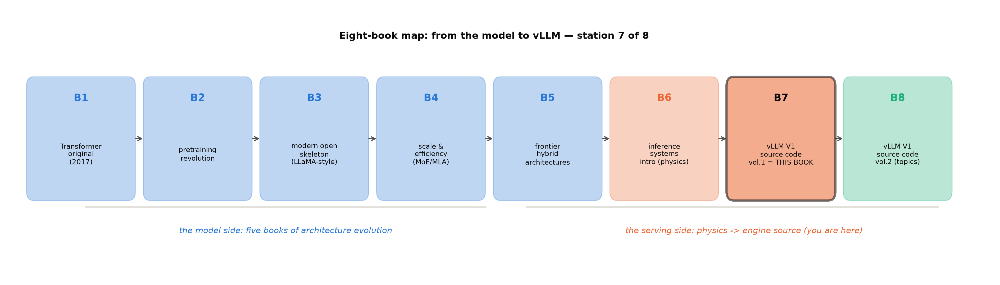

# 第 13 章 收束：一条请求重走全程

## 13.1 十七站重走

收束章的任务不是罗列知识点，是检验「忘掉细节之后还剩什么」。导览章开卷的许诺是「沿一条请求的生命周期把源码读穿」——检验它的方式只有一个：把这条线凭记忆重走一遍。下面每站一句话，是作者的版本；你的版本应该略有出入（详略不同、锚点不同），但**十七站一个不缺、两次越界位置不错**是硬指标：**每句话你都应该能指向一个具体的类或文件**，指不出的那一站，就是值得重读的那一章。

站 1-2（协议与校验，前端进程）：请求以 OpenAI 协议进门，`create_chat_completion` 校验参数、认出模型名（ch3/ch11）。站 3（模板）：chat 模板四级解析在这里换装——实测注入空 think 块的 4 个 token 是它的存在证明（ch3/ch11）。站 4（tokenize）：分词成 id、连同采样参数打包成 `EngineCoreRequest`——分词留前端是 V1 进程分工的第一笔（ch3）。站 5（队列）：请求过 `RequestOutputCollector` 前身式的登记，等桥（ch3）。站 6（ZMQ 出）：第一次进程越界——Python 对象经 MsgpackEncoder 变字节帧，`EngineCoreRequestType` 单字节打头（ch4）。站 7（add_request）：引擎核收件入 waiting 队列，记 `QUEUED` 时间戳（ch4/ch5/ch12）。站 8（schedule）：调度器的决策循环——token 预算、KV 余量、抢占，产出 `{request_id: num_tokens}` 字典（ch5——本册的心脏章）。站 9（KV 分配）：`KVCacheManager` 经 `allocate_slots` 给块、查哈希链定 APC 命中——56.0% 对拍的那本账（ch6）。站 10（输入装配）：`GPUInputAssembly` 把全批拼成张量、做成 attn metadata（ch7）。站 11（forward）：model runner 执行前向——MRV1/MRV2 双轨在此分派（ch7）。站 12（attention）：后端分派——NPU 侧 `AscendAttentionBackend` 的页式注意力与 antiquant 通道（ch8 的图执行与 ch9 的后端在此汇合）。站 13（sample）：Sampler 九步管线出 token id、混合批 torch.where 一箭双雕（ch11）。站 14（ZMQ 回）：第二次越界——`EngineCoreOutputs` 信封打包回前端（ch4 兼收、ch11 续讲）。站 15（输出处理）：唯一全批循环四步——指标、detokenize、logprobs、造 RequestOutput（ch11）。站 16（增量解码）：detokenizer 给字、stop 扣留宁可晚发不错发（ch11）。站 17（流回）：collector 缝合背压、SSE 五类事件逐块推出——`data: [DONE]` 收摊（ch11）。

重走的自测规则：每句话里的类名/文件名都应该是你「亲手敲过的」——grep 过、断点进过、或在实验日志里见过它的输出行。哪一站只有印象没有手感，回那一章补做它的实验件——这是比「读完」硬得多的达标线。离线链的读者再加一句：`LLM` 类的批量请求从站 4 直接跳到站 6（无 HTTP、无模板），站 7 之后与在线链完全同路——所以十七章里真正属于「在线」的只有头尾各三站，中间十一章全是两种形态共享的引擎本体，这个比例本身就是「引擎 vs 服务」两词的边界。

两次越界、三个进程、五份 config——现在闭上眼你能把这条线画出来。这就是「读穿」。

## 13.2 算法→模块：点名到类的总账

Book6 收束章的「主链路门」在此交割：推理物理学的每个算法，在 V1 里都有一个点名到类的模块。表 13.1 是总账——左列你在 Book6 手造过什么，右列它在引擎里长成了什么。读法建议两遍：第一遍竖读左列——那是一部浓缩的 Book6，每行背后都是你手算过的账与手写过的玩具；第二遍竖读右列——那是一部浓缩的 Book7，每行背后都有源码走查与实测对拍。两列之间的箭头，就是「机制心智→工业实现」的翻译本身——丛书后三册全部的叙事，压缩在这一张表里。

表 13.1 算法→模块对照总表（Book6 算法 → V1 模块；行锚为阅读锚 v0.30.0 样例）

| Book6 的算法（册·章） | V1 的模块 | 行锚样例 | 本册章 |
|---|---|---|---|
| 连续批处理（6·ch4） | `Scheduler::schedule` 决策循环（phase-less 字典） | scheduler.py#L561（def schedule） | ch5 |
| chunked prefill 调度折中（6·ch7） | token 预算两级（`max_num_batched_tokens`/`max_num_seqs`） | config/scheduler.py#L40-70 | ch5/ch12 |
| 抢占（6·ch7） | `preempt` 分支+重算式（RECOMPUTE 默认） | scheduler.py#L748-753（抢占选择） | ch5 |
| 分页 KV（6·ch5） | `KVCacheManager`+`BlockPool`（allocate_slots 五层） | kv_cache_manager.py::allocate_slots | ch6 |
| 前缀缓存（6·ch6） | 哈希块链满块 APC（queries/hits token 口径） | kv_cache_utils.py 哈希族 | ch6 |
| kernel 深化（6·ch8） | attention 后端族（NPU=AscendAttentionBackend） | attention/ascend.py | ch9 |
| 采样两家（6·ch9） | `Sampler` 九步管线+`TopKTopPSampler` native 路 | sampler.py#L26-59 | ch11 |
| 投机解码（6·ch10） | `spec_decode/` proposer 族+两段式验证接口 | spec_decode/ 18 项 | ch7（机制→Book8 ch2） |
| 量化推理（6·ch11） | checkpoint 白名单+反量化通道（int8 KV antiquant） | fused_infer_attention | ch9/ch10 |
| 图执行（6·ch12） | `CompilerManager` 分派+ACLGraph 捕放（6.15×） | acl_graph.py#L165 | ch8 |
| （无对应面：进程模型） | `EngineCore` busy loop+ZMQ 桥——mini 引擎=uniproc 近亲 | core.py#L1283 | ch4 |

最后一行是对照线的诚实注脚：Book6 的玩具引擎没有进程边界（调度与执行同进程同线程），V1 的进程拓扑是引擎实现层自己的新问题——这条「无对应面」恰是两册分工的边界本身。

## 13.3 两层账总决算：差距解剖

Book6 收束时留的最后一笔账：mini 引擎与真实引擎的差距有名字、有口径。现在三层解剖交卷（数字全部有底档，表 12.1 是总表；每层引用前先对齐口径——这是第 12 章的纪律在此的最后一次执行）。

**机制红利**（同一机制，引擎实现得更深）：APC 满块哈希链对齐块边界——mini v4 只能做到请求级前缀对齐，引擎把复用粒度压到物理块（56.0% 命中=手算天花板的逐位咬合）；attention 走页式 kernel，KV 永不搬家、指针间接寻址——mini 每层重算整段；采样是批级算子一次算整批（混合批 torch.where）——mini 逐请求循环。单点机制的实现深度差异，每一项都能在对应章找到对拍读数。**工程红利**（结构性的钱）：同模型同卡 eager 对 eager，vLLM 载 207M 的 23.1 ms 对 mini v2 的 59 ms=**2.6×**——批装配、内存复用、算子调度这些「不出论文的工程」叠加出的量级；它最诚实的地方是这个 2.6× 不含任何机制差异（同模型、同卡、同为 eager、同为贪心）——**纯粹的结构与工程**。**生态红利**（一个人的工程变成一个社区的工程）：平台插件让同一引擎长在六家硬件上（vllm-ascend 17 项插件接入、54 条 patch 的兼容层是它的日常维护费）、Day 0 模型支持、四道注册门让外部模型不进源码树也能服役——大项目穿过的就是这层。三层红利各值多少、怎么继续挣，是生产化的事——Book8 的地界。

## 13.4 钩子决算与移交 Book8

伏笔线是这套书的长记忆：五册埋向 Book6 的十八笔旧钩在那册收束时逐行销项，本册沿同一制度——进账五钩（Book6 押给本册的 B6 系）逐条兑现销项，出账 B7 系十一钩点好名册押给 Book8。决算的纪律沿 Book6：每钩「埋点/内容/回收落点/销项」四列可查、原句可回溯——欠账框在章末、台账在收束，两处对得上才算清。

表 13.2 钩决算（上半=进账五钩销项；下半=本册埋向 Book8 的 B7 系；B6-8 不埋注记沿用 Book6）

| 钩 | 内容一句话 | 落点与销项 |
|---|---|---|
| B6-1 | 自写压测→bench 三件套与参数扫描 | ch12 §12.5-12.6 **已销**（latency/serve fast 档+双轴扫描实测） |
| B6-3 | 哈希前缀 vs radix 之争 | ch6 **已销**（树 vs 链对照定谳） |
| B6-4 | 调度折中的引擎正身 | ch5 **已销**（决策循环+抢占三跑） |
| B6-6 | 图执行源码与 NPU 对照 | ch8 **已销**（ACLGraph 对拍 6.15×） |
| B6-9 | mini 引擎 vs 真实引擎终局对照 | ch10+ch12 **已销**（大项目三方对照） |
| B7-1 | hybrid KV cache manager 机制深讲（线性/SSM 固定状态统一分页） | Book8 ch1（ch6 埋） |
| B7-2 | KV 第四种省法：offload/tiering（B6-2 转址） | Book8 ch9（ch6 埋） |
| B7-3 | proposer 全家机制正身（B6-5 转址+两段式接口续讲） | Book8 ch2（ch7 埋） |
| B7-4 | 结构化输出管线（xgrammar/guidance 机制层） | Book8 ch3（ch11 埋） |
| B7-5 | 多模态与 LoRA 服务路径 | Book8 ch4（ch11 埋） |
| B7-6 | ubatching/dual-batch overlap | Book8 ch5（ch8 埋） |
| B7-7 | 多卡图模式的同步边界 | Book8 ch6（ch8 埋） |
| B7-8 | PD 分离工程生态（B6-7 侧账） | Book8 ch7（ch01 埋） |
| B7-9 | MoE 量化与 expert 权重加载 | Book8 ch8（ch10 埋） |
| B7-10 | 可观测生态（Prometheus/Grafana/fault tolerance/OTel） | Book8 ch9（ch12 埋） |
| B7-11 | sparse/indexer 族与 hybrid 组合后端 | Book8 ch1（ch9 埋） |

另有两条不埋的注记：MRV1 移除时点（v0.32 预计）是 Book8 开工的第一核对项——若锚已漂移，Book8 按差异附录的口径 rebase；fp8 观测实验与 ModelSlim 检查点产制沿 ch10 的显式登记（不做，理由与预注册预期在档）。

## 13.5 八册地图第七站

图 13.1 八册地图（自绘示意级）：左五册蓝系=模型侧的架构演化（原典→预训练→现代骨架→规模效率→前沿混合），右三册橙青系=服务侧（推理物理学→引擎源码上册→引擎源码下册）。本册是第七站——第一册教「Transformer 是什么」，这一册教「一台 Transformer 怎么被伺候好」。地图上前五册与后三册的分界，也正是「造模型的人」与「伺候模型的人」的换边处——Book6 导览立的那次转身，到这里完成了源码层的闭环：每一册架构演化造出的新账（MoE 的路由、MLA 的压缩、混合层的固定状态），都在这两册里找到了付账的模块。

## 13.6 带走的心智

三章收束成三句话。**其一，「一条请求的生命周期是引擎的纲」**：十七站、两个越界、三个进程——任何引擎、任何版本，先画出这条线就永远不迷路（读新版本时，这张图只需要改锚不需要改形；本册自己就是证据——阅读锚 0.30.0 与运行栈 0.27.1 隔着四个版本，十七条站序一步未乱）。**其二，「每个算法都有点名到类的家」**：凭 Book6 的机制心智，你能直接说出引擎里谁管这件事——判断力落地成导航力；反过来，遇到表 13.1 没有的新机制（比如 hybrid KV），先问「它付的是哪笔账、住在哪个子包」，导航力又还原成判断力。**其三，「双轨是纪律不是技巧」**：源码走查与运行实测互相作保的读法，从这一册起是你的默认读法——它适用于任何活跃开源项目，vLLM 只是教它的那个教室；哪天你读别的引擎，会发现「先 git 锚定、再日志分流、后对拍验证」的手艺原样可用。

下一册（Book8）沿这张地图走最后一站：proposer 全家的机制、结构化输出管线、多模态与 LoRA 服务、PD 分离工程、可观测生态——本册每章末欠账框点过的名，在那里逐个开箱。主线也换轨：本册沿一条请求走，下册沿一个个专题切——但地图不换：每个专题仍然长在十七站的某几站上，你此刻画得出的那张图，到下册还是导航仪。

**动手验证**（总测三件；选卡纪律照 CLAUDE.md）：
① 合上书画十七站：一张白纸、17 个框、两次越界箭头——画完对照 ch2 图 2.2 自评（能画出=读穿达标）；
② `grep -c "(EngineCore pid=" log/book7-00/vllm_smoke_eager1.log`——52：分流手艺的最小复演（ch12 §12.2）；
③ `python code/ch10/bench_207m.py --help 2>/dev/null || sed -n '1,15p' code/ch10/bench_207m.py`——大项目交付件的门脸还在原处。

---

## 册末附录 A：术语表（首现章对照）

| 术语（中英） | 一句话 | 首现 |
|---|---|---|
| 引擎核（EngineCore） | V1 的执行进程，busy loop 逐步推进 | ch1/4 |
| 消息桥（ZMQ bridge） | 前端与引擎核间的 IPC 消息层 | ch4 |
| 单进程模式（inproc mode） | `VLLM_ENABLE_V1_MULTIPROCESSING=0` 下的 InprocClient 直调 | ch12 |
| phase-less 调度 | 无 prefill/decode 阶段切换、只排「谁要几个 token」 | ch1/5 |
| token 预算（token budget） | 每步可排 token 总量的上限（`max_num_batched_tokens`） | ch5 |
| 抢占（preemption） | KV 不足时把 running 请求赶回 waiting | ch5 |
| 分页 KV（paged KV） | KV 按块分配的逻辑-物理分离 | ch6 |
| 块池（BlockPool） | 物理块的台账与分配器 | ch6 |
| 前缀缓存（APC, automatic prefix caching） | 相同前缀命中免算的哈希块链 | ch6 |
| 哈希链（hash chain） | 满块级前缀指纹：父块哈希+本块内容 | ch6 |
| 模型执行器（model runner） | 装配输入、执行前向、调采样的 worker 侧组件 | ch7 |
| 两段式（execute→sample） | execute_model 与 sample_tokens 分立的协议 | ch7 |
| MRV1/MRV2 | model runner 两代实现（v0.29 起 MRV2 默认） | ch1/7 |
| 输入批（InputBatch） | 全批请求状态的张量化台账 | ch7 |
| 编译（compilation） | torch.compile 路径的图捕获与 piecewise 切分 | ch8 |
| 图执行（graph replay） | 捕获计算图后单次发射重放 | ch8 |
| ACLGraph | NPU 的 CUDA Graph 等价物 | ch8 |
| attention 后端（attention backend） | 页式注意力算子的平台实现族 | ch9 |
| 权重映射（WeightsMapper） | HF 键名→vLLM 键名的翻译表 | ch10 |
| 注册面四门 | 内置注册表/平台插件/运行时注册/transformers 回退 | ch10 |
| 采样九步（nine-step sampling） | V1 Sampler 的 logits→token 管线 | ch11 |
| 增量解码（incremental detokenization） | 逐 token 出 delta 文本的解码器 | ch11 |
| 信封（EngineCoreOutputs） | 引擎核→前端的批量输出容器 | ch4/11 |
| SSE（server-sent events） | `data: {json}` 帧的流式协议 | ch11 |
| 三层法（three-layer reading） | 静态地形→动态跟跑→对拍验证 | ch2/12 |
| 行级锚（line anchor） | `文件#L行` 的源码引用纪律 | ch1 |
| 双轨口径（dual-track） | 阅读锚 v0.30.0 与运行栈 0.27.1 并行 | ch1 |
| 版本冻结（version freeze） | 全书锚定单 commit 的可复核性制度 | ch1 |
| 忙环（busy loop） | EngineCore 的 while 循环执行骨架 | ch4 |
| 进程拓扑（process topology） | 前端/引擎核/worker 三进程分工 | ch4 |

## 册末附录 B：源码地图（`vllm/v1/` 十五子包速查）

| 子包 | 职责一句话 | 本册章 |
|---|---|---|
| `engine/` | EngineCore/busy loop/输出处理器/消息类型 | ch4/ch11 |
| `core/sched/` | 调度器与请求队列 | ch5 |
| `core/`（除 sched） | KVCacheManager/BlockPool/前缀缓存 | ch6 |
| `worker/` | model runner（MRV1/MRV2）/InputBatch/LoRA mixin | ch7 |
| `compilation/` | CompilerManager/piecewise 后端 | ch8 |
| `attention/`（v1 侧接入） | 后端注册与页式接口 | ch9 |
| `model_executor/`（顶层） | 模型实现/层库/权重加载 | ch10 |
| `entrypoints/` | LLM 类/OpenAI 服务/bench 全家 | ch3/ch11/ch12 |
| `metrics/` | 指标聚合与 Prometheus 输出 | ch12 |
| `sample/` | Sampler 与采样算子 | ch11 |
| `spec_decode/` | proposer 族（机制=Book8） | ch7 点名 |
| `structured_output/` | 四后端结构化输出（机制=Book8） | ch11 点名 |
| `executor/` | uniproc/multiproc/ray 执行器族 | ch4 |
| `kv_cache_spec_registry.py` 等 | KV 形状规格注册 | ch6 点名 |
| `platforms/`（vllm 顶层） | 平台插件接口与六平台实现 | ch9/ch10 |

（17 站文件级速查=ch2 图 2.2 及其锚表；vllm-ascend 姊妹地图=ch9 §9.6/ch11 §11.6 的 patch 清单。）这张表的双向用法：读 Book8 前按行预习（每个子包一句话重建方位）、读完本套书后按行自测（能否把每行的「一句话」扩成一段）。

## 册末附录 C：版本差异附录（v0.30.0→v0.31.0，阅读锚之后的变化）

装了当期版本的读者与本册行锚对表的缓冲带：语义变化已在正文框注就地处理，此处收结构不动、但值得知道的条目——**框架是「正文管语义、附录管清单」**，两张表合起来就是 v0.30.0→v0.31.0 的完整影响面。

正文框注已覆盖语义变化项；此处收其余附录级条目（全部 {官方 release notes}，PR 号照录）：

| 区域 | v0.31 变化 | PR |
|---|---|---|
| 调度器 | 新增 `--max-num-active-seqs`（RUNNING 准入独立于 max_num_seqs） | #56758 |
| 调度器 | `n>1` 请求原子准入 | #53936 |
| 调度器 | `max_num_seqs` 非 8 倍数吞吐悬崖修复 | #57355 |
| KV 管理 | `release_kv_cache_memory()` 只释放 KV 内存 | #44890 |
| 执行层 | MRV2 补齐 draft-model 投机解码（两代 runner 完成度收口的活例） | #43091 |
| 执行层 | MRV2 补齐 custom logits processors | #56497 |
| 执行层 | FULL decode graphs 覆盖 one-token prompt tails | — |
| 图执行 | batch-invariant CUDA graphs（`VLLM_BATCH_INVARIANT`，数值可复现侧栏素材） | #57586/#56377 |
| 图执行 | parallel Triton warmup | — |
| 权重加载 | `ipc_cache` 守护进程扩展（DP/draft/health/readiness） | #57386 等 |
| 入口层 | OpenAI 层 launcher 目录重组（api_server 转发壳化——正文 A 级差异框注的余波） | — |
| 术语 | Responses API 面扩展（本册仅点名） | — |

判词沿用卷首冻结声明：附录级十二条、框注级十处、重大级零条——**阅读锚 v0.30.0 仍成立**；v0.32 若如节奏推算删除 MRV1，Book8 开工时按第一核对项处理。
