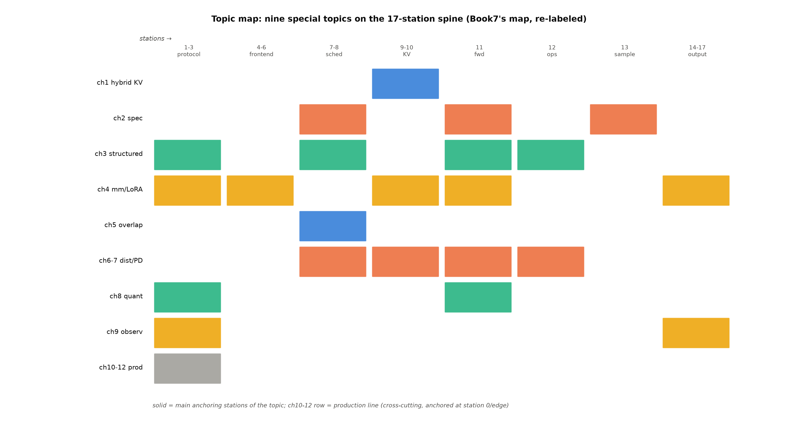

# 第 0 章 导览：地图、契约与三条贯穿线

## 0.1 你在哪里

丛书走到第八册（最后一册）。前七册的路：Book1-5 从 Transformer 原典一路讲到前沿混合架构（模型侧的完整旅程），Book6 立引擎无关的推理物理学，**Book7 沿一条请求的 17 站把 vLLM V1 主链路精读了一遍**（纵向的解剖刀）。「横向」的含义值得在开篇就掰清：横向不是浅——每个专题都挖到源码行级与实测底档；横向是**切入方式的差异**——Book7 从「一条请求的旅程」切入（叙事有天然的线性），本册从「一笔账的疑问」切入（每个专题由一个生产必问的问题领着走）。两种切入各有擅长：线性叙事长于建立全局感（知道每站挨着谁）、问题驱动长于建立判断力（知道每个机制为谁而设）——**丛书把它们排成先纵后横，正是让两种能力先后长齐**。本册（Book8）的角色因此是**横向的专题针**：在 Book7 立好的 17 站骨架上，开**九个专题章**（ch1-9：混合 KV/投机解码/结构化输出/多模态与 LoRA/调度重叠/分布式/PD 分离/量化/可观测——其中 **ch9 兼生产化线的起点**，双重身份）+**两个生产化章**（ch10 平台边界/ch11 选型容量）+毕业设计（ch12）+收束（ch13）。导航图不变——**Book7 图 0.1 的 17 站仍是本册每章开篇的坐标系**，每个专题长在其中某几站上（图 0.1）。

图 0.1 专题地图（母图；底图=Book7 图 0.1 的 17 站横轴改标，按 v0.30.0 源码自绘，示意级）：行=本册九专题+生产化线，列=17 站折成八组，色块=该专题的主锚定站；三段读法——横读一专题看它的地界、竖读一站看谁在此设账、整读看「专题横切」与「站段纵深」的正交性。

本册副题《专题与生产化》点破结构：**前九章是专题（每个讲透一个机制族），生产化线从 ch9 起步**（可观测是第一块砖）并在 ch10-11 走完（平台边界/选型容量）。专题的选择标准值得一提：它们不是按「模块距离」排的（那会变成目录抄写），而是按「**一笔账**」排的——每个专题回答一笔生产必问的账（KV 怎么省/步数怎么省/输出怎么约束/请求怎么变胖/时间怎么重叠/机器怎么变多/实例怎么分工/字节怎么压/出了事怎么知道）——九笔账问完，一台推理服务的全部经济学就过完了。这个「按账分章」的组织也解释了为什么专题章可以乱序读（账与账之间弱耦合、指针互指）而生产化章必须顺序读（三步是递进的）。

Book7 收束时的决算一句话重述（新读者的最近三站）：14 章主链路精读（站 1-17 每站有账）、大项目三方对照（自训 207M 对工业引擎——机制红利 2.6×/工程红利的分账）、十一钩出账（B7 系全数埋向本册）——**本册就是那十一钩的收账人**。

## 0.2 卷间契约三栏

**已知基础**（读到本册你应该已经有的——缺哪块回哪块，各约一章的补课量）：Book7 的 17 站导航+主链路模块图（每章开篇的站段坐标直接用它的语言）；Book6 的推理物理学全家（α/τ 账本、批处理五部曲、KV 三线、roofline——各专题的理论母账）；Book3-5 的架构面（GQA/RoPE/MoE/MLA/混合架构——被服务对象的形状）。**新增知识**：九个专题的引擎侧实现（机制+配置+实测三层——三层的关系是：机制让你懂、配置让你用、实测让你信）+生产化三步（可观测/平台边界/选型容量）+毕业设计。**架构修改**：无——模型冻结为 workload，本册只动引擎侧。这条「冻结」值得多说一句：它是丛书叙事的经济性选择——八册里模型侧的知识（Book1-5）已经齐装，本册的全部篇幅留给「引擎怎么伺候它们」；代价是模型演进（新架构/新模态）不在本册射程内——那些是「从模型到 vLLM」下一轮修订的候选地。

三栏契约的执行方式（本册各章开篇的最小背景栏就是第二栏的逐章实例）：读到任何前置概念时先看背景栏有没有指路——有则跳转（每次跳转约 2-5 分钟）、无则说明是本册新增（正文自足）。「架构修改=无」的另一面读法：**模型是常量、引擎是变量**——全书后三册的一切优化都在引擎侧发生，这是「推理系统」这个词的定义性特征（Book6 开篇立的判断在本册走到极致）。

## 0.3 章集群与读法

三集群的进度参考（给自学者的时间表）：机制族四章是「状态与行为」的专题——它们改的是引擎管的东西（KV 怎么组织/草稿怎么提/输出怎么裁/请求怎么变胖）；系统族四章是「时间与空间」的专题——它们改的是资源怎么排（时间重叠/空间分布/实例分工/字节压缩）；生产化四章是「从能跑到敢承诺」的专题——它们不改引擎、改的是你对引擎的知识（看它/懂它地基/为它算账）。十四章按账的类别分三集群：**机制族**（ch1-4——状态与行为的专题：混合 KV/投机/结构化/变胖）约三小时一个下午；**系统族**（ch5-8——时间与空间的专题：重叠/分布式/PD/量化）约三小时；**生产化+毕业**（ch9-12+ch0/ch13）约三小时。整块时间则从 ch1 直通 ch13（约 10-12 小时——本科一学期的量，你已走到最后一学期）。无论哪种读法，**本章的专题地图（图 0.1）与 ch13 的八册投影（图 13.1）是两个「随时回来看」的锚点**——前者告诉你现在在哪、后者告诉你走过什么。还有一个跨册锚点顺手立此：**Book7 的差异附录**（v0.30.0 对更早版本的 50 行差异）与本册的续表（#11-#27）合起来是「vLLM 演进日志」的两卷——升级运行栈前先扫这两份，是本册读者的例行公事。

分账的检验标准：三处各自可独立成立（ch2 不依赖 ch12/ch13 可读、ch12 引 ch2 底档不重跑、ch13 只记账不叙事）——**分账不是切香肠，是同一项目的三种视图**（技术视图/集成视图/资产视图）。

## 0.4 大项目总览（三章分账）

**207M+投机解码服务**：ch2 出技术核心与实测（ngram 1.40×/drafter τ=2.64）；ch12 出集成收拢、资产台账（表 12.1）与八册全链走查；ch13 出钩决算与八册终点——三章分账防灌水。资产五件全部自产（207M 注册链/2 层 drafter 89,134,080/hf_draft2m 五件套/lora_toy 双件/七臂矩阵底档），路径在 ch12 表 12.1。大项目在教学上的独特价值：它是**唯一贯穿「训练（Book3 管线）→注册（Book7 注册链）→服务（本册投机装配）」全链的自产资产**——每一环你都亲手碰过，所以每一环的机制你都不是「读过」而是「做过」；下载的模型给不了这个。

## 0.5 三条贯穿线

**①站段坐标线**：每章开篇「专题→站段→模块」三段定位——17 站是全书坐标系，读者任何时刻都知道「我们在哪台机器的哪里」。**②理论→工程对账线**：每个专题回收 Book6 的理论账本（投机 α→ch2、调度折中→ch5、KV 三线→ch1/ch9、量化四法→ch8、DistServe→ch7）——Book6 立的每笔账在本册找到它的引擎侧收款人；**对账的双向意义**：理论册的公式不再是抽象（每个都有一个能跑的落点）、工程册的数字不再是经验（每个都有一笔能验的账）——两册互相供血。**③生产化递进线**：从「能跑」（ch1-8 专题实测）到「看得见」（ch9）到「知道站在什么上」（ch10）到「敢承诺」（ch11）——下半场的主旋律。三条线的关系是经纬结：站段线是经（位置）、对账线是纬（深度）、生产化线是走向（方向）——每章都在三条线的交点上织自己的那块布；读者若在某章迷路，先自问「我在哪条线上丢了」——位置丢了回图 0.1、深度丢了回 Book6 的账本、方向丢了回本节。三线还有第四种用法（给复习者）：把三条线当**抽认卡的三个牌组**——站段线抽「这是哪站」、对账线抽「这笔账谁立的谁收的」、生产化线抽「这章让读者敢多承诺什么」——三组都能过，一册就算消化了。

读法预告一句（大纲钦定）：ch1 是全书最重的开篇——1.1-1.2 先立「两种内存一个池子」的图景即可上路（例 1.1 的块账是全书 toy 例的范式），1.3-1.5 的源码图谱随用随回不必强记。

## 0.6 各章一站速览

一句话+一个关键锚数字（锚的用法：读前扫一遍建立预期、读后回验一遍检查吸收、忘了时回来查——三个时机三种用法）：**ch1** 两种内存共一个池子（0.941× 准入账逐位咬合）；**ch2** 猜 token 省步数（ngram 1.40×——但 random 臂翻车记 shows「猜得准是联合属性」）；**ch3** 文法裁窄门（miss/hit 差两个数量级）；**ch4** 请求变胖基座不动（图模式 3.126×）；**ch5** 时间轴不空转（async 0.946× 负结果——红利是 T_cpu/T_npu 的函数）；**ch6** 一卡变多卡（A+DP+N=1+1+2 实测）；**ch7** SLO 各归各（448 MiB 的带宽账）；**ch8** 两本账换算（fp8 进门 ✓ 装载 ✗——561103）；**ch9** 看得见才管得住（指标 96 族→111 族——offload 开关在指标面自带旁证）；**ch10** 引擎的地基（收紧四案）；**ch11** 从 SLO 到卡数（式 (11.1) 三本账）；**ch12** 全链穿越（毫秒时间线——每行耗时都有账本来源）；**ch13** 收官（钩决算+八册终点）。十三个锚是全书的最小压缩——记住锚数字与心智，就保住了每章一半的判断力。速览的另一种用法是**反向自检**：读完全册后回来遮住右侧只看章名，自己补锚数字——补得出的章说明吸收完成、补不出的回读（比「再读一遍」高效——它精确定位了遗忘的洞）。

两册合读的具体走法示例（一次两小时的复习课）：拿 ch2 的投机专题为例——先读 Book7 §7.7 的装配接线（十五分钟）、再读本册 ch2 全章（六十分钟）、最后合上书自述「一条带 spec 的请求在 17 站怎么走」（四十五分钟）——**纵向给路线、横向给深度、自述给检验**，这个三段式适用于全部九个专题的复习。

## 0.7 与 Book7 的衔接（纵向×横向）

Book7 纵向给了**导航能力**（每个模块在哪、怎么走到下一个）；本册横向给了**深入能力**（每个感兴趣的模块挖到底）。两册合读：**纵向是地图、横向是景点**（地图防迷路、景点长见识——只有地图会纸上谈兵、只逛景点会只见树木——拿着 Book7 的地图走到任何一站，用本册的专题在该站下钻。已换血解禁的专题全家（PD 工程/结构化管线/mm 与 LoRA/可观测/kv_offload/proposer 接口/ubatching/ray 深讲/MoE 量化装载——Book7 期间全部是「点名带地址」的禁词，本册起为正菜）在这张地图上各自领到了地界——**hybrid KV 机制深讲**（九专题之首）领站 9、**proposer 接口**领站 8+12+13、**结构化管线**领站 3-13、其余各按图索骥。

> **最小背景栏**：Book7 图 0.1（17 站底图）、Book6 各理论章、Book3-5 架构面——三笔旧账被本册反复指回；每章开篇的最小背景栏告诉你指回哪页。纪律：本册不重教任何旧账。

> **【欠账】** 九个专题的第一个开箱——两种内存共享一个池子的 hybrid KV cache manager → 第 1 章。
