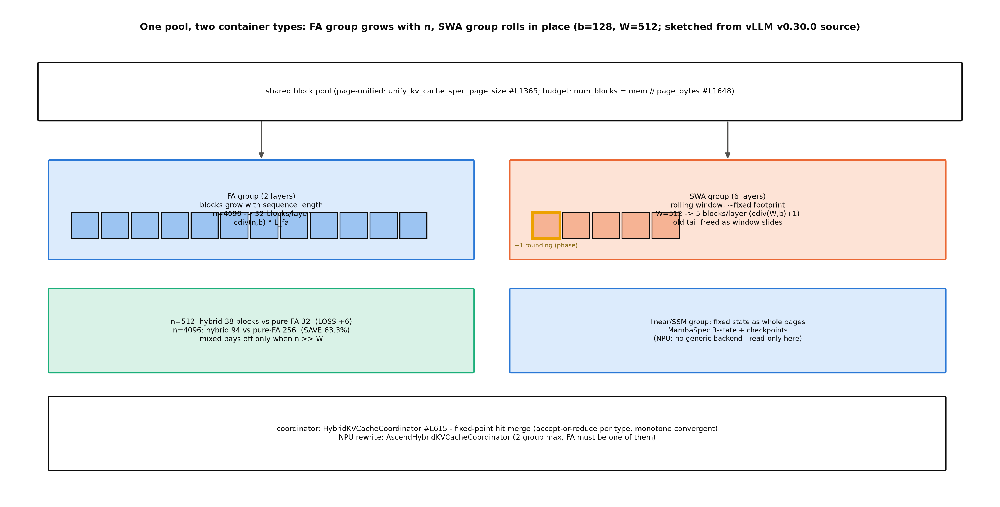

# 第 1 章 混合架构服务：hybrid KV cache manager

> 站段坐标：站 9 深讲（Book7 ch06 在此只留了「两类住客」一节即止），兼收站 12 的 attention 组合后端。B7-1 的欠账句在此开箱：「hybrid KV cache manager 的机制深讲（线性/SSM 固定状态与全注意力 KV 的统一分页、层型特化命中）→ Book8 第 1 章」。B7-11（sparse/indexer 族与 hybrid 组合后端）是本章第二主题，从 1.5 起并入。

## 1.1 一台机器，两种内存

Book7 第 6 章收尾时说过：KV 管理器里住着两类住客——「随长度长的 KV」与「定长不长的状态」，那一节（§6.7「两类住客」，一节即止）讲到「同一协调器、各组各账」为止，机制深讲押给了本章。上一册我们把 BlockPool 的四动作账（分配/释放/驱逐/上册——进来、出去、挤兑、记账）算得很熟——那是一本「单一种类住客」的账本；本章把住客变成多种类，看那套账本怎么被推广成「每组一本、协调器归并」的结构。Kimi K3 的官方技术报告（§5.4，p22）把这件事的分量说到了顶：服务一台 hybrid 架构的机器，要在百万 token 上下文里**同时维护两种本质不同的 cache 并联合管理**；新模块各自要专用 kernel；生产流量里单请求成本横跨三个数量级。三重挑战值得各停一拍：**「两种本质不同的 cache」**——MLA 的 KV 逐 token 增长、KDA 的递归状态每请求一份定长，若各开管理器就得上两套分配/逐出/传输逻辑，边界情形（谁先满、谁挤谁）没有好答案；**「专用 kernel」**——KDA 的 delta-rule 递归、Block AttnRes 的残差累加、稀疏 MoE 的路由，每个都不是通用 GEMM 能拼出来的，器件层的账我们在 1.4 的 NPU 边界见；**「单请求成本跨三个数量级」**——同一台机器上 128 token 的短问与 1M token 的长文档差四个数量级的 KV 账，预算式准入（机群级）因此成为必需，那条线在 ch7。报告的三层应对——引擎级 KDA-aware prefix cache、器件级专用 kernel、机群级亲和调度——恰好是本章、1.4、与 ch7 的三段分工。

B5-4 的前账在此回收：Book5 给 K3 立的官方定义句说的正是这件事——混合架构=「无界账本与定长记忆」同机并存；那册教的是**模型侧怎么设计**这两种记忆，本章教**引擎侧怎么伺候**它们。用人话说本章的问题：**一台机器里同时住着「越住越长的账本」（全注意力 KV）和「一成不变的大件行李」（线性/SSM 的定长状态），引擎用什么结构让它们共享一个池子、一套账本？命中怎么归并？NPU 这条腿走到哪了？**这是全书开篇最重的一章——先把 1.1-1.2 的图景立起来即可上路，1.3-1.5 可随用随回。三段定位补齐：专题=hybrid KV cache manager；站段=站 9 深讲（兼收站 12 组合后端）；模块=`vllm/v1/kv_cache_interface.py`+`v1/core/{single_type_kv_cache_manager,kv_cache_coordinator,kv_cache_utils}.py`+vllm-ascend 侧 patch。本章产出三件：机制图谱（1.2）、K3 工业对照（1.3）、四本账实测读数（1.6）。

> **最小背景栏**：滑窗注意力、线性注意力、GDN 的架构机制是 Book5 已教内容（ch02/ch05/ch06），指回不重教；本章只讲「引擎侧怎么伺候它们」。Book7 ch06 的块账四动作（分配/释放/冻结/抢占）是本章账本的底稿。

## 1.2 一个池子、一套账本、两种集装箱

先算一笔最小混合的账，把直觉立起来。

**例 1.1（双组最小混合的块账：混合不是免费午餐）** 仿真机：8 层=2 层全注意力（FA）+6 层滑窗（SWA，W=512）、块大小 b=128、每 token 每层 KV 2048B（与 Book7 207M 的账逐位同源）。两个工况：①序列长 n=512——纯 FA 要 $\lceil 512/128\rceil\times8=32$ 块；混合机 FA 组 4 块×2 层+SWA 组滚动窗 $\lceil 512/128\rceil+1=5$ 块×6 层=8+30=**38 块——比纯 FA 多 6 块**（SWA 的滚动窗要跨块对齐，+1 舍入块乘 6 层是纯开销）。②n=4096——纯 FA 32 块×8 层=256；混合机 $\lceil 4096/128\rceil\times2+5\times6=64+30=$ **94 块，省 63.3%**。教学点：**混合省显存的前提是 $n\gg W$；短序列上混合是亏本生意**。那个 +1 舍入块不是拍脑袋，源码注释给了机制：

```python
# vllm/v1/kv_cache_interface.py#L833-841（骨架摘录）【源码：阅读锚 v0.30.0】
        # +1 because the sliding window may not start from the beginning of
        # the block. E.g. block size 4 and num_token 4 needs two blocks
        # [XXCD][EF] to store the 6-token window [CDEF].
```

指名看什么：窗在块内**不对齐起步**（[XXCD] 的 CD 是窗的头两 token）——同样的 token 数，窗起点的相位决定多占一块；紧邻的上文还交代了 chunked prefill 期「窗内已算 token+在途 token」的持有语义与 spec 解码的 `extra_retained_tokens` 追加持有——一段注释三层语义，是「读源码注释比读文档细」的活例。

机制图像就位：**一个池子、一套账本、两种集装箱**——FA 的 KV 是散装小件逐 token 装、SWA 是滚动窗、线性/SSM 的状态是大件行李一整块，但都装进同样尺寸的页（图 1.1）；后文一切机制（分组、归并、预算）都是这个图像的工程化展开。



图 1.1 混合组块布局（按 v0.30.0 源码自绘，示意级）：FA 组块链随 $n$ 增长、SWA 组滚动窗原地踏步（黄框=+1 舍入块）、页统一与预算公式在池顶；底行账板=例 1.1 两工况的胜负手。谁来判定「这是台混合机器」？一条五步判定链，每步都有行锚：①模型 config 供料（`layer_types` 逐层类型、`sliding_window` 窗宽、mamba 层混排——1.6 的变身实验就是在这一步注入：`--hf-overrides` 改写 config，下游四步全部无感跟随，这是「config 即契约」设计的直接红利：**混合机的开关不在引擎代码里，在模型的 config 里**，引擎只做忠实读者）；②每层自报缓存规格（spec，正身 `KVCacheSpec`；`vllm/model_executor/layers/attention_layer_base.py::get_kv_cache_spec`#L40——mamba 系另走 `layers/mamba/abstract.py#L67`）；③runner 收集全模型的 spec 清单（`gpu_model_runner.py#L7558`；kv_sharing 同层共享的跳过逻辑 #L7569-7579）；④按 uniform 类型分组成 KVCacheGroup（新 spec 类型可经 `kv_cache_spec_registry.py::L191 register_kv_cache_spec` 插挂注册——HiSparse 三态就是这样长进来的）；⑤工厂看组数分派协调器（coordinator，正身 `KVCacheCoordinator`；`get_kv_cache_coordinator`#L1014）：零组可缓存→NoPrefixCache（#L477）、一组→Unitary（#L529）、**多组→Hybrid（#L615）**。纯 FA 的机器在这条链上走到底只有一组、拿到 Unitary——「混合」不是开关，是分组结果的派生事实。

Hybrid 协调器的构造期还押着四道闸（都值得记，因为每道都是一个真实部署踩过的坑）：可缓存组的 block_size 必须整除 hash_block_size（断言直接抛）；DCP>1 时只许 FA+Mamba 两类组（通信对齐的硬约束）；`enable_partial_hash_hits` 的判定（需 MambaSpec align 模式且各组 manager 都支持细粒度 hash 查找，否则告警降级——1.6 实验分支②的主角）；`cache_hit_alignment_tokens` 双档对齐。命中期的心脏则是这段定点迭代：

```python
# vllm/v1/core/kv_cache_coordinator.py::KVCacheCoordinator.find_longest_cache_hit #L841-848
# （骨架摘录）【源码：阅读锚 v0.30.0】
        """
        Find the longest cache hit using an iterative fixed-point algorithm.

        Each attention type either accepts the current candidate length or
        reduces it. If any type reduces the length, restart checks over all
        types. This converges because length monotonically decreases and is
        bounded below by 0.
        """
```

指名看什么：算法的全部正确性论证就这两句——「每类要么接受要么压低；长度单调降且有下界，故收敛」。满注意力「向下封闭」（更短的前缀当然也命中）所以只查一次、后续只裁剪（#L894-901）；simple hybrid（1 FA+1 其他）一轮即收敛（#L872-876）；EAGLE 组有个奇特的约束——每候选长度至多 drop 一块（#L878-941，issue #32802 的修复现场）。返回三元组里藏着 hybrid 特有读数 `num_uncached_common_prefix_tokens`（#L970-973）——「公共前缀里有多少 token 其实没被缓存」，它是 1.6 账 3 的主角。

图谱四件套——spec 全类（表 1.1）、manager 全类（表 1.2）、页统一与预算入口、三态协调器：

**表 1.1 spec 全类对照**（15 具体子类=4 中间+11 叶子——HiSparse 双属叶子、实验子系统；计数外基类/容器 3 件）

| 族 | spec（锚=kv_cache_interface.py） | 状态形态 |
|---|---|---|
| 全注意力 | FullAttention / MLA / HiddenState / SlidingWindowMLA | 随长增长 |
| 滑窗族 | SlidingWindow#L807 / RSWA / ChunkedLocal / CircularBuffer | 滚动窗（近定长） |
| 线性/SSM | Mamba#L993（三态 cache_mode+checkpoint 三字段） | 定长状态 |
| 混合尾部 | KpoolTail / Cross / Sink / UniformType 容器 | 各类尾部特化 |
| 稀疏双 | HiSparseHotSpec#L415 / HiSparseResidentSpec#L449（实验子系统，ch9 地界） | 三区异构 |

**表 1.2 manager 12 类**（每组一个记账者——类型特化的命中规则住在这里）

| manager（`single_type_kv_cache_manager.py` 锚） | 管什么 |
|---|---|
| FullAttention#L737 | 全量 KV 的常规账（Book7 的原型账本） |
| SlidingWindow#L944 | 滚动释放：窗外块随 decode 逐块回收 |
| RSWA#L898 / ChunkedLocal#L1286 / CircularBuffer#L1193 | 滑窗族变体（重扫窗/分块局部/环形缓冲） |
| Mamba#L1444 | 固定状态+checkpoint 生命周期（CoW 快照） |
| KpoolTail#L1282 / Cross#L2130 / Sink#L2195 | 尾部特化/跨层/下沉等各类小众账 |
| HiSparse 三态#L2219/#L2406/#L2489 | 稀疏三区（Source/Hot/Resident——ch9 地界） |

读表 1.2 一次——每行是一个单类型管理器（manager，正身 `SingleTypeKVCacheManager`）：**每行就是「这种状态的命中规则与释放时机」的一个专门实现**——SWA 行管滚动释放（1.6 实验 A 的稳态账主角）、Mamba 行管 checkpoint（例 1.2 的三态账）。页大小统一与预算入口在 `kv_cache_utils.py`：`unify_kv_cache_spec_page_size`#L1365（把所有组的页对齐到同字节）→`get_kv_cache_config_from_groups`#L1648（**num_blocks=可用内存//每块字节**——混合机的预算公式与纯 FA 同形，只是「每块字节」已经过页对齐）。

分组不是纸上谈兵——设计文档（`docs/design/hybrid_kv_cache_manager.md`，246 行，自注 early stage、滞后处以代码为准——见 1.3 末考据框）用五个 Cases 把真实模型的分组账走了一遍，推演链值得照抄进直觉：Cases 1-3 从玩具（1 full+3 sw）到规则配比（2 sw:1 full——**连续同型层合成一组**是首要规则）到不规则（Gemma-3-27b 的 52 sw+10 full：滑窗组取 min 分组数+尾组 padding——层不按配比排队时引擎的应对）；**Case4 是本章最值钱的一步**：hybrid mamba（不同 kv_hidden_size）时**增大注意力 block_size 直到 ≥ state_size、mamba 状态按页 padding**——「页统一」不是对齐到最小而是凑到最大，零头用 padding 吃掉；Case5 收 KV sharing——共享的层不另立组、不另花显存（判定链第③步的跳过逻辑 #L7569-7579 即其实现面），MQA/GQA 的跨层共享在混合机里沿同一机制泛化。

**例 1.2（Mamba 三态账：固定状态的显存↔可命中性三角）** Mamba 组的 spec（`kv_cache_interface.py#L992-1006`）带三态 `mamba_cache_mode` 与 checkpoint 三字段（`num_prefill_checkpoint_blocks`/`prefill_checkpoint_alignment`/页大小）。toy 三态：1 页/层（小状态，最省显存但 checkpoint 无处安放→前缀缓存对 Mamba 组失效）、2 页/层（运行态+重放/CoW 态——常数 2、尚无 checkpoint 槽；要 K3 式端点 checkpoint 需再加 num_prefill_checkpoint_blocks 页）、32 页/层（K3 级多 checkpoint——命中语义完整但显存地皮大）。教学点：**固定状态的「可命中性」要用 checkpoint 页买**——显存、可命中性、页数是个三角，没有免费顶点；`MambaSpec.max_memory_usage_bytes` 的公式（align=page×(2+spec+ckpt)）就是这三角的解析式，实验 C 的账 4 与它对账。

## 1.3 K3 的答卷：双粒度解耦与两段式查找

vLLM 的这套机制不是凭空长的——K3 报告 §5.4.1（p22-24，Fig.12）给了工业级答卷，而且报告章节与 vLLM 模块几乎一一对应（逐点对应收进表 1.3）。先看页内布局的讲究：**所有头的状态按头连续存放**、每头的字节流自包含——这不是随便选的格式：自包含的头流正是**跨节点传输的最小单元**（PD 分离时按头搬、不拆页重组）；1.2 的「页统一」管页间对齐、这里的「头连续」管页内布局，两层格式约定合起来才把「一个池子」兑现到可搬运。K3 的三重约束里最扎手的一条：block-hash 前缀缓存要求**所有层共享一个 block size**，而 KDA 层每序列只有一个大状态、快照只能存在稀疏边界——共享块被逼到 1024-6144 token，hash 粒度也被拖着变粗，**粗到短于一块的请求永远无法复用**。解法是**双粒度解耦**：hash 在 MLA 页内跑细块（512 token），物理块仍是粗分配单元；KDA 方向相反——checkpoint 只存在 MLA hash 端点上（只有这些位置是查找可能引用的位置）。

prefill 期的注册侧同样精巧，值得三笔：**部分填充的 MLA 页**以「最后一个完整 hash 块的链式 hash」注册进索引（每个 hash 覆盖此前全部 hash 块——匹配端点即认证整条前缀），注册端点随页填充前移；KDA kernel 每次前向后**在最后处理的 hash 对齐位置持久化递归状态**——checkpoint 只在会有人来查的位置存在；被请求推进超越的中间 checkpoint **回收**，会话轮次边界处的保留供跨请求复用——缓存 checkpoint 是只读快照：命中=拷贝进请求私有运行状态、新 checkpoint 写新槽、对他人可见的 checkpoint 从不就地改（并发安全就靠这一条）。还有个工程趣闻值得考据框：原文说类型混淆访问会得到**垃圾而非「看似合理的数据」**——池化布局自带的零开销 sanity check。

**例 1.3（K3 Fig.12 两段式查找：在物理块内部命中）** toy 数字复刻官方例：物理块 6144=12×512 hash 块；请求前 2800 token 匹配→命中 B=2560=5×512——**命中点在物理块内部深处**，不是块边界。恢复动作：B 处的 KDA checkpoint 拷入请求私有状态+部分 MLA 块 CoW，[0,B) 零重算。命中的完整判据=「MLA 段链式 hash 最长匹配」+「KDA 段每组 checkpoint 都在」——**命中长度总是 hash 块倍数、不要求物理块倍数**。报告机制与引擎实现的逐点对应收进**表 1.3**（详映射在 notes/08）：

**表 1.3 K3 §5.4.1 机制 ↔ vLLM v0.30.0 实现**（报告页码↔源码锚）

| K3 报告机制（页） | vLLM 实现（锚） |
|---|---|
| 统一分页、页同字节（p23） | `unify_kv_cache_spec_page_size`#L1365 |
| 细 hash 块 512 /物理块 1024-6144（p23-24） | `prefix_match_unit`（hash 粒度）+块大小解析 |
| KDA checkpoint 只存 hash 端点（p24） | `MambaSpec.num_prefill_checkpoint_blocks`/`prefill_checkpoint_alignment=16`（K3 覆写） |
| 两段式查找（MLA 链 hash→KDA 逐组验证，Fig.12） | `HybridKVCacheCoordinator.find_longest_cache_hit`#L841 定点迭代 |
| checkpoint 只读快照/新槽写入（p24） | Mamba manager 的 CoW 语义（`single_type_kv_cache_manager.py#L1444`） |

（PD 分离下 prefill/decode 节点 TP 度不同时在传输路径上 re-layout、GPU 侧零重排——这条留 ch7。）

> **【考据框】节号与引文**：Book5/本册任务书曾按「K3 报告 §5.4」引用——正身是 §5.4 Inference and Online Serving（p22 起，三重挑战在此总起），KV 联合管理是其子节 **§5.4.1 KDA-Aware Prefix Cache Management**（p22-24）；本册一律用正身节号。
>
> **【考据框】page_size 同名不同账**：设计文档的 page_size=num_layers×block_size×kv_hidden（整层一页），代码 `KVCacheSpec.page_size_bytes`=block_size×kv_hidden（单层单块）——文档自带 note 声明口径差；且该文档自注 early stage，前缀缓存段「只支持恰好两种注意力型」已滞后于 v0.30.0 代码（不动点多组）。**成书以代码为准**，文档只作设计意图的旁证——这是读官方设计文档的通用姿势。

## 1.4 vllm-ascend 侧重写与 NPU 边界

跨到 NPU 侧，vllm-ascend 对协调器做了**整件重写**：`patch/platform/patch_kv_cache_coordinator.py`#L70 的 `AscendHybridKVCacheCoordinator`（654 行）——与上游同名物相比有两处收紧：**只支持两类组且其一必须是满注意力**（上游的通用多组不动点在这里被收窄成「FA+任意一组」的简单混合）。配套两件：`_ascend_resolve_kv_cache_block_sizes`（#L51——块大小取 LCM×dcp、hash 块取 GCD 的分支；上游正身=`v1/core/kv_cache_utils.py#L717`）与 `_get_kimi_k3_dspark_mixed_kv_cache_groups`（#L87——K3-DSpark 的混合分组特判，hash 块取各组块大小 gcd：**粒度必须被所有组整除，链式 hash 才能在组间比对**）。为什么 NPU 要整件重写而不是继承？上游协调器的多组不动点假设了各 manager 命中规则的成熟度，而 NPU 栈的 manager 面（滑窗算子 sparse_mode、Mamba 无通用 backend）还没长齐——**收紧支持面换确定性**，与 ch3 将见到的单后端 patch 是同一个平台哲学。补一笔语义细节：上游协调器的 `enable_partial_hash_hits`（基类类属性 #L71 起）允许「部分 hash 命中」——MambaSpec align 模式下细粒度 hash 查找可以命中到 checkpoint 边界而不必整块；NPU 重写版把这条路径的触发条件收得更紧（判定在构造期 #L700-719，不满足则告警降级）——1.6 实验 B 分支②的那个「计数语义差」，机制根源就住在这类条件分支里。算子面：NPU 滑窗走 `sparse_mode=4` 原生支持；支持矩阵里 Qwen3-Next/Gemma-2/3/GLM-5.x 在册——注意这份名单与 Book5 的混合架构章几乎重合：**架构侧每出一台新混合机，引擎侧就多一行支持矩阵**，两册书在这里互为索引；**Gemma-3-4B-it 有 A2 系单卡 CI 配置**（TP=1/len 4096/eager——官方 CI 每日跑通的「最小混合机」，下载接口在册，实验 D 预留）。边界也要如实钉死：**NPU 无通用 mamba/linear attention backend**——线性/SSM 组在 NPU 栈属阅读面（这也是表 1.1 的 Mamba 行在本机只有「仿真账」可讲的原因）。

## 1.5 第二主题：sparse/indexer 族与组合后端

从「状态异构怎么共管」转到「后端异构怎么组合」（B7-11 兑现）。NSA/DSA 谱系的引擎侧住在 MLA 目录下：`vllm/v1/attention/backends/mla/indexer.py#L55` 起——`DeepseekV32IndexerBackend`（V3.2 即 DSA 正身）→V4→V41→KpoolTail（GLM 系），registry 另有 MiniMax-M3 的 sparse/MSA 系（`backends/registry.py#L93-132`）。两笔账值得记：其一，indexer 的 K cache **强制量化**（V3.2 走 fp8 layout、Blackwell 专属 mxfp4）——稀疏检索的索引结构天生为低压存储设计：top-k 检索要的是序不是精度，索引向量压到 1 字节/维，检索账便宜一个数量级，这与 ch8 量化的「权重量化省带宽」是同族不同物（那是算子账，这是索引账）；其二，这些后端与 hybrid 组合（HiSparse 三态 spec——Source/Hot/Resident 三区各管冷热数据，就是为此长出来的）——「混合组管状态异构、组合后端管检索异构」，两套异构在站 9 与站 12 两个层面各自成谱，读新架构的引擎支持面时先问它落在哪一谱。MLA/DSA/SFA 的实测=云 GPU 选做——已按作者裁定登记「选做不做」（Book7 ch9:162 欠账以此销项）。

## 1.6 实验：本机实测+仿真四本账

谱系与支持边界都立住了，现在把四本账落到本机读数上。

**实验 A（hf207m 零下载变身——主实验）**【本机实测（Atlas 910B3，CANN 9.1.0，运行栈 vllm 0.27.1+vllm-ascend 0.27.1rc1）：底档 `log/book8-00/r10_hybrid_override.{py,json,log}`+基线 `log/book7-00/vllm_smoke_eager1.log`】：`--hf-overrides` 注入 `layer_types=["full_attention","sliding_attention"]×6`+`sliding_window=256`，12 层满注意力的 hf207m 变成双组混合机——**零下载、一行 config**。这一跑的机制走位值得复盘：`hf_overrides` 注入 config → 判定链第①步供料 → 六层自报 sliding spec → 分组成 FA+SWA 两组 → Hybrid 协调器上岗 → 预算入口按页对齐后的块字节算 num_blocks——**五步全部无感跟随，一行配置生效到池子**；启动日志的 config 行与容量行（底档 log#L10 原样）就是这条链的可见端点。

容量读数给了一堂「指标量的是什么」的课。三个数先摆正：同参数纯 FA 基线（Book7 底档）**1,038,080 token**（并发 1013.75×）；变身机（1024 档）**977,016**（954.12×）——比值 **0.941×，混合机反而略小**；2048 档同口径 1,044,224 vs 1,012,704=**0.970×**。为什么省显存的混合机池子反而小？因为「GPU KV cache size」这个启动指标按**每请求准入上限定池**，不看稳态：`SlidingWindowSpec.max_admission_blocks_per_request`（kv_cache_interface.py#L816-841）= $\lceil\min(W{-}1{+}\text{mift},\ \text{len})/b\rceil{+}1$——本栈 max_in_flight_tokens≥8192 大于 max_len，SWA 准入退化为 $\lceil\text{len}/128\rceil{+}1$：1024 档 9 块/层 vs FA 的 8。每请求单位：混合 $2{\times}8{+}6{\times}9{=}102$ 块 vs 纯 FA $96$ 块——$96/102{=}0.9412$，与实测**逐位咬合**（2048 档 198 vs 192=0.9697 同构）。**1.2 的「混合省显存」省在稳态滚动释放（窗外块随 decode 释放、HBM 实占下降），不在启动容量指标**——两个账本 again：准入上限是池子的账、滚动释放是流量的账，读指标前先问它量的是哪本。（作者注：早稿曾拿 510,208 当基线算出 1.914×——那是带 drafter 的 spec 跑，draft 模型分走一半预算的污染对照；真基线一直在 Book7 的底档里。）

**例 1.4（准入账推演：0.941× 从哪来——实验 A 的理论侧）** 用准入公式（与式 (1.1) 同族的准入版）反推：W=256 但 mift≥8192 压过 max_len=1024，SWA 每层准入 $\lceil 1024/128\rceil{+}1{=}9$ 块（窗再小也至少按整段上下文+1 块准入）；FA 每层 8 块。每请求单位 $2{\times}8{+}6{\times}9{=}102$ vs 纯 FA $12{\times}8{=}96$——池子容量 $\propto 1/$单位，$96/102{=}0.9412$，与实测 0.941× **逐位咬合**。而**稳态**持有走另一本账：序列推进后 SWA 组滚动释放到 $\lceil W/b\rceil{+}1{=}3$ 块/层，实占 $2n{+}6{\times}384$ token 当量——长序列下接近纯 FA 的一半。**准入上限与稳态持有是两本账：启动指标只认前者，省显存的收益住在后者**——这正是读任何容量指标前的第一问。


**实验 B（变身命中率——Book7 例 6.4 workload 续账）**【本机实测（Atlas 910B3，CANN 9.1.0，运行栈 0.27.1+vllm-ascend 0.27.1rc1）：底档 `log/book8-ch01/exp_ch01_hit_*.json`】：workload 原样复用（4 前缀×4 请求、prefix 1000 不整除 128、suffix 200、输出 32、率 2/s），FA 基线臂与变身 W=512 臂各一进程。读数：**FA 基线 56.0%（hits=10752=12×896、queries=19200=16×1200）——与预注册天花板逐位咬合**；**变身臂 56.0%——落在预注册分支②**（主分支预期 32.0%=min 归并语义）。分支②的判读分两层。表层：混合机的命中计数走了 **FA 语义**而非 min 归并——hits=10752 恰=12×896（FA 组的可缓存前缀），SWA 组在 W=512 下理论只能常驻 512/前缀（min 语义应得 12×512=6144、32.0%）。深层：这个 24 个百分点的差不是 bug 而是**语义选择**——上游 Hybrid 协调器的定点迭代按 min 归并（实验 C 账 3 的解析式），NPU 重写版在本地（非 PD）场景的计数路径没有走这套归并；「命中的定义」在两套实现里不同，恰是 1.4 那句「收紧支持面换确定性」的量化注脚。机制根源**待查**：已知不是 partial_hash 路径（本地无 Mamba 组时该路径恒不触发——patch#L166-170 判定条件所限），ascend 版协调器本体仍是 min 归并（#L377 起与上游同构），嫌疑落在指标/调度侧的计数口径——逐行核验列入 ch9 回账清单。**预注册三分支的价值在此兑现：落在哪支都有账可对，且每支都产教学点**。

> **【版本差异框注】命中的定义在两套实现里不同**：阅读锚 v0.30.0 的 Hybrid 协调器按 min 归并语义计数（W=512 档理论 32.0%）；运行栈 0.27.1+vllm-ascend 实测走 FA 语义计数（56.0%）。计入卷级差异清单续表；#56227（SWA bounded replay）随本章切分定级=附录级。

**实验 C（仿真四本账，纯 CPU）**——扫掠件 `code/Book8-vLLM源码剖析下/ch01/exp_ch01_sim.py`（逐位判据预注册，**四账全闭合**，底档 `exp_ch01_sim.json`）：账 1 块布局=例 1.1 的手算账（38/94 vs 32/256——仿真器按 workload 全长 n=1232 出同构账 30/20 vs 120，两口径如实分记）；账 2 显存预算——式 (1.1)

$$L_{fa}\,n\,c_{tok}+L_{sw}\Big(\Big\lceil\frac{W-1}{b}\Big\rceil+1\Big)b\,c_{tok} \tag{1.1}$$

| 符号 | 含义 | 量纲 |
|---|---|---|
| $L_{fa}/L_{sw}$ | FA/SWA 层数 | 层 |
| $n$ | 序列长 | token |
| $W$ | 滑窗宽 | token |
| $b$ | 块大小 | token/块 |
| $c_{tok}$ | 每 token 每层 KV 字节 | 2048 B |

的用人话版：FA 层付「全长×单价」、SWA 层付「一个窗+一块零头的固定月租」；n=4096 代入：FA 侧 $2\times4096\times2048=16$MiB、SWA 侧 $6\times5\times128\times2048=7.5$MiB，合计 **23.5MiB** vs 纯 FA 的 64MiB——**省 63.3%**，且与账 1 的块数比逐位互证（94/256=0.367≈1−0.633——两本账一本数块、一本数字节，算的是同一笔钱）；账 3 命中率阶梯（W=128/256/512/≥1024→**8.0/16.0/32.0/56.0%**——12 缓存请求×min(896,W)÷19200，min(FA,SWA) 归并语义的解析式）；账 4 Mamba 三态（1/2/32 页·层的显存↔可命中性三角）——并与源码公式对账：`MambaSpec.max_memory_usage_bytes` 的 align=page×(2+spec+ckpt) 与仿真的三态数字同构（仿真器账 vs 源码公式账的逐位互证，Book7 双口径互证要素的同构延伸）。

**例 1.5（命中率归并对账：56.0%→32.0% 的跨册续账）** 三步小账先立住：FA 组可缓存前缀 896 token（7 满块×128）、SWA 组 W=512 常驻窗 512、min 归并→12 缓存请求×512÷19200=**32.0%**；uncached=896−512=**384** token/前缀（SWA 窗外每次重算）。同一 workload 三种读法：Book7 纯 FA 实测 56.0%（天花板）；本册仿真 W=512 档 32.0%（min 归并的理论值）；本册实测 56.0%（分支②——计数语义未归并）。三个数并排，读者第一次看见「同一个命中率指标在不同语义下差出 24 个百分点」——**读混合机的命中率，先问归并语义**。第三读法藏在协调器返回值的第三个字段：`num_uncached_common_prefix_tokens`（#L970-973）——就算计数器报了 56%，混合机仍要如实告诉你「公共前缀里有多少 token 其实没缓存」：SWA 组窗外的 384 token/前缀每次都要重算。**计数器的语义可以选，重算的物理账不能骗**——这是读一切命中率指标的最后试金石。

**实验 D（Gemma-3-4B 下载接口预留，不跑）**：真模型混合组对照（34 层 5:1、W=1024，CI 配置单卡 TP=1/len 4096/eager 每日跑通）——批二资产窗口再定是否下载；它将回答「仿真账在真模型的非均匀层序上还准不准」这一步，彼时例 1.1 的 toy 配比与 Gemma 的 5:1 真配比可直接对表。

## 1.7 本章小结

回扣开篇：两种内存共享一个池子的答案分三层——spec 15 类是「每层自报住什么形态」的契约、manager 12 类是「每组各自记账」的账本、三态协调器是「归并出到底命中多少」的裁判；K3 的双粒度解耦（细 hash/粗物理、checkpoint 只存端点）给了这套结构工业级的正当性与表 1.3 的逐点对应；NPU 侧整件重写并收紧到两类组——支持面换确定性。实测把三层都上了读数：一行 config 变身（准入账 0.941× 逐位咬合——启动指标量的是准入上限这本账）、命中率三分支（FA 逐位咬合 56.0%/hybrid 落分支②=计数语义差假说、根源待 ch9 核验）、仿真四账逐位闭合（块数/字节/阶梯/三态四本账互证）。

**带走的心智**：其一，**混合机的账本在组不在池**——同一个池子里每组各有命中规则，「命中率」这个词在混合机上是复数；其二，**混合不是免费午餐**——$n\gg W$ 才省、短序列反亏（+1 舍入块乘层数是纯税）；其三，**双粒度解耦是个通用模式**——「粗粒度分配、细粒度索引」（K3 的 6144 物理/512 hash）在任何存储系统里都会再见（OS 页表、数据库页/行，同一思想的三次发明）；其四，**config 即契约**——混合机的开关在模型 config 不在引擎代码，判定链把「忠实读 config」贯彻到池子，这是变身实验一行配置生效的机制根源，也是新架构接入引擎的推荐路径。

下一章换一种「猜」的省钱法：不再压缩状态的形态，而是猜 token——投机解码的 proposer 全家与服务装配。两章恰好是「KV 账」的两端：本章把每 token 的 KV 变便宜（窗钉死一半层），下一章把每步前向多产出几个 token（一次验证出一串）——省显存与省步数，混合架构与投机解码在生产部署里常常同开，两笔账一起算才是完整的容量规划（ch11 见）。

> **【欠账】** kv_offload 对混合组的第四种省法 → 第 9 章；实验 B 分支②的归并语义逐行核验 → 第 9 章回账清单。

**动手验证**（三件；选卡纪律照 CLAUDE.md）：
① 变身容量账一眼：`ASCEND_RT_VISIBLE_DEVICES=<空卡> python log/book8-00/r10_hybrid_override.py` 后 grep `GPU KV cache size`，与纯 FA 基线 `grep ... log/book7-00/vllm_smoke_eager1.log` 对比——0.941× 与准入公式 96/102 应逐位咬合；
② 仿真四账：`python code/Book8-vLLM源码剖析下/ch01/exp_ch01_sim.py`——四个 checks 应全 True；
③ 命中率两臂：`python code/Book8-vLLM源码剖析下/ch01/exp_ch01_hit.py --arm baseline --out-name my_fa` 复跑基线——56.0% 应逐位复现（同 seed 同 workload）。
