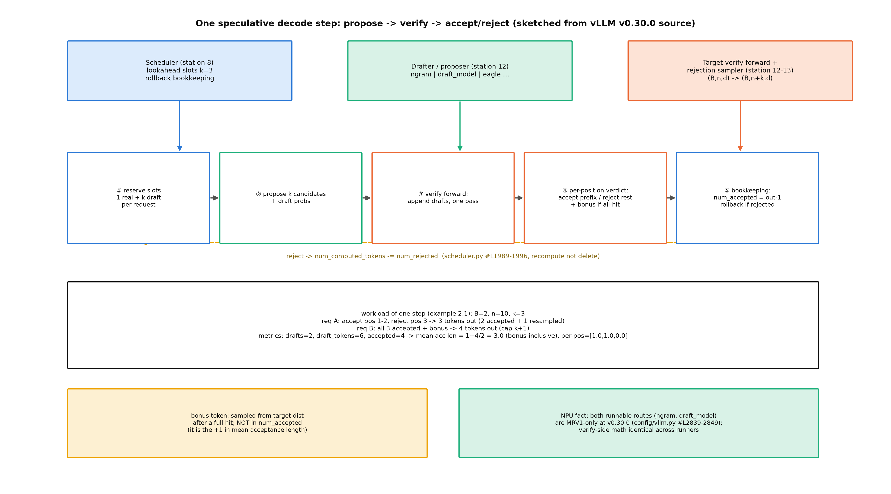
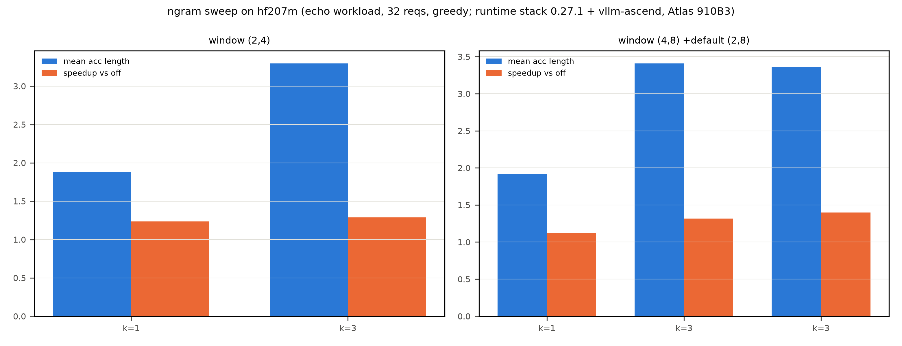

# 第 2 章 投机解码落地：proposer 全家与服务装配

> 站段坐标：站 8（超前读与 DraftTokenIds 调度）+站 12（drafter 装配与 draft forward）+站 13（rejection sampler 验证采样）。B7-3（proposer 全家机制正身）与 B6-5（五型谱系转址）双钩并门；B4-ch08-MTP 改道句三段式在此收口。本章兼大项目技术主场（ch2/ch12/ch13 三章分账之一）。

## 2.1 开篇：把「猜得准」装进引擎

Book7 第 7 章走执行层时只在 7.7 亮了一次装配接线：「四型 proposer 统成一个接口的接线层在这——『统一接口』的机制正身（draft 怎么提、怎么验、怎么回滚）→ Book8 第 2 章」【Book7 ch07-执行层.md#L197】；章末欠账框正式挂账：「proposer 全家的机制正身（draft 提案/验证/回滚）→ Book8 第 2 章」【同文件#L207，B7-3】。Book6 第 10 章立完了理论账——α/τ 记号、五型谱系、负结果 α=0.2 的赔本账——并把引擎侧地址留在这里：「五型 proposer 在真实引擎的统一接口与调度协同 → Book8 第 2 章」【Book6 ch10-投机解码.md#L145，B6-5】。本章的问题一句话：**Book6 教过的那套「猜-验-滚」数学，在 vLLM V1 里由谁、在哪些站、以什么接口落地？本机这台 NPU 上哪几条真能跑？**

记号契约先钉死（全册通用）：**接口位叫 proposer（提议器），被装载的小模型实体叫 drafter（草稿模型），方法名字符串 `draft_model` 指的是后者的装配路线**——三个词一个物两个位，混用即乱。三段定位：专题=投机解码落地；站段=站 8+12+13（调度侧超前读→执行侧 draft 前向→采样侧独立验证层）；模块=`vllm/v1/spec_decode/`（MRV1 proposer 族 19 件）+`vllm/v1/worker/gpu/spec_decode/`（MRV2 speculator 族——推测器/装配名）+`vllm_ascend/spec_decode/`（NPU 接入）+scheduler 的回滚记账。产出：draft-verify 一步的完整步账（例 2.1）、proposer 全家对照表（表 2.1）、ngram 参数扫描与 drafter 配对两组实测（表 2.2）、α 理论对账（例 2.5）。

还有一条双轨事实必须开篇立起：v0.30.0 的 MRV2 白名单（`config/vllm.py#L2815-2847` 的 `_get_v2_model_runner_unsupported_features`，#L2839-2849）把白名单外的 ngram/draft_model/suffix/medusa 全部排除——**本机仅有的两条可实测路线（ngram 与 draft_model）恰是 MRV1-only**；draft_model 在 MRV2 的补齐晚至 v0.31（#43091）。处置：本章**读的链以 MRV2 为正身（验证侧）、跑的链落在 MRV1（装配侧）**——两条链在 2.4 用版本差异框注钉死，与「专题引用一律 MRV2」的册级纪律不冲突：MRV2 讲机制正身，MRV1 讲实测装配。

> **最小背景栏**：验证器数学（分布不变性、截顶几何期望、α-c-γ 加速比三角）与五型谱系（ngram/draft model/EAGLE 系/MTP 系/树型）是 Book6 第 10 章已教——式 (10.1)-(10.3) 与例 10.2 的逐 token 走查直接指回，本章不重教；装配接线的位置感（站 12 的 drafter 装配链）是 Book7 §7.7 已亮——本章展开其内部。

## 2.2 机制正身：draft-propose-verify-accept/reject 的一步账

结构账先于流程：这一步里**谁持有写权**——draft token 由 drafter 写、验证由 rejection sampler（拒收采样验证器）判、回滚由 scheduler 记账。三权分立的意义在拒绝发生的那一刻现形：scheduler 对每个带草稿的请求把 `num_computed_tokens -= num_rejected`（`vllm/v1/core/sched/scheduler.py#L1989-1996`）——**拒绝=KV 账面回退+重算**，被否掉的草稿槽位由 lookahead 预留兜住（调度器排 1 真位+k 草稿位的槽位账；`num_lookahead_tokens` 的取法两代不同——见下方框注）。计数正身在同一处：`num_accepted = max(len(generated_token_ids) - num_sampled, 0)`（#L1984-1985，每步采样恒 1 个）——**num_accepted=本步产出−1，不含 bonus**；这个口径差是 2.7 节三个观测口径的根源，先在这里立住。

> **【版本差异框注】lookahead 的推导住在哪一代**：0.27.1 在 Scheduler 内按方法自算（eagle=k/draft=k/dflash=k+1/dspark=k——`v1/core/sched/scheduler.py#L247-270`）；v0.30.0 上移为 `config/vllm.py#L627` 的 property，docstring 明言 "Consumers must read this property rather than re-deriving"（**消费统一入口、禁止各处重推**——「一个数只有一处推导」的配置纪律，diff 差异 #13）。



图 2.1 draft-verify 时序（按 v0.30.0 源码自绘，示意级）：站 8 调度器排 1+k 槽位→站 12 drafter 出 k 候选、目标模型一次前向验证→站 13 rejection sampler 逐位判收；形状标注全序列视角 $(B,n,d)\to(B,n{+}k,d)$、每步 query 视角 $(B,1,d)\to(B,k{+}1,d)$（K/V 全序列、Q 只 k+1 位）；拒绝处标回滚边界（num_computed_tokens 回退）、全中处标 bonus 位。

**例 2.1（draft-verify 一步的批形状与调度账）** 构造：B=2 请求（各 n=10 的 prompt）、k=3。输入四步：
①调度器为每请求排 1 真位+3 草稿位（lookahead 预留 3 槽——KV 槽位账）；
②drafter 各出 3 候选→验证前向形状 $(2,10,d)\to(2,13,d)$（拼进上下文一次前向）；
③逐位验证：请求 A 接受位 1-2、位 3 拒→`num_computed_tokens -= 1`、从残差分布采出修正 token；请求 B 三位全中+bonus（全中彩头位）→单轮封顶 $k{+}1=4$；
④步末产出：A=3 token（2 接受+1 修正）、B=4 token（3+bonus）。
并入指标账（2.7 的公式在此先手算一遍）：num_drafts=2、num_draft_tokens=6、num_accepted=5（A 贡献 2、B 贡献 3——不含 bonus）→mean acceptance length $=1+5/2=\mathbf{3.5}$（含 bonus）、draft acceptance rate $=5/6=\mathbf{83.3\%}$（分母是 token）、per-position 剖面 $=[1.0,1.0,0.5]$（B 的第 3 位全中、A 落空）。
效果读法：**同一步的账用三个口径读出三个数**——「接受长度 3.5」说效率、「83.3%」说草稿质量、「剖面 [1.0,1.0,0.5]」说第几位拖后腿。（位置：计数口径正身=scheduler.py#L1984-1985；本例数字与 2.7 实测行同公式对账。）

验证器本体是双轨的。**MRV2 主读轨**：`vllm/v1/worker/gpu/spec_decode/rejection_sampler.py#L77` `class RejectionSampler:`（328 行），构造函数先看一眼：

```python
# vllm/v1/worker/gpu/spec_decode/rejection_sampler.py#L90-105（骨架摘录，截尾标 …）
# 【源码：阅读锚 v0.30.0（ced6857）】
        self.num_speculative_steps = spec_config.num_speculative_tokens
        self.enable_adaptive_verification = spec_config.enable_adaptive_verification
        rejection_sample_method = spec_config.rejection_sample_method
        self.use_block_verification: bool = False
        self.synthetic_conditional_rates: torch.Tensor | None = None
        if rejection_sample_method == "synthetic":
            assert spec_config.synthetic_acceptance_rates is not None
            self.synthetic_conditional_rates = torch.tensor(
                unconditional_to_conditional_rates(
                    spec_config.synthetic_acceptance_rates
                ),
            …
        elif rejection_sample_method == "block":
            self.use_block_verification = True
```

指名看什么：v0.30.0 的验证策略已经**参数化**成三档——synthetic（拿一组合成接受率做实验对照，`unconditional_to_conditional_rates` 把无条件率换算成条件链率）、block（块验证）、默认逐 token；外加 `enable_adaptive_verification` 开关（配套新件 acceptance_estimator.py 501 行/adaptive_verification.py 504 行——「按在线估计动态决定验几位」的新方向，阅读面点名）。**MRV1 对照轨**：`vllm/v1/sample/rejection_sampler.py#L45`（1123 行）——核族锚 `rejection_sample`#L407/`apply_sampling_constraints`#L519/`expand_batch_to_tokens`#L577/`sample_recovered_tokens`#L671/greedy 版核 `rejection_greedy_sample_kernel`#L719；两个类做同一件数学事（Book6 式 10.1 的分布不变性两分支），代码形态一个是验证器类、一个是采样层模块——「同一机制在两代的户口差异」。

采样分岔在 model runner 的执行路径上：无 draft 走 `self.sampler(...)`、有 draft 走 `self.rejection_sampler(spec_decode_metadata, draft_probs, logits, sampling_metadata)`——构造点 `gpu_model_runner.py#L641-695`（紧随 drafter 装配链）、调用点 **#L641**（采样路径）+ #L6355/#L6369（图捕获/dummy 路径——验证器也要进图）。草稿的「提议侧」数据流也补一笔：drafter 的 logits 变 draft_probs 喂验证器、验证产出回灌 scheduler 的通道是 `vllm/v1/outputs.py::DraftTokenIds`（scheduler.py#L69 import）——站 12 到站 8 的回流线，图 2.1 上那条向上的箭头。

ngram 路线的「提议」本身值得一个走查（它是本机两条实测路线之一）：

**例 2.2（n-gram 提议走查）** 构造：prompt=`"the cat sat on the mat . the cat sat"`、当前上下文尾=`"the cat sat"`、窗口设 (2,4)。输入三步：①窗口匹配——在 prompt 前文找长度 ∈[min,max] 的最长相邻匹配：尾部 3-gram「the cat sat」在位置 0 命中；②抄续写——提议后续 `["on","the","mat"]`（k=3，直接从 prompt 抄）；③边界——若 prompt 里没有第二处「the cat sat」，本轮零草稿（提议失败不报错、下步再来）。输出读法：ngram 的「智能」全部住在**重复**里——prompt 没有可抄的，它就一事无成；Book6 ch10 的 open 文本臂实测「30 次提议里 30 次落空、仅 1 次凑齐 3-gram 候选（有效步 1/30）」就是这条边界的教育版。（位置：正身=`ngram_proposer.py#L12`+`batch_propose_numba`#L178——CPU numba 提议；参数语义见 2.6。）

## 2.3 proposer 统一接口与家族：一张表读两代

「统一接口」在两代 runner 里是两套装配机构。MRV1 侧：`gpu_model_runner.py` 构造函数内的 if-elif 分派链（#L642-688，实测 11 分支：custom_class→ngram→draft_model→ngram_gpu→gemma4→step3p5→dflash→suffix→eagle（eagle3 特判）→medusa→extract_hidden_states）——proposer 族住在 `vllm/v1/spec_decode/`（19 件：17 顶层+2 dynamic）。MRV2 侧：工厂 `init_speculator`（`worker/gpu/spec_decode/__init__.py#L8`），分支骨架看一眼：

```python
# vllm/v1/worker/gpu/spec_decode/__init__.py#L17-28（骨架摘录）【源码：阅读锚 v0.30.0（ced6857）】
    elif speculative_config.method == "dflash":
        if "DFlash2DraftModel" in speculative_config.draft_model_config.architectures:
            from vllm.v1.worker.gpu.spec_decode.dflash2.speculator import (
                DFlash2Speculator,
            )
            return DFlash2Speculator(vllm_config, device)

        from vllm.v1.worker.gpu.spec_decode.dflash.speculator import (
            DFlashSpeculator,
        )
        return DFlashSpeculator(vllm_config, device)
```

指名看什么：MRV2 工厂**按 draft 的 architectures 再特判**（同名 method 下按草稿模型架构选 speculator）——「方法」与「实体」两级分派。实测工厂分支 7 个（extract_hidden_states/dflash+dflash2/dspark/gemma4/multi_module_mtp/mtp/eagle）——**ngram/draft_model/suffix/medusa 不在其列**（else 直接 `NotImplementedError`），与 2.1 的白名单互证。全家对照一张表：

**表 2.1 proposer 全家对照**（口径定死：MRV1 具体 proposer 类 10+基类 1+custom_class 工厂位=12 槽；method 字符串 12（含 eagle3 变体）；MRV2 init_speculator 分支 7——三口径并列，禁混用）

| method | MRV1 proposer（锚） | MRV2 speculator | vllm-ascend 接入 | Book6 表 10.1 五型 | 本机可测性 |
|---|---|---|---|---|---|
| ngram | NgramProposer `ngram_proposer.py#L12` | —（MRV1-only） | AscendNgramProposer（继承上游 CPU 版） | ngram 型 | **实测 ✓** |
| ngram_gpu | NgramProposerGPU `ngram_proposer_gpu.py#L217`（`NgramGPUKernel` 在 #L28） | — | AscendNgramProposerNPU | ngram 型 | 阅读面 |
| draft_model | DraftModelProposer `draft_model.py#L19`（115 行） | —（v0.31 #43091 补） | AscendDraftModelProposer | draft model 型 | **实测 ✓** |
| suffix | SuffixDecodingProposer `suffix_decoding.py#L9` | — | 有分支 | draft model 型（后缀树） | 阅读面 |
| medusa | MedusaProposer `medusa.py#L18`（81 行） | —（子族缺位） | 有分支 | 树型（多头+typical acceptance） | 阅读面 |
| eagle/eagle3 | EagleProposer（基类 `llm_base_proposer.py#L72`，1886 行=全家最大） | EagleSpeculator `eagle/speculator.py#L12` | AscendEagleProposer（双继承） | EAGLE 系 | 阅读面+云 GPU 选做 |
| mtp | （经 use_eagle→EagleProposer） | MTP 分支 | **mtp 走 EAGLE 形态**（`AscendEagleProposer`；step3p5 变体另走 `AscendStep3p5MTPProposer`#L47-51） | MTP 系 | 阅读面（207M 无 MTP 层） |
| dspark | （无上游专属类——dspark 走 eagle 分派） | DSparkSpeculator（271 行） | AscendDSparkProposer（Ascend 特有） | EAGLE 系旁支 | 阅读面+云 GPU 选做 |
| dflash/dflash2 | DFlashProposer | DFlash/DFlash2Speculator | 有分支（dflash2=华为自补 `dflash2_proposer.py`） | EAGLE 系旁支 | 阅读面+云 GPU 选做 |
| gemma4/step3p5 | 各有 proposer | gemma4 有/step3p5 无 | step3p5 有/gemma4 无 | MTP 系 | 阅读面 |
| extract_hidden_states | `extract_hidden_states.py#L28` | 有 | 有 | （接口件） | 阅读面 |
| custom_class | `custom_class_proposer.py#L12`（用户注入口） | — | **无分支（配了即 ValueError）** | （注入口） | — |

【证据等级：源码走查（阅读锚 v0.30.0+运行栈 vllm-ascend 0.27.1rc1；两代计数口径 notes/11 §六实测定谳）】

两句话读表 2.1。正向读（横读=同一权衡五次下注——Book6 表 10.1 的读法在此重现）：从 ngram 到 EAGLE，「草稿从哪来」的成本阶梯是 抄 prompt→小模型→共享 trunk 的浅层→目标自己的 MTP 层——猜得越准、装配越重；反向读（纵读=两代完成度差异）：**Medusa 在 MRV1 有 81 行正身、MRV2 子族缺位**——两代 speculator 不是新旧关系而是侧重的分岔（MRV2 深耕 EAGLE/MTP 系重机制、MRV1 保留轻路线），这解释了 2.1 的白名单为何「倒挂」。

**MTP 改道句三段式在此收口**（Book4→Book7→本章）：Book4 ch08 的实现对照框曾说 vLLM「已有同型实现件——那半段归 Book7」【book4/ch08-MTP.md#L126】；Book7 ch10 勘误改道：「vLLM 的 MTP 实现实际是 spec_decode 的 proposer 路线，机制正身属 Book8 第 2 章」【book7/ch10-权重与注册.md#L142】。兑现：MTP 论文机制（DSV3 §2.2 的 Eq.21-25、λ=0.3→0.1、D=1）指回 Book4 ch08；引擎面实现族=`model_executor/models/deepseek_mtp.py#L235`（DeepSeekMTP）+`glm4_moe_mtp.py#L194`（Glm4MoeMTP，`num_mtp_layers = config.num_nextn_predict_layers`——**GLM 卡面字段 `mtp_num_hidden_layers` 与 vLLM 侧字段名不同形**，Book5 警示的落点）等；运行栈的 mtp 默认走 EAGLE 形态（表 2.1 vllm-ascend 列）——「MTP 层当 EAGLE head 用」是 NPU 的现实现状。**B4-ch08-MTP 钩全销。**

> **【考据框】EAGLE 论文链与生态续作**。EAGLE-1（2401.15077；ICML'24 为 repo 自述、arXiv 页无标注——双源并注）→EAGLE-2（2406.16858，3.05-4.05×）→EAGLE-3（2503.01840，NeurIPS'25 亦 repo 自述；up to 6.5×）——三代论文的主线是把 draft 的特征来源从「词嵌入层」一路提到「目标模型隐层」，与表 2.1 的成本阶梯同向。2026 年的生态续作（P-EAGLE/DFlash/DSpark/Adaptive Verification 等）全部{厂商自报}且硬件口径为 B200/GB300——读数字时先看硬件脚注；DSpark/DFlash 正式论文未见（官方博客级）。引擎面对应件：`deepseek_eagle3.py`+`eagle.py#L10`。

还有一个接口件值得一句：`vocab_mapping.py#L68` `VocabMapping`——**异词表 drafter 的词表映射接口**（draft 与 target 词表不同时按映射对齐 logits）。本大项目用不上（207M 与 drafter 同 32k 词表、tokenizer 同源——词表对齐判据天然落位），但「跨词表投机」是 drafter 选型的真实自由度，接口在此。

## 2.4 NPU 侧落地：工厂全表与四条平台守卫

vllm-ascend 的接入面是第三个工厂：`get_spec_decode_method`（`vllm_ascend/spec_decode/__init__.py#L36-61`）——ngram 直接继承**上游 CPU 版**（override `dummy_run` 为 no-op：图捕获期无模型可跑的适配）、ngram_gpu 走 `NgramProposerNPU`、eagle/eagle3/mtp 汇入 `AscendEagleProposer`、dspark 是 Ascend 特有类、draft_model 有分支；**gemma4/custom_class 无分支——配了直接 `ValueError: Unknown speculative decoding method`**（与上游的差异点）。接线点在 `model_runner_v1.py#L671`（装配链 #L649-671），装载日志锚 `#L4034 "Loading drafter model..."`（2.6 实测判据）。

平台守卫四条（`vllm_ascend/platform.py`，一条一个账）：①**spec 量化强制继承主模型**（#L724-732，告警 "Ascend automatically uses the main model's quantization method"——drafter 不许自带量化格式，ch8 白名单的又一扇小门）；②**动态投机×DCP 拒绝**（#L1531-1560 `_validate_draft_decode_context_parallel_config`——`num_speculative_tokens_per_batch_size`×DCP>1 直接 ValueError——「动态 k×并发副本」的验证批形状在 CP 下无稳定解，平台选择不猜；MLA draft 豁免 GQA/MQA 分头规则——验证批的上下文并行是未解难题，NPU 用「明确报错」处理，与 Book7 见过的 NotImplementedError 同一哲学）；③**xlite 图模式×无投机**（#L1121-1131——xlite 的算子替换与投机路径的前向形状假设互斥，守卫把这对冲突在配置期就拦下）；④**capture sizes 计入 spec tokens**（#L1430-1445 `decode_query_len += num_speculative_tokens`，上限 `min(max_num_seqs×decode_query_len, 512)`——Book7 ch7 实验③已实测：ngram k=3 档图捕获表尾 256→512、启动 84s→159s——spec 不是免费的，图捕获面跟着涨，k 的选择因此有第二本账）。

配置层还有一件 NPU 特有补丁值得展开半段：`patch_speculative_config.py`（patch/__init__.py §18 官方说明）做 `SpeculativeConfig.hf_config_override` 的整体替换——把 DSV3/V4、GLM4-MoE、Qwen3-Next 等 **MTP draft 重映射为目标模型的 MTP 层**加载（上游不会把这些 model_type 映到 MTP 变体——「厂商把额外一层当独立模型发布、引擎要把它装回母体」的协议差，patch 来填）；同处还按 model_type 放行 k3_dspark、临时关 dspark 的 DCP。worker 侧配套四件小 patch（`patch_eagle3_init/patch_eagle3_pp_aux/patch_rejection_sampler/patch_pp_mtp`）——「一个投机特性一串 patch」是 NPU 接入层的工作常态，ch10 平台层会把这些收进方法论。

> **【版本差异框注】读的链与跑的链是两条**：MRV2 speculator 族（2.2/2.3 的阅读锚）与 MRV1 drafter 装配（本机实测链）在 0.27.1 上并存——顶层 proposer 面 19 件中 12 件两轨逐字节一致（正面清单：eagle/medusa/ngram_proposer/ngram_gpu/suffix 等，行号零漂移）；MRV2 验证侧 v0.30.0 新增 4 条目（acceptance_estimator/adaptive_verification/dflash2/extract_hidden_states），运行栈无——**dflash2 由 vllm-ascend 自实现**（「上游无、华为自补」）。实测证据恒标 MRV1 侧锚（`model_runner_v1.py#L4034`）。

本机可实测面定谳（粗纲待核项已核毕）：**ngram+draft_model 仅此两条**；MTP 出实测集（207M 无 MTP 层）；eagle/eagle3 需专用 draft 权重产制（207M 无 eagle head）；dspark/dflash=阅读面+云 GPU 选做（写作要求 12 纪律：vllm-ascend 侧实现均在，但需 DSA/DSV4 系模型）。

## 2.5 大项目技术主场：自产 drafter 的资产与训练账

大项目（207M+投机解码服务，三章分账：本章技术主场/ch12 集成/ch13 台账）的核心资产是一条**自产 2 层 drafter**——hf_draft2m（五件套在 `log/book8-00/hf_draft2m/`，tokenizer 复用 hf207m 同源件=词表对齐判据落位；max_position_embeddings 对齐 target 后由引擎第二道闸收口——`Overriding draft model max model len from 2048 to 1024`，运行栈 `speculative.py#L1157` 日志）。

**例 2.3（drafter 的词表钉死账）** 构造：2 层 drafter、词表 32,000、d=1024。输入两步：①embedding 与 lm_head（untied）各 $32000\times1024=32{,}768{,}000$，合计 **65,536,000**；②非 embedding=2 层×11,798,528（attn 3.1M+mlp 8.7M+norm 2K）+最终 norm 1,024=23,598,080——**final norm 也是参数**（底档 account 逐位）；总参 **89,134,080**，词表占 **73.5%**。输出读法：层数 12→2 参数省 57%，但再想小——**词表是地皮**（32,000 词一个不能少）；Book6「draft 取小两个数量级」的选型结论撞在 32k 词表的下限上。（位置：两口径对账=target 207,119,360≈2.3×；数字由 config 心算复现。）

训练账三条读数（同语料/同配方/同步数，唯层数 12→2——**对齐 target 训练量才是控制变量正确口径**：训得更多的 draft 反而与弱训练 target 失配；训练池上限 6870 步不跨 epoch，207M「终态」实为 integrated 1000 步——两头同量级才可比）：稳态 **0.016 s·step⁻¹**（207M 同管线 0.0808 s——2 层 0.0158 s，快约 5.1×）；初始 loss 10.5804 对预言 $\ln V+d\sigma^2/2=10.5783$（复算 ln 32000+1024×0.02²/2 逐位同；|Δ|=0.0021——Book3 训练管线的初始化理论在此续账）；final_eval **5.7789** 全有限（NaN 预注册判据过——首跑 NaN 复跑消失=瞬态毛刺登记不改）vs target 12 层的 5.83534——**欠数据区小模型先吃饱**（8.2M token 语料上 2 层反而略优）。但注意另一半：eval 接近≠分布接近——条件分布的形状才决定 α，这正是实测要验的（2.6）。配对冒烟三判据全绿（【本机实测（Atlas 910B3 单卡，2026-10）；训练底档 `log/book8-00/r7_draft_int.log`+`r7_draft_b8draft2Lint.json`，冒烟底档 `r7c_draft_pairing.*`】）：J1 双模型装载（两行日志锚 grep 断言）+J2 贪心两轮一致+J3 非空输出。

## 2.6 实验：ngram 扫描与 drafter 配对

**实验 A：ngram 参数扫描**（serve 口径，fast 档 8 轮+判别臂）。先立参数正身：ngram 的两个窗口键 `prompt_lookup_max/min` **双缺省时双双默认 5、只给其一则另一键镜像跟随**（`config/speculative.py#L1177-1184` 同逻辑两轨在位；字段定义 #L458/#L461）——所以真·缺省窗是 (5,5)，实验的 (2,8) 是显式给的体检档；`num_speculative_tokens` 必填（环境体检踩过的坑）。

网格：spec off 基线+k∈{1,3}×窗口 (2,4)/(4,8) 扫描+体检档 (2,8) 臂。workload 三臂自产（`make_workloads.py`）：**echo 主臂**（~64 token 段落出现两遍+「Repeat the passage:」——续写大概率回抄 prompt）、**random 臂**（同长随机 token 解码文本——预注册的负结果锚）、**prefix_repetition 判别臂**（引擎内建：跨请求共享前缀但 prompt 内无重复——测的是前缀缓存不是 ngram）。

八条混淆源逐条过的纪律清单进 2.7；判据预注册四条：装配行 grep 断言（`core.py:121` config 行）、/metrics 双向旁证、acceptance 分支（>1.2 正结果/≤1.2 负结果升教学主读数）、加速比对账 $\tau/(kc{+}1)$。

**表 2.2 ngram 扫描与 drafter 配对读数**（九臂全账；τ=mean acceptance length 含 bonus、α̂=数值解 $(1-\hat\alpha^{k+1})/(1-\hat\alpha)=\tau_{\mathrm{obs}}$、ĉ=从两臂时延反解、sp=对 off 臂吞吐倍率）

| 路线·臂 | k | 窗口 | num_drafts | num_accepted | τ | α̂ | sp | ĉ |
|---|---|---|---|---|---|---|---|---|
| ngram·echo | 1 | (2,4) | 3,887 | 3,421 | 1.88 | 0.880 | 1.236 | 0.52 |
| ngram·echo | 1 | (4,8) | 3,570 | 3,274 | 1.917 | 0.917 | 1.12 | 0.71 |
| ngram·echo | 3 | (2,4) | 2,226 | 5,110 | 3.296 | 0.872 | 1.288 | 0.52 |
| ngram·echo | 3 | (2,8) | 2,187 | 5,159 | 3.359 | 0.885 | **1.399** | 0.47 |
| ngram·echo | 3 | (4,8) | 2,016 | 4,855 | 3.408 | 0.894 | 1.319 | 0.53 |
| ngram·pr 判别臂 | 3 | (2,8) | 943 | 2,227 | 3.362 | 0.885 | 1.377 | 0.48 |
| ngram·random | 3 | (2,8) | 2,130 | 4,710 | 3.211 | 0.855 | 1.222 | 0.54 |
| draft_model | 1 | — | 4,507 | 3,672 | 1.815 | 0.815 | 1.175 | 0.54 |
| draft_model | 3 | — | 3,110 | 5,088 | 2.636 | 0.726 | 1.164 | 0.42 |

【本机实测（Atlas 910B3，运行栈 0.27.1+vllm-ascend 0.27.1rc1，卡 2，贪心+eager+APC 关+async 显式同关；底档 `log/book8-ch02/` 13 件 JSON+`c_alpha_recon.json` 汇总）】

三笔判读。

其一，**正结果主线兑现**：echo 臂 τ=3.36（k=3/体检档 (2,8)）——加速比 1.399× 也落在理论带内（$\tau/(kc{+}1)=3.36/(3\times0.47{+}1)=1.40$，逐位咬合；k 与窗口的双轴读数画在图 2.2）。

其二，**random 臂与判别臂的负结果锚双双没有归零**（random τ=3.21、prefix_repetition τ=3.36——预注册说它们应≈1.0）。两层归因：表层是 workload 构造——random 臂「随机 token **解码成文本**再入服务」的 decode→再分词往返把均匀随机面变成了高频子词面（2-gram 撞配率远超大词表直觉；echo 段落的词池采样本身也带词重复）；深层是 Book6 α 理论的正面孔——**弱训练 207M 的输出分布 p 本来就平，ngram 抄来的 q 落在高频子词上，q/p 重叠大 → 拒收采样按比例接受，α 就高**。「垃圾进 → 平分布 → 什么都好猜」——α 是 draft 与 target 的联合属性，随机 workload 验证的不是 ngram 而是分布的平度。**负结果锚本身翻车**因此是双课：要造真随机面得词表截断+字符级；而「负结果没复现」本身成了 α 理论的活体证据——如实入档。

其三，**draft_model 臂 τ=2.64 低于 ngram 臂**（2 层 drafter 输给了「直接抄 prompt」）——echo workload 里抄续写是降维打击，drafter 的价值要在无重复的开放生成里才显现（其装配链本身的读数是干净的：J1 的 `Loading drafter model...` 行+`Overriding draft model max model len from 2048 to 1024` 闸行都按预注册落档——表 2.2 两行 b 臂即 b_sweep 双轮全绿）；per-position 剖面把差距定位到第 2 位起（0.804/0.462/0.374 对 ngram 臂的 0.883/0.771/0.705）。


**例 2.4（k 扫描的验证批形状账）** 构造：B=8、k∈{1,2,3,4}。输入逐档：验证 forward 的 token 数=$(1+k)\times B$=16/24/32/40——**k 每加一，验证批线性变胖**；KV 槽位预留=lookahead k；图捕获档联动 `decode_query_len=1+k`、上限 $\min(B\times(1+k),512)$。输出读法：k 的账是三本的——τ 随 k 升（截顶几何）、验证批随 k 胖（算力）、捕获面随 k 涨（Book7 实测 84s→159s）——**最优 k 是三本账的交点**，不是「越大越好」；表 2.2 的 k=1 对 k=3 对照（τ 1.88→3.36、sp 1.24→1.40）就是这台天平的两档读数。（位置：捕获锚=platform.py#L1430-1445；与 Book6 最优 γ 账指回互证。）

**例 2.5（从 τ_obs 反解 α̂：α 对账的手算）** 构造：任取一臂读数 τ_obs=2.0、k=3（draft_model 臂的量级）。输入两步试值：①$\hat\alpha=0.5$：$(1-0.5^4)/(1-0.5)=1.875$（不够）；②$\hat\alpha=0.55$：$2.019$（略过）→$\hat\alpha\approx0.54$。再代 Book6 式 (10.3)：ĉ=0.42→理论加速 $2.0/(3\times0.42+1)=2.0/2.26\approx0.89\times$——**账面翻不正**：α̂ 在 0.5-0.6 中间带，加速比全看 ĉ 的脸色；对比底单原设 ĉ=0.2 时的 1.25×——**ĉ 从 0.2 涨到 0.42，同一 τ 下理论加速从 1.25× 跌破 1**，工程红利的敏感度在这一跌里现形（两层账：机制红利 τ vs 工程红利 ĉ 分开读）。用人话说：拿实测的平均接受长度倒推每一步的命中概率——τ 是 α 的复利，α̂ 是本金。输出读法：表 2.2 每行的 α̂/ĉ/sp 三列就是这道例题的批量版——**先手算后实测逐位对**（Book7 例 6.4 天花板预注册同款纪律；残差>15% 的行逐行归因）。



图 2.2 ngram 扫描读数（自产，数据=表 2.2 echo 臂）：左窗 (2,4) 右窗 (4,8)+体检档 (2,8)，蓝=mean acceptance length、橙=对 off 臂加速比——k=3 一致压过 k=1；**窗口放宽的红利也集中在 k=3**（τ 3.296→3.408、sp 1.288→1.319 双升），k=1 放宽窗 τ 仅微升而 sp 反降（1.236→1.12——ĉ 从 0.52 涨到 0.71 的工程账吃掉了机制红利）。

## 2.7 观测与判读：三个口径与三条纪律

实测读数从哪来？**acceptance 的三口径正身**在 `vllm/v1/spec_decode/metrics.py`（两轨同文，diff 仅 Grafana 查询串 docstring）。

**口径一·mean acceptance length** $=1+$num_accepted/num_drafts（`#L113-114` 注释+公式行原话 "Conventionally, mean acceptance length includes the bonus token"——+1 从哪来：全中时白得的 bonus 位）。**口径二·draft acceptance rate** $=$ num_accepted/num_draft_tokens（分母是 token 不是 draft 次）。**口径三·per-position acceptance** $=\Sigma_j$accepted_per_pos[j]$/num_drafts$（前 j 位全对的通过率剖面——「第几位拖后腿」的读数，与 DSV3「位置越往后衰减越快」互证）。

用人话说：同一笔账，3.5 说平均每步走了几步、83.3% 说草稿的质量、剖面说第几位开始掉链子——三个口径三个用处，报数先报口径。同一份 `SpecDecodingStats` 有三个消费面：serve 周期日志行、/metrics 三 counter（`vllm:spec_decode_num_drafts/num_draft_tokens/num_accepted_tokens`——**仅 speculative_config 非空才注册**，spec off 臂没有这些行本身就是旁证）、inproc 钩子（须 `VLLM_ENABLE_V1_MULTIPROCESSING=0`——Book7 12.2 踩坑延续）。周期行的原文长这样（echo k=3 体检档臂，逐字摘录）：

```text
# log/book8-ch02/a_k3_w28_echo_speclog.txt:1（运行栈 0.27.1 实测日志原文）
INFO … [metrics.py:120] SpecDecoding metrics: Mean acceptance length: 3.36, Accepted
throughput: 165.99 tokens/s, Drafted throughput: 210.33 tokens/s, Accepted: 5159 tokens,
Drafted: 6537 tokens, Per-position acceptance rate: 0.883, 0.771, 0.705, Avg Draft
acceptance rate: 78.9%
```

指名看什么：一行日志同时给出三口径（3.36/78.9%/剖面三元组）——例 2.1 的手算在这行里全部对上（5159/6537=78.9% ✓、1+5159/2187=3.36 ✓）。

> **【版本差异框注】per-request 指标三件套运行栈没有**：v0.30.0 新增 `--per-request-spec-decode-metrics`（none/summary/detailed 三档，`config/observability.py#L48`；`RequestSpecDecodeMetrics`+`EngineCoreOutputs.spec_decode_metrics`）——**运行栈全仓 0 命中**，本大项目的观测只能走聚合面（周期行/counter/inproc），per-request 剖面用 inproc 钩子替代。

实验三纪律（提炼自八条混淆源的前三条，全表在 notes/06 §2.5）：①**async 互斥**——ngram 类 spec 与 async scheduling 互斥（启动告警行「Async scheduling not supported with ngram-based speculative decoding and will be disabled」；正身=`async_scheduler.py#L16/#L23/#L44` 的 `_spec_token_placeholders` 用 −1 占位符顶替 spec token 槽位——调度与起草的异步握手协议，**Book7 ch12:57 钩在此兑现**；互斥守卫的主叙事在 ch5 §5.2，此处一句点名不吞）；②**温度**——bench serve 默认温度 1.0，一切确定性判据臂显式 `--temperature=0`；③**workload**——random 臂的翻车（2.6）就是这条的活教材。另有一笔 spec×grammar 的交叉口径埋给 ch3：草稿也过文法（`validate_tokens`，`scheduler.py#L2448-2460`），判废草稿**从 draft 分母剔除、不从 accepted 分子剔**——spec+结构化同开时 acceptance 读起来更「乐观」，口径差写脚注。

## 2.8 本章小结

回扣开篇：「猜-验-滚」落进引擎是三权分立的一步账——drafter 写草稿（11 分派支的 proposer 族+7 分支的 MRV2 工厂，表 2.1 两代对照）、rejection sampler 判收（双轨正身）、scheduler 记回滚（num_computed_tokens 回退+lookahead 预留）；例 2.1 的 3.5/83.3%/[1.0,1.0,0.5] 三口径在手，例 2.2 把 ngram 的「智能全住在重复里」走查成三步，例 2.3 的 89,134,080/73.5% 给 drafter 立了词表地皮账；表 2.2 九臂读数对上 α 理论（echo 臂 1.399× 逐位咬合 τ/(kc+1)）；ngram 臂 τ=3.36 与 drafter 臂 τ=2.64 的对照把「抄 prompt 的降维打击」与「per-position 第 2 位衰减」钉成读数。

**带走的心智**：两幅画。**其一，三权分立的一步账**——读任何投机系统的行为，先分清谁提议、谁裁决、谁回滚；接受长度/接受率/剖面三个口径是同一笔账的三种读法，混淆口径就是混淆结论（+1 bonus 的惯例是第一坑）。**其二，「猜得准」是联合属性**——drafter 与 target 同分布训练才有望重叠（欠数据区小模型先吃饱≠α 高：eval 接近是必要不充分），而 workload 决定 ngram 有没有得抄（echo 3.36 对 random 设计失败后的 3.21——负结果锚也要造得干净）；加速比最终看 α̂ 与 ĉ 两张脸，机制红利与工程红利永远分开记账。

镜头拉回全书：本章把「时间的省」装进了单实例（一步多算 k 个 token）；下一章换一种约束——空间的省之后是**输出的形**（结构化输出：采样器里的硬约束），spec×grammar 的交叉口径已在脚注埋好。大项目的主场到此交棒：ch12 把 hf207m+hf_draft2m 装成一个端到端服务并走全链。

> **【欠账】** ①大项目集成收拢（serve 形态+一条请求穿越八册的全链走查——不重跑本章实验，引用本章底档）→ 第 12 章；②eagle/eagle3/dspark/dflash 的实测（需专用 draft 权重/DSA 系模型——云 GPU 选做已裁定不做，登记台账）→ 第 13 章终账。

**动手验证**（Atlas 910B3；选卡纪律照 CLAUDE.md；serve 纪律=127.0.0.1+高位口+SIGTERM+HBM 慢释放复查）：
① workload 构造：`python code/Book8-vLLM源码剖析下/ch02/make_workloads.py`——产物 `wl_echo.jsonl`/`wl_random.jsonl`（md5 入 `log/book8-ch02/workload_md5.json`）；
② 单臂复跑（八臂循环骨架=同目录 `a_sweep.sh`）：`ASCEND_RT_VISIBLE_DEVICES=<卡> vllm serve log/book7-00/hf207m --dtype bfloat16 --max-model-len 1024 --gpu-memory-utilization 0.4 --enforce-eager --no-async-scheduling --no-prefix-caching --host 127.0.0.1 --port 18021 --speculative-config '{"method":"ngram","num_speculative_tokens":3,"prompt_lookup_min":2,"prompt_lookup_max":8}'`——验收行=启动 config 行 `method='ngram', num_spec_tokens=3`+周期行 `Mean acceptance length: 3.36`；
③ α 对账：`python code/Book8-vLLM源码剖析下/ch02/alpha_recon.py`——验收行=表 2.2 的 α̂/ĉ/sp 三列逐位复现（底档 `c_alpha_recon.json`）；
④ 源码三锚：`sed -n '77,80p' repos/vllm/vllm/v1/worker/gpu/spec_decode/rejection_sampler.py`（MRV2 验证器）、`sed -n '1984,1996p' repos/vllm/vllm/v1/core/sched/scheduler.py`（计数与回滚正身）、`sed -n '36,61p' repos/vllm-ascend/vllm_ascend/spec_decode/__init__.py`（NPU 工厂全表）；
⑤ drafter 臂复跑（骨架=同目录 `b_sweep.sh`）：`--speculative-config '{"method":"draft_model","model":"log/book8-00/hf_draft2m","num_speculative_tokens":3}'`——验收行=启动日志 `Loading drafter model...`（model_runner_v1.py#L4034）+周期行 mean acceptance length ≈2.64（底档 `b_b_k3.json`）。
