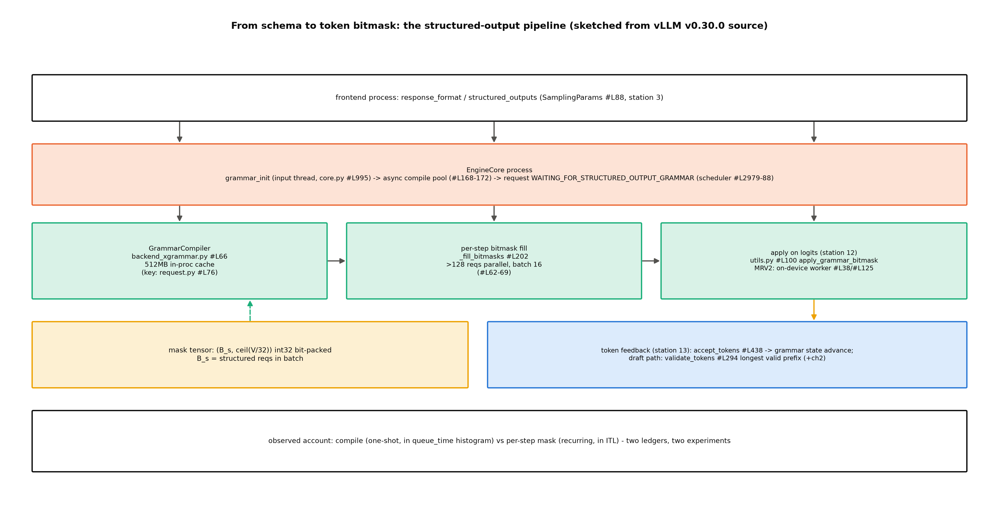

# 第 3 章 结构化输出：从 schema 到 token 掩码

> 站段坐标：站 3（协议进入）+站 7/8（编译与调度等待）+站 12（掩码施于 logits）+站 13（token 回灌）。记号契约首现：本章的 backend（后端）专指**结构化输出的文法引擎**（xgrammar/guidance 一族）——与 attention backend、量化 backend 同名不同物，随文消歧。B7-4 的欠账句在此开箱：「结构化输出管线（xgrammar/guidance 机制层）→ Book8 第 3 章」。

## 3.1 一句「请输出 JSON」，怎么变成每一步的硬约束

Book6 讲采样时留过半句：logits 处理器是「软变换」一族（温度、top-p 改的是分布的形状），而「另一族『硬约束截断』（语法/格式的强制掩码）是结构化输出的地界 → Book8 第 3 章」。Book7 ch11 在协议面做过两层实证（混用后端报错的 UT 与激活探针），又点了 Responses 面的名——但都止步于「三扇门共享同一个引擎出口」。本章的问题因此很具体：**一句「请输出 JSON」，是怎么变成采样器里每一步的硬约束的？**产出四件：管线正身走查（3.2）、后端族与两轨账（3.3）、四组实测读数（3.4）、论文链考据（3.5）——外加一笔 ch2 脚注的兑现（3.3 的 spec×grammar 账）。到站时图景：schema 被编译成文法、文法在每步把词表裁成窄门；ch2 埋下的那笔 spec×grammar 脚注也将在 3.3 顺带兑账，留给后面的是选型决策（ch11）。

> **最小背景栏**：需要两笔旧账——Book6 第 9 章的 logits 处理器软/硬两族之分（式与例指回），Book7 ch11 与环境体检 11/12 号探针（log/env-audit-20261011/）的协议面实证——静默丢弃下输出是否像 JSON 取决于模型服从性，Book7 的 happy path 与体检的散文档并不矛盾、后者才是约束未生效的直接证据。另补一句前置：**文法（grammar）=产生式规则表**，每步「合法下一步」由它判定；JSON 属上下文无关文法家族、正则是其真子集——所以 str_pattern 变体与 json 变体同住一条编译管线。「结构化输出」（structured output，亦称约束解码 constrained decoding）首现对照在此。

三段定位补齐：专题=结构化输出；站段=3/7-8/12/13；模块=`vllm/v1/structured_output/`（8 文件地界，3.2 开箱）。

先立一块地层学的碑。结构化输出在 vLLM 里的协议入口换过三代：最老的 completions 面只有 `logit_bias` 这类穷人硬约束；中间的 chat 面长出 `guided_json/guided_regex` 一族字段——这一族在 0.27.1 的协议层被静默移除（Book7 ch11 的负结果档：字段进了请求、约束没进引擎，返回散文不报错），到 v0.30.0 干脆显式声明移除并给 warning（`entrypoints/serve/engine/protocol.py#L20-34` 的 `_REMOVED_GUIDED_FIELDS` frozenset——注释原话「Warn instead of burying the only breadcrumb at DEBUG level」）；现在的正身是 `response_format`（与 OpenAI 对齐的 `json_schema` 形态）。三代入口背后是同一条引擎管线——**协议面换皮，管线不动**，这正是 Book7 那句「三扇门共享同一个引擎出口」的下文：本章要开的就是这扇门后面的机器。

## 3.2 管线正身：八文件与一条掩码流

结构账先于性能数字——先看这条管线上有谁、谁持写权。地界在 `vllm/v1/structured_output/`（8 文件 2556 行），总管是 `__init__.py::StructuredOutputManager`#L36——编译调度（`grammar_init`#L115/`_create_grammar`#L178）、掩码聚合（`_fill_bitmasks`#L202/`grammar_bitmask`#L314）、草稿验证（`validate_tokens`#L294/`accept_tokens`#L438）三类写权集于一身。抽象双件套在 `backend_types.py`：`StructuredOutputBackend`（工厂+编译）与 `StructuredOutputGrammar`（每请求逐步约束）——四个后端实现同一对接口，3.3 逐家点名。

**一条 schema 的旅程**（图 3.1 的正文版，逐站给锚）：站 3，请求级 schema 从协议层进来（`sampling_params.py::StructuredOutputsParams`#L88——json/regex/choice/grammar 四种形态）；站 7/8，EngineCore 构造 Manager（`v1/engine/core.py#L146`），`grammar_init` 在**输入处理线程**被调（core.py#L995-1002）——注意「线程」二字：编译是异步的，为什么住在输入线程而不是调度循环里？因为调度循环是全引擎最贵的不动产（Book7 ch4 的 busy loop——有活绝不谦让的内循环），毫秒级的编译塞进去等于向所有请求收税；把它挪到输入线程的线程池，编译就变成「旁路工序」，请求先停在等待态，编完了再进调度——**用一点状态机的复杂度，换调度循环的纯净**，这笔置换与 Book7 讲过的 tokenize/detokenize 外移是同一个设计哲学的三次应用；调度器每步放行前检查（scheduler.py#L2979-2988：文法未就绪→不调度、编译异常→单请求失败不炸引擎、就绪→转 WAITING）；站 8，每步 `get_grammar_bitmask` 批量填掩码（批内结构化请求多于 128 时并行、每批 16——__init__.py#L62-69）；站 12，`utils.py::apply_grammar_bitmask`#L100 把掩码施于采样前 logits——MRV2 侧这一步有上卡件（`worker/gpu/structured_outputs.py::StructuredOutputsWorker`#L38 与 `_apply_grammar_bitmask_kernel`#L125，本章主读轨的 MRV2 声明落点）；站 13，出的 token 经 `accept_tokens` 回灌文法推进状态。

```python
# vllm/v1/engine/core.py#L995-1002（原样八行）【源码：阅读锚 v0.30.0】
        if req.use_structured_output:
            # Note on thread safety: no race condition.
            # `grammar_init` is only invoked in input processing thread. For
            # `structured_output_manager`, each request is independent and
            # grammar compilation is async. Scheduler always checks grammar
            # compilation status before scheduling request.
            self.structured_output_manager.grammar_init(req)
        return req, request.current_wave
```

指名看什么：合同注释就在摘录里——「grammar_init 只在输入处理线程被调；编译异步；**调度器放行前总检查编译状态**」三句把 3.2 的管线合同一次说尽，线程安全论证（每请求独立，无竞态）也顺带给了。形状流转表（规范 §3）：schema 字符串 →（编译）Grammar 对象 →（每步）掩码矩阵 $(B_s,\lceil V/32\rceil)$ int32 位打包（$B_s$=批内结构化请求数）→（施用）logits $(B,V)$ 禁位置 $-\infty$。

**例 3.1（mini 词表上的掩码演化）** toy 词表 8 个 token：`{`、`"`、`a`、`:`、`1`、`2`、`}`、`x`（id 0-7）；schema 等价文法 S→`{` `"` a `"` `:` N `}`，N→`1`|`2`。四步走（每步输入=已生成前缀、输出=8 维掩码）：①前缀空：掩码 {0:1}（只 `{` 开）；②`{`：{1:1}（只 `"`）；③`{"a":`：{4:1,5:1}（N 展开两通道）；④`{"a":1`：{6:1}（只 `}`）。开通道数序列 1,1,2,1——**硬约束=把 softmax 的前景裁成窄门**；token `x` 四步全关。用人话说：文法就是一个每步重画的「哪些字合法」清单，掩码就是把它拍在 logits 上。

**编译期与执行期是两本账**，观测口径各归各：编译在 EngineCore 进程的线程池里异步跑（`executor.submit` #L168-172，max_workers=(cpu+1)//2）；等待编译的时间**落 request_queue_time 账**——请求停在等待态期间不被调度（scheduler#L2979-2988）、`queued_time=scheduled_ts−queued_ts`（`v1/metrics/stats.py#L543`）、直方图 `vllm:request_queue_time_seconds`（loggers.py#L852-858）——**不侵入任何观测就能从 queue 直方图读出编译账**，这是实验 1 差分法的理论根据。执行期开销（每步填掩码+施掩码）则住在 ITL 里。两本账分开读，是本章实验设计的骨架。

编译结果有缓存：`backend_xgrammar.py#L66-70` 构造 `xgr.GrammarCompiler(cache_limit_bytes=VLLM_XGRAMMAR_CACHE_MB*1024*1024)`——默认 **512MB**（两轨同值），缓存键=`request.py::get_structured_output_key`#L76。

异步编译不是无条件的——有一段值得整段照录的注释，讲清什么部署形态必须把它关掉：

```python
# vllm/v1/structured_output/__init__.py#L47-56（骨架摘录）【源码：阅读锚 v0.30.0】
        # When in external_launcher mode, async grammar compilation causes deadlocks
        # due to external_launcher mode having a scheduler for each TP rank.
        # Async grammar compilation causes the
        # WAITING_FOR_STRUCTURED_OUTPUT_GRAMMAR → WAITING transition to
        # happen at different times on different TP ranks,
        # breaking the determinism assumption that external_launcher relies on.
        self._use_async_grammar_compilation = (
            vllm_config.parallel_config.distributed_executor_backend
            != "external_launcher"
        )
```

指名看什么：external_launcher 形态下每个 TP rank 各有一个调度器，异步编译会让「等待文法→就绪」的状态迁移**在不同 rank 上发生在不同时刻**——破坏 external_launcher 依赖的确定性假设，死锁。一个布尔开关背后是一整段确定性论证：**「什么时候允许不确定」本身就是并行系统的设计决策**，这句话在 ch6 分布式章还会回来。

调度器侧的配合是三分支检查（放行前每请求过一遍）：

```python
# vllm/v1/core/sched/scheduler.py#L2979-2988（骨架摘录）【源码：阅读锚 v0.30.0】
        if request.status == RequestStatus.WAITING_FOR_STRUCTURED_OUTPUT_GRAMMAR:
            structured_output_req = request.structured_output_request
            if not structured_output_req or structured_output_req.grammar is None:
                return False
            if isinstance(structured_output_req.grammar, Exception):
                self.grammar_compile_error_reqs.add(request.request_id)
                return False
            request.status = RequestStatus.WAITING
            return True
```

指名看什么：文法未就绪→不调度（return False，下一轮再看）；**编译结果是异常对象→只把该请求记进失败清单**，引擎照常服务其他请求——「单请求失败不炸引擎」的容错边界在类型判断上（`isinstance(grammar, Exception)`——编译线程把异常当返回值传回来，这个模式值得记住）。

**例 3.2（一条请求的时间线两工况）** toy 假设值（实测读数 3.4 回填）：请求 t=0 到达，编译 220ms、调度等待 90ms、出首 token。工况 A（首请求，缓存 miss）：queue≈310ms；工况 B（同 schema 第二请求，命中）：queue≈90ms——差分 220ms 就是编译账，queue 直方图直接可见。用人话说：**编译是一次性成本，缓存把它摊掉；每步掩码是持续成本，住在 ITL 里**——「miss 工况」与「hit 工况」必须分开报。

**例 3.3（512MB 缓存的 LRU 账）** 每份编译产物约 0.46MB（xgrammar 论文实测锚——自适应存储后的量级）；toy 缩小池=1.0MB（≈2 份），访问序列 A,B,C,A：C 进池时 A 被逐出、第 4 步 A miss 重编并逐出 B。放大回真实池：512MB÷0.46MB≈**1113 份 schema 常驻**——一个服务日常轮换的 schema 数很难超过这个量级，这就是「缓存为什么够用」的数量级直觉；真超了，LRU 逐出后代价也只是回到 miss 工况（实验 1 的毫秒账），不是灾难。

**图 3.1** 把这条流画成两泳道（前端进程/EngineCore 进程），节点沿站号排，每条边标数据形态。



图 3.1 schema→掩码管线（按 v0.30.0 源码自绘，示意级）：schema 字符串→Grammar 对象→$(B_s,\lceil V/32\rceil)$ 位打包掩码→logits 禁位；编译异步与等待态分支标在站 7/8。读图两次：第一次顺着箭头走数据（一张 schema 怎么变成每步的整数向量）；第二次逆着箭头找写权（编译产物 Manager 建、掩码 Manager 填、施用 worker 做、文法状态 Manager 推进——四步里三步的写权在同一个对象手里，这就是「总管」二字的分量）。

## 3.3 后端族：四种文法引擎与两本账

管线正身看完，四个可替换的引擎位并排上桌——表 3.1 先给全景。

**表 3.1 结构化输出四后端对照**（依赖在装情况为本机 env 实测；「两轨状态」列为 diff 实证）

| 后端 | 类锚（v0.30.0） | 编译产物缓存策略 | 本机依赖 | 两轨状态 |
|---|---|---|---|---|
| xgrammar | `backend_xgrammar.py::XgrammarBackend`#L37 | 进程内 512MB | **在装 0.2.8（默认主力）** | 配置面逐字节同 |
| guidance | `backend_guidance.py::GuidanceBackend`#L89 | 无独立编译缓存（LLMatcher 每请求在 EngineCore 线程池构造；`serialize_guidance_grammar`#L228=schema/regex→llguidance 文法串的进程内转换） | 在装（llguidance 1.7.6，vllm 自带依赖） | 同上 |
| outlines | `backend_outlines.py::OutlinesBackend`#L54 | **磁盘缓存**（backend_outlines.py#L57 调 `utils.py::get_outlines_cache`#L296——"unbounded on-disk cache"） | 在装（outlines_core 0.2.14，vllm 自带依赖） | 同上 |
| lm-format-enforcer | `backend_lm_format_enforcer.py::LMFormatEnforcerBackend`#L96 | 无独立缓存层 | **在装** | 同上 |

读法导引：表 3.1 的第三列是四种「编译产物住哪」的设计——同一问题的四种工程答案并排。逐家走近看：**xgrammar** 是默认主力，它的杀手锏是自适应掩码——把 schema 编译成上下文无关的「token 开关表」预检大部分通道，只有不足 1% 的 context-dependent token 需要逐步判（论文数字，3.5 考据框），所以每步填掩码便宜；512MB 进程内缓存让同 schema 二次编译近乎免费，代价是缓存进程私有、重启即冷。**guidance** 走 llguidance 库（vllm 自带依赖），无独立编译缓存层——每请求在 EngineCore 线程池构造 LLMatcher；`serialize_guidance_grammar` 做的是 schema/regex→llguidance 文法串的**进程内转换**（前端校验用）。当年「guidance vs xgrammar 路线之争」的骨架（llguidance 的 lark 文法 vs xgrammar 的自适应掩码摊薄每步成本）保留为背景，但「编译放前端」的说法不成立于 v0.30.0 实现里。**outlines** 走磁盘缓存（`backend_outlines.py#L57` 调 `utils.py::get_outlines_cache`#L296——自述「unbounded on-disk cache」）：编译产物落盘、跨重启复用——最朴素的答案，代价是 I/O 与序列化格式版本管理。**lm-format-enforcer** 没有独立缓存层，定位是正则/字符级格式强制的轻量件（本机在装，可作对照实验件）。

掩码本体的机制值得停一拍。位打包的形状 $(B_s,\lceil V/32\rceil)$：每个 int32 字管 32 个 token 的开关位——15 万级词表（Qwen 系）压到约 4700 个字，一个请求一步的掩码就是不到 19KB 的整数向量；填掩码的循环按批推进（批量大于 128 个结构化请求时并行、每批 16——__init__.py#L62-69 的两个阈值），施掩码则是按位把禁位的 logits 写 $-\infty$。用人话说：**文法每步画一张「哪些字合法」的清单，位打包把清单压成一组整数，施掩码就是按清单把非法位的音量拧到零**——softmax 之后零音量的位概率精确为零，这就是「硬约束」的全部数学。

后端枚举是五值 Literal（`config/structured_outputs.py#L12-14`：auto/xgrammar/guidance/outlines/lm-format-enforcer）——**两轨逐字节一致**（diff 零输出的正面清单），这是本章免框注的底气。auto 的解析规则朴素：按请求的约束形态（json→xgrammar 等）选家——但「谁被选中」启动日志不打印，实验 4 的源级探针因此多了一层动机（行为佐证：Book7 ch11 的混用报错文案里出现的就是实际后端名）。

> **【版本差异框注】#15：validate_tokens 语义重构**——两轨在「怎么验证投机草稿」上分了家。v0.30.0 把它做成管理器三件套：`validate_tokens`#L294（draft 块→最长文法合法前缀）+`accept_tokens`#L438+`strip_speculative_padding`（utils.py#L48-61，-1 哨兵剥离从后端内部**上提**到管理器）；运行栈 0.27.1 走 `should_fill_bitmask`#L361 内联逐 token 处理，draft 被文法拒绝时**直接 raise AssertionError**（R 侧 #L329）——v0.30.0 改为 log error+标 failed 继续。拒绝语义从「炸」到「容」，是把 spec×grammar 组合从实验特性推向生产特性的成熟动作。

**例 3.4（最长合法前缀与 -1 哨兵）** 文法 S→`a` `b` `c`；draft 块 spec_tokens=[a, b, x]（k=3，第三位非法）。五步：①draft 块进 Manager；②`strip_speculative_padding` 查 -1 padding（本例无，原样过）；③constraint_start=0（无推理窗）；④`grammar.validate_tokens` 走栈——a、b 合法推进，x 非法停住，返回 [a,b]；⑤scheduler 回填 `[-1]` 补长→[a,b,-1]，`num_invalid_spec_tokens=1`。读法：acceptance 口径里**分母 3−1=2**——grammar 判废草稿从 draft 分母剔除、不从 accepted 分子剔（scheduler.py#L2811-2812 的 `num_draft_tokens -= num_invalid_spec_tokens`）——spec+结构化同开时读数偏「乐观」的机制根，ch2 §2.6 那个脚注在这里长出了正身。

NPU 平台在此处加了一条自己的约束：vllm-ascend 的 `patch/platform/patch_structured_output.py`（134 行）patch 掉两个方法——`SamplingParams` 的结构化参数校验（把请求里带的后端名截获，`setattr(SamplingParams, "_vllm_ascend_original_validate_structured_outputs", ...)` 存原件再换壳）与 `Manager.grammar_init`（首请求把 auto 解析出的后端**记进 config**，此后任何不一致直接抛错），**强制单引擎单后端**——同引擎中途换后端直接 `VLLMValidationError`。为什么收紧？上游 V1 允许请求级选择后端，四个后端各有自己的掩码语义与缓存结构，NPU 栈上「中途换引擎」的组合矩阵没人验证过——平台层的取舍是把这个未验证的自由度换成一刀切的确定性：**少一种配置，多一分稳定**。与图模式默认档（Book7）、ubatching 禁用（ch5）同族——本家族已立的第二个成员；ch5 见第三个、ch10 收总账。

**例 3.5（auto 混用后端三步走查）** ①serve 以 backend='auto' 起；②首请求（json schema）→auto 解析为 xgrammar 并记进 config；③第二请求显式要求 guidance→报错：`The engine is already using 'xgrammar', but ...`——解法是显式配 `structured_outputs_config.backend`。记账细节：首请求的后端名走两条路径——校验路径记进 config（Book7 的 cfg_backend_recorded_by_patch 所测）、grammar_init 路径记 Manager 实例属性。对照着看：上一册 guided_json 字段被协议层**静默丢弃**（请求返回散文、不报错），这一处换后端被平台层**显式拒绝**——同册两个「静默 vs 显式」的对偶案例，工程哲学一句话：**报错优于静默**。这一对偶还有个实用推论：写生产代码时，先故意发一个「错后端」请求看引擎骂不骂你——骂，说明约束真的在生效；不骂，你就要自己写校验兜底（实验 3 的 jsonschema 双断言就是这种兜底的示范）。

## 3.4 实验：编译账、稳态账与正确性账

四件实验全部判据预注册（设计书 notes/12 §四），模型=Qwen3-0.6B【本机实测（Atlas 910B3，运行栈 0.27.1+vllm-ascend 0.27.1rc1）：底档 `log/book8-ch03/`】。

**实验 1（编译时间，inproc 钩子法）**——扫掠件 `code/Book8-vLLM源码剖析下/ch03/exp1_compile_timing.py`：monkey-patch 包住 `StructuredOutputManager._create_grammar` 记 per-request 编译毫秒，8 个 schema 变体各两发（miss/hit）。读数（exp1_compile.json）：**首个 miss=24.25ms**（obj_basic——含 xgrammar 库热身，一次性）、**正则转换最贵 miss=14.27ms**（str_pattern——regex→文法的转换账）、其余六变体 miss 落 1.38-3.75ms、**八个 hit 全部 0.15-0.38ms**——缓存把编译摊掉约一个数量级。与例 3.2 的回接：miss 24.25ms vs hit 0.19ms 就是两工况的实测版（差分思路没走 queue 直方图——钩子法直接量到同一笔账；exp2 热后 TTFT 差 17.6ms 是差分口径侧证）。J1 分支如实落位：0.6B 词表+简单 schema 下这是「小编译账」（毫秒级），机制叙事以 miss/hit 比值为主——论文里 100× 编译加速的战场在十万级 token 的完整 JSON Schema，不在本章的玩具 schema（口径对齐是 3.5 考据框的纪律）。

**实验 2（稳态约束开销，serve 流式差分）**——扫掠件 `exp2_overhead.py`：单 serve 同接两臂（response_format 是请求级），guided 预热后 plain 与 guided 各 32 请求×64 token 流式记 TTFT/ITL——**主读数=ITL（每 token 口径，防输出长度污染吞吐）**。读数（exp2_overhead.json）：plain ITL 均值 **54.37ms** vs guided **61.68ms**——**稳态约束开销 +13.4%**；TTFT 差 17.6ms（缓存热后，量级与实验 1 的 hit 编译账相容）。J1 方向符合预注册（guided 更高），幅度 13.4% 高于「个位数」预期、未触发 ≥30% 的重编译排查分支——归因口径：eager 模式+小批量下每步 CPU 侧填掩码+施掩码的占比被放大（MRV2 的掩码上卡件 `StructuredOutputsWorker` 在本机栈属阅读面），图模式与大批量下这笔账会摊薄。J2 侧的 TTFT 差 17.6ms 与实验 1 的 hit 编译账（0.2ms）相容且大近两个量级——多出的部分是首 token 前的掩码准备与调度路径差，量级诚实记录、不过度归因。顺带一记测量细节：流式差分用**每 token 到达间隔**（ITL）而非总吞吐作主读数，是因为 guided 输出天然更短更整齐——总吞吐会被输出长度差污染（混淆源⑦），每 token 口径才量得准「约束本身的税」。

**实验 3（正确性，jsonschema 双断言）**——扫掠件 `exp3_correctness.py`：4 变体×8 请求，断言①`json.loads` 可解析（严判：截断算失败）、断言②`jsonschema.validate` 过 schema（**schema 校验器是唯一裁判，「看起来像 JSON」不算数**），温度 0 两轮输出哈希一致。读数（exp3_correct.json）：**确定性 32/32；schema 双过 24/32**——八败全在同一变体 obj_nested，逐条归因（底档 exp3_attribution.md）：tags 数组**没写 maxItems**（schema 缺省无限）→模型的列举惯性刹不住车→撞 max_tokens 截断→parse 失败；给 schema 加一行 `"maxItems": 4` 后同探针输出完全合法（`{"user": {"id": 1, "tags": ["math","science","history","technology"]}, "active": true}`）。J1 分支裁定：**非引擎缺陷——24 个非失控请求三断言全过，约束全程在工作；败因是 schema 设计×token 预算的交互**。教训值一框：**schema 是合同，token 预算是账本——合同写得再严，也救不了账本不够**；给生产写 schema，数组长度的上界与 max_tokens 要一起算。

**实验 4（单后端 patch 探针）**——扫掠件 `exp4_patch_probe.py`（CPU 侧秒级）：patch 在**平台激活期**应用（engine 构造时），import 期 `hasattr` 必为 False——探针按 J1 分支改为源级三证：两个 `_vllm_ascend_original_*` 属性常量与 setattr 目标在 patch 源码在位（`patch_structured_output.py#L15-16/#77-108`）、运行时激活证据引 Book7 ch11 双钩子底档。读数（exp4_patch.json）：**双 True**——UT 7/7 沿 Book7 底档引用不重跑。

四件实验共用一套混淆源裁定（判据预注册于本章设计书，含结果分支）：ch3 无 spec 不受 ngram×async 互斥影响；`--temperature 0` 一律显式；guided 输出更短所以吞吐不作主读数（ITL 才是）。进程纪律与 ch2 不同且值得点破：**两臂可同服**——约束是请求级字段（response_format），而 ch2 的 spec 是服务级配置，彼处必须一臂一进程；inproc 件的 `__main__` 守卫与一进程一 LLM 实例纪律不变。

**表 3.2 结构化输出的两本账与能力面**（本章实验读数汇总；口径=Qwen3-0.6B、eager、单卡——第三行为能力面附行）

| 账本 | 量级（实测） | 住在哪个观测里 | 摊销方式 |
|---|---|---|---|
| 编译（一次性） | 首次 24ms（含库热身）/常规 1.4-3.8ms/hit 0.2ms | request_queue_time 直方图 | 512MB 缓存（约千份 schema 常驻） |
| 每步掩码（持续） | ITL +13.4%（54.4→61.7ms） | ITL/TPOT | 图模式与大批量下摊薄（本机栈为 eager 口径） |
| 正确性（能力面） | 24/24 非失控请求三断言全过 | jsonschema 双断言 | schema 写好 maxItems+预算充足即闭环 |

表 3.2 把四件读数并排读，一条完整的成本曲线浮现：**约束的总开销=一次性编译（首 schema 24ms 含热身、常规 1.4-3.8ms、命中后 0.2ms）+持续每步掩码（ITL +13.4%）**。生产口径的推论直接可写：schema 集合稳定的服务（温度计、表单抽取这类）几乎只付每步的 13%；schema 千变万化的服务（用户任意上传 schema）则要为每个新 schema 付一次毫秒级编译——两种商业模式对应两条成本曲线，选型时先问自己属于哪种。还有一笔跨界账：钩子脚本本身也是「运行栈观察」的产物——包的是 0.27.1 的 Manager 方法；v0.30.0 的三件套重构（validate_tokens/accept_tokens/strip_speculative_padding，差异 #15 本体）意味着同一只钩子跨版本要重写——这就是双轨纪律的日常证据。

实验 3 的八连败还带出一个方法学教训，值得与 ch2 的 random 臂并排收藏：**预注册判据的价值不在「猜对」，在「猜错时知道去哪查」**——八败全在同一变体、parse 全败而 deterministic 全过，这个模式本身就指向「输出被截断」而非「约束失效」；顺着模式查两步（看输出尾部、试 maxItems）就完成了归因。如果当初只报一个 24/32 的总数，这堂课就没了。

测法本身也有一笔可复用的手艺：实验 1 的钩子计时**不需要改任何引擎源码**——monkey-patch 在进程内包住 Manager 的方法，`VLLM_ENABLE_V1_MULTIPROCESSING=0` 让引擎与脚本同进程，钩子就能看见每一步。这是 ch2 讲过的 inproc 观测位在结构化专题的第二次应用（第一次是 spec 的 per-position 剖面）：**运行栈没有 per-request 指标（差异 #14）的年代，inproc 钩子就是请求级观测的替代口径**——两章用同一件工具量两本不同的账，工具本身的复用性也进了「带走的心智」。

## 3.5 论文链：一个摘要里住着两个口径

> **【考据框】xgrammar（2411.15100，v1 2024-11-22→v3 2025-05-12，MLSys'25）**：摘要同一句里「up to 100x speedup over existing solutions」是**编译/掩码构造口径**、「near-zero overhead ... in end-to-end LLM serving」是**端到端口径」（引文按 PDF 原文核字）——引用前先对口径，这是全丛书写作纪律③的现成正身。SGLang v0.4 博客的「up to 10x faster for JSON decoding」是第三种（端到端 JSON 解码）{厂商自报}。机制数字：context-dependent token 不足 1%（1134/128k，Llama-3.1+JSON 文法）——**绝大多数 token 的开/关与上下文无关、可预检**，这是自适应掩码的论文根；自适应存储把掩码缓存从 160MB 压到 0.46MB（0.2%）。
> **XGrammar-2（2601.04426，ACM CAIS'26）**：TagDispatch+Cross-Grammar Cache，「over 6× faster compilation」——TagDispatch 面向工具调用场景（schema 里嵌着「先选工具、再按工具出参数」的分派结构，1 系按单一文法编译、2 系按 tag 拆开各编各的）；Cross-Grammar Cache 跨语法复用子文法。**未进 v0.30.0**（引擎 import 的仍是 1 系 API）：论文跑在引擎冻结前面的活例，ch12 新芽候选。
>
> 顺带把引用纪律的三句话钉在这条链上：同一篇论文里「100×」与「near-zero」是两个口径（编译构造 vs 端到端）；SGLang 的「10×」是第三种（端到端 JSON 解码）且是{厂商自报}；本册实验 1 的毫秒级读数是第四种（0.6B 词表+玩具 schema）——**四个数字四个世界，引用任何一个之前先报口径**，这是丛书写作纪律③在结构化输出专题的落地。

## 3.6 本章小结

回扣开篇：那句「请输出 JSON」的旅程——协议层收进 schema、EngineCore 异步编译成文法、调度器等它就绪、每步把词表裁成窄门、出的 token 回灌推进——五站连成一条掩码流，写权集于 Manager 一身。四件实验把这条流的每个环节都上了读数：编译账毫秒级且缓存可摊、每步掩码的税 13.4%、正确性在 schema 与预算各守其责时全绿、平台的单后端约束在源码与运行时双证在档。两本账各自有了读数：编译是一次性成本（缓存摊掉、queue 直方图可见），每步掩码是持续成本（住在 ITL 里）。

**带走的心智**：其一，**约束的作用点在 softmax 之前**——文法不改分布的形状（软变换），它裁掉非法位的概率质量（硬截断），Book6 的软硬两族之分至此在引擎侧合龙；其二，**两本账各住各的账本**——编译是一次性成本（queue 直方图看见、缓存摊掉）、每步掩码是持续成本（住在 ITL 里），报读数前先说清报的是哪本；其三，**报错优于静默**——guided_json 静默丢弃与混用后端显式拒绝的对偶，是读任何引擎配置面的试金石；其四，**schema 是合同，token 预算是账本**——实验 3 的八连败教的是：约束引擎保证结构合法，不保证你给得起写完这个结构的 token。

下一章把「请求」本身变胖：图片进请求、adapter 挂权重——多模态与 LoRA 服务把入口层与执行层同时拉长。

> **【欠账】** 选型章的合规维度（结构化输出的各引擎支持面一句）→ 第 11 章。

**动手验证**（三件；选卡纪律照 CLAUDE.md）：
① `python code/Book8-vLLM源码剖析下/ch03/exp1_compile_timing.py --smoke`——两变体的 miss/hit 编译毫秒应与 3.4 实验 1 读数同量级；
② `python code/Book8-vLLM源码剖析下/ch03/exp4_patch_probe.py`——双钩子布尔即 NPU 单后端约束的激活证据；
③ serve 后 `curl .../v1/chat/completions` 带 response_format json_schema（体检 12 号脚本模板 `log/env-audit-20261011/12_guided_smoke.sh` 可复用）——合法 JSON 返回即 happy path。
