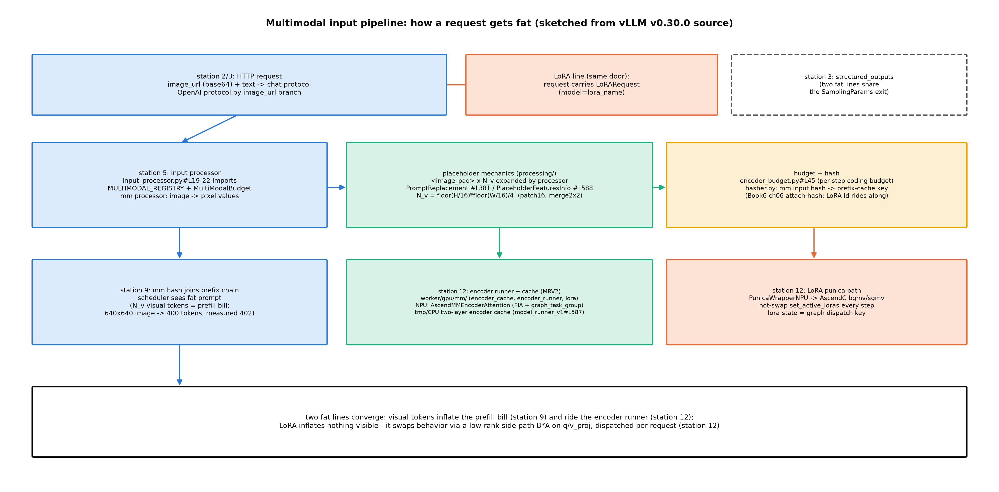

# 第 4 章 多模态与 LoRA 服务

> 站段坐标：多模态线=站 2/3（HTTP 图文输入）→站 5（预处理与预算）→站 9（mm 哈希入前缀链）→站 12（编码器 runner+缓存）；LoRA 线=站 3（LoRARequest 随请求进）→站 8（调度约束）→站 12（punica 执行）→站 15（LoRAStats）。B7-5 后半句与 B5-6（一张图=16,384 词元）双钩并门。

## 4.1 开篇：两个「请求变胖」的方向

上一章把「输出的形」钉进了采样器；Book7 ch11 的同一只欠账框还挂着后半句：「多模态与 LoRA 服务路径 → Book8 第 4 章」【Book7 ch11-OpenAI兼容层.md#L163，B7-5】。再往前，Book5 第 10 章在能力扩展专题里立过一笔服务侧的账：「一张图=一万六千词元的预填充（K3 口径），原生 VLM 的请求形态与多模态、LoRA 的服务路径 → Book8 第 4 章」【Book5 ch10-能力扩展专题.md#L178，B5-6】。本章的问题成对：**图片进请求后，引擎的哪几站要改账？一个外挂 adapter 又怎么不重载权重地改变行为？**——一个把请求变胖（输入侧），一个把行为变道（权重侧），两条线在站 5 与站 12 汇合。

三段定位：专题=多模态与 LoRA 服务；站段=上述双挂站行；模块=`vllm/multimodal/`（12 文件 6137 行——registry/处理/预算/哈希四族）+`vllm/v1/worker/gpu/mm/`（MRV2 编码器镜像）+`vllm/config/lora.py` 与 `vllm/lora/`（LoRA 配置与层）+`vllm_ascend/lora/`（NPU punica 执行）。产出：mm 输入管线全景（图 4.1）、视觉词元的手算账与实测对拍、LoRA 参数面与组合矩阵（表 4.1/4.2）、VLM 首跑与七臂组合实测。本章双主读轨照册级纪律：上游一律 MRV2 路径（`worker/gpu/mm/`+`gpu/lora_utils.py`），MRV1 只作演进对照。

> **最小背景栏**：LoRA 的低秩旁路机制前七册没有专节（Book3/4/5 仅散点提及；Book6 ch06 附加哈希处半句「附加位容纳 LoRA 标识、多模态输入哈希等」——正好是本章 LoRA×APC 交叉的指回锚），此处自建到能画的程度。冻结基座权重 $W_0$，在旁边加一条低秩旁路：

$$y = W_0 x + \frac{\alpha}{r} BAx \tag{4.1}$$

| 符号 | 含义 | 形状/取值例 |
|---|---|---|
| $x$ | 该层输入激活 | $(d,)$ 单 token 视角；d=1024（Qwen3-0.6B） |
| $W_0$ | 冻结的基座权重 | $(d', d)$，如 q_proj 1024×1024 |
| $A$ | 降维件（可训练） | $(r, d)$，rank-8 时 8×1024 |
| $B$ | 升维件（可训练，初始化为零） | $(d', r)$，1024×8 |
| $\alpha/r$ | 缩放（α=lora_alpha） | 标量；例 16/8=2 |

用人话说：**大路不动，旁边修一条窄匝道**——车流（梯度）只走匝道（A/B 两小件），匝道宽度由秩 r 定、流量由 α/r 这只旋钮定；「外挂」=匝道随请求装载，基座一字不动。多模态侧：一张图=多少词元的架构账是 Book5 ch10 已立（196/576/2304/16,384 阶梯），本章只换服务侧口径，严禁重教架构。

## 4.2 多模态输入路径：从 image_url 到视觉词元

先看全景（图 4.1）——一张图从 HTTP 进门到变成计算，要过四站。



图 4.1 mm 输入管线（按 v0.30.0 源码自绘，示意级）：上带=站 2/3 请求进门（image_url 分支与 LoRARequest 同门，共享 SamplingParams 出口）；中带=站 5 输入处理（processor 预处理、占位符展开、预算与哈希）；下带=站 9/12（mm 哈希入前缀链、编码器 runner 与缓存、LoRA punica 路径）——两条「变胖」线在站 5 与站 12 汇合。

地界四族（mm=multimodal 多模态，`vllm/multimodal/`，12 文件 6137 行）：**注册表**（`registry.py#L103 MultiModalRegistry`——模型↔处理器工厂绑定）；**处理器**（`processing/processor.py`：`PromptReplacement`#L381/`PlaceholderFeaturesInfo`#L588/`BaseMultiModalProcessor`#L1030——占位符机制正身）；**预算**（`encoder_budget.py#L45 MultiModalBudget`——每步编码量上限，chunked prefill 的多模态前提）；**哈希**（`hasher.py`——mm 输入哈希进前缀缓存链；Tensor 与 ndarray 都按 `.nbytes` 计）。v1 侧挂点在站 5 一屏看完：

```python
# vllm/v1/engine/input_processor.py#L19-21【源码：阅读锚 v0.30.0（ced6857）】
from vllm.multimodal import MULTIMODAL_REGISTRY, MultiModalRegistry
from vllm.multimodal.encoder_budget import MultiModalBudget
from vllm.multimodal.inputs import MultiModalFeatureSpec
```

指名看什么：输入处理期（站 5）就完成 mm 的装载与预算构造（同文件 #L63 `mm_budget = MultiModalBudget(...)`）——**图文请求的「胖」在进调度器之前就已经成形**。MRV2 的编码器镜像在 `worker/gpu/mm/`（encoder_cache/encoder_runner/lora/rope 四件——`mm/lora.py` 是 mm×LoRA 交叉的正身，4.8 回收）。

预算与哈希两族值得多看两眼：**预算**（`encoder_budget.py#L45 MultiModalBudget`——每步编码量上限：多图请求的视觉词元会被切进多个 chunked prefill 步，**没有这本预算账，一张 16,384 词元的图就能独占一步把长文本请求全部挤出去**——「图片也可以切着付入场费」是 chunked prefill 的多模态前提）；**哈希**（`hasher.py`——mm 输入哈希进前缀缓存链：Tensor 与 ndarray 都按 `.nbytes` 进摘要、bfloat16 有字节流特判——**同一张图编出同一个哈希**，这是 4.7「同图二发免重编码」的机制根）。

Qwen3-VL-2B 的配置实物（本地快照 config.json 摘录——架构账的一手凭据）：

```json
// log/huggingface/hub/models--Qwen--Qwen3-VL-2B-Instruct/snapshots/<hash>/config.json
"architectures": ["Qwen3VLForConditionalGeneration"], "model_type": "qwen3_vl",
"vision_config": {"deepstack_visual_indexes": [5, 11, 17], "depth": 24, "hidden_size": 1024,
  "num_heads": 16, "out_hidden_size": 2048, "patch_size": 16, "spatial_merge_size": 2},
"text_config": {"hidden_size": 2048, "num_hidden_layers": 28,
  "num_attention_heads": 16, "num_key_value_heads": 8, "head_dim": 128}
```

指名看什么：视觉塔（24 层 ViT、patch 16、2×2 空间合并）与文本塔（28 层、2048 维）是两套超参——词元公式由**视觉塔**的那三个数决定：

$$N_v=\left\lfloor \frac{H}{16}\right\rfloor\cdot\left\lfloor \frac{W}{16}\right\rfloor \Big/ 2^2 \tag{4.2}$$

用人话说：图片先切成 16×16 的小格、四格并一格，**格子的总数就是这张图的「词数」**——服务引擎眼里图片不是像素、是一队排好队的视觉词元。**例 4.1（视觉词元账与占位符走查）** 构造：按式 (4.2) 逐图算账。输入三步：
①逐图算账：96×96→⌊96/16⌋²/4=9；640×640→400；4096×4096→**16,384**（恰是 B5-6 的 K3 口径数——不同 ViT 参数=不同架构账，服务侧只认「占位符数=预填充预算」）；
②占位符走查：prompt 里的 `<image_pad>` 序列被 processor 展开成 400 个特征位（`PlaceholderFeaturesInfo` 的替换机制），文本「描述这张图」拼在后面——进 batch 的形状是 $(400+T_{\text{text}}, d)$；
③预算判定：400 个视觉词元的编码在 `MultiModalBudget` 的每步上限内排队——一张 640×640 的图在调度器眼里就是一个 400 token 的预填充账单。
输出读法：**视觉词元账=图片的入场费**，付在站 9 的 prefill；实测对拍见 4.7（640×640 实测 402=400+模板 2，逐位闭合）。（位置：Qwen3-VL-2B config 实物=本地快照（vision_config depth 24/hidden 1024、text_config 28 层 hidden 2048）；公式推导与 Book5 阶梯对拍一句收拢。）

## 4.3 NPU 侧：同一抽象、两个后端的四差异点

机制层（registry/占位符/预算）是平台无关的；NPU 的活全在「同一抽象的另一个后端」——四差异点逐个看（vllm-ascend）。

**①ViT 编码器注意力**：`ops/mm_encoder_attention.py` 的 `AscendMMEncoderAttention`（继承上游抽象），docstring 自述 eager 与图捕获都走 `npu_fused_infer_attention_score` 加 `graph_task_group_begin/end`——与 LLM 全图模式同一套融合路径；填充常量 `MIN_PAD_SIZE=64/MAX_PAD_SIZE=128/FIA_BLOCK_SIZE=128`（#L41-44——MIN_PAD_SIZE 在 #L41）。注意力有了自己的融合路径，图管理器自然也要一份——

**②编码器独立图**：`worker/encoder_acl_graph.py#L256 EncoderAclGraphManager`（改名继承上游 CudaGraphManager）——编码器自己有一套图管理器，与主模型图并行（ViT 的批形态与 LLM 不同步：图片到齐就编、不必等文本批，分开捕图才互不牵扯）。编码一次贵（ViT 前向几亿 flop），缓存也就有了两个层次——

**③编码缓存双层化**：`model_runner_v1.py#L587-591`——tmp 设备层+cpu 主存层+异步搬运队列（`_pending_encoder_cache_copies`）：设备层快而小（热数据）、主存层大而慢（冷数据），按调度输出异步搬运/逐出——「热缓存住显存、冷缓存搬主存」的两级存储微缩版。

**④模型级补丁**：`patch/worker/patch_qwen3vl.py`（105 行）——deepstack 输入嵌入的 TP 分块、`triton_split_qkv_rmsnorm_mrope` 融合核、ViT interpolate 的 CPU 兜底——「一个 VLM 家族一串 patch」（视觉侧算子生态不如文本侧成熟，逐模型补齐是现状）。

选型红线两面（官方文档级）：绿名单 `supported_models.md`#L132-133——**Qwen3-VL 系 ✅**【证据等级：官方文档（vllm-ascend docs）】（dense 与 30B-A3B/235B-A22B 均在）；**InternVL 2.0/2.5/3.0 全族 ❌**（issue #2064）——本章实验只走 Qwen3-VL。特性交叉（feature_matrix）：mm×W8A8 ✅、mm×W4A4/W4A8 ❌、mm×ACLGraph 双模式 ✅——这张交叉表是 ch8 部署矩阵的多模态行：**VLM 服务目前只能配 W8A8 或不量化**，4 位权重的 VLM 部署在 NPU 上是空格（选型时先查交叉表再谈容量）。

> **【版本差异框注】mm 缓存漂移的重试机制运行栈没有**（#21，A 级）：v0.30.0 的 `MultiModalCacheMissError`（`multimodal/cache.py#L42-52`）处理 P0/P1 双进程 mm 缓存的漂移——前端持影子副本、两进程更新顺序不同会漂移，漂移时抛错并让引擎返回**可重试响应**、前端丢弃过期条目自愈（`engine/core.py#L1763-1766` 捕获+`_handle_mm_cache_miss`#L1858）；运行栈全仓零命中（grep 复核）——书里画有的层、跑着的栈没有，与 ch3 #15 同处置。

## 4.4 LoRA 服务：配置、调度与热交换

换第二条线。结构账先立（谁持有什么）——配置面一张表读全：

**表 4.1 LoRA 参数面**（`vllm/config/lora.py`【源码：阅读锚 v0.30.0（ced6857）；运行栈同文件基本零漂移】）

| 参数 | 默认 | 语义与量级 |
|---|---|---|
| `enable_lora` | False | 总开关（serve 侧 `--enable-lora`；EngineArgs#L629） |
| `max_loras` | 1 | 批内同时活跃 adapter 上限——**调度约束**（每步分派进批元数据的件数） |
| `max_lora_rank` | 16 | 预算上限（Literal 九档 1-512（1/8/16/32/64/128/256/320/512））；≥128 时 punica 走回退路（4.5） |
| `lora_dtype` | auto | 旁路精度（默认随基座） |
| `enable_tower_connector_lora` | False | 视觉塔/连接器挂件开关（4.8；实验特性） |
| `default_mm_loras` | None | 按模态默认挂件（「该模态出现即激活」的第三路线，仅单 adapter） |

读法：第一行的开关决定「有没有」，二三行的两个 max 决定「多大」——一个管并发分时、一个管秩预算；后三行是多模态族的路由件。请求面：`lora/request.py#L8 LoRARequest`（lora_name/lora_int_id/lora_path 三字段随请求进门——OpenAI 层把请求的 `model` 字段当 adapter 名路由，这正是 4.7 矩阵实验「换 model 名=换 adapter」的机制）。调度面的硬约束值得看断言正身：

```python
# vllm/v1/core/sched/scheduler.py#L845-852（骨架摘录）【源码：阅读锚 v0.30.0（ced6857）】
        scheduled_loras: set[int] = set()
        if self.lora_config:
            scheduled_loras = set(...)
            assert len(scheduled_loras) <= self.lora_config.max_loras
```

指名看什么：超了不是 OOM、是**本轮不排**——LoRA 并发度的物理形态是「调度分轮」（例 4.3）。运行栈同逻辑在 #L675-681。

层类还有一次系统性「换血」：`vllm_ascend/lora/utils.py#L202 refresh_all_lora_classes()` 把六个 Ascend 版线性层类（RowParallel/ColumnParallel/MergedColumnParallel/MergedQKVParallel/FusedMoE/FusedMoE3D）插进 `_all_lora_classes` 头部——**模型代码一行不改，线性层的 LoRA 化实现被整族替换**（与 Book7 见过的「平台插件换 worker_cls」同一手法在层粒度的重演）。这是「外挂不改基座」在代码组织上的对应物：基座类的接口不动、可替换的实现清单挂在旁边。

**例 4.2（LoRA 无操作判据：B=0 的数学）** 构造：缩小版 rank-2——$x\in\mathbb{R}^{4}$、$A\in\mathbb{R}^{2\times4}$、$B=\mathbf{0}\in\mathbb{R}^{4\times2}$、α/r=1。输入三步：①$x\to A$ 得 $\mathbb{R}^{2}$（降维）；②$\to B$ 得 $\mathbb{0}\in\mathbb{R}^{4}$（零矩阵吃掉一切）；③$\frac{\alpha}{r}\cdot\mathbf{0}+W_0x=W_0x$——输出逐位不变。输出读法：**B=0 ⇒ 旁路恒零 ⇒ 装了等于没装**——这就是「无操作判据」（4.7 实测的 J2 数学根：同一个引擎、同一个请求，挂 noop adapter 的输出必须与裸模型逐位一致；不一致=装载路径有副作用）。真实尺寸一行注记：Qwen3-0.6B 的 q_proj 1024×1024、rank-8 旁路 A 是 8×1024、B 是 1024×8——A 件占基座的 0.8%、A+B 两件合计 1.6%。（位置：实测=4.7 的 pre2 底档三判据。）

**例 4.3（max_loras 的调度分轮）** 构造：3 个请求挂 2 个 adapter、`max_loras=1`。输入两轮：①第 1 轮调度器只排 adapter#1 的请求（scheduled_loras 集合={#1}，断言不破），adapter#2 的请求在 `LoRAStats` 的 waiting 集合里等；②第 2 轮换件——#1 的请求走完、#2 上场。输出读法：**换 adapter=换一轮调度**，不是并行三头——「多 LoRA 服务」的并发模型是分时制；LoRAStats（`v1/metrics/stats.py#L587`）的 waiting/running 两本集合就是分时制的账面。（位置：断言锚=scheduler.py#L852；观测面=ch9 指标字典的 LoRA 行。）

热交换（hot-swap——源码注释原话 "Hot-Swap lora model"）的执行面在 model runner：`model_runner_v1.py#L1541-1543` 每步 `set_active_loras(self.input_batch, ...)`——把本批请求的 adapter 映射进批元数据（三字段 `npu_input_batch.py#L198-201`：request_lora_mapping/lora_id_to_request_ids/lora_id_to_lora_request）；装载/卸载/枚举走 worker 的 add_lora/remove_lora/list_loras/pin_lora 四接口（#L1083-1093，OpenAI 层 `/v1/load_lora_adapter` 路由可达——**运行中加件也是服务面操作**，不必重启）。还有一个图模式的深层耦合：**LoRA 状态是图分派键的一部分**——`model_runner_v1.py#L3699-3703` 捕图时显式注入 `force_has_lora/force_num_active_loras`（注释原话：LoRA 在上下文管理器里才激活，但捕图时就要知道批描述符的 LoRA 状态）。用人话说：回放一张图前必须先回答「这批挂没挂件、挂几件」——答案不同的批走不同的图，所以 LoRA 状态和批大小一样是选图的钥匙；官方口径「You can run LoRA with ACLGraph mode now.」【证据等级：官方文档（lora.md#L9）】。

两轨稳定性在此值得一提（与 ch2/ch3 的「读的链跑的链分离」对照）：LoRA 的**算法主体两轨极稳**——lora_model.py/request.py/resolver.py/peft_helper.py/torch_ops 等七件逐字节一致（正面清单），漂移集中在 runner 集成面（mixin 的 `reset_lora_state`——基权重被替换后摘除全部 adapter，与 sleep/wake 场景联动——运行栈无此件）。两条脚注级考据顺手收下：运行栈 `lora/layers/` 里有个 `vocal_parallel_embedding.py`（v0.30.0 已改正为 `vocab_parallel_embedding.py`——一个跨版本 typo 的化石）；MoE-LoRA 的 scaling 有 α/rank 与 α/√r（rsLoRA）两派（`lora_weights.py` 两轨各一型——v0.30.0 #L204-206 per-adapter scaling 注释明示 rsLoRA）。视频与音频模态：`multimodal/video_decoders/` 的四解码后端为 opencv/torchcodec/pynvvideocodec/deepstream（本机均未装）——**视频/音频=阅读面**，本机实测止于图像。

## 4.5 punica 三级接线与内核

NPU 的 LoRA 执行路径是三级接线（与 attention 后端、平台插件同构——「平台插件改哪里」的第三个标本）：**平台挂钩**（`platform.py#L190-192`）→**包装类**（`lora/punica_npu.py#L16 PunicaWrapperNPU`）→**内核**（`lora/lora_ops.py` 的 AscendC 六函数）。挂钩正身三行：

```python
# vllm_ascend/platform.py#L190-192【源码：运行栈 vllm-ascend 0.27.1rc1】
    @classmethod
    def get_punica_wrapper(cls) -> str:
        return "vllm_ascend.lora.punica_npu.PunicaWrapperNPU"
```

包装类的内核选择分支（#L31-34）藏着两条回退路：硬件无 `LORA_CUSTOM_OPS` 能力位、或 `max_lora_rank≥128`——回退上游 torch 原生实现；否则走 AscendC 内核（csrc 四文件 bgmv_shrink/bgmv_expand/sgmv_shrink/sgmv_expand）。另有**单 LoRA 槽优化**（#L57-63：A2/A3——昇腾硬件代际枚举的两档、本机 910B3 属 A2——且 max_loras==1 时免内核调度直连 matmul——4.7 的 rank-8 toy 实验正落此分支）；图捕获期另有 triton 融合核支路（`_try_lora_linear_triton`#L334——捕获中+bf16 时走 triton 融合，与 AscendC 内核是「捕图内/捕图外」的分工）。

**例 4.4（bgmv/sgmv 的分组账）** 构造：4-token 批=请求 1（2 token，adapter#1）+请求 2（2 token，adapter#2）。输入两算：**bgmv**（b=batched）——逐 token 查 index 直算：每个 token 的 x 过自己请求的 A、B（decode 形：批里每请求 1 token，天然逐个）；**sgmv**（s=segmented）——按 adapter 把批切成连续段，段内一次分组 GEMM（prefill 形：同 adapter 的长段摊薄启动开销）。输出读法：**同一旁路两种打包**——名字里的 b/s 就是批形态；rank-8 旁路一次 shrink（x→xA，1024→8）一次 expand（→B 加回，8→1024），中间秩空间只有 8——旁路计算量被秩压到可忽略，成本全在访存与调度。（位置：内核注册正身=`lora_ops.py#L30-40`（`torch.ops._C_ascend.bgmv_shrink`）；图捕获感知 `_lora_is_capturing()`#L327+`custom_op("_vllm_ascend_lora::lora_linear")`#L460——注册为 custom op 是图可捕的前提。）

## 4.6 组合守卫与七臂实测

组合守卫（combination guard）＝两特性同开时引擎的互斥/回退行为——本章把它当作 LoRA×其余特性交叉的观测对象（ch5 将见它的平台禁用版）。LoRA 与其他特性的交叉是官方证据的稀疏带：**量化×MoE×LoRA**——`lora/quant_moe.py` docstring 自述「preserve floating-point LoRA boundaries around quantized base expert matmuls」（量化基座周围保持浮点 LoRA 边界）；官方 MoE 表：非量化+W8A8 dynamic 支持、其余 MoE 量化/Fused MC2/动态 EPLB 不兼容【证据等级：官方文档（lora.md#L30-37）】。**spec×LoRA**——无配置层硬禁（两轨 grep 零命中）；机制层有接线证据：draft 批次分派带 LoRA 状态（`vllm_ascend/spec_decode/llm_base_proposer.py#L894-895`——`has_lora = len(...lora_id_to_lora_request) > 0`，草稿批的批描述符同 LR 请求一样携带 adapter 身份）；CI 有 eagle3×LoRA 先例（官方 adapter `vllm-ascend/Qwen3-1.7B_eagle3` 参数化测试）。**spec×LoRA 的账因此是三本的**：旁路路径成本（M1 列）、spec 自身的 TTFT 扫描费（M4 列）、两者的组合叠加（M5 列）——M5 的 ITL 72.6ms ≈ M1 的 72.2ms（旁路主导、spec 的稳态贡献在 echo workload 下被 τ 抵消），而 TTFT 1016ms ≈ M4 的 904ms+装载与旁路初始化——**组合矩阵的单因子归因法在这里显出用法：先读单因子臂，再验组合臂是否≈单因子之和**。**官方未表态面**——feature_matrix 没有 LoRA 行（grep 零命中）：LoRA×其余 23 特性交叉官方不背书。处置：自建组合矩阵实测（表 4.2）。

**表 4.2 LoRA×APC×图模式×spec 七臂组合矩阵**（Qwen3-0.6B+lora_toy 双件；echo workload 16 请求同 seed 温度 0 全 eager 除图臂；【本机实测（Atlas 910B3，运行栈 0.27.1+vllm-ascend 0.27.1rc1，卡 3；底档 `log/book8-ch04/combo_matrix/`，第六跑清场版】）

| 臂 | LoRA | APC | 图 | spec | 吞吐相对 M0 | ITL ms | TTFT ms | 判读 |
|---|---|---|---|---|---|---|---|---|
| M0 锚 | off | off | eager | off | 1.000 | 60.3 | 118 | 参照 |
| M1 | perturb | off | eager | off | 0.863 | 72.2 | 137 | LoRA 单因子：−14% |
| M1n | noop | off | eager | off | 0.930 | 66.1 | 144 | 判锚臂：noop 也付 7% 路径成本 |
| M2 | off | on | eager | off | 1.015 | 59.3 | 114 | APC：+1.5%（echo 前缀复用） |
| M3 | off | off | ACLGraph | off | **3.126** | **8.9** | **46.8** | 图模式：本矩阵最大收益（ITL 6.7×） |
| M4 | off | off | eager | ngram k=5 | 1.038 | 60.6 | **904** | spec：吞吐平、TTFT 膨胀 7.6×（prompt-lookup 扫描计在首 token） |
| M5 | perturb | on | ACLGraph | on | 0.896 | 72.6 | 1016 | **全组合可行**——官方未表态面的自建答案 |

读法两句话。正向读：**M5 全组合跑通了**——LoRA×APC×图×spec 四特性同开不炸（吞吐 0.896× 近锚），「未表态」≠「不可用」；反向读：每行最右列的判读比数字本身值钱——LoRA 的 −14% 是旁路路径成本（noop 臂证明 7% 是纯路径开销）、spec 的 TTFT 膨胀把「扫描费计在首 token」变成了读数、图模式一骑绝尘但与 LoRA 同开时收益被部分吃掉（3.126→组合内 ITL 8.9→72.6 的表观矛盾源于 M5 的 spec+LoRA 叠加开销——单因子归因法在组合矩阵里的用法注记）。

实验设计的两条增补纪律也值得留档（沿 ch2 八条混淆源之上的 ch4 特有项）：**mm 图字节确定性**——PIL 造图不带时间戳元数据（PNG 确定性编码），保证 mm 哈希稳定、缓存行为可断言；**adapter 两态**——「已装载」（load_lora）与「已激活」（请求带 model 名）是两步，判锚用 noop 件在**同臂内**对比、不跨臂。CI 覆盖面是官方证据的最后一块：one_card/lora/ 七测试覆盖了 LoRA×{ilama/llama32/**spec_decode**/olmoe(MoE)/多 adapter/reranker(pooling)/**qwenvl(VLM)**}+two_card 四测试（TP2 面）——**官方用 CI 把「未表态」的交叉悄悄表态了大半**，自建矩阵补的是 CI 没覆盖的组合（APC×图×spec×LoRA 四元）。

## 4.7 实验：VLM 首跑与判据三件

LoRA 线的读数落定，mm 线的本机首验现在补上。**VLM 首跑**（Qwen3-VL-2B-Instruct，4.26G 在位——A2——910B3 所在硬件代际——绿名单模型的本机首验）：J1 起服 92s 全绿；J2 图文请求 200 且描述合理（640×640 纯红图→「A solid, uniform red color fills the entire image.」）；**J3 视觉词元预算账逐位闭合**：`usage.prompt_tokens` 图文 417 − 纯文本 15 = **402 = 400（公式值）+2（模板开销）**——例 4.1 的手算在真机上兑现【本机实测，底档 `log/book8-ch04/vlm_first_run.json`】。J4 同图二发延迟 180ms（mm 处理缓存热的观测级读数）。**J5 守卫观测**（LoRA×VLM 交叉）：serve 带 toy adapter 起得来（装载行在档），但首个请求**运行期挂起 >300s** 而非装载报错——疑似 adapter 维度（1024）对不上 VL 文本塔（2048）的懒加载挂法（底档留归因、serve 日志无维度报错行——归因候选口径）；守卫行为=「晚失败」，如实登记（工程四坑之一：**adapter↔基模型的维度匹配是使用者的责任**，引擎不替你查到装载期）。晚失败的路径值得走查两步：装载期 load_lora 只核键名与文件完整性（toy 件的 q/v_proj 键在 VL 文本塔里同名存在——键名关过了）；真正的维度比对发生在**首次前向的 punica 分派**（A 矩阵 8×1024 要右乘 2048 维激活——形状错位在这一刻才暴露），而请求已进调度队列、无超时兜底时表现为挂起。**「键名关早、形状关晚」**是懒加载类插件系统的通病——排查这类挂起，先 diff 两边的模块名表与维度表。

**noop/perturb 判据三件**（pre2 预跑底档引用不重跑）：J1 装载 ✓、J2 noop 输出与基线**逐位一致** ✓（例 4.2 的 B=0 数学）、J3 perturb 输出分叉 ✓（第二条 prompt 基线「…five **seven nine**…」变「…five **six seven eight**…」——旁路生效的肉眼证据）【本机实测（2026-10-12，卡 3），底档 `log/book8-00/pre2_lora_format.json`】。adapter 的构造法也是件教具：toy 件按 peft 格式手写——28 层 q/v_proj、112 张量（28×2×A/B 两件）、键名 `base_model.model.<module>.lora_{A,B}.weight`、`adapter_config.json` 九键（peft_type/task_type/r=8/lora_alpha=16/lora_dropout/bias/target_modules=["q_proj","v_proj"]/base_model_name_or_path——peft 格式约定）——**LoRA adapter 就是一个目录几 MB 的小包裹**，不碰基座一个字节（脚本 `pre2_lora_format.py` 可复跑）。

工程四坑收拢：①adapter 与基模型维度/键名匹配自查（J5 的晚失败——引擎不在装载期替你查维度）；②`max_loras` 默认 1——多 adapter 并发要显式调（例 4.3 的分时制）；③spec 与 LoRA 同开时 ngram 的扫描费全计 TTFT（M4/M5 列）；④mm 处理缓存与 APC（multimodal） 是**两本账**——图重复省的是处理器缓存（ViT 编码与预处理，J4 的 180ms），文本前缀重复省的是 token 级 APC；一本按 `--mm-processor-cache-gb`（默认 4GB）预算、一本按块池走，混称即混账。

## 4.8 mm-LoRA：语言塔之外的另外两本账

LoRA 不止能挂语言塔——`config/lora.py` 的一个开关打开第二路线：`enable_tower_connector_lora`（#L63，两轨同字段同行号零漂移），docstring 自述「LoRA support for the tower (vision encoder) and connector of multimodal models…experimental…only supports some MM models such as the Qwen VL series」。类型面正身：

```python
# vllm/lora/layers/utils.py#L27-31【源码：阅读锚 v0.30.0（ced6857）】
class LoRAMappingType(Enum):
    LANGUAGE = 1
    TOWER = 2
    CONNECTOR = 3
```

指名看什么：**同一引擎里语言塔/视觉塔（vision tower）/连接器（connector，与第 7 章 KV 传输 connector 同名不同物）三本 LoRA 账分开记**（`LoRAMapping.type` 默认 LANGUAGE）——视觉也能被旁路改造（比如微调视觉风格敏感度）。request 级路线（语言塔随请求换件）与 tower 级路线（启动期开关+视觉侧权重）的对照由此立起。组合守卫在此又现一例——CI 测试里的显式互斥（`test_qwenvl_lora.py#L264-268`）：

```python
# repos/vllm-ascend/tests/e2e/pull_request/one_card/lora/test_qwenvl_lora.py#L264-268
# 【源码：运行栈 vllm-ascend 0.27.1rc1（tests，repo 内）】
        # Currently, tower_connector_lora is incompatible with
        # the multi-modal processor cache.
        # TODO: Remove this restriction
        mm_processor_cache_gb=0,
        enable_tower_connector_lora=True,
```

指名看什么：**tower connector LoRA 与 mm 处理器缓存互斥**——CI 里显式把缓存置 0 并留 TODO（「组合守卫」家族的 mm 版，与 ch5 将见的 ubatching 守卫同族）。执行件的位置补一句（兑现 4.2 的伏笔）：mm×LoRA 交叉的 MRV2 执行正身在 `vllm/v1/worker/gpu/mm/lora.py`——编码器 runner 侧的 LoRA 挂点（视觉塔的前向也过 punica 式的旁路分派），与表 4.1 的语言塔路线共用 adapter 生态、各挂各的塔。

两条路线的对照至此完整：**request 级**=语言塔随请求换件（OpenAI 层把 model 名当 adapter 名路由——4.6 矩阵实验的机制；粒度=每请求、零重启）；**tower 级**=启动期开关+视觉侧权重（官方件锚 4B 模型；粒度=整实例、管视觉行为）；外加 **`default_mm_loras`**（#L53，按模态默认挂件——「该模态出现即激活」的第三条配置路线，docstring 自注仅支持单 adapter）。本机边界如实：官方 tower 件与 2B 不匹配——**tower 路线本机=CI 证据+源码阅读面**，登记 ch13 终账。

## 4.9 本章小结

回扣开篇：两条「变胖」线各有完整账目——**mm 线**：图从站 2 进门（image_url）、站 5 成形（占位符 400 个视觉词元=预填充账单，图 4.1）、站 9 入前缀链（mm 哈希）、站 12 过编码器（NPU 四差异点+双层缓存）；实测 402=400+2 逐位闭合、同图二发 180ms。**LoRA 线**：旁路 $W_0x+\frac{\alpha}{r}BAx$ 随请求进门（LoRARequest）、调度分轮（max_loras 是调度约束，例 4.3）、每步热交换、punica 三级接线到 AscendC 内核（bgmv/sgmv 两种打包，例 4.4）；noop 判据的 B=0 数学（例 4.2）与七臂矩阵（M5 全组合可行 0.896×、图模式 3.126×、LoRA 路径成本 7-14%）把官方未表态面补成了自建证据。

**带走的心智**：两幅画。**其一，mm 的经济学=「图片付入场费」**——视觉词元账在 prefill 一次付清（640×640=400 token、4096²=16,384——B5-6 的一万六千词元在此落地为公式与实测），编码器缓存让同图免二次付（180ms 的观测面）、预算账让大图可以切着付；读 VLM 服务的容量，先算三件事：每图入场费、图片构成（图文比）、缓存命中率。**其二，LoRA 的经济学=「行为按需变道、成本全在路径」**——旁路计算被秩压到可忽略（A+B 合计 1.6% 参数、几 MB 包裹），但路径成本真实存在（noop 也付 7%）；多 adapter 是分时制不是并行制（max_loras 的调度本质）；与图/spec 的组合可行但各有隐性账单（M5 的 TTFT=两笔单因子账之和）——**官方没表态的交叉，自己动手测一臂最便宜**，这是本章方法论层面最想留下的动作习惯。

镜头拉回全书：请求的胖与行为的变道都伺候完了；下一章回到时间轴——调度与执行的重叠（async scheduler 与 ubatching：把等待变成计算的两把刀）。mm-LoRA 的 tower 件与四元对拍结果进 ch13 终账。

> **【欠账】** ①mm-LoRA tower 路线（官方件锚 4B、本机 2B 不匹配——CI 证据+阅读面口径）与 LoRA×spec 全组合的深描（M5 可行但 TTFT 膨胀机制未拆）→ 第 13 章终账登记；②工程四坑的第三坑（spec×LoRA 的 TTFT 账）→ 第 5 章调度章展开复账。

**动手验证**（Atlas 910B3；选卡纪律照 CLAUDE.md；serve 纪律全套）：
① VLM 首跑：`ASCEND_RT_VISIBLE_DEVICES=<卡> vllm serve log/huggingface/hub/models--Qwen--Qwen3-VL-2B-Instruct/snapshots/<hash> --host 127.0.0.1 --port 18434 --served-model-name qwen3-vl-2b --max-model-len 4096 --gpu-memory-utilization 0.5`，发 640×640 图文请求——验收行=prompt_tokens 差分 402=400+2（底档 `vlm_first_run.json`）；
② 组合矩阵单臂复跑：骨架=`code/Book8-vLLM源码剖析下/ch04/combo_matrix.sh`（七臂循环；M5 臂加 `--enable-lora --lora-modules '{"name":"toy_perturb","path":"log/book8-00/lora_toy/toy_perturb"}' --speculative-config '{"method":"ngram","num_speculative_tokens":5,"prompt_lookup_max":10,"prompt_lookup_min":5}'`）——验收行=M5 起服+吞吐≈0.9×M0（底档 `combo_matrix/`）；
③ noop 判据：`ASCEND_RT_VISIBLE_DEVICES=<卡> python log/book8-00/pre2_lora_format.py`——验收行=三判据全 true；
④ 源码三锚：`sed -n '190,192p' repos/vllm-ascend/vllm_ascend/platform.py`（punica 挂钩）、`sed -n '31,34p' repos/vllm-ascend/vllm_ascend/lora/punica_npu.py`（内核分支）、`sed -n '845,852p' repos/vllm/vllm/v1/core/sched/scheduler.py`（max_loras 断言）；
⑤ 制图：`python code/Book8-vLLM源码剖析下/ch04/fig_ch04.py`——产物 `figures/fig-4-1-mm-input-pipeline.png`。
