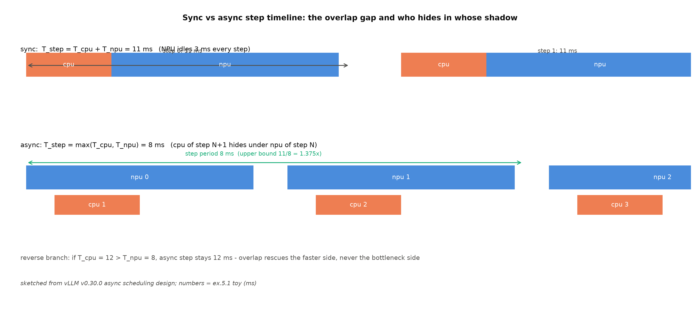

# 第 5 章 调度与重叠优化：async scheduler 与 ubatching

> 站段坐标：站 8 内部（AsyncScheduler 是 Scheduler 的子类——同一站内的另一种调度器）+站 4（EngineCore 步循环的非阻塞提交）+站 12（worker 输出 busy loop）配套。B7-6（ubatching/dual-batch overlap）在此兑现；ch2 埋的「async×ngram 互斥」机制层主场也在此。

## 5.1 开篇：时间轴上的等待产权

Book7 第 8 章收束图执行时留了欠账：「ubatching/dual-batch overlap（调度与计算的正交重叠线）→ Book8 第 5 章」【Book7 ch08-编译与图执行.md#L150，B7-6】。理论母账在 Book6 §12.5，那段话值得整句搬来：任一时刻三条流各自在忙——CPU 在为第 $t{+}1$ 步构造指令、NPU 在算第 $t$ 步、传输在搬第 $t{-}1$ 步，「引擎的每一毫秒都在三个流上同时记账——单流视角的账本永远高估成本」；现实的差距叫**重叠缺口**（overlap gap）：CPU 侧的 Python 调度慢于设备计算时，设备空转等指令【Book6 ch12-图执行与并行拓扑.md#L61】。再往前翻，Book6 ch04 给 v0 引擎立的三宗罪之三就是「逐批串行」（批间无重叠）——**等待的产权**从那时起第一次被记账；而五部曲（静态之弊→连续批处理→分页 KV→前缀缓存→分块预填）逐层拆清的是「批」的产权，本章拆的是**「步与步之间」的等待产权**——同一条记账逻辑，换到时间轴。

这条账为什么值钱，两个量级感：调度一步的 CPU 开销在毫秒级（Python 的循环+字典+锁），而 decode 每步的 NPU 计算对小模型也是毫秒级——**两者同量级，谁也吃不掉谁**，串行时就互相等出 30-50% 的空转（生产形态里大批量长序列的设备步长会把比值拉开，async 的红利才显著）；第二个量级感是 MoE 的 all-to-all 通信——DP+EP 部署下稀疏 all-toall 与计算同窗竞争，DBO 就是专门盖这条缝的。本章的问题：**CPU 决策与 NPU 计算的时间账怎么 overlap，谁在替谁打工？**

三段定位：专题=调度与重叠优化；站段=站 8 内部为主（调度器子类）；模块=`vllm/v1/core/sched/async_scheduler.py`（70 行，**两轨逐字节一致**——diff 实测零输出，本章主读锚免框注）+`config/vllm.py` 守卫链+`v1/worker/ubatch*.py`（微批三件）。产出：async scheduling 的完整正身（配置链→守卫→占位符闭环）、ubatching/DBO 的阅读面走查（**平台禁用守卫=平台收紧第三案例**）、一次 async on/off 对拍实测、重叠族谱的统一账。先把最简的账立起来：

$$T_{\text{sync}} = T_{\text{cpu}} + T_{\text{npu}} \qquad T_{\text{async}} = \max(T_{\text{cpu}},\ T_{\text{npu}}) \tag{5.1}$$

| 符号 | 含义 | 量纲 |
|---|---|---|
| $T_{\text{cpu}}$ | 单步 CPU 侧时长（调度决策+输入组装+输出处理） | ms |
| $T_{\text{npu}}$ | 单步设备侧时长（前向+采样） | ms |

用人话说：同步世界里一步的账是两段相加，异步世界里只付较长的那段——短的那段藏进了另一条的影子里。**重叠救的是快的一侧，不救瓶颈侧**（$T_{\text{cpu}}>T_{\text{npu}}$ 时 async 一步仍是 $T_{\text{cpu}}$——方向性缺口）。

**例 5.1（同步 vs 异步的时间线小账）** 构造：$T_{\text{cpu}}{=}3$ ms（调度 2+输出处理 1）、$T_{\text{npu}}{=}8$ ms。输入两算：①同步：11 ms/步——NPU 每 11 ms 只算 8 ms，**空转 3 ms**（重叠缺口的数字版）；②异步：$\max(3,8){=}8$ ms/步，加速上界 $11/8{=}1.375\times$。反向分支：$T_{\text{cpu}}{=}12>8$——异步一步仍 12 ms（CPU 成了瓶颈，NPU 反过来等指令）。输出读法：async 的红利是 $T_{\text{cpu}}/T_{\text{npu}}$ 的函数——比值越小、影子越藏得深；比值过 1，红利归零只剩簿记成本。（位置：本例即图 5.1 的 toy 底稿；实测对拍在 5.4。）

把这两个量级感带进式 (5.1) 的世界：第一个比值（$T_{\text{cpu}}/T_{\text{npu}}$）决定 async 的红利上界、第二个（通信/计算）决定 DBO 的——**本章两条主线各吃一个比值**，读的时候心里挂着这两个分数，每个机制的「为什么」都会自动归位。



图 5.1 重叠时序对比（按 v0.30.0 源码自绘，示意级；数字=例 5.1 toy 值）：上=同步步进（cpu/npu 串行相接、每步 3 ms 空转阴影）；下=async（下一步的 cpu 藏进本步 npu 的影子，步周期压到 8 ms）；底行标反向分支——CPU 瓶颈时重叠无效。

## 5.2 async scheduling 正身：配置链、守卫与占位符闭环

结构账先行——async scheduling 不是另一个进程、另一个线程，**是同一个调度器类换了子类**。配置字段（`config/scheduler.py#L190-193`，两轨同文）：

```python
# vllm/config/scheduler.py#L190-193【源码：阅读锚 v0.30.0（ced6857）；运行栈同文】
    async_scheduling: bool | None = None
    """If set to False, disable async scheduling. Async scheduling helps to
    avoid gaps in GPU utilization, leading to better latency and throughput.
    """
```

指名看什么：类型是 `bool | None`——**None 不是关，是「交给配置协商器裁决」**（默认开的实现方式）。分派体也看一眼正身（#L206-214，两轨同文）：`if self.async_scheduling: from vllm.v1.core.sched.async_scheduler import AsyncScheduler; return AsyncScheduler`——一行 import 的差别，换了整套步进协议。与基类的分工值得一句：`AsyncScheduler` 只重写 `_update_after_schedule`/`_update_request_with_output` 两个钩子，**乐观记账的骨架在基类**（Book7 ch5:84 已教「先记账后对账」，指回不重教）；基类处理 spec 拒绝回滚时会同时减两本账——`num_computed_tokens` 与（async 下）`num_output_placeholders`（`sched/scheduler.py#L1988-1996` 注释原文点名）。输出侧的半条腿在执行器：`multiproc_executor.py::async_output_busy_loop`（两轨同文）——输出经队列异步搬运、线程自须重设设备上下文（Book7 §7.6 已引，此处只补「它就是 async 的输出侧」一句）；PP 微批一笔也埋在这 70 行里：`request.next_decode_eligible_step = self.current_step + self.pp_size`（#L46-49）——async 与 PP 流水共舞时同一条请求隔 pp_size 步才可再排（族谱第四支，5.5 收）。

协商器的守卫是 ch2 三纪律其一的机制层正身（那章只引了告警行，这里给全链）。自动挡（None→开）撞上白名单外的投机方法就静默关掉并告警（`config/vllm.py#L1441-1462`）：

```python
# vllm/config/vllm.py#L1441-1462（骨架摘录）【源码：阅读锚 v0.30.0（ced6857）】
            elif (
                self.speculative_config is not None
                and self.speculative_config.method not in get_args(EagleModelTypes)
                and self.speculative_config.method not in get_args(NgramGPUTypes)
                and self.speculative_config.method != "draft_model"
                and self.speculative_config.method != "dspark"
            ):
                logger.warning_once(
                    "Async scheduling not supported with %s-based "
                    "speculative decoding and will be disabled.",
                    self.speculative_config.method,
                )
                self.scheduler_config.async_scheduling = False
```

指名看什么两处：其一，**白名单的本体是一行 Literal**——`NgramGPUTypes = Literal["ngram_gpu"]`（`config/speculative.py`）：在白名单的是 ngram_gpu（GPU 张量化提议），**经典 ngram 不在**——它的提议在 CPU（numba），而 async 恰恰要 CPU 让位，两者抢同一块肉（这是互斥的机制根，ch2 只给了现象、此处给了物理解释）；其二，**两轨差异**：运行栈同块（`env/.../config/vllm.py#L1107-1116`）**没有 `!= "draft_model"` 行**——0.27.1 上 draft_model 配 spec 时 async 会被静默关掉，v0.30.0 放行（差异续表 #26，A 级；读者若在运行栈上开 draft_model 服务感到吞吐不达预期，先查这条告警）。告警行的运行实物（ch2 probe 底档直接引用）：`WARNING … [vllm.py:1113] Async scheduling not supported with ngram-based speculative decoding and will be disabled.`——那一次探测未显式传 async 开关，**默认 None→自动挡→被关**的完整证据链。

配套连锁账两笔值得各给一句机制：**其一**，async 开启时 DP 组的同步原语弃 NCCL 改 Gloo——NCCL 的集合调用会占住 CPU 线程（与「CPU 让位」矛盾），Gloo 是 CPU 侧的轻量替代（代价是带宽性能，又一笔簿记）；**其二**，投机×async 同时开时级联注意力被禁（「not yet compatible with async speculative decoding」）——**一个优化项的启用吃掉另外两个优化项**，功能矩阵上永远要看这类连锁列。

正身 70 行里最要紧的是**占位符的生命周期**（Book7 ch12:57 钩在此兑现），三段合读：

```python
# vllm/v1/core/sched/async_scheduler.py#L13-17,#L21-25,#L34-44（骨架摘录，两轨逐字节同文）
    def __init__(self, *args, **kwargs) -> None:
        super().__init__(*args, **kwargs)
        # reusable read-only placeholder list for speculative decoding.
        self._spec_token_placeholders: list[int] = [-1] * self.num_spec_tokens
…
        spec_decode_tokens = scheduler_output.scheduled_spec_decode_tokens
        # Use the latest num of scheduled draft tokens in next step as placeholder.
        self._spec_token_placeholders = [-1] * scheduler_output.num_spec_tokens_to_schedule
…
            cur_num_spec_tokens = len(spec_decode_tokens.get(req_id, ()))
            request.num_output_placeholders += (
                self.num_sampled_tokens_per_step + cur_num_spec_tokens
            )
            # Add placeholders for new draft/spec tokens.
            # We will update the actual spec token ids in the worker process.
            request.spec_token_ids = self._spec_token_placeholders
```

指名看什么：调度步 $N{+}1$ 时 drafter 还没跑——token 编号只能是 $-1$（哨兵），真值在 worker 进程里才回填（`gpu_input_batch.py::update_async_spec_token_ids`——docstring 原话「update spec_token_ids … with real draft token ids from prior step」）；配套记账 `num_output_placeholders += 1+k`（「排了 4 个槽、一个产出还没回来」）。

占位符的两侧各有一条腿把重叠真正跑起来。引擎核侧的协议窗口：`step()` 里先 `future = self.model_executor.execute_model(scheduler_output, non_block=True)` **提交后不等**，转头去处理上一歩的输出与下一轮的调度决策，最后才 `future.result()` 收本步的期货（core.py#L600-607，两轨同文）——「非阻塞提交+期货等待」这八个字就是重叠的协议层本体（Book7 §7.4 立过位，此处是它的 async 完整形态）；post_step 的注释一句话说透本质：「When using async scheduling we can't get draft token ids in advance, so we update draft token ids in the worker process」（#L623-627）——**draft token 的生产被搬进 worker**，引擎核不再先取 drafter 结果再排下一步。worker 侧的腿：`multiproc_executor.py::async_output_busy_loop` 输出线程（两轨同文）把 token 从设备队列异步搬回引擎核——docstring 自白线程须重设设备上下文（「a thread will not inherit the context of the main thread」——NPU/CUDA 线程语境的通用坑）。两条腿加占位符闭环，async 的完整数据流：**scheduler 撒 −1 → executor 非阻塞提交 → worker 算+回填真值 → 输出线程搬回 → 引擎核对账减占位**——五步里没有任何一步需要停下来等另一步完成，这就是「藏进影子」的工程学。

**例 5.2（−1 占位符的账本走查）** 构造：k=3、单请求。输入三幕：
①步 $N$ 调度：请求排 $1{+}3{=}4$ 槽，`spec_token_ids=[-1,-1,-1]`，`num_output_placeholders += 4`（输入=scheduler_output；输出=占位数 4）；
②worker：drafter 产真 token 回填、验证接受 2 个——引擎核收到 2 个新 token，`placeholders -= 2` → 余 2（输入=输出线程交回的真值；输出=占位数 2）；
③被抢占的竞态：placeholders 在抢占时清零，迟到的旧输出标 `is_stale` **不再减账**——`if not is_stale: … assert request.num_output_placeholders >= 0`（#L59-63，防下溢的守卫）。
输出读法：占位符是「先记账后对账」的乐观主义在 async 世界的完备化——**每笔乐观都有对应的守卫**，读异步系统先读它的守卫。（位置：三段正身锚同上；MRV2 面的回填路径未在 runner 镜像定位——speculator 链自消化，沿 ch2「读的链/跑的链」先例框注一次。）

## 5.3 ubatching/DBO：阅读面与平台禁用守卫

第二条重叠线换切法——**切批内**。正身是官方设计文档 `docs/design/dbo.md`（89 行）【证据等级：官方设计文档】：动机一句话直引——「The core motivation of the DBO system in vLLM is to overlap the sparse all-to-all communication in the MoE layer with the surrounding computation. This system currently only targets DP+EP deployments.」（#L5）——两个限定词先立住：**MoE 层**（通信大头是稀疏 all-to-all）与 **DP+EP 部署**（单卡无此通信、TP 部署走 allreduce 不走 all-to-all——DBO 的适用面因此天然窄）。机制骨架：两个 CPU worker 线程（UBatch 线程）在 MoE kernel 的 yield 点**乒乓**——一个跑计算时另一个等通信；「ubatch=µ-batch 的 ASCII 写法」（#L9，术语考据一句）。启用条件四件套：`--enable-dbo`+`--data-parallel-size N>1`+`--enable-expert-parallel`+≥2 GPU；后端**仅支持 DeepEP all2all**（生态锁定）；且**只支持 Full CUDA graphs**——约束的下半句值得整句读：「once a DBO CUDA graph has been captured, it can be replayed without any multithreading or CPU synchronization」（#L62）——捕获期要线程协同、回放期零同步（图把乒乓的时序固化了——Book6 图执行章「用捕获换运行时自由」主题的又一实例）。

微批切分算法（教学主菜，`v1/worker/ubatch_utils.py::maybe_create_ubatch_slices`#L166-217）：切点=DP 填充后 token 总数**中点**等分（`split_point = num_tokens_padded // num_ubatches`），请求归属用两次 `searchsorted`——跨界请求同时出现在两个微批、query 各自截断。

**例 5.3（中点切分+跨界请求）** 构造：6 请求 scheduled tokens $=[2,3,4,1,2,2]$（总 14，恰为奇偶混合——故意让中点不落在请求边界上）、$u{=}2$（DBO 默认双微批——`_NUM_UBATCHES: int = 2` 硬编码）。输入三步：①切点 $=14//2=7$；②cumsum $=[0,2,5,9,10,12,14]$，微批 1=tokens $[0,7)$、请求 slice(0,3)——请求 2 跨界（4 个 token 左 2 右 2）；③微批 2=tokens $[7,14)$、请求 slice(2,6)。输出读法：跨界请求**两边都出现**（K/V 在两个微批里共享、query 各管各的段）——MRV2 侧 docstring 的现成机制金句互证：「A request straddling the boundary appears in both microbatches, its query truncated to the tokens each one owns」。（位置：算法锚 #L177-180/#L199-207；本例数字可手推验证 searchsorted 取值。）

**例 5.4（DBO 乒乓时刻表）** 以 dbo.md#L23-26 的官方时刻表为实物（直引，{官方设计文档}——这张表本身就是设计文档作者写给实现者的「时序合同」，读设计文档先找这种表）：

```text
# repos/vllm/docs/design/dbo.md#L23-26（原文直引）
# Comp: |-A0₀-A1₀-||-MLP₁-||-S₁-MLP₀-||-S₀-A0₁-A1₁-|
# Comm: |----D₁---||--D₀--||----C₁---||-----C₀-----|
# Order: D₁ send, A0₀, A1₀, D₁ recv, D₀ send, MLP₁, D₀ recv,
#        C₁ send, S₁, MLP₀, C₁ recv, C₀ send, S₀, A0₁, A1₁, C₀ recv.
```

走查前六个事件：T0 起 A0₀/A1₀ 在算的同时，通信流在搬 D₁——**MoE 的 all-to-all 被前向计算盖住**（这就是「dual batch」的收益本体：两个微批交错排布，一个在算时另一个在传，通信延迟从关键路径上消失）。节拍器是 `_cpu_yield` 的三断言（`ubatching.py#L94-100`——「It is critical for correctness that only one thread is running at a time」）：两个线程互为闹钟、**同一时刻恰一个醒**——这是正确性不变量而非优化建议（两个 CPU 线程同时碰 forward_context 或 stream 就会竞态）；三断言分别验上下文、流、事件位，醒来前先验自己确实是唯一持有者。yield 点的接入方式也值得看一眼：全部经 `_register_ubatch_function` 包装注册（#L160-167），包装后的函数**不在 ubatch 上下文里就是空操作**——MoE kernel 的让渡点因此对非 DBO 路径零侵入（同一个 kernel 源码服务两种执行形态，「特性不污染主路径」的接口设计范本）。

配置面两键先分清（`config/parallel.py#L222-227`）：`enable_dbo`（bool，固定切 2 微批+调度器协同）与 `ubatch_size`（int，任意微批数）——**同一机制的两个门**（性质对：`use_ubatching = enable_dbo or ubatch_size > 1`；`num_ubatches = 2 if enable_dbo else ubatch_size`）；另有阈值旋钮 `dbo_decode_token_threshold`（默认 32——decode 段 token 少于此数不切，切了不值得）。线程侧的默认也硬编码在案：`_NUM_UBATCHES: int = 2`（ubatching.py#L15-16 注释自认「Here we hardcode … for default」）。

然后是本章第二个守卫正身——**平台显式禁用**（平台收紧第三案例，与图模式默认档、结构化输出单后端合流成 ch10 的总账）：

```python
# vllm_ascend/platform.py#L856-868（节选）【源码：运行栈 vllm-ascend 0.27.1rc1】
        if getattr(vllm_config.parallel_config, "enable_dbo", False):
            logger.warning(
                "Parameter is currently ignored on Ascend. parameter=enable_dbo, "
                "action: resetting to False. ")
            vllm_config.parallel_config.enable_dbo = False

        ubatch_size = getattr(vllm_config.parallel_config, "ubatch_size", 0)
        if ubatch_size != 0:
            logger.warning(
                "Parameter is currently ignored on Ascend. parameter=ubatch_size, "
                "value=%d, action: resetting to 0. ", ubatch_size)
            vllm_config.parallel_config.ubatch_size = 0
```

指名看什么：不是「不支持所以报错」，是**参数收下、告警、强制重置**——与 ch3 单后端 patch 同款哲学（平台以收紧换稳定）。为什么禁：三层因果——ubatching.py 全文件以 `torch.cuda.Stream/Event` 为类型基座（代码级证据）、通信侧仅支持 DeepEP（生态证据）、CUDA 图约束（Full graphs only）——层层都是 CUDA 专属性。NPU 不是没有重叠优化，而是**自建了特化版**：`multistream_overlap_shared_expert`（`ascend_config.py#L389`，默认关）把共享专家搬上辅流与主流路由专家重叠（`ops/fused_moe/shared_experts.py#L285` 的 `npu_stream_switch`）；`multistream_dsv4_dsa_overlap`（#L387，默认开）做 DSA 注意力辅流——但两者都需要 MoE/DSA 模型才生效，本机无对应检查点，**源码阅读面口径**（大纲钦定本章为阅读章）。

## 5.4 实验：async on/off 对拍

两臂对拍。设计要点先交代（沿 ch2 的八条混淆源裁剪到本章）：**两臂都无 spec**——互斥守卫不触发（它本身已是 5.2 的教学正身，不再消耗实验臂）；两臂 async 开关**显式对置**（`--async-scheduling` vs `--no-async-scheduling`）——杜绝 None 协商路径的不确定性（ch2 的 probe 底档就是 None 被自动关的受害者证据）；eager 同置（隔离捕获方差，图模式臂留 full 档）、APC 同关（echo 共享前缀会引 APC 混淆）、温度 0、同卡同 seed、workload 复用 ch2 的 echo 集（跨模型不与 ch2 读数混算，只作本章内部对照）。判据预注册五条：J1 装配断言（on 臂日志 non-default args 行含 `'async_scheduling': True`、off 臂含 False——显式传参才进该行）；J2 守卫旁证（两臂均无「Async scheduling not supported」告警——与 5.2 所引 ch2 probe 的有告警构成「同一守卫、spec 有无两副面孔」）；J3 主判据 ITL 对拍四分支（>5% 正结果/2-5% 边际/<2% 负结果/on 更差的 overhead 分支）；J4 TTFT 预期变化小；J5 图模式臂可运行性（full 档，失败不硬试）。

**表 5.1 async on/off 两臂读数**（Qwen3-0.6B，echo workload 32 请求×64 token、rate 8/s【本机实测（Atlas 910B3，运行栈 0.27.1+vllm-ascend 0.27.1rc1，卡 3；底档 `log/book8-ch05/async_{on,off}.json`+`async_ab_summary.json`】）：

**表 5.1 async on/off 两臂读数**（【本机实测（Atlas 910B3，运行栈 0.27.1+vllm-ascend 0.27.1rc1，卡 3；底档 `log/book8-ch05/async_{on,off}.json`+`async_ab_summary.json`】）

| 臂 | 吞吐 (req/s) | mean ITL (ms) | mean TTFT (ms) |
|---|---|---|---|
| async off | 1.668 | 59.2 | 116.4 |
| async on | 1.578 | 63.7 | 183.7 |
| on/off 比 | **0.946** | 1.076 | 1.579 |

判读走的是预注册的**负结果分支**（J3 的「on≤off」支），逐笔拆这笔 0.946×：其一，负载形态——echo workload 32 请求×64 token、rate 8/s 下批规模小、decode 窗口短，$T_{\text{cpu}}$（调度+组装+输出处理约毫秒级）与 $T_{\text{npu}}$（0.6B 单步前向）同量级但都不大，**缺口窄**——式 (5.1) 的上界 $1+T_{\text{cpu}}/T_{\text{npu}}$ 本身趋近 1；其二，簿记成本——占位符的撒与收、双队列的交接、输出线程的唤醒，这些固定开销在小步长下占比放大；两笔相减，净值为负 5.4%。**0.946× 因此是式 (5.1) 的活体反例教材**：重叠红利是 $T_{\text{cpu}}/T_{\text{npu}}$ 的函数，本实验的负载形态把比值压到了红利区之外。两笔附账：TTFT 膨胀（1.58×）部分来自批组成与调度时点变化（async 主改稳态 decode，TTFT 不是它的战场——J4 预注册过这一条）；负结果**同样是有效读数**（第三次出现——Book6 的 open 臂、ch1 的 0.941×、本章的 0.946×：本丛书把「如实记负」当方法论主线之一）——「何时不该开 async」与「何时该开」同价，收益条件式（大批量/长 decode/设备步长大的生产形态才见红利）就是本章想交付的判断力。图模式臂（async×ACLGraph 的生产形态组合）为 full 档选做项，J5 预注册了失败分支不硬试。

## 5.5 重叠族谱：四个切法与统一账

把本章两条线放进族谱（四切法+一对照）：

**表 5.2 重叠族谱账**（切法/谁等谁被消除/层级/开关/NPU 状态）

| 切法 | 切哪条缝 | 层级 | 开关 | NPU 状态 |
|---|---|---|---|---|
| async scheduling | 步与步（调度 $N{+}1$×执行 $N$） | engine 层 | 默认开（None→auto） | **可实测**（5.4，负结果也是读数） |
| ubatching/DBO | 批内（微批乒乓，通信×计算） | runner 层 | `--enable-dbo`/`--ubatch-size` | **平台禁用**（5.3 守卫） |
| multistream overlap（NPU 自建） | 算子间（共享专家/DSA 辅流） | 算子层 | ascend_config 两键 | 源码在、需 MoE/DSA 模型 |
| PP 微批 | 流水段（`next_decode_eligible_step`） | engine 层 | async 下需 2 并发批 | ch6 分布式章前哨 |
| （对照）SGLang overlap scheduler | 步与步 | engine 层 | — | {厂商自报}：v0.4 实测 1.1×、对基线 1.3× |

族谱第四支（PP 微批）多给两句，它是 ch6 的前哨：async 开启时引擎需要**至少 2 个并发批**（`max_concurrent_batches` 语义——本步在算、下一步已在排，两个批同时在飞），PP 流水则需要 pp_size 个（每个流水段一个在制品）；`next_decode_eligible_step` 就是两条需求叠加时的合格步标记——同一条请求隔 pp_size 步才许再排，防止流水段被同一请求塞满。切「流水段」这条缝的簿记代价因此是**合格步标记+并发批配额**，与前三支的占位符/乒乓/事件各不相同、代价结构同源。

读法两句话。正向读：四个切法切的都是「单流视角里串行的两段」，差别只在**缝的位置**（步间/批内/算子间/流水段）——缝的位置决定收益的天花板（步间的上界是式 (5.1)、批内的是通信时长、算子间的是辅流时长、流水段的是气泡时长）；反向读：每种切法都要付**簿记代价**（占位符/线程乒乓/事件同步/合格步标记）——「免费的重叠不存在」，与 Book6「动态是税」对偶。Book6 ch12 那句「微批重叠技术本机不可实测」在这里给 2026-10 修订版：**async 可测、ubatch 平台禁、multistream 需特定模型——可实测面是平台的函数**（这句话本身就是 ch10 的预告）。

## 5.6 本章小结

回扣开篇：谁在替谁打工的答案=**快的一侧藏进慢的一侧的影子**（式 (5.1) 与例 5.1 的 1.375× 上界），而工程实现是三件套——配置链（None≠关的协商器）、守卫（spec 互斥的白名单本体是一行 Literal）、占位符闭环（例 5.2 的 −1 哨兵从 scheduler 撒到 worker 回填，每笔乐观配一个防下溢守卫）；ubatching/DBO 走阅读面（例 5.3 的中点切分与例 5.4 的官方时刻表），平台禁用守卫是收紧第三案例；实测 0.946× 负结果把「红利是比值的函数」钉成了读数。

**带走的心智**：两幅画。**其一，时间轴上的影子**——读任何引擎的步进协议，先画出 cpu/npu 两条泳道找空转阴影；同步世界的账是加法、异步世界是 max，**但簿记成本永远在场**（占位符的撒与收、乒乓的醒睡、守卫的连锁——本章三种机制各配一种），红利=影子面积−簿记成本；本机 0.946× 的负结果就是这笔减法在小步长负载下的负净值——负结果不否定机制，只划定收益边界。**其二，可实测面是平台的函数**——同一个「重叠优化」的名字下，async 在 NPU 可测、ubatch 被平台重置、multistream 要特定模型；读功能矩阵先读平台的禁用守卫（「参数收下+告警+强制重置」三件套是它的签名，与 ch3 单后端的「直接报错」是两种收紧哲学）——把这两幅画带在身上，遇到任何「overlap/异步/流水」命名的新优化，先问三件事：切哪条缝、簿记代价是什么、平台让不让跑。

镜头拉回全书：本章把「等待」拆到了步与批的粒度；下一章把「机器」拆到多卡（TP/PP/EP——族谱第四支 PP 微批在那章展开）；而平台收紧三案例（图模式/单后端/ubatch）将在 ch10 合流成平台层方法论。

> **【欠账】** ①平台收紧三案例总账（图模式默认档+结构化输出单后端+ubatching 禁用）→ 第 10 章；②差异续表两行候选（#26 async 白名单 draft_model 两轨差/#27 ubatching 文件集两轨差）→ 卷级大纲差异清单补登（终校销号）。

**动手验证**（Atlas 910B3；选卡纪律照 CLAUDE.md；serve 纪律全套）：
① 对拍复跑（骨架=`code/Book8-vLLM源码剖析下/ch05/async_ab.sh`）：`ASCEND_RT_VISIBLE_DEVICES=<卡> vllm serve Qwen/Qwen3-0.6B --dtype bfloat16 --max-model-len 1024 --gpu-memory-utilization 0.4 --enforce-eager --no-enable-prefix-caching --seed 20261012 --host 127.0.0.1 --port 18041 --async-scheduling`（off 臂换 `--no-async-scheduling`）+bench serve echo workload——验收行=on/off 吞吐比 ≈0.95（负结果分支；底档 `async_ab_summary.json`）；
② 守卫三连核字：`sed -n '856,868p' repos/vllm-ascend/vllm_ascend/platform.py`（平台重置原文）、`grep -n "Async scheduling not supported" log/book8-ch02/probe_ngram_engage.log`（互斥告警实物）、`sed -n '13,17p;34,44p' repos/vllm/vllm/v1/core/sched/async_scheduler.py`（占位符三正身）；
③ 切分 dry 跑：`python -c "from vllm.v1.core.sched.async_scheduler import AsyncScheduler; print(AsyncScheduler.__mro__[1].__name__)"`——验收行=`Scheduler`（子类关系一行验，两轨同文一跑双证）；
④ 制图：`python code/Book8-vLLM源码剖析下/ch05/fig_ch05.py`——产物 `figures/fig-5-1-overlap-timeline.png`。
