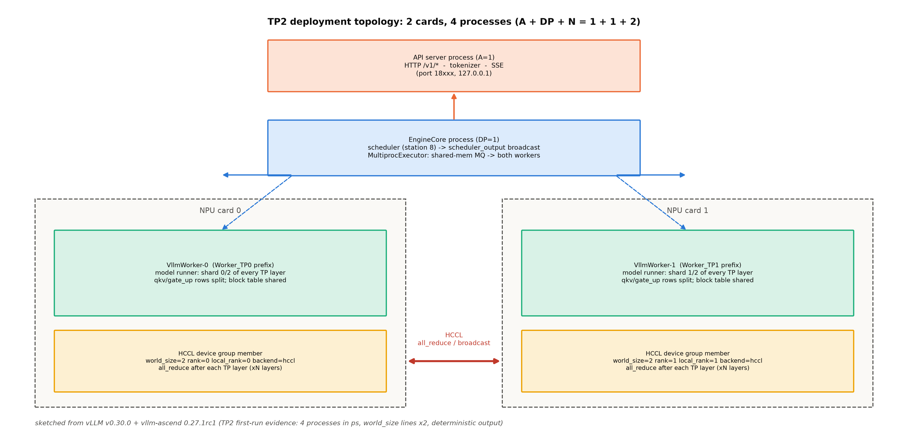

# 第 6 章 分布式服务：TP/PP/EP 与多卡边界

> 站段坐标：站 7（EngineCore 构造期：`get_class` 选执行器）+站 10（广播面：消息队列分发到各 worker）+站 11（worker 进程形态：Multiproc 进程/Ray actor）。B4-1（专家并行工程）与 B7-7（多卡图模式同步边界）双钩并门。

## 6.1 开篇：一张卡装不下的时候

Book6 第 12 章立完四刀理论账（TP 切权重、PP 切层、DP 切请求、EP 切专家），末句把工程账留在这里：「真实大系统的拓扑是四刀的组合拳——组合的搜索空间正是系统设计的难处（→ Book8 第 6 章）」【Book6 ch12-图执行与并行拓扑.md#L104】。两笔正式钩同章到期：Book4 讲 MoE 机构学时说「专家互不通信、通信退化为 token 搬运——all-to-all 调度、设备级负载治理与推理引擎里的专家分发工程属系统侧。→ Book8 第 6 章」【Book4 ch02-MoE基本机构.md#L205，B4-1】；Book7 收束图执行时留了后半句「多卡图模式的同步边界 → Book8 第 6 章」【Book7 ch08-编译与图执行.md#L150，B7-7】——它的能力矩阵表行写着「TP>4 图模式同步边界｜**否（单卡）**｜Book8 第 6 章」，那三个字「否（单卡）」正是本章要翻页的账：多卡图模式在本机 TP 双卡上有多少可验、多少仍留云档，6.5 节逐条清点。Book7 ch7 已把 executor 三态与 Worker 七函数讲到「worker 住哪」一级——本章增量=多卡展开后的**拓扑账**、**EP/MoE 专题**、**多卡图模式**。本章的问题：**一张卡装不下的模型与一套实例扛不住的流量，引擎怎么拆账、通信账谁来付？**——这问的两半分别对应「拆权重」（TP/PP/EP 的切法选择）与「拆流量」（DP 与 ch7 的 PD——两条流量拆法线，前者复制一切、后者分工段）。

三段定位：专题=分布式服务；站段=站 7+10+11；模块=`vllm/v1/executor/`（五件 3902 行）+`vllm/distributed/parallel_state.py`（进程组总线）+`vllm_ascend/ops/fused_moe/token_dispatcher.py`（NPU 令牌派发）+EPLB 双路配置。产出：并行旋钮总表（表 6.1）、TP2 双卡首跑的完整对账（进程公式 1+1+2=4 实测）、EP 与 EPLB 的机制正身、多卡图模式的同步边界、W4A8×EPLB 两表冲突的如实并注。

## 6.2 并行全景与 executor：五件与进程公式

先给全景（图 6.1）——一次 TP2 部署从单卡 2 进程变双卡 4 进程，谁多了谁没多，一图数清。



图 6.1 TP2 并行拓扑（按 v0.30.0+vllm-ascend 源码自绘，示意级）：API 进程（A=1）与 EngineCore（DP=1）不随 TP 变；每张卡各住一个 `VllmWorker-{rank}`（`Worker_TP{n}` 日志前缀），持每层的半个分片；卡间通道=HCCL 设备组（world_size=2，逐层 all_reduce）。右侧证据行=6.6 实测的 ps/world_size/确定性输出三面。

**表 6.1 并行旋钮总表**（四刀+两个 NPU 特产——「切什么×引擎旋钮」的一页字典）

| 切法 | 切什么 | 引擎旋钮 | 通信几何 | 本机状态 |
|---|---|---|---|---|
| TP 张量并行 | 每层权重行/列分片 | `--tensor-parallel-size` | 逐层 all_reduce（HCCL） | **实测 ✓**（6.6 双卡） |
| PP 流水线并行 | 按层切段 | `--pipeline-parallel-size` | 点对点激活传递 | 阅读面（多机为主） |
| DP 数据并行 | 按请求切 | `--data-parallel-size` | 组间几乎零通信 | 概念面 |
| EP 专家并行 | 按专家切 | `--enable-expert-parallel` | all-to-all token 搬运 | 源码走查（6.3/6.4） |
| finegrained TP | 按**模块**细切 | ascend_config 五键 | all_to_all/reduce_scatter | 阅读面（6.5） |
| （配套）执行器 | 进程形态 | `--distributed-executor-backend` | — | mp 实测/ray 阅读面 |

一行加一句「什么时候轮到它」：TP 是默认选项（单机多卡的第一步——装不下才需要）；PP 在层数多、卡间带宽窄时优于 TP（点对点比全互联省）；DP 在流量超单实例吞吐时加（近乎零通信成本的横向扩）；EP 是 MoE 模型的专属（专家天然可切）。**组合拳的搜索空间**（2×2×2×2 的开关组合）正是 Book6 说「系统设计的难处」的那句话的形状——本章给的解法是按需逐个开（先 TP 再看），不是枚举。读法：正向读=先选切法再选进程形态（执行器只是「怎么把 worker 拉起来」，不改变切法语义）；反向读=每一行的通信几何决定它的代价曲线——TP 逐层同步（对延迟最敏感）、EP 按需搬运（对负载均衡最敏感，6.4 展开）、PP 点对点（对气泡敏感，ch5 族谱第四支的伏笔回收处）。

执行器五件（`vllm/v1/executor/`）：`abstract.py`（399 行，`Executor(ABC)`#L38+`get_class`#L49-93 分派）、`uniproc_executor.py`（207 行，单进程直调+`ExecutorWithExternalLauncher`#L161——torchrun 外部拉起、每 executor 单 worker、多引擎互不同步）、`multiproc_executor.py`（1127 行，**单机多进程主力**：`MultiprocExecutor`#L111/`WorkerProc`#L600/`worker_busy_loop`#L1029——共享内存消息队列广播，Book7 ch4 实测过的 2 进程档就是它）、`ray_executor.py`（645 行，Ray V1：worker 变 actor）、`ray_executor_v2.py`（580 行，`RayExecutorV2(MultiprocExecutor)`#L237——**继承 mp 复用 MQ busy loop**，docstring 自述只重写 worker 生命周期管理（原文还带个 typo「cricitcal」——照录），两代设计的活对照）。分派正身十行：

```python
# vllm/v1/executor/abstract.py#L61-70（骨架摘录）【源码：阅读锚 v0.30.0（ced6857）】
        elif distributed_executor_backend == "ray":
            if envs.VLLM_USE_RAY_V2_EXECUTOR_BACKEND:
                from vllm.v1.executor.ray_executor_v2 import RayExecutorV2

                executor_class = RayExecutorV2
            else:
                from vllm.v1.executor.ray_executor import RayDistributedExecutor

                executor_class = RayDistributedExecutor
```

指名看什么：ray 一个字符串内部还分两代（环境变量选 V2——**配置项里藏着代际开关**，读旧文档先核这一行）；分派表还接受任意全限定类名（`resolve_obj_by_qualname`——执行器的插件位，与 ch1 见过的模型注册表门路同构）。承 Book7 已讲的 uni/mp 两支，这里补齐 ray 三支后的全景：**执行器唯一的职责是「把 N 个 worker 进程拉起来并维持消息通路」**——切法语义（表 6.1）完全在 worker 侧，执行器换形态不换账。

进程组总线是 `GroupCoordinator`（`parallel_state.py#L422`——「takes charge of all the communication operations」）。它注释里的官方表就是 rank 的全部学问（#L436-446）：

**例 6.1（rank 三兄弟：rank/local_rank/rank_in_group）** 构造：2 节点各 2 进程、一个大小为 4 的组（照源码注释表）。输入=部署描述，输出=每人三件身份证，逐行念一遍：进程 0-1 在节点 0（rank 0/1、local_rank 0/1、组内 0/1）；进程 2 在节点 1——**rank=2（全世界第几名）、local_rank=0（本机的第 0 张卡）、rank_in_group=2（组内第几名）**。效果读法：拿到任何日志行（`world_size=2 rank=1 local_rank=1 …`）能立刻说出它在哪台机、哪张卡、哪个组第几号——6.6 的 rank 分配行就是这张表的日志面。（位置：底本=`parallel_state.py#L436-446` 注释表原文；local_rank 用来派卡、rank_in_group 用来通信——三兄弟各管一本账。）

先立公式的来历再算账：它不是设计者的发明而是**职责的自然展开**——每类角色至少一个进程（API 要独立因为不能被引擎阻塞、EngineCore 要独立因为调度是 CPU 密集、worker 每 TP 份一个因为每份要绑一张卡），$A$ 默认=$DP$ 是因为 DP 每路要自己的前端。**例 6.2（进程公式三档舰队）** 构造：总进程数 $=A+DP+N$（$N=DP\times PP\times TP$，A 默认=DP）【官方设计文档 arch_overview.md#L105-125】。输入三档并排：①单卡=1+1+1=**2 进程**（Book7 ch4 实测档：worker 吸收进 EngineCore）；②TP2 双卡=1+1+2=**4 进程**（本章实测档：1 API+1 EngineCore+2 VllmWorker）；③文档算例 tp2dp4=1+4+8=13+DP>1 的 A 展开=**17 进程**。输出读法：每档数一遍「哪些角色被吸收、哪些展开」——TP 只扩 worker、A/DP 角色不变；见部署先算角色再问执行器形态，才数得出物理进程（Book7「公式数角色、ps 数进程」心智的多卡续账）。（位置：②的实测=6.6 表 6.3。）

ray 路线在 NPU 上是阅读面（写作要求 12 显式标注），证据四件成群。接线正身（vllm-ascend 平台侧，4 行）：

```python
# vllm_ascend/platform.py#L92-95【源码：运行栈 vllm-ascend 0.27.1rc1】
    ray_device_key: str = "NPU"
    device_control_env_var: str = "ASCEND_RT_VISIBLE_DEVICES"
    ray_noset_device_env_vars: list[str] = [
        "RAY_EXPERIMENTAL_NOSET_ASCEND_RT_VISIBLE_DEVICES",
    ]
```

指名看什么：Ray 集群按 `"NPU"` 资源名调度（对应 CUDA 世界的 `"GPU"`——一行字符串就是一套生态适配）；noset 列表防 Ray 覆写 `ASCEND_RT_VISIBLE_DEVICES`——**与全书 NPU 选卡纪律直接相关**（Ray 代管进程-卡绑定后，手工选卡变量反而要让路）。第二件：actor 设备索引注释（`ray_executor.py#L179-182`——"The way ray actors are setup in vllm is that the visible devices are not set by actors … Internally we index the right gpu with local_rank. This is similar to how mp mode works."——与 mp 模式同构的一句话定位）。第三件：官方多机 PP 文档例（`--distributed-executor-backend ray --tensor-parallel-size 8 --pipeline-parallel-size 2`）。第四件：本机 `import ray`→ModuleNotFoundError（2026-10-12 探针，可复跑）。**定谳：ray=阅读面；多机实测归云 GPU 选做（作者已裁定不做，登记 ch13）**。

## 6.3 MoE 专家并行：EP 组与令牌派发

EP 的机构学根据 Book4 已立（专家互不通信、路由器天然分桶、通信退化为 token 搬运——「机构学根据在这里止步，工程账留个地址」的那个地址就是这里），本章接工程正身。EP 组怎么建（`parallel_state.py#L2210-2245`）：

```python
# vllm/distributed/parallel_state.py#L2210-2245（骨架摘录）【源码：阅读锚 v0.30.0（ced6857）】
        use_all2all = parallel_config.use_all2all
        if enable_elastic_ep:
            with _elastic_join_warmup_ctx():
                _EP = _init_stateless_group(group_ranks, "ep", ..., use_all2all=use_all2all)
        else:
            _EP = init_model_parallel_group(
                group_ranks, get_world_group().local_rank, backend,
                group_name="ep", use_all2all=use_all2all,
            )
```

指名看什么：组的 rank 几何来自 DP×PCP×TP 的 unbind（#L2213-2219——把 DP 维「解开」重排成 EP 维：同一条 DP 通路上的卡各持不同专家）；`use_all2all` 随组传入（通信几何在组对象上声明）。紧随其后的注释值得整句引：「Create EPLB group with the same ranks as EP … **a separate process group to isolate EPLB communications from MoE forward pass collectives and prevent deadlocks**」——**控制面通信（重排协商）与数据面通信（前向搬运）分组隔离**：同一个 rank 集合建两个组，EPLB 的协商流量不会卡住 MoE 的 all-to-all——防死锁的机制正身。

NPU 侧的令牌派发是三路线并列（`vllm_ascend/ops/fused_moe/token_dispatcher.py`）：`TokenDispatcherWithMC2`#L112（MC2=CANN MegaMoe 融合通信——默认主力）/`TokenDispatcherWithAllGather`#L333（先聚合再各取所需）/`TokenDispatcherWithAll2AllV`#L439（通用 all-to-all）。MC2 路线的接线五行值得看正身：

```python
# vllm_ascend/ops/fused_moe/token_dispatcher.py#L115-119【源码：运行栈 vllm-ascend 0.27.1rc1】
        device_group = get_mc2_group().device_group
        # TODO: Try local_rank = ep_group.rank_in_group
        local_rank = torch.distributed.get_rank(group=device_group)
        backend = device_group._get_backend(torch.device("npu"))
        self.moe_all_to_all_group_name = backend.get_hccl_comm_name(local_rank)
```

指名看什么：最后一行——all-to-all 不走通用集合通信层，而是拿 **HCCL 专属 comm name** 直连 MegaMoe 算子（通信被算子吸收：MC2 在 kernel 内部完成搬运与计算的交织，正好是 ch5 DBO 想盖的那条缝的 NPU 答案——不过它切在算子内部而非批之间）；那行 TODO 顺带暴露了 rank 选择的未定式（local_rank 与 rank_in_group 的取舍）。与上游 CUDA 侧 `all2all.py` 的十类后端管理器（AgRs/DeepEP×3/Nixl/FlashInfer×2/Mori/DeepEPV2）对照着读：**同一个「MoE token 搬运」问题、两套生态各自的答案集**——CUDA 侧按后端族分层（DeepEP 系深耕 NVLink/RDMA），NPU 侧按 HCCL 算子融合（CUDA 族只点名分类，禁深讲）。

先给 EP 一句定位（防与 DP 混）：DP 是「每卡一份完整的模型各伺候各的请求」、EP 是「各卡各持一部分专家合起来伺候所有请求」——前者复制权重、后者切分权重；MoE 模型的「专家天然可切」让 EP 成为它的专属选项（dense 模型无此选项）。

**例 6.3（八专家两卡的路由分桶）** 构造：8 逻辑专家 E0-E7、EP=2（卡 0 持 E0-E3、卡 1 持 E4-E7）；4 个 token 各 top-2：t1→{E1,E5}、t2→{E2,E6}、t3→{E0,E4}、t4→{E5,E7}。输入三步：
①每卡持全量 token 隐状态（前面的 TP all_reduce 之后）；
②按专家去向分桶：卡 0 本地算 (t1,E1)(t2,E2)(t3,E0)=**3 对**、向卡 1 发出 4 个 token 块；卡 1 本地算 (t1,E5)(t2,E6)(t3,E4)(t4,E5)(t4,E7)=**5 对**、发 3 块回卡 0；
③算完反向 all-to-all 汇聚加权和。
输出读数：总计算对数 8=4×top2 ✓（账闭合）；**3:5 的不均衡**让卡 0 空等 2 份时长——「拓扑决定通信的形状、均衡决定通信的等待」（Book6 §12.6 原句回响）。钩子：若 E5 长期热→给它开分店（例 6.4 的 EPLB）。（位置：派发正身=token_dispatcher 三类；均衡问题=6.4 的入场券。）

## 6.4 EPLB 负载均衡：双路配置与「借上游」的补丁

均衡问题的解法是**冗余专家**（redundant experts）——给热门逻辑专家开多个物理分店。NPU 上有两条配置路，先立映射的机制：

**例 6.4（冗余专家=开分店：logical_to_physical 走查）** 构造：2 个 MoE 层、4 逻辑专家、3 个 EP rank、冗余 2 → 6 个物理专家；热账假设 L0 承载 60% token。输入两读（底本=`eplb_state.py#L109-147` docstring 官方例，直接引为 toy 实物）：重排前 `physical_to_logical=[[0,1,2,3,0,1],…]`（L0 只两席且同侧）；重排后 `[[0,2,0,1,0,3],…]`——**L0 占 P0/P2/P4 三席、恰在三个 rank 各一席**。输出读法：逻辑专家是岗位、物理专家是工位，EPLB 按客流（窗口内逐专家 token 计数，shape `(num_moe_layers, num_logical_experts)`）调工位表（输出 logical_to_physical，shape `(...,num_redundant+1)`，-1=无映射）——热专家的三家分店把流量摊平到每张卡。（位置：`EplbModelState` docstring；每个 MoE 模型一份状态账本。）

**表 6.2 EPLB 双路对照**（MRv1 legacy vs MRv2——**两路开关与配置格式互斥，官方明令禁混用**）

| 维度 | MRv1 legacy 路 | MRv2 路 |
|---|---|---|
| 开关 | `AscendConfig.eplb_config`（additional_config 内） | `--eplb-config` 命令行（字段不进 additional_config，唯一例外 load_collection_phase） |
| 关键字段 | dynamic_eplb(False)/expert_map_path/热采间隔 600/执行间隔 50/冗余数 0/policy∈[0,3] | window_size=1000/step_interval=3000/冗余数/use_async（恒 true）/policy |
| 环境变量 | DYNAMIC_EPLB/EXPERT_MAP_RECORD 须 true（守卫 #L151-155） | MRv2 下这两个变量=直接报错 |
| 通信底座 | Gloo（控制面） | AscendGlooEplbCommunicator（patch 换血） |

【证据等级：官方文档（eplb 文档 L17-18 警告原文「Do not mix MRv1 … with MRv2」——两代开关与配置 schema 各走各的）+源码走查】

两路并存的背景值得半段：MRv1 路是 vllm-ascend 自己长出来的（字段住在 ascend_config、环境变量做总闸），MRv2 路是上游把 EPLB 收编进主仓后的标准面（命令行 config、异步强制）——**收编期的新旧并存**是活跃仓库的常态，读任何 EPLB 教程先问它写的是哪一路（两路字段名连「冗余专家数」都不同名）。MRv1 侧还有一件配置实物候选：ascend_config #L285-296 自带全量示例 JSON（八字段一屏——照抄即用的母版）。

MRv1 路的环境变量守卫看一眼正身（五行的「双保险」上半）：

```python
# vllm_ascend/ascend_config.py#L151-155【源码：运行栈 vllm-ascend 0.27.1rc1】
        if self.dynamic_eplb:
            assert (
                os.getenv("DYNAMIC_EPLB", "false").lower() in ("true", "1")
                or os.getenv("EXPERT_MAP_RECORD", "false") == "true"
            ), "The environment variable DYNAMIC_EPLB or EXPERT_MAP_RECORD of the EPLB must be set to true."
```

指名看什么：配置字段开了、环境变量没开——启动即 AssertionError；而同一对环境变量在 MRv2 下反过来是**报错项**（平台侧 `platform.py#L889-935` 的互斥守卫：MRv2 下 additional_config 里的 legacy 字段直接 ValueError、DYNAMIC_EPLB 环境变量也炸）——「同一互斥律的配置层/平台层双保险」，读旧配置迁移到新栈时的第一坑。MRv2 侧另有异步强制（use_async=false 归一为 true+告警）与 communicator 必须 torch_gloo 两守卫。

为什么需要「借」：上游 EPLB 是 CUDA-only（`config/parallel.py#L527-531`：`if not current_platform.is_cuda_alike(): raise ValueError("Expert parallelism load balancing is only supported on CUDA devices or ROCm devices now.")`）——vllm-ascend 的解法是 `patch_eplb.py#L37-48` 的代理类：

```python
# vllm_ascend/patch/platform/patch_eplb.py#L37-48（骨架摘录）【源码：运行栈 vllm-ascend 0.27.1rc1】
class _CudaAlikeEplbPlatformProxy:
    """Delegate platform operations while exposing EPLB validation capability."""

    def __init__(self, platform) -> None:
        self._platform = platform

    def is_cuda_alike(self) -> bool:
        return _is_npu_platform(self._platform) or self._platform.is_cuda_alike()
```

指名看什么：**让上游守卫相信 NPU 是 CUDA-like**——这是「平台收紧上游自由度」系列的**镜像案例**（ch5/ch3 是收紧、这里是替上游守卫放行）；三件套补丁（平台代理+Gloo communicator 工厂换血+workspace move 包装）合成「借上游控制器、换 NPU 通信底座」的完整故事；异步重排周期 commit 有专属日志行（`Ascend async EPLB cycle committed`）可 grep——多卡实验的观测点。

两处如实并注收尾。**其一，W4A8×EPLB 两表冲突**：feature_matrix 标 ❌（已验证结论面）、eplb 文档 MRv2 表标 W4A8 Enabled（代码路径开放性面）——**两表并列如实写、不裁决，实测定谳留多卡档**（本机 Qwen1.5-MoE 非绿名单且冲突项是 W4A8 不是 W4A16）。**其二，性能边界三条件**（官方建议直引）：P 侧输入 <1024 token、D 侧每 die 专家数 ≤8（950DT ≤16）或每 die 负载 <128 token 时**不建议开 EPLB**；≈8 专家/die 时收益≈开销——结构账（例 6.4 的搬运账）先于性能数字，这三条才有处安放。

## 6.5 多卡图模式同步边界（B7-7）与 finegrained TP

图遇到多卡，协同边界三层看正身（v0.30.0 阅读面）。第一层，入口把捕获包在**三个组的上下文里**：

```python
# vllm/distributed/parallel_state.py#L1659-1663【源码：阅读锚 v0.30.0（ced6857）】
    with (
        get_tp_group().graph_capture(context),
        get_pp_group().graph_capture(context),
        get_dp_group().graph_capture(context),
    ):
        yield context
```

指名看什么：图不是每卡各自录各的，是「**编队进入、编队退出**」——TP/PP/DP 三组各设栅栏，任何一卡未就位，全组都不开始捕获。第二层，组内的流等待（`GroupCoordinator.graph_capture`#L707-712）：

```python
# vllm/distributed/parallel_state.py#L707-712（注释+骨架）
        # ensure all initialization operations complete before attempting to
        # capture the graph on another stream
        curr_stream = torch.cuda.current_stream()
        if curr_stream != stream:
            stream.wait_stream(curr_stream)
```

指名看什么：注释原文把危险说清——**初始化没完成就在另一条流上捕获**，录下来的图会引用半初始化的通信缓冲；另有「Capture each group's own comm. A global lookup would double-capture」（#L701-702——每组只捕自己的通信器，全局查表会捕两次）。第三层，**同步账的具体内容**=`custom_all_reduce.py#L386-405` 的 `register_graph_buffers()`：捕获上下文结束后，把图内缓冲的 IPC 句柄逐 rank 广播（`dist.broadcast_object_list` 循环）——**每张卡的图里记着别的卡的地址，这些地址必须在捕获后全组对账**。这正是 B7-7「同步边界」的机制本体；TP 越大、对账参与方越多（Book7 表行口径「TP>4」，教学上写成「多卡图的捕获/回放需要全组协同」更准）。

NPU 侧没有 custom-all-reduce IPC 对账那一层，多卡图的协同约束落在**捕获档位对齐**（`platform.py#L1179-1199`）：TP>1 且图模式且（SP∪共享专家 DP∪DSA-CP）时，capture sizes 须为 tp_size 倍数、筛后回写 max 档——注意条件是三合取，不是无条件 TP>1（写稿不越界）。

**例 6.5（图档位对齐：tp_size 的倍数筛）** 构造：tp=2、原 capture 档位 [1,2,3,4,8]、SP 开启。输入两步：逐档除以 2 → [0.5,1,1.5,2,4]；非整除档（1、3）剔除 → 对齐档 [2,4,8]，max 档回写=8。输出读法：**档位 1 为什么必须死**——每卡分不到整 token，SP 切分出小数；「多卡的图连静态形状都要全组整除」是同步边界的档位面（与例 6.2 的进程对账、IPC 的地址对账合成三层协同）。（位置：正身=platform.py#L1195-1199 两行动作；条件复述防越界。）

云 GPU 选做在此收口：TP>4 图模式同步+EP 扩展性的多卡实测（系列总览的云 GPU 实验 A 与 Book6 ch12:3 的「实测留云档」半句）——**作者已裁定（2026-10-12）选做不做**，按先例登记 ch13 台账；本机 TP 双卡实测（6.6）不在此列。

finegrained TP 一瞥（「并行度不止四个旋钮」的活标本）。字段面五行（`ascend_config.py#L987-991`）：

```python
# vllm_ascend/ascend_config.py#L987-991【源码：运行栈 vllm-ascend 0.27.1rc1】
    oproj_tensor_parallel_size: int = 0
    lmhead_tensor_parallel_size: int = 0
    embedding_tensor_parallel_size: int = 0
    mlp_tensor_parallel_size: int = 0
    olora_tensor_parallel_size: int = 0
```

指名看什么：**每个模块自带一个 TP 旋钮**（默认 0=跟随全局 tp_size）——输出投影、lm_head、词表、MLP、olora 各切各的度。守卫四条各有一句机制：仅 MoE 模型可用；各值须整除 DP；oproj 仅图模式+仅 PD 的 D 节点（源码注释自述：静态 all_to_all/reduce_scatter 交换缓冲按图回放设计、eager 的 dummy_run 跑不全 attention 模块——`enforce_eager` 直接 AssertionError）；oproj 额外要求标准 tp_size==1（权重分片轴与输入分片轴的对齐问题，#L1013-1024 注释自述）。守卫正身看一眼（#L1025-1041 节选）：

```python
            if vc.model_config and vc.model_config.enforce_eager:
                raise AssertionError("oproj_tensor_parallel_size is only supported in graph mode")
            if vc.kv_transfer_config is None or not vc.kv_transfer_config.is_kv_consumer:
                raise AssertionError(
                    "oproj_tensor_parallel_size is only supported in pd scenario "
                    "and can only be used in D node.")
```

定位：DP 内「模块级细粒度 TP」——把「并行度是 per-module 的」这个心智立起来即可；本机不可实测（需 PD 双实例+DP>1，选做登记）。

## 6.6 实验：TP 双卡首跑

主实验把 Book7 的「公式数角色、ps 数进程」从单卡档推到 TP2 档。**单卡对读基线先立**（现成实物，不必重跑）：环境体检 12 号 serve 日志的三行——`world_size=1 rank=0 local_rank=0 distributed_init_method=tcp://… backend=hccl`（#L51）、config 行 `tensor_parallel_size=1 … device_config=npu`（#L45）、rank 分配行 `rank %d … DP rank .., EP rank N/A, EPLB rank N/A`（#L60）——单卡档连 EP/EPLB 的 rank 都是 N/A，这三行就是双卡档要翻页的账。实验参数：Qwen3-0.6B、卡 0+1、eager、贪心、serve 纪律全套（八混淆源逐条过——async 状态记录、温度 0、APC 记录、eager 统一、选卡纪律、端口/pid/SIGTERM/孤儿四件套、`VLLM_EXECUTE_MODEL_TIMEOUT_SECONDS=3000` 应 HCCL 1836s 超时提示行）：

**表 6.3 TP2 双卡首跑读数**（【本机实测（Atlas 910B3 卡 0+1，运行栈 0.27.1+vllm-ascend 0.27.1rc1；底档 `log/book8-ch06/tp2_summary.json`+`tp2_ps.txt`+`tp2_serve.log`】）

| 判据 | 读数 | 判读 |
|---|---|---|
| J1/J2 进程数 | ps 实数 **4**：API(1)+EngineCore(1)+Worker_TP0+Worker_TP1 | 公式 $A{+}DP{+}N=1{+}1{+}2$ **逐位兑现**（例 6.2 的②档） |
| J3 公式对账 | 与 Book7 ch4 单卡档（2 进程）同公式不同档 | 同一公式三档并排闭合 |
| J4 HCCL 证据 | `world_size=2 rank=0 local_rank=0 backend=hccl` 与 rank=1 两行+超时链提示行（1836s→3000） | 例 6.1 身份证表的日志面 |
| J5 config 行 | `tensor_parallel_size=2` | 站 7 执行器分派的回显 |
| J6 确定性 | 同 prompt 两轮贪心逐 token 一致（输出头「 eight nine ten one two three five seven nine one」） | TP 归约顺序未引入可见漂移 |
| J7 资源 | 两卡各挂本实例进程 | npu-smi 双卡对账 |

还有一个多卡侧的自查件值得记（动手验证的扩展）：`npu-smi info` 的 Process 表在 TP2 下应看到**两个**本实例进程各挂一张卡——这是图 6.1「每卡一个 worker」的物理验证（比 ps 更直观，因为卡号直接可见）。一个自查思考题留给读者（动手验证⑤的延伸）：把 J1 的命令改成 `--tensor-parallel-size 4`（四卡），先手算进程数（答案：1+1+4=6）与每卡权重（207M 太小——换 Qwen3-1.7B 的 1.7G÷4）再跑 ps 验证——公式从「学的」变「用的」就是这一步。副实验（MoE 单卡装载）的执行与读数在 ch8 兑现（compressed-tensors W4A16 的装载冒烟——B7-9 前半章实测），本章不重复；其源码侧的三面证据（检查点张量名×docstring 逐字匹配/分派日志行/白名单识别）已在 ch8 §8.7 落档。

## 6.7 本章小结

回扣开篇：拆账的答案是一页旋钮字典（表 6.1——四刀+finegrained TP 各切各的缝）加一本进程账（$A{+}DP{+}N$ 公式三档闭合，例 6.2）；通信账的付款人各有其人——TP 逐层 all_reduce（HCCL 双卡实测，world_size 两行+超时链三行铁证）、EP 的 all-to-all（例 6.3 的 3:5 不均衡把「均衡决定等待」钉成读数，EPLB 的分店映射（例 6.4）是解法、双路配置与「借上游」的代理补丁是 NPU 的实现路径）、多卡图的同步边界（IPC 地址对账+档位倍数筛——B7-7 兑现，云 GPU 档销项）。

**带走的心智**：两幅画。**其一，角色先于进程**——见部署先算 A/DP/N 三类角色再数进程，TP 只扩 worker、API 与 EngineCore 永远各一个；rank 三兄弟（全世界名次/本机卡号/组内名次）是读一切多卡日志的身份证。**其二，通信几何决定代价曲线**——TP 的同步逐层发生（延迟敏感）、EP 的搬运按需发生（均衡敏感）、PP 的传递点对点（气泡敏感）；选拓扑就是选「谁来付通信账、按什么频率付」——EPLB 的性能边界三条件（<1024 token/≤8 专家每 die 不建议开）只是这条曲线上的几个已标定点。

镜头拉回全书：本章把机器拆到了多卡；下一章把**实例**拆成两半（PD 分离——prefill 与 decode 各住各的实例，KV 要跨实例搬家，通信账换成传输账）。EPLB×W4A8 的两表冲突与 ray 多机面进 ch13 终账登记。

> **【欠账】** ①expert 权重的分布式加载与部署矩阵 → 第 8 章（8.7 节已兑现装载冒烟——欠账在此销号）；②W4A8×EPLB 冲突实测定谳（需绿名单 MoE+多卡）与 ray 多机拓扑（云档已裁定不做）→ 第 13 章终账登记。

**动手验证**（Atlas 910B3；选卡纪律照 CLAUDE.md——多卡件用升序列表如 `0,1`；serve 纪律全套）：
① TP2 复跑：`ASCEND_RT_VISIBLE_DEVICES=0,1 VLLM_EXECUTE_MODEL_TIMEOUT_SECONDS=3000 vllm serve Qwen/Qwen3-0.6B --tensor-parallel-size 2 --enforce-eager --host 127.0.0.1 --port 18061 --max-model-len 4096`——验收行=ps 数 4 进程+world_size 两行（底档 `log/book8-ch06/`）；
② rank 三刀核字：`grep -n "Worker_TP" log/book8-ch06/tp2_serve.log | head -4`（前缀刀）、`grep "world_size=2" log/book8-ch06/tp2_serve.log`（初始化刀）、`grep "tensor_parallel_size=2" log/book8-ch06/tp2_serve.log | head -1`（config 刀）；
③ 源码三锚：`sed -n '436,446p' repos/vllm/vllm/distributed/parallel_state.py`（rank 三兄弟官方表）、`sed -n '61,70p' repos/vllm/vllm/v1/executor/abstract.py`（分派正身）、`sed -n '115,119p' repos/vllm-ascend/vllm_ascend/ops/fused_moe/token_dispatcher.py`（HCCL comm name 接线）；
④ 制图：`python code/Book8-vLLM源码剖析下/ch06/fig_ch06.py`——产物 `figures/fig-6-1-tp2-topology.png`。
