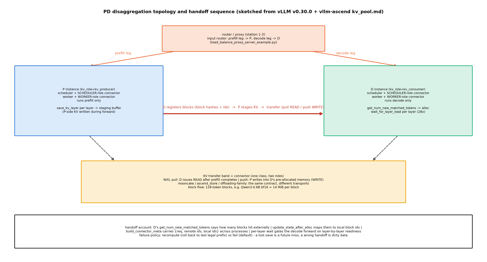

# 第 7 章 PD 分离与 KV 传输：connector 生态

> 站段坐标：站 8（调度器侧 connector 的决策挂点）+站 9（块账与命中协商）+站 11/12（worker 侧 connector 的搬运执行）。B7-8（PD 分离工程生态）与 B6-7 侧账（connector 一族）双钩并门；Book6 的 DistServe 理论账在此兑现为工程。

## 7.1 开篇：拆开部署的三个工程问题

Book7 开篇立「第五个名字」时留了存照句：「但把『拆开部署』做成可运维的工程（**显存怎么传、路由怎么写、故障怎么算**）是另一回事——工程生态的完整拆解归 Book8 第 7 章，本章只立此存照」【Book7 ch01-总起.md#L23，B7-8】。三问就是本章的节骨架：显存怎么传→7.3（connector 契约与传输账）、路由怎么写→7.2（proxy 与 P/D 拓扑）、故障怎么算→7.5（失败策略与事件账）。理论母账在 Book6：DistServe 的双 SLO 约束下 **7.4× 更多请求或 12.6× 更紧 SLO**；动机侧的干净实验——同一张卡混跑两段 goodput 1.6 rps、只跑 prefill 5.6、只跑 decode 10，**分池后按 2 卡 prefill+1 卡 decode 拿到 10 rps**；传输账的论文级锚 **KV 1.13 GB/请求 ÷11 GB/s**【官方论文 2401.09670，经 Book6 ch12:118 引账——指回不重教】。

还要先立一块官方压舱石——上游文档开宗明义的自白：「Disaggregated prefill **DOES NOT improve throughput**」（`docs/features/disagg_prefill.md#L16`；两条理由=分别调 TTFT 与 ITL、控制尾部 ITL）。**PD 分离买的是 SLO 可调性，不是吞吐**——与 Book6「分池买按段独立扩缩的自由」互证；把这句立在开篇，后面所有传输账的斤斤计较才有了正确的天平（不是为了快，是为了两段 SLO 各自可调）。三段定位：专题=PD 分离与 KV 传输（connector 生态）；站段=站 8（调度侧决策）+9（块账协商）+11/12（worker 侧搬运）；模块=`vllm/distributed/kv_transfer/`（全树 37,362 行、75 个 .py——两支分节见 7.2）+`distributed/kv_transfer/kv_connector/v1/base.py`（契约正身，两轨共有）+vllm-ascend 的 `distributed/kv_transfer/`（NPU 实做）。本章问题：**KV 从 P 搬到 D 的传输带由哪些件拼成、账怎么算、坏了怎么办？**

> **最小背景栏**：PD 分离的动机与 DistServe 理论账（7.4×/12.6×/混跑 1.6 vs 分池 10 rps/KV 1.13GB@11GB/s）=Book6 ch12 已教（指回）；chunked prefill 与连续批处理=Book6 ch04；P/D 实例角色与 prefill/decode **阶段**的区别本章 7.2 立即消歧。记号契约：connector（KV 传输器）与 attention/量化 backend、结构化输出 backend、LoRA adapter 是四样东西（前七章已陆续消歧，此处收拢一句）。

## 7.2 拓扑与角色：xPyD、kv_role 与 17 个连接器

一词三名先消歧：学术叫 **PD 分离**（prefill-decode disaggregation）、华为系文档叫 **xPyD**（cross-instance Prefill-and-decode——vllm-ascend 官方支持口径「xPyD is supported」{官方文档}）、上游文档叫 **disaggregated prefilling**（自标 experimental）——同一个东西。角色语义钉死：**P 实例**（producer）=只跑 prefill 阶段的服务进程、**D 实例**（consumer）=只跑 decode 的服务进程——「实例角色非阶段名」（每个 P/D 内部仍有完整的调度器与 worker，只是阶段过滤器不同）；配置面的 `kv_role` 三值（`kv_producer`/`kv_consumer`/`kv_both`，`config/kv_transfer.py#L75-77`——两轨字段集逐字节一致）与实例角色对位但可独立配：合法组合是 P 实例配 kv_producer、D 实例配 kv_consumer；kv_both 留给单实例既产又收的过渡形态，而「P 实例配 kv_consumer」这类交叉格无意义（prefill-only 的实例没有可消费的 decode 步）——**2×3 的配置矩阵只有三格有物理意义**，读部署脚本先扫这格。

配置实物看本机真实生效面（producer 探针日志的 non-default args 行原文）：

```text
# log/book8-ch01/pd_probe/producer.log#L17（运行栈 0.27.1 实测，Atlas 910B3）
KVTransferConfig(kv_connector=None, engine_id='…', kv_buffer_device='npu',
kv_buffer_size=1000000000.0, kv_role='kv_producer', …)
```

指名看什么：`kv_buffer_device='npu'`——平台默认值已换（CUDA 世界是 gpu）；`kv_buffer_size=1e9` 的连接器缓冲预算；`kv_port=14579` 的默认握手口。这一行还没配 connector 名——它正是 7.6 实验 E1-a 的「死在 APIServer 层」现场（下文分解）。



图 7.1 PD 拓扑与时序（按 v0.30.0+vllm-ascend 部署模板自绘，示意级）：顶=路由 proxy（prefill 腿发 P、decode 腿发 D）；中=P/D 双实例（各含调度器侧与 worker 侧两份 connector——单类双角色）；底=KV 传输带（pull/push 两式与三家传输件的块流向）；底带=交接账（命中协商→分配映射→元数据跨进程→逐层等待）与失败策略两值。

地界两支分节（这是与 ch9 的分工边界——**词面也分工**：transfer=跨实例搬运（本章）、offload/tiering=本实例的二级存储分层（ch9）、pool=跨实例 KV 对象存储（NPU 语境 AscendStore）——三个词在文档里常混用，按数据流向区分最稳）：`kv_transfer/` 全树 37,362 行里，**PD 传输支**（跨进程/跨机搬运——本章正菜）：NixlConnector/NixlPullConnector/NixlPushConnector（`v1/nixl/`，base_worker.py 3401 行=全家最大）、MooncakeConnector（2296 行）+MooncakeStoreConnector（store/ 子树 2633 行）、MoRIIOConnector（ROCm 专用）、HF3FSKVConnector、DecodeBenchConnector（压测件）；**KV 卸载/分层支**（本地二级存储——ch9 正菜）：LMCache 系、Offloading 系、SimpleCPUOffloadConnector、FlexKVConnectorV1、MultiConnector（组合器）、ExampleConnector（教学样板）、HiSparseConnector（v0.30.0 独有——两轨唯一差集）。上游注册表共 **17 名**（`factory.py#L152-247` 逐行核：Example#L152/Nixl 裸名#L176/Mooncake#L224/SimpleCPUOffload#L239/HF3FS#L244 等）。

在进入例题前先给 xPyD 一个「不提升吞吐」的算术直觉：混跑时 prefill 的长计算会阻塞同卡 decode 的步进（两种 SLO 曲线形状不兼容——prefill 要吞吐、decode 要节奏），分池后各自的卡各自优化；但搬 KV 要付传输账（例 7.3 的 448 MiB）与协调账（proxy 的双跳）——**两笔新账换一种自由度**，这就是「不提升吞吐、只调 SLO」的机制版。

**例 7.1（文件交接式 PD：最小心智模型）** 构造：两个进程+一块盘（ExampleConnector 官方示例的机制内核，模型口径换 Qwen3-0.6B）。输入两幕：
①P 进程：4 条 prompt（"Hi "×1000 两条+"Hey "×500 两条——示例的真实构造）算 prefill，KV 按 128-token 块落 `local_storage/`（输出=磁盘上的 KV 分块文件）；
②D 进程：读入同 4 条完整 prompt，从盘加载 KV 继续 decode 10 token（输出=4 条生成文本，与不分离开局一致）。
效果读法：PD 交接的两要素在此显形——**角色**（kv_producer/kv_consumer）与**KV 落点**（shared_storage_path）；真实 connector 只是把这块「盘」换成网线，把文件读写换成 RDMA/共享内存。（位置：`examples/disaggregated/example_connector/` 全家 119 行——run.sh 就是顺序跑两个进程、一个 shared_storage_path 参数。）

## 7.3 connector 协议：单类双角色与两本账

契约的第一设计是**单类双角色**——一个 connector 类在两个进程里各实例化一份（`factory.py#L67-75` 尾注原文）：

```python
# vllm/distributed/kv_transfer/kv_connector/factory.py#L67-75（两轨同文）
# NOTE(Kuntai): v1 connector is explicitly separated into two roles.
# Scheduler connector:
# - Co-locate with scheduler process
# - Should only be used inside the Scheduler class
# Worker connector:
# - Co-locate with worker process
# - Should only be used inside the forward context & attention layer
# We build separately to enforce strict separation
```

用人话说：调度器侧那份管「**要不要传、传哪些块**」的决策账（`KVConnectorRole.SCHEDULER`），worker 侧那份管「**怎么搬**」的执行账（WORKER）——严格分离是刻意的（注释原话 enforce strict separation）：决策与执行不同进程、不同生命周期。挂点两侧各一。调度器侧在构造期创建（`v1/core/sched/scheduler.py#L155-157`，紧随其后就是 7.5 要讲的三个状态初值——同块摘录一次两用）；worker 侧有一条初始化次序的机制账值得看注释正身：

```python
# vllm/v1/worker/gpu_worker.py#L748-753【源码：阅读锚 v0.30.0（ced6857）】
    # NOTE(Kuntai): This need to be done before `initialize_kv_cache`,
    # because `initialize_kv_cache` will inject kv cache groups not
    # related to kv cache connector (e.g. kv cache sharing layers).
    ensure_kv_transfer_initialized(self.vllm_config, kv_cache_config)
```

指名看什么：**connector 先于 KV 池成形**——池的分组要吸收 connector 的要求（哪些层进传输、哪些进共享），顺序反了池就分错组；这类「初始化次序即机制」的注释是读大型代码库的路标。MRV2 镜像再补一句（本章主读轨的点名件）：`v1/worker/gpu/kv_connector.py` 给 model_runner 一个窄接口——`KVConnector`（pre_forward/finish_forward/post_forward/no_forward/set_disabled/reset_capture_state 六钩子=**forward 生命周期的挂位**）与 `ActiveKVConnector`（经全局单例回到 base.py 实做）——「窄接口在前、真身在契约层」的双层结构，与 ch2 见过的 sampler/rejection_sampler 分层同构。

契约的方法面是**两本账**（#17，本章最高纪律）：讲接口一律以 v0.30.0 base.py 为正身（+8 法的完整面），NPU 实做全部继承 0.27.1 契约（无 get_transfer_results 等）——中间一张框注缝合：

> **【版本差异框注】契约两本账**（逐方法对照进附表，此处给方法族）：v0.30.0 新增——`get_transfer_results`+`KVConnectorTransferResults`（「传完了吗」升格为显式返回值）、`finish_forward`/`reset_capture_state`（图捕获协同）、`bind_kv_cache_manager`（绑块池→绑管理器）、`register_finished_partial_tail`（尾块异步协同）、`supports_divergent_local_hybrid_hits`（ch1 hybrid 的投影）；0.27.1 独有已删——cross-layer 对两法。**稳定面是心脏**：核心四抽象（`start_load_kv`#A313/`wait_for_layer_load`#A331/`save_kv_layer`#A345/`wait_for_save`#A367）与调度侧三抽象（`get_num_new_matched_tokens`#A489/`update_state_after_alloc`#A524/`build_connector_meta`#A550）**两轨同名同序**——七个方法就是 connector 的全部动词。

**例 7.2（2 块 KV 的 P→D pull 传输七步）** 构造（这七步是 connector 契约的「运转实录」——表 7.1 的每个方法名都会在步骤里出现一次，读完后回看契约面会全部对上号）：1 条 260 token 的 prompt（Qwen3-0.6B、块 128——3 块取 2 满块走查）。输入七步（每步标输入→输出）：
①D 调度器 `get_num_new_matched_tokens`（输入=req 的 block_hashes→输出=2——「外部可命中 2 块」）；
②`update_state_after_alloc`（输入=2→输出=本地分配块号【100,101】）；
③`build_connector_meta`（输出=元数据 {req_id、远端块号【5,6】、本地块号【100,101】}——跨进程递给 worker）；
④D worker `start_load_kv`（异步发起 READ→立即返回）；
⑤逐层 `wait_for_layer_load`（输入=layer_name→输出=该层 KV 就绪——**28 层各等一次**，逐层粒度是重叠的窗口）；
⑥D 前向（只算新 token 的 decode 步）；
⑦与此同时 P 侧 `save_kv_layer` 在 prefill 前向中逐层把 KV 抽出暂存——**双侧时序对位是本例灵魂**：P 的「存」与 D 的「等」在同一时间轴上咬合。
输出读法：七步里调度侧三步（①②③）与 worker 侧四步（④⑤⑥⑦）恰是两本角色账的分工；pull 模式=③之后 D 主动 READ（push 模式=P 直接 WRITE 进 D 预分配的内存——`nixl_kv_push_connector.md#L1-13` 的两式定义）。（位置：方法族锚=A/base.py#L313-550；例 7.1 的「盘」在这一族里换成了网线。）

传输的账立成式：

$$T_{\text{xfer}} = N_{\text{blk}} \cdot B_{\text{blk}} / BW_{\text{eff}} \tag{7.1}$$

| 符号 | 含义 | 量纲/取值例 |
|---|---|---|
| $N_{\text{blk}}$ | 搬运块数 | 无量纲（4k prompt=32 块） |
| $B_{\text{blk}}$ | 每块字节 | B（Qwen3-0.6B bf16 块 128=14 MiB——28 层×8 KV 头×128 维×2(KV)×2B=112 KiB/token×128） |
| $BW_{\text{eff}}$ | 有效带宽 | B/s（25 Gbps 以太≈2.8 GB/s；100 Gbps RDMA≈11 GB/s） |

用人话说：传输时间=块数×块字节÷带宽，**能不能藏进下一请求的 prefill 计算时间里**，就是「这条传输带值不值这条带宽」的全部判断（DistServe 的隐身线口径）。

**例 7.3（448 MiB 走多快的带宽）** 构造：4k prompt@Qwen3-0.6B=32 块×14 MiB=**448 MiB**（数字全部本机 config 直读实算）。输入三档带宽：25 Gbps（≈2.8 GB/s）→**0.16 s**；100 Gbps RDMA（≈11 GB/s）→**0.041 s**；200 Gbps（≈22 GB/s）→0.020 s。对照锚：DistServe 1.13 GB÷11 GB/s≈0.10 s【官方论文 2401.09670——跨档对照不混入本机曲线】。输出读数：带宽翻倍传输时间减半（式 (7.1) 线性反比）；0.16 s 意味着 25 Gbps 网上每请求要多付一个 TTFT 量级的账——**网卡的档位直接决定 PD 分离的生死**，这就是为什么生产部署清一色 RDMA。（位置：解析推演脚本 `code/.../ch07/transfer_account.py` 可复算；数字标 {config 逆向}。）

> **【考据框】生态三家与版本锚**。Mooncake：机制叙事引 FAST'25 版（沿 Book6），现状叙事引 arXiv v5（2026-10-08《Mooncake: A KVCache-centric Disaggregated Architecture…》）——两版正文差异未比对，引用先定版本锚。NIXL：v1.5.0（2026-09-30）无论文工程项目，且 **wheel 捆绑 NVIDIA Proprietary 模块**——提「开源传输层」须带此注。LMCache（2510.09655）：CacheBlend 非前缀复用；且「LMCache 可用 Mooncake 当远端存储」——层叠生态，不作零和读。

## 7.4 NPU 侧实做：注册覆盖与 24 名生效表

vllm-ascend 的接入是**先 pop 再覆写 3 个上游名+注册 8 个新名**（`vllm_ascend/distributed/kv_transfer/__init__.py#L22-101`，合计 11 个注册调用）：覆写 MultiConnector/OffloadingConnector/SimpleCPUOffloadConnector→Ascend 系类；新增 MooncakeConnectorV1/MooncakeHybridConnector/MooncakeConnectorStoreV1（弃用别名）/AscendStoreConnector/MooncakeLayerwiseConnector/UCMConnector/RecomputeCPUOffloadConnector/SfaRemoteD2HConnector。触发链经 setup.py 的 entry_points（`ascend_kv_connector = vllm_ascend:register_connector`——插件机制又一枚，与 ch1 的模型注册、ch4 的 LoRA 层换血同族）。本机探针读数（2026-10-13 import 探针，实验二固化）：**bare import=16 名**（上游静态注册原样）；**插件触发后=24 名**（16+8 新增；3 覆写不增名只换类）；serve 全路径实证覆写生效（offload 日志行 `Creating v1 connector with name: AscendOffloadingConnector`——配置名 OffloadingConnector、实例化类 AscendOffloadingConnector）。

**表 7.1 connector 对照与生效判定**（17 上游名+8 NPU 新名；【生效面=本机 import 探针实测（2026-10-13），底档 `log/book8-ch07/probe_registry.json`（实验二固化）+`log/book8-ch01/pd_probe/`】）

| 分支 | 名（例） | 依赖（本机） | 生效判定 |
|---|---|---|---|
| PD 传输·NIXL 系 | NixlConnector/NixlPull/NixlPush | nixl 未装 | 注册在册、import 即 ImportError（依赖面） |
| PD 传输·Mooncake 系 | MooncakeConnector（裸名=上游）/ **MooncakeConnectorV1**（NPU P2P）/ Layerwise / Store | mooncake-transfer-engine-npu 未装 | 同上；**裸名歧义**：上游类与 NPU 实做两名并存，C8 守卫两名都认（`uses_mooncake_connector`——utils.py#L1290-1293 的集合 `{"MooncakeConnector","MooncakeConnectorV1"}`） |
| PD 传输·其他 | MoRIIO（ROCm）/HF3FS/DecodeBench | — | 阅读面 |
| 卸载系（→ch9） | OffloadingConnector（**生效类=AscendOffloadingConnector**）/SimpleCPUOffload | 纯 torch | 注册可 import；**默认 CPU spec 路径本机不可行**（E1-b 实测，7.6） |
| 组合器/教学 | MultiConnector（覆写）/ExampleConnector | 纯 torch | 可 import——Example 是教学样板（例 7.1） |
| NPU 池化 | AscendStoreConnector（前缀缓存池） | mooncake 后端 | 源码阅读面 |

读法两句话：正向读——**生效注册表是三条路径三个数**（bare 16/插件 24/serve 全路径类已换），读任何配置文档前先问「我看的是哪本注册表」；反向读——import 成功≠可跑（SfaRemoteD2HConnector 注册名可载、引擎在 memfabric_transfer_engine 才爆依赖——注册表懒加载的**两级失败**）。

C8×mooncake 的量化守卫在此埋给 ch8（B4-3 面交叉钩）——报错文案本身就是机制课（`ascend_config.py#L801-805`）：

```python
# vllm_ascend/ascend_config.py#L801-805（报错文案原文）【源码：运行栈 vllm-ascend 0.27.1rc1】
        raise ValueError(
            "MooncakeConnector does not support C8 KV cache quantization on GQA models. "
            "The producer keeps KV cache in bf16 while the consumer allocates int8 KV cache, so raw "
            "Mooncake transfer would reinterpret bf16 bytes as int8. Please disable C8 KV cache quantization "
            "or use MooncakeLayerwiseConnector, which quantizes KV cache before transfer.")
```

指名看什么：**P 侧 bf16、D 侧 int8，裸传=字节重解释**——量化与传输解耦的第一课（第 8 章的两本账在此露出传输侧的牙）；解法=MooncakeLayerwiseConnector 传输前量化。xPyD 的官方部署模板（`kv_pool.md#L181-330`）给全配置面：P/D 双实例+proxy 三件、MultiConnector 包 MooncakeConnectorV1（传输）+AscendStoreConnector（前缀池）双子 JSON、`PYTHONHASHSEED=0`（哈希一致性）、A2 ROCE 系环境（nr_hugepages=200000/HCCL_IF_IP）——**模板带 `--enforce-eager`**（图模式×PD 组合可开但模板未开，实验设计注意点）；MLA 模型走 D→P 反向 put（consumer_is_to_put）。三禁包关系定谳一句：xPyD 主路只依赖 mooncake 一个**可选**包（非禁包）；memfabric/memcache/arctic 是特定分支的依赖——遇 ImportError=预期内降级。

NPU 实做类正身再各看一眼头（不贴全文——三个类的骨架同构）：`MooncakeConnector(KVConnectorBase_V1, SupportsHMA)`（mooncake_connector.py#L1605——`if role == KVConnectorRole.SCHEDULER:` 后接两套分体，Scheduler#L1726/Worker#L2104——**单类双角色的 NPU 活例**）；`AscendStoreConnector`（#L77-104——layerwise 需 PIECEWISE 图模式+三个 extra_config 读取）；`AscendSimpleCPUOffloadConnector`（#L26——aclrtMemcpyBatchAsync 走 NPU 流）。三家的共同点：都继承 0.27.1 契约、都挂 SupportsHMA（与 ch1 hybrid 的兼容门）。

**例 7.4（一个名字的三种身份）** 构造：配置名 `OffloadingConnector`。输入三本账走查：①v0.30.0 静态注册表（factory.py#L212→上游类）；②0.27.1 静态注册表（同名→上游 0.27.1 类）；③本机 serve 生效表（探针+日志实证→**AscendOffloadingConnector**——同名已换类）。再一对：`MooncakeConnector`（裸名）在生效表里仍是上游类、`MooncakeConnectorV1` 才是 NPU P2P 实做。输出读法：**同名异物与同物异名一网打尽**——配置文档、源码仓、运行栈三本注册表可能三个答案，读之前先问在哪本。（位置：三本账的取数命令在动手验证②。）

## 7.5 缓存一致性与版本：故障怎么算

失败策略是「故障怎么算」的正身。分布式 KV 的故障面比单机宽一档：单机丢缓存=性能退化（重算就行）、PD 传错 KV=**正确性事故**（D 侧拿着错的上下文继续生成——输出看着正常其实全错，最难排查的那类故障）。所以这一节的每条机制都偏保守——不是性能最优解，是「宁可重算不可错算」的工程立场。`kv_load_failure_policy` 两值（`kv_pool.md#L11-16` 官方口径）：`recompute`——KV 加载失败回滚到最后合法前缀重排重算（hybrid 注意力模型暂不支持）；`fail`——请求直接带错终止；**vLLM 默认 fail**；MultiConnector 时配在顶层不配子连接器。调度器侧还有两条时序账：`defer_block_free`（overlapping batches 下一个 step 可能仍在写已结束请求的 KV 块——consumer 的 load 与该写不保序，**推迟释放**；`max_concurrent_batches > 1` 且 is_kv_consumer 才开）与 `requires_kv_delivery`（docstring 原意：preempt 中的请求其 hand-off 仍 pending 时**宁可重算，不许放行**交出已被抢占释放的块）。用人话说：**传输带上的包裹比缓存金贵——缓存丢了是一次 miss，传错了是脏数据**；best-effort 的 save 掉了只是未来一次 miss，这就是失败策略偏保守的机制根。

事件面给 ch9 埋钩。v0.30.0 的 `kv_events` 新增两字段，docstring 本身就是教学句：

```python
# vllm/distributed/kv_events.py#L78-87（docstring 节选）【源码：阅读锚 v0.30.0（ced6857）】
    """LOCAL or REMOTE relative to the publisher; None means unspecified."""
    locality: str | None = None
    """Secondary offloading tier identifier, if generated by one."""
    ownership: str | None = None
    """Session that triggered this store or reuse report.

    This identifies the request context that emitted the event, not exclusive
    ownership of the underlying block, which may be shared across sessions.
    """
    session_id: str | None = None
```

指名看什么：`ownership`=「二级 offload 层标识」（块现在住在谁家——内存池/磁盘/远端）；`session_id` 的 docstring 特意澄清「触发上下文，**非块的独占权**」（同一块可被多 session 共享——前缀缓存的共享语义在事件流里的投影）。发布器挂在调度器构造（`EventPublisherFactory.create(...)`，scheduler.py#L171-175）——**KV 事件总线=可观测章的数据源**：谁存了块、谁复用了块、块去了哪层，全在这条流上（0.27.1 无此二字段，版本框注一次）。版本账第三件（weight/ec_transfer）一句点名进 ch12 新芽：v0.30.0 新增分片 RDMA 传输引擎族四件（sharded_rdt_{common,engine,fake,trainer}.py）vs NPU 侧 HCCL/NPU-IPC 两引擎（经 `register_engine()` 与 connector 同块注册）——「KV 传输范式推广到权重与 embedding cache」是 A4/A5 号新芽。

xPyD 部署模板还有一个值得点破的细节（生产常踩）：模板用 `PYTHONHASHSEED=0` 固定哈希种子——因为 P/D/proxy 三方都要算块哈希，**Python 的进程级哈希随机化会让三方算出不同的哈希**（同一天启动没事、滚动重启后全军命中归零——极难排查的那种坑）；这是「分布式系统的隐性共享状态」清单的典型条目（同类：时区/浮点模式/locale——凡多方必须算出同值的场合都要清一遍）。

## 7.6 实验：三级降级口径下的三件

实测边界先定谳（三级降级判定）：一级（本机双实例）不可行实证——pd_probe 四探针的报错原文就是平台边界实物；二级（云 GPU）已裁定选做不做；三级=ascend_store/NIXL/mooncake 源码精读+本章写法。实验三件：

**实验一：配置面探针三连**（serve 级短任务，起进程即失败不占长时 NPU；复现 VERDICT 三发，判据预注册均兑现——注意三发的探测价值不在于「证明不可行」（那是结论）而在于**定位死在哪一层**（那是知识）：同一句「PD 不可行」在三层有三种死法，排查真实部署故障时这条分层知识直接可用）；
①E1-a（只有 kv_role 无 connector 名）——死在 **APIServer 层**（pydantic 校验）：`Value error, Connector name is not set in KVTransferConfig`（producer.log#L74）；
②E1-b（OffloadingConnector+cpu_bytes_to_use）——死在 **EngineCore 层**，两段链：缺参数→`Exception: cpu_bytes_to_use must be specified…`；带 8G→`Exception: CPU Offloading is currently only supported on CUDA-alike and XPU GPUs`（调用链三帧：worker.py#L1031→offloading/worker.py#L67→`kv_offload/cpu/spec.py#L179-180`）；
③E1-c（名字不在册）——死在 **APIServer 层**：`Value error, Unsupported connector type: RecomputeConnector`（正名是 RecomputeCPUOffloadConnector）。
【本机实测（运行栈 0.27.1，Atlas 910B3；底档 `log/book8-ch01/pd_probe/` 四件+VERDICT.md，实验一封装脚本 `e1_config_probe.sh`】读法：三发分别示范**配置校验层/工厂创建层/运行时依赖层**三道门——平台边界的挡板不止一道，这就是「为什么三级降级」的机制级答案；且 ② 的报错发生在覆写生效**之后**（日志先见 `Creating v1 connector with name: AscendOffloadingConnector`）——**NPU 适配层接住了配置、上游 spec 层挡住了执行**，两层的边界在此现形。

**实验二：connector 清单对照**（import 探针，CPU 可跑）——bare 16 名/插件后 24 名/逐名 lazy-load 分类（纯 torch 名 OK、mooncake 系 ImportError）——表 7.1「生效面」三列的数据源（底档 `probe_registry.json`）。**实验三：传输账解析推演**（`transfer_account.py`，CPU 纯计算）——112 KiB/token、14 MiB/块、4k=32 块 448 MiB 数值闭合+带宽扫描曲线（例 7.3 的三档即其采样点）。传输观测现状如实：可观测面=启动/创建日志行（`Creating v1 connector…`+`Creating offloading spec…`）；**mooncake 的 prom 指标在 vllm-ascend 侧未接线**（上游 v0.30.0 有 get_kv_connector_stats——又一处两轨差，脚注登记）。

## 7.7 本章小结

回扣开篇三问：**显存怎么传**——单类双角色的 connector 契约（调度侧三抽象+worker 侧四抽象=七个动词，两轨同名同序的稳定面）+17 上游名/24 生效名的生态+传输账式 (7.1)（例 7.3 的 0.16 s→0.041 s：网卡档位决定生死）；**路由怎么写**——proxy 双腿+kv_role 三值+P/D 实例角色（图 7.1）；**故障怎么算**——recompute/fail 两值+推迟释放+「宁可重算不放行」的包裹哲学。例 7.1 的「盘换网线」给了最小心智，例 7.4 的「三本注册表」给了防迷路的罗盘；实测走三级降级（三行报错原文=三道门的平台边界铁证）。

**带走的心智**：两幅画。**其一，决策与执行分居两进程**——connector 的每个类都活两世（调度器侧管要不要传、worker 侧管怎么搬）；读任何传输系统的行为，先分清它的决策面与执行面在哪。**其二，PD 分离买的是 SLO 可调性、付的是传输与复杂度**（三件代价清单：传输账式 (7.1)、协调账 proxy 双跳、一致性账 7.5 的保守策略）——「不提升吞吐」的官方自白+448 MiB 的带宽账+失败策略的保守哲学，三件合起来是评估任何「拆开部署」方案的完整天平；传输带上的包裹永远比缓存金贵。

镜头拉回全书：KV 的四种省法至此集齐三种（ch1 混合钉层/本章传输换机/ch8 压字节——第四种 offload 搬走是下一章正菜）；下一章进入生产化三步曲的起点（可观测——metrics 指标字典把本章「prom 未接线」的现状接过去收账）。

> **【欠账】** ①kv_offload/tiering 对混合组的第四种省法（Offloading 的 NPUOffloadingSpec 分支+SimpleCPUOffload 未验——B7-2/B6-2 主账）→ 第 9 章；②C8×mooncake 的量化守卫与裸名歧义台账 → 第 8 章已回收半句（8.6 C8 段），余额进 ch13 终账。

**动手验证**（Atlas 910B3；选卡纪律照 CLAUDE.md；serve 纪律全套——探针虽秒败仍走完整纪律）：
① 探针复现：`bash code/Book8-vLLM源码剖析下/ch07/e1_config_probe.sh`——验收行=三发分别死于 APIServer/APIServer/EngineCore 三层（底档 `log/book8-ch07/e1/`）；
② 注册表三本账：`python code/Book8-vLLM源码剖析下/ch07/probe_connector_registry.py`——验收行=bare 16 名→插件 24 名、新增 8 名集合与表 7.1 一致；
③ 传输账：`python code/Book8-vLLM源码剖析下/ch07/transfer_account.py`——验收行=112 KiB/token、4k 档 448 MiB、11 GB/s→0.041 s（底档 `transfer_account.json`）；
④ 源码三锚：`sed -n '67,75p' repos/vllm/vllm/distributed/kv_transfer/kv_connector/factory.py`（双角色尾注）、`sed -n '313,345p' repos/vllm/vllm/distributed/kv_transfer/kv_connector/v1/base.py`（核心四抽象前两件）、`sed -n '801,805p' repos/vllm-ascend/vllm_ascend/ascend_config.py`（C8×mooncake 守卫文案）；
⑤ 制图：`python code/Book8-vLLM源码剖析下/ch07/fig_ch07.py`——产物 `figures/fig-7-1-pd-topology.png`。
