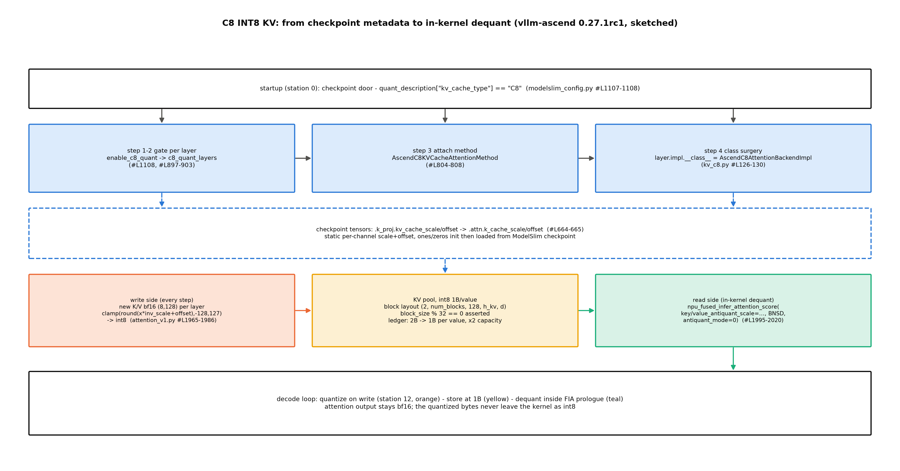

# 第 8 章 量化生产化：部署矩阵与两本账

> 站段坐标：站 0（启动期——检查点进门判定、量化识别、权重重打包）+站 12（算子层——量化算子链的执行）。四笔欠账并门：B4-3 与 F18 后半（推理侧量化下半程）、Book6 ch11 的部署矩阵欠账、B7-9（MoE 量化与 expert 权重加载）。

## 8.1 开篇：四张到期的欠账单

上一章把 KV 的「搬家」讲完——PD 分离解决的是 KV 在实例间的位置问题；本章回到体积问题本身：权重与 KV 太大，怎么办。这笔账从丛书第一册就挂着：Book1 的欠账地图里有一行「F18 | 低精度：从 GNMT 定点 8-bit 到今天 | …… | Book8 第 8 章」【Book1 ch11 三大遗产与欠账.md#L106】。低精度这条接力线，Book4 第 7 章交了训练侧的半棒（「训练侧这一棒到此交棒：推理侧的量化（GPTQ/AWQ/KV 量化、FP8/MXFP4 部署矩阵）→ Book6 第 11 章 / Book8 第 8 章」【Book4 ch07-训练侧工程.md#L196 章末欠账框原文】），Book6 第 11 章交了推理侧的算法账，并在章末留下最后一张欠账单：「部署矩阵（哪种模型配哪种量化、精度-吞吐-SLO 三维修齐）→ Book8 第 8 章」【Book6 ch11-量化推理.md#L195 章末欠账框原文】。再加上 Book7 ch10 的最后一笔——「MoE 量化与 expert 权重加载 → Book8 第 8 章」【Book7 ch10-权重与注册.md#L153 章末欠账框原文】——四张欠账单在本章全部到期。

本章的问题只有一句话：**一个量化检查点从进门到算子执行要过几道门？进门之后，引擎把它翻译成什么？精度、吞吐、SLO 三本账怎么一起读？** 前两问的答案是一对账本——「进门账」管引擎认不认这份权重（元数据判定），「出门账」管认下之后用什么算子跑（执行路径）；后一问的答案是一张三维的部署矩阵。三段定位：专题=量化生产化；站段=站 0（进门判定/权重重打包）+站 12（量化算子链执行）；模块=`vllm_ascend/platform.py`（白名单）+`vllm_ascend/quantization/` 的 configs/ 与 methods/ 两子包（翻译链与算子族）+`attention_v1.py` 的 C8 实现+上游 `vllm/platforms/interface.py` 的 verify_quantization 门禁。产出五样：两本账的对照字典（表 8.2）、部署矩阵（表 8.1）、三条主力算子链的源码走查、C8 的容量账与 W4A16 的存储账两个手算例、以及 fp8 与 MoE-w4a16 两组检查点在本机的装载实测。章末会看到：量化从「选不选」变成「选哪个才能装下、跑多快」——这张表正是第 11 章容量规划的隐藏输入。

> **最小背景栏**：量化四法的数学是 Book4 第 7 章（FP8/MXFP4 格式课与训练侧量化）与 Book6 第 11 章（GPTQ 摊派/AWQ 缩放与 int8 KV 的算法账）已教；KV 压缩三线的理论账是 Book6 第 3 章已教；「检查点白名单≠执行格式」的对位表 Book7 第 10 章表 10.2 已立——本章是那张表的展开与实测。C8 的装配链（五步链）Book7 第 9 章表 9.1 已逐行锚过——本章指回不重教，只补量化经济学视角。

## 8.2 进门账：白名单六法

先看第一道门。引擎认什么量化模型？答案不在模型侧、不在算子侧，在**平台层的检查点白名单**（checkpoint whitelist）里——一份平台声明的「进门格式清单」。NPU 平台的正身是两个文件的拼合：

**实物 8.1**（白名单六法正身：平台类的列表+常量值；看什么——六个槽位里三个是常量名、三个是字面量，常量还原要到 utils 里查）

```python
# vllm_ascend/platform.py#L99-106【源码：运行栈 vllm-ascend 0.27.1rc1】
    supported_quantization: list[str] = [
        ASCEND_QUANTIZATION_METHOD,
        COMPRESSED_TENSORS_METHOD,
        FP8_METHOD,
        "deepseek_v4_fp8",
        "modelopt_mxfp8",
        "mxfp8",
    ]

# vllm_ascend/utils.py#L57-59【源码：运行栈 vllm-ascend 0.27.1rc1】
ASCEND_QUANTIZATION_METHOD = "ascend"
COMPRESSED_TENSORS_METHOD = "compressed-tensors"
FP8_METHOD = "fp8"
```

指名看两处：其一，列表的前三项用常量名、后三项用字面量——常量是跨文件复用的方法名（utils.py 集中定义、全仓十几处引用），字面量是只在注册与个别比对处零星出现的名字，写法差异本身就是代码使用频率的痕迹；其二，六法的完整语义要在常量还原之后才齐：**ascend**（ModelSlim——华为自家量化工具链的输出格式，检查点里带一份逐层的量化描述字典）、**compressed-tensors**（LLM-Compressor 生态的开放标准，社区量化权重的大本营）、**fp8**（OCP 标准浮点 8 位）、**deepseek_v4_fp8**（DeepSeek-V4 专属的 FP8 变体布局）、**modelopt_mxfp8** 与 **mxfp8**（微缩浮点 microscaling FP——950 系/A5 世代的主打格式，本机 910B3 上属降级走查面）。这份清单是本章自己的解读地图——源码列表本身不带注释，生态归属是从各格式的文档与检查点结构考据来的【证据等级：本书源码考据+官方文档综合】。

真正常被踩的一脚在这份清单的**反面**：gptq 与 awq 不在列——两家社区最流行的后训练量化格式，在 NPU 平台进门即拒。机制的正身在上游平台基类：

```python
# vllm/platforms/interface.py#L983-992（骨架摘录）【源码：阅读锚 v0.30.0（ced6857）；运行栈 0.27.1 同构，下方探针实测】
    @classmethod
    def verify_quantization(cls, quant: str) -> None:
        if cls.supported_quantization and quant not in cls.supported_quantization:
            raise ValueError(
                f"{quant} quantization is currently not supported in {cls.device_name}."
            )
```

这段代码值得当场撞一次门。本机探针给 Qwen3-0.6B 强设 `quantization="gptq"`，配置构建期即抛：

```text
# log/book8-ch08/exp_ch08_whitelist_probe.json（ValidationError 原文摘录）
Value error, gptq quantization is currently not supported in npu.
```

【本机实测（运行栈 0.27.1+vllm-ascend 0.27.1rc1，CPU 档探针——引擎配置构建期即抛，不触 NPU）】指名看什么：报错文案自带**被拒的方法名与设备名**、却不列合法值清单——想知道「那什么能进」，得回去读 platform.py 的列表（这正是本节开头先看源码的原因：报错只告诉你出局的是谁，白名单本体在代码里）。

> **【实现对照框】** 为什么 gptq/awq 被拒？不是「NPU 不能跑量化」——是这两家的**还原算子**（gptq 的 marlin 系、awq 的反量化 dequantization 核）是 CUDA 专属，NPU 上没有对应实现。替代路径是把模型经 ModelSlim 或 LLM-Compressor **重产**为白名单格式再进门。「不支持格式」≠「不支持量化」——不支持的是那份格式的解码器；这与第 7 章 OffloadingConnector 的 CUDA-only 边界是同一类平台约束，第 10 章会把这类边界收进平台层方法论。

进门账到此清楚：一份六槽位的列表、一道 `verify_quantization` 的门。把这道门想成海关就有了画面——申报单是 config 的 quantization 字段、查验员是 verify_quantization、盖章放行才轮到装载。但这份账只回答了「让不让进」——让进之后跑什么，是另一本账。

## 8.3 出门账：执行格式八种与 fp8 的两代命运

第二本账在算子侧。过了门的检查点按什么格式执行——**执行格式**（execution format）的合法值由 `QuantType` 枚举定义，它是 vllm-ascend 算子族的路牌：

**实物 8.2**（QuantType 枚举正身；看什么——整数值枚举的注释口径，W/A 后缀的读法）

```python
# vllm_ascend/quantization/quant_type.py#L26-37【源码：运行栈 vllm-ascend 0.27.1rc1】
class QuantType(Enum):
    """Quantization type enum for MoE schemes."""

    NONE = 0  # No quantization
    W8A8 = 1  # W and A are INT8
    W4A8 = 2  # W is INT4, A is INT8
    W8A8MXFP = 3  # W and A are MXFP8
    W4A16 = 4  # W is INT4, A is BF16 or FP16
    W4A4MXFP = 5  # W and A are MXFP4
    W4A8MXFP = 6  # W is MXFP4, A is MXFP8
    W8A8FP = 7  # W and A are FP8
    W4A16MXFP = 8  # W is MXFP4, A is BF16 or FP16
```

指名看什么：**W 后的数字=权重位宽、A 后的=激活位宽、MXFP 后缀=用微缩浮点而非整数量化**——八种非 NONE 的执行格式，每一种是一条独立的算子链（不是同一条链的参数变体）；注释还顺手给了口径（如 W4A16 行：激活是 BF16 或 FP16——weight-only 量化（只压权重、不动激活）的名字从注释里就长出来了）。这张枚举表就是出门账的全部合法值。

两本账是**不同的世界**，关键认知一句话：**白名单≠执行格式**——进门看「格式声明」（config 的 quantization_config），出门看「算子有没有到位」。同一个 fp8 检查点，在两代硬件上走出两条完全不同的命运，权威表述就在 fp8 算子族自己的文档字符串里：

**实物 8.3**（fp8_block.py docstring 节选；看什么——两代硬件两条命运的分岔描述与那句加粗的代价）

```python
# vllm_ascend/quantization/methods/w8a8/fp8_block.py#L17-33（docstring 节选，截尾标 …）
# 【源码：运行栈 vllm-ascend 0.27.1rc1】
"""Schemes for native block-wise FP8 checkpoints (``quant_method: "fp8"``).
…
* On Ascend 950 the resolved matrix is re-quantized to MXFP8 (one E8M0 scale per
  32 elements along the reduction dim). The native ``npu_quant_matmul`` path then
  runs and weights stay at one byte per element, which is what makes a 27B FP8
  checkpoint fit on a single card.
* On every other Ascend generation the resolved matrix is kept in the model dtype
  and served by the ordinary unquantized GEMM. Correct, but the footprint doubles.

Both paths read the same checkpoint, so no per-model patch or offline
re-quantization step is needed. …"""
```

用人话说：fp8 检查点进门时是「罐头」（e4m3 张量+逐块 scale），上桌前要开封——950 系把它重装成 MXFP8（每 32 个元素配一枚 E8M0 指数，权重保持 1 字节/元素，原生量化算子直达计算）；**其余各代（含本机 910B3）把它解回模型 dtype、当普通 bf16 矩阵用**——正确性没问题，但 footprint doubles（显存足迹翻倍回 bf16 的量级），量化的收益只剩传输与存储（权重文件小一半）。两条路读的是同一份检查点、不需要逐模型补丁或离线重产——**翻译全部发生在加载之后**。这条「解回模型 dtype」的翻译路径在本机的真实命运，8.8 节用双臂实验实测。

由此可以立本章的第一条判断力：**算子在，格式才能「进门即出门」直达计算；算子不在，格式只是元数据标签，实际跑的是翻译后的替代品。** 下一节把「翻译」本身摊开。

## 8.4 翻译链：从进门格式到出门格式

引擎把进门格式翻译成该硬件最优的出门格式——这条翻译链（translation chain）通常对用户不可见，但每一步都有代码正身。以 compressed-tensors 的 W4A16 子集为例走一遍。

第一步是格式识别与解析：检查点 config 的 quantization_config 声明 `format="pack-quantized"`、`group_size=128`、`num_bits=4`【本机缓存检查点 config.json 实核】；配置侧 `AscendCompressedTensorsConfig` 按层分派：Linear 层归 `AscendLinearMethod`、FusedMoE 层归 `AscendFusedMoEMethod`（分派点各打一行 `info_once` 日志「Using the vLLM Ascend llmcompressor Quantization now!」，`compressed_tensors_config.py#L158/#L175`；`_is_w4a16` 判定在 #L397）【源码：运行栈 vllm-ascend 0.27.1rc1】。

第二步是权重重打包：加载期 `npu_convert_weight_to_int4pack`（`methods/wna16/w4a16.py#L101`）把 safetensors 里的 int4 数组重新打包为 NPU 硬件解压格式。第三步是算子执行：`npu_weight_quant_batchmatmul`（`methods/wna16/w8a16.py#L65`）边解压边乘。

六步链（格式识别→格式解析→算子分派→权重重打包→算子调用→反量化输出）里用户看到的只有「模型能跑了」，翻译全在暗处。

翻译之所以必要，是因为**量化格式的碎片化**：同一个「4 位权重」的概念，GPTQ 用 marlin 布局、AWQ 用等效缩放、LLM-Compressor 用 packed 布局、ModelSlim 用自家布局——权重位的排列方式各不相同，NPU 算子只认自家布局。翻译层就是「各家方言→NPU 普通话」的转换局。把进门×出门×硬件三维合起来，就是部署矩阵：

**表 8.1 部署矩阵**（进门格式×910B3 出门格式×机制一句话——Book7 表 10.2 的展开版）

| 检查点格式（进门） | 910B3 出门格式 | 机制一句话 |
|---|---|---|
| ascend（ModelSlim） | W8A8 / W4A16 / C8(KV) | 全链华为生态，C8 独此一家（8.6 节） |
| compressed-tensors | W8A8 / W4A16（按 scheme 子集） | 本机实测：W4A16 的 FusedMoE 层有链、dense Linear 层无 scheme（8.7 节） |
| fp8 | **bf16 反量化服务（设计）** | 本机实测：装载解块期撞算子边界 561103（8.8 节） |
| deepseek_v4_fp8 | MX 族布局重组 | 专属布局，阅读面 |
| modelopt_mxfp8 / mxfp8 | MX 族（950 系主打） | 本机降级走查（quant_parser.py 四档 dtype 表） |
| gptq / awq | **进门即拒** | 还原算子 CUDA 专属（8.2 节探针） |

【证据等级：源码走查（运行栈 vllm-ascend 0.27.1rc1 全锚在 notes/18）+本机探针实测】两句话读表 8.1。正向读：同一列进门名在不同硬件代际走出不同出门格式——fp8 行的分岔（950 系 MXFP8/本机设计上 bf16 反量化）是全表的钥匙；反向读：六行不是六条可选项——gptq/awq 一行压根没有出门格式（门在格式层就关了）、MX 两行在本机是降级走查面，矩阵实际是「可行/降级/拒绝」三档可行性，格子的粒度细到**层型**（compressed-tensors 行 8.7 节实测）。

两本账本身的对照收进表 8.2——它是本章的字典页：

**表 8.2 两本账对照**（同一名词在两个世界的身份）

| 维度 | 进门账（白名单） | 出门账（QuantType） |
|---|---|---|
| 本体 | platform.py 六槽位列表 | quant_type.py 八值枚举 |
| 键面 | quantization_config.quant_method 字符串 | W/A 位宽+MXFP 后缀 |
| 谁消费 | verify_quantization 门禁 | 算子族分派（方法类） |
| 数量关系 | 六法 | 八种（多对多：一法可译多格、多法可译一格） |
| 例 | "fp8" | 950 出门=MXFP8；910B3 出门=bf16 服务（设计）——本机实测装载即断（8.8 节） |

读法两句话。正向读：进门六法→出门八种是**多对多**——fp8 在 910B3 出门是 bf16（NONE 之外的第九种「格式」：翻译后的替代品），在 950 出门是 MXFP8；反向读：出门表里的 W4A16 有两个进门来源（ModelSlim 与 compressed-tensors），进门名相同算子链却可能不同（8.7 节两条 w4a16 路线正是实例）。**查表必须两本账一起查**——这正是「部署矩阵是三维的」的含义：格子由（进门格式×硬件代际）共同决定。

## 8.5 算子地图一：W8A8 与 W4A16 两把刀

出门格式落到算子。权重侧的两条主力路径先把「省带宽」与「省容量」两种收益分开——它们是两把不同的刀。

**W8A8 dynamic（动态量化，dynamic quantization）**——权重与激活都压 8 位、激活每步现量。算子链正身只有两行调用：

```python
# vllm_ascend/quantization/methods/w8a8/w8a8_dynamic.py#L92,#L98（两处节选）
# 【源码：运行栈 vllm-ascend 0.27.1rc1】
        quantized_x, pertoken_scale = torch_npu.npu_dynamic_quant(x, dst_type=self.act_quant_type)
        output = torch_npu.npu_quant_matmul(
```

指名看什么：`npu_dynamic_quant` 的输入是本步的激活 $x$——**每步前向都要现量激活**（激活分布是动态的，不能像权重一样离线校准，所以叫 dynamic）；`npu_quant_matmul` 把「量化激活×量化权重×scale 乘加」融合成一次调用。收益的账：decode 的主要访存是权重搬运，int8 权重 1B/值对 bf16 的 2B/值——带宽省一半；付的代价是每步多一次现量调用。Book6 第 11 章的 int8 探针（1.37×）就是这条家族路径在本机的量化侧样本【Book6 ch11 实测底档，经 Book7 ch10 §10.5 引账】。

**W4A16（weight-only 量化）**——只压权重存储、激活全程 bf16。两步走：加载期 `npu_convert_weight_to_int4pack`（`methods/wna16/w4a16.py#L101`）把权重预压为 int4pack——NPU 专用的 4 位压缩布局（适配硬件解压单元的打包格式，不是裸 int4 数组）；执行期 `npu_weight_quant_batchmatmul`（`methods/wna16/w8a16.py#L65`）在算子核内边反量化边乘。尺寸流转一笔：激活 $(n,d_{\mathrm{hid}})$ bf16 × 权重（$d_{\mathrm{hid}}/8$ 个 int32 打包列，每列装 8 个 4 位权重）→ 核内解压成 bf16 参与乘加 → 输出 $(n,d_{\mathrm{inter}})$ bf16。用人话说：权重在仓库里按 4 位折叠存放、上架时算子自己展开——**模型侧的每个计算都还是 bf16 的**，这就是「weight-only」三个字的全部含义。收益：权重存储压到 1/4（同卡驻留 4 倍大的模型）；代价：解压开销。

两把刀的选择口诀一线工程师人人会背：**装不下选 W4、跑不快选 W8**——W4A16 省（显存）容量、W8A8 省（带宽）速度。加上 8.6 节的 C8，三条链的选择表：

**表 8.3 三条主力算子链的选择**（压什么/换什么/适用面）

| 链 | 压什么 | 省的账 | 付的账 | 适用面 |
|---|---|---|---|---|
| W8A8 dynamic | 权重+激活（8 位） | 权重带宽（1B vs 2B/值） | 每步现量调用 | 在线服务/大模型 decode |
| W4A16 | 仅权重（4 位） | 显存容量（1/4） | 核内解压开销 | 装不下/精度敏感 |
| C8 int8 KV | 仅 KV 缓存 | KV 容量（1/2） | antiquant 开销（核内反量化） | KV 瓶颈场景 |

读法：第一列是刀、第三四列是价目——**三条不互斥**（W4A16+C8 可叠：权重 1/4+KV 减半，容量收益是乘法；例 8.1 会算这笔叠加账）；反向读：三条链都不动 TTFT——装载时长不在刀的价目上，那是 8.9 节第三维 SLO 的账。三条链在表 8.1 里各占一行进门来源：W8A8/W4A16 从 ModelSlim 与 compressed-tensors 进门，C8 只从 ModelSlim 进门——最后这条是下一节的主角。

## 8.6 算子地图二：C8 的量化经济学

第三条链压的不是权重，是 KV 缓存。先把画面立起来：decode 的每一步都在往 KV 块里写「账本行」，每值 2B——C8 做的事是把账本上每个数字从 2B 压到 1B：库房还是那个库房、行数一个不少，但每行瘦了一半，同预算下能记的 token 数直接翻倍；读账的人（attention）拿到的数字要先用 scale 乘回来，这就是全部代价所在。C8（int8 KV）的**装配链**——检查点元数据怎么一路把 attention 层换到 C8 前向——Book7 第 9 章表 9.1 已五步逐行锚过（①`modelslim_config.py#L1107-1108` 的 `enable_c8_quant =（kv_quant_type=="C8"）`→②逐层门控→③方法装配→④类手术 `layer.impl.__class__ = AscendC8AttentionBackendImpl`→⑤antiquant 入参喂 FIA 算子），本章不重走，指回即可。这里补的是那章没算的三笔账：**写入侧的公式、KV 块的容量、与反量化的位置**。图 8.1 把三笔账放回同一条数据流：



图 8.1 C8 int8 KV 五步链数据流（按 vllm-ascend 0.27.1rc1 源码自绘，示意级）：上带=站 0 启动期（检查点元数据判定→逐层门控→方法装配→类手术，检查点随行带静态 scale/offset）；下带=站 12 每步循环（写入侧量化→int8 KV 块→FIA 算子核内反量化）；账本行标注每值字节 2B→1B。

先立公式。写入侧每步把新算出的 K/V 量化进块，正身一行不多：

```python
# vllm_ascend/attention/attention_v1.py#L1976-1980（_quantize_kv_to_int8 节选）
# 【源码：运行栈 vllm-ascend 0.27.1rc1】
        k_int8 = torch.clamp(
            torch.round(actual_key * layer._c8_k_inv_scale + layer._c8_k_offset),
            -128,
            127,
        ).to(torch.int8)
```

写成一般式（V 路同构）：

$$k_{\mathrm{int8}} = \operatorname{clip}\left(\operatorname{round}\left(k \cdot s_k^{-1} + o_k\right),\ -128,\ 127\right) \tag{8.1}$$

| 符号 | 含义 | 形状/取值 |
|---|---|---|
| $k$ | 本步新算出的 K（单层单请求） | $(n_{\mathrm{new}}, h_{kv}, d_k)$，bf16 |
| $s_k$ | 该层 K 的静态缩放因子 | 标量（per-tensor 档）或 $(h_{kv},d_k)$（逐通道档）——按检查点张量大小自适应（`_shard_and_reshape` 两分支，#L1890-1903），来自检查点 `kv_cache_scale` 张量 |
| $o_k$ | 静态偏移 | 同 $s_k$ 形状，来自检查点 `kv_cache_offset` |
| $k_{\mathrm{int8}}$ | 写入 KV 块的量化值 | 同 $k$ 形状，int8（1B/值） |

用人话说：写入前先「乘倒数尺度、加偏移、四舍五入、夹回 −128..127」——**仿射量化**（affine quantization，带零点偏移，不是纯对称缩放）；scale/offset 不是运行时估的，是 ModelSlim 产制检查点时**离线校准**好、随权重一起进门的静态参数（键映射 `.k_proj.kv_cache_scale → .attn.k_cache_scale`，`modelslim_config.py#L664-665`）。读取侧不做事后解压——`npu_fused_infer_attention_score` 的 antiquant 通道在**算子核内**边反量化边算（`key_antiquant_scale`/`value_antiquant_scale` 入参，`attention_v1.py#L2005-2018`；docstring 自述 "C8 decode via FIA V1 BNSD with native paged INT8 KV + perchannel antiquant"）——量化字节从不以 int8 身份离开算子核。

**例 8.1（C8 的容量账与叠加账）** 构造：Qwen3-0.6B（config 实核：28 层、16 注意力头、GQA 8 个 KV 头、head_dim 128）。输入三步走：①bf16 基线每 token KV 字节 = 28 层 × 8 头 × 128 维 × 2(K 与 V) × 2B = **114,688 B/token**；②C8 后每值 1B：28×8×128×2×1B = **57,344 B/token**——同预算下 KV 容量翻倍；③叠加第 1 章的混合架构：ch1 的滑动窗层把「部分层的 KV 钉死在窗宽」、C8 把「全部层的 KV 压半字节」，两者正交可叠——混合省一半层 × C8 省一半字节 = 理论 **4× 容量**。输出读法：三种省法（层钉死/字节压半/搬走到 offload）叠加，正是 gpt-oss 级模型能塞进边缘 NPU 的算术底座；代价是 antiquant 的精度损失（静态 per-channel scale 缓解）与核内反量化开销。（位置：模型数字由本地 config.json 实核【notes/18 §三】；机制正身=式 (8.1) 与图 8.1 下带。）

C8 的经济学骨架与第 7 章的传输临界比**同构**：省的东西（KV 容量减半）对付出的东西（精度损失+antiquant 开销）之比，决定了它在你的负载上值不值——这个「临界比」判断力 8.9 节统一收账。

## 8.7 MoE 量化与 expert 的分布式装载（B7-9 正身）

B7-9 的正身是 MoE。回忆 Book4 第 7 章的参数账：MoE 的总参数是激活参数的十倍级（DeepSeek-V3 总 671B、激活 37B），体积的大头是路由专家——本检查点的实测口径：expert 12.46B/总 14.31B ≈ **87%**（例 8.2 的四筐账）。量化 MoE 的最大收益就在压 expert；反过来，精度风险也集中在 expert（量化扰动可能改变 top-k 路由的稳定性）。

w4a16 的 MoE 装载有**两条并列路线**，出门账里都叫 W4A16、进门账与打包格式却不同。

第一条：`AscendW4A16FusedMoEMethod`（`methods/wna16/w4a16.py#L111` 起）——只认 LLM-Compressor 产物（docstring 自举例 `moonshotai/Kimi-K2-Thinking`），每个 expert 的每个投影存三件：`weight_packed`（int32，`[moe_intermediate_size, hidden/8]`——**pack_factor（打包因子）=8，一个 int32 装 8 个 4 位权重**）、`weight_scale`（bf16，`[moe_intermediate_size, hidden/128]`——group_size=128 一枚 scale）、`weight_shape`（int32，`[2]`）。

第二条：`AscendW4A16MXFP4FusedMoEMethod`（`methods/wna16/w4a16_mxfp4.py#L50`）——MXFP4 微缩浮点路线，加载后处理五步连发（`unpack_uint8_to_fp4_return_float32`→transpose→`npu_format_cast`→`npu_convert_weight_to_int4pack`→contiguous，#L138-152，w13/w2 两键各自一遍）。w13/w2 是 MoE 装载的暗语：w13=gate+up 两投影拼合、w2=down——三个投影并成两个 fused 权重。

这份文档描述与真实检查点对得上吗？第 6 章预热的 w4a16 检查点（nm-testing 的 Qwen1.5-MoE-A2.7B-Chat）正好当对拍件：

**实物 8.4**（检查点×docstring 的逐字对拍；看什么——张量名命名法逐字匹配、专家张量的整数闭包）

```text
# 检查点侧：log/huggingface/hub/models--nm-testing--Qwen1.5-MoE-A2.7B-Chat-quantized.w4a16/
#   model.safetensors.index.json 解析（本机缓存 JSON 实核）
arch = Qwen2MoeForCausalLM；24 层；60 experts（top-4）；shared_expert_intermediate_size=5632
quantization_config：compressed-tensors，format="pack-quantized"，group_size=128，
                     num_bits=4，symmetric=true，strategy="group"，targets=["Linear"]
张量总数 13,635；其中专家张量 12,960 条 = 24 层 × 60 专家 × 3 投影 × 3 件（packed/scale/shape）
total_size = 8,310,237,312 B（≈7.74 GiB）；global_compression_ratio = 2.2386

# 源码侧：w4a16.py#L111 起 docstring 命名法（§8.7 上文三件命名）
model.layers.L.mlp.experts.E.gate_proj.weight_packed / .weight_scale / .weight_shape …
```

【证据等级：本机缓存检查点 config/index JSON 解析+源码 docstring（运行栈 0.27.1rc1）——两源逐字对拍】指名看什么：命名法**逐字咬合**（`weight_packed/weight_scale/weight_shape` 三件套在 docstring 与检查点张量名里同名同序），且 12,960 恰好被 24×60×3×3 整除闭合——装载类、张量名映射、算子路径三面源码核齐（notes/18 §二/§三全锚）。

**例 8.2（W4A16 检查点的存储账）** 构造：同一模型两个版本——Qwen1.5-MoE-A2.7B 的 bf16 原生版与上述 w4a16 版，全部数字由本地 config.json+index.json 实核。

输入三步走：
①参数四筐（config 实核）：attention Linear 0.40B + shared expert 0.83B + 路由专家 12.46B（24 层×60 专家×3 投影×2048×1408）+ embedding+lm_head 合计 0.62B（词表 151,936×2048=0.31B/份；config 实核 `tie_word_embeddings=false`，两份各自随行）——总参 **14.31B**，bf16 版 ≈ **28.6 GB**；
②w4a16 版的压缩范围是 `targets=["Linear"]`——前三筐共 13.69B 全压 4 位：packed 13.69B×0.5B ≈ 6.85 GB，group128 的 scale 13.69B/128×2B ≈ 0.21 GB；embedding/lm_head（1.24 GB）与 router 等免检件仍按 bf16 随行；
③合计 6.85+0.21+1.24+杂件 ≈ **8.31 GB**——毛估与 index.json 标称 total_size=8,310,237,312 B 在三位有效数字内咬合（≈8.31 GB）。

输出读法：毛估压缩比 28.6/8.31≈**3.4×**（到不了 4× 的两笔原因：embedding/lm_head 共 1.24 GB 不压缩、scale 自身又新增约 0.21 GB）；config 自报 global_compression_ratio=2.2386 是 llmcompressor 自己的口径（分母未随 config 说明）——**读任何压缩比，先问分母装了什么**。（位置：数字全部来自实物 8.4 的两个 JSON+config 实核；构成账的机制面=docstring 三件命名。）

装载冒烟——ch6 章末「ch8 开工首跑」承诺的兑现：检查点权重 blob 曾两度断流（各留 1.9G/1.0G 的 .incomplete 分片），2026-10-13 上午经断点续传补全落位（两片 8.31GB 齐整），本册随即跑了装载冒烟。结果又是两本账的活教材——**进门 ✓**（config echo 打出 `quantization=compressed-tensors`，白名单第二法放行）**装载 ✗**：

```text
# log/book8-ch08/run_moe_smoke.log（EngineCore 日志原文摘录）
ERROR …   File "…/vllm_ascend/quantization/configs/compressed_tensors_config.py", line 318,
            in _create_scheme_for_layer_type
NotImplementedError: No compressed-tensors compatible scheme was found
                      for quant_type=W4A16, layer_type=linear.
```

【本机实测（Atlas 910B3，运行栈 0.27.1+vllm-ascend 0.27.1rc1，卡 6；底档 `log/book8-ch08/exp_ch08_moe_load_smoke.json`+`run_moe_smoke.log`）】指名看什么：报错点名的两个维度——`quant_type=W4A16` 与 `layer_type=linear`。**出门账的粒度是层型**：FusedMoE 层有算子（上节 `AscendW4A16FusedMoEMethod` 的整条装载链），dense Linear 层没有 scheme——而本检查点的 `targets=["Linear"]` 恰好把 attention 投影与 shared expert 这些 dense 层也压成了 W4A16，于是装载在第一个 dense Linear 上断掉。表 8.1 里「按 scheme 子集」五个字由此有了实测注脚：**子集有两层——进门格式的 scheme 子集 × 检查点内部的层型子集**；要装得下，得用只量化 expert 的检查点（docstring 自举例 Kimi-K2-Thinking 正是这类）。这个负结果与 8.8 节 fp8 的装载失败互为镜像：一个断在算子（561103）、一个断在 scheme（NotImplementedError）——**「白名单≠可执行」的两个失败档位**。

expert 的**装载**还有一层分布式语义，这是 ch6 埋给本章的接力：EP（专家并行）下每卡只装自己分到的那些 expert——「分卡映射」与「量化解压」发生在同一条装载管道里（ch6 的 EP 分卡是前半段、本章的 int4pack 重打包是后半段）。复合管道意味着错误也有两层：分错卡（路由找不到 expert）或量化解压错（数值错但形状对——更难查）；生产冒烟应一次 forward 同时验两层（路由命中+输出非 NaN）。分发侧的部署现实也要存照：本检查点 8.31GB 权重的「最后一公里」两度断流才补全——**社区量化权重的分发策略（自建镜像/预热本地盘/多源 fallback）不是附属问题，是部署矩阵的隐藏维度**。ModelSlim 侧的检查点产制工具本机未装——**C8 与 ascend 格式的产制面=阅读面，如实标注**（第 13 章终账登记）。

## 8.8 实验：fp8 检查点的双臂对拍

实物 8.3 的推论（910B3 上 fp8 解回 bf16 服务）值得亲手验一次——这正是 Book7 ch10 欠账框里「显式登记选做不做」的 fp8 观测实验④，本册把它从选做升格为正实验。设计：**双臂同机同卡同负载**——A 臂 Qwen3-1.7B-FP8（fp8 检查点，2.65 GB——本地快照 2,654,425,984 B 实核；quant_method=fp8、块尺度 [128,128]【Book7 ch10 §10.5 定档，本章复核在位】）、B 臂 Qwen3-1.7B（同模型 bf16 原生版）；config 实核两臂同构（Qwen3ForCausalLM、28 层、8 KV 头、head_dim 128）。判据**预注册**（沿 Book7 §10.5，负结果预注册）：若 fp8_block.py#L30 的 docstring 为真，则两臂 TPOT 量级相同、运行显存足迹近似——**fp8 的收益只在下载与磁盘，不在运行时**；若两臂显著差异，先查引擎是否意外落了原生路径（那反而推翻 docstring，是更大的发现）。

实测三步走。第一步看门：fp8 臂的启动日志先把「进门」钉死——config echo 打出 `quantization=fp8`（白名单收下了这份检查点），十秒之后引擎死在装载期（时间戳 20:59:37→20:59:47）：

**实物 8.5**（fp8 臂装载现场；看什么——config echo 的进门行与 resolve_block_scales 的崩点行，中间只隔一次权重装载）

```text
# log/book8-ch08/run_fp8_arm2.log（EngineCore 日志原文摘录；两次运行同签名）
INFO … Initializing a V1 LLM engine (v0.27.1) with config: model='Qwen/Qwen3-1.7B-FP8',
      …, dtype=torch.bfloat16, …, quantization=fp8, …
ERROR …   File "…/vllm_ascend/quantization/methods/w8a8/fp8_block.py", line 96, in resolve_block_scales
ERROR …     resolved[row_start:row_end] = weight[row_start:row_end].to(torch.float32) * row_scales
RuntimeError: copy_d2d_baseformat_opapi:…/CopyKernelOpApi.cpp:89 NPU function error:
             call aclnnInplaceCopy failed, error code is 561103
```

【本机实测（Atlas 910B3，运行栈 0.27.1+vllm-ascend 0.27.1rc1，卡 6，两次运行确定性复现；底档 `log/book8-ch08/exp_ch08_fp8_arm.json`+`run_fp8_arm2.log`）】指名看什么：**崩点不在执行期、在装载期**——`resolve_block_scales` 正是实物 8.3 docstring 里「the resolved matrix is kept in the model dtype」的那只手：把 e4m3 权重逐块乘 scale 解回 bf16，解到第一个 1024 行分块，就在 `.to(torch.float32)` 的设备内转换拷贝上抛 561103（aclnnInplaceCopy——torch-npu 的 d2d dtype 转换算子，ERR00100 PTA 调用失败）。

第二步看基线：bf16 臂同机同卡全绿——装载 95.3 s；单请求两点法 TPOT **9.11 ms/token**（1 token 生成 0.098 s、128 token 生成 1.255 s，差除以 127；offline 路径的 `RequestOutput.metrics` 恒为 None，两点法是本实验的替代口径）；四请求聚合 **379.6 toks/s**【本机实测，底档 `log/book8-ch08/exp_ch08_bf16_arm.json`】。这份基线同时验证了实验管线本身——fp8 臂若能装载，本应在这里交出同量级的读数；顺带白捡一件进门账实物：bf16 臂启动行「No quantization signature detected from model files … will be loaded as float」——**检查点不带量化签名时的默认路径**（进门账的另一半：门不只审「认不认」，还审「带没带」）。

第三步做隔离：装载失败住在哪一层？微探针把 #L96 那一行拆到原子步（表 8.4）：

**表 8.4 解块路径的算子隔离**（复刻 `fp8_block.py#L86-97`；探针 `code/Book8-vLLM源码剖析下/ch08/exp_ch08_fp8_resolve_probe.py`）

| 变体 | 构造 | 结果 |
|---|---|---|
| A 忠实复刻（toy） | 256×512 e4m3，原地切片赋值 | **561103** |
| B 忠实复刻（真实层尺寸） | 12288×2048（Qwen3-1.7B 的 gate_up 投影） | **561103** |
| C 非原地写法 | 先转 bf16 再切片赋值 | **561103** |
| D CPU 解块再上卡 | 全程 CPU 算完 `.to(npu)` | **OK** |
| 原子分解第 1 步 | `w.to(fp32)`——整张/切片/转 bf16 全试 | **561103** |
| 对照 | `w.cpu().to(fp32)` | OK |

【本机实测（同上栈），底档 `log/book8-ch08/exp_ch08_fp8_resolve_probe.json`】读法三对：A 对 B——失败与张量尺寸无关；A/B 对 C——与写法无关；四者对 D——数学与数据布局全然无碍，CPU 解完上卡畅通。分解行把元凶钉死在第一原子步：**本机 torch-npu 栈（2.10.0.post4+CANN 9.1.0）上 fp8（e4m3）→ 任何 dtype 的设备内转换拷贝（aclnnInplaceCopy）不可用**。用两本账的话说：门在站 0 开了，产线断在站 12 的第一道转换工序上。

判据对账按预注册如实收束：预注册的任何一支都没料到结果会更早一步——fp8 臂根本没走到执行期，「两臂 TPOT 是否同量级」无从验起。这条负结果不吞不改：**fp8 检查点在 910B3+本机栈的现实=进门 ✓、装载 ✗**——docstring 写的「解回模型 dtype 服务」是设计意图（950 系另有 MXFP8 重装路），本机被算子边界挡在翻译的第一步。绕法有二：换 compressed-tensors 的 w4a16 检查点进门（其装载链本机已源码核齐——8.7 节），或等运行栈算子库升级；边界登记入 ch13 终账。这个结果反而是「白名单≠可执行」的最强实锤——**门开了、产线没接上**，两本账的差距以比 TPOT 平价更尖锐的方式现形。

边界与补遗三句：①本机可做的第三件是「GGUF 外阅」——llama.cpp 的 GGUF 不在六法白名单（第 11 章四引擎对照会回到它），本机口径=阅读面；②进门探针的复现一行命令见本章动手验证①；③bf16 基线读数只作同模型同硬件的趋势级结论、跨模型跨卡不外推——fp8 臂读数缺位（装载失败）本身就是结论的一部分。

## 8.9 三维权衡与工程检查单

三条算子链摆齐后，量化的最终决策是三维的：**精度**（量化误差的下游影响，按任务敏感度排序大致是 数学>代码>生成>分类）、**吞吐**（W8A8 省带宽→ITL 降、W4A16 解压开销、C8 只省 KV 不省权重带宽）、**SLO**（TTFT 是否被装载时间主导）。三维不自由组合——部署矩阵每个格子有自己的最优档：在线低延迟→W8A8 dynamic（带宽省落到 ITL）；离线批处理→W4A16（同卡塞更多并发，吞吐优先）；精度敏感→bf16 或 C8 只压 KV（KV 是中间态不是知识载体，对最终输出的影响比权重量化间接）；装不下→W4A16 是「有没有」的解。给一个定量直觉：70B 模型上 4×64G 卡——bf16 权重 140G 装不下；W8A8 70G 勉强；W4A16 约 35G（4 卡各 ~8.8G，KV 余量充裕）——**量化档位一换，容量规划表整张重画**，这就是欠账框把部署矩阵送往第 11 章的原因。

部署的工程检查单五步（从两本账到命令行）：①查白名单——模型的 quantization_config 在六法内？（不在→重产格式）；②查出门表——该格式在本硬件走什么路径（表 8.1）；③算容量——权重+KV+激活三本账（第 11 章容量规划的地界）；④设参数——`--quantization`/`--kv-cache-dtype`（注意：NPU 的 int8 KV 不走 `--kv-cache-dtype`，由 C8 检查点逐层激活——Book6 ch03 实现对照框已核）；⑤冒烟验证——一次 forward 验路由与数值+一次 bench 验性能。最后收一笔 8.6 埋的账：KV 的四种省法（ch1 混合钉层/C8 压半字节/ch9 offload 搬走/ch7 传输换机）共享同一个**临界比**经济学——「省的 > 付的」这个不等式在每一种 KV 变换里反复出现，读任何新方案先用它预判收益条件。

留一道判断题（第 11 章大作业的量化子题）：4 张 910B3 部署 Qwen3-30B-A3B（MoE、总参 30B、48 层注意力全在、4 个 KV 头、head_dim 128），要求 ITL<50ms、并发 16 路×4096 上下文——选哪条量化链？提示：权重账三档（60G/30G/15G）先过「装不装得下」，KV 账按 48 层×4 头×128×2×2B=98,304 B/token 起算（bf16 全并发约 6.4G 总量，C8 减半约 3.2G），再回表 8.3 选刀——算完你会发现答案不止一个，**「看你最在乎哪一轴」正是三维决策的本意**。

## 8.10 本章小结

回扣开篇：四张欠账单兑付成一对账本与一张矩阵——进门账（白名单六法+verify_quantization 门禁，gptq/awq 因算子 CUDA 专属进门即拒）与出门账（QuantType 八种），中间是六步翻译链；三条主力算子链各背一本账（W8A8 省带宽、W4A16 省容量、C8 省 KV——例 8.1 的 114,688→57,344 B/token 与叠加 4×、例 8.2 的 8.31 GB 对账闭合（毛估 3.4×）构成手算证据）；两组装载实测把「白名单≠可执行」钉进两个失败档位——fp8 断在算子（561103，进门 ✓/装载 ✗，bf16 臂以 9.11 ms/token 基线证明管线无恙）、compressed-tensors 的 W4A16 断在 scheme（dense Linear 层 NotImplementedError——出门账的粒度是层型）。

**带走的心智**：两幅画。**其一，海关与生产线是两本账，中间隔着翻译局**——进门看申报单（quantization_config）、出门看产线（算子链），「模型能不能跑」永远查两本账的换算表而非白名单一家；翻译全在暗处，读不懂翻译链就 debug 不了「为什么这个格式跑不通」。**其二，量化是三维决策，且 KV 的变换共享一个临界比**——精度/吞吐/SLO 三轴各有一个最优档，没有全能冠军；而「省的>付的」这个不等式，从 ch1 的混合架构、本章的 C8、到 ch9 的 offload、ch7 的传输，是 KV 管理全部设计空间的统一经济学。

镜头拉回全书：生产化三步（可观测→平台边界→选型容量）从下一章起步——量化改了引擎的行为（延迟/精度/显存），**「量化后到底快了多少」的答案不在本章、在下一章的指标里**：metrics 指标字典、OTel 追踪、fault tolerance，把引擎变成自己会说话的对象；本章的部署矩阵则在那里等第 11 章收进选型决策表。

> **【欠账】** ①部署矩阵进选型决策表与容量规划 → 第 11 章；②W4A8×EPLB 冲突的实测定谳（ch6 转入）、ModelSlim 产制面（本机阅读面）与 fp8 装载算子边界（561103，本机实测登记）→ 第 13 章终账登记。

**动手验证**（Atlas 910B3；选卡纪律照 CLAUDE.md，卡号以当日 npu-smi 为准）：
① 进门探针（CPU 档）：`source env.sh && python code/Book8-vLLM源码剖析下/ch08/exp_ch08_whitelist_probe.py`——验收行=`gptq quantization is currently not supported in npu`；
② 双臂复跑：`ASCEND_RT_VISIBLE_DEVICES=<卡> python code/Book8-vLLM源码剖析下/ch08/exp_ch08_fp8_dequant.py --arm fp8` 与 `--arm bf16`（各一进程）——验收行=fp8 臂确定性装载失败（561103@resolve_block_scales）+bf16 臂 tpot_ms≈9（底档 `log/book8-ch08/exp_ch08_*_arm.json`）；
③ 算子隔离：`ASCEND_RT_VISIBLE_DEVICES=<卡> python code/Book8-vLLM源码剖析下/ch08/exp_ch08_fp8_resolve_probe.py`——验收行=A/B/C=561103、D=OK（底档 `exp_ch08_fp8_resolve_probe.json`）；
④ 源码三锚：`sed -n '99,106p' repos/vllm-ascend/vllm_ascend/platform.py`（白名单）、`sed -n '26,37p' repos/vllm-ascend/vllm_ascend/quantization/quant_type.py`（八种）、`sed -n '1965,1986p' repos/vllm-ascend/vllm_ascend/attention/attention_v1.py`（写入侧量化式 (8.1) 正身）；
⑤ MoE 装载冒烟：`ASCEND_RT_VISIBLE_DEVICES=<卡> python code/Book8-vLLM源码剖析下/ch08/exp_ch08_moe_load_smoke.py`——验收行=进门 ✓（quantization=compressed-tensors）+装载 ✗（NotImplementedError@layer_type=linear；底档 `exp_ch08_moe_load_smoke.json`）；
⑥ 制图：`python code/Book8-vLLM源码剖析下/ch08/fig_ch08.py`——产物 `drafts/Book8-vLLM源码剖析下/figures/fig-8-1-c8-five-step-chain.png`。
