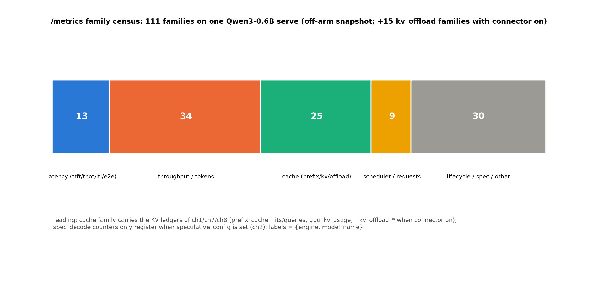

# 第 9 章 可观测与鲁棒性：metrics、OTel 与 KV 分层

> 站段坐标：站 2+15（指标的采集与出口面）+站 7/12（计时发生处）。生产化线起点（知道发生了什么）；B6-2/B7-2/B7-10 三钩并门；ch1 的命中率语义账与 ch7 的 kv_events 在此回账。

## 9.1 开篇：让引擎自己说话

生产化三步从本章起步：可观测（知道发生了什么）→平台边界（ch10，知道站在什么地基上）→选型容量（ch11，知道敢承诺什么）。前两册埋的钩在此到期：Book6 ch03 留下「KV 的第四种省法 offload/tiering 引擎里谁管」的半句（B6-2）；Book7 ch12 的观测面只讲到实验方法学（B7-10 的指标字典待长成生产面）；ch1 那笔命中率语义账（两臂同读 56.0%、手算天花板 32.0%——「计数者是谁」的悬案）也约好在此回账。本章的问题：**生产上的引擎怎么「自己说话」？说出来的每句话（指标）是谁在什么位置数的？KV 的第四种省法（搬走）在引擎里的落地形态与代价是什么？**

三段定位：专题=可观测与鲁棒性（第九个专题章兼生产化首章——双重身份：既是 KV 专题族的收官（第四种省法），也是生产化三步曲的第一步）；站段=站 2+15+7/12（指标的出口面在前后端、计时发生处在引擎核与 worker）；模块=`vllm/v1/metrics/`（loggers/reader/prometheus 三层）+`vllm/tracing/`（OTel）+`vllm_ascend/distributed/kv_transfer/kv_pool/kv_offload/`（NPU 卸载正身）。产出：指标族谱的实测普查（图 9.1+表 9.1 抽样）、/metrics 与日志行两个消费面的读法、kv_offload 的对拍实测（**NPUOffloadingSpec 路径首验**——ch7 负结果的解药）、ch1 悬案的回账。方法论口径沿 Book7 ch12 三层法：先静态走查（指标定义面）、再动态跟跑（普查与对拍）、终对拍（两消费面互证）。

> **最小背景栏**：Prometheus 指标三型（counter/gauge/histogram——正文用到哪型讲到哪型）；Book7 ch12 的实验方法学三层法（静态走查→动态跟跑→对拍）是本章的工具箱，指回；块账与 KV 三线压缩=Book6 ch03 已教。

## 9.2 指标族谱：一次 /metrics 普查

先做一次本机普查再讲体系——比先讲体系再举例有效。serve Qwen3-0.6B（off 臂，无任何附加配置），抓一份 `/metrics`：**96 个指标族、349 行 exposition**【本机实测（Atlas 910B3，运行栈 0.27.1+vllm-ascend 0.27.1rc1，2026-10-14；底档 `log/book8-ch09/off_metrics.txt`】。按语义分五族（图 9.1）——**时延族**管「多快」（TTFT/TPOT/ITL 的直方图+均值，SLO 的原材料）、**吞吐族**管「多少」（token 与请求的成败计数）、**缓存族**管「省没省」（prefix_cache 两 counter+gpu_kv 水位——KV 三本账的监控面）、**调度族**管「排队多深」（waiting/running 两态+步耗时）、**其余**是生命周期与引擎信息（版本指纹——对拍底档的自证面）：



图 9.1 指标族谱普查（自产，数据=底档 off/on 两份快照）：五族按色分——时延族（ttft/tpot/itl 的直方图与均值）、吞吐族（token/请求计数）、缓存族（prefix_cache/gpu_kv/offload 三本 KV 账）、调度族（请求状态与迭代计时）、其余（生命周期/引擎信息）；on 臂再加 15 个 kv_offload 族（9.4）。

**表 9.1 指标字典抽样**（全量 38 项主表见调研档 notes/06 §五——R 37/A 38 两轨唯一差 `request_num_preemptions`；此处抽生产高频 12 项）

| 指标 | 型 | 含义 | 消费面 |
|---|---|---|---|
| `vllm:time_to_first_token_seconds` | histogram | TTFT 分布（本机底档实名） | SLO 监控（ch11 的 P99 判据） |
| `vllm:inter_token_latency_seconds` | histogram | ITL 分布（TPOT 请求口径=`request_decode_time_seconds`/生成数） | decode SLO |
| `vllm:request_inference_time_seconds` | histogram | 端到端（prefill+decode 两条分账也有：`request_{prefill,decode}_time_seconds`） | 总 SLO |
| `vllm:prefix_cache_hits_total` | counter | **token 口径**命中累计 | 命中率（9.5 回账主角） |
| `vllm:prefix_cache_queries_total` | counter | token 口径查询累计 | 同上分母 |
| `vllm:gpu_kv_cache_usage_perc` | gauge | KV 池水位 | 容量告警/预逐出 |
| `vllm:num_requests_waiting/running` | gauge | 两态队列深度（另有 swapped/preempted 变体） | 排队监控 |
| `vllm:request_success/failure_total` | counter | 成败计数 | 故障率（鲁棒性主读数） |
| `vllm:iteration_duration_seconds` | histogram | 引擎步耗时 | 瓶颈定位 |
| `vllm:cache_config_info` | info | 块大小/版本指纹 | 对拍底档自证 |
| `vllm:spec_decode_num_drafts/…` | counter | spec 三口径（ch2）——**仅 spec 配置才注册** | ch2 已教，指回 |
| `vllm:kv_offload_cpu_cache_usage_perc` 等 15 族 | gauge/hist | **仅 offload connector 开才注册** | 9.4 |

【证据等级：源码走查（`vllm/v1/metrics/`，运行栈与阅读锚两轨行号分列见 notes/06）+本机实测底档】

周期日志行的实物长这样（off 臂 serve 日志摘录，人类可读面）：

```text
# log/book8-ch09/off_serve.log（EngineCore 周期行格式，INFO 级）
INFO … Avg prompt throughput: … tokens/s, Avg generation throughput: … tokens/s,
Running: n reqs, Waiting: m reqs, GPU KV cache usage: x.x%, …
```

指名看什么：一行同时给吞吐两口径（prompt/generation——prefill 与 decode 的分离在日志面就叫这两个名字）、队列两态、KV 水位——**周期行是五族指标的窗口快照**；它与 /metrics 的分工：人盯日志行看趋势、系统抓 /metrics 做告警。

读法两句话。正向读：五族正好对应生产的五类问题（多快/多少/缓存省没省/排队多深/挂没挂）——一张表 9.1 就是引擎的「体检查单」，巡检时逐族扫一行即可覆盖全部健康面；反向读：**两张条件注册表**（spec 开才有 spec 族、offload 开才有 offload 族）本身就是配置面的旁证——用指标有无反推引擎配置，是排查「我的配置生效了吗」的零成本手段（ch2 的 J2 判据、9.4 的对拍都用了这招）。

体系侧三件套值得各给一段真讲。**loggers**：统计的汇聚与周期输出——引擎每步把增量喂给 stats 对象、logger 按 `--metrics-interval` 周期把窗口均值打成人类可读行（serve 日志里的 `Avg prompt throughput: … tokens/s, Running: n reqs` 一族就是它的输出）；窗口语义要读清——周期行是**滑动窗口均值**不是累计值，与 /metrics 的 counter（单调累计）是两种时间观，混读会把「窗口内的慢」当成「一直慢」。**reader**：inproc 读数口——外部分析进程不经 HTTP 直接订阅统计流（ch3 实验①的编译计时钩子、ch2 的 per-position 剖面都走这类口）；它跳过了序列化层，代价是必须与引擎同进程树（`VLLM_ENABLE_V1_MULTIPROCESSING=0` 的老朋友）。**prometheus**：exposition 出口——`/metrics` 的 403 行按 PromQL 格式吐出（counter 带 `_total` 后缀、histogram 自动展 `_bucket/_sum/_count` 三件），label 统一 `{engine, model_name}` 两维（多实例 DP 时按 engine 维分列——ch6 的 rank 三刀在指标面的投影）。三件套共用同一份 stats 底账——**一份账、三个出口、三种消费者**（人/分析进程/监控系统），这个分层是可观测系统的标准姿势，读任何引擎的 telemetry 模块先找它的「底账在哪、出口有几个」。

OTel 面：`vllm/tracing/`（**勘误：不在 entrypoints/otel——notes/02 勘误在案**）的 sync_wrapper 装饰链给每个 RPC 位埋 span（ch2 的栈里见过 `tracing/otel.py#L178`——`EngineCoreProc` 的每层包装都过它手）；分布式追踪的增值在**跨进程拼链**——一条请求的 span 从 API server 串到 EngineCore 再到 worker，走廊时间（ZMQ 序列化/排队）因此可见，这是 /metrics 的平均值看不到的个体路径。本机无 collector——**阅读面口径**（写作要求 12 标注：完整实操需配 OTel collector 后端；`--otlp-traces-endpoint` 指向后端即开）。

## 9.3 计时发生在哪：两个消费面的账

指标不是凭空来的——**每个计时的发生处**才是一课。TTFT 的时钟在请求进 EngineCore 时按下（`arrival_time`——前端进程的时间戳随请求序列化过 ZMQ 传进来，所以 TTFT 里含走廊时间；离线 LLM 路径则是 generate 调用时刻）、首 token 产出时停表；ITL 是相邻 output 的时间差（差分不是累计——所以它的直方图天然比 TTFT 窄）；`iteration_duration` 是引擎步循环的自计时（一步含调度+前向+采样全链——它变宽时先看是哪一段：`num_requests_running` 同时涨=批变大属正常、不变而变宽=真有慢步）。两个消费面读同一份账：`/metrics`（拉模式——监控系统的标准口，Prometheus 按 scrape 间隔采集）与周期日志行（推模式——人看的，窗口均值）。**同一指标在两个面的数值应当一致**——不一致就是 bug 或口径差（这是 ch1 悬案的入口，9.5 展开）；生产排查的第一课就是「先统一口径再下结论」：均值对均值、分位对分位、窗口对窗口。

## 9.4 kv_offload：第四种省法的引擎正身与对拍实测

KV 的四种省法至此集齐前三种（ch1 混合钉层/ch8 压字节/ch7 传输换机），第四种「搬走」的正身是 OffloadingConnector 框架+NPU 专属 spec。**ch7 实验 E1-b 的死局在此解开**——同一 connector、换一个 spec：

**实验（kv_offload on/off 对拍，2026-10-14）**。设计要点先交代：两臂 serve Qwen3-0.6B（off=无 connector；on=`OffloadingConnector`+`spec_name="NPUOffloadingSpec"`+`spec_module_path="vllm_ascend...kv_offload.native.npu"`+kv_role=kv_both+cpu_bytes_to_use 4G+blocks_per_chunk 8——官方 `kv_cache_cpu_offload.md` 的 NPU 路径原文参数，一个字没改）；负载=4 前缀×4 请求共享前缀（offload 要有可搬的冷块——共享前缀让第二批请求有前缀可挂）、贪心、同卡同 seed、eager、端口/pid/SIGTERM/HBM 复查全套纪律。判据预注册五条：J1 双臂起服（**J2 是本章的正题**——ch7 E1-b 同一 connector 的内置 spec 死于 CUDA 断言，树外 NPU spec 能否活就是「文档在册路径是否可行」的定谳）；J3 双臂生成正常；J4 两份 /metrics 快照做族谱差集；J5 装配链行 grep【本机实测，底档 `log/book8-ch09/exp_ch09_offload_ab.json`+两臂 serve log+metrics txt】。三笔读数：

①**装配链三行原文**（on 臂日志逐字）：
```text
# log/book8-ch09/on_serve.log（EngineCore/APIServer 行摘录）
INFO … [factory.py:62] Creating v1 connector with name: AscendOffloadingConnector and engine_id: …
WARNING … [factory.py:38] Loading out-of-tree offloading spec 'NPUOffloadingSpec' from
         'vllm_ascend.distributed.kv_transfer.kv_pool.kv_offload.native.npu'. This API is
         experimental and subject to change …
```
指名看什么：覆写生效（AscendOffloadingConnector）+ **out-of-tree spec 的显式告警**——NPU 卸载不是内置路径、是「树外插件」（experimental 自述）——这行 WARNING 就是 ch7 E1-b（内置 CPUOffloadingSpec 的 CUDA 断言）与本章（树外 NPU spec 可行）的分岔标志。

②**指标族差集=+15 族**（96→111 族、349→403 行）：`kv_offload_cpu_cache_{read,write,}usage_perc`（CPU 池三水位）、`kv_offload_lookup_sync_delay_seconds_*`（查找同步时延直方图）、`kv_offload_size_*`（搬运大小）、`kv_offload_total_bytes/time_total`（累计搬运量与耗时）——**offload 自带全套可观测面**，水位/大小/时延三类齐全，不靠日志行解析。

③**运行面**：两臂各 16 请求生成正常（J3）；本实验 0.4 显存水位下无逐出发生——offload 无实际搬运（指标在但计数近零）。判读（预注册过的方向）：**offload 是容量保险丝，不是加速器**——它的收益要在「KV 池压力>容量」的逐出场景才兑现（池满时把冷块搬 CPU、命中时异步搬回——LRU 逐出策略管 CPU 侧）；稳态富余水位下开它只付装配成本。这正对应 Book6 的理论账：第四种省法省的是「装不下时的重算」，不是「每步的计算」。实验设计的自我批评也如实记：理想的对拍臂应当把 `gpu_memory_utilization` 压到逐出发生的档位（如 0.15）再跑共享前缀负载——那才是 offload 的主场；本实验 0.4 档的意义在装配面与观测面的定谳（J1/J2/J4/J5 四判据全过），收益面的读数留作升级实验（预注册：压水位+长前缀+间隔复跑——hit 冷块回迁的 delay 直方图才是它的成绩单）。

机制面补齐（源码走查口径，`kv_offload/native/npu.py` 一带）：**CPU 块池**预分配 `cpu_bytes_to_use` 的主机内存（可选 pinned——pinned 锁页让 H2D 走 DMA 快路，代价是这块主存被独占）；`blocks_per_chunk` 控搬运粒度（每次搬几块——粒度大则协议开销摊薄、粒度小则首字延迟低，8 是官方默认）；**D2H/H2D 走专属 NPU 流**异步搬运（与计算流并行——ch5 重叠族谱的算子间支亲戚，stream 语义与 mm 编码器缓存的双层搬运同款）；**LRU 逐出**管 CPU 侧（CPU 池也满时按最近最少使用丢——第二级的容量账与第一级同构，只是介质更便宜）；前缀缓存 miss 在 NPU 但数据在 CPU 时异步加载回（减少重算——省的是「装不下时的重算」这本账）。回收侧一条：块在 NPU 被逐出时**先问 CPU 池收不收**（收则搬走保留、不收则真丢）——「逐出」在分层世界里变成了「降级」。fault tolerance 面指回 ch7（kv_load_failure_policy 的 recompute/fail 两值——加载失败时回滚重算或直接报错，两层存储把「丢」的概率放大了，策略的保守因此更有理由）。

与第四种省法的兄弟姐妹们合账（KV 四省法至此全家福）：**钉层**（ch1——部分层的 KV 封顶窗宽，省的是「不用存那么多」）、**压字节**（ch8/ch6——C8 每值 1B，省的是「存得小」）、**换机**（ch7——KV 跟着请求搬家到 decode 实例，省的是「重算一遍」）、**搬走**（本章——冷块降到 CPU，省的是「装不下时的挤出」）。四者的共同骨架仍是 ch8 立过的临界比经济学：**省的（容量/重算）> 付的（查找/搬运/精度）** 才值得开——offload 的特化判据是「逐出率>0 且被逐块有复用可能」，这正好能用它自己的指标族读出（`cpu_cache_usage_perc` 高+`lookup_sync_delay` 低=划算；反之=白付搬运）。

## 9.5 ch1 悬案回账：计数者是谁

先用 toy 把「两本账」的直觉立住：

**例 9.1（匹配账 vs 归并账的 toy）** 构造：一个 hybrid 批=1 条请求（前缀 1000 token 已缓存）、FA 组匹配 896、SWA 组窗内 512。输入两算：①**匹配账**（调度器的前缀匹配面）：按块哈希匹配到 896 token——记「命中 896」；②**归并账**（hybrid 协调器的 min 面）：min(896,512)=512——实际免算 512 token、剩 384 token 仍要算。输出读法：两本账差 384——**匹配账说「找到了多少」、归并账说「省了多少计算」**；纯 FA 机器两账恒等（只有一组）、hybrid 机器两账分叉（组间取 min）——ch1 的 56.0%（匹配）与 32.0%（归并）就是这笔 toy 的真机放大。（位置：计数面=Book7 ch06 的块哈希记账；归并面=ch1 表 9.2 的证据链。）

ch1 留下的账：混合臂与纯 FA 臂同读 56.0% 命中率、手算 min 归并天花板 32.0%——嫌疑收紧到「指标口径的计数者是谁」。本章的普查给了回账的钥匙：

**表 9.2 悬案的证据链**（ch1 底档+本章普查合读）

| 证据 | 内容 | 指向 |
|---|---|---|
| ch1 两臂 hits/queries | 10,752/19,200（两臂同值） | 计数不随 SWA 组存在与否变化 |
| 本章 off 臂 | `prefix_cache_queries_total=464.0`、`hits_total=0.0`（顺序 curl 负载） | 计数面=token 口径 counter，粒度=请求级累计 |
| 源码定义面 | hits 的累计发生在 scheduler 侧 `num_cached_tokens` 路径（Book7 ch06 已教其记账位） | **计数者=调度器的前缀匹配面，不是协调器的 min 归并面** |

这个回账也立了一个更一般的方法论：**看到指标异常先查计数者**——每个指标都有明确的产生位置（哪层代码、什么时机、什么口径），异常可能不在现象而在口径（两本账的错位）。ch1 当年若先查计数者，56.0% 的悬案当场可解——这是把「指标字典」从查表工具升格为排查工具的全部含义。回账结论（可检验口径）：`prefix_cache_hits` 数的是**调度器认定的前缀匹配 token 数**——它先于 hybrid 协调器的 min 归并发生（归并是「实际省了多少计算」，计数是「匹配了多少前缀」）；ch1 两臂的 FA 组匹配同为 896/请求，故 token 口径命中率同为 56.0%——**不是 bug，是两本账**（匹配账 vs 归并账）。可检验判据留给读者：并发同前缀负载下对比 `num_cached_tokens`（省算账）与 hits（匹配账）两读数——两者在 hybrid 臂应分叉、纯 FA 臂应相等。ch1 的 `num_uncached_common_prefix_tokens=384` 正是两本账的差值本体。

观测的完整位置图至此可以画出来（文字版）：**发生处**（引擎核的请求钟/worker 的步钟——最靠近真相但最难碰）→**汇聚处**（stats 对象+loggers——把个体汇成分布）→**出口处**（/metrics 拉口/日志行推口/reader 直读口——三种消费者各取所需）→**消费处**（Prometheus 存储与告警/人眼/Grafana 面板）。四层里每层都可能引入口径变换（窗口化/聚合/标签化）——**读数前先知道自己站在哪层**，这是可观测排查的地图感。

## 9.6 鲁棒性的指标面

故障怎么读（「崩了怎么办」的观测面）。单指标各有岗位：`request_failure_total` 按 finish_reason 分 label——异常终止的请求进 STOP=error 类，**故障率的第一读数**；`vllm:num_preemptions`（本机底档实名；v0.30.0 侧名 `request_num_preemptions`——两轨差，框注级）记抢占重排——重排不是故障但会让延迟尾部变胖（重排的请求重新排队）；预逐出的水位线=`gpu_kv_cache_usage_perc` 接近 1（ch1 例 1.5 的容量账在监控上的投影——水位满意味着下一步就要逐出/抢占）。单指标是词汇、**组合才是句子**：三元组一=**failure 涨+waiting 涨+kv 水位满**——容量型故障（负载超了容量，该降并发、开 offload 或扩容——ch11 的容量公式在此接手）；三元组二=**failure 涨+iteration_duration 抖+kv 水位正常**——设备型故障（计算侧出问题，查卡/查算子——npu-smi 的 AICore 占用是第一站）；三元组三=**TTFT 涨+queue_time 涨+吞吐平**——排队型（入口速率超服务速率，限流或扩前端）。三个三元组是生产 on-call 的第一直觉，也是「把指标字典背成句子」的示范——**可观测的价值不在有多少指标，在于指标间的关系能拼出因果句**。

鲁棒性的另一半是**引擎对故障的自愈行为**（不只是观测）：调度器的抢占-重排机制（Book7 ch5 已教——水位压力下的优雅降级）；chunked prefill 的可中断性（长 prefill 切步、每步之间可以让位——Book6 已立）；本章的 offload 则是**存储层的自愈**（池满降级到 CPU 而不是丢弃）；PD 场景的 kv_load_failure_policy（ch7——加载失败回滚重算）。四者合成引擎的「韧性面」：观测（知道）→降级（扛住）→恢复（回来）——生产化叙事的完整一环。

## 9.7 本章小结

回扣开篇：引擎自己说话的两个面（/metrics 的 111 族与周期日志行——同一份账的拉推两消费；例 9.1 的匹配账对归并账把「同一负载两本账」钉成 toy）；计时发生处的三层（请求钟/步钟/汇聚器）；kv_offload 的对拍把 ch7 死局解开（NPUOffloadingSpec 树外路径可行——+15 族自带观测、装配链三行原文、「保险丝不是加速器」的定位）；ch1 悬案回账（计数者=调度器匹配面、56.0% 是匹配账——两本账读法+可检验判据）。

**带走的心智**：两幅画。**其一，指标是账本的出口不是账本本身**——四层位置图（发生→汇聚→出口→消费）里每层都做口径变换；排查异常的顺序是「先定位计数者与口径、再谈现象」（ch1 悬案的两本账教训：56.0% 的匹配账对 32.0% 的归并账——同一负载、两个真相、都真）——每个数字背后有明确的计数者（谁在哪一层数的）；读到一个异常指标，先问「这是谁数出来的、在哪个位置、什么口径」——口径不同结论可以完全相反（ch1 的 56.0% 对 32.0% 就是同一负载的两本账）。**其二，可观测面是配置面的镜子**——条件注册表把「配置生效了吗」变成一次 curl 的事（spec 族在/offload 族在=配置在）；on-call 的三元组句子（容量型/设备型/排队型）是指标字典的正确背法——spec 族只在 spec 开时注册、offload 族只在 connector 开时注册：用指标的有无反推配置的生效，是零成本的排查第一招；反过来，选引擎时先看它的指标字典覆盖哪五族——**不能观测的优化等于没优化**。

镜头拉回全书：生产化三步的第一步立起（知道发生了什么）；下一步（ch10）把镜头从引擎内部转到引擎脚下——平台层：这整套可观测面跑在什么地基上、上游给了什么、NPU 收紧了什么。KV 四种省法的账全部齐了（钉层/压字节/换机/搬走），ch13 终账将把它们与临界比经济学合并收拢。

一个 on-call 场景把本章全部件串一遍（叙事小结）：凌晨告警「TTFT P99 超阈值」——第一步看三元组定位故障类：failure 平/waiting 涨/kv 水位 0.9+——容量型，逐出与抢占正在发生；第二步看分族细节：`num_requests_preempted` 涨（有重排）、`iteration_duration` 稳（计算没变慢）——确认是 KV 池压力不是设备；第三步决策：降并发（立即）或开 offload（把冷前缀降到 CPU——`cpu_cache_usage_perc` 上线后观察 lookup_delay 是否可接受）或扩容（ch11 的容量公式算该加几张卡）；第四步验证：TTFT P99 回落、preemption 归零——闭环。这条链上每一步都只是查一个指标、做一个判断——**可观测的意义就是让每一步判断有数可依**。

> **【欠账】** ①平台收紧四案与可观测面的衔接（指标暴露的平台差异——如 preemption 计数两轨差）→ 第 10 章；②APC hits=0（顺序负载）的并发复验+kv_events 双字段（ownership/session_id）的消费面实测 → 第 13 章终账登记（阅读面/选做口径）。

**动手验证**（Atlas 910B3；选卡纪律照 CLAUDE.md）：
① 对拍复跑：`source env.sh && bash code/Book8-vLLM源码剖析下/ch09/exp_ch09_offload_ab.sh`——验收行=双臂起服+on 臂 `Creating v1 connector with name: AscendOffloadingConnector`+指标族 96→111（底档 `log/book8-ch09/exp_ch09_offload_ab.json`）；
② 族谱自查：`curl -s 127.0.0.1:18091/metrics | grep -c "^vllm:"`（serve 任一实例）——数量级 300-400 行；
③ 悬案判据（选做）：并发同前缀负载下对比 `prefix_cache_hits_total` 与引擎日志的 cached token 数——hybrid 臂两数分叉则 9.5 的两本账读法成立；
④ 制图：`python code/Book8-vLLM源码剖析下/ch09/fig_ch09.py`——产物 `figures/fig-9-1-metric-families.png`。
