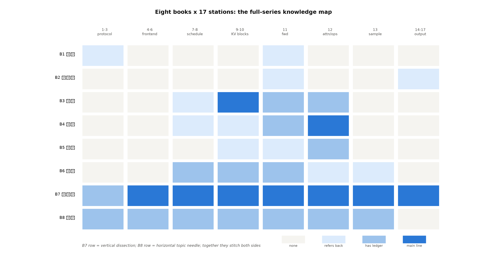

# 第 12 章 毕业设计：一条请求穿越八册

> 站段坐标：横览全站+八册（毕业设计型——防灌水条款适用：血肉=大项目集成+全链走查+新芽导读三件实事，不为撑篇幅复述）。

## 12.0 开篇：从大作业到毕业设计

上一章的期末大作业是「给定条件做设计」；毕业设计升一档：**拿真实资产跑真实服务，再用一条请求把八册知识走一遍**。三段定位：专题=大项目集成与八册总对账；站段=横览 17 站；模块=大项目资产（207M+drafter）+全部账本。防灌水声明：本章只有三件实事——集成收拢、全链走查、新芽导读；前十一章的内容不复述（用到时点名「哪册哪章」+一行读数），已交付的实验不重跑（引底档）。这条声明不是谦虚是设计：毕业设计的价值在**组织**不在**重复**——就像毕业论文的价值在综合运用而不在抄讲义；读者若在走查中遇到「这个机制想不起来了」，那正是回读对应册的路标（走查是索引，不是替代）。

## 12.1 交付件台账：你手里有什么

**表 12.1 全书交付件台账**（七件——路径全在档可复验）

| # | 交付件 | 规格 | 底档 |
|---|---|---|---|
| 1 | 自训 207M 注册链 | Book7 ch10 C+A 双档全绿（cross_route_parity.identical=true） | log/book7-00/ |
| 2 | 2 层 drafter（89,134,080 参数） | 训练底档+词表钉死账（ch2 例 2.3） | log/book8-00/r7_* |
| 3 | hf_draft2m 五件套 | HF 格式、tokenizer 同源 | log/book8-00/hf_draft2m/ |
| 4 | mini 引擎四版 | Book6 交付（指回不重跑） | Book6 code/ |
| 5 | lora_toy 双件 | noop/perturb（4.6MB） | log/book8-00/lora_toy/ |
| 6 | 七臂组合矩阵底档 | ch4 表 4.2（M5 全组合可行） | log/book8-ch04/combo_matrix/ |
| 7 | 实验脚本+fig 全家 | ch1-9 的 exp_*/fig_* 入库 | code/Book8-*/ |

读法：这七件是八册学习的「硬资产」——不是练习题的草稿，是可以继续搭服务的构件。毕业设计就用 1+2+3 装配、用 6+7 验证。台账还有一层毕业季的意味：**清点你带走什么**。八册读完，具体数字会忘、具体行号会漂移，但这七件（能跑的模型、能验证的矩阵、能复现的脚本）不会因为遗忘而失效——它们是知识沉淀为工程能力的凭证。找工作面试时「我训过一个 drafter 并配对验证过」比「我读过投机解码的论文」硬一个数量级——**资产证明经历，经历胜过阅读**。

## 12.2 全链走查：一条请求穿越八册（全书总装主线）

这是全书最重要的十页（也是唯一建议「边读边翻前册」的十页——走查的每一站都可能让你想回查某个机制，这是设计使然不是缺陷：**走查是复习的索引**）。取 ch2 实验的 echo workload 一条请求（底档实构：64-token 段落×2 遍+「Repeat the passage:」——32 条各异的确定性随机段落、k=3 spec 开、贪心），从 HTTP 进门走到 SSE 出门——**每一站标注「这站的知识在哪册哪章学的、此刻账上发生了什么」**。走查的读数锚：207M 的 TPOT 23.1ms/启动 55.1s（Book7 底档）+drafter 0.016s/step（ch2）。

**第一段·进门与前端（站 1-6，Book7 ch3/ch3/ch4+Book8 ch3）**：JSON 请求到 127.0.0.1:18xxx——协议层校验（字段合法性——非法在此 400，连引擎的门都摸不到）+chat 模板（Book7 ch3——消息列表拼成 prompt 串）；若带 response_format，schema 在此进 SamplingParams（ch3 的站 3——「请输出 JSON」的旅程起点）；前端建输出收集器、切 token id、序列化过 ZMQ（Book7 ch4——毫秒时间线里这段走廊 ~1ms 级，但它是**两次进程越界的前半**：请求从此离开前端进程的管辖、进入引擎核的时区——两次越界是全书叙事的骨架缝（图 0.1 的两道竖线），走查在此跨过第一道）。**册账**：Book1 的 tokenizer（BPE 分词在这条请求上把句子切成 token——八册旅程的第 0 步）；**走查的第一课也在此**：echo 请求的 prompt 会被切成 ~64 个 token（ch2 的 workload 构造数字），其中「The quick brown fox」这样的常见片段是单 token 或双 token——**分词的粒度直接决定后面每一站的账量**（prefill 的 token 数、APC 的块对齐、ngram 的匹配窗口——第一站的手下意识地塑造了所有后续站）。

走查方法先立（这是可迁移的手艺）：拿一条具体请求、逐站问三个问题——**这里改了什么状态？这笔账记在哪？哪册教过它？**——三问答完，站与站之间用「下一站拿什么当输入」缝合。下面四段就是这个方法的执行实录（数字全引自各章底档——走查不产生新数字，只重排已有数字的视角）。

**第二段·引擎核（站 7-10，Book7 ch5/ch6+Book8 ch1）**：调度器的预算决策（token 预算与 KV 余量——Book7 ch5 的 admission 三问在这条请求上的回答：预算够、余量足、放行）；块账与哈希前缀（Book7 ch6——前缀缓存的记账位；注意 ch2 实验显式关了 APC 混淆源，走查此处看的是**机制在位**而非命中发生：若开 APC，同前缀请求会在此命中免重算——ch9 例 9.1 的匹配账正描述这条路）；**混合 KV 的协调器归并**（ch1——若模型是变身体，spec 的 −1 占位符与 hybrid 命中在此交汇：ch5 的占位符撒在调度步、ch1 的 min 归并在命中期）。**册账（本段最厚——四册交汇）**：Book2-5 的全部架构知识浓缩在「这条请求的前向要算什么」里——GQA 的 KV 头数（Book3）决定块账的每 token 字节（ch8 例 8.1 的公式）、MoE 的路由（Book4）决定 expert 派发（ch6 例 6.3 的分桶）。

**第三段·worker 执行（站 11-13，Book7 ch7/ch8+Book8 ch2/ch5）**：model runner 把批喂进模型——**spec 在此开场**：drafter 先出 3 个候选（ch2 例 2.1 的步账——(B,n,d)→(B,n+k,d)），目标模型一次前向验证（图 2.1 的形状流转）；前向内部每层过 attention（Book7 ch9 的后端查表——NPU 上 FIA 的 block_table 路径）、过 FFN（W4A16 的边解压边乘——ch8 的算子链）；rejection sampler 逐位判收（ch2——drafter 臂的 per-position 剖面 0.804/0.462/0.374，τ=2.64）。**async 的重叠在此发生**（ch5——若开：下一步的调度已在本步计算的影子里开始）。**册账**：Book6 的 α/τ 理论（接受 2 个=τ 贡献——例 2.1 手账的现场版）、roofline（带宽账的方法——ch11 式 (11.1) 的三步算例就是本段的前向成本推演）；**还要加上 ch4 的变胖线**（若这条请求带图：402 个视觉词元在此段入场——编码器 runner 与主前向的双流）。

**第四段·出门（站 14-17，Book7 ch11）**：token id 打包回桥（第二次进程越界——请求的产出从此往家走）、增量解码（detokenizer 的状态机——Book7 ch11 的 12 token 15 事件里那些「无产出」的事件就是它在干活）、SSE 流式推回——**结构化输出的掩码若在**，每步采样前 logits 被裁成窄门（ch3 例 3.3 的 1,1,2,1——「窄门」与「贪心」的相遇：贪心在单门里没有选择余地，掩码退化为身份操作——这是 spec×grammar×greedy 三特性交汇的静默一角：**三个特性各自都有代价，但某些组合下代价互相抵消**——这种「组合静默」只有走查能看见，单特性实验永远看不见）。

走查到这里应该停下来看一眼全景的形状：**四个段的书份分布不均**——前端段轻（两册有账）、引擎核段最重（四册交汇：调度理论/块账/混合归并/重叠）、worker 段最深（前向内的每一层都是 Book2-5 架构知识的兑现现场）、出门段最薄（一册讲完）。这个不均匀本身就是「推理引擎」这个词的形状——**复杂性集中在中间的决策与执行两段**，前后两端是协议与呈现的薄壳。选才入行时也知道该先深哪段。

毫秒时间线（端到端账，取各章底档首值拼成）：

| 段 | 耗时量级 | 账本来源 |
|---|---|---|
| 启动（一次性） | 55.1s | Book7 ch4（含图捕获可另加 84→159s——ch2 守卫④） |
| 走廊（ZMQ×2） | 亚毫秒级×2（Book7 的时间戳账口径） | Book7 ch4 |
| 调度+块账 | 毫秒级/步（相对前向是小头） | Book7 ch5/ch6 |
| prefill（APC 开时命中省、关时全付） | ~130 token 段：几十 ms 级 | Book6 chunked 账+ch9 匹配账 |
| decode 每步 | 23.1ms=无 spec 基线 TPOT（Book7 ch10）；spec 开后验证批变胖但省步数——ch2 的 α 对账管这笔合成账 | Book7 ch10+ch2 |
| SSE 出门 | 亚毫秒级/事件 | Book7 ch11 |

走查的终点读法：**一条请求的每个毫秒都有一册的账本在记**——启动的 55 秒是 Book7 ch4 拆的、每步的 23 毫秒是 Book7 ch10 与 ch2 合记的、命中省掉的 prefill 是 ch9 的匹配账——「八册」两个字在时间轴上展开就是这条线；而毕业设计的最后一课是：**你能对任何一行耗时说出它的账本来源——这就是「带走的心智」的可检验形态**。

## 12.3 八册×17 站投影：知识的地图

**表 12.2 八册×17 站投影矩阵**（行=册、列=17 站的站组、格=该册的贡献——细目版）

| 册 | 站 1-6（前端） | 站 7-10（引擎核） | 站 11-13（worker） | 站 14-17（出门） | 元层 |
|---|---|---|---|---|---|
| B1 原典 | tokenizer | 注意力数学 | — | — | 全书地基 |
| B2 预训练 | 模型的来历 | — | 权重的意义 | — | 训练侧半场 |
| B3 骨架 | — | KV 账本起点 | RoPE/GQA 算 | — | 单轨主线 |
| B4 规模效率 | — | MoE 块账 | expert 派发 | — | 量化数学 |
| B5 前沿混合 | 混合架构需求 | 状态异构 | 稀疏注意力 | — | 需求侧 |
| B6 推理系统 | — | 调度理论 | roofline/α | — | 引擎无关物理 |
| B7 源码上 | 协议/进程/调度/块账/执行/attention/图/输出 | ←主链路精读 | — | — | 17 站地图 |
| **B8 本册** | ch3 约束/ch4 变胖 | ch1 混合/ch5 重叠 | ch2 投机/ch8 量化/ch6 分布式 | — | ch9-11 生产化+本章 |

横读竖读各有姿势：**竖读一列**（如「12 attn/ops」列）看到的是「这一站的全部知识来源」——B1 的注意力数学+B3/B4 的架构变体+B6 的 roofline+B7 的后端查表+B8 的量化算子——一个站五位老师各教一门；**横读一行**（如 B8 行）看到的是「这一册的全部落点」——专题册均匀用力（每站组都有账）、唯独输出链留白（Book7 地界）——一册书的责任田。两读合起来这张表就是「知识的产权登记」：哪块地谁种的、种到什么深度——研究任何系统时画一张这样的表，你对它的理解就完成了结构化。

图 12.1 八册×17 站总地图（自绘，示意级；数据=表 12.2 投影矩阵）：色深=贡献密度（主讲/有账/指回/无）；B7 行全深（主链路精读贯穿全部站）、B8 行前七组均匀中深（专题横切均匀用力、末组留白——输出链属 Book7 地界）；B3/B4 的色块集中在引擎核与 worker 段（架构知识转化为账本的位置）。读图一遍就能回答「学某站的机制该翻哪册」——这张图是全丛书的检索接口。

## 12.4 大项目集成收拢

207M+drafter 的端到端形态（引 ch2 底档不重跑）：serve 或 offline 起 target（hf207m）+spec config `{method:draft_model, model:hf_draft2m, num_speculative_tokens:3}`——装配链三行（`Loading drafter model...`/长度对齐闸/贪心两轮一致）全绿；τ=2.64（ch2 表 2.2 的 b_k3 臂）——**低于 ngram 的 3.36 但那是 echo workload 的偏袒**（抄 prompt 谁都赢）；开放生成的对比留作用业（判据已立：随机前缀负载两路线重跑——drafter 的分布学习优势应反超）。集成的教学点一句话：**「注册链（Book7）+投机服务（Book8）」两章工作拼成一个自产模型的加速服务**——没有一行权重是下载的，这就是单轨主线的毕业含义。集成时踩过的三个坑也值得留档（都是前文的伏笔兑现）：①drafter 的 max_position_embeddings 要 ≥target 的（引擎的长度对齐闸只收不放——`Overriding from 2048 to 1024` 行）；②两件的 tokenizer 必须同源（词表对齐判据——ch2 的 32k 同源账）；③spec 开启时 async 的互斥守卫会静默关调度器（ch5——集成跑分前先看告警行）。**集成是伏笔的总回收站**——单独学时每条纪律只是知识，集成时每条纪律都是事故预防。

## 12.5 新芽导读：源码在往哪长

六个新芽（v0.30.0→当期的演进方向，各一句「往哪长、长出来替谁」）：
①**XGrammar-2**（2601.04426）——TagDispatch+跨文法缓存，替「每请求唯一 schema」的击穿工况（ch3 的软肋）；
②**MRV2 speculator 族扩张**——draft_model 补齐进工厂（v0.31 #43091），替「读 MRV1 跑 MRV1」的双轨尴尬（ch2）；
③**EC connector 与 weight_transfer**——传输范式推广到 embedding/权重（ch7 的 A4/A5 芽）；
④**mm 缓存自愈**（MultiModalCacheMissError 可重试闭环）——替 P0/P1 漂移的静默错（ch4 #21）；
⑤**kv_events 双字段**（ownership/session_id）——KV 事件总线长出消费面（ch7/ch9 的接缝）；
⑥**per-request spec 指标**（三档 detail）——请求级投机剖面（ch2 #14 的正身补全）。
读法：**新芽不是新闻——是「本书哪个章节的哪个『不够』在 upstream 被接着长」**——读新芽的姿势是回正文找它补的那句话。六芽各自的「本章伏笔号」也顺便对上：①=ch3 §3.8 的击穿工况、②=ch2 表 2.1 的 MRV2 缺行、③=ch7 §7.5 的版本账、④=ch4 的 #21 框注、⑤=ch7/ch9 的 kv_events 接缝、⑥=ch2 的 #14 框注——**每颗芽在正文里都有它的种子页**（这也是「新芽导读」合法性的一部分：不是展望未来，是回收本书自己立的「不够」）。六芽的生长方向还能归成三类：补可观测（⑤⑥——看不见的让它看得见）、补吞吐（①②③——慢的让它快）、补健壮（④——错的让它自愈）——**三类正好对应生产化三步的深化**（ch9 可观测/ch11 容量/ch10 平台边界的健壮面）。预言一句收束：等这些芽长成主干，下一本讲 vLLM 的书会把「每请求唯一 schema 的击穿」「P0/P1 漂移」「draft_model 双轨尴尬」当作历史故事讲——**而你会记得自己在书的哪一页亲眼见过它们的「不够」版本**。

## 12.6 本章小结

回扣：三件实事交付——七件资产台账（表 12.1）、一条请求的四段走查（17 站逐站对册账+毫秒时间线）、八册×站投影（表 12.2 双面锦）；大项目集成收拢（τ=2.64 的诚实账+开放生成作业）；六新芽各归其位。

**带走的心智**：一幅画（毕业设计只留一幅）：**知识的形状是一张 8×17 的矩阵，但用它的时候是一条线**——服务一条请求时，矩阵按请求的路径折叠成线；读引擎源码时，按站纵切；做选型时，按维度横叠；排查故障时，按指标的因果链斜穿。八册书把矩阵填满，毕业设计证明你会折叠它——**教育的终点不是知道矩阵的每个格，是拥有折叠的自由**。

镜头拉回全书：下一章（最后一章）收束——钩决算全表、八册地图终点、收官注记。

> **【欠账】** 无新外债——本章全部欠账转 ch13 终账（表 13.1）。

**动手验证**（全可做）：
① 集成复现：`ASCEND_RT_VISIBLE_DEVICES=<卡> vllm serve log/book7-00/hf207m --speculative-config '{"method":"draft_model","model":"log/book8-00/hf_draft2m","num_speculative_tokens":3}' …`——验收行=装配三行+τ≈2.6（底档 ch2 的 b 系）；
② 走查自查：遮住 12.2 的站名，对着表 12.2 从站 1 背到站 17——每站说出「哪册哪章+一个读数」；
③ 台盘点验：抽表 12.1 任两件回底档路径 ls 确认在位。
