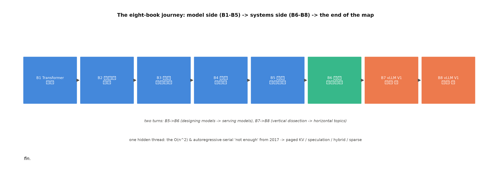

# 第 13 章 收束：钩决算、八册终点与收官注记

## 13.1 开篇：清账的时候到了

收束章的本分是三件：**钩决算**（进账全销项+出账清零声明）、**八册地图终点**（从 Book1 第一章走到这里的全景回望）、**收官注记**（这套书想留给读者的最后几句）。与前册收束章同构但多一层意义——**这是丛书级的终点**：Book1 在 2017 年的原论文埋下的每一笔可执行的欠账（F 系）、七册之间互相立的每一笔钩（B 系），到本章的表 13.1 全部有一个落点。清完账，八册合起来才是「一件事」而不是「八本书」。决算表还有一层**对作者的价值**：它是写作期全程的「防丢钩装置」——每写一章先核表上待销的行（这章该销哪笔）、每收一章再核一遍（销了没有、销干净没有）；没有这张表，跨八册的账在第四册就会开始漏——**长工程的记忆不在脑子里，在账上**（这是这套书的写作方法论收笔，也是读者做任何长项目可以借走的一件工具）。

## 13.2 钩决算全表

**表 13.1 钩决算全表**（进账 23 钩逐行销项——B7 系 11+B6 转址 3+B4 系 4+B5 系 4+F18 后半+云档裁定；对 notes/09 台账全量复核）

| 钩 | 内容一句话 | 落点与销项 |
|---|---|---|
| B7-1 | hybrid KV cache manager 机制深讲 | ch1 **已销**（三层图谱+K3 映射+0.941× 实测+仿真四本账） |
| B7-2/B6-2 | KV 第四种省法 offload/tiering | ch9 **已销**（NPUOffloadingSpec 树外路径首验+指标族差集 15+保险丝定位） |
| B7-3/B6-5 | proposer 全家机制正身 | ch2 **已销**（11 分支装配+表 2.1 两代对照+α 对账+双路线实测） |
| B7-4 | 结构化输出管线 | ch3 **已销**（八文件管线+四实验+两本账+单后端收紧） |
| B7-5 | 多模态与 LoRA 服务 | ch4 **已销**（VLM 首验 402=400+2+七臂矩阵+punica 三级） |
| B7-6 | ubatching/DBO | ch5 **已销**（平台禁用守卫+阅读面+重叠族谱四切法） |
| B7-7 | 多卡图模式同步边界 | ch6 **已销**（三层上下文+档位对齐+云档销项） |
| B7-8/B6-7 | PD 分离工程生态 | ch7 **已销**（17 连接器+24 名生效表+三级降级+传输账） |
| B7-9 | MoE 量化与 expert 加载 | ch8 **已销**（两本账+算子链+装载冒烟 NotImplementedError 定谳） |
| B7-10 | 可观测生态 | ch9 **已销**（指标族谱 96/111+offload 对拍+ch1 悬案回账） |
| B7-11 | sparse/indexer 族 | ch1 §1.5 **已销**（DSA 谱系+强制量化+云档登记） |
| B4-1 | EP 工程 | ch6 **已销**（EP 组建立+令牌派发+EPLB 双路+分店映射） |
| B4-3/F18 后半 | 推理侧量化 | ch8 **已销**（B4-3 并轨；fp8 装载边界 561103 实测登记） |
| B4-ch08-MTP | MTP 三段式改道 | ch2 §2.3 **已销**（Book4 原句→Book7 改道→本章兑现，四件合销） |
| B5-3/B5-4/B5-8 | ch1 前账三笔 | ch1 **已销**（1M 服务账/K3 定义句/三刀机 n* 交叉点） |
| B5-7 | 引擎选型 | ch11 **已销**（四引擎对照+式 (11.1)+期末大作业） |
| B5-6 | 多模态服务路径（16,384 token/图） | ch4 **已销**（与 B7-5 并轨开箱——视觉词元账 402 逐位闭合） |
| Book6 ch07 容量句 | 容量规划 | ch11 **已销**（SLO 反推三步） |
| 云 GPU 裁定 | 选做不做 | **已登记**（ch1/ch6/ch7 按裁定口径写；本表一行终账） |
| README 灭失行 | B5-8 存照 | **存照**（历史灭失以现状为准——不追溯） |

**出账=零**：本册欠账框全部指向册内（各章「→ 第 M 章」均已在前文兑现），ch13 无新增外债——**收官清账，丛书无 Book9**。

各章路由到本章的**终账登记行**（欠账框②的收口，逐章清点）：

**表 13.2 终账登记**（八章十二笔「→ ch13 终账登记」的逐笔落点）

| 来源章 | 登记项 | 终账口径 |
|---|---|---|
| ch1 | MLA/DSA/SFA 实测（云 GPU 选做不做） | 裁定已登记（源码阅读面），本表存档 |
| ch2 | eagle/eagle3/dspark/dflash 实测 | 同上（vllm-ascend 实现在册、需专用权重） |
| ch4 | mm-LoRA tower 件（4B 不匹配）+LoRA×spec 深描 | CI 证据+阅读面；M5 全组合可行 0.896× 已入表 4.2 |
| ch5 | 差异续表 #26/#27（async 白名单/ubatching 文件集） | 附录 C 收录 |
| ch6 | W4A8×EPLB 冲突定谳+ray 多机 | 两表冲突如实并注；ray 阅读面 |
| ch7 | C8×mooncake 裸名歧义+边界 | ch8 §8.6 已收半句；余额=口径提示（用 V1 名） |
| ch8 | fp8 装载算子边界（561103）+ModelSlim 产制面 | 本机实测登记（三层底档在）；产制=阅读面 |
| ch9 | APC 并发复验+kv_events 消费面 | 选做留档（判据已立：并发同前缀负载） |
| ch11 | 竞品数字终核+徽章冲突 | 版本快照口径（表 11.1 注）；终核随 rebase 决策 |表 13.1 的读法：正向读=每笔进账有且仅有一个销项落点（无「部分销」「散见多章」的含糊行——含糊即未清）；反向读=从落点回看埋点，钩的生命周期跨了最多七册（F18：Book1 ch11 埋→Book4 ch07 执行→Book6 ch11 算法→ch8 引擎落地——**一笔账在四本书里各有自己的段落**）——这就是「丛书」区别于「系列单行本」的全部含义：账是连着的。

## 13.3 八册地图的终点

从 Book1 第一章到这里的路线，一屏走完：**模型侧五册**（原典的注意力与 O(n²) 伏笔→预训练的范式分化→现代骨架的插槽改装→规模效率的 MoE/量化→前沿混合的突围三路线）把「机器是什么」讲完；**系统侧三册**（推理物理学的引擎无关账本→V1 主链路的 17 站精读→本册的专题与生产化）把「机器怎么被服务」讲完。两半的接缝处是 Book5→Book6 的那次视角切换（从设计模型到伺候模型），而本册 ch12 的全链走查是两半的**合拢点**——一条请求的每个毫秒在八册里都有账本。

给这套结构三个回望坐标：**每册一个身份**（1 原典/2 范式/3 骨架/4 规模/5 前沿/6 物理/7 纵剖/8 横切）；**两个大转折**（Book5→6 的模型到系统、Book7→8 的纵向到横向）；**一条暗线**（O(n²) 与自回归串行这两个 2017 年的「不够」——一路长成分页 KV/投机解码/混合架构/稀疏注意力的整条效率树——Book1 埋的 F 系欠账就是这棵树的年轮）。

三个坐标之外还有一套**方法论年轮**值得回望（它比知识更耐旧）：Book1-3 教的「先整体后局部再回整体」（读任何架构的手艺）；Book4-5 的「参数账+证据等级」（对任何宣称的数字先问来源）；Book6 的「物理账本」（引擎无关的容量/带宽/命中账）；Book7-8 的「行号锚+三镜头+判据预注册」（读源码与做实验的自检纪律）——四层手艺叠着长，每册都把前面的当默认。这套方法论的检验标准很朴素：**拿着它去读任何一个新的推理引擎（或任何大型系统），你能在一下午画出它的地图、立出它的账本、找到它的「不够」**——如果能，这套书就成功了；如果不能，是我们没写好。读者走到这里，手里应该有：一张 17 站的地图、九笔专题的账、一套「先算账再动手」的反射。

图 13.1 八册地图终点（自绘，示意级）：蓝=模型侧五册、青=理论册、橙=源码两册；两个转折（B5→B6 从设计模型到伺候模型、B7→B8 从纵剖到横切）与一条暗线（2017 年的两个「不够」长成的效率树）——走到这里，地图合上。

## 13.4 给读者的最后一封信

（这封信写给三种读完方式的人：从头读到尾的、挑章节读的、只读了导览和收束的——三种都算读过，只是带走的东西不同。）

这套书从一个朴素的问题出发（Transformer 到底怎么工作），走了八册。如果你从头走到尾，你现在拥有的不是「关于 vLLM 的知识」——知识会过时（v0.31 已发、v0.32 在路上，本册的差异附录就是为过时准备的）——而是三样更耐久的东西：**读源码的手艺**（从行号锚到三镜头的自检——任何新代码库都适用）、**立账本的习惯**（容量/带宽/命中率/接受率——数字先于意见）、**折叠知识矩阵的自由**（按请求走查/按站纵切/按维度横叠——结构化知识的能力）。引擎会换、算子会换、甚至注意力机制都会换——这三样不换。最后一句叮嘱：不要把这套书当参考书供着——**它是工具书，用旧的**。去读真源码、去跑真实验、去把某个「不支持」剥开看等价路径；书页会过时（快则一年），但你在这八册里练过手的每一行日志、每一笔账、每一次负结果的如实记录，会成为你面对任何新系统时的直觉——直觉不会过时，因为它是从「亲手算过」里长出来的。

## 13.5 收官注记

《从模型到 vLLM》八册至此收官。诚实的尾声一句：这套书不是完美的——负结果、降级口径、阅读面比比皆是（本册 ch7 的 PD 全链只能三级降级、ch8 的 fp8 死在装载期、云 GPU 选做最终没做）——我们把这些如实写进去，因为**工程的真实形状就是「能做的、不能做的、等它长好的」三块拼的**；教科书画全绿是失真。愿读者带着这块不全的地图上路，走完我们没有走到的那些站。写给最后翻到这一页的你：这套书的写作本身就是一个「从模型到系统」的旅程——写前五册时我们在讲机器，写后三册时我们在讲怎么伺候机器，而写本册毕业设计时我们发现**这两件事在一条请求里合而为一**。愿你合上最后一页时，脑中留下的不是八本书的目录，而是一条会自己走完 17 站的请求——它知道自己在哪、付着什么账、被谁记录着。这就是全部了。

---

## 册末附录 A：术语表（首现章对照）

| 术语（中英） | 一句话 | 首现 |
|---|---|---|
| 混合组（hybrid KV group） | 不同 KV 形态的层分成的组 | ch1 |
| spec（KVCacheSpec） | 每层自报的缓存形态契约 | ch1 |
| 准入上限（admission cap） | 每请求可占的最大 KV 块数 | ch1 |
| proposer / drafter | 提议器（接口位）/ 草稿模型（实体） | ch2 |
| rejection sampler（拒收采样验证器） | 逐位裁决草稿生死的验证层 | ch2 |
| 文法位掩码（grammar bitmask） | 文法状态下合法 token 的位打包掩码 | ch3 |
| 占位符（placeholder/`<image_pad>`） | 多模态 prompt 中的视觉词元展开位 | ch4 |
| punica 包装（PunicaWrapper） | 多 LoRA 分组 GEMM 的元数据管理器 | ch4 |
| 异步调度（async scheduling） | 调度步 N+1 与执行步 N 重叠 | ch5 |
| 微批（ubatch/µ-batch） | 批内切分的子批（DBO 的单位） | ch5 |
| rank 三兄弟（rank/local_rank/rank_in_group） | 进程的三个身份号 | ch6 |
| EPLB（expert parallelism load balancer） | 专家并行的负载均衡（冗余专家分店） | ch6 |
| P/D 实例（producer/consumer） | 只跑 prefill/只跑 decode 的服务实例 | ch7 |
| 单类双角色（dual-role connector） | connector 在调度器/worker 各一份实例 | ch7 |
| 白名单六法（checkpoint whitelist） | 平台认的六种量化进门格式 | ch8 |
| 执行格式（QuantType） | 算子侧的八种量化执行路径 | ch8 |
| 指标族（metric family） | /metrics 里同前缀的一组指标 | ch9 |
| 匹配账/归并账（match/merge ledger） | 前缀命中数的两种口径 | ch9 |
| 平台收紧（platform tightening） | 平台对上游自由度的主动限制 | ch10 |
| 等价路径（equivalent path） | CUDA 专属项的本平台替代实现 | ch10 |
| 容量三本账（capacity ledger） | 权重+KV+激活的部署算术 | ch11 |
| SLO 反推（SLO-driven sizing） | 从承诺倒推配置的三步法 | ch11 |

## 册末附录 B：源码地图

| 子包 | 行数 | 讲述章 |
|---|---|---|
| vllm/v1/kv_cache_interface.py+core/ | ~8000 | ch1 |
| vllm/v1/spec_decode/+worker/gpu/spec_decode/ | 6155+7760 | ch2 |
| vllm/v1/structured_output/ | 2556 | ch3 |
| vllm/multimodal/+lora/ | 6137+2907 | ch4 |
| vllm/v1/core/sched/async_scheduler.py | 70 | ch5 |
| vllm/v1/executor/+distributed/ | ~5000 | ch6 |
| vllm/distributed/kv_transfer/ | 37362 | ch7 |
| vllm_ascend/quantization/ | ~2000 | ch8 |
| vllm/v1/metrics/+tracing/ | 4743+~500 | ch9 |
| vllm/platforms/+vllm_ascend/platform.py | 7+~1500 | ch10 |

## 册末附录 C：版本差异附录

v0.31.0 差异基数（notes/05 §二）：框注 14 条+附录 50 行（草案级——终校按清单逐条复核销号）；差异续表 #11-#27（notes/03+ch5/ch1/ch3/ch7 各处新登：#26 async 白名单 draft_model 两轨差/#27 ubatching 文件集差/#17 connector 契约两本账等）。v0.32 终核（rebase 截止条款）：写作期最新 tag 为 v0.32.0rc0、正式版未发——**若正式版删 MRV1，按 Book7 预案处置**（MRV1 相关段落加「已于 v0.32 移除」框注+差异附录一行，不构成 rebase；主链结构变化波及两章以上才呈作者）。
