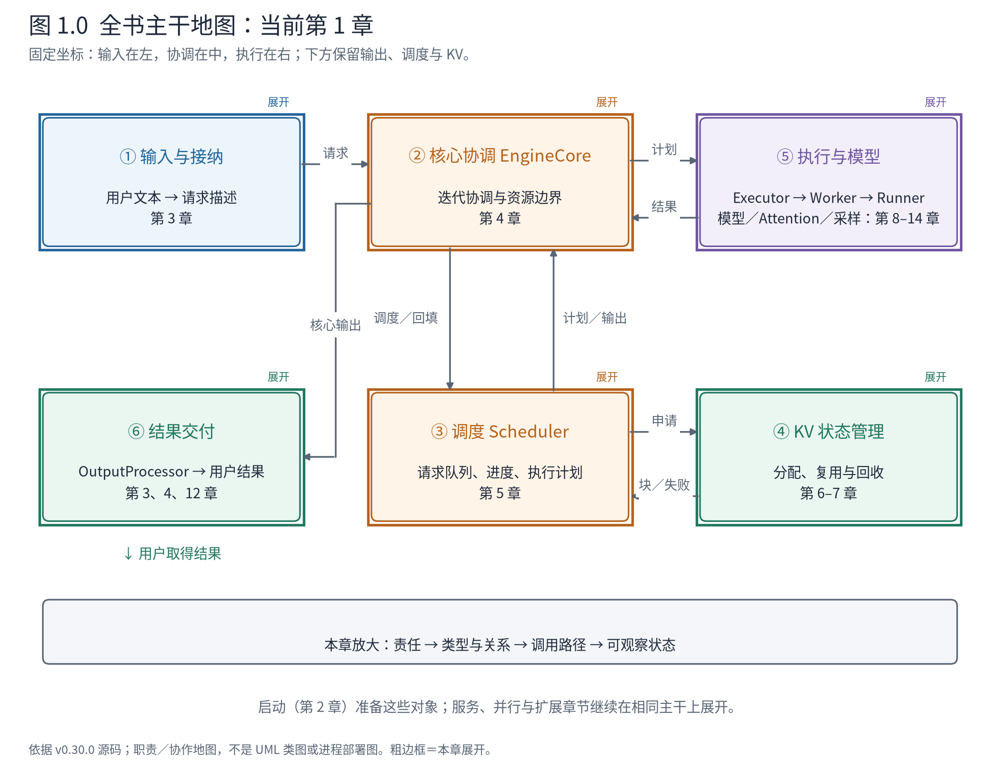
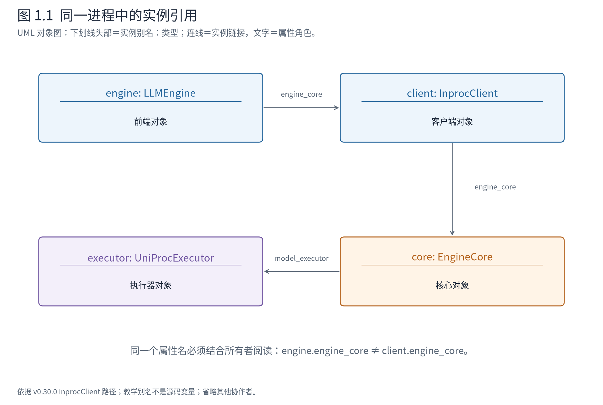

# 第 1 章 从架构地图进入源码

读完 Book7，你已经能解释 vLLM 中前端、核心、调度器、KV 管理器与执行层的分工。现在打开源码，一个新的困难出现了：图上的一个组件，可能对应多个类；一个名为 `engine_core` 的属性，可能并不是核心本体；一次用户调用，也不一定与一次设备计算对应。

本书要解决的正是这段距离。我们不会从文件第一页开始翻译，也不会要求你记住所有分支。我们沿一组短请求，观察职责如何落到对象、接口如何落到调用、状态如何在边界上改变。每次放大局部之前，先保留全局坐标。



**先在地图上定位。** 六个位置将在各章保持不变：①接纳输入，②协调迭代，③决定工作，④管理 KV，⑤组织并完成模型计算，⑥交付结果。本章建立阅读方法，因此先看整张图；第 2 章看它如何装配，第 3 章把一条请求交进去。灰显表示暂时折叠，不表示该组件没有运行。地图上的职责箭头也不等于进程间消息，部署视图会另行标明。

## 1.1 源码阅读需要四种坐标

假设你读到 `self.engine_core.add_request(request)`。这行代码并没有回答全部问题。首先要知道当前的 `self` 是谁；然后确认 `engine_core` 引用什么对象；再检查实际类型实现的 `add_request`；最后才判断它改变了什么状态。

把这几个问题固定下来，源码就有了可反复使用的阅读坐标：

| 坐标 | 要确认的问题 | 可观察的依据 |
|---|---|---|
| 职责 | 它负责接纳、调度、执行还是交付？ | 全局地图、接口的输入输出 |
| 结构 | 谁持有它，它继承谁，哪些状态归它维护？ | 类定义、构造函数、属性引用、UML 类图 |
| 控制流 | 谁调用它，什么条件下进入，是否跨进程？ | 调用树、分支条件、时序与部署图 |
| 状态 | 在这个停点，哪些值已改变，哪些工作尚在途？ | 对象快照、请求 ID、轮次与返回值 |

只保留控制流，容易把软件看成一串函数；只保留类图，又不知道对象何时真正协作。本书会把四种坐标放在同一案例上核对。例如，第 4 章会看到 `num_computed_tokens` 已增加，而模型尚未完成当轮执行。这个值没有错，错的是脱离写入时点解释它。

这也决定了我们的源码停点。先读到一个接口的契约可以解释其输入输出，再决定是否继续进入内部实现。若当前正在理解请求登记，就暂时把 Attention 算子折叠；若正在研究块映射，则不要被 HTTP 参数解析拉走。折叠不是略过核心原理，而是让每章只打开完成当前推理所需的部分。

## 1.2 类名、属性名与实际对象不是同一件事

在前端中，`LLMEngine.engine_core` 保存的是核心客户端。客户端提供提交请求、取得输出和中止等操作，但实现可以选择直接调用同进程核心，也可以发送消息给另一个进程。

下面节选客户端工厂的两个分支。工厂的作用是根据配置创建适合的实现，调用方通过共同的客户端契约使用它。

<!-- book:ch01-client:start -->
源码教学注释版，vllm v0.30.0：[原文件 L121–L129](https://github.com/vllm-project/vllm/blob/ced6857afa0ea7b2e3f0846a62e1394e90f15607/vllm/v1/engine/core_client.py#L121-L129)。仅新增 `# 【解读】`，其他内容保留原文。

```python
        # 【解读】上下文：异步多进程分支已在上文处理；这里检查同步多进程配置。
        if multiprocess_mode and not asyncio_mode:
            # 【解读】构造 SyncMPClient，将配置与执行器类交给它；不是返回 EngineCore 本体。
            return SyncMPClient(
                vllm_config,
                executor_class,
                log_stats,
                renderer=renderer,
            )

        # 【解读】剩余有效配置走 InprocClient；同一个客户端契约可以由不同部署实现。
        return InprocClient(vllm_config, executor_class, log_stats)
```
<!-- book:ch01-client:end -->

两个分支都返回客户端，因此上层代码可以继续调用 `add_request`。但它们的执行含义不同：InprocClient 的方法可以直接进入核心对象；SyncMPClient 必须跨消息边界。**接口一致不意味着调用路径一致，更不意味着所有实现具有相同的阻塞行为。**

这是一种运行期多态：变量在接口层表达“一个核心客户端”，运行时实例决定操作如何实现。它让前端不用把每种部署的传输细节写进请求处理，但同时引入了需要分别验证的边界：消息序列化、取消到达顺序、远端错误传播，都不能通过同进程单步调试自动证明。



**图 1.1 怎样读。** 这是一张简化 UML 对象图，框头用“教学别名：实际类型”表示一个实例，而不是一个类定义；别名仅用于读图。实线链接标出相关属性引用。前端到客户端、客户端到核心是两条不同的链接，所以相同的 `engine_core` 名称必须连同所属对象一起读。图表示本书教学配置中的引用关系，不声称其他部署也能直接访问这些对象。

到运行现场，再用类型记录验证这个判断：

<!-- book:ch01-types:start -->
真实运行字段投影，保留字段名与值，省略无关项。来自[原始记录](evidence/baseline-inproc-traced/manifest.json)。

```json
{
  "effective": {
    "client": "vllm.v1.engine.core_client.InprocClient",
    "scheduler": "vllm_ascend.patch.platform.patch_balance_schedule.BalanceScheduler",
    "executor": "vllm.v1.executor.uniproc_executor.UniProcExecutor",
    "worker": "vllm_ascend.worker.worker.NPUWorker",
    "runner": "vllm_ascend.worker.v2.model_runner.NPUModelRunner",
    "balance_enabled": false
  }
}
```
<!-- book:ch01-types:end -->

记录告诉我们：客户端是 InprocClient；执行组织使用上游 UniProcExecutor；Worker 与 Runner 来自 Ascend；调度器实例也是 Ascend 包装类，但均衡功能关闭。接下来还要确认它的方法是否委托上游。第 5 章会读到这个真实分支，不能仅凭类名里的包前缀猜测实际算法。

源码阅读因此有两个相邻但不同的动作：**先确认对象类型，再确认当前方法的实现归属。** 继承、工厂和平台替换使第二步不可省略。上游源码仍是本书主线，平台分支用于解释这个运行现场如何映射到它。

## 1.3 调用树能说明什么，不能说明什么

在同进程教学配置中，前端取得一次输出的局部调用树可以写成：

```text
LLMEngine.step()
├─ InprocClient.get_output()
│  ├─ EngineCore.step_fn() 〔本例绑定 step〕
│  └─ EngineCore.post_step(...)
└─ OutputProcessor.process_outputs(...)
```

这是根据源码整理的控制流骨架，省略统计与中止处理，不是运行时采集的线程栈。缩进表示嵌套调用，同级项按本例先后顺序排列。若断点停在 `EngineCore.step` 内，前端与客户端的祖先调用尚未返回；后面的输出处理还没有开始。不能把整棵树的所有节点同时列为活动栈帧。

如果换成多进程，图就必须断开：

```text
前端进程：提交请求／等待输出
             │ 请求消息         ↑ 输出消息
             └────── 进程边界 ──┘
核心进程：接收请求 → 自己的推进循环 → 发送输出
```

这时需要按请求 ID 和消息契约关联两侧，而不是幻想有一条连续 Python 栈能够从前端单步到设备。第 4 章会展示真实对照：前端取结果的次数与核心迭代次数不能直接互换。

本书中的三种线因而各有用途：UML 关系线说明对象长期怎样组织；调用树说明方法怎样进入；时序图说明跨对象或跨进程的交互次序。你无需提前熟悉所有 UML 记号，首次使用时会解释；但必须先确认当前正在读哪一种图。

## 1.4 用足够小的请求看见真实状态

贯穿案例从两段普通补全文本开始：A 是 `The capital of France is`，B 是 `The largest ocean on Earth is`。它们分别有 5、6 个实际输入 token，最多生成 2、3 个新 token。随后加入 C：`The capital of Japan is`，观察一个新请求怎样进入已经运行的系统。

这个例子小到可以完整展示每轮计划和输出，却已经包含几个核心变化：多条请求共同执行、生成长度不同、一个请求先结束、预算导致分块、新请求等待后加入。进一步观察前缀复用、取消、并行和投机时，再改变必要条件。多模态与混合状态需要新的输入或模型分支，我们会明确切换，不用一个不具备能力的文本模型伪装覆盖全部功能。

基础运行使用显式同进程客户端、eager、同步调度和关闭前缀缓存，以便在每轮之间暂停。它们是观察条件，不是生产建议。模型仍在 NPU 上执行；将前端与核心放在一个进程，不等于用 Python 模拟推理引擎。配置、模型快照和日志入口见[基础实践与证据](实践与证据.md)。

看到 JSON 时，请先读其来源说明。真实运行字段投影保留原值，但可能只选择部分字段；探针添加的类型标识不一定是对象原有字段；集合、元组在 JSON 中的表示也不等于进程线上编码。对于无法在本机执行的分支，会明确标为源码推导或构造例，不填上一组看似真实的延迟数字。

## 1.5 从目录到设计问题

目录是一种检索工具，不是自动生成的教学顺序。下面这张导航表只说明“带什么问题进去”，不要求现在依次打开所有文件。

| 阅读问题 | 首先进入的源码区域 | 读懂后应拿到什么 |
|---|---|---|
| 一份用户需求如何登记 | `vllm/v1/engine/` | 身份、输入描述、核心与输出状态的关联 |
| 一轮如何推进、下轮算谁 | `engine/core.py`、`core/sched/` | 计划、执行返回和进度回填的契约 |
| KV 状态怎样跨轮存在 | `core/kv_cache_manager.py` 及相关管理器 | 请求逻辑位置、块元数据与设备存储的映射 |
| 计划怎样变成计算 | `executor/`、`worker/`、模型层与 Attention | 持久状态、当步批次、张量和算子的边界 |
| 功能如何扩展 | 服务、分布式、投机、结构化输出与 connector 等区域 | 哪个既有契约被扩展，哪些组件要共同改变 |

前半册先建立普通生成闭环，再逐步打开并发、服务、分布式和扩展功能。后半册不会把每个新功能重新讲成另一套引擎；我们始终问它修改了同一张地图上的哪个对象、协议或状态。

本章的阅读习惯可以落实为一句动作顺序：**定位责任，核对类型，跟踪调用，再检查状态。** 下一章先让这些对象存在起来。只有模型、设备和 KV 资源都完成相互一致的准备，后续 `add_request` 才有一台可工作的机器可以交付。

**源码停点：** 本章只读 [EngineCoreClient 的选择](https://github.com/vllm-project/vllm/blob/ced6857afa0ea7b2e3f0846a62e1394e90f15607/vllm/v1/engine/core_client.py#L79-L129)与 [InprocClient 的引用和操作](https://github.com/vllm-project/vllm/blob/ced6857afa0ea7b2e3f0846a62e1394e90f15607/vllm/v1/engine/core_client.py#L333-L374)。知道接口背后有实现选择即可，暂不进入 ZMQ 传输内部。职责背景可对照[官方架构说明](https://docs.vllm.ai/en/v0.30.0/design/arch_overview/)。
