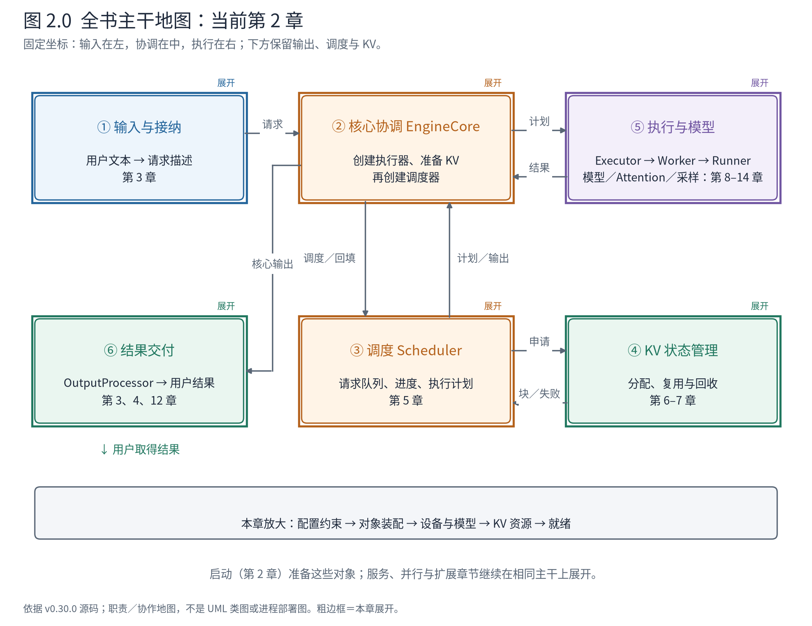
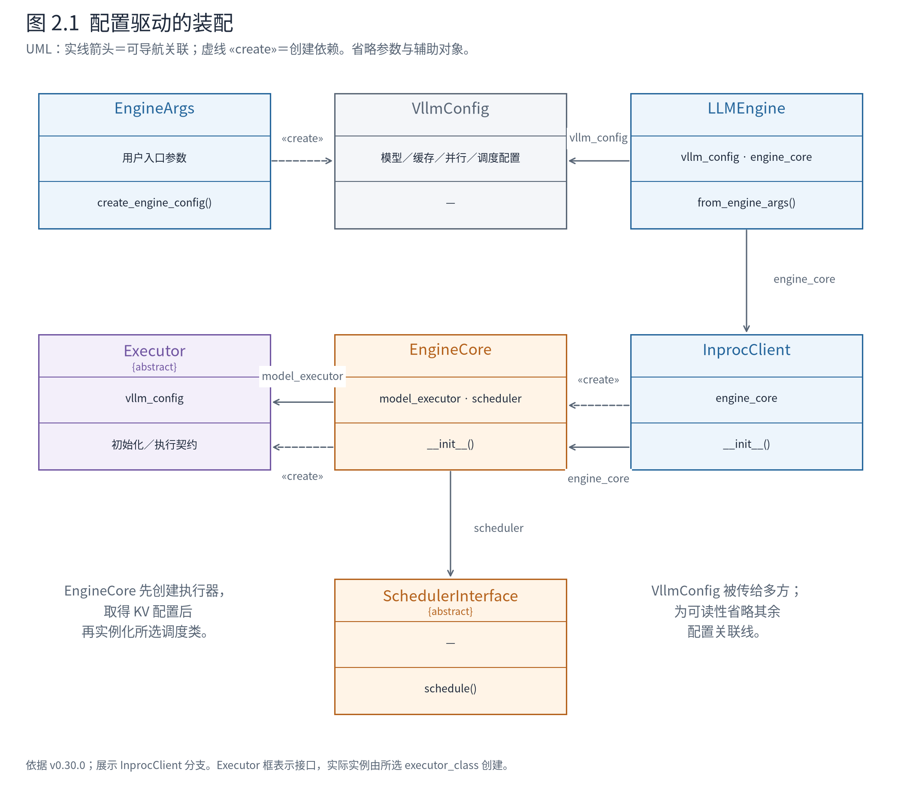
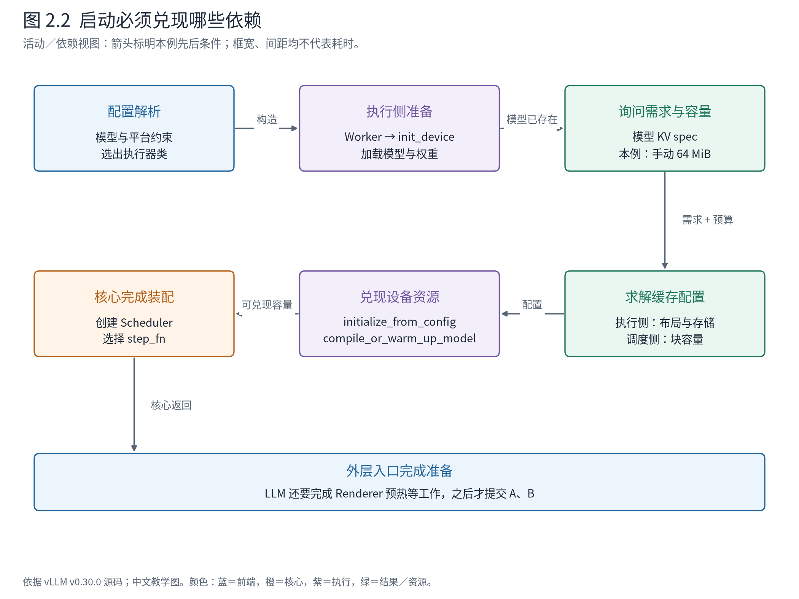

# 第 2 章 引擎怎样完成装配与资源准备

创建一个 `LLM` 对象，看起来只是传入模型路径和几个参数。但构造返回之前，系统必须回答一组彼此关联的问题：模型是什么，使用哪个执行实现，设备怎样初始化，权重在哪里，KV 能保存多少位置，调度器应遵守怎样的限制？

这些问题不能独立决定。模型决定 KV 的需求，平台约束布局与块大小，可用内存限制容量，容量又可能影响有效模型长度。如果只把启动代码读成一串初始化方法，就会错过本章真正的设计：**把分散的选择变成一套能够共同成立的运行约束，再交给长期存活的对象。**



**先在地图上定位。** 六个位置与第 1 章相同。启动横跨这些职责，当前没有用户请求穿过它们；我们关注谁创建谁、哪些资源准备必须先完成。本章出口是一台已经就绪的引擎，第 3 章才向①提交 A、B。

## 2.1 配置先建立约束，再决定实现

入口参数表达用户意图，例如模型路径、最大长度、并行规模和是否使用 eager。`EngineArgs` 将这些入口参数组织起来，`create_engine_config` 再形成 `VllmConfig`。后者包含模型、缓存、调度、并行、编译等配置，是多个子系统共同使用的约束集合。

它不是一份完全不变的用户参数复印件。默认值解析、模型识别、平台约束和资源准备都可能使最终有效值与最初传入值不同。于是调试启动时，应当同时保留“请求了什么”与“最后生效了什么”，而不是只截取命令行。

在前端装配入口，可以直接看到配置先于实现选择：

<!-- book:ch02-config:start -->
源码教学注释版，vllm v0.30.0：[原文件 L175–L191](https://github.com/vllm-project/vllm/blob/ced6857afa0ea7b2e3f0846a62e1394e90f15607/vllm/v1/engine/llm_engine.py#L175-L191)。仅新增 `# 【解读】`，其他内容保留原文。

```python
        # Create the engine configs.
        # 【解读】把入口参数解析成有效系统配置；模型、调度、并行等约束在这里形成关联。
        vllm_config = engine_args.create_engine_config(usage_context)
        # 【解读】按已经解析的配置选出执行器类，暂时还不是一个已创建的执行器实例。
        executor_class = Executor.get_class(vllm_config)

        # 【解读】环境变量可以启用前端／核心多进程；不能只看调用参数默认值判断部署。
        if envs.VLLM_ENABLE_V1_MULTIPROCESSING:
            logger.debug("Enabling multiprocessing for LLMEngine.")
            enable_multiprocessing = True

        # Create the LLMEngine.
        # 【解读】用有效配置与所选类构造 LLMEngine，后续协作者在构造过程中装配。
        return cls(
            vllm_config=vllm_config,
            executor_class=executor_class,
            log_stats=not engine_args.disable_log_stats,
            usage_context=usage_context,
            stat_loggers=stat_loggers,
            # 【解读】此标志决定客户端形态；离线入口仍可能采用多进程。
            multiprocess_mode=enable_multiprocessing,
        )
```
<!-- book:ch02-config:end -->

`Executor.get_class` 返回一个类，后面才会实例化它。类是构造与行为的定义，对象才承担一次引擎生命周期中的状态。这种两步装配允许同一个前端选择单设备或其他执行组织方式，同时让初始化逻辑继续传递一份共同的配置。

代价是配置的耦合必须被检查。某个参数在单卡文本生成中有效，并不说明它与所有平台、图执行、并行和扩展组合都兼容。校验应尽可能在接纳用户请求之前发生，否则运行中才发现无法分配状态，会把配置错误变成请求失败。



**图 2.1 怎样读。** 虚线创建依赖说明某个装配入口会产生哪类对象，实线关联说明对象长期保存什么。类图省略启动后才需要理解的成员。EngineCore 接收执行器类参数，再创建执行器实例；调度类从配置中选择，实例化时使用已经准备的 KV 配置。不是所有依赖都由一个外部容器预先创建，也不是 EngineCore 继承了执行器。

这可以理解为**配置驱动的装配**。它把实现选择集中到边界上，使运行中的迭代循环主要面向已有协作者；同时也要求读者将“构造时如何选择”和“运行时怎样调用”分开阅读。第 4 章的类关系，是本章装配完成后的结果。

## 2.2 从构造入口走到真正的执行对象

本书基础运行显式选择 InprocClient，因此可以把关键启动路径整理成同一进程内的调用树。下面依据固定源码展开，省略参数解析的内部细节、日志和扩展分支；它不是运行时栈采集。

```text
LLM.__init__
└─ LLMEngine.from_engine_args
   ├─ EngineArgs.create_engine_config          → VllmConfig
   ├─ Executor.get_class                      → 执行器类
   └─ LLMEngine.__init__
      ├─ 装配 Renderer / InputProcessor / OutputProcessor
      └─ EngineCoreClient.make_client
         └─ InprocClient.__init__
            └─ EngineCore.__init__
               ├─ executor_class(config)
               │  └─ UniProcExecutor._init_executor
               │     ├─ WorkerWrapperBase.init_worker
               │     ├─ init_device
               │     └─ load_model
               ├─ _initialize_kv_caches
               │  ├─ 取得 KV spec 与可用容量
               │  ├─ 生成工作侧与调度侧 KV 配置
               │  ├─ initialize_from_config
               │  └─ compile_or_warm_up_model
               └─ 创建 Scheduler，选择 step_fn
```

树的最后一行汇总核心构造的相关阶段，不表示两个动作紧邻、没有其他初始化。多进程配置必须在客户端启动核心进程处断开，再从核心进程入口继续，不能直接沿用整棵同线程调用树。

先看核心初始化的前半段：

<!-- book:ch02-core:start -->
源码教学注释版，vllm v0.30.0：[原文件 L133–L149](https://github.com/vllm-project/vllm/blob/ced6857afa0ea7b2e3f0846a62e1394e90f15607/vllm/v1/engine/core.py#L133-L149)。仅新增 `# 【解读】`，其他内容保留原文。

```python
        # Setup Model.
        # 【解读】实例化执行器；本例的 UniProcExecutor 会继续创建 Worker、初始化设备并加载模型。
        self.model_executor = executor_class(vllm_config)
        self._pooler_config_logged = False
        # 【解读】若调用者提供执行失败回调，将其登记到执行器，准备传播运行故障。
        if executor_fail_callback is not None:
            self.model_executor.register_failure_callback(executor_fail_callback)

        # 【解读】容量初值 -1 表示尚未确定，不能拿它参与调度。
        self.available_gpu_memory_for_kv_cache = -1

        # 【解读】弹性扩容有专门准备路径；本例不开启。
        if envs.VLLM_ELASTIC_EP_SCALE_UP_LAUNCH:
            self._eep_scale_up_before_kv_init()

        # Setup KV Caches and update CacheConfig after profiling.
        # 【解读】模型已经存在，才能取得 KV 需求并准备实际资源；返回的是调度侧 KV 配置。
        kv_cache_config = self._initialize_kv_caches(vllm_config)
        # 【解读】创建结构化输出管理对象，不意味着每个请求都启用语法约束。
        self.structured_output_manager = StructuredOutputManager(vllm_config)

        # Setup scheduler.
        # 【解读】从配置选择 Scheduler 类；其实例还要使用刚准备的 KV 配置。
        Scheduler = vllm_config.scheduler_config.get_scheduler_cls()
```
<!-- book:ch02-core:end -->

这里先创建执行器，再准备 KV，最后才取得调度器类。顺序并非偶然：如果模型尚未存在，系统还不能可靠地询问模型需要怎样的 KV 状态；如果缓存容量尚未决定，调度器也没有可依据的资源边界。

这并不意味着每个构造函数只分配几个 Python 字段。`executor_class(vllm_config)` 的调用中已经可能发生设备初始化和权重加载。读到一个构造调用时，应追问它是否只创建描述对象，还是同时获取了昂贵资源。混淆两者，就会误判启动耗时和失败位置。

## 2.3 Worker 是设备资源的执行入口

在单设备执行器中，Worker 由包装对象初始化。包装层使上层能够用统一方法名分派工作，但它并不是 NPU 或 GPU 设备本身。实际 Worker 由运行配置和平台选择决定。

<!-- book:ch02-worker:start -->
源码教学注释版，vllm v0.30.0：[原文件 L68–L75](https://github.com/vllm-project/vllm/blob/ced6857afa0ea7b2e3f0846a62e1394e90f15607/vllm/v1/executor/uniproc_executor.py#L68-L75)。仅新增 `# 【解读】`，其他内容保留原文。

```python
        # 【解读】通过 WorkerWrapperBase 装配实际 Worker 类型；平台会影响这个实现选择。
        self.driver_worker.init_worker(all_kwargs=[kwargs])
        # 【解读】先建立设备与相关执行环境，再加载模型。
        self.driver_worker.init_device()

        # 【解读】弹性 EP 扩容另有调用方式；普通启动进入 else 分支。
        if envs.VLLM_ELASTIC_EP_SCALE_UP_LAUNCH:
            self.driver_worker.elastic_ep_execute("load_model")
        else:
            # 【解读】委托 Worker 加载模型；权重加载机制在第 10 章打开。
            self.driver_worker.load_model()
        # 【解读】所选平台与后端还可能约束块大小；用户请求值不是最终有效值的全部来源。
        current_platform.update_block_size_for_backend(self.vllm_config)
```
<!-- book:ch02-worker:end -->

三步的依赖是明确的：先实例化实际 Worker，再建立设备上下文，随后加载模型。平台还可能在模型及后端选择之后调整块大小。因此，看到用户没有显式指定 block_size，不能推断核心将使用某个永远不变的默认值。

在本机，执行器仍是上游 UniProcExecutor，实际 Worker 是 NPUWorker。前者解决“如何组织调用”，后者解决“在这个平台上如何准备与执行”；模型对象、权重和注意力后端继续位于更深层。第 8–11 章会逐层打开这些边界，本章不把权重加载和算子适配混成一段构造流水账。



**图 2.2 怎样读。** 实线表示本教学路径中必须保持的准备顺序，不是耗时比例。上半部准备模型与设备，下半部根据资源形成有效容量并完成预热。Scheduler 需要的是能够兑现的容量描述，Worker 需要的是真实存储，两者在启动期建立一致视图。

## 2.4 从 KV 需求到两侧一致的容量

模型加载之后，核心通过执行器询问各 Worker 的 KV spec。spec 描述状态需要怎样的存储，而不是已经分配的张量。系统还需要知道各执行侧能够提供多少内存，才能把需求转成具体的块数量与布局。

通常，可用容量来自内存测算；但如果用户明确指定 KV 字节预算，实现可以走手动容量路径。我们当前的基础运行恰好指定了 64 MiB。原始 NPU 日志明确写出了这项选择并跳过自动 memory profiling，见[该次控制台记录](evidence/baseline-inproc-console.log)。因此本案例不能被描述成“先测出 64 MiB，再自动选择它”。也不能把关闭这一步测算推广为整个初始化没有任何试运行或预热。

拿到 spec 与容量后，核心生成配置：

<!-- book:ch02-layout:start -->
源码教学注释版，vllm v0.30.0：[原文件 L319–L333](https://github.com/vllm-project/vllm/blob/ced6857afa0ea7b2e3f0846a62e1394e90f15607/vllm/v1/engine/core.py#L319-L333)。仅新增 `# 【解读】`，其他内容保留原文。

```python
        # 【解读】结合模型的 KV spec 与各 Worker 可用字节，求出各执行侧的 KV 配置。
        kv_cache_configs = get_kv_cache_configs(
            vllm_config, kv_cache_specs, available_gpu_memory
        )
        # 【解读】为生成的配置附上已经确定的物理布局。
        for kv_cache_config in kv_cache_configs:
            kv_cache_config.kv_cache_layout = vllm_config.cache_config.kv_cache_layout

        # If auto-fit reduced max_model_len, sync the new value to workers.
        # This is needed because workers were spawned before memory profiling
        # and have the original (larger) max_model_len cached.
        # 【解读】容量推导可能反过来影响最大模型长度，所以比较推导前后的值。
        max_model_len_after = vllm_config.model_config.max_model_len
        # 【解读】仅当自动适配改变长度时同步 Worker，防止核心与执行侧约束不一致。
        if max_model_len_after != max_model_len_before:
            self.collective_rpc("update_max_model_len", args=(max_model_len_after,))

        # 【解读】由执行侧配置生成调度侧资源视图，两者用途不同。
        scheduler_kv_cache_config = generate_scheduler_kv_cache_config(kv_cache_configs)
        # 【解读】把有效块数量回写配置，后续观察应读取这个已解析的值。
        vllm_config.cache_config.num_gpu_blocks = scheduler_kv_cache_config.num_blocks
```
<!-- book:ch02-layout:end -->

这段代码同时展示了两个方向。向下，它为执行侧形成缓存配置；向上，它从这些配置归纳出调度器使用的资源视图，并把有效块数回写配置。若自动长度适配改变了最大长度，还要把变化同步给已创建的 Worker。

为什么需要两份视图？执行侧关心层、张量、布局和设备存储；调度侧关心请求能否获得足够块以及如何管理块的生命周期。它们合作管理同一项资源，却不需要共享同一个巨大对象。这减少了调度代码对具体张量实现的依赖，代价是两侧必须对块大小、块编号和可用容量作出一致解释。

基础运行在初始化之后记录了以下请求值和有效值：

<!-- book:ch02-effective:start -->
真实运行字段投影，保留字段名与值，省略无关项。来自[原始记录](evidence/baseline-inproc-traced/manifest.json)。

```json
{
  "requested_settings": {
    "max_model_len": 128,
    "max_num_seqs": 4,
    "max_num_batched_tokens": 32,
    "kv_cache_memory_bytes": 67108864,
    "enforce_eager": true
  },
  "effective": {
    "async_scheduling": false,
    "use_v2_model_runner": true,
    "block_size": 128,
    "num_gpu_blocks": 4
  }
}
```
<!-- book:ch02-effective:end -->

这里有三个不能相互替代的上限。`max_num_batched_tokens=32` 限制一轮工作量，`max_num_seqs=4` 限制调度中的活跃请求数量，`num_gpu_blocks=4` 描述有效物理块总量。最后一个名字沿用上游字段，在本机指 NPU 路径使用的配置值。块池还存在特殊块与具体分配规则，所以不能直接宣布“恰好可以同时服务四条任意请求”。第 6 章会打开这个总量背后的资源账本。

## 2.5 预热完成之后，才谈就绪

配置描述准备完，不代表设备上的资源已经存在。核心还要让执行侧按配置初始化，然后执行相应编译或预热：

<!-- book:ch02-ready:start -->
源码教学注释版，vllm v0.30.0：[原文件 L352–L356](https://github.com/vllm-project/vllm/blob/ced6857afa0ea7b2e3f0846a62e1394e90f15607/vllm/v1/engine/core.py#L352-L356)。仅新增 `# 【解读】`，其他内容保留原文。

```python
        # 【解读】校验最终块大小，尽早拒绝不满足约束的组合。
        vllm_config.validate_block_size()

        # 【解读】让执行侧据配置真正准备 KV 等资源，而不是只有一份描述。
        self.model_executor.initialize_from_config(kv_cache_configs)
        # 【解读】普通启动继续编译或预热；eager 关闭图执行，不代表完全没有预热。
        if not envs.VLLM_ELASTIC_EP_SCALE_UP_LAUNCH:
            self.model_executor.compile_or_warm_up_model()
```
<!-- book:ch02-ready:end -->

`enforce_eager=True` 在本书中用于简化图执行与编译路径，但它不意味着完全没有算子预热。真实日志中仍有 Triton kernel warmup。这里的设计目标是尽可能将模型和资源准备从请求主路径移走，使请求进入之后主要进行已准备对象之间的协作。

这也存在代价：启动更重，部分资源提前占用，最终可用形态必须在接纳流量之前确认。模型路径错误、平台不支持的后端、容量不足和暖机失败，应该根据所在阶段定位，而不是统称为“generate 失败”。例如，若权重加载已经完成但 KV 初始化失败，就应检查 spec、预算和布局，而不是首先怀疑输入文本。

核心末尾会根据批队列等配置绑定 `step_fn`，普通教学路径使用 `step`。更外层的 LLM 构造在引擎完成后还有 Renderer 预热等准备。因此“权重加载成功”“核心构造返回”“LLM 构造完成”是三个不同的停点。真正开始本书第 3 章时，我们选择最后一个：用于提交请求的入口对象已经构造完成。

## 2.6 把启动产物交给第一条请求

现在回到地图。①与⑥已具备输入处理和交付能力，②持有具体的调度与执行协作者，③拿到资源约束，④与⑤对 KV 容量和布局建立了对应。我们没有执行 A，却已经为它准备好了可遵守的契约。

读完启动源码，最值得保留的不是构造函数的数量，而是**配置选择、对象装配和资源兑现是三个连续阶段**。配置使各方的假设能够相容，对象让职责有具体承担者，资源准备使这些承诺可以真正执行。下一章沿 A 的文本进入这台已经就绪的机器，观察它如何从用户需求变成核心可以推进的工作。

**源码停点：** [LLMEngine 装配入口](https://github.com/vllm-project/vllm/blob/ced6857afa0ea7b2e3f0846a62e1394e90f15607/vllm/v1/engine/llm_engine.py#L164-L191)读到实现选择；[EngineCore 初始化](https://github.com/vllm-project/vllm/blob/ced6857afa0ea7b2e3f0846a62e1394e90f15607/vllm/v1/engine/core.py#L105-L250)按模型、KV、调度三项依赖阅读；[KV 准备](https://github.com/vllm-project/vllm/blob/ced6857afa0ea7b2e3f0846a62e1394e90f15607/vllm/v1/engine/core.py#L253-L356)先理解输入输出，暂不穷举所有 KV spec。模型层加载与设备存储分配细节在对应章节继续展开。
