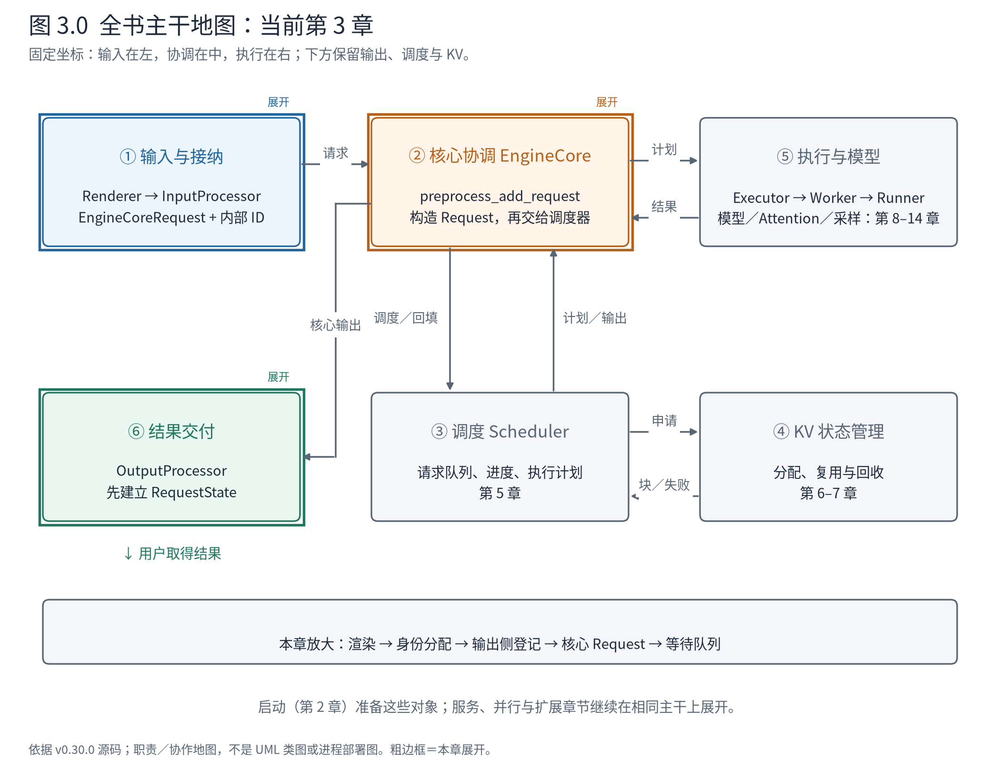
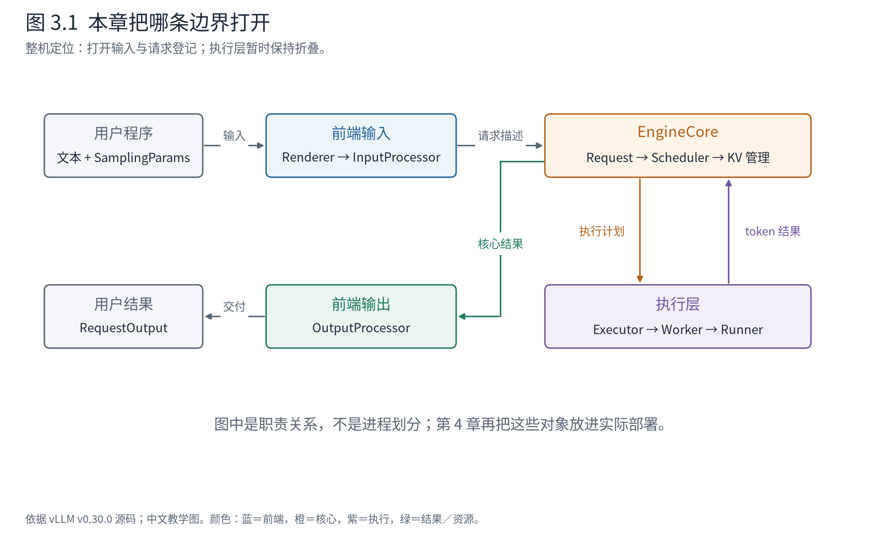
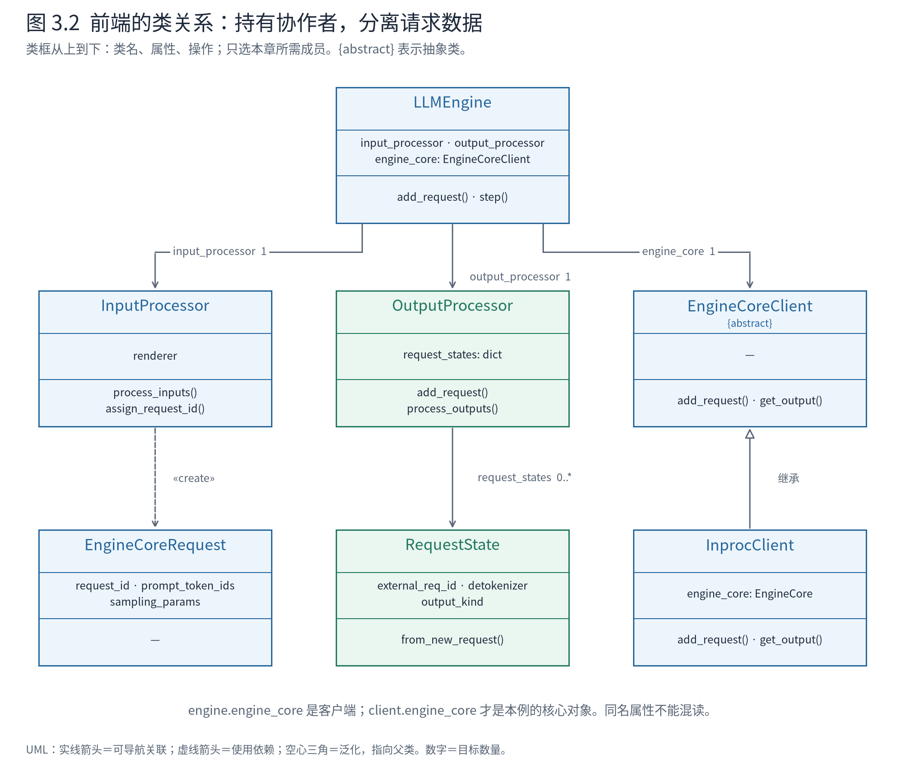
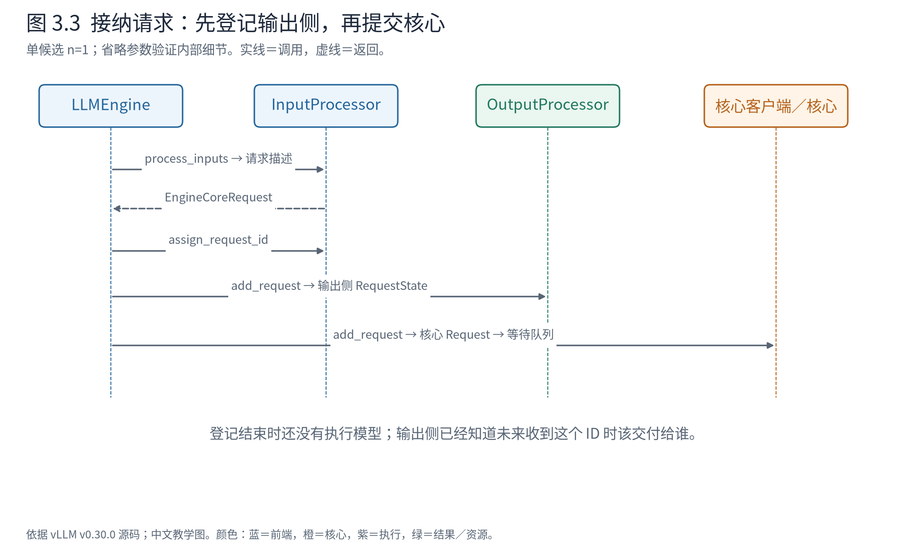

# 第 3 章 一条请求如何获得引擎中的身份

在 Book7 中，我们已经把 vLLM 看成一台协作的机器：前端接收需求，核心决定计算，执行层运行模型，结果再回到用户。现在把镜头推进到这台机器的入口。一段文本已经交给 vLLM，距离它第一次进入模型，中间还需要发生什么？

很容易给出“分词，然后加入队列”的回答。但当你打开源码，会遇到 `EngineCoreRequest`、`Request`、`RequestState`，还会看见相似的请求标识在不同对象里出现。如果只沿函数调用向下追，这些名字像是同一份数据被反复包装；如果只记住类名，又很难知道请求到底走到了哪里。

本章用两条真实请求把这些对象连起来。我们关心的是：**一份生成需求如何变成核心可以管理的工作，同时让前端保有正确交付结果的能力。** 到章末，请求已经登记，但模型还没有开始计算。下一章再让机器前进一步。



**先在地图上定位。** 后续章节沿用这六个位置，不因章节变化重新排列。实线箭头表达职责之间的交接，不代表这些组件都在同一进程。粗边框是本章展开的部分：输入描述、核心接纳，以及为返回预先建立的输出状态；调度和执行先折叠。沿图中①到②，请求获得核心身份；同时在⑥登记交付状态。本章出口是③中的等待请求，下一章才开始推进计算。

这张地图回答“读哪里”；后面的 UML 类图回答“对象怎样组织”，调用树回答“运行时怎样经过它们”。三个问题需要不同视图，不把一张调用链当作整个软件架构。

## 3.1 先确定我们要观察什么

让模型续写两句很短的英文：A 是 `The capital of France is`，B 是 `The largest ocean on Earth is`。A 最多生成 2 个 token，B 最多生成 3 个。选择短补全文本，是为了让每个 token 都能放进视野；这里不经过聊天模板，也不以回答质量作为实验目标。

使用 Qwen3-0.6B，模型快照、分词器和运行配置见[复现说明](实践与证据.md)。设置 `temperature=0`，并用 `ignore_eos=True` 让这个小实验按指定长度结束。实际服务通常需要尊重 EOS；这里的设置是为了固定观察窗口。

为逐轮停下来观察，样稿使用显式的 `InprocClient`：前端和 EngineCore 放在同一 Python 进程，模型仍在 NPU 上计算。关闭异步调度和图执行，关闭前缀缓存。这样，手动调用一次前端 `step()` 就能观察一次核心推进。第 4 章会与真实多进程配置对照。这个安排是教学观察条件，不是 vLLM 默认部署的描述。



**图 3.1 怎样读。** 先看上半部的输入方向：用户需求经过前端，成为核心的请求。再看下半部返回方向：执行层不会直接给用户拼接文本，结果要经核心与输出处理器返回。我们这一章只打开输入和登记边界；图中的执行层仍保持折叠。图据 v0.30.0 的 `LLMEngine` 与 `EngineCore` 绘制，表达职责，不表达进程数量。

探针不重写这些职责。它只在真实对象的方法前后记录字段，在调用返回的当时保存快照。因此下文的数据是一次真实运行的字段节选，不是为了讲故事手工填写的示例。

## 3.2 文本先成为模型输入，再成为核心请求

用户说的是“续写这段文字”，核心需要的却是“这条请求已知哪些 token，以什么参数生成”。中间有两个不同的转换。

第一步由 Renderer 负责。这里可以把它理解成**把用户输入组织成模型可接受的输入表示的对象**。普通补全主要涉及解析和分词；聊天、多模态会增加其他工作。在我们这条路径中，渲染后的输入已经带着 token 编号。

<!-- evidence:data:rendered_a:start -->
实测对象字段节选，[原始事件 1](evidence/baseline-inproc-traced/events.jsonl)；JSON 是阅读投影，保留原始字段值。

```json
{
  "type": "token",
  "prompt_token_ids": [785, 6722, 315, 9625, 374],
  "prompt": "The capital of France is"
}
```
<!-- evidence:data:rendered_a:end -->

留意原文和 token 列表的对应：A 的输入是 5 个 token，不是 5 个字符，也不是由本书根据英文单词数推算出来的数量。后面调度器计算的预算单位，就是这样实际进入模型的 token 位置。

第二步由 `InputProcessor` 负责。它在引擎语境中检查输入与生成参数，处理模型长度、功能和请求参数的约束，然后构造 `EngineCoreRequest`。它封装的是**提交给核心的一份生成需求描述**。

这两步不应合并成一句“InputProcessor 负责一切预处理”。本版 `process_inputs` 仍有接受原始 prompt 的兼容分支，但源码会发出弃用警告，并调用 Renderer。我们观测时直接把 `renderer.render_cmpl()` 的结果交给引擎，避免把兼容路径误讲成唯一主线。

`EngineCoreRequest` 的定义开头就能看出这种描述的轮廓：

<!-- evidence:source:core_request:start -->
源码教学注释版，vllm v0.30.0：[ `vllm/v1/engine/__init__.py`，原文件 L107–L122](https://github.com/vllm-project/vllm/blob/ced6857afa0ea7b2e3f0846a62e1394e90f15607/vllm/v1/engine/__init__.py#L107-L122)。仅插入 `# 【解读】` 注释，其余内容保留原文；行号指向原文件。

```python
# 【解读】这是提交给核心的数据结构；不是 Scheduler 维护进度的 Request。
class EngineCoreRequest(
    # 【解读】继承 msgspec.Struct；下面三个选项配置编码形式、默认值省略和 GC 跟踪。
    msgspec.Struct,
    array_like=True,  # type: ignore[call-arg]
    omit_defaults=True,  # type: ignore[call-arg]
    gc=False,
):  # type: ignore[call-arg]
    # 【解读】内部标识把提交、计算结果与前端状态关联起来。
    request_id: str
    # 【解读】已渲染的输入 token；可为空是为了容纳嵌入等其他输入路径。
    prompt_token_ids: list[int] | None
    # 【解读】多模态特征在本例为空；普通文本不需要进入该分支。
    mm_features: list[MultiModalFeatureSpec] | None
    # 【解读】生成参数与 pooling 参数服务不同任务；本例使用 sampling_params。
    sampling_params: SamplingParams | None
    pooling_params: PoolingParams | None
    # 【解读】到达时间用于请求记录；不是已经执行了多久。
    arrival_time: float
    # 【解读】LoRA、缓存隔离盐、DP 路由是扩展上下文，本例不启用。
    lora_request: LoRARequest | None
    cache_salt: str | None
    data_parallel_rank: int | None
    # 【解读】允许直接提交嵌入；它不等于本例的 token ID 列表。
    prompt_embeds: torch.Tensor | None = None
```
<!-- evidence:source:core_request:end -->

`prompt_token_ids` 给出输入内容，`sampling_params` 给出生成要求。其他字段容纳多模态、Pooling、LoRA 等能力；它们在当前案例中没有启用，不必现在追到每个分支内部。这里先抓住边界：**该对象说明要做什么，但还没有调度器逐轮推进这项工作所需的全部运行状态。**

类型定义使用 `msgspec.Struct`，并启用 `array_like=True`。读者暂时只需知道，它是适合序列化传递的结构化数据。本书把字段打印为 JSON，是便于人阅读的投影，不能据此断言进程消息在网络上也是这个 JSON 文本。

## 3.3 请求标识为什么会变

如果你在用户侧给请求取名为 A，随后在核心日志里搜索精确等于 `A` 的标识，可能会认为请求丢失了。实际上，前端在提交之前还做了一次身份分配：保存外部标识，再给内部标识增加随机后缀。

<!-- evidence:source:assign_id:start -->
源码教学注释版，vllm v0.30.0：[ `vllm/v1/engine/input_processor.py`，原文件 L260–L279](https://github.com/vllm-project/vllm/blob/ced6857afa0ea7b2e3f0846a62e1394e90f15607/vllm/v1/engine/input_processor.py#L260-L279)。仅插入 `# 【解读】` 注释，其余内容保留原文；行号指向原文件。

```python

    # 【解读】静态方法：只修改传入的请求描述，不读取 InputProcessor 实例状态。
    @staticmethod
    def assign_request_id(request: EngineCoreRequest):
        """Replace the externally supplied request ID with an internal request ID
        that adds 8 random characters in order to ensure uniqueness.
        """
        # 【解读】调用方不应自行填写 external_req_id；违规时拒绝，防止两套身份混用。
        if request.external_req_id is not None:
            raise ValueError(
                "The external_req_id field should not be set on EngineCoreRequests"
                " passed to vLLM; use the request_id field."
            )
        # 【解读】先保存外部名称 A，后续对用户返回仍要使用它。
        request.external_req_id = request.request_id
        # 【解读】兼容开关允许关闭随机化，但会报警；本次实验未开启这个开关。
        if envs.VLLM_DISABLE_REQUEST_ID_RANDOMIZATION:
            logger.warning_once(
                "VLLM_DISABLE_REQUEST_ID_RANDOMIZATION is set and will be "
                "removed in a future release. Duplicate externally-provided "
                "request IDs may cause failures and/or subtle correctness errors."
            )
        # 【解读】正常分支追加八位随机后缀；本次 A 变成 A-93858a1e。
        else:
            request.request_id = f"{request.external_req_id}-{random_uuid():.8}"
```
<!-- evidence:source:assign_id:end -->

这段代码有两个值得停下来的地方。首先，`external_req_id` 保留用户侧的名字；其次，`request_id` 成为引擎内部关联工作的名字。这里没有更换请求的内容，而是在区分两个命名空间。

本次 A 完成身份分配后如下：

<!-- evidence:data:identified_a:start -->
实测对象字段节选，[原始事件 3](evidence/baseline-inproc-traced/events.jsonl)；JSON 是阅读投影，保留原始字段值。

```json
{
  "request_id": "A-93858a1e",
  "external_req_id": "A",
  "prompt_token_ids": [785, 6722, 315, 9625, 374],
  "sampling_params": {
    "temperature": 0,
    "max_tokens": 2,
    "ignore_eos": true,
    "output_kind": "CUMULATIVE"
  }
}
```
<!-- evidence:data:identified_a:end -->

后文正文为了叙述简洁称它为“A”，所有原始记录仍保留这里的真实内部 ID。重新运行时随机后缀通常不同，应通过外部与内部标识的映射对齐，而不是要求每次日志逐字相同。

默认增加随机后缀，能降低外部名称重复带来的内部冲突；代价是调试时必须维护映射，取消和输出交付也要处理两个名字。这个小方法已经体现了源码阅读的一项习惯：**相同含义的“身份”，可能在不同边界有不同表示。** 不要只看字段都叫 ID，就假定它们能在任何层互换。

## 3.4 三种对象为什么各有必要

现在看登记的关键代码。在本例的 `n=1` 分支中，前端先建立输出状态，再把请求交给核心客户端。

<!-- evidence:source:register:start -->
源码教学注释版，vllm v0.30.0：[ `vllm/v1/engine/llm_engine.py`，原文件 L271–L285](https://github.com/vllm-project/vllm/blob/ced6857afa0ea7b2e3f0846a62e1394e90f15607/vllm/v1/engine/llm_engine.py#L271-L285)。仅插入 `# 【解读】` 注释，其余内容保留原文；行号指向原文件。

```python
        # 【解读】上下文：LLMEngine.add_request 已取得 EngineCoreRequest，现在分配内部身份。
        self.input_processor.assign_request_id(request)

        # 【解读】保存内部 ID，作为本方法最后返回给调用方的关联键。
        req_id = request.request_id

        # Use cloned params that may have been updated in process_inputs()
        # 【解读】读取输入处理后可能已克隆、修正的参数，不再拿原始用户参数作准。
        params = request.params

        # 【解读】n 是单条请求的候选数量；pooling 不走多候选生成，本例 n=1。
        n = params.n if isinstance(params, SamplingParams) else 1

        # 【解读】这里只节选单候选路径；多候选分支在片段之外。
        if n == 1:
            # Make a new RequestState and queue.
            # 【解读】先建立输出侧 RequestState：未来收到 token 时必须已有交付状态。
            self.output_processor.add_request(request, prompt_text, None, 0)
            # Add the request to EngineCore.
            # 【解读】engine_core 此处是客户端，具体为 InprocClient；并非直接的 EngineCore 属性。
            self.engine_core.add_request(request)
            # 【解读】返回内部 ID 只表示完成提交，不表示模型已经执行。
            return req_id
```
<!-- evidence:source:register:end -->

这里的 `n` 是一条请求要生成的候选数量，不是这次提交了几个 prompt。我们有 A、B 两条请求，每条都只有一个候选。`n>1` 会涉及子请求与父请求的关联，暂不把这条支路带入当前案例。

为什么要在计算之前先登记输出状态？因为一旦核心开始返回 token，前端必须知道这些 token 属于谁、对应什么原始输入、怎样累积和交付。先建立返回所需的状态，后启动工作，使两条方向相反的数据流在同一个 ID 上闭合。



**图 3.2 怎样读。** 类框依次列类名、属性和操作，只展示本章有关的成员。实线箭头是**可导航关联（association）**：一个对象保存通向另一个对象的引用；虚线箭头是**依赖（dependency）**：创建或调用时需要某个类型，并不因此长期保存它。空心三角是**泛化（generalization）**，从子类指向父类。`1` 与 `0..*` 是目标端的数量，不是调用次数。图中的抽象类使用 `{abstract}` 标记，Python 源码通过 `ABC` 等机制表达其约束。

先看最上方。`LLMEngine` 保存 `input_processor`、`output_processor` 和 `engine_core` 三个协作者引用，通过它们委托工作。这是 **has-a 的对象协作**，不是 LLMEngine 继承了三种能力。尤其注意 `engine_core` 这个属性的类型是 `EngineCoreClient`；在本例里，它引用 `InprocClient`，后者自己的 `engine_core` 才指向真正的核心。源码中同名属性必须连同所属对象一起读。

再看下方两条不同的边。InputProcessor 创建 `EngineCoreRequest`，所以画创建依赖；OutputProcessor 用 `request_states` 长期索引活跃的 `RequestState`，所以画带 `0..*` 多重性的关联。输出侧登记一条请求，就增加一个交付状态；完成或中止时再删除。图没有把每个 `self.x` 都画成带黑菱形的 UML **组合（composition）**：组合还表达更强的整体—部分与生命周期约束，仅凭保存引用不足以证明这些条件。

这里的设计可以用**协调对象、边界数据与会话状态**三个概念理解。LLMEngine 组织协作者；EngineCoreRequest 是跨前端／核心边界的数据传输对象（DTO），承载生成需求；RequestState 保存交付过程中的状态，核心 Request 则保存计算工作的进度。DTO 是本书对其设计角色的归纳，不是源码额外声明的基类。分离这些角色，使输入校验的变化无需变成调度器里的文本处理逻辑；代价是字段转换、身份关联和结束通知必须一致。

这些关系可以直接在 [LLMEngine 的装配代码](https://github.com/vllm-project/vllm/blob/ced6857afa0ea7b2e3f0846a62e1394e90f15607/vllm/v1/engine/llm_engine.py#L102-L131)、[输出状态的登记](https://github.com/vllm-project/vllm/blob/ced6857afa0ea7b2e3f0846a62e1394e90f15607/vllm/v1/engine/output_processor.py#L564-L588)和 [InprocClient 定义](https://github.com/vllm-project/vllm/blob/ced6857afa0ea7b2e3f0846a62e1394e90f15607/vllm/v1/engine/core_client.py#L333-L359)核对。类图说明持有与类型关系；下面再对照实例内容，避免只记住抽象名词。

输出侧 `RequestState` 封装的是**一次结果交付过程**。它保留外部标识、原始 prompt、输出方式，以及反分词器等对象。这个状态由 `OutputProcessor` 的 `request_states` 保存。本例登记后的字段是：

<!-- evidence:data:output_state_a:start -->
实测对象字段节选，[原始事件 4](evidence/baseline-inproc-traced/events.jsonl)；JSON 是阅读投影，保留原始字段值。

```json
{
  "type": "vllm.v1.engine.output_processor.RequestState",
  "request_id": "A-93858a1e",
  "external_req_id": "A",
  "prompt": "The capital of France is",
  "prompt_token_ids": [785, 6722, 315, 9625, 374],
  "prompt_len": 5,
  "max_tokens_param": 2,
  "output_kind": "CUMULATIVE",
  "is_prefilling": true,
  "sent_tokens_offset": 0
}
```
<!-- evidence:data:output_state_a:end -->

`output_kind=CUMULATIVE` 意味着后续向用户返回的 token 可以包含此前已生成的部分；它不是指调度器要重复计算所有 token。`prompt_len` 是输入长度，不是执行进度。`is_prefilling` 属于输出处理语境，不能拿它替代核心的队列状态。不同对象里的相似字段，要连同使用者一起理解。

另一侧，核心把输入描述转换成 `vllm.v1.request.Request`。这一步从 `EngineCore.preprocess_add_request` 进入，调用 `Request.from_engine_core_request`；核心随后将其交给 Scheduler。`Request` 封装的是**一次尚未完成的推理工作及其可变进度**，而不仅是用户最初传入的参数。

<!-- evidence:data:core_request_a:start -->
实测对象字段节选，[原始事件 6](evidence/baseline-inproc-traced/events.jsonl)；JSON 是阅读投影，保留原始字段值。

```json
{
  "type": "vllm.v1.request.Request",
  "request_id": "A-93858a1e",
  "status": "WAITING",
  "prompt_token_ids": [785, 6722, 315, 9625, 374],
  "output_token_ids": [],
  "num_computed_tokens": 0,
  "num_in_flight_tokens": 0,
  "max_tokens": 2
}
```
<!-- evidence:data:core_request_a:end -->

此时 `status=WAITING`，计算进度和在途 token 都为零，输出列表为空。输入虽然已是 token，但尚未跑过模型。`max_tokens=2` 限制的是生成数量，不是这个请求总共只需要处理两个输入 token。

三个对象各自回答的问题可以这样区分：

| 对象 | 谁使用和维护 | 它回答的问题 |
|---|---|---|
| `EngineCoreRequest` | 前端创建，经核心客户端交付 | 用户提交了怎样的生成需求？ |
| 核心 `Request` | 核心建立，Scheduler 推进其状态 | 这项工作还差多少、现在能否推进、是否结束？ |
| 输出侧 `RequestState` | `OutputProcessor` | 新结果应如何反分词、累积并交还用户？ |

这不是绝对没有重复字段的设计。请求 ID 和部分 token 信息会出现在多个表示中。拆开以后，调度器不必承担文本交付职责，输出处理器也不必理解 KV 块分配；代价是必须建立清楚的身份映射、消息契约和结束通知。只说“职责分离”还不够，源码中的这些重复与协调成本，也是设计的一部分。

## 3.5 登记成功意味着什么

把上面的动作重新按时间连起来，就得到这张登记时序图。



**图 3.3 怎样读。** 从上往下看，前端先获得输入描述，再分配身份，然后先登记输出侧、后提交核心侧。右侧把客户端到核心的细节折叠起来；在本章 InprocClient 配置中它是直接调用，在多进程部署中会跨消息边界。图示只覆盖单候选正常接纳。

在源码编辑器里，可以按下面这棵树展开。**它是依据 v0.30.0 源码整理的调用树，不是某一时刻采集的线程堆栈**；同级节点按本例发生顺序排列，前一个调用返回后才进入后一个。省略参数校验、统计与探针包装层，只保留单候选、普通文本、首次提交、InprocClient 的路径。

```text
观测脚本提交 A
├─ renderer.render_cmpl(...)                  → 已分词输入
└─ LLMEngine.add_request(...)
   ├─ InputProcessor.process_inputs(...)     → EngineCoreRequest
   ├─ InputProcessor.assign_request_id(...)  → 内部 ID
   ├─ OutputProcessor.add_request(...)
   │  └─ RequestState.from_new_request(...)  → 存入 request_states
   └─ InprocClient.add_request(...)
      ├─ EngineCore.preprocess_add_request(...)
      │  └─ Request.from_engine_core_request(...) → 核心 Request
      └─ EngineCore.add_request(...)
         └─ Scheduler.add_request(...)
            └─ _enqueue_waiting_request(...) → waiting，并登记 requests
```

例如停在 `Scheduler.add_request` 内部时，左侧祖先路径说明“谁把我们带到这里”；此前 `OutputProcessor.add_request` 已经返回，不应再算作当前活动栈帧。换成多进程客户端后，树要在客户端发送请求的位置截断，再从核心进程的消息接收入口开始画另一棵树。前端和核心之间没有一条可以直接单步跨过去的 Python 调用栈。

现在把调用树的末端与真实对象对应。提交 A、B 之后、尚未调用第一次 `step()` 之前，核心中出现以下状态：

<!-- evidence:data:admitted:start -->
实测对象字段节选，[原始事件 15](evidence/baseline-inproc-traced/events.jsonl)；JSON 是阅读投影，保留原始字段值。

```json
{
  "waiting": ["A-93858a1e", "B-9078dc24"],
  "running": [],
  "requests": {
    "A-93858a1e": {
      "status": "WAITING",
      "num_computed_tokens": 0,
      "num_in_flight_tokens": 0
    },
    "B-9078dc24": {
      "status": "WAITING",
      "num_computed_tokens": 0,
      "num_in_flight_tokens": 0
    }
  }
}
```
<!-- evidence:data:admitted:end -->

等待队列保存的是待处理请求的顺序；`requests` 是按 ID 管理活跃请求的索引；`running` 此时为空。不要把这些容器想成三份互不相关的请求副本：同一个核心 Request 可以由请求索引和相应队列共同引用，它们服务于查找与调度这两类操作。

这个现场能纠正一个常见直觉：**“引擎接受了请求”不等于“设备已经开始计算”。** 接纳先建立身份、状态和返回路径，计算机会要由后续调度决定。于是引擎可以让多个请求先进入系统，再根据资源把它们组织进不同轮次。

本轮使用引擎的 `add_request` 与 `step` 接口，目的是在接纳和计算之间停下来。平常的 `LLM.generate` 会替用户组织这些推进动作，并在满足其返回契约后交付结果；读者不必为了使用 vLLM 自己实现这个循环。

## 3.6 带着身份与职责继续往下读

走到这里，A、B 仍未进入模型，但它们已经获得三件关键东西：核心可以管理的工作对象、前端可以交付结果的状态，以及贯穿两侧的身份关联。

以后再遇到一个名为 Request 的类，先问它处在哪个边界。它是描述需求的消息，还是维护执行进度的对象，抑或维护输出生命周期的对象？这个问题比背下完整字段列表更能帮助你读懂后续代码。

下一章将调用一次 `step()`。我们会看到 A 的计算进度从 0 变成 5，却不会立刻把这个变化解释成“模型已经执行完”。要理解这个看似奇怪的时刻，必须打开 EngineCore 的协调循环。

**源码阅读到这里即可停下：** [LLMEngine.add_request](https://github.com/vllm-project/vllm/blob/ced6857afa0ea7b2e3f0846a62e1394e90f15607/vllm/v1/engine/llm_engine.py#L223) 看两个登记方向；[InputProcessor](https://github.com/vllm-project/vllm/blob/ced6857afa0ea7b2e3f0846a62e1394e90f15607/vllm/v1/engine/input_processor.py#L260) 看身份分配和输入描述；[核心转换](https://github.com/vllm-project/vllm/blob/ced6857afa0ea7b2e3f0846a62e1394e90f15607/vllm/v1/engine/core.py#L980) 看描述如何变成 Request。暂不进入多模态和多候选内部。设计背景参见[官方架构说明](https://docs.vllm.ai/en/v0.30.0/design/arch_overview/)，接口事实以这里的固定源码为准。
