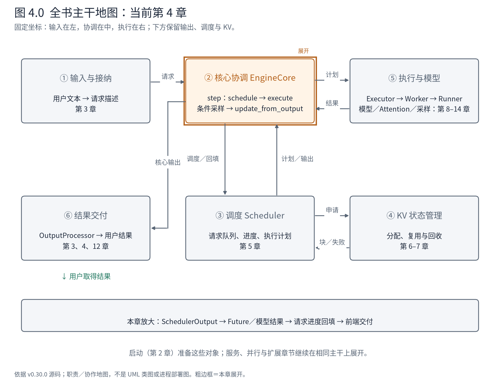
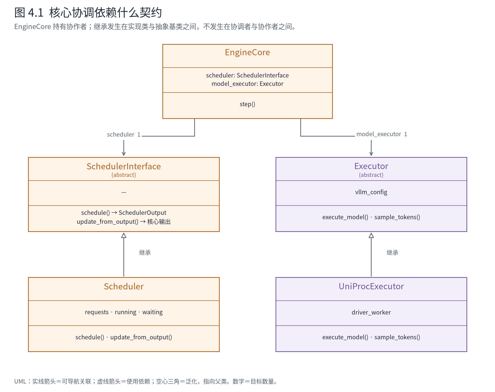
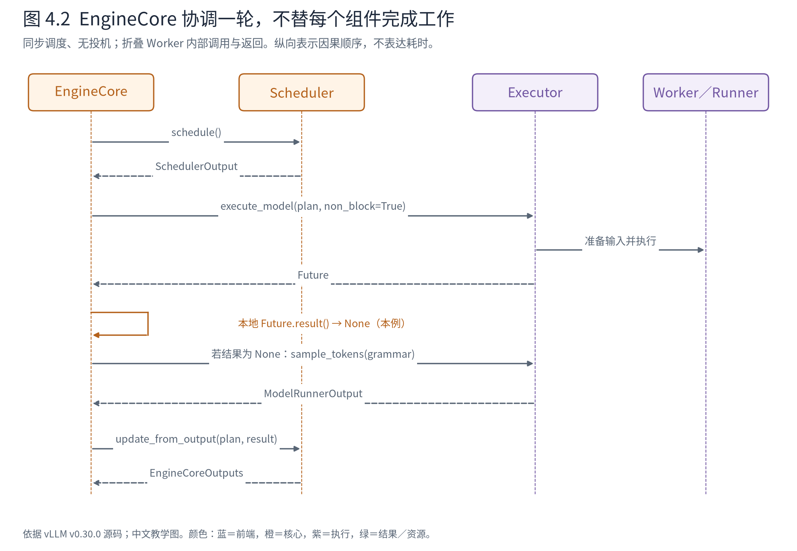
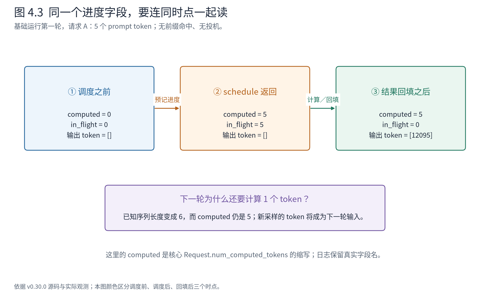
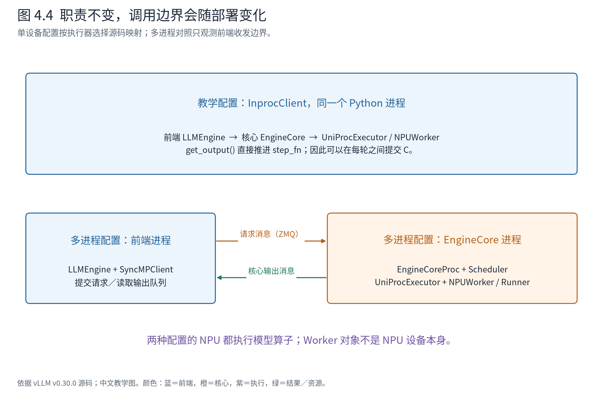

# 第 4 章 EngineCore 如何推进一轮计算

上一章结束时，A、B 已经进入等待队列。前端知道将来怎样交付它们的结果，核心也有了可以维护的 Request，但模型尚未处理任何输入。现在我们调用一次引擎的 `step()`，看看系统怎样真正向前走。

Book7 把这一轮概括为“调度、执行、返回”。进入源码后，还必须回答更具体的问题：这几个动作由谁串起来？执行结果为什么可能先是一个 Future？模型返回一个 token 之后，谁把它变成下一轮的输入？请求结束时，又是谁负责把这个事实传到其他组件？

本章的主角是 **EngineCore：一次推理迭代的协调者**。它持有 Scheduler 与 Executor，把决定、计算和结果更新接成闭环。理解它的价值，不是记住它调用了几个函数，而是看清这些函数之间的责任交接。



**先在地图上定位。** 坐标与第 3 章相同；这次只展开②核心协调。它从③取得计划，交给⑤执行，再把结果交回③更新状态，最后经⑥返回用户。输入、KV 和模型内部仍折叠。本章的输入是已登记的请求，出口是一次完整迭代的结果与更新后的请求状态；第 5 章将放大③。

## 4.1 先把一轮计算缩到可以看清的尺度

在阅读调用顺序之前，先看它依赖的静态结构。EngineCore 不是 Scheduler 或 Executor 的父类，它是持有这两个协作者的协调对象。



**图 4.1 怎样读。** 向下的关联箭头表示核心保存一个调度器引用和一个执行器引用；下方向上的空心三角表示实现类继承抽象基类。SchedulerInterface 和 Executor 都是 Python 抽象基类，不是两个正在运行的额外进程。这里画上游 Scheduler；本机 Ascend BalanceScheduler 的继承与委托分支在第 5 章单独核对。只展示 UniProcExecutor 这一种执行实现，其他实现不因此从系统中消失。

这体现了**面向契约的委托与运行期多态**：协调代码使用调度与执行操作，实际行为由装配的实现提供。核心构造函数接收 `executor_class`，再创建 `model_executor`，属于通过类参数注入执行实现；调度类则由 `scheduler_config.get_scheduler_cls()` 选择。不要把这种装配说成所有对象都由外部容器完整注入，也不要把 EngineCore 说成完全不感知具体实现——初始化和扩展路径仍有专门处理。此处分析的是普通迭代主干的稳定边界。

契约不只是方法名，还包括调用方与被调用方对状态的约定：

| 接口 | 调用时交付什么 | 返回后可以依赖什么 | 不应额外假设什么 |
|---|---|---|---|
| `schedule()` | 当前请求状态与本轮约束已由 Scheduler 持有 | 得到 SchedulerOutput；核心进度已按调度规则预记 | 设备已完成这些位置的计算 |
| `execute_model(plan, non_block=True)` | 计划已经描述请求更新与当步工作 | 得到可取回接口结果的 Future | 该结果一定已经包含采样 token |
| `sample_tokens(grammar)` | 本执行路径已准备采样所需状态 | 本例得到 ModelRunnerOutput | 所有配置都必须独立调用一次采样 |
| `update_from_output(plan, result)` | 对应的计划与结果 | 核心进度、结束状态与输出按该结果更新 | 前端已经完成反分词并交付用户 |

这样划分使“如何选择工作”和“如何分发执行”可以分别变化；代价是双方必须遵守计划、结果和状态的语义。如果执行器将 None 错当作失败，或者协调者把预记进度当作完成进度，类型名称即使都正确，协议仍会出错。这是源码阅读需要检查的**行为契约**。

装配依据见 [EngineCore 初始化](https://github.com/vllm-project/vllm/blob/ced6857afa0ea7b2e3f0846a62e1394e90f15607/vllm/v1/engine/core.py#L125-L171)，接口依据见 [SchedulerInterface](https://github.com/vllm-project/vllm/blob/ced6857afa0ea7b2e3f0846a62e1394e90f15607/vllm/v1/core/sched/interface.py#L38)与 [Executor](https://github.com/vllm-project/vllm/blob/ced6857afa0ea7b2e3f0846a62e1394e90f15607/vllm/v1/executor/abstract.py#L39)。下面再把这些关系放到一次实际迭代中。

继续使用上一章的基础运行。A 有 5 个 prompt token，最多生成 2 个；B 有 6 个 prompt token，最多生成 3 个。每轮输入 token 预算为 32，因此第一轮可以容纳两条请求的完整输入。

这个预算大于本例需求，并不意味着模型每轮都要算满 32 个 token。它给调度器一个上限。模型实际要处理哪些位置，由本轮的计划决定。



**图 4.2 怎样读。** 从左侧 EngineCore 出发，每个箭头都对应一项职责交接：向 Scheduler 要计划，向 Executor 发工作，再把结果交回 Scheduler。执行层内部暂时只显示 Worker／Runner，不展开模型和算子。图对应 v0.30.0 的 `EngineCore.step`；纵向是因果顺序，不是耗时比例，也不覆盖异步队列的完整分支。

先看这段真实代码。虽然比单个方法调用稍长，但它保留了理解本轮闭环所需的条件与顺序：

<!-- evidence:source:core_step:start -->
源码教学注释版，vllm v0.30.0：[ `vllm/v1/engine/core.py`，原文件 L589–L619](https://github.com/vllm-project/vllm/blob/ced6857afa0ea7b2e3f0846a62e1394e90f15607/vllm/v1/engine/core.py#L589-L619)。仅插入 `# 【解读】` 注释，其余内容保留原文；行号指向原文件。

```python
    # 【解读】返回二元组：按客户端索引组织的输出，以及本轮是否安排了模型计算。
    def step(self) -> tuple[dict[int, EngineCoreOutputs], bool]:
        """Schedule, execute, and make output.

        Returns tuple of outputs and a flag indicating whether the model
        was executed.
        """

        # Check for any requests remaining in the scheduler - unfinished,
        # or finished and not yet removed from the batch.
        # 【解读】has_requests 还考虑待清理工作；不能只用 waiting 是否为空替代。
        if not self.scheduler.has_requests():
            # 【解读】没有需要处理的工作，返回空输出和 False。
            return {}, False
        # 【解读】委托 Scheduler 制订计划；预填充节流参数由当前核心配置决定。
        scheduler_output = self.scheduler.schedule(self._should_throttle_prefills())
        # 【解读】把计划交给 Executor，取得 Future；non_block 不等于启用异步调度器。
        future = self.model_executor.execute_model(scheduler_output, non_block=True)
        # 【解读】准备本轮结构化输出的语法约束；本例无约束，结果为 None。
        grammar_output = self.scheduler.get_grammar_bitmask(scheduler_output)
        # 【解读】上下文管理器保存迭代诊断信息并在异常时记录细节，不替代模型执行。
        with (
            self.capture_iteration_details(scheduler_output) as iteration_details,
            self.log_error_detail(scheduler_output),
        ):
            # 【解读】在核心本地取回 Future 结果；必要时等待。
            model_output = future.result()
            # 【解读】只有执行接口尚未给出最终 ModelRunnerOutput 时，才进入独立采样接口。
            if model_output is None:
                model_output = self.model_executor.sample_tokens(grammar_output)

        # Before processing the model output, process any aborts that happened
        # during the model execution.
        # 【解读】先处理计算期间到达的中止，再更新结果，避免继续推进已取消的请求。
        self._process_aborts_queue()
        # 【解读】计划和执行结果一起回交 Scheduler，使在途量、输出和结束状态一致更新。
        engine_core_outputs = self.scheduler.update_from_output(
            scheduler_output, model_output
        )
        # 【解读】把诊断信息附到核心输出；这不是给用户拼接文本。
        self._attach_iteration_details(engine_core_outputs, iteration_details)

        # 【解读】布尔值按计划中的 token 总量判断；输出仍需经前端处理才能交付用户。
        return engine_core_outputs, scheduler_output.total_num_scheduled_tokens > 0
```
<!-- evidence:source:core_step:end -->

阅读时先抓住四个动词：`schedule`、`execute_model`、条件式的 `sample_tokens`、`update_from_output`。它们之间传递的三个关键产物分别是 `SchedulerOutput`、执行结果以及 `EngineCoreOutputs`。其余代码不是无关紧要，而是围绕这条主干提供空闲判断、语法约束、错误记录和取消处理。

下面把前端到核心的路径压成可在编辑器中展开的调用树。它依据源码整理，折叠统计、异常上下文和执行内部调用；**不是实测堆栈**，也不把依次发生的兄弟调用当成同时在栈上。

```text
LLMEngine.step()
├─ InprocClient.get_output()
│  ├─ EngineCore.step_fn() 〔本例绑定 step〕
│  │  ├─ scheduler.schedule(...)           → SchedulerOutput
│  │  ├─ model_executor.execute_model(...) → Future
│  │  ├─ scheduler.get_grammar_bitmask(...)→ 本例 None
│  │  ├─ Future.result()                  → 本例走 None 分支
│  │  ├─ model_executor.sample_tokens(...) → ModelRunnerOutput（条件调用）
│  │  ├─ _process_aborts_queue()
│  │  └─ scheduler.update_from_output(...) → EngineCoreOutputs
│  └─ EngineCore.post_step(...)
├─ OutputProcessor.process_outputs(...)   → 用户结果与需中止的请求
└─ 核心客户端.abort_requests(...)          〔空列表在客户端内不触发核心中止〕
```

树中 `Future.result()` 在 EngineCore 当前线程里调用 Future 对象的方法；它不是再向 Executor 发一个同名远程请求。类图里的持有关系不随这些调用反复建立和销毁，临时计划与结果却每轮产生。这就是静态结构和动态协作的区别。

这里没有让 Scheduler 去调用模型，也没有让 Worker 去决定哪些用户请求应该获得资源。EngineCore 把两种职责连接起来，所以调度规则和设备执行方式可以分别改变。但代价也很具体：各方必须约定计划和结果的字段，并且协调者必须正确处理返回时机、异常和取消。

## 4.2 第一件产物是一份计划

`schedule()` 返回后，模型尚未被 `execute_model()` 调用，我们已经拿到了这样的计划节选：

<!-- evidence:data:first_plan:start -->
实测对象字段节选，[原始事件 21](evidence/baseline-inproc-traced/events.jsonl)；JSON 是阅读投影，保留原始字段值。

```json
{
  "type": "vllm.v1.core.sched.output.SchedulerOutput",
  "num_scheduled_tokens": {
    "A-93858a1e": 5,
    "B-9078dc24": 6
  },
  "total_num_scheduled_tokens": 11,
  "finished_req_ids": []
}
```
<!-- evidence:data:first_plan:end -->

`num_scheduled_tokens` 回答“这一轮给每条请求处理多少个位置”；`total_num_scheduled_tokens=11` 是本轮合计，而不是生成了 11 个新 token。两个请求的完整输入恰好是 5 加 6，后续模型计算可能分别产生首个输出 token。

`scheduled_new_reqs` 还带着执行侧第一次认识这些请求所需的数据。此时先把它理解成“除了工作量，还要交付创建执行状态所需的信息”，下一章会打开其具体结构。

计划在本轮内描述一件确定的工作，而核心 Request 会继续变化。因此计划不能简单等同于“把所有活跃 Request 的引用交过去，让 Worker 随时读取”。跨进程时对象根本不共享；即使在本章的同进程配置中，也应按这个协议来理解责任。

## 4.3 最容易误读的现场：计划形成了，进度已经增加了

如果这时在调试器里查看 A，会发现 `num_computed_tokens` 已从 0 增加到 5。难道模型已经执行了？沿本章的调用顺序看，`execute_model()` 还在后面，这种解释显然不成立。

原因藏在 Scheduler 的 `_update_after_schedule` 中。它在形成当前计划后，预先推进请求进度，并记录在途工作：

<!-- evidence:source:advance:start -->
源码教学注释版，vllm v0.30.0：[ `vllm/v1/core/sched/scheduler.py`，原文件 L1520–L1534](https://github.com/vllm-project/vllm/blob/ced6857afa0ea7b2e3f0846a62e1394e90f15607/vllm/v1/core/sched/scheduler.py#L1520-L1534)。仅插入 `# 【解读】` 注释，其余内容保留原文；行号指向原文件。

```python
    # 【解读】上下文：计划已包含当步所需的旧进度；现在更新核心持有的 Request。
    def _update_after_schedule(self, scheduler_output: SchedulerOutput) -> None:
        # Advance the number of computed tokens for the request AFTER
        # the request is scheduled.
        # 1. The scheduler_output of the current step has to include the
        #    original number of scheduled tokens to determine input IDs.
        # 2. Advance the number of computed tokens here allowing us to
        #    schedule the prefill request again immediately in the next
        #    scheduling step.
        # 3. If some tokens (e.g. spec tokens) are rejected later, the number of
        #    computed tokens will be adjusted in update_from_output.
        # 【解读】取出每个请求本轮获准推进的数量，而不是模型返回的 token 数。
        num_scheduled_tokens = scheduler_output.num_scheduled_tokens
        # 【解读】遍历计划，再通过索引找到同一个可变 Request 对象。
        for req_id, num_scheduled_token in num_scheduled_tokens.items():
            request = self.requests[req_id]
            # 【解读】预记已调度进度；本例 A 从 0 增至 5，此刻设备尚未完成。
            request.num_computed_tokens += num_scheduled_token
            # 【解读】同时记入在途量 5，结果回填后再消减，以区分计划与兑现。
            request.num_in_flight_tokens += num_scheduled_token
```
<!-- evidence:source:advance:end -->

源码注释交代了两个时点：当前计划要携带推进前的计数，以确定本轮输入；核心 Request 则在计划形成后更新，为后续调度提供进度。于是“计划中的起点”和“核心对象当前的计数”可以不同，它们描述的是不同时间截面。

下面把真实快照并排看：

<!-- evidence:data:progress:start -->
实测对象字段节选，[原始事件 18, 21, 27](evidence/baseline-inproc-traced/events.jsonl)；JSON 是阅读投影，保留原始字段值。

```json
[
  {
    "event": "schedule.before",
    "num_tokens": 5,
    "num_computed_tokens": 0,
    "num_in_flight_tokens": 0,
    "output_token_ids": []
  },
  {
    "event": "schedule.after",
    "num_tokens": 5,
    "num_computed_tokens": 5,
    "num_in_flight_tokens": 5,
    "output_token_ids": []
  },
  {
    "event": "update.after",
    "num_tokens": 6,
    "num_computed_tokens": 5,
    "num_in_flight_tokens": 0,
    "output_token_ids": [12095]
  }
]
```
<!-- evidence:data:progress:end -->



**图 4.3 怎样读。** 先从左到右观察同一条 A。中间一格的 5 是已经纳入本轮计划的推进量，`in_flight=5` 表示这部分工作尚在途。右侧是在执行结果交给 Scheduler 更新之后，输出列表才出现 `[12095]`，在途计数归零。图中缩写 `computed` 对应真实字段 `num_computed_tokens`；取值来自本次 NPU 运行。

这个机制为后续重叠工作提供了条件，但本章不用异步执行来解释它。即便我们显式关闭异步调度，计数仍然在 schedule 返回前增加。**字段名中的过去时，不等于观察时刻的设备完成证明。** 读进度状态要同时看谁写入、在哪一步写入、还有什么在途量没有兑现。

有了这个区别，后面再读异步调度、投机结果修正与抢占恢复时，就不会把暂时领先的核心计数直接判断成错误。

## 4.4 从 Future 到真正的模型结果

下一句把计划交给 Executor，并要求 `non_block=True`。Executor 封装的是执行组织方式：本例只有一个设备，其他配置可能需要把工作分发给多个 Worker。EngineCore 通过同一个执行接口发出工作，而不把这些分发细节写进调度循环。

返回的 Future 可以理解成**一次尚待取回结果的工作凭据**。它不是用户请求，也不是生成 token 的容器。调用 `future.result()`，才取得这个接口承诺的结果；必要时会等待。仅凭拿到 Future 不能推断设备工作已完成，也不能把 `non_block=True` 等同于“这台系统启用了异步调度”。后者还涉及核心是否继续组织其他轮次，本例显式关闭。

本次观测记录了以下调用与返回：

<!-- evidence:data:execution_events:start -->
实测对象字段节选，[原始事件 23, 24, 25](evidence/baseline-inproc-traced/events.jsonl)；JSON 是阅读投影，保留原始字段值。

```json
[
  {
    "event": "execute.return",
    "returned_type": "concurrent.futures._base.Future"
  },
  {
    "event": "sample.call",
    "grammar": null
  },
  {
    "event": "sample.return",
    "returned_type": "vllm.v1.outputs.ModelRunnerOutput"
  }
]
```
<!-- evidence:data:execution_events:end -->

源码中的 `if model_output is None` 尤其需要保留。在对应执行路径中，模型执行与采样可以通过分开的接口推进：执行调用完成后暂时没有最终的 ModelRunnerOutput，核心再调用 `sample_tokens(grammar_output)`。这个 None 是接口约定的一部分，不是“模型算坏了”；也不能反过来把每一种执行配置都写成无条件进行两次相同调用。

在本例的 `update_from_output` 入口，真正用于回填的结果如下：

<!-- evidence:data:model_output:start -->
实测对象字段节选，[原始事件 26](evidence/baseline-inproc-traced/events.jsonl)；JSON 是阅读投影，保留原始字段值。

```json
{
  "type": "vllm.v1.outputs.ModelRunnerOutput",
  "req_ids": ["A-93858a1e", "B-9078dc24"],
  "req_id_to_index": {
    "A-93858a1e": 0,
    "B-9078dc24": 1
  },
  "sampled_token_ids": [
    [12095],
    [279]
  ]
}
```
<!-- evidence:data:model_output:end -->

`req_ids` 与 `req_id_to_index` 把结果行对应回请求身份；`sampled_token_ids` 按请求组织本轮生成的 token。第一轮 A 得到 `[12095]`，B 得到 `[279]`。这里的形态是长度为 2 的外层列表，每条请求各有 1 个新 token；它已是回传侧的 Python 数据，不是模型内部 logits 张量。

Executor、Worker、Runner 的分工，以及 logits 怎样变成这些 token，会在执行层章节展开。当前只需抓住接口承诺：**核心给执行层的是本轮要处理的工作，执行层交回的是可按请求身份归并的结果。**

## 4.5 结果怎样变成下一轮的起点

模型结果不能直接原封不动送给用户。Scheduler 还要消减在途量、更新请求的输出 token、判断停止，并按需要释放状态。只有完成这一步，系统才知道下一轮应该继续处理谁。

在普通生成路径中，追加 token 与停止判断的代码是：

<!-- evidence:source:append_stop:start -->
源码教学注释版，vllm v0.30.0：[ `vllm/v1/core/sched/scheduler.py`，原文件 L2347–L2364](https://github.com/vllm-project/vllm/blob/ced6857afa0ea7b2e3f0846a62e1394e90f15607/vllm/v1/core/sched/scheduler.py#L2347-L2364)。仅插入 `# 【解读】` 注释，其余内容保留原文；行号指向原文件。

```python
    # 【解读】输入是核心 Request 与本轮新 token 列表；输出为接纳的 token 及停止标志。
    def _update_request_with_output(
        self, request: Request, new_token_ids: list[int], is_stale: bool = False
    ) -> tuple[list[int], bool]:
        # is_stale is only used by the AsyncScheduler override.
        # Append generated tokens and check for stop. Note that if
        # a request is still being prefilled, we expect the model runner
        # to return empty token ids for the request.
        # 【解读】先假设未停止；空列表意味着本轮没有新 token 可追加。
        stopped = False
        # 【解读】从 1 计数，便于停止时保留已经接纳的前 num_new 个 token。
        for num_new, output_token_id in enumerate(new_token_ids, 1):
            # 【解读】修改 Request 的累计输出；新 token 也进入后续计算的已知序列。
            request.append_output_token_ids(output_token_id)

            # Check for stop and update request state.
            # This must be called before we make the EngineCoreOutput.
            # 【解读】追加后再检查长度、EOS 等停止条件，并更新请求状态。
            stopped = check_stop(request, self.max_model_len)
            # 【解读】如果已停止，删掉同批结果中尚未接纳的尾部，立即结束循环。
            if stopped:
                del new_token_ids[num_new:]  # Trim new tokens if needed.
                break
        # 【解读】返回的是裁剪后的列表与 stopped；分块 prefill 可返回 []、False。
        return new_token_ids, stopped
```
<!-- evidence:source:append_stop:end -->

注意先追加，再判断停止，随后才构造核心输出。这样，下游看到的结束原因与当前已经接纳的输出是相互一致的。对于尚未处理完整 prompt 的分块，源码注释明确预期没有可交付的新 token；“本轮执行了”与“本轮生成了”又一次分开了。

第一轮结束后，A 的已知 token 数从 5 变成 6：原始输入仍是 5 个，输出多了 1 个。但 `num_computed_tokens` 保持为 5。新得到的 token 是本轮预测结果，还没有作为输入位置被下一轮前向处理。因此第二轮通常还要为 A 调度 1 个 token，才能预测接下来的那个。

这个“新结果成为下一轮输入”的环，就是自回归生成在引擎状态中的具体表达。把本次三轮并排看：

<!-- evidence:table:baseline:start -->
| 轮次 | 实际调度的输入 token 数 | 本轮生成 token | 回填后仍在等待 | 回填后仍在 running |
|---|---|---|---|---|
| 1 | A：5；B：6 | A：[12095]；B：[279] | 无 | A、B |
| 2 | A：1；B：1 | A：[13]；B：[16462] | 无 | B |
| 3 | B：1 | B：[21575] | 无 | 无 |

表据[原始运行记录](evidence/baseline-inproc-traced/events.jsonl)生成；A/B/C 为内部 ID 的外部名称映射。空列表 `[]` 表示该请求本轮没有新输出 token。
<!-- evidence:table:baseline:end -->

第二轮结束时 A 已达到两个输出 token，核心将它结束；B 继续。第三轮计划里只剩 B 的计算，同时携带 A 的 `finished_req_ids` 通知，让执行侧删除不再需要的请求状态。**完成一个请求不只是停止给它预算，还需要把生命周期变化传给持有相关状态的组件。**

这里也存在一个值得保留的边界：本例在用户侧全部完成后停止手动推进，最后结束的 B 仍可能留在 Scheduler 的待通知集合里，等待下一次核心推进传到执行侧；随后关闭引擎会释放执行资源。因此不能因为 `requests` 已为空，就声称同一瞬间所有 Worker 缓存也都完成清理。完整事件记录保留了这个最后时刻，避免把逻辑结束、通知交付和物理释放画成一个不可分割的动作。

## 4.6 核心结果和用户结果仍有一段距离

`update_from_output` 返回的核心输出还要经客户端到达前端。`LLMEngine.step` 随后调用 `OutputProcessor.process_outputs`，由它利用上一章登记的 RequestState 组织用户结果。

<!-- evidence:source:frontend_step:start -->
源码教学注释版，vllm v0.30.0：[ `vllm/v1/engine/llm_engine.py`，原文件 L310–L326](https://github.com/vllm-project/vllm/blob/ced6857afa0ea7b2e3f0846a62e1394e90f15607/vllm/v1/engine/llm_engine.py#L310-L326)。仅插入 `# 【解读】` 注释，其余内容保留原文；行号指向原文件。

```python
        # 【解读】上下文：LLMEngine.step。下面取得的是核心输出，还不是用户文本。
        # 1) Get EngineCoreOutput from the EngineCore.
        # 【解读】record_function_or_nullcontext 是可选性能标记，不另建一个工作进程。
        with record_function_or_nullcontext("llm_engine step: get_output"):
            # 【解读】InprocClient 会推进核心；SyncMPClient 则读消息，不能混同两种含义。
            outputs = self.engine_core.get_output()

        # 2) Process EngineCoreOutputs.
        # 【解读】转入交付阶段，仍在前端调用中。
        with record_function_or_nullcontext("llm_engine step: process_outputs"):
            # 【解读】仅在启用统计且存在输出时创建迭代统计对象，否则传 None。
            iteration_stats = (
                IterationStats() if self.log_stats and outputs.outputs else None
            )
            # 【解读】利用 RequestState 将核心 token 结果变成用户结果；时间戳供统计使用。
            processed_outputs = self.output_processor.process_outputs(
                outputs.outputs,
                engine_core_timestamp=outputs.timestamp,
                iteration_stats=iteration_stats,
            )
            # 【解读】更新调度统计；不负责决定下一轮算谁。
            self.output_processor.update_scheduler_stats(outputs.scheduler_stats)

        # 【解读】这是后续中止处理的入口提示：停止字符串由前端识别后通知核心。
        # 3) Abort any reqs that finished due to stop strings.
```
<!-- evidence:source:frontend_step:end -->

可以对照 A 的第二轮结束记录：

<!-- evidence:data:final_a:start -->
实测对象字段节选，[原始事件 49](evidence/baseline-inproc-traced/events.jsonl)；JSON 是阅读投影，保留原始字段值。

```json
{
  "request_id": "A",
  "finished": true,
  "outputs": [
    {
      "text": " Paris.",
      "token_ids": [12095, 13],
      "finish_reason": "length"
    }
  ]
}
```
<!-- evidence:data:final_a:end -->

此时对用户返回的是外部标识 A，文本为 ` Paris.`，累计输出 token 为 `[12095, 13]`，结束原因为 `length`。这恰好兑现了输入侧约定：最多生成两个 token，而不是要求模型一定回答一个完整自然段。

核心的每轮输出与用户收到的累计文本不相同。核心发送本轮新 token，输出处理器决定怎样累积和反分词。以后看到一次用户返回包含多个 token，不能据此认定一次模型执行就生成了同样数量的新 token。

这里的停止判断也不是全部终止条件都集中在 Scheduler。用户设置的停止字符串需要结合解码文本判断，前端可以据此请求核心中止；源码中 `processed_outputs.reqs_to_abort` 正是这条返回控制路径的一部分。后续在线服务章将把停止、取消和清理放在一起展开。

## 4.7 换成多进程，哪一层的 step 会改变含义

到这里容易形成一个错误推广：每调用一次前端 step，系统就同步执行一轮核心 step。这在本章选定的 InprocClient 中成立，是因为其 `get_output()` 直接调用核心的 `step_fn()`。

<!-- evidence:source:inproc_output:start -->
源码教学注释版，vllm v0.30.0：[ `vllm/v1/engine/core_client.py`，原文件 L361–L364](https://github.com/vllm-project/vllm/blob/ced6857afa0ea7b2e3f0846a62e1394e90f15607/vllm/v1/engine/core_client.py#L361-L364)。仅插入 `# 【解读】` 注释，其余内容保留原文；行号指向原文件。

```python
    # 【解读】当前实现仅针对同进程客户端；多进程客户端的同名接口不是这段代码。
    def get_output(self) -> EngineCoreOutputs:
        # 【解读】step_fn 在本例绑定 EngineCore.step，返回各客户端输出和执行标志。
        outputs, model_executed = self.engine_core.step_fn()
        # 【解读】执行本轮后的处理钩子；不是再做一次普通模型前向。
        self.engine_core.post_step(model_executed=model_executed)
        # 【解读】取客户端 0 的输出；没有该输出时构造空 EngineCoreOutputs。
        return outputs and outputs.get(0) or EngineCoreOutputs()
```
<!-- evidence:source:inproc_output:end -->

换成多进程客户端，核心在自己的执行循环里推进，前端负责提交请求并读取输出。两者的工作时机解开了，前端读取一次输出不能当成对核心的一次同步单步调用。



**图 4.4 怎样读。** 上半部把前端和核心放在同一进程，便于控制观察时点；下半部通过消息把它们分开。两种运行都显式使用单设备，按执行器选择源码对应 UniProcExecutor，因此下半部的 Worker 与核心在同一核心进程内，不额外虚构第三个 Worker 进程。同进程运行直接记录了执行器类型；多进程运行只观测前端收发，下半部内部结构依据有效配置与 v0.30.0 的客户端、执行器源码映射。

独立的多进程对照使用相同基础请求。我们在前端记录请求提交与核心输出接收，不把前端日志冒充核心内部快照。本次前端调用了 4 次取结果接口，最终 token 与基础运行相同；这个 4 不能据此解释成核心执行了 4 轮。客户端类型和完整结果见[实践与证据](实践与证据.md)。它的作用是验证部署边界，并提醒读者区分“我调用了一次取结果接口”与“核心完成了一轮工作”。

本章保留下来的心智是：**EngineCore 协调一轮，Scheduler 维护工作进度，Executor 兑现计算，OutputProcessor 完成交付。** 数据在边界间逐步改变含义：需求变成计划，计划变成执行结果，结果又变成下一轮进度与用户输出。下一章打开这条主干的第一步，看看 Scheduler 为什么为某条请求决定这个数量，而不是另一个数量。

**源码停点：** [EngineCore.step](https://github.com/vllm-project/vllm/blob/ced6857afa0ea7b2e3f0846a62e1394e90f15607/vllm/v1/engine/core.py#L589) 读到返回即可；[进度推进](https://github.com/vllm-project/vllm/blob/ced6857afa0ea7b2e3f0846a62e1394e90f15607/vllm/v1/core/sched/scheduler.py#L1520) 对照三时点；[前端 step](https://github.com/vllm-project/vllm/blob/ced6857afa0ea7b2e3f0846a62e1394e90f15607/vllm/v1/engine/llm_engine.py#L304) 读到结果交付与中止通知。暂不展开 `step_with_batch_queue`，它属于后续异步执行章节。
