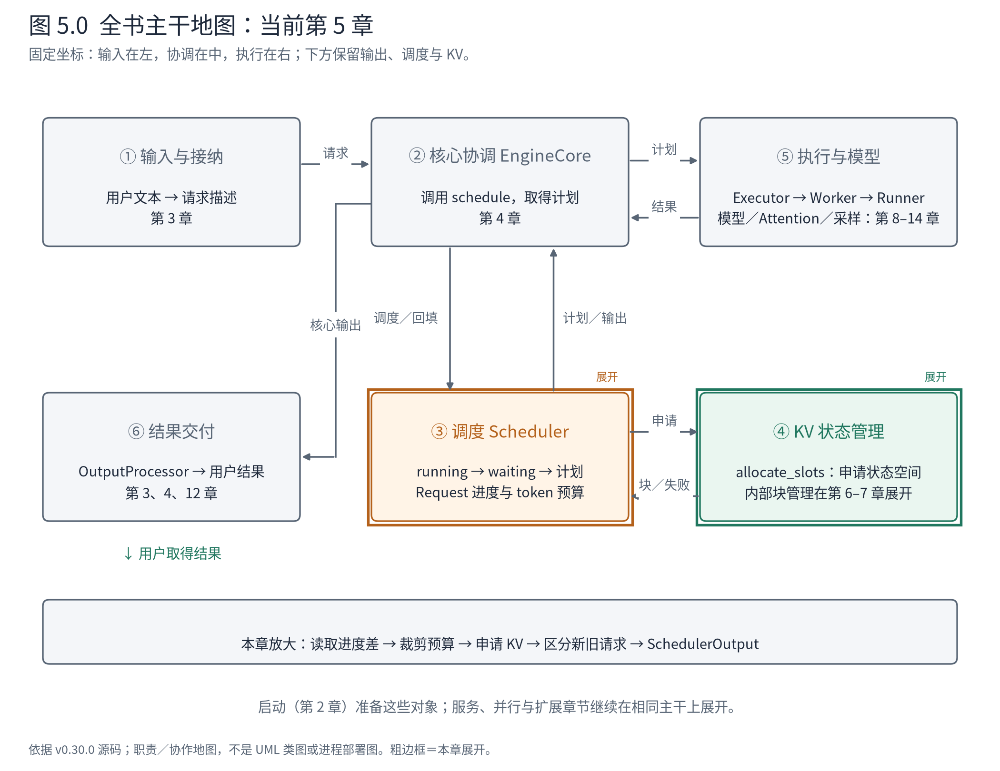
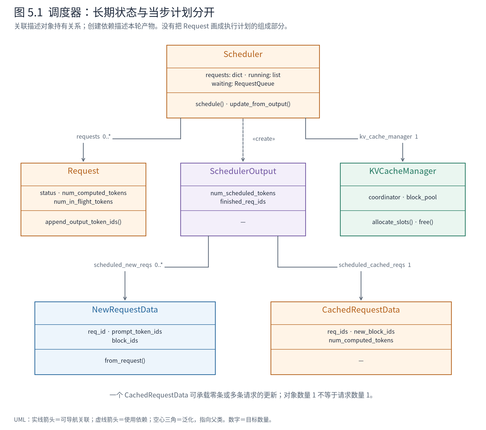
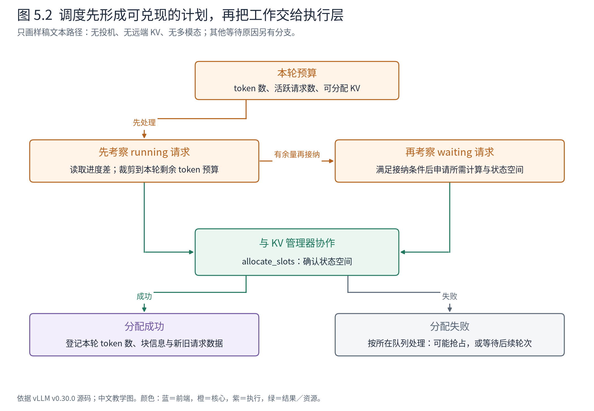
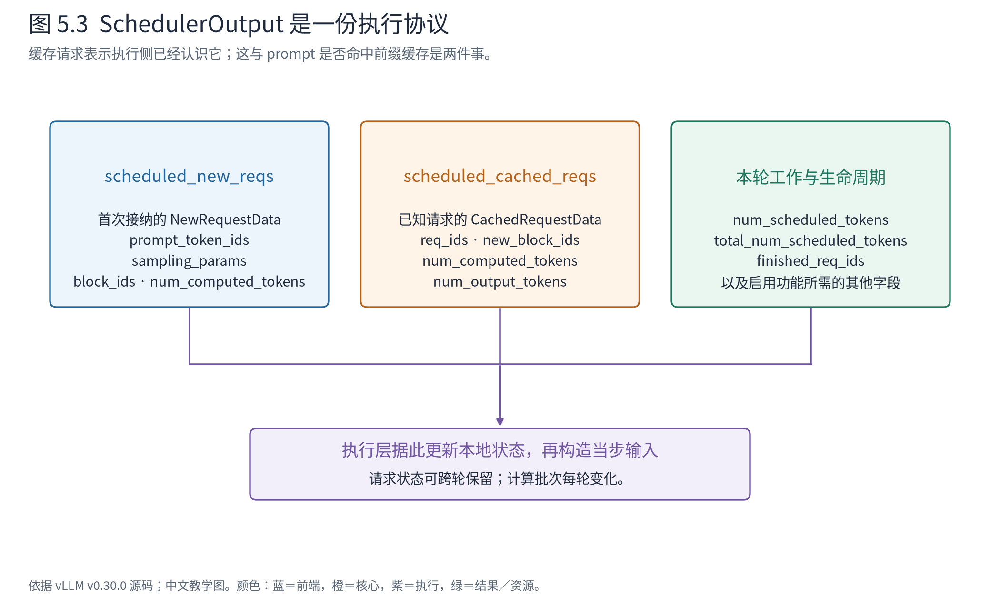
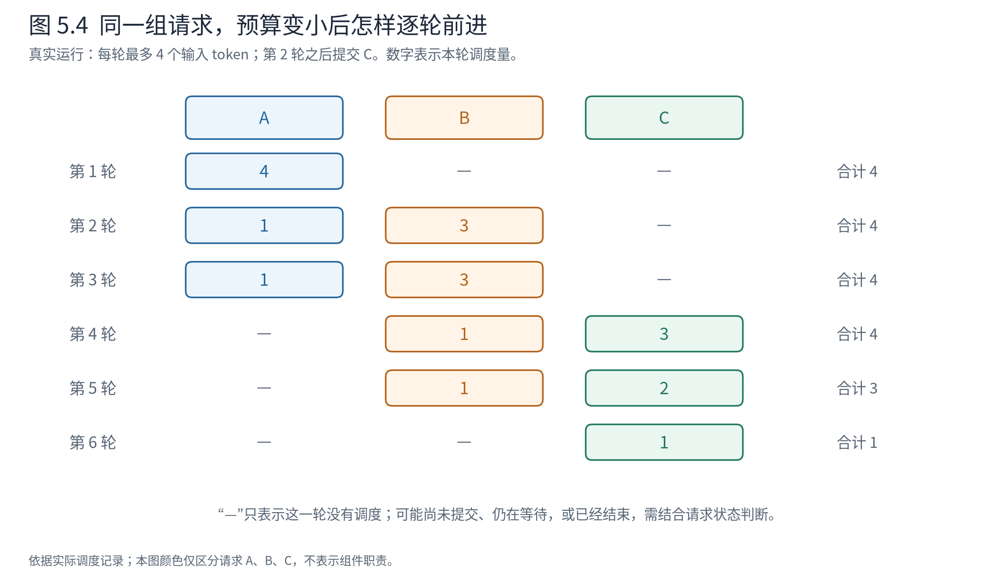

# 第 5 章 Scheduler 如何形成执行计划

上一章把一轮计算走通了，但在最关键的起点停留得很短：`scheduler.schedule()` 返回一份计划，EngineCore 就按它组织执行。这一行代码里究竟发生了什么？为什么第一轮是 A 处理 5 个 token、B 处理 6 个，下一轮却各只处理 1 个？如果预算放不下全部输入，引擎又怎样继续？

本章把镜头推进 Scheduler。它封装的不是一个“调用模型之前的排序函数”，而是**在有限计算与状态资源下，持续推进一组未完成请求的决策过程**。它维护队列和请求进度，与 KV 管理器协商资源，并把决定整理成执行层能理解的协议。

我们仍然使用同一组请求。先解释上一章已经拿到的计划，再把每轮预算从 32 降到 4，并在两轮之后加入 C。通过这一次变化，可以同时看清调度量、等待、分块、请求接纳和结束通知，而不需要先背下长函数里的所有分支。



**先在地图上定位。** 与前两章保持同一布局。这次展开③调度，并打开它与④KV 管理的申请接口；②只保留调用者角色，⑤执行内部仍折叠。我们从核心 Request 与可用预算出发，走到一份 SchedulerOutput。第 6 章再沿④进入物理块管理，不重新换一张系统地图。

## 5.1 调度器看到的是还没兑现的工作

先把上一章的抽象基类关系向下展开。现在关注 Scheduler 自己持有什么，以及它每轮创建什么。



**图 5.1 怎样读。** 实线关联指向长期引用或计划字段引用；虚线创建依赖指向当步产物。Scheduler 通过 `requests` 引用零到多个 Request，同时持有一个 KVCacheManager。`schedule()` 创建 SchedulerOutput，后者引用零到多个 NewRequestData 和一个 CachedRequestData。这个 `1` 是批量容器的对象数量，不是说本轮只有一条已知请求。

这里有三项结构决定直接影响读代码的方式。

首先，`requests`、`running` 和 `waiting` 是**同一批请求的不同访问视图**：字典服务按身份检索，列表与队列服务调度顺序。它们可以共同引用同一个 Request；将 A 从等待转入运行，并不意味着复制一份新的核心请求。队列成员资格与 `Request.status` 必须随生命周期转换保持一致，这也是为什么接纳、抢占和结束应当连同容器修改一起阅读。

其次，Scheduler 与 KVCacheManager 是**对象协作**，不是继承关系。Scheduler 维护“谁有资格、推进多少”的策略，KVCacheManager 封装槽位与块分配。调度决定要受分配结果约束，分配器也需要请求进度与资源上下文，因此这个边界不是互不知情的两个黑盒。好处是块管理机制可以集中维护；代价是调度分支要正确处理失败、预留和回收，不能只算完 token 数就无条件出计划。

最后，Request 是跨轮的可变工作状态，SchedulerOutput 是**当步执行协议的数据载体**。计划并不把整个 Request 对象送给执行侧修改，而是选取新请求资料、增量和当步额度。执行侧可维护自己的持久状态，减少每轮传输；双方也因此承担初始化、更新和删除的一致性责任。这不是把系统认定为某个命名设计模式，而是从属性、数据类型和调用边界能直接验证的结构。

源码依据是 [Scheduler 的请求容器](https://github.com/vllm-project/vllm/blob/ced6857afa0ea7b2e3f0846a62e1394e90f15607/vllm/v1/core/sched/scheduler.py#L191-L205)、[KV 管理器装配](https://github.com/vllm-project/vllm/blob/ced6857afa0ea7b2e3f0846a62e1394e90f15607/vllm/v1/core/sched/scheduler.py#L299)和 [SchedulerOutput 字段](https://github.com/vllm-project/vllm/blob/ced6857afa0ea7b2e3f0846a62e1394e90f15607/vllm/v1/core/sched/output.py#L224-L240)。带着这张类图，再看它怎样从状态算出本轮需求。

对普通文本生成来说，Request 有两类数量必须分清：已经知道的 token 数，以及已经纳入计算进度的 token 数。

A 刚进入引擎时，已知内容只有 5 个 prompt token，计算进度为 0，所以它还需要处理这 5 个位置。第一轮模型预测出一个新 token 后，已知序列长度变成 6，而计算进度是 5，所以接下来需要处理 1 个位置。两种情形的计算规模不同，却可以用同一个“追上已知序列”的问题表达。

`schedule` 的运行请求分支中，实际计算如下：

<!-- evidence:source:demand:start -->
源码教学注释版，vllm v0.30.0：[ `vllm/v1/core/sched/scheduler.py`，原文件 L656–L665](https://github.com/vllm-project/vllm/blob/ced6857afa0ea7b2e3f0846a62e1394e90f15607/vllm/v1/core/sched/scheduler.py#L656-L665)。仅插入 `# 【解读】` 注释，其余内容保留原文；行号指向原文件。

```python
            # 【解读】上下文：schedule 的 running 循环；候选工作量来自已知序列与当前进度的差。
            num_new_tokens = (
                # 【解读】已知 token 包含可选投机 token；本例没有投机，等于 prompt 加已有输出。
                request.num_tokens_with_spec
                # 【解读】异步输出占位也参与进度核算；本例同步路径占位数为零。
                + request.num_output_placeholders
                # 【解读】减去已经记入核心进度的部分，避免把所有已知位置再次计算。
                - request.num_computed_tokens
            )
            # 【解读】若启用了长 prefill 阈值且差额过大，先按该阈值截断。
            if 0 < self.scheduler_config.long_prefill_token_threshold < num_new_tokens:
                num_new_tokens = self.scheduler_config.long_prefill_token_threshold
            # 【解读】再取剩余 token 预算和可用输入位置的最小值；本例 draft_slots 为零。
            num_new_tokens = min(
                num_new_tokens, token_budget, input_budget - draft_slots
            )
```
<!-- evidence:source:demand:end -->

本例没有投机 token，也没有异步输出占位，因而 `num_tokens_with_spec` 等于已知 prompt 与输出 token 的总数，`num_output_placeholders` 为零。这时第一段代码可以读成：**本轮还可以推进的工作量，是已知序列长度减去当前计算进度。**

但源码没有直接把所有差额交给设备。它还要受到长输入分块阈值、剩余 token 预算、输入预算等限制。`draft_slots` 属于投机相关约束，本例为零。保留这些真实字段，是为了让读者知道简化例子成立的条件；现在不需要为了一个未启用的变量提前读完整个投机解码章节。

这个统一表达是 V1 设计的重要支点。官方 V1 说明将调度决定描述为“每个请求在本轮处理多少 token”，用来容纳分块 prefill、前缀复用和投机等行为。[V1 设计说明](https://vllm.ai/blog/2025-01-27-v1-alpha-release)

统一调度抽象，不代表 prefill 和 decode 在计算上没有区别。输入组织、Attention 形态、是否能交付新 token 仍然不同。设计减少的是调度层必须分别维护的互斥流程，而不是抹掉模型执行的实际差异。

## 5.2 队列维护的是资格，不只是排列顺序

第 3 章中，A、B 被放入 waiting。真正调度到某条请求后，它会成为 running 中的一员，并在后续轮次继续参与决策。

这里的 running 不能翻译成“此刻设备正在为它执行算子”。本例在每次 `step()` 结束后暂停，running 里仍有请求，但设备并不因此一直在计算它们。这个状态表示该请求已经进入持续推进的集合，尚未完成；是否在某一轮获得预算，还要看当轮决定。

本版调度器先考察 running 请求，再在条件允许时从 waiting 接纳新请求。这样的组织使已经开始的工作可以持续推进，同时允许新请求利用剩余预算加入。它也带来取舍：新请求可能因为已有工作消耗预算而继续等待。不能只称赞它“提高吞吐”，还要看这会怎样影响新请求的首次结果等待时间。



**图 5.2 怎样读。** 从本轮预算开始，先看 running，再看 waiting，随后把注意力放到 KV 协作。图把两个队列内部各自进行的资源申请汇总到一个框里，并不表示源码等所有请求选完才统一申请。成功才形成可执行计划；失败的处理随所在队列与功能分支而不同。图只概括样稿文本路径，不能当作整段 `schedule` 的完整流程图。

因此，调度器同时维护几种约束：本轮最多处理多少 token，能容纳多少活跃请求，所需 KV 状态能否获得空间，以及请求是否还在等待某种前置条件。token 预算不是唯一准入条件；活跃请求数也不是 token 数。把这些约束混成一个“batch size”，源码就很难读准确。

## 5.3 决定计算之前，先确认状态有地方放

前向计算会生成新的 KV 状态。调度器可以决定给 A 推进 5 个 token，却不能凭这个决定创造存储空间。它需要向 KV 管理器申请本次推进所需的槽位。

如果在本例的 KV 申请处停下，可以用下面这条路径找到当前栈的位置。它是依据源码整理的**停点调用链**，从外层调用者写到当前方法；省略记录包装器，不声称采集了实际堆栈。BalanceScheduler 是本机运行类，关闭均衡时才出现这里的上游委托，具体分支在 5.6 节核验。

```text
LLMEngine.step
  → InprocClient.get_output
    → EngineCore.step                  〔step_fn 在本例的绑定〕
      → BalanceScheduler.schedule      〔Ascend 包装入口〕
        → Scheduler.schedule           〔super() 委托上游〕
          → KVCacheManager.allocate_slots  ← 当前停点
```

返回时沿原路径回到 `Scheduler.schedule` 的当前循环，再决定是否纳入本轮计划。`allocate_slots` 返回以后才可能构造 SchedulerOutput；两者不是同时处于活动调用栈的嵌套子方法。图 5.1 中的“持有一个 KV 管理器”因此落到一个具体方法调用，下一段代码中的返回值则决定该协作能否兑现。

下面是 waiting 请求接纳路径中的真实调用：

<!-- evidence:source:allocate:start -->
源码教学注释版，vllm v0.30.0：[ `vllm/v1/core/sched/scheduler.py`，原文件 L1159–L1180](https://github.com/vllm-project/vllm/blob/ced6857afa0ea7b2e3f0846a62e1394e90f15607/vllm/v1/core/sched/scheduler.py#L1159-L1180)。仅插入 `# 【解读】` 注释，其余内容保留原文；行号指向原文件。

```python
                # 【解读】上下文：waiting 接纳分支；先取得 KV 槽位，再承诺执行该请求。
                new_blocks = self.kv_cache_manager.allocate_slots(
                    # 【解读】request 标识所属请求；num_new_tokens 是本轮计划推进的输入位置数。
                    request,
                    num_new_tokens,
                    # 【解读】把本地命中进度和命中块交给 KV 管理器；本例关闭前缀复用。
                    num_new_computed_tokens=num_new_local_computed_tokens,
                    new_computed_blocks=new_computed_blocks,
                    # 【解读】lookahead、外部 KV 与异步加载是扩展上下文；本例不借用这些机制。
                    num_lookahead_tokens=effective_lookahead_tokens,
                    num_external_computed_tokens=num_external_computed_tokens,
                    delay_cache_blocks=load_kv_async,
                    # 【解读】encoder 位置及完整输入预留策略也影响分配；不能只看 token_budget。
                    num_encoder_tokens=num_encoder_tokens,
                    full_sequence_must_fit=self.scheduler_reserve_full_isl,
                    # 【解读】传递保留块数及是否已有运行请求，供分配策略判断。
                    reserved_blocks=reserved_blocks,
                    has_scheduled_reqs=bool(self.running),
                )

                # 【解读】None 表示分配失败；不能把它当成成功分配了零个块。
                if new_blocks is None:
                    # The request cannot be scheduled.

                    # NOTE: we need to untouch the request from the encode cache
                    # manager
                    # 【解读】若此请求有 encoder 输入，先回收相应 encoder 缓存登记。
                    if request.has_encoder_inputs:
                        self.encoder_cache_manager.free(request)
                    # 【解读】退出本次 waiting 接纳循环；不是立即让这条请求执行，也不是运行分支的抢占逻辑。
                    break
```
<!-- evidence:source:allocate:end -->

这个接口将两个职责分开。Scheduler 知道当前想推进哪些请求、多少位置；KVCacheManager 知道如何把这些需求映射成可用的状态空间。调度器不需要在这里亲自维护物理空闲块链表，但也不能对资源申请是否成功漠不关心。

在本例基础运行第一轮，A 的申请现场是：

<!-- evidence:data:allocation:start -->
实测对象字段节选，[原始事件 19](evidence/baseline-inproc-traced/events.jsonl)；JSON 是阅读投影，保留原始字段值。

```json
{
  "request_id": "A-93858a1e",
  "requested_tokens": 5,
  "granted": true,
  "block_ids": [
    [1]
  ]
}
```
<!-- evidence:data:allocation:end -->

这里的块编号与 token 编号不同。`[1]` 指向分配结果中的物理块标识，不是 token ID 1。外层按 KV cache group 组织；JSON 将源码中的 tuple/list 容器统一展示为数组，所以不能从这段打印推断它原本就是两层普通列表。

本次有效块大小是 128 个 token，A 的短输入在一个块内即可容纳。它没有因此被调度成 128 个 token；分配粒度与计算粒度不同。怎样定位块中的槽位、不同 cache group 怎样协同，留到下一章打开。此处要记住的是：**调度计划必须同时获得计算预算和保存状态的资格。**

如果分配返回 None，waiting 路径不会把这条请求强行送去执行。运行请求路径还可能触发抢占等处理；这些机制有自己的状态转移，不能将所有失败都概括成“把请求直接丢掉”。本轮观察预算不足造成的等待，没有人为制造 KV 耗尽；对容量不足的源码解释与硬件实测保持区分。

## 5.4 计划为什么要区分新请求与旧请求

经过进度判断、预算裁剪和资源申请，Scheduler 还要把内部决定转换成另一个组件可以消费的形式。这个产物就是上一章见到的 `SchedulerOutput`。

它的定义开头明确说明了两类请求数据：

<!-- evidence:source:plan_definition:start -->
源码教学注释版，vllm v0.30.0：[ `vllm/v1/core/sched/output.py`，原文件 L224–L240](https://github.com/vllm-project/vllm/blob/ced6857afa0ea7b2e3f0846a62e1394e90f15607/vllm/v1/core/sched/output.py#L224-L240)。仅插入 `# 【解读】` 注释，其余内容保留原文；行号指向原文件。

```python
# 【解读】dataclass 声明执行计划的数据容器；它不承担 Scheduler 的决策算法。
@dataclass
class SchedulerOutput:
    # list of the requests that are scheduled for the first time.
    # We cache the request's data in each worker process, so that we don't
    # need to re-send it every scheduling step.
    # 【解读】第一次交给执行侧的请求携带 NewRequestData，可有零条或多条。
    scheduled_new_reqs: list[NewRequestData]
    # list of the requests that have been scheduled before.
    # Since the request's data is already cached in the worker processes,
    # we only send the diff to minimize the communication cost.
    # 【解读】一个 CachedRequestData 批量容纳已有请求的更新；不是每条请求各一个该对象。
    scheduled_cached_reqs: CachedRequestData

    # req_id -> num_scheduled_tokens
    # Number of tokens scheduled for each request.
    # 【解读】映射每个内部 ID 到本轮输入 token 数；它不是要求生成的输出长度。
    num_scheduled_tokens: dict[str, int]
    # Total number of tokens scheduled for all requests.
    # Equal to sum(num_scheduled_tokens.values())
    # 【解读】总量应等于上一字段各项之和，执行层据此准备当步工作。
    total_num_scheduled_tokens: int
```
<!-- evidence:source:plan_definition:end -->

假设执行层第一次看见 A，只有“本轮处理 5 个 token”并不够：它还不知道 A 的输入编号、采样要求和块信息。因此首次计划带有 `NewRequestData`。而到第二轮，执行侧已经保存了 A 的请求状态，重复传输完整描述就会增加通信和输入处理成本；计划改用 `CachedRequestData` 传递当轮所需更新。



**图 5.3 怎样读。** 左边告诉执行侧如何认识新请求，中间更新它已经认识的请求，右边交代本轮工作量和生命周期通知。三部分一起才构成完整的执行协议。图是字段节选，省略未启用扩展的信息；不能把这三个框当成三个独立调度器。

对比基础运行中的两份真实数据：

<!-- evidence:data:new_a:start -->
实测对象字段节选，[原始事件 21](evidence/baseline-inproc-traced/events.jsonl)；JSON 是阅读投影，保留原始字段值。

```json
{
  "type": "vllm.v1.core.sched.output.NewRequestData",
  "req_id": "A-93858a1e",
  "prompt_token_ids": [785, 6722, 315, 9625, 374],
  "block_ids": [
    [1]
  ],
  "num_computed_tokens": 0,
  "prefill_token_ids": [785, 6722, 315, 9625, 374]
}
```
<!-- evidence:data:new_a:end -->

<!-- evidence:data:cached_second:start -->
实测对象字段节选，[原始事件 37](evidence/baseline-inproc-traced/events.jsonl)；JSON 是阅读投影，保留原始字段值。

```json
{
  "type": "vllm.v1.core.sched.output.CachedRequestData",
  "req_ids": ["A-93858a1e", "B-9078dc24"],
  "resumed_req_ids": [],
  "new_token_ids": [],
  "all_token_ids": {},
  "new_block_ids": [null, null],
  "num_computed_tokens": [5, 6],
  "num_output_tokens": [1, 1]
}
```
<!-- evidence:data:cached_second:end -->

第一份中 A 的 `num_computed_tokens=0` 是本轮输入的起点。它与第 4 章 schedule 返回后核心 Request 已经记为 5 不矛盾：NewRequestData 在核心推进前取得本轮需要的起点，随后核心自己的状态继续变化。

第二份按 `req_ids` 对齐各个列表：A、B 的计算起点是 `[5, 6]`，此前生成数量是 `[1, 1]`。`new_block_ids=[null, null]` 表示本轮没有新增块信息；不表示两个请求没有 KV。短请求仍然使用已经建立的块映射。

还要留意 `new_token_ids=[]`。源码注明这一字段用于 PP 相关传递，本例没有 PP，不能据此说“上一轮没有生成 token”。执行侧如何保存刚产生的 token，会在 Runner 章节展开。阅读消息时，空字段需要结合消费者和配置理解，不能只按字段英文名猜含义。

这里的 CachedRequestData 更不能解释成“命中了前缀缓存的请求”。本例明确关闭前缀缓存，第二轮仍然使用它。**执行侧跨轮记住同一个请求，与后来一个请求复用相同前缀，是两种不同的复用。** 前者减少重复传输和初始化，后者减少重复模型计算。

增量协议的代价是两侧必须正确衔接状态。请求结束、抢占、恢复时，执行侧需要知道该删除、重建还是追加。比如本版 MRV2 路径会把恢复的请求重新放入新请求数据中；这说明“新”首先是面向执行侧状态建立的含义，不只是“用户刚刚提交”的日常含义。深入恢复流程时，应回来重新检查这个边界。

## 5.5 把预算缩到 4，观察完整的六轮

现在重新启动一台相同模型的引擎，把 `max_num_batched_tokens` 从 32 改为 4，保持非异步调度、无前缀缓存、无投机。仍先提交 A、B，在第二轮之后再提交 C：`The capital of Japan is`，5 个输入 token，生成上限 2。

这是一次独立运行，所以内部请求 ID 与基础运行不同。下面的表用 A、B、C 作为真实内部 ID 的可读别名；对应映射和原始事件保存在证据文件中。

<!-- evidence:table:chunked:start -->
| 轮次 | 实际调度的输入 token 数 | 本轮生成 token | 回填后仍在等待 | 回填后仍在 running |
|---|---|---|---|---|
| 1 | A：4 | A：[] | B | A |
| 2 | A：1；B：3 | A：[12095]；B：[] | 无 | A、B |
| 3 | A：1；B：3 | A：[13]；B：[279] | C | B |
| 4 | B：1；C：3 | B：[16462]；C：[] | 无 | B、C |
| 5 | B：1；C：2 | B：[21575]；C：[26194] | 无 | C |
| 6 | C：1 | C：[13] | 无 | 无 |

表据[原始运行记录](evidence/chunked-inproc-traced/events.jsonl)生成；A/B/C 为内部 ID 的外部名称映射。空列表 `[]` 表示该请求本轮没有新输出 token。
<!-- evidence:table:chunked:end -->



**图 5.4 怎样读。** 每个数字是该轮实际调度的输入 token 数，不是输出数量。每行求和不超过 4。横线只代表这一轮没有调度，必须结合表中的生命周期解释它：B 在第一轮等待，C 在前两轮尚未提交，A 在后面几轮已经结束。

先看第一轮。A 需要处理 5 个已知位置，但预算只有 4，于是只处理前 4 个。它已经从 waiting 进入 running，模型也实际做了工作，却还没有把完整 prompt 处理到可以交付首个结果的位置。因此执行结果里的 token 列表为空：

<!-- evidence:data:chunk_first:start -->
实测对象字段节选，[原始事件 20, 25, 26](evidence/chunked-inproc-traced/events.jsonl)；JSON 是阅读投影，保留原始字段值。

```json
{
  "num_scheduled_tokens": {
    "A-bf03f9a5": 4
  },
  "sampled_token_ids": [
    []
  ],
  "request_after_update": {
    "status": "RUNNING",
    "num_computed_tokens": 4,
    "num_in_flight_tokens": 0,
    "output_token_ids": []
  }
}
```
<!-- evidence:data:chunk_first:end -->

这不是一次失败的采样，也不是请求丢失。A 的计算进度已经推进到 4，下一轮可以从那里继续。**处理了一段 prompt 是进度，产生了用户可见 token 是结果；两个事件不必在每轮同时发生。**

第二轮，running 中的 A 还差 1 个 prompt token，先得到 1。剩余 3 个预算可用于接纳 B，于是 B 开始处理自己的前 3 个输入位置。这一轮 A 得到首个 token，B 仍没有输出。

我们在这时提交 C。第三轮开始前，它已经在 waiting 中；但 A 需要 1 个位置来生成第二个输出，B 还需要 3 个位置补完 prompt，两者恰好耗尽预算。C 因而继续等待。这里不需要假定设备内存不足，也不需要引入优先级策略：单看本轮预算和已有请求的进度，就能解释等待原因。

第四轮 A 已结束，B 只需 1 个 decode 输入位置，剩余 3 个预算让 C 加入。第五轮 B 再用 1 个，C 用剩下所需的 2 个；这时预算只用了 3，因为没有更多符合条件的已知工作需要填进去。第六轮只剩 C 的 1 个 decode 位置。

这六轮没有使用一套“纯 prefill 队列调度器”再切到另一套“纯 decode 调度器”。同一个决策过程在已有进度与预算之间分配工作，允许一轮同时包含不同请求的不同生成阶段。对模型执行来说，这些位置仍有不同含义；对 Scheduler 来说，它们都需要获得本轮推进额度。

## 5.6 从真实类名回到上游实现

本书以 upstream vLLM 为主，但本机运行使用 Ascend 插件。要让上一节的现场成为可信的源码证据，不能只检查包版本，还要确认执行的方法来自哪里。

本次实际调度对象的类名是 Ascend 的 `BalanceScheduler`，其 `_balance_enabled` 为 false。该包装类在此条件下直接调用 `super().schedule(throttle_prefills)`，而 `update_from_output`、KV 分配等相关方法来自上游。探针记录了对象类型、方法来源和文件哈希；对应分支是：

<!-- evidence:source:balance_delegate:start -->
源码教学注释版，vllm-ascend v0.30.0：[ `vllm_ascend/patch/platform/patch_balance_schedule.py`，原文件 L163–L165](https://github.com/vllm-project/vllm-ascend/blob/c09d3e20b9c45c80b34ae3781440d90904a44023/vllm_ascend/patch/platform/patch_balance_schedule.py#L163-L165)。仅插入 `# 【解读】` 注释，其余内容保留原文；行号指向原文件。

```python
    # 【解读】本机实例的方法入口来自 Ascend 包装类；同名不保证实现归属相同。
    def schedule(self, throttle_prefills: bool = False) -> SchedulerOutput:
        # 【解读】本次 _balance_enabled 为 False，成立时进入以下委托路径。
        if not self._balance_enabled:
            # 【解读】super() 按继承链调用上游 Scheduler.schedule，并原样返回其计划。
            return super().schedule(throttle_prefills)
```
<!-- evidence:source:balance_delegate:end -->

因此，本章逐轮解释依据的是上游调度路径，实际模型执行则落在 Ascend 的 `NPUWorker` 与 `NPUModelRunner`。这两件事可以同时成立。不能因为对象名带 Ascend 就忽略上游行为，也不能因为观察到了上游调度行为，就把下方 CUDA 执行路径宣称为本机实测。

这段对照也提供了一个实际阅读方法：**看到实例类型之后，还要确认方法的实现归属和生效分支。** 尤其在平台插件、继承和补丁参与装配的系统中，类名只是入口，不能代替运行路径核验。

## 5.7 调度器交给下一层的承诺

现在回看 `schedule()`，它的产物已经不再是一个抽象的“batch”。它告诉执行层：哪些请求需要建立状态，哪些请求只需更新，本轮各推进多少个位置，哪些块已经获得，以及哪些请求应当清理。

这种设计让调度与执行保持分工：Scheduler 以请求进度和资源约束作决定，执行侧把计划翻译为张量与模型调用。要付出的成本，是维护增量状态的一致性，并让失败、结束和恢复都能被协议表达。

面对一个未获得服务的请求，你现在可以依次问：它尚未提交，还是已在 waiting？已有请求是否耗尽本轮预算？活跃数量限制是否允许接纳？KV 分配是否成功？是否还有某种前置状态没准备好？这个排查顺序来自我们刚刚看到的对象和分支，不需要记住长函数的所有行号。

下一章将沿本章留下的 `allocate_slots` 继续放大。Scheduler 已经提出“要推进这些位置”，但究竟怎样把这个需求映射到物理块、怎样在结束后回收、怎样在复用时保留内容，还需要打开 KV 管理器。我们已经知道为什么需要这个组件，也知道从哪个真实接口进去。

**源码停点：** [Scheduler.schedule](https://github.com/vllm-project/vllm/blob/ced6857afa0ea7b2e3f0846a62e1394e90f15607/vllm/v1/core/sched/scheduler.py#L561) 先读 running、waiting、构造输出三个区段，按本例条件跳过未启用功能；[SchedulerOutput](https://github.com/vllm-project/vllm/blob/ced6857afa0ea7b2e3f0846a62e1394e90f15607/vllm/v1/core/sched/output.py#L224) 对照两轮实物；[KV 分配接口](https://github.com/vllm-project/vllm/blob/ced6857afa0ea7b2e3f0846a62e1394e90f15607/vllm/v1/core/kv_cache_manager.py#L370) 本章只读参数语义和返回契约，内部机制留下一章。
