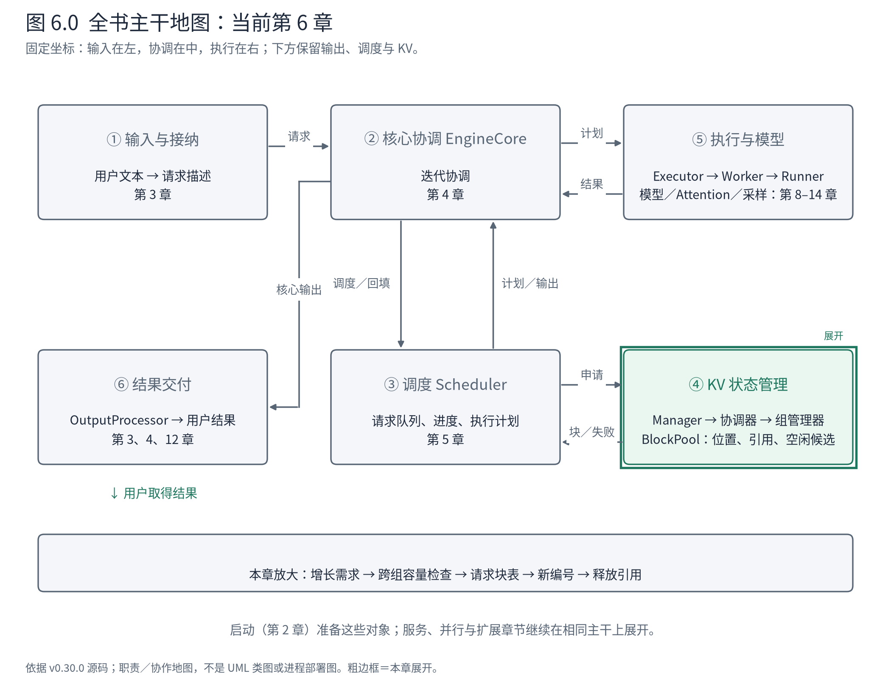
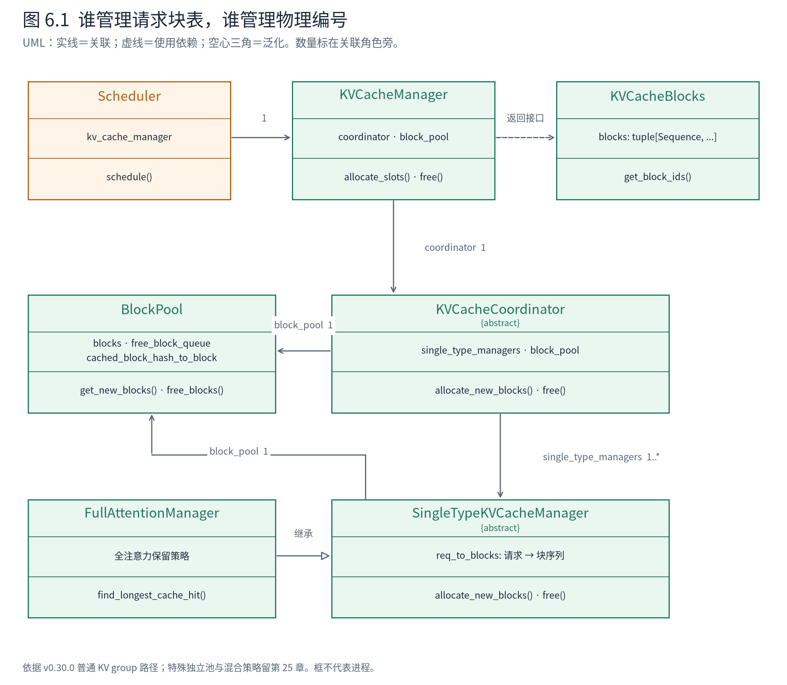
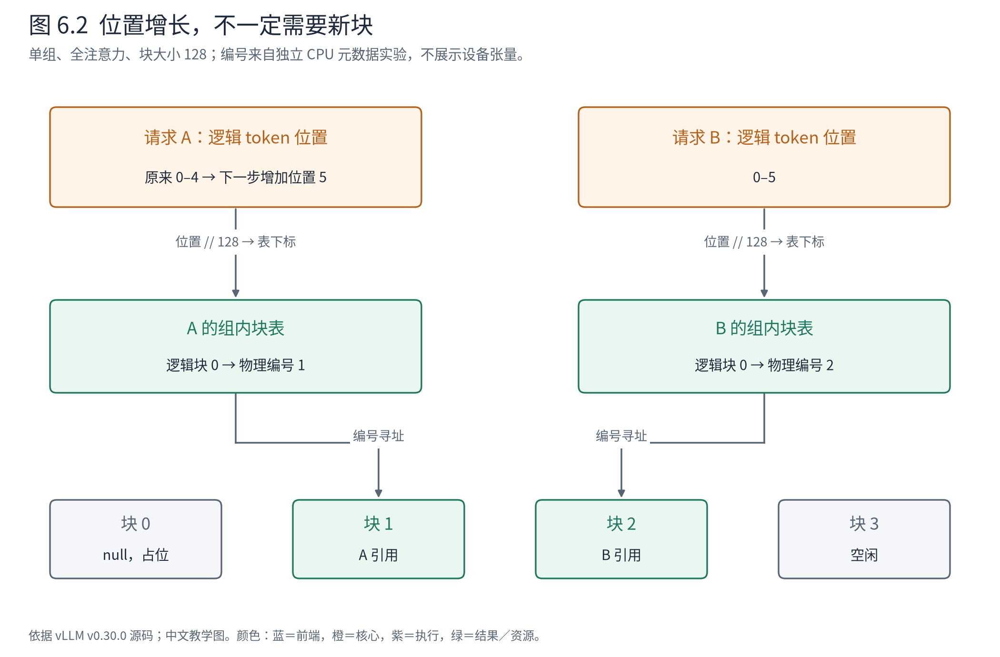

# 第 6 章 KV 块：把状态位置交给执行层

第 5 章的调度器已经决定给 A 计算 5 个 token、给 B 计算 6 个 token。可计算预算还不够：这些 token 的 K/V 要写到哪里，下一轮怎样找到，A 结束时又由谁收回位置？如果这几个问题没有统一答案，一份合法的调度计划仍可能覆盖别人的状态。



**先在地图上定位。** 本章打开③与④之间的资源契约，并把④内部的对象分工展开。⑤仍折叠为块编号的消费者；我们先交付可用位置，第 9、11 章再看这些位置怎样变成设备上的寻址。输入是一条请求的增长需求，出口是它获得的块及其生命周期。

## 6.1 一个“块”有三种相关但不同的表示

Book6 已经解释分页管理的动机：请求增长不可预知，如果预先为每条请求保留一整段最大长度存储，资源容易浪费；如果要求每次增长都搬移整段数据，代价也很高。PagedAttention 的论文把按块管理与注意力访问结合起来，但论文中的历史实现不能直接充当本版本的类关系。[原论文](https://arxiv.org/abs/2309.06180)提供设计背景，下面以固定源码建立当前对象模型。

设一块覆盖 128 个 token 位置。A 的逻辑位置 0–4 可以放入一个物理块，而不必紧挨 B 的物理块。这里需要区分三个层面：

| 层面 | 本章中的表示 | 回答的问题 |
|---|---|---|
| 请求逻辑位置 | 从 0 开始的 token 位置、组内块表的列表下标 | 这是 A 的第几个位置？ |
| 块元数据 | `KVCacheBlock.block_id`、`ref_cnt`、哈希身份 | 哪个物理编号可用，谁还在引用？ |
| 设备存储 | Worker／Runner 准备的 KV 张量与后端布局 | 这个编号对应哪些实际字节？ |

`KVCacheBlock` 是第二层的 CPU 元数据对象，它并不把巨大的 K/V 张量装进 Python 属性里。块表也不是 token 数组：表中的整数告诉执行侧去哪个物理块读写，token 值仍在输入与输出序列中。

在一个 KV group 内，多层可以共用同一张块表，这表示它们采用一致的请求位置映射，不表示不同层共享同一份 K/V 数值。例如 A 的块号为 1，每层仍需要在自己的存储视图里解释“块 1”。第 11 章会将这条约定连到 Attention 元数据。

## 6.2 不把所有状态塞进一个管理器

面向调度器的接口叫 `KVCacheManager`，但它并没有独自实现所有状态策略。内部还有协调器、单类型管理器和块池。先看静态关系，再进入方法。



**图 6.1 怎样读。** 实线箭头是持有引用的可导航关联，虚线是方法使用依赖，空心三角是继承。一个协调器关联多个组管理器；本章的单组全注意力配置只有一个相关组管理器。KVCacheManager 与协调器暴露的 `block_pool` 引用可以指向同一池，不能据两个属性推断有两份资源。图中没有把这些关联画成强组合。

这个分层各自封装一种变化。KVCacheManager 给调度器提供请求级操作；协调器让多个 group 的需求共同成立；`SingleTypeKVCacheManager` 的具体子类实现一种状态保留策略，并维护 `req_to_blocks`；`BlockPool` 管编号、引用和空闲候选。全注意力需要保存完整历史，滑窗可以回收离开窗口的块，这些差异不应全部写进 Scheduler 的队列循环。

这是一种门面与策略分层的架构解释：外部接口缩小了 Scheduler 必须知道的范围，策略变化集中在组管理层。代价是调试一次申请时必须跨几层核对同一组数值，而且跨组资源预算需要协调。不能把“接口简单”误读为“内部只有一个列表”。

调度器收到的 `KVCacheBlocks` 又是另一种对象。它封装各组块序列，提供 `get_block_ids()`，把内部块对象转换成计划需要的编号。外层维度是 KV group，内层是该组的逻辑块顺序；所以单组的 `([1],)` 序列化后可能显示为 `[[1]]`，这两层括号有明确含义。

## 6.3 从四个编号开始，先看真实账本

基础 NPU 运行的有效配置是块大小 128、总块数 4。要理解这个数字，我们执行同版本的真实 `KVCacheManager` 类，但只创建 CPU 元数据，不创建模型、设备 KV 张量或 Attention。实验使用 A/B 的原始 token，独立于前面那次完整生成；因此编号变化不能跨运行拼接。

初始化块池的关键代码如下：

<!-- book:ch06-pool:start -->
源码教学注释版，vllm v0.30.0：[原文件 L177–L194](https://github.com/vllm-project/vllm/blob/ced6857afa0ea7b2e3f0846a62e1394e90f15607/vllm/v1/core/block_pool.py#L177-L194)。仅新增 `# 【解读】`，其他内容保留原文。

```python
        # All kv-cache blocks.
        # 【解读】为每个编号创建 CPU 元数据对象；这里没有创建 K/V 张量。
        self.blocks: list[KVCacheBlock] = [
            KVCacheBlock(idx, pool=self) for idx in range(num_gpu_blocks)
        ]
        # Free block queue that constructs and manipulates a doubly linked
        # list of free blocks (including eviction candidates when caching is
        # enabled).
        # 【解读】空闲队列保存可取用的块，开启缓存时也容纳可淘汰候选。
        self.free_block_queue = FreeKVCacheBlockQueue(self.blocks)

        # Cache for block lookup
        # 【解读】哈希索引与空闲队列回答不同问题：内容在哪里，以及哪里可以再分配。
        self.cached_block_hash_to_block: BlockHashToBlockMap = BlockHashToBlockMap()
        self.cached_block_hashes_by_block: dict[int, set[BlockHashWithGroupId]] = {}

        # To represent a placeholder block with block_id=0.
        # The ref_cnt of null_block is not maintained, needs special care to
        # avoid freeing it.
        # 【解读】取走编号 0 作为特殊占位块，不能继续按普通空闲块分配。
        self.null_block = self.free_block_queue.popleft()
        self.null_block.is_null = True
```
<!-- book:ch06-pool:end -->

编号 0 被取作 null block。它用于特殊占位，不是一块可以随便写入的普通空闲资源。于是总数 4 在这个小配置中留下 3 个普通可分配块。这个事实解释了第 2 章为什么不能直接把“4 块”解释成“4 条请求的承诺”。

下面是[CPU 元数据实验记录](evidence/kv-metadata/trace.json)的字段投影。驱动依次分配 A、分配 B、释放 A、再分配 C；没有执行模型，所以这里只证明账本操作。

<!-- book:ch06-blocks:start -->
真实运行字段投影，保留字段名与值，省略无关项。来自[原始记录](evidence/kv-metadata/trace.json)。

```json
{
  "allocation": {
    "initial": {
      "num_free_blocks": 3,
      "free_order": [
        1,
        2,
        3
      ]
    },
    "allocate_A": {
      "returned_block_ids": [
        [
          1
        ]
      ]
    },
    "allocate_B": {
      "req_to_blocks": [
        {
          "A": [
            1
          ],
          "B": [
            2
          ]
        }
      ]
    },
    "free_A": {
      "free_order": [
        1,
        3
      ]
    },
    "allocate_C": {
      "req_to_blocks": [
        {
          "B": [
            2
          ],
          "C": [
            1
          ]
        }
      ]
    }
  }
}
```
<!-- book:ch06-blocks:end -->

先逐步读它。初始化可取编号为 1、2、3。A 只需要一块，取到 1；B 取到 2。释放 A 后，1 成为优先复用候选，C 随后取得它。C 与 A 的 token 不同，复用的是存储位置，不是宣称可以复用 A 的 KV 内容。后面的执行必须为 C 写入它自己的状态。

这个例子也说明“空闲”是一种所有权判断，不是设备字节已经清零的保证。不同状态和后端可能有清零要求；是否记录待清零的新编号有独立条件。普通块的安全复用依赖于正确的有效长度、写入和访问范围，不能靠把所有 tensor 清零来替代生命周期管理。

## 6.4 一次申请为什么先估算，再修改块表

从第 5 章的调用点向下展开，普通单组全注意力、无缓存命中的路径是：

```text
Scheduler.schedule
└─ KVCacheManager.allocate_slots(request, num_new_tokens, ...)
   ├─ coordinator.remove_skipped_blocks        〔全注意力通常无窗口外块〕
   ├─ coordinator.get_num_blocks_to_allocate   → 需要消耗的块数
   ├─ 比较可用量、预留量与接纳水位
   └─ coordinator.allocate_new_blocks
      └─ SingleTypeKVCacheManager.allocate_new_blocks
         ├─ BlockPool.get_new_blocks
         └─ req_to_blocks[request_id].extend(...)
```

这是源码整理的条件调用树，不是采集栈。协调器按 group 委托；具体方法可能继承自基类。缓存命中、外部 KV 与部分命中复制会增加步骤，本节不把它们伪装成这条最小路径的一部分。

先读容量检查：

<!-- book:ch06-capacity:start -->
源码教学注释版，vllm v0.30.0：[原文件 L546–L563](https://github.com/vllm-project/vllm/blob/ced6857afa0ea7b2e3f0846a62e1394e90f15607/vllm/v1/core/kv_cache_manager.py#L546-L563)。仅新增 `# 【解读】`，其他内容保留原文。

```python
        # 【解读】协调器按各组策略合计本次需要消耗的可用块，包含需要保留的命中块。
        num_blocks_to_allocate = self.coordinator.get_num_blocks_to_allocate(
            request_id=request.request_id,
            num_tokens=num_tokens_need_slot,
            new_computed_blocks=new_computed_block_list,
            num_encoder_tokens=num_encoder_tokens,
            total_computed_tokens=num_local_computed_tokens
            + num_external_computed_tokens,
            num_local_computed_tokens=num_local_computed_tokens,
            num_tokens_main_model=num_tokens_main_model,
        )

        # Keep `reserved_blocks` free for other in-flight sequences, and an
        # additional watermark of headroom for waiting/preempted admissions.
        # 【解读】扣除给其他在途序列预留的块；总空闲量不一定就是本请求可用量。
        available_blocks = self.block_pool.get_num_free_blocks() - reserved_blocks
        # 【解读】接纳水位也进入约束，不能仅比较新增 token 数。
        required_blocks = num_blocks_to_allocate + watermark_blocks
        # 【解读】资源不足以 None 返回，让调度器决定等待或抢占。
        if required_blocks > available_blocks:
            # Cannot allocate new blocks
            return None
```
<!-- book:ch06-capacity:end -->

这里比较的是块，而不是 token。预算还有两个修正：为其他在途序列保留的块不能借给当前请求；接纳水位可以为后续增长留下余量。`None` 是“此次不能分配”的协议结果，由 Scheduler 决定后续策略，不是管理器自行把请求从运行队列移走。

容量检查之前已经可能释放窗口外块，所以不能把整个 `allocate_slots` 宣称为失败时完全无副作用的数据库事务。更准确的边界是：在把命中块和新块接到请求上之前，先检查需要的可用容量；允许提前回收不再需要的状态。完整原子性还取决于调用上下文，不能仅凭方法名推断线程安全。

接着读普通增长的核心：

<!-- book:ch06-grow:start -->
源码教学注释版，vllm v0.30.0：[原文件 L393–L403](https://github.com/vllm-project/vllm/blob/ced6857afa0ea7b2e3f0846a62e1394e90f15607/vllm/v1/core/single_type_kv_cache_manager.py#L393-L403)。仅新增 `# 【解读】`，其他内容保留原文。

```python
        # 【解读】上下文：前面的可选部分命中 CoW 已处理；读取该请求已有的组内块表。
        req_blocks = self.req_to_blocks[request_id]
        # 【解读】把需要覆盖的 token 总位置数向上取整为块数。
        num_required_blocks = cdiv(num_tokens, self.block_size)
        # 【解读】已有块继续使用，只补差额。
        num_new_blocks = num_required_blocks - len(req_blocks)
        # 【解读】没有差额仍可能返回前面产生的 CoW 块；普通无 CoW 路径为空列表。
        if num_new_blocks <= 0:
            return cow_blocks
        else:
            # 【解读】从物理编号池取新块，并把它们接到长期块表尾部。
            new_blocks = self.block_pool.get_new_blocks(num_new_blocks)
            req_blocks.extend(new_blocks)
            # 【解读】需要执行侧清零时，另记新编号供其消费。
            if self._record_new_block_ids:
                self.new_block_ids.extend(b.block_id for b in new_blocks)
            # 【解读】返回此次新增块，不返回整个请求的块表。
            return cow_blocks + new_blocks
```
<!-- book:ch06-grow:end -->

`num_tokens` 是需要覆盖的总位置数，而 `num_new_blocks` 是本次需要增加的物理块数。A 从 5 个已占位置增长到 6，仍在 128 大小的同一块中，新增块数为零。没有新增块并不等于没有安排计算；这只是说已持有的容量足以容纳它。



**图 6.2 怎样读。** 上方是请求的逻辑位置，下方是编号池，中间是按组维护的块表。A 的逻辑块 0 指向物理编号 1；A 再增加一个 token，箭头不动。只有超出当前覆盖范围时才需要增加表项。此图采用 CPU 实验的初始 A/B 分配停点，不声称展示了设备字节布局。

返回值也有一个重要区别：申请返回本次新增块，长期块表保留全部已分配块。调度计划可以发送增量，执行侧则维护累计映射；两侧不能把“本轮没新块”解释成“清空旧块表”。这正是第 5 章 `CachedRequestData.new_block_ids` 需要结合既有状态阅读的原因。

## 6.5 释放是引用变化，设备清理另有边界

请求完成时，调度器调用 KVCacheManager 的释放接口，协调器让各组撤下该请求的块表，然后把相应引用交回池。普通组管理器按反向块序传入释放方法，但最终候选顺序还会按有没有缓存身份分流：

<!-- book:ch06-free:start -->
源码教学注释版，vllm v0.30.0：[原文件 L778–L800](https://github.com/vllm-project/vllm/blob/ced6857afa0ea7b2e3f0846a62e1394e90f15607/vllm/v1/core/block_pool.py#L778-L800)。仅新增 `# 【解读】`，其他内容保留原文。

```python
        # Identify blocks with hash (LRU cache) and without it (never match APC)
        # 【解读】把优先复用与最后复用的块分开收集。
        blocks_to_evict_last = []
        blocks_to_evict_first = []
        other_pools: dict[BlockPool, list[KVCacheBlock]] = {}
        for block in ordered_blocks:
            # 【解读】若块属于其他池，转交所属池处理，避免修改错误的空闲账本。
            if block.pool is not None and block.pool is not self:
                other_pools.setdefault(block.pool, []).append(block)
                continue
            # 【解读】释放一份引用；只有最后一份普通引用消失时才进入空闲队列。
            block.ref_cnt -= 1
            if block.ref_cnt == 0 and not block.is_null:
                # 【解读】无哈希或关闭缓存的块优先复用。
                if block.block_hash is None or not self.enable_caching:
                    # LIFO reuse of non-cached blocks for better GPU locality.
                    blocks_to_evict_first.append(block)
                else:
                    # 【解读】带缓存身份的块放到后部，给之后的前缀命中保留机会。
                    # FIFO reuse of cached blocks for LRU eviction behavior.
                    blocks_to_evict_last.append(block)

        # Blocks to reuse first are prepended to the front of the free queue.
        # 【解读】队首加入优先候选。
        self.free_block_queue.prepend_n(blocks_to_evict_first)
        # Blocks to reuse last are appended to the end of the free queue.
        # 【解读】队尾加入缓存候选，释放并不在这里删除缓存身份。
        self.free_block_queue.append_n(blocks_to_evict_last)
        for pool, blocks in other_pools.items():
            pool.free_blocks(blocks)
```
<!-- book:ch06-free:end -->

关键条件是引用数降到零。若一个块仍由另一条请求引用，当前请求结束不能让它重新分配。若它没有缓存身份，放在优先复用一侧；若它保存可复用的前缀身份，保留在较后候选中。这是源码中两种复用顺序的具体原因，不能简单概括成“所有释放块都加到队尾”。

这里操作的是调度侧账本。执行侧还要消费结束 ID、更新它自己的请求状态和块表；第 4 章已经看到结束通知可能留待下一轮发送。因此，不要在 `free` 返回的断点上宣布“所有组件都忘记了 A”。状态有明确归属，清理依靠既定协议向前传播。

本章已经把第 5 章的申请接口兑现为三个可以检查的对象：请求块表、编号池和返回给计划的新增编号。下一章保持这些对象不变，改变一个条件：开启前缀复用。届时，A 的请求结束了，它留下的内容身份却可能继续帮助另一条请求；同一套引用账本将承担更复杂的关系。

**源码停点：** [KVCacheManager](https://github.com/vllm-project/vllm/blob/ced6857afa0ea7b2e3f0846a62e1394e90f15607/vllm/v1/core/kv_cache_manager.py#L370-L611)读申请和释放的协议；[组管理器](https://github.com/vllm-project/vllm/blob/ced6857afa0ea7b2e3f0846a62e1394e90f15607/vllm/v1/core/single_type_kv_cache_manager.py#L361-L403)停在总量与增量区别；[BlockPool](https://github.com/vllm-project/vllm/blob/ced6857afa0ea7b2e3f0846a62e1394e90f15607/vllm/v1/core/block_pool.py#L664-L800)追引用与空闲候选。混合组、滑窗和部分命中复制留到第 25 章。
