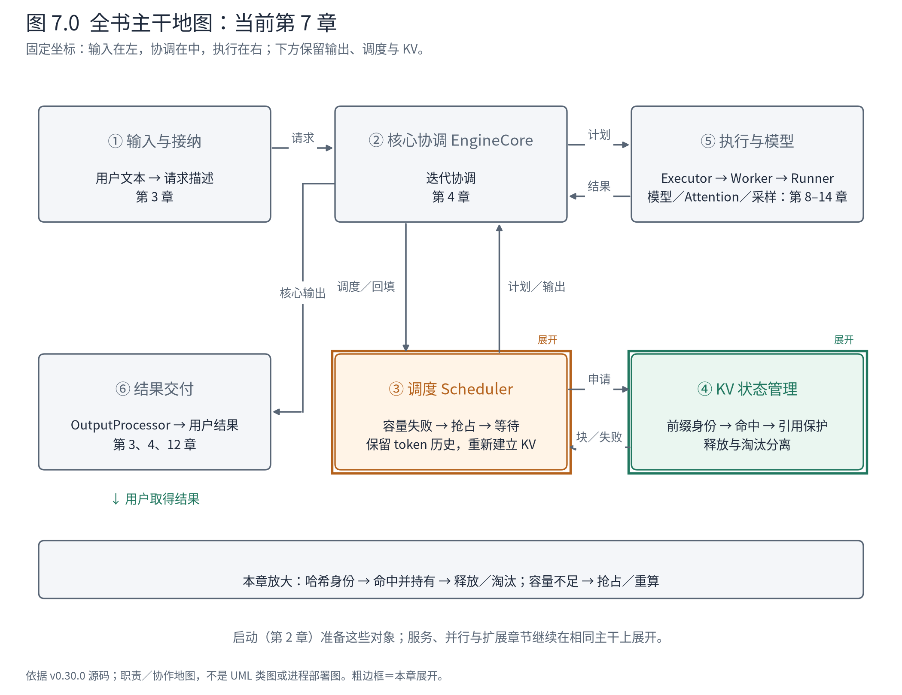
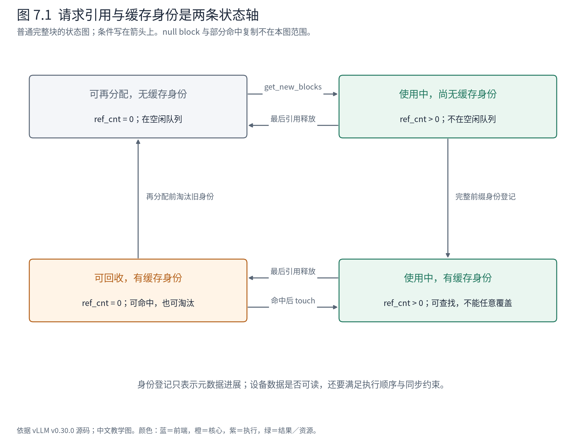
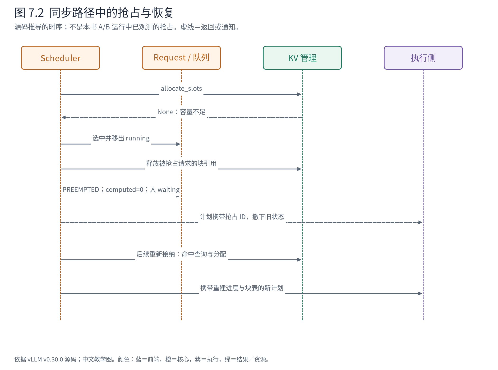

# 第 7 章 前缀复用与抢占：状态可以留下，请求可以重来

上一章把 KV 位置交给了 A，完成后又释放了引用。现在考虑两种变化。第一种：另一个请求恰好具有相同前缀，能否继续使用 A 留下的计算？第二种：B 还没有结束，系统却无法为它的下一步找到空间，能否暂时撤下它，之后再恢复？

两者都要求把“请求仍然存在”“块仍被引用”“内容仍可复用”分开。只用一个空闲／占用布尔值，表达不了这些状态。



**先在地图上定位。** 本章继续打开④，并回到③观察资源压力如何改变请求状态。前半章的产物是命中前缀与引用关系，后半章的产物是可重新接纳的请求。⑤只接收这些变化形成的计划，不负责决定谁被抢占。

## 7.1 缓存身份不是一段相同的文字

A 的输入是 `The capital of France is`。C 的输入是 `The capital of Japan is`。两者开头有共同 token，但不能因此把 A 的全部 KV 交给 C：自注意力中的当前位置依赖前文，块内 token 相同也不足以证明上下文相同。

vLLM 的哈希方案将父块身份接入当前块身份。这样，某块不仅代表“这些 token”，还代表“这些 token 接在这个前缀之后”。LoRA、多模态内容和 cache salt 等额外因素也会影响可复用性，相关身份通过额外键进入哈希。官方[前缀缓存设计](https://docs.vllm.ai/en/v0.30.0/design/prefix_caching/)解释了这一策略；本节用固定版本的实现确认输入结构。

<!-- book:ch07-hash:start -->
源码教学注释版，vllm v0.30.0：[原文件 L659–L665](https://github.com/vllm-project/vllm/blob/ced6857afa0ea7b2e3f0846a62e1394e90f15607/vllm/v1/core/kv_cache_utils.py#L659-L665)。仅新增 `# 【解读】`，其他内容保留原文。

```python
    # 【解读】首块没有父块时使用初始化的 NONE_HASH。
    if not parent_block_hash:
        parent_block_hash = NONE_HASH

    # 【解读】把本块 token 固定为元组，形成稳定的输入结构。
    curr_block_token_ids_tuple = tuple(curr_block_token_ids)
    # 【解读】哈希输入同时包含父链、本块 token 和额外身份，不能只比较这一小段文本。
    return BlockHash(
        hash_function((parent_block_hash, curr_block_token_ids_tuple, extra_keys))
    )
```
<!-- book:ch07-hash:end -->

代码中的 `parent_block_hash` 把前文压缩成身份链；当前 token 转成元组；`extra_keys` 承载其他必要条件。本书没有将 Python 哈希结果写死，也不声称所有算法和版本都产生同样的字节。要复现具体哈希，必须同时固定算法、序列化方式、初始身份与附加键。

从软件设计看，哈希把“能否共享”转成查找键，避免按每条已结束请求逐段比对。但这也把正确性约束集中到键构造处：漏掉一个影响模型计算的因素，就可能把语义不同的状态错误地判为相同。因此读缓存源码时，不应只看查找表的复杂度，还要追问键包含了哪些上下文。

## 7.2 命中长度为什么经常少于输入长度

基础 NPU 运行的块大小是 128，A 的输入只有 5 个 token，而且关闭了前缀缓存。这条记录无法证明完整块前缀复用。为了看清机制，本章另设 CPU 元数据实验：仍用 A 的 5 个真实 token，把教学块大小设为 4，打开缓存，之后再提交同样的 A。这个块大小只用于元数据类，不是本机后端的有效配置。

理论上，重复 A 的全部 token 都已出现。但请求还需要获得用于继续生成的 logits，缓存的 K/V 本身不是 logits。当前接口把命中上限限制为 `request.num_tokens - 1`，再由各组策略和对齐约束决定可复用长度：

<!-- book:ch07-hit:start -->
源码教学注释版，vllm v0.30.0：[原文件 L286–L300](https://github.com/vllm-project/vllm/blob/ced6857afa0ea7b2e3f0846a62e1394e90f15607/vllm/v1/core/kv_cache_manager.py#L286-L300)。仅新增 `# 【解读】`，其他内容保留原文。

```python
        # 【解读】请求或配置禁用读取缓存时，返回各组空块和零命中。
        if not self.prefix_cache_lookup_enabled(request):
            return self.empty_kv_cache_blocks, 0, 0

        # NOTE: When all tokens hit the cache, we must recompute the last token
        # to obtain logits. Thus, set max_cache_hit_length to prompt_length - 1.
        # This can trigger recomputation of an entire block, rather than just
        # the single last token, because allocate_slots() requires
        # num_computed_tokens to be block-size aligned. Removing this limitation
        # could slightly improve performance in the future.
        # 【解读】最多复用到最后一个 token 之前，仍需一次计算取得后续生成所需的 logits。
        max_cache_hit_length = request.num_tokens - 1
        # 【解读】让协调器寻找所有必要状态组能够共同承认的前缀；本章只展开单组全注意力。
        computed_blocks, num_new_computed_tokens, num_uncached = (
            self.coordinator.find_longest_cache_hit(
                request.block_hashes, max_cache_hit_length
            )
        )
```
<!-- book:ch07-hit:end -->

在本章的单组完整块路径中，5 个 token 最多命中前 4 个，最后一个还要进入计算。如果输入长度恰好等于块大小，限制和块对齐可能让整个尾块需要重算；不能把这条规则理解为永远只重算一个 token。

更复杂状态存在部分命中与细粒度保留分支，本版本源码已经包含相关支持。本章不据通用设计文档中的“完整块”表述否认这些分支，而是明确将例子限定为普通全注意力、完整块命中。第 25 章会讨论不同状态如何共同确定可接受的前缀边界。

## 7.3 三种关系：请求块表、内容索引、空闲候选

上一章 UML 中的对象没有改变，现在要把它们维护的三个关系同时读出来。

`req_to_blocks` 回答某条请求引用哪些块；`cached_block_hash_to_block` 回答某个内容身份在哪里；`free_block_queue` 回答哪些块可以被重新分配。三者并非同一集合的别名。一个带哈希、引用数为零的块，可以同时被内容索引找到，又处于空闲候选队列；命中时取用它，重新分配时则可以淘汰它的旧身份。



**图 7.1 怎样读。** 这是一张针对普通完整块的状态图，状态由“引用数是否为零”和“是否有缓存身份”共同定义；不包括 null block、混合状态固定引用或部分命中复制。箭头标明操作条件。沿 A 看：分配后有引用，建立完整块身份后可被查找，A 结束后引用归零，新的命中又把它带回有引用状态。

下面看真实 CPU 元数据执行的投影。驱动调用上游管理器完成申请、记录和释放，然后查询重复请求。它没有生成任何 K/V 张量，所以这些数据验证的是身份和引用算法，不能证明实际 Attention 输出。原始记录与脚本见[独立实验](evidence/kv-metadata/trace.json)。

<!-- book:ch07-cache:start -->
真实运行字段投影，保留字段名与值，省略无关项。来自[原始记录](evidence/kv-metadata/trace.json)。

```json
{
  "prefix": {
    "A_released": {
      "blocks": [
        {
          "block_id": 0,
          "ref_cnt": 0,
          "is_null": true,
          "has_hash": false
        },
        {
          "block_id": 1,
          "ref_cnt": 0,
          "is_null": false,
          "has_hash": true
        },
        {
          "block_id": 2,
          "ref_cnt": 0,
          "is_null": false,
          "has_hash": false
        },
        {
          "block_id": 3,
          "ref_cnt": 0,
          "is_null": false,
          "has_hash": false
        }
      ],
      "free_order": [
        2,
        3,
        1
      ]
    },
    "lookup_A_again": {
      "hit_block_ids": [
        [
          1
        ]
      ],
      "num_hit_tokens": 4
    },
    "attach_hit_and_allocate_tail": {
      "returned_block_ids": [
        [
          2
        ]
      ],
      "req_to_blocks": [
        {
          "A-again": [
            1,
            2
          ]
        }
      ],
      "free_order": [
        3
      ]
    }
  }
}
```
<!-- book:ch07-cache:end -->

A 释放后，编号 1 的 `ref_cnt` 是 0，但 `has_hash` 仍为 true。空闲队列中它排在未缓存候选后面。重复 A 查询到编号 1、命中 4 个 token；单纯查找并不等于已经给新请求持有了一份引用。随后分配接口才把命中块接到新请求，并为最后一个 token 取得另一块。

请对照两个返回值：`hit_block_ids` 是命中的已有块；`returned_block_ids` 是本次申请返回的新块。新请求的长期表包含两者。把它们混在一起，会在执行侧重复追加旧块，或者漏掉应当复用的前缀。

增加命中引用的操作很短，却承载了关键不变量：

<!-- book:ch07-touch:start -->
源码教学注释版，vllm v0.30.0：[原文件 L757–L764](https://github.com/vllm-project/vllm/blob/ced6857afa0ea7b2e3f0846a62e1394e90f15607/vllm/v1/core/block_pool.py#L757-L764)。仅新增 `# 【解读】`，其他内容保留原文。

```python
        # 【解读】逐个处理本次复用的块；调用者正在把它们挂到新请求。
        for block in blocks:
            # ref_cnt=0 means this block is in the free list (i.e. eviction
            # candidate), so remove it.
            # 【解读】零引用块原本可被回收，现在命中后先移出空闲队列。
            if block.ref_cnt == 0 and not block.is_null:
                self.free_block_queue.remove(block)
            # 【解读】增加引用，使新请求的使用关系进入账本。
            block.ref_cnt += 1
            if self.metrics_collector:
                self.metrics_collector.on_block_accessed(block)
```
<!-- book:ch07-touch:end -->

当引用从零变为非零，必须把块从可回收队列移走；否则另一个请求可能把仍在使用的块当作空闲位置。已有正引用时，只需增加计数。释放是反向过程：最后一份引用消失，才重新成为候选。

这一职责边界也解释了为什么“共享缓存”不意味着共享可随意修改的尾块。完整前缀的身份需要保持稳定，后续新 token 应写入适当的私有空间；涉及部分命中的修改，还必须处理复制与所有权。只讲引用计数、不讲可写条件，仍是不完整的缓存解释。

## 7.4 释放不等于淘汰，登记不等于计算完成

在 `BlockPool.free_blocks` 中，我们已经看到：释放会把缓存块放回候选队列，但不会在那一步立即删除全部内容身份。真正把一个候选拿来存放其他内容时，`get_new_blocks` 会先调用 `_maybe_evict_cached_block`，清除旧身份映射，再增加新的使用引用。

这使请求生命周期与缓存生命周期分开。A 可以退出系统，块的内容仍对重复 A 有价值；直到容量压力要求重用该编号，旧内容才失去可命中的身份。收益是减少重复 prefill，代价是哈希、引用和候选顺序需要同步维护。命中也不是免费：仍有查找与状态维护，而且它主要避免重复的输入计算，不能直接免除后续逐 token 解码。

还应注意登记时点。普通 `allocate_slots` 路径可以在当轮模型执行之前调用 `cache_blocks`，将符合条件的 token 前缀身份记入索引。这是核心推进协议的一部分，不能把某个断点上的哈希存在当成设备数据已完成的证明。我们的 CPU 小实验正是只执行了元数据这一层；真实执行的生产者顺序、消费者顺序和同步约束由引擎与执行层保证。异步时尤其要结合第 13 章的在途工作判断。

前缀命中、引用保护和真正写入可以通过不同方法发生，但必须共同满足一个不变量：**任何消费者读到某段 KV 时，生产它的计算已经满足使用顺序，且这段位置没有被其他请求重新占用。** 块池只承担其中的所有权部分。

## 7.5 容量不足时，谁决定让请求重来

现在关闭前缀命中带来的便利，考虑运行中的 B 需要扩展块表，而普通空闲块不足。第 6 章的 `allocate_slots` 返回 `None`；接下来是 Scheduler 的决策范围。运行队列中的申请失败可能触发抢占；等待队列接纳失败也可能只是停止接纳。不能把每次 `None` 都叫一次抢占。

抢占路径的局部调用树可以整理为：

```text
Scheduler.schedule
├─ KVCacheManager.allocate_slots(...) → None
├─ 按当前调度策略选择并移出被抢占的运行请求
└─ Scheduler._preempt_request(victim, timestamp)
   ├─ _free_request_blocks(victim)       → 撤下 KV 引用
   ├─ encoder_cache_manager.free(...)   → 释放相关 encoder 状态
   ├─ status = PREEMPTED; computed = 0
   └─ waiting.prepend_request(victim)   → 允许以后重新接纳

后续 schedule
└─ 从 waiting 重新接纳 → 查询可复用前缀 → 重新分配／重算
```

这是一条源码推导路径，前述 A/B 短请求和 CPU 缓存实验都没有触发真实调度器抢占。受害者选择还依赖调度策略；本章只追“已经选中一条请求之后，恢复条件怎样保存”。

<!-- book:ch07-preempt:start -->
源码教学注释版，vllm v0.30.0：[原文件 L1490–L1518](https://github.com/vllm-project/vllm/blob/ced6857afa0ea7b2e3f0846a62e1394e90f15607/vllm/v1/core/sched/scheduler.py#L1490-L1518)。仅新增 `# 【解读】`，其他内容保留原文。

```python
        # 【解读】调用者已把请求移出 running；这里要求它此前确实处于 RUNNING。
        assert request.status == RequestStatus.RUNNING, (
            "Only running requests can be preempted"
        )
        # 【解读】释放请求的 KV 引用与 encoder 缓存，并撤销在途 prefill 登记。
        self._free_request_blocks(request)
        self.encoder_cache_manager.free(request)
        self._inflight_prefills.discard(request)
        # 【解读】请求仍然存在，但计算进度重置；已生成 token 历史没有在此清空。
        request.status = RequestStatus.PREEMPTED
        request.num_computed_tokens = 0
        # 【解读】草稿 token 不是已确认历史，抢占时丢弃。
        if request.spec_token_ids:
            request.spec_token_ids = []
        # Async scheduling: mark all in-flight output as stale. Its tokens are
        # still delivered on return (dropping them would perturb spec-decode
        # acceptance) but must not mutate the reset counters; each step drains
        # its share in update_from_output. num_in_flight_tokens already
        # includes any undrained stale share, so assign rather than accumulate.
        # An undrained drop-mode share stays dropped: its positions have
        # already been resampled.
        # 【解读】异步路径额外标记旧输出：不能用旧返回再次推进重置后的计数。
        request.drop_stale_output = drop_stale_output or (
            request.drop_stale_output and request.num_stale_output_tokens > 0
        )
        # 【解读】记录仍在途的旧输出数量，后续回填负责消解。
        request.num_stale_output_tokens = request.num_in_flight_tokens
        request.num_output_placeholders = 0
        # 【解读】留下累计抢占次数供统计和恢复逻辑使用。
        request.num_preemptions += 1
        if self.log_stats:
            request.record_event(EngineCoreEventType.PREEMPTED, timestamp)

        # Put the request back to the waiting queue.
        # 【解读】插回等待队列，并通知执行侧清理旧请求状态。
        self.waiting.prepend_request(request)
        self.reset_preempted_req_ids.add(request.request_id)
```
<!-- book:ch07-preempt:end -->

最关键的两行是 `status = PREEMPTED` 与 `num_computed_tokens = 0`。它们撤销的是当前可依赖的计算进度，不是在这里清空用户输入和已经确认的输出 token。重算需要原始 prompt，也需要已经生成的历史；否则恢复后就成了另一条生成任务。

考虑一个明确标为源码构造的停点：B 已经生成 `the`，请求历史保留了它，随后在同步、无在途工作、无缓存命中的条件下被抢占。可以把变化读成：

```text
抢占前：status=RUNNING，prompt=原 B，output_token_ids=[279]
        num_computed_tokens>0，持有 KV 块
抢占后：status=PREEMPTED，prompt 与 [279] 保留
        num_computed_tokens=0，已撤下原 KV 引用
重新接纳：以保留的 token 历史重新建立状态，再继续生成
```

这个构造例没有给出伪造的运行时 ID 或耗时。它要说明的是恢复所需的最小信息：token 历史仍在 Request，KV 可以被重新计算。如果前缀缓存仍保留有效块，恢复还可能从命中位置继续，不必机械地把全部历史都重算。



**图 7.2 怎样读。** 从上向下看一次同步教学路径。Scheduler 改请求状态与队列，KV 管理器撤销引用，下一次计划通知执行侧调整旧状态。恢复时重新建立可用块表，再形成计算计划。图不是“整个请求已经结束”；前端输出状态仍需要等待这条请求后续结果。

## 7.6 用重新计算换容量，成本落在哪里

抢占使系统有机会继续服务其他请求，代价是被抢占请求的等待和重复计算。频繁抢占可能消耗原本可用于新 token 的预算；因此，资源水位、接纳策略和可用容量之间存在直接权衡。不能只从一次峰值吞吐判断策略优劣，也不能把重算叫作无成本的恢复。

异步路径还有额外难题：请求被撤下时，旧结果可能仍在返回途中。源码中 `num_stale_output_tokens` 与 `drop_stale_output` 正是为这种情形保留的状态，不能删去它们后宣称已经解释完整实现。我们此处明确停在同步因果，再在第 13 章打开迟到结果如何避免破坏重置后的进度。

到这里，调度侧已经能够回答三件事：当前请求有哪些状态位置，哪些既有内容可被复用，容量压力下哪些进度需要重建。下一章越过地图中的②→⑤，把带着这些编号和进度的计划交给 Executor。资源管理承诺“位置可用”，执行层接下来必须让正确的请求在正确位置上完成计算。

**源码停点：** [命中入口](https://github.com/vllm-project/vllm/blob/ced6857afa0ea7b2e3f0846a62e1394e90f15607/vllm/v1/core/kv_cache_manager.py#L265-L321)读命中上限与返回值；[块池的触碰与释放](https://github.com/vllm-project/vllm/blob/ced6857afa0ea7b2e3f0846a62e1394e90f15607/vllm/v1/core/block_pool.py#L726-L800)读身份与引用分离；[抢占方法](https://github.com/vllm-project/vllm/blob/ced6857afa0ea7b2e3f0846a62e1394e90f15607/vllm/v1/core/sched/scheduler.py#L1477-L1518)读恢复所需状态，暂不沿异步分支继续。
