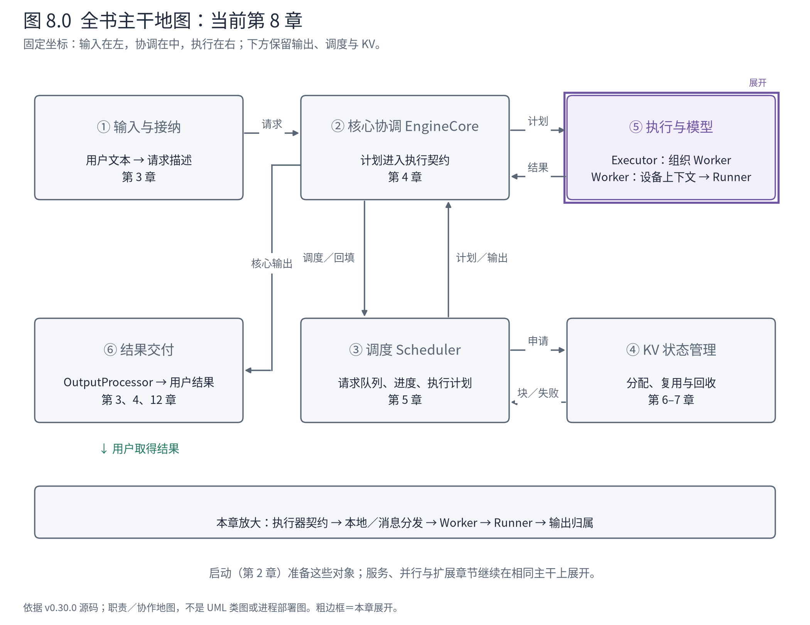
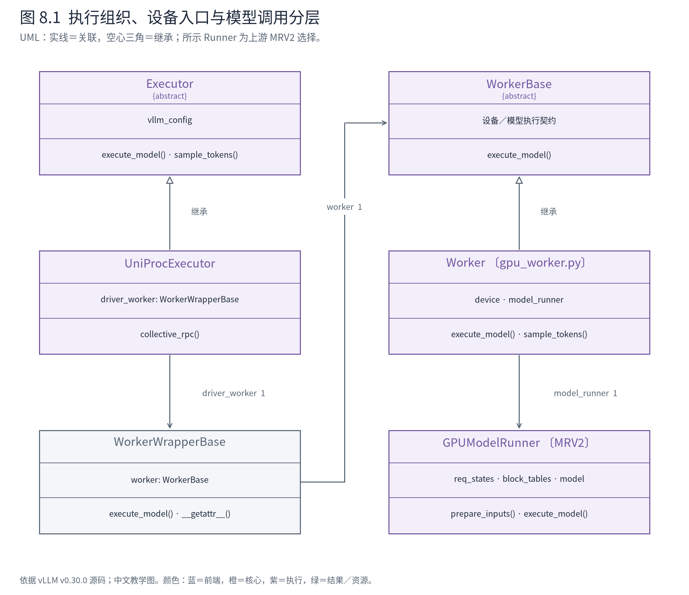
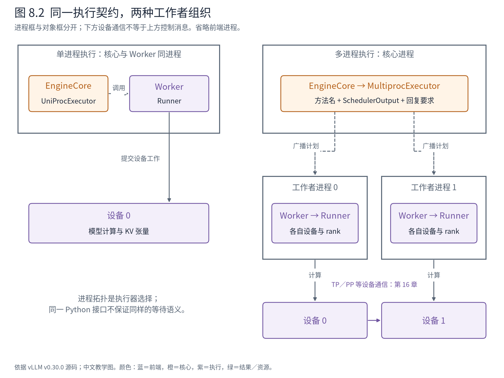

# 第 8 章 Executor 与 Worker：把一份计划交给执行系统

到第 7 章为止，调度侧已经维护了请求进度与 KV 所有权。现在核心拿到一份 `SchedulerOutput`：A 算多少，B 算多少，各自有哪些块，哪些旧请求需要撤下。它需要的是执行结果，却不应该为了单卡、多进程或不同平台重新实现调度循环。

本章要读懂隔在两者之间的执行契约。先把三个名字拆开：Executor 组织工作者，Worker 承担设备侧运行入口，Model Runner 组织一次模型调用。它们的名字都像“执行”，封装的变化却不同。



**先在地图上定位。** 从②跨到⑤，本章只打开 Executor 与 Worker。输入是第 5–7 章形成的计划，出口是送达 Runner 的执行调用以及返回核心的结果契约。Runner 如何组装张量在第 9 章继续，模型层内部暂时折叠。

## 8.1 三个抽象不是一条继承链

若 EngineCore 直接创建每个设备上的模型、广播参数、等待通信、组织批次，它会同时承担调度、部署与模型执行三种职责。一个并行组织方式的变化，都可能影响最核心的推进循环。

vLLM 用 Executor 作为核心看到的执行边界。它提供初始化、执行、采样及其他集体操作；不同实现决定本地调用还是跨进程分发。Worker 则知道自己所在的设备和 rank，维护与模型执行有关的上下文，并协调需要跨流水线阶段传递的中间张量。Runner 继续负责请求状态、输入准备、模型调用与采样准备。



**图 8.1 怎样读。** Executor 与其实现之间是继承，Worker 与 Runner 之间是关联，不能把所有纵向框都解释成“is-a”。单进程执行器持有 `WorkerWrapperBase`；包装对象再引用真正的 Worker。实线关联只说明可导航引用，不推断某对象可以脱离其资源生命周期独立使用。类图展示上游 GPU 主路径，NPU 实例在本章后部另行对应。

这个边界可以用三个变化检验：只改变工作者部署方式，首先影响 Executor；只改变设备初始化与运行上下文，首先影响 Worker／平台；只改变批次如何变成输入，首先影响 Runner。实际功能仍可能跨多个边界，但这种分工使我们知道从哪里开始定位。

代价是层间需要明确协议。调度计划不能携带任意只有本地指针才有意义的内容，执行错误必须穿回核心，多个 rank 的输出也要有明确归属。封装并没有消灭分布式复杂度，而是把它限制在应该承担它的边界。

## 8.2 在单设备路径中，RPC 接口也可以只是本地调用

先读上游 UniProcExecutor。它把 `execute_model` 翻译成统一分发接口上的一个操作：

<!-- book:ch08-call:start -->
源码教学注释版，vllm v0.30.0：[原文件 L119–L132](https://github.com/vllm-project/vllm/blob/ced6857afa0ea7b2e3f0846a62e1394e90f15607/vllm/v1/executor/uniproc_executor.py#L119-L132)。仅新增 `# 【解读】`，其他内容保留原文。

```python
    # 【解读】单进程执行器实现统一执行契约，参数是本轮 SchedulerOutput。
    def execute_model(  # type: ignore[override]
        self, scheduler_output: SchedulerOutput, non_block: bool = False
    ) -> ModelRunnerOutput | None | Future[ModelRunnerOutput | None]:
        # 【解读】把方法名和参数交给执行器自己的分发接口；single_value 避免返回一元素列表。
        output = self.collective_rpc(
            "execute_model",
            args=(scheduler_output,),
            non_block=non_block,
            single_value=True,
        )
        # In non-blocking mode, surface any exception as early as possible.
        # 【解读】若返回的 Future 已完成，立即取结果以提前暴露异常。
        if non_block and output.done():
            # Raise the exception in-line if the task failed.
            output.result()
        return output
```
<!-- book:ch08-call:end -->

`args=(scheduler_output,)` 仍然是完整计划对象的引用，在这个进程内不需要先序列化成网络消息。`single_value=True` 表示上层要一个结果，而不是一个“各 Worker 结果”列表。这样，EngineCore 不必在每次调用处写“只有一个 Worker 时取第零项”的条件。

继续沿方法名向下，普通路径是：

```text
EngineCore.step
└─ UniProcExecutor.execute_model(plan, non_block=True)
   └─ UniProcExecutor.collective_rpc("execute_model", args=(plan,))
      └─ run_method(driver_worker, ...)
         └─ WorkerWrapperBase.execute_model(plan)
            ├─ _apply_mm_cache(plan)          〔文本例没有媒体工作〕
            └─ worker.execute_model(plan)
               └─ model_runner.execute_model(plan, intermediate_tensors)
```

这是一棵依据源码整理的同进程调用树。包装层的 `execute_model` 有自己的实现，先处理适用的媒体缓存，再委托 Worker；其他某些方法通过 `__getattr__` 转发。因此不能粗略地说包装对象的所有方法都只是同一个透明代理。

调用接口名带有 RPC，并不证明本次存在远程进程。应当看实现如何分发。UniProcExecutor 的实现直接执行 `run_method`；多进程实现才把方法与参数送到工作者队列。类似地，前端使用 SyncMPClient 也不自动决定这里一定采用 MultiprocExecutor：前端／核心边界与核心／执行边界是两个独立问题。

## 8.3 返回 Future，不等于另起一个线程

第 4 章已经看到核心会取得 Future，再解析结果。现在读它是怎样产生的：

<!-- book:ch08-future:start -->
源码教学注释版，vllm v0.30.0：[原文件 L102–L117](https://github.com/vllm-project/vllm/blob/ced6857afa0ea7b2e3f0846a62e1394e90f15607/vllm/v1/executor/uniproc_executor.py#L102-L117)。仅新增 `# 【解读】`，其他内容保留原文。

```python
        # 【解读】同步接口直接取得结果；异步输出包装需要在此解析。
        if not non_block:
            result = run_method(self.driver_worker, method, args, kwargs)
            if isinstance(result, AsyncModelRunnerOutput):
                result = result.get_output()
            return result if single_value else [result]

        # 【解读】non_block 分支仍先在当前调用中运行 Worker 方法，不在这里创建后台线程。
        try:
            result = run_method(self.driver_worker, method, args, kwargs)
            # 【解读】若执行侧返回延迟输出，用专门 Future 延后解析。
            if isinstance(result, AsyncModelRunnerOutput):
                return AsyncOutputFuture(result, single_value)
            # 【解读】普通返回值放进已完成 Future，统一上层消费方式。
            future = Future[Any]()
            future.set_result(result if single_value else [result])
        # 【解读】异常也进入 Future，调用者取得结果时可重新抛出。
        except Exception as e:
            future = Future[Any]()
            future.set_exception(e)
        return future
```
<!-- book:ch08-future:end -->

`non_block=True` 分支仍然先运行 `run_method`。如果普通结果已经返回，就把它装入已完成 Future；如果拿到的是 `AsyncModelRunnerOutput`，则返回 `AsyncOutputFuture`，将读取输出的动作留到之后。错误也能作为 Future 的异常保存。

于是这里至少存在三种时间点：Python 调用已返回、设备计算已排入执行、输出已经可以供 CPU 使用。它们不必同时发生。一个方法返回得快，可能因为只提交了设备工作；一个 Future 已经完成，也要看里面装的是哪种结果与这个实现如何封装。不能只用 Python 对象名字推断并行程度。

本书重新执行 A/B，在真实边界处记录了以下字段：

<!-- book:ch08-contract:start -->
真实运行字段投影，保留字段名与值，省略无关项。来自[原始记录](evidence/runner-inproc-traced/projection.json)。

```json
{
  "steps": {
    "1": {
      "execute": {
        "plan": {
          "num_scheduled_tokens": {
            "A-9fe0112d": 5,
            "B-b550db9e": 6
          },
          "total_num_scheduled_tokens": 11
        },
        "non_block": true
      },
      "returned": {
        "returned_type": "concurrent.futures._base.Future"
      }
    }
  }
}
```
<!-- book:ch08-contract:end -->

记录证明这个 NPU 教学配置中，首轮计划为 11 个 token，调用使用 `non_block=True`，Executor 返回 Future。它没有直接采集 Future 内部结果的每个状态。结合第 4 章已核对的条件以及随后出现的采样调用，才能解释该次迭代为什么继续进入 `sample_tokens`；不能把单独一行类型日志当作完整异步协议证据。

新记录来自[Runner 观测运行](evidence/runner-inproc-traced/events.jsonl)，实际 Executor 仍为上游 UniProcExecutor，Worker 为 NPUWorker。最后 A/B 的 token 与原无探针对照一致。探针读取小设备张量会同步，所以这些间隔不能拿来评估非阻塞效率。

## 8.4 Worker 把计划交给 Runner，同时承担设备协作

上游 GPU Worker 中真正委托 Runner 的片段如下。本机执行的是 NPU Worker 分支，此段用于阅读上游设计，不是 CUDA 实测记录：

<!-- book:ch08-worker:start -->
源码教学注释版，vllm v0.30.0：[原文件 L1209–L1222](https://github.com/vllm-project/vllm/blob/ced6857afa0ea7b2e3f0846a62e1394e90f15607/vllm/v1/worker/gpu_worker.py#L1209-L1222)。仅新增 `# 【解读】`，其他内容保留原文。

```python
        # 【解读】本节展示上游 GPU Worker；前面的 PP 接收准备已经完成。
        with self.annotate_profile(scheduler_output):
            # 【解读】把计划与可选中间张量交给 Runner，Worker 不重新决定调度顺序。
            output = self.model_runner.execute_model(
                scheduler_output, intermediate_tensors
            )
            # 【解读】MRV2 pooling 模型有独立收尾；A/B 是生成模型，不进入此分支。
            if (
                self.use_v2_model_runner
                and self.model_runner.is_pooling_model
                and output is None
            ):
                output = self.model_runner.pool()  # type: ignore
            # 【解读】返回生成结果、延迟结果或 None；其他输出在下文按 PP 中间张量处理。
            if isinstance(
                output, ModelRunnerOutput | AsyncModelRunnerOutput | NoneType
            ):
                return output
```
<!-- book:ch08-worker:end -->

这段代码已经揭示了返回契约的多样性。普通生成可以返回 `ModelRunnerOutput`、延迟输出或 `None`；pooling 模型有相应收尾；若返回的是流水线中间张量，下面的代码还要把它交给下一个 PP rank。中间激活不是用户生成结果，不能直接送回 Scheduler 当采样 token。

Worker 在进入这段代码之前还可能等待上一次 PP 发送完成，以免新前向覆盖尚被通信读取的缓冲区；非首段也可能先接收上游激活。因此它并不只是一个给 Runner 改名的薄壳。它将设备执行上下文和跨阶段协作放在模型批次逻辑外部，使 Runner 可以接收明确的输入条件。

单设备 A/B 不需要 PP 中间张量，此参数为 `None`。保持这个最小案例有助于理解基础路径；第 16 章再加入 rank 与通信，不必在首次阅读执行入口时把每个分支一起展开。

## 8.5 多进程时，调用树在消息边界断开

如果执行实现改为 MultiprocExecutor，同样的计划通过 `rpc_broadcast_mq` 广播。工作者各自在自己的进程中取出方法、参数和回复要求，执行之后将结果送回响应队列。执行器可以按 `unique_reply_rank` 只等指定输出 rank；connector 等情况则可能需要收集并聚合多个输出。



**图 8.2 怎样读。** 外框表示进程，内部框表示对象，设备另列。左图的箭头是本地调用，右图穿过进程边界的是方法与计划消息。右侧 Worker 之间的设备通信不等于控制消息广播；两种箭头分别标明。此图是执行层部署对照，不包括 HTTP 前端，也不把 worker 数量直接等同于服务副本数量。

跨边界的路径应这样写，而不是伪造一条连续 Python 栈：

```text
核心进程：MultiprocExecutor.collective_rpc
          └─ 广播 (method, args, kwargs, output_rank)
                        ↓ 消息边界
工作者进程：WorkerProc 执行循环 → Wrapper → Worker → Runner
                        ↓ 响应边界
核心进程：收取所需回复 → 解析状态／聚合 → 返回结果或 Future
```

方法失败、进程退出和等待超时都可能从这里暴露。远端异常并不能保留一个可直接单步进入的本地栈帧；日志中的 rank、进程和阶段因而很重要。第 27 章会用这些边界定位问题。正常路径下，这层协议让核心继续处理相同的“计划进入、结果返回”，把工作者数量和传输机制留在实现内部。

本章完成了执行组织的放大，却还没有解释设备输入长什么样。下一章沿同一次 A/B 运行进入 Runner。那里最重要的转换不是“再调用一个方法”，而是把请求身份、长期状态与本轮顺序重新组织成紧凑的计算输入。

**源码停点：** [UniProcExecutor](https://github.com/vllm-project/vllm/blob/ced6857afa0ea7b2e3f0846a62e1394e90f15607/vllm/v1/executor/uniproc_executor.py#L89-L142)读调用与结果包装；[Wrapper](https://github.com/vllm-project/vllm/blob/ced6857afa0ea7b2e3f0846a62e1394e90f15607/vllm/v1/worker/worker_base.py#L357-L376)读显式处理和转发的区别；[MultiprocExecutor](https://github.com/vllm-project/vllm/blob/ced6857afa0ea7b2e3f0846a62e1394e90f15607/vllm/v1/executor/multiproc_executor.py#L375-L440)停在消息与响应边界，通信算子后续再读。
