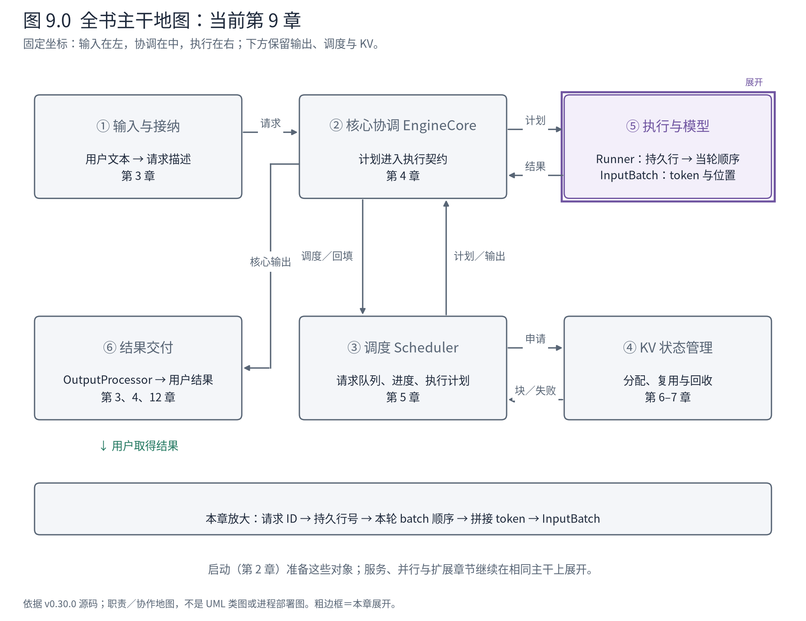
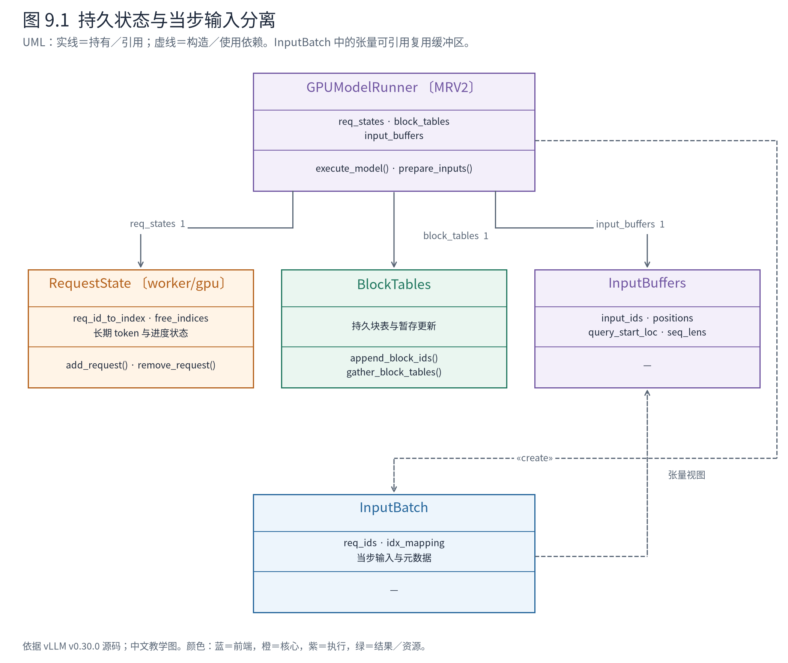
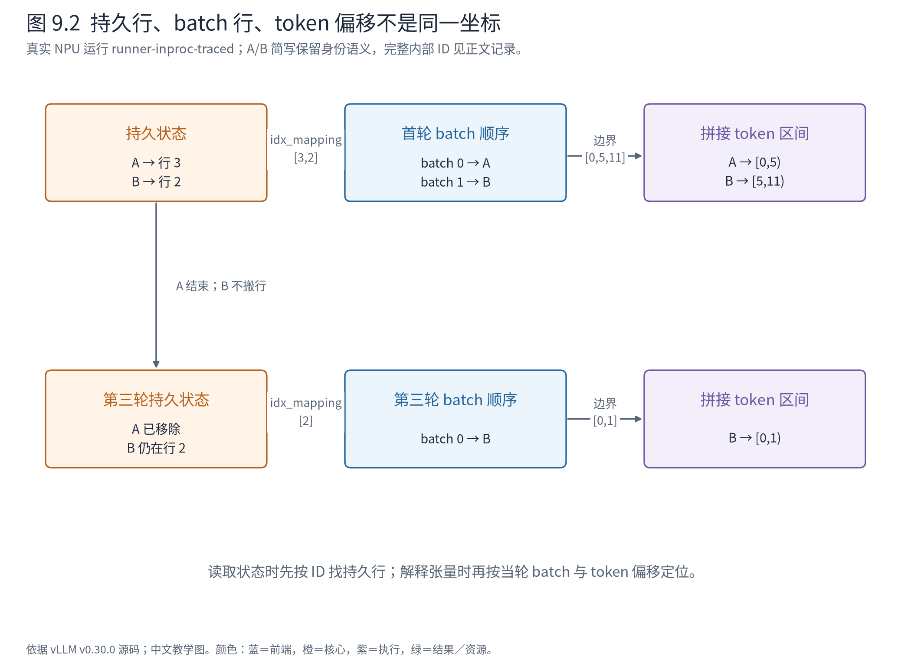

# 第 9 章 Model Runner：从请求身份到计算批次

Executor 已把计划送达。对 Scheduler 而言，这是一组请求 ID 与工作量；对模型而言，需要的是连续的 token、位置、注意力元数据和张量。两种表示之间还有一个难题：请求跨轮存活，但每轮参加计算的请求集合和排列都可能改变。

如果为了改变批次顺序而搬动全部长期状态，输入准备会越来越复杂。MRV2 的重要选择是：让长期状态有自己的位置，让当轮输入有自己的顺序，再用映射把两者连起来。



**先在地图上定位。** 本章进一步打开⑤中的 Runner，接过第 8 章送达的计划，产出可交给模型的计算批次。④提供的块编号同时进入执行侧状态；模型与 Attention 算子仍折叠，在第 10、11 章展开。

## 9.1 先区分两个同名问题

前面已经有输出侧 `RequestState`，现在又出现 `worker/gpu/states.py` 中的 `RequestState`。它们不是同一个类：前者维护文本交付，后者管理执行侧请求状态与持久行。读到短类名必须连同模块位置，否则很容易把结束条件、文本缓冲和设备状态混成一个对象。

同样，MRV1 与 MRV2 都有批次相关对象，却不能按名字直接互换。官方[MRV2 设计说明](https://docs.vllm.ai/en/v0.30.0/design/model_runner_v2/)明确解释了改动动机：将持久状态与每步输入分开，减少因输入顺序要求而产生的状态重排。本章据当前 MRV2 源码讲解，不用 MRV1 的 `CachedRequestState` 填补推断。



**图 9.1 怎样读。** Runner 持有 RequestState、BlockTables 和可复用 InputBuffers；当轮构造 InputBatch，引用本次使用的输入及元数据。虚线创建依赖不意味着它复制全部底层存储：InputBatch 中许多张量可以是缓冲区的切片或视图。图展示职责与引用，不是显存连续布局。

RequestState 封装跨轮保持的请求身份和进度；BlockTables 封装持久块映射及其更新；InputBuffers 提供可复用的执行输入空间；InputBatch 描述当前批次真正使用哪一部分。这种分离降低了“请求退出导致所有后续行搬家”的需求，但引入了索引映射、收集和更新可见性的成本。我们要检查的正是这些连接。

## 9.2 请求有一行长期位置，批次另有一个临时位置

先读上游 RequestState 登记请求的关键片段：

<!-- book:ch09-row:start -->
源码教学注释版，vllm v0.30.0：[原文件 L99–L115](https://github.com/vllm-project/vllm/blob/ced6857afa0ea7b2e3f0846a62e1394e90f15607/vllm/v1/worker/gpu/states.py#L99-L115)。仅新增 `# 【解读】`，其他内容保留原文。

```python
        # 【解读】活跃请求必须先取得一个持久槽位，槽位耗尽不能继续登记。
        assert len(self.free_indices) > 0, "No free indices"
        # 【解读】从空闲行尾部取号，所以教学配置中最先取得的不是必然为零。
        req_idx = self.free_indices.pop()
        # 【解读】维护 ID 到行号及反向映射。
        self.req_id_to_index[req_id] = req_idx
        self.index_to_req_id[req_idx] = req_id

        # 【解读】在这行写入请求的长度约束。
        self.max_seq_len[req_idx] = prompt_len + max_tokens
        self.prompt_len.np[req_idx] = prompt_len
        # 【解读】prefill_len 包括本次交给 Runner 的历史，恢复请求时可以长于原 prompt。
        prefill_len = len(all_token_ids)
        assert prefill_len >= prompt_len, (
            f"prefill_len {prefill_len} < prompt_len {prompt_len}"
        )
        self.prefill_len.np[req_idx] = prefill_len
        # 【解读】大状态通过暂存写入描述更新；实际应用发生在 apply_staged_writes。
        self.total_len.stage_write_elem(req_idx, prefill_len)
        self.all_token_ids.stage_write(req_idx, 0, all_token_ids)
        # 【解读】保存计算进度，CPU 与设备侧状态分别更新。
        self.num_computed_prefill_tokens[req_idx] = num_computed_tokens
        self.num_computed_tokens_np[req_idx] = num_computed_tokens
        self.num_computed_tokens.stage_write_elem(req_idx, num_computed_tokens)
```
<!-- book:ch09-row:end -->

空闲行号从列表尾部取出。`max_num_reqs=4` 时，初始列表是 0、1、2、3，第一条请求拿到 3，第二条拿到 2。这个实现细节本身不是算法要求；真正需要保持的是：请求存活期间，其他对象通过一致的映射找到它的行。结束或抢占之后，行号才可以交回并重新使用。

这里的 `prompt_len` 与 `prefill_len` 也不能混读。前者是用户原始输入长度，后者是本次进入 Runner 的历史长度。第 7 章的恢复请求可能带着已经生成的 token 重建状态，因此后者可以更长。把两者强行设成相同，会把恢复计算错当成用户的新输入。

真实 NPU 运行中，我们在登记与输入准备边界取得下面的投影：

<!-- book:ch09-index:start -->
真实运行字段投影，保留字段名与值，省略无关项。来自[原始记录](evidence/runner-inproc-traced/projection.json)。

```json
{
  "steps": {
    "1": {
      "registered": {
        "req_id_to_index": {
          "A-9fe0112d": 3,
          "B-b550db9e": 2
        }
      },
      "inputs": {
        "batch": {
          "req_ids": [
            "A-9fe0112d",
            "B-b550db9e"
          ],
          "idx_mapping": {
            "values": [
              3,
              2
            ]
          }
        }
      }
    },
    "3": {
      "registered": {
        "req_id_to_index": {
          "B-b550db9e": 2
        }
      },
      "inputs": {
        "batch": {
          "req_ids": [
            "B-b550db9e"
          ],
          "idx_mapping": {
            "values": [
              2
            ]
          }
        }
      }
    }
  }
}
```
<!-- book:ch09-index:end -->

首轮 A 对应持久行 3，B 对应行 2；当轮请求顺序为 A、B，所以映射是 `[3,2]`。第三轮 A 已结束，只剩 B。此时 B 的 **batch index 为 0，持久状态行仍为 2**。如果按 batch 下标去读长期状态第 0 行，就会读错请求。

本次实际类为 AscendRequestState／AscendInputBatch，记录来自[独立 NPU 运行](evidence/runner-inproc-traced/events.jsonl)。源码主线仍是上游 MRV2；Ascend 适配后保留了本节解释的两套索引。该观察不能证明所有平台都按相同行号顺序分配，我们只验证此运行与相应源码契约的一致性。

## 9.3 当轮顺序确定之后，再收集状态

Runner 不要求本轮顺序等于持久行顺序。当前实现先排序请求，再按 ID 收集索引：

<!-- book:ch09-gather:start -->
源码教学注释版，vllm v0.30.0：[原文件 L1234–L1249](https://github.com/vllm-project/vllm/blob/ced6857afa0ea7b2e3f0846a62e1394e90f15607/vllm/v1/worker/gpu/model_runner.py#L1234-L1249)。仅新增 `# 【解读】`，其他内容保留原文。

```python
        # 【解读】上下文：普通真实批次，已取得计划的请求数与工作量。
        draft_tokens = scheduler_output.scheduled_spec_decode_tokens
        # batch_idx -> req_id
        # 【解读】先决定本轮请求顺序，不把持久行号直接当 batch 顺序。
        req_ids = sort_batch_req_ids(
            num_tokens_per_req, draft_tokens, self.decode_query_len
        )

        # 【解读】按相同顺序收集每条请求的工作量。
        numtoks_iter = map(num_tokens_per_req.__getitem__, req_ids)
        num_scheduled_tokens = np.fromiter(numtoks_iter, dtype=np.int32, count=num_reqs)

        # 【解读】将本轮 req_id 映射回持久状态行，这是两套索引之间的桥。
        idx_mapping_iter = map(self.req_states.req_id_to_index.__getitem__, req_ids)
        idx_mapping_np = np.fromiter(idx_mapping_iter, dtype=np.intp, count=num_reqs)
        # 【解读】使用映射收集 prefill 状态，避免读取同下标但属于其他请求的数据。
        prefill_len_np = self.req_states.prefill_len.np[idx_mapping_np]
        num_computed_prefill_tokens_np = self.req_states.num_computed_prefill_tokens[
            idx_mapping_np
        ]
        is_prefilling_np = num_computed_prefill_tokens_np < prefill_len_np
```
<!-- book:ch09-gather:end -->

`req_ids` 是当轮次序，`idx_mapping_np` 把这个次序翻译成持久行号，随后各状态按同一映射收集。这里每个数组必须对齐同一个 batch 维度：工作量、prefill 长度、计算进度不能各自采用不同的排列。

这是一项比“数组长度相等”更强的契约。两个长度都为 2 的数组仍可能把 A 与 B 对调。调试时应一起打印请求 ID、索引映射和对应字段，不能只截一个 shape。第 8 章的计划以 ID 表达身份，到这里才变成适合设备批处理的位置表达。



**图 9.2 怎样读。** 左侧保留真实持久行 3 与 2，中间是本轮 batch 的第 0、1 项，右侧是拼接 token 的偏移区间。沿 B 走一遍：身份 B → 持久行 2 → 首轮 batch 第 1 项 → token 区间 `[5,11)`。第三轮右下方只剩 B，它移动的是批次位置，长期状态并不跟着搬到行 0。

同样，块表从第 6 章进入 Runner 后也要按这条映射取得当轮视图。Scheduler 中的 Request 对象并没有被直接传进设备；Runner 依据计划维护自己的执行状态，两侧用 ID、进度和块编号保持契约一致。

## 9.4 两段不同长度的输入怎样变成一条 token 轴

A 有 5 个输入 token，B 有 6 个。常见的模型训练示例会把它们补齐成 `[2,6]`，但这里的真实执行输入是 11 个 token 的拼接，并通过边界数组表示每个请求的片段。

下面保留真实张量的 shape、dtype、device 与小数组值：

<!-- book:ch09-input:start -->
真实运行字段投影，保留字段名与值，省略无关项。来自[原始记录](evidence/runner-inproc-traced/projection.json)。

```json
{
  "steps": {
    "1": {
      "inputs": {
        "batch": {
          "input_ids": {
            "type": "torch.Tensor",
            "shape": [
              11
            ],
            "dtype": "torch.int32",
            "device": "npu:0",
            "values": [
              785,
              6722,
              315,
              9625,
              374,
              785,
              7772,
              17951,
              389,
              9237,
              374
            ]
          },
          "positions": {
            "type": "torch.Tensor",
            "shape": [
              11
            ],
            "dtype": "torch.int64",
            "device": "npu:0",
            "values": [
              0,
              1,
              2,
              3,
              4,
              0,
              1,
              2,
              3,
              4,
              5
            ]
          },
          "query_start_loc": {
            "type": "torch.Tensor",
            "shape": [
              3
            ],
            "dtype": "torch.int32",
            "device": "npu:0",
            "values": [
              0,
              5,
              11
            ]
          },
          "seq_lens": {
            "type": "torch.Tensor",
            "shape": [
              2
            ],
            "dtype": "torch.int32",
            "device": "npu:0",
            "values": [
              5,
              6
            ]
          },
          "logits_indices": {
            "type": "torch.Tensor",
            "shape": [
              2
            ],
            "dtype": "torch.int64",
            "device": "npu:0",
            "values": [
              4,
              10
            ]
          }
        }
      }
    }
  }
}
```
<!-- book:ch09-input:end -->

`input_ids` 是 `[11]` 的 int32 NPU 张量；前 5 个元素属于 A，后 6 个属于 B。`positions` 同样有 11 项，但在 B 开始处回到 0，因为位置属于各自序列，不是整个批次的全局序号。

`query_start_loc=[0,5,11]` 用半开区间定位请求：A 在 `[0,5)`，B 在 `[5,11)`。最后一个值同时是有效 token 总数。`seq_lens=[5,6]` 描述每条请求此次计算能够看到的序列长度，在首轮恰好等于 query 长度，解码时就不同了。

构建这组分段边界的上游代码很直接：

<!-- book:ch09-offset:start -->
源码教学注释版，vllm v0.30.0：[原文件 L1342–L1352](https://github.com/vllm-project/vllm/blob/ced6857afa0ea7b2e3f0846a62e1394e90f15607/vllm/v1/worker/gpu/model_runner.py#L1342-L1352)。仅新增 `# 【解读】`，其他内容保留原文。

```python
        # Get query_start_loc.
        # num_reqs_padded is None for PIECEWISE graphs (no request padding needed)
        # 【解读】当步描述可能要求补齐请求数；eager 教学路径不依赖图补齐。
        num_reqs_padded = batch_desc.num_reqs or num_reqs
        # 【解读】预先准备边界数组，首元素为零。
        query_start_loc_np = np.empty(self.max_num_reqs + 1, dtype=np.int32)
        query_start_loc_np[0] = 0
        # 【解读】每条请求的本轮 token 数做前缀和，得到拼接批次的分段边界。
        np.cumsum(num_scheduled_tokens_np, out=query_start_loc_np[1 : num_reqs + 1])
        # Pad for full CUDA graph mode.
        # Some attention backends like FA3 require query_start_loc to be non-decreasing.
        # 【解读】填充尾部使边界非递减，不能留下任意旧值给后端。
        query_start_loc_np[num_reqs + 1 :] = num_tokens
        query_start_loc = self.input_buffers.query_start_loc
        # 【解读】复制到执行输入缓冲区；真正有效范围在后文裁出。
        async_tensor_h2d(query_start_loc_np, out=query_start_loc)
```
<!-- book:ch09-offset:end -->

前缀和把“每条请求算多少”转成“拼接输入在哪里切开”。后端因此不需要把短请求补成与长请求同样多的真实 query token。某些图执行路径仍会补齐批次外形，但补齐位置与有效工作必须通过元数据区分；不能用本例 eager 的 11 项输入推广为所有执行模式永远没有 padding。

最后看 `logits_indices=[4,10]`。这两个位置是各请求本轮末尾的隐藏状态行；普通生成不必把首轮 11 行全部送入词表输出后再选两个。它们将在第 12 章连接到 logits 与采样。现在只需记住，token 轴上的位置选择与请求轴上的结果排列必须一致。

## 9.5 下一轮不再重复传入整个 prompt

A、B 首轮分别生成了 12095 和 279。第二轮的实际输入变成：

<!-- book:ch09-decode:start -->
真实运行字段投影，保留字段名与值，省略无关项。来自[原始记录](evidence/runner-inproc-traced/projection.json)。

```json
{
  "steps": {
    "2": {
      "inputs": {
        "batch": {
          "input_ids": {
            "values": [
              12095,
              279
            ]
          },
          "positions": {
            "values": [
              5,
              6
            ]
          },
          "query_start_loc": {
            "values": [
              0,
              1,
              2
            ]
          },
          "seq_lens": {
            "values": [
              6,
              7
            ]
          }
        }
      }
    }
  }
}
```
<!-- book:ch09-decode:end -->

现在 query 长度各为 1，所以边界是 `[0,1,2]`；位置分别是 5 和 6，序列长度则增长到 6 和 7。这里清楚地分开了三个量：本轮计算的 token 数、该 token 在请求中的位置、注意力可以访问的历史长度。

本轮不把 A 的 5 个原始输入 token 再次全部前向。历史通过已经建立的 KV 和块表保留，新输入来自此前采样结果；当请求处在 prefill chunk 或恢复阶段时，又会按相应进度读取需要计算的历史片段。统一计划表达了工作量，输入准备根据状态决定这些工作量对应哪些 token。

Runner 执行入口的相关调用树如下，省略 dummy run、并行同步与扩展支路：

```text
GPUModelRunner.execute_model(plan)
├─ finish_requests(plan)             → 撤下结束／抢占的持久行
├─ free_states(plan)                 → 释放相关 encoder 状态
├─ add_requests(plan)                → 登记新请求，覆盖初始块表
├─ update_requests(plan)             → 更新旧进度，追加块表增量
├─ block_tables.apply_staged_writes
├─ gather_batch_req_state(plan)      → 当轮顺序与持久行映射
├─ prepare_inputs(...)              → InputBatch
├─ prepare_attn(input_batch)         → 当轮块表与 slot mapping
└─ 模型前向与后续输出状态准备
```

这是上游源码骨架，实际 Ascend Runner 的入口在平台处理后调用上游实现，并覆盖部分输入准备。不同方法的实现归属已记录在该次运行的 provenance 中，不能把整棵树叫作纯 CUDA 实测。

旧请求的块更新进一步说明为什么增量不能当全量：

<!-- book:ch09-delta:start -->
源码教学注释版，vllm v0.30.0：[原文件 L1185–L1193](https://github.com/vllm-project/vllm/blob/ced6857afa0ea7b2e3f0846a62e1394e90f15607/vllm/v1/worker/gpu/model_runner.py#L1185-L1193)。仅新增 `# 【解读】`，其他内容保留原文。

```python
        # 【解读】旧请求更新按 ID、计算进度、新块编号并行遍历。
        for req_id, num_computed_tokens, req_new_block_ids in zip(
            reqs.req_ids, reqs.num_computed_tokens, reqs.new_block_ids
        ):
            # 【解读】先通过 ID 找持久行，不使用这次循环下标当行号。
            req_index = self.req_states.req_id_to_index[req_id]
            # 【解读】更新该请求的 CPU 进度镜像。
            num_computed_tokens_np[req_index] = num_computed_tokens
            # 【解读】已有完整块表覆盖更新时不再追加；普通增量只追加新编号。
            if req_new_block_ids is not None and req_id not in table_updates:
                self.block_tables.append_block_ids(
                    # 【解读】overwrite=False 保留此前块表。
                    req_index, req_new_block_ids, overwrite=False
                )
```
<!-- book:ch09-delta:end -->

`overwrite=False` 保留已有块，追加新块；特殊完整块表更新已经处理时则跳过重复追加。对于本例第二轮，原来的一块仍足够，因此没有新编号也可以继续执行。执行侧最终使用的是累计映射，而不是本轮 `new_block_ids` 单独构成的表。

## 9.6 “输入准备完成”究竟交付了什么

到模型前向之前，Runner 已经建立两种一致性。身份一致性使 ID、持久行与 batch 行对应；位置一致性使 query 片段、序列位置、历史长度和 KV 块映射对应。第 10 章的模型层可以接收 token／位置张量，第 11 章的 Attention 后端可以据元数据访问正确历史。

这套设计降低了每轮重建大状态的 CPU 工作，却要求严格控制缓冲区生命周期。InputBatch 可能引用可复用空间，把这个对象留到下一轮再打印，看到的值可能已变。本书探针在边界立即复制小张量，因而获得的是当时快照；这样的同步成本不能混入性能结论。

更进一步的优化是暂存增量写入，而不是每轮复制整张状态表；异步和图执行又会约束何时修改、哪些地址必须稳定。第 13、14 章继续处理这些问题。此刻先把本章的输入交给模型：A/B 第一轮共 11 个 token，即将成为隐藏状态，而它们背后的身份与位置已经有了可核对的坐标。

**源码停点：** [RequestState](https://github.com/vllm-project/vllm/blob/ced6857afa0ea7b2e3f0846a62e1394e90f15607/vllm/v1/worker/gpu/states.py#L91-L133)读行号生命周期；[Runner 的状态更新与输入准备](https://github.com/vllm-project/vllm/blob/ced6857afa0ea7b2e3f0846a62e1394e90f15607/vllm/v1/worker/gpu/model_runner.py#L1073-L1420)沿上述调用树选择性进入；[InputBatch](https://github.com/vllm-project/vllm/blob/ced6857afa0ea7b2e3f0846a62e1394e90f15607/vllm/v1/worker/gpu/input_batch.py#L43-L119)逐一对应本章的两套索引和 token 轴，暂不穷举投机字段。
