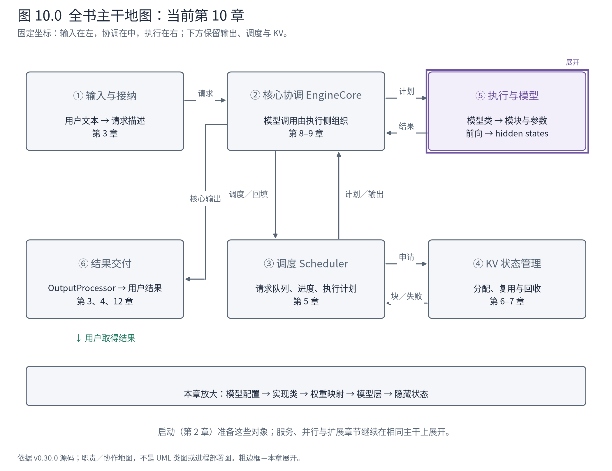
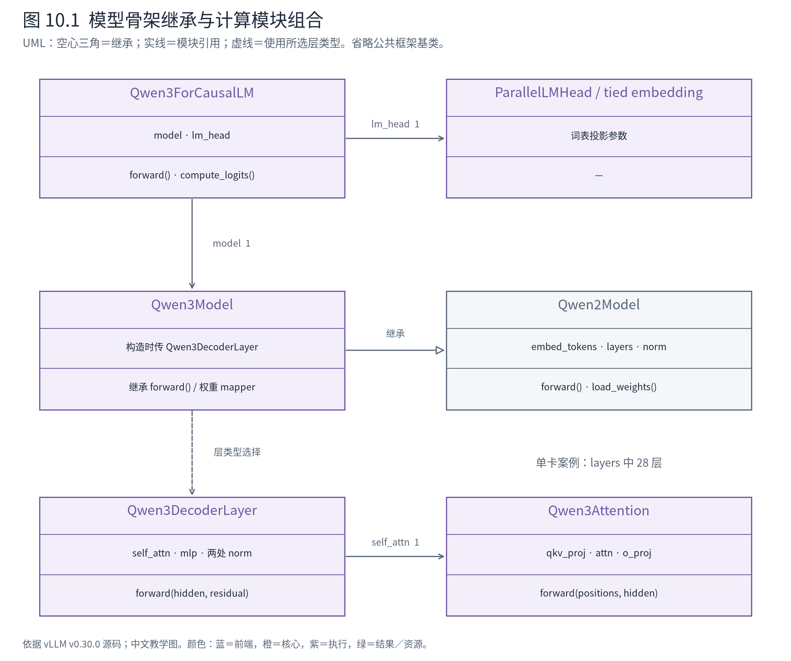
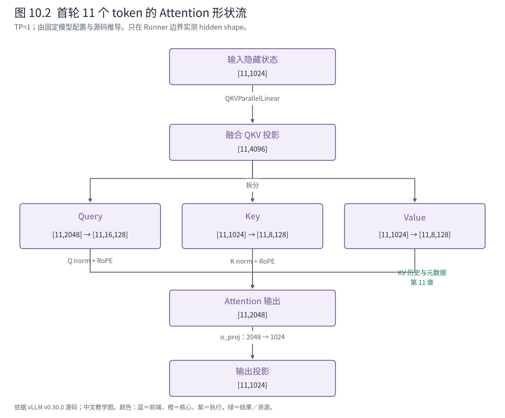

# 第 10 章 模型实现：让熟悉的 Transformer 成为可执行对象

第 9 章交付了 A/B 的 11 个输入 token 和对应位置。现在进入读者已经熟悉的模型计算，但源码中的模型还多了另一组责任：按配置选择实现，把 checkpoint 权重放进正确参数，在并行和后端约束下执行前向，并把隐藏状态交回 Runner。

本章不重讲 Transformer 理论，而是把模型知识映射到真实模块与接口。我们将看到，一个 checkpoint 中的三份投影权重，可以对应运行模型中的一个融合参数；一个模型类，也可以借用另一模型的执行骨架而替换具体层。



**先在地图上定位。** 继续打开⑤，当前位置是 Runner 所持有的模型对象。启动期先把模型结构和权重装好，运行期再消费 InputBatch。本章出口为隐藏状态；Attention 的状态访问和采样各留一个明确接口给后两章。

## 10.1 配置、类与权重是三个相邻的对象

模型目录不是一个可以直接调用的 Python 模块。配置描述架构与尺寸，模型注册／选择机制把架构名解析为实现类，权重文件提供参数数值。三者必须匹配，才能得到真正可执行的对象。

基础案例固定到同一个模型快照，以下数值直接读取其配置文件：

<!-- book:ch10-config:start -->
固定模型快照的配置字段投影；这是文件检查，不是执行期间张量观测。来自[原始记录](evidence/model-assets/metadata.json)。

```json
{
  "model_revision": "c1899de289a04d12100db370d81485cdf75e47ca",
  "config": {
    "architectures": [
      "Qwen3ForCausalLM"
    ],
    "hidden_size": 1024,
    "head_dim": 128,
    "num_attention_heads": 16,
    "num_key_value_heads": 8,
    "num_hidden_layers": 28,
    "intermediate_size": 3072,
    "vocab_size": 151936
  }
}
```
<!-- book:ch10-config:end -->

`architectures` 指向 Qwen3ForCausalLM；hidden size 为 1024，query 头数为 16，KV 头数为 8，head dimension 显式为 128。这里尤其不能沿用“每个头的维度永远等于 hidden_size / num_heads”的简写：16×128 是 2048，与 hidden size 1024 不相等。实现允许投影后的 query 总宽度与输入宽度不同。

初始化工具先解析实现类，再调用该类的构造函数：

<!-- book:ch10-create:start -->
源码教学注释版，vllm v0.30.0：[原文件 L46–L61](https://github.com/vllm-project/vllm/blob/ced6857afa0ea7b2e3f0846a62e1394e90f15607/vllm/model_executor/model_loader/utils.py#L46-L61)。仅新增 `# 【解读】`，其他内容保留原文。

```python
    # 【解读】未显式给模型配置时，使用系统配置中的模型部分。
    if model_config is None:
        model_config = vllm_config.model_config
    # 【解读】从模型架构描述解析实现类，和读取权重文件是不同步骤。
    if model_class is None:
        model_class, _ = get_model_architecture(model_config)

    # 【解读】量化配置先与模型类适配，普通 BF16 案例不进入此分支。
    if vllm_config.quant_config is not None:
        configure_quant_config(vllm_config.quant_config, model_class)

    signatures = inspect.signature(model_class.__init__)
    all_params = [param.name for param in signatures.parameters.values()]
    # 【解读】现代模型构造约定接收 vllm_config 与层名前缀。
    if "vllm_config" in all_params and "prefix" in all_params:
        # new-style model class
        # 【解读】在当前配置上下文中创建模块，并记录后续重载所需元数据。
        with set_current_vllm_config(vllm_config, check_compile=True, prefix=prefix):
            model = model_class(vllm_config=vllm_config, prefix=prefix)
            record_metadata_for_reloading(model)
            return model
```
<!-- book:ch10-create:end -->

这一步创建模型模块与参数结构，不等于参数数值已经从 checkpoint 正确装入。之后 loader 读取权重迭代器并交给模型的加载协议；模型映射名称、子模块和分片，具体参数加载器再处理相应切片。量化或并行会进一步改变加载规则，所以不能把整个过程概括成一个通用 `load_state_dict`。

本节省略下载、文件缓存和所有 loader 格式；要保留的结构是“选择实现—创建结构—装入数值”。第 2 章关心这一阶段何时完成，本章打开它实际产生的模型对象。

## 10.2 类复用与模块包含要分别读



**图 10.1 怎样读。** Qwen3Model 到 Qwen2Model 的空心三角表示继承；外层语言模型到 `model`、`lm_head` 的线表示模块引用。Qwen3Model 构造时将 `Qwen3DecoderLayer` 作为层类型传给父类。于是父类的层遍历骨架可以复用，但每一层执行 Qwen3 的归一化、Attention 与 MLP 组合。图省略 nn.Module 等公共基类，避免把业务层次与框架层次挤在一起。

外层 `Qwen3ForCausalLM` 提供 forward、compute_logits 和 load_weights 等入口；内部 Qwen3Model 管 embedding、decoder 层序列及末尾 norm；每个 DecoderLayer 再组合 Attention、MLP 与归一化模块。

这形成两个方向的复用。继承复用模型主干遍历，模块组合复用计算构件。Qwen3 的 MLP 也复用相应实现，但模型对象仍需要表达自己的架构差异。收益是避免重复整套层遍历和并行框架，代价是读源码时必须追到真正继承的方法，不能因为 Qwen3Model 类体很短，就认为它没有 forward。

普通单设备运行的主要调用树因此是：

```text
GPUModelRunner 的模型调用
└─ Qwen3ForCausalLM.forward
   └─ Qwen3Model.forward              〔继承 Qwen2Model.forward〕
      ├─ embed_input_ids             → token embedding
      ├─ 遍历本 rank 负责的 decoder layers
      │  └─ Qwen3DecoderLayer.forward
      │     ├─ input_layernorm
      │     ├─ Qwen3Attention.forward
      │     ├─ post_attention_layernorm
      │     └─ Qwen3MLP.forward      〔复用相应 MLP 实现〕
      └─ 末尾 norm                   → hidden states
```

这棵树省略辅助隐藏状态、PP 中间结果和框架 `__call__` 包装。多卡时不一定每个 rank 都有全部层、embedding 与 lm_head；`PPMissingLayer` 等占位会表达部署差异，第 16 章再展开。

## 10.3 checkpoint 名称为什么不等于运行参数名称

固定快照的 safetensors 头部中，第一层有三份权重：q_proj 为 `[2048,1024]`，k_proj 和 v_proj 各为 `[1024,1024]`，类型均为 BF16。这些是直接读取文件头的形状信息，不是把大权重加载到设备后测得的结果，见[文件元数据](evidence/model-assets/metadata.json)。

运行模块却使用 `QKVParallelLinear`。三份输入如何知道自己应该写入哪个位置？Qwen3Model 继承的 mapper 给出了明确规则：

<!-- book:ch10-map:start -->
源码教学注释版，vllm v0.30.0：[原文件 L324–L333](https://github.com/vllm-project/vllm/blob/ced6857afa0ea7b2e3f0846a62e1394e90f15607/vllm/model_executor/models/qwen2.py#L324-L333)。仅新增 `# 【解读】`，其他内容保留原文。

```python
    # 【解读】Qwen3Model 继承并使用这份权重映射。
    hf_to_vllm_mapper = WeightsMapper(
        orig_to_new_stacked={
            # weight_name: (param_name, shard_id)
            # 【解读】q/k/v 三份 checkpoint 权重写入同一 qkv 参数的不同 shard。
            ".q_proj": (".qkv_proj", "q"),
            ".k_proj": (".qkv_proj", "k"),
            ".v_proj": (".qkv_proj", "v"),
            # 【解读】gate/up 同样进入融合参数，以 shard 0/1 区分。
            ".gate_proj": (".gate_up_proj", 0),
            ".up_proj": (".gate_up_proj", 1),
        }
    )
```
<!-- book:ch10-map:end -->

这不仅改名字，还保留 `shard_id`。同样的新名字 `.qkv_proj`，配上 `q`、`k`、`v` 才能区分三个分片；gate 与 up 使用 0、1。后续参数加载器依据分片以及 TP 配置决定实际写入范围。

在当前 TP=1 的形状推导中，qkv 输出总宽度为 2048+1024+1024=4096。模型可以用一次融合投影得到这些输出，再拆成 Q/K/V。checkpoint 保留分立权重格式，使模型分发和兼容更方便；运行表示则服务于具体算子和并行实现。两种表示之间的映射是必须显式维护的契约。

如果模型能构造却加载失败，应优先核对架构选择、参数名、形状与分片约定，而不是先怀疑调度器。若某个权重没有对应模块，还要区分它是被当前 PP rank 有意跳过，还是确实遗漏。DefaultModelLoader 的权重跟踪为部分配置提供缺失检查，但不能据“加载函数返回”推断所有格式都执行了完全相同的严格校验。

## 10.4 从一层代码读出残差状态的责任

熟悉理论之后，容易在代码里寻找一行显式 `x + residual`。本实现把部分残差与归一化操作融合了，阅读时需要跟踪两个返回值：

<!-- book:ch10-layer:start -->
源码教学注释版，vllm v0.30.0：[原文件 L232–L246](https://github.com/vllm-project/vllm/blob/ced6857afa0ea7b2e3f0846a62e1394e90f15607/vllm/model_executor/models/qwen3.py#L232-L246)。仅新增 `# 【解读】`，其他内容保留原文。

```python
        # Self Attention
        # 【解读】第一层尚无独立 residual 时先保存输入；后续层使用双输入归一化。
        if residual is None:
            residual = hidden_states
            hidden_states = self.input_layernorm(hidden_states)
        else:
            # 【解读】融合残差与归一化返回两份状态，残差没有被省略。
            hidden_states, residual = self.input_layernorm(hidden_states, residual)
        # 【解读】Attention 子模块取得位置与归一化后的隐藏状态。
        hidden_states = self.self_attn(
            positions=positions,
            hidden_states=hidden_states,
        )

        # Fully Connected
        # 【解读】MLP 前再次处理残差与归一化，随后执行前馈网络。
        hidden_states, residual = self.post_attention_layernorm(hidden_states, residual)
        hidden_states = self.mlp(hidden_states)
        # 【解读】把主分支与 residual 一起交给下一层。
        return hidden_states, residual
```
<!-- book:ch10-layer:end -->

第一层将输入保存为 residual；后续路径把主分支和 residual 一起交给归一化模块。Attention 后又进入相应的归一化／残差处理，再计算 MLP。函数最后返回 `hidden_states, residual`，下一层继续消费。

因此，没看到独立加法语句不表示没有残差连接；同样，不能只打印 hidden_states 就认定已经看到了层间全部状态。这里的封装让融合实现拥有更多优化空间，代价是调用契约比“单输入单输出”更丰富。理解双返回值，比记住某个具体融合算子名字更能帮助后续迁移阅读。

## 10.5 Q/K/V 的真实维度从哪里来

接着打开 Qwen3Attention 的主干：

<!-- book:ch10-qkv:start -->
源码教学注释版，vllm v0.30.0：[原文件 L158–L170](https://github.com/vllm-project/vllm/blob/ced6857afa0ea7b2e3f0846a62e1394e90f15607/vllm/model_executor/models/qwen3.py#L158-L170)。仅新增 `# 【解读】`，其他内容保留原文。

```python
        # 【解读】一次融合投影生成 Q/K/V，再按 query 与 KV 各自宽度拆开。
        qkv, _ = self.qkv_proj(hidden_states)
        q, k, v = qkv.split([self.q_size, self.kv_size, self.kv_size], dim=-1)
        # Add qk-norm
        # 【解读】按 head_dim 组织 Q，使归一化作用于每个头的最后一维。
        q_by_head = q.view(*q.shape[:-1], q.shape[-1] // self.head_dim, self.head_dim)
        q_by_head = self.q_norm(q_by_head)
        q = q_by_head.view(q.shape)
        # 【解读】K 同样按其头数归一化；Q 与 K 的总宽度不必相同。
        k_by_head = k.view(*k.shape[:-1], k.shape[-1] // self.head_dim, self.head_dim)
        k_by_head = self.k_norm(k_by_head)
        k = k_by_head.view(k.shape)
        # 【解读】按各 token 的序列位置应用旋转位置编码。
        q, k = self.rotary_emb(positions, q, k)
        # 【解读】通用 Attention 接口消费 Q/K/V，后端实现留下一章。
        attn_output = self.attn(q, k, v)
        # 【解读】输出投影把 query 头总宽度映射回 hidden_size。
        output, _ = self.o_proj(attn_output)
        return output
```
<!-- book:ch10-qkv:end -->

在 TP=1、首轮 T=11 的条件下，可由代码和配置推导下列形状。除明确标为实测的边界外，中间形状是静态推导，不是逐层探针记录。



**图 10.2 怎样读。** 输入 hidden 是 `[11,1024]`；融合投影得到 `[11,4096]`，拆成 query `[11,2048]` 与 key/value 各 `[11,1024]`。按头组织后分别是 `[11,16,128]` 和 `[11,8,128]`。Q/K 归一化作用于头内维度，RoPE 使用第 9 章的每请求位置，Attention 返回 query 头总宽度，输出投影再回到 hidden size。

这张图有意保留 query 头数与 KV 头数的差异。分组查询注意力的共享发生在模型语义与后端解释之中，不能靠把两个张量都命名为 hidden_states 就忽略尺寸。多卡还会改变本 rank 的头数或 KV 复制策略，本图不直接套用到 TP>1。

沿 28 层与最终 norm 走完，Runner 的采样入口实际看到：

<!-- book:ch10-hidden:start -->
真实运行字段投影，保留字段名与值，省略无关项。来自[原始记录](evidence/runner-inproc-traced/projection.json)。

```json
{
  "steps": {
    "1": {
      "hidden": {
        "hidden": {
          "type": "torch.Tensor",
          "shape": [
            11,
            1024
          ],
          "dtype": "torch.bfloat16",
          "device": "npu:0"
        }
      }
    },
    "2": {
      "hidden": {
        "hidden": {
          "type": "torch.Tensor",
          "shape": [
            2,
            1024
          ],
          "dtype": "torch.bfloat16",
          "device": "npu:0"
        }
      }
    }
  }
}
```
<!-- book:ch10-hidden:end -->

首轮是 `[11,1024]`，第二轮是 `[2,1024]`，都位于 NPU，类型 BF16。这与第 9 章的有效 token 数一致；它验证了模型边界产物，却不证明每个中间算子都采用某个 CUDA 内核。第 12 章只从其中挑出各请求需要的行形成 logits。

## 10.6 模型为什么不管理请求队列

这层代码主要表达张量变换、模型结构与可适配计算接口。它不决定 A 与 B 谁等待，不知道哪个 HTTP 客户端断开，也不直接维护 Scheduler 的 Request。Runner 已经把系统状态转换成它能消费的输入和上下文。

边界带来的收益很具体：同一模型层可以处理 prefill 与 decode 的不同 token 数，不必重新实现服务生命周期；执行组织可以改变，而模型仍表达自己的运算。不过，平台、量化和并行约束仍通过层实现进入模型，不能把它看成完全脱离推理系统的纯数学函数。

下一章沿 `self.attn(q,k,v)` 继续。它的三个显式参数并没有携带完整 KV 块表和当前请求边界，这些信息到底从哪里进入，将决定我们是否真正理解模型与推理引擎的结合点。

**源码停点：** [Qwen3 模型](https://github.com/vllm-project/vllm/blob/ced6857afa0ea7b2e3f0846a62e1394e90f15607/vllm/model_executor/models/qwen3.py#L65-L339)沿类关系读构造与 forward；[继承的主干](https://github.com/vllm-project/vllm/blob/ced6857afa0ea7b2e3f0846a62e1394e90f15607/vllm/model_executor/models/qwen2.py#L323-L445)看层类型与遍历；[加载器](https://github.com/vllm-project/vllm/blob/ced6857afa0ea7b2e3f0846a62e1394e90f15607/vllm/model_executor/model_loader/default_loader.py#L415-L445)停在权重流交给模型的边界。量化与分布式切片在各自章节继续。
