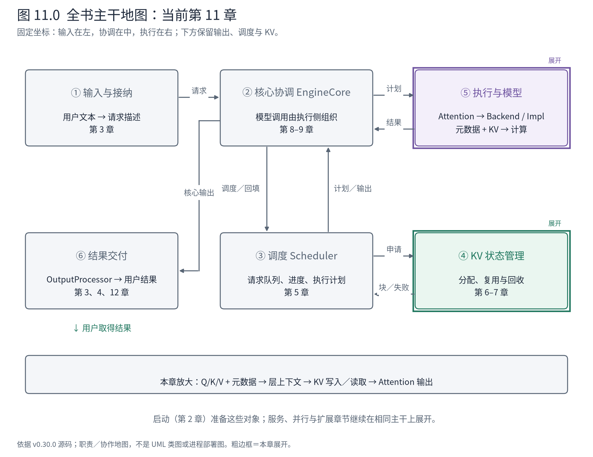
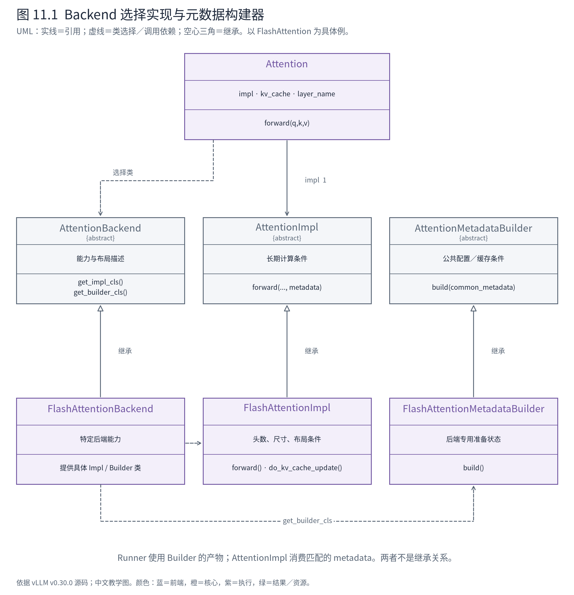
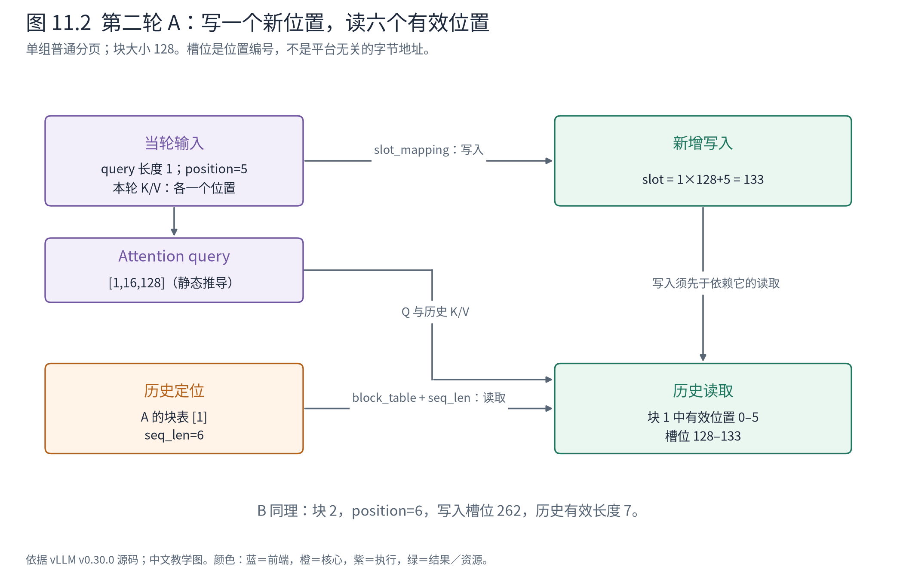

# 第 11 章 Attention：让模型计算找到正确的 KV

上一章读到 `self.attn(q,k,v)` 时，模型已经给出本轮的查询、键和值。但注意力还需要历史：A 的 KV 在哪些块，B 本轮有几个 query，每条序列已经多长，当前层使用哪种布局？这些信息不在三个显式参数里，却不能缺失。

本章把模型与推理系统的结合点打开。核心不是找一个名字叫 Attention 的大函数，而是看模型层、后端选择、元数据构建和具体实现怎样形成一套一致契约。



**先在地图上定位。** 当前位于⑤的 Attention 接口，接过第 10 章的 Q/K/V，同时消费第 6、9 章形成的块编号与当轮元数据。④管理所有权，⑤实际读写设备存储；这两项责任在这里相遇，但没有合并成同一个类。

## 11.1 Backend 不是一个算子的别名

vLLM 支持不同平台、注意力类型和执行条件。若每个模型都直接选择底层 kernel，并各自构建请求边界、块表和布局，模型实现将被硬件条件淹没；后端变更也难以统一验证。

因此需要几个分别承担职责的抽象：Attention 层提供模型调用入口，AttentionBackend 描述能力并提供实现类和元数据构建器，MetadataBuilder 把公共批次信息转换为后端需要的表示，AttentionImpl 执行实际注意力契约。



**图 11.1 怎样读。** 类图中的虚线表示选择／使用依赖，实线表示持有实现对象，空心三角表示具体类实现相应抽象。Backend 返回的是类，Attention 再实例化 Impl；Builder 属于另一条元数据准备路径，不是 AttentionImpl 的父类。为了看清结构，图以 FlashAttention 作为上游具体实现例子，省略其他后端。

这种分工让模型层保持相对稳定的入口，同时允许后端控制其有效头尺寸、dtype、块尺寸和图执行支持。它也带来一个必须支付的成本：实现类与元数据类型必须匹配，布局与资源准备也必须一致。随意替换一个 kernel，不一定构成合法的 backend 替换。

Attention 构造中的关键装配点是：

<!-- book:ch11-impl:start -->
源码教学注释版，vllm v0.30.0：[原文件 L416–L429](https://github.com/vllm-project/vllm/blob/ced6857afa0ea7b2e3f0846a62e1394e90f15607/vllm/model_executor/layers/attention/attention.py#L416-L429)。仅新增 `# 【解读】`，其他内容保留原文。

```python
        # 【解读】Backend 提供实现类；不是在这里启动 Attention 计算。
        impl_cls = self.attn_backend.get_impl_cls()
        # 【解读】按模型头数、维度、KV类型等构造实现对象，保存到 Attention.impl。
        self.impl = impl_cls(  # type: ignore[assignment]  # impl_cls always returns an AttentionImpl subclass
            num_heads,
            head_size,
            scale,
            num_kv_heads,
            alibi_slopes,
            sliding_window,
            kv_cache_dtype,
            logits_soft_cap,
            attn_type,
            kv_sharing_target_layer_name,
            **extra_impl_args,
        )
```
<!-- book:ch11-impl:end -->

这里配置的是实现对象的长期条件，例如头数、维度和缓存类型。本轮 A/B 的序列长度则属于动态元数据，不应被误塞进这个构造阶段。区分长期条件与当步数据，是阅读后端接口的第一步。

## 11.2 两条准备链在前向上下文汇合

第一条链来自模型：hidden states → Q/K/V → Attention。第二条链来自 Runner：InputBatch → 当轮块表与 slot mapping → 公共注意力元数据 → 后端专用 metadata。后者告诉算子怎样解释前者的 token 轴。

Runner 将相关元数据放进当前前向上下文，模型层按层名找到自己的信息。层名不仅用于日志，它还在模型对象、缓存资源和执行上下文之间承担关联作用。一个模型有多层注意力，不能只用一个无区分的全局 KV 张量代替全部层的存储。

上游统一调用入口在执行前补齐这些隐含参数：

<!-- book:ch11-forward:start -->
源码教学注释版，vllm v0.30.0：[原文件 L770–L787](https://github.com/vllm-project/vllm/blob/ced6857afa0ea7b2e3f0846a62e1394e90f15607/vllm/model_executor/layers/attention/attention.py#L770-L787)。仅新增 `# 【解读】`，其他内容保留原文。

```python
    # 【解读】显式依赖用于保持 KV 写入与读取的编译顺序；不是数学计算输入。
    # kv_cache_dummy_dep is not used but accepting it creates a data dependency
    # that ensures torch.compile preserves ordering between KV cache update and
    # attention forward.
    del kv_cache_dummy_dep
    # 【解读】用层名取当前前向上下文，补齐调用签名没有显式传入的状态。
    layer_name = _resolve_layer_name(layer_name)
    attn_metadata, self, kv_cache, _ = get_attention_context(layer_name)

    # 【解读】委托所选实现，将 Q/K/V、真实 KV 张量、元数据和输出缓冲交给同一契约。
    self.impl.forward(
        self,
        query,
        key,
        value,
        kv_cache,
        attn_metadata,
        output=output,
        output_scale=output_scale,
        output_block_scale=output_block_scale,
    )
```
<!-- book:ch11-forward:end -->

`get_attention_context` 返回该层的 metadata、Attention 对象、KV 张量等。随后 Impl 同时取得 Q/K/V 与这些上下文。这样，模型层的普通调用签名较简洁，编译与后端边界也有统一入口；代价是读一个方法签名已经不足以看见全部依赖，必须追到 ForwardContext 的建立与层名解析。

本节相关调用路径应拆成准备与消费两部分：

```text
准备侧：GPUModelRunner.execute_model
       ├─ prepare_inputs → InputBatch
       ├─ prepare_attn → block_tables / slot_mappings
       ├─ model_state.prepare_attn → 各层所需 metadata
       └─ 建立当前 ForwardContext 后调用模型

消费侧：Qwen3Attention.forward
       └─ Attention.forward
          ├─ 必要时独立更新 KV
          └─ unified_attention_with_output
             ├─ get_attention_context(layer_name)
             └─ AttentionImpl.forward(..., kv_cache, attn_metadata, ...)
```

这是上游普通路径的源码骨架。直接 Python 调用与注册 custom op 的分派存在条件差异，不能把上面所有步骤都认作始终能在同一层 Python 栈中看到；但它们应满足同一语义依赖。

## 11.3 块表负责读历史，slot mapping 负责放新值

第 9 章已经展示 `query_start_loc` 与 `seq_lens`。现在再加两个相关但不同的数据结构。

**块表**按本轮请求顺序，指出每个逻辑块对应哪个物理编号，供后端访问历史。**slot mapping**按本轮 token 顺序，指出新算出的 K/V 要写到哪个位置。前者是请求到历史块的映射，后者是新 token 到写入槽位的映射。

真实 NPU 运行在 prepare_attn 返回时得到：

<!-- book:ch11-slot:start -->
真实运行字段投影，保留字段名与值，省略无关项。来自[原始记录](evidence/runner-inproc-traced/projection.json)。

```json
{
  "steps": {
    "1": {
      "attn": {
        "block_tables": [
          {
            "type": "torch.Tensor",
            "shape": [
              2,
              1
            ],
            "dtype": "torch.int32",
            "device": "npu:0",
            "values": [
              [
                1
              ],
              [
                2
              ]
            ]
          }
        ],
        "slot_mappings": {
          "type": "torch.Tensor",
          "shape": [
            1,
            11
          ],
          "dtype": "torch.int32",
          "device": "npu:0",
          "values": [
            [
              128,
              129,
              130,
              131,
              132,
              256,
              257,
              258,
              259,
              260,
              261
            ]
          ]
        }
      }
    },
    "2": {
      "attn": {
        "slot_mappings": {
          "type": "torch.Tensor",
          "shape": [
            1,
            2
          ],
          "dtype": "torch.int32",
          "device": "npu:0",
          "values": [
            [
              133,
              262
            ]
          ]
        }
      }
    }
  }
}
```
<!-- book:ch11-slot:end -->

首轮块表是 `[[1],[2]]`：A 使用块 1，B 使用块 2。块大小 128，因此 A 的位置 0–4 对应槽位 128–132；B 的位置 0–5 对应 256–261。第二轮只新增 A 的位置 5、B 的位置 6，于是写入槽位是 133 和 262，块表仍可保持不变。

对于本章单组、单设备、普通分页情景，位置到槽位可按以下关系核对：逻辑块下标为 `position // block_size`，块内偏移为 `position % block_size`，再由块表取物理编号，得到 `block_id * block_size + offset`。这是位置编号关系，不是任意后端的字节地址公式；实际字节布局还包括层、K/V、head、dtype 等维度。



**图 11.2 怎样读。** 沿第二轮 A 看：本轮 query 长度为 1，位置为 5；K/V 写到槽位 133。注意力读取的历史长度是 6，依据块表找到块 1 中的有效位置。图没有把“只算一个 token”误画成“只看一个 token”。B 对应块 2 与位置 6，按同样规则独立访问。

这些实测数据来自 Ascend 后端准备边界，证明本机有效元数据的形态。下面选 FlashAttention 作为上游源码代表时，必须重新依据它的布局解读，不能将 NPU 的布局名称套进 CUDA 代码。

## 11.4 写入与注意力计算可以是两个操作

本版本 FlashAttentionBackend 声明 `forward_includes_kv_cache_update=False`。因此在适用条件下，Attention 层先走独立 KV 更新，再调用注意力实现。共享其他层 KV、encoder-only 等情形有自己的分支，不能无条件重复写入。

FlashAttention 更新方法中，先根据它自己的布局取得 K/V 缓存视图，再调用写入算子：

<!-- book:ch11-write:start -->
源码教学注释版，vllm v0.30.0：[原文件 L1451–L1472](https://github.com/vllm-project/vllm/blob/ced6857afa0ea7b2e3f0846a62e1394e90f15607/vllm/v1/attention/backends/flash_attn.py#L1451-L1472)。仅新增 `# 【解读】`，其他内容保留原文。

```python
        # 【解读】本段是上游 FlashAttention 更新路径，不是本机 Ascend 布局实测。
        # Scatter write into the KV cache using slot_mapping indices.
        # No TMA kernel is invoked here, so stride canonicalization is not needed.
        # (B, H, N, 2*D) -> ((B, N, H, D), (B, N, H, D))
        # 【解读】按此后端布局取得 K/V 缓存视图，不能复制此布局假设到所有平台。
        key_cache, value_cache = kv_cache.transpose(1, 2).split(self.head_size, dim=-1)

        # Reshape the input keys and values and store them in the cache.
        # Skip this if sharing KV cache with an earlier attention layer.
        # NOTE(woosuk): Here, key and value are padded while slot_mapping is
        # not padded. However, we don't need to do key[:num_actual_tokens]
        # and value[:num_actual_tokens] because the reshape_and_cache_flash
        # op uses the slot_mapping's shape to determine the number of
        # actual tokens.
        # 【解读】调用缓存写入算子，slot_mapping 决定本轮 token 对应的写入位置。
        reshape_and_cache_flash(
            key,
            value,
            key_cache,
            value_cache,
            # 【解读】写入位置来自当步元数据，块管理器只提供编号，不在这里代算 K/V。
            slot_mapping,
            self.kv_cache_dtype,
            layer._k_scale,
            layer._v_scale,
        )
```
<!-- book:ch11-write:end -->

这个片段的职责很窄：把本轮 key/value 放入映射指定的位置。它不决定块是否属于 A，也不决定 B 应否抢占，这些承诺已经由调度和块管理完成。后续 Attention 使用 metadata 中的请求边界、历史长度与块表进行计算。

前一节统一调用入口还接收 `kv_cache_dummy_dep`。这个值不参与注意力数学计算，却建立编译器能识别的数据依赖，避免把 KV 写入和随后读取重排到错误顺序。它是一个很具体的软件设计取舍：某些系统依赖不能仅靠 Python 文本先后暗示，还必须进入编译可见的契约。

当前 CPU 小实验里，块已经有元数据身份并不证明这里的写入已经发生。只有走到实际设备更新，并满足执行顺序，消费者才可以使用这些值。第 7 章对“登记与完成”的区分，在这里落到了真实读写边界。

## 11.5 MetadataBuilder 把通用含义转成后端表示

公共元数据表达请求数、query 边界、序列长度、块表、槽位和因果条件等含义。FlashAttentionMetadataBuilder 的 `build` 从这些字段出发，再准备本后端所需的调度与执行信息。其他后端可以需要不同附加字段，甚至支持不同的执行形态。

Builder 因而不是一份无意义的数据拷贝。它封装“这个后端如何解释本轮工作”，让 Runner 不必逐个拼装所有内核的私有参数；也使能力检查能尽早拒绝不支持的组合。代价是公共 metadata 与专用 metadata 的边界要持续维护，特别是图执行、滑窗、投机和并行都可能增加约束。

如果 Attention 结果错误，排查时不能只看 Q/K/V 数值。先对齐请求顺序、query 边界、seq_lens、块表和 slot mapping，再核对层名、布局与实际 Impl。维度合法不代表语义正确：两条请求交换块表，shape 仍然可以完全吻合。

本章完成了状态位置到实际访问的连接。A/B 的新 K/V 被写入各自位置，模型最终返回隐藏状态。下一章回到 Runner，观察它怎样从这些行中选择 logits、采样 token，再沿核心与前端将输出变成用户看到的文本。

**源码停点：** [Attention 层与统一入口](https://github.com/vllm-project/vllm/blob/ced6857afa0ea7b2e3f0846a62e1394e90f15607/vllm/model_executor/layers/attention/attention.py#L485-L787)跟显式输入与上下文汇合；[公共接口](https://github.com/vllm-project/vllm/blob/ced6857afa0ea7b2e3f0846a62e1394e90f15607/vllm/v1/attention/backend.py#L59-L103)看能力与实现选择；[代表 Builder](https://github.com/vllm-project/vllm/blob/ced6857afa0ea7b2e3f0846a62e1394e90f15607/vllm/v1/attention/backends/flash_attn.py#L763-L799)停在公共字段如何进入专用准备，不在本章展开完整内核优化。
