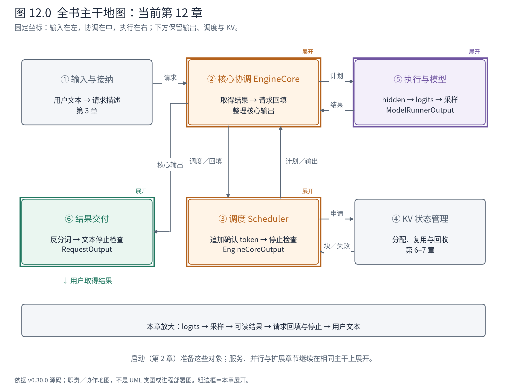
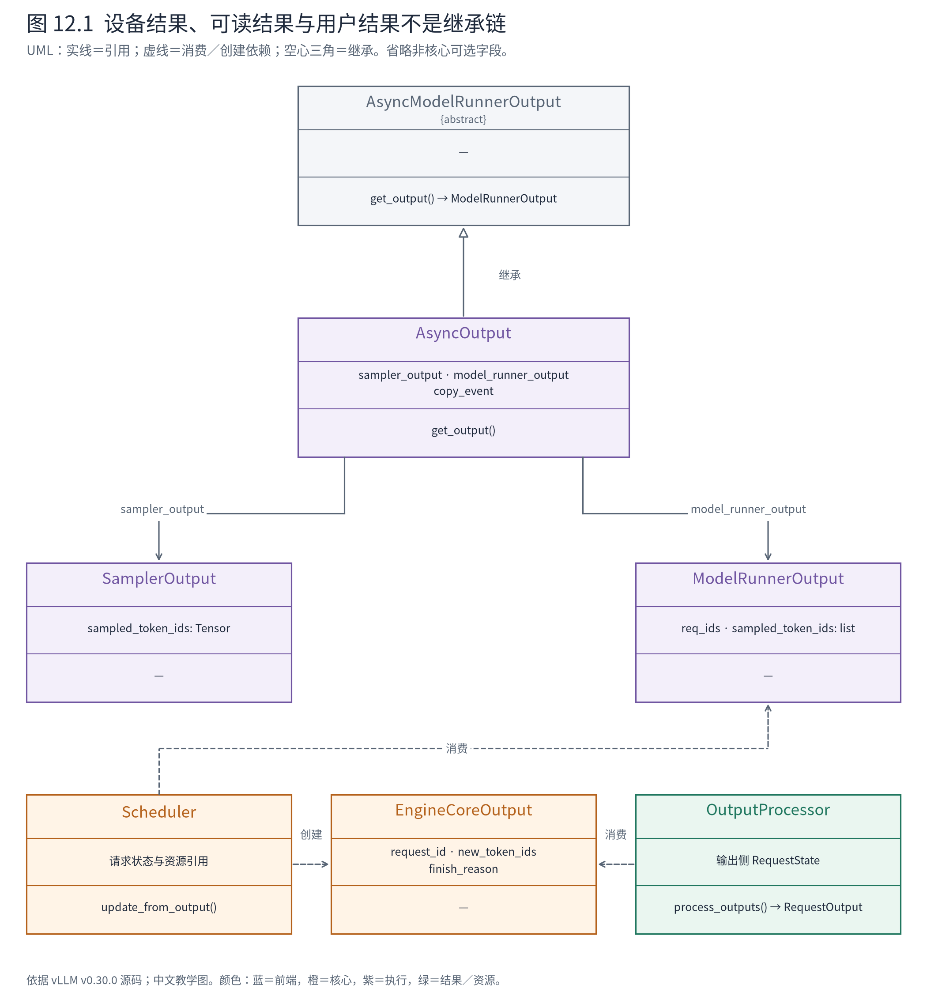
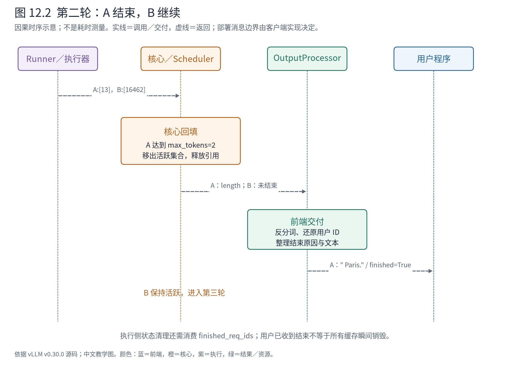

# 第 12 章 从隐藏状态到用户结果：生成的最后半圈

第 10、11 章完成了模型计算。首轮 A/B 共处理 11 个输入 token，Runner 得到 `[11,1024]` 的隐藏状态。但用户需要的既不是这 11 行向量，也不是词表中的全部得分，而是每条请求接下来的 token，以及何时应当停止生成。

本章沿返回方向走完闭环，同时辨别三种对象：设备上的采样产物、核心使用的请求结果、用户读取的文本输出。它们承载同一次计算，却服务于不同责任，不能当作同一种结果在各层原样转发。



**先在地图上定位。** 从⑤采样出发，经②协调、③请求回填，再到⑥交付。④可能在请求结束时释放引用。核心判定 token 与长度层面的结束，前端负责文本与交付形态；本章将说明这两个判定如何保持一致。

## 12.1 11 行隐藏状态，为什么只计算两行 logits

在普通自回归生成中，一个请求经过本轮计算后，只需用最后一个有效位置预测下一个 token。A 的首轮区间是 `[0,5)`，B 是 `[5,11)`，因此选中第 4、10 行。首轮每个 prompt token 都参与了模型计算，但并非每个位置都要执行用于下一 token 采样的输出头。

Runner 的普通、未分片 logits 路径写得很直接：

<!-- book:ch12-logits:start -->
源码教学注释版，vllm v0.30.0：[原文件 L1533–L1545](https://github.com/vllm-project/vllm/blob/ced6857afa0ea7b2e3f0846a62e1394e90f15607/vllm/v1/worker/gpu/model_runner.py#L1533-L1545)。仅新增 `# 【解读】`，其他内容保留原文。

```python
        # 【解读】普通未分片 logits 分支；上文另有分片路径。
        else:
            # 【解读】按每条请求需要采样的位置抽取隐藏行，本例 [11,1024] → [2,1024]。
            sample_hidden_states = hidden_states[input_batch.logits_indices]
            # 【解读】语言模型输出头把选中隐藏行投影到词表，本例得到 [2,151936]。
            logits = self.model.compute_logits(sample_hidden_states)

        # 【解读】若存在结构化输出约束，先在 logits 上施加语法掩码；本案例不进入。
        if grammar_output is not None:
            # Apply grammar bitmask to the logits in-place.
            assert self.structured_outputs_worker is not None
            self.structured_outputs_worker.apply_grammar_bitmask(
                logits,
                input_batch,
                grammar_output.structured_output_request_ids,
                grammar_output.grammar_bitmask,
            )
```
<!-- book:ch12-logits:end -->

抽行后，形状从 `[11,1024]` 变成 `[2,1024]`，再投影到 `[2,151936]`。最后一维是本案例词表大小；每一行代表一条请求在当前预测位置上的得分。真实边界观测为：

<!-- book:ch12-shapes:start -->
真实运行字段投影，保留字段名与值，省略无关项。来自[原始记录](evidence/runner-inproc-traced/projection.json)。

```json
{
  "steps": {
    "1": {
      "inputs": {
        "batch": {
          "logits_indices": {
            "values": [
              4,
              10
            ]
          }
        }
      },
      "hidden": {
        "hidden": {
          "type": "torch.Tensor",
          "shape": [
            11,
            1024
          ],
          "dtype": "torch.bfloat16",
          "device": "npu:0"
        }
      },
      "logits": {
        "logits": {
          "type": "torch.Tensor",
          "shape": [
            2,
            151936
          ],
          "dtype": "torch.bfloat16",
          "device": "npu:0"
        }
      }
    }
  }
}
```
<!-- book:ch12-shapes:end -->

这份记录只打印 shape、dtype、device 和所选行号，没有打印 151936 个得分。不要从它推断某个词的概率，也不要把 `[2,151936]` 误读成两条完整序列的所有 token 输出。

这种先抽取再投影的组织减少了普通生成不需要的 logits 工作。需要 prompt logprobs 时，另外的处理路径会计算对应位置；投机验证也可能需要更多预测行。优化依赖明确的输出需求，而不是简单地规定“每条请求永远只有一行”。

## 12.2 采样器封装选取规则，模型只提供得分

模型的 `compute_logits` 回答“当前上下文下，各词表项得到什么分数”。Sampler 则负责把请求参数落实为选取规则：允许哪些 token、是否施加惩罚、怎样处理温度、top-k/top-p 与随机种子。两者分离后，改变输出策略无需修改 Transformer 的前向计算。

这种分离并不意味着所有约束都只在一个 Sampler 类里。上面的源码已经表明，语法掩码可在调用采样器前应用；第 21 章会打开它。Sampler 内部的参数状态也按请求持久行组织，因此必须使用第 9 章建立的索引映射。把 A 的温度或惩罚历史应用到 B 的 logits，形状检查不会替我们发现错误。

A/B 的参数采用温度 0。上游 MRV2 的 `gumbel_noised_argmax` 在温度非零时才加随机噪声；温度为零时对处理后的 logits 取最大项。这里“处理后”不能省略：贪心选择仍可能受到允许词、惩罚或其他合法约束的影响。本例没有开启那些额外约束，因此适合观察基本闭环。

普通、无投机、单设备生成的返回调用树如下。它是根据源码整理的顺序树，不是某一时刻同时存在的全部栈帧。

```text
执行侧：GPUModelRunner.sample_tokens
        ├─ sample
        │  ├─ 选择 sample_hidden_states → model.compute_logits
        │  ├─ 可选 grammar mask
        │  └─ Sampler → SamplerOutput（设备张量）
        ├─ 构造 ModelRunnerOutput 与 AsyncOutput
        └─ 执行器解析延迟结果 → ModelRunnerOutput（可读 token 列表）

核心侧：Scheduler.update_from_output(plan, result)
        ├─ 按 request_id 对齐请求
        ├─ _update_request_with_output → check_stop
        └─ 整理 EngineCoreOutputs

前端侧：OutputProcessor.process_outputs
        ├─ 找到输出侧 RequestState
        ├─ detokenizer.update → 增量文本／文本停止
        └─ make_request_output → RequestOutput
```

多进程部署时，核心与前端之间通过客户端消息交付，不能把上面三段直接拼成一个 Python 调用栈。当前实测是教学用 InprocClient；执行器已经解析了延迟输出，探针看到的是可读结果。

## 12.3 名字都叫 Output，封装的边界却不同



**图 12.1 怎样读。** AsyncOutput 继承延迟结果契约，并同时引用设备采样结果与待完成的 ModelRunnerOutput。后两者不是父子类。下方的依赖表示核心消费 Runner 结果，再产生核心输出；前端消费核心输出，再产生用户输出。箭头表达使用与创建，不表示这些类型有继承关系。

`SamplerOutput` 中的 sampled_token_ids 是设备张量，适合在执行侧继续使用。`ModelRunnerOutput` 携带 req_ids、按请求组织的 token 列表以及可选 logprobs 等字段，适合核心按身份回填。`EngineCoreOutput` 是单请求的新结果与结束信息，多个结果按客户端整理成 `EngineCoreOutputs`。`RequestOutput` 则恢复用户请求标识并提供文本、token、候选序号和结束原因等接口。

还有一项容易忽略的生命周期：ModelRunnerOutput 刚创建时，采样列表可以暂时为空占位；AsyncOutput 发起设备到主机的复制，待取得结果时才补齐。上游实现为：

<!-- book:ch12-materialize:start -->
源码教学注释版，vllm v0.30.0：[原文件 L167–L178](https://github.com/vllm-project/vllm/blob/ced6857afa0ea7b2e3f0846a62e1394e90f15607/vllm/v1/worker/gpu/async_utils.py#L167-L178)。仅新增 `# 【解读】`，其他内容保留原文。

```python
    def get_output(self) -> ModelRunnerOutput:
        # 【解读】读取 CPU 结果前等待复制事件，异步发起不等于数据已经可读。
        self.copy_event.synchronize()

        # NOTE(woosuk): The following code is to ensure compatibility with
        # the existing model runner.
        # Going forward, we should keep the data structures as NumPy arrays
        # rather than Python lists.
        # 【解读】把已复制的 token 张量转换为兼容现有接口的 Python 列表。
        sampled_token_ids: list[list[int]] = self.sampled_token_ids.tolist()
        # 【解读】每条请求有效输出数可能不同；不能按填充宽度全部返回。
        num_sampled_tokens: list[int] = self.num_sampled_tokens_np.tolist()
        for token_ids, num_tokens in zip(sampled_token_ids, num_sampled_tokens):
            # 【解读】去掉无效尾部，再填入最终交给核心的 ModelRunnerOutput。
            del token_ids[num_tokens:]
        self.model_runner_output.sampled_token_ids = sampled_token_ids
```
<!-- book:ch12-materialize:end -->

因此，“已经构造一个结果对象”与“其有效 token 已能被 CPU 读取”不是同一事件。保留设备张量引用、记录复制事件、等到消费点再同步，都是这份延迟契约的组成部分。第 13 章会进一步讨论这些动作如何与下一轮工作重叠。本机观测不构成 CUDA 流实现的硬件验证。

实际 A/B 的三轮可读采样结果如下：

<!-- book:ch12-sampled:start -->
真实运行字段投影，保留字段名与值，省略无关项。来自[原始记录](evidence/runner-inproc-traced/projection.json)。

```json
{
  "steps": {
    "1": {
      "sample": {
        "output": {
          "req_ids": [
            "A-9fe0112d",
            "B-b550db9e"
          ],
          "sampled_token_ids": [
            [
              12095
            ],
            [
              279
            ]
          ]
        }
      }
    },
    "2": {
      "sample": {
        "output": {
          "sampled_token_ids": [
            [
              13
            ],
            [
              16462
            ]
          ]
        }
      }
    },
    "3": {
      "sample": {
        "output": {
          "req_ids": [
            "B-b550db9e"
          ],
          "sampled_token_ids": [
            [
              21575
            ]
          ]
        }
      }
    }
  }
}
```
<!-- book:ch12-sampled:end -->

第一轮各一个 token；第二轮 A 得到句号，B 得到 `Pacific` 对应 token；第三轮只剩 B。此处 `req_id_to_index` 的含义是当前结果中的行号，不是第 9 章的持久槽位。第三轮 B 的持久行仍可为 2，但结果列表中的行是 0。

## 12.4 先接纳 token，再判定是否结束

采样器返回了候选结果，核心还必须把它变成请求的确认历史。这个边界尤其重要：一轮可能产生多个 token，而停止条件可能在其中某个位置已经满足。

<!-- book:ch12-append:start -->
源码教学注释版，vllm v0.30.0：[原文件 L2347–L2364](https://github.com/vllm-project/vllm/blob/ced6857afa0ea7b2e3f0846a62e1394e90f15607/vllm/v1/core/sched/scheduler.py#L2347-L2364)。仅新增 `# 【解读】`，其他内容保留原文。

```python
    def _update_request_with_output(
        self, request: Request, new_token_ids: list[int], is_stale: bool = False
    ) -> tuple[list[int], bool]:
        # is_stale is only used by the AsyncScheduler override.
        # Append generated tokens and check for stop. Note that if
        # a request is still being prefilled, we expect the model runner
        # to return empty token ids for the request.
        # 【解读】初始假设尚未停止；分块 prefill 的输出列表可以为空。
        stopped = False
        # 【解读】逐个接纳本轮新 token；投机路径一轮可能不止一个。
        for num_new, output_token_id in enumerate(new_token_ids, 1):
            # 【解读】先进入请求的确认历史，再用更新后的历史检查终止条件。
            request.append_output_token_ids(output_token_id)

            # Check for stop and update request state.
            # This must be called before we make the EngineCoreOutput.
            # 【解读】停止检查同时修改请求状态，后续核心输出据此填写结束原因。
            stopped = check_stop(request, self.max_model_len)
            if stopped:
                # 【解读】若已停止，裁掉同轮剩余 token，避免把结束之后的内容继续交付。
                del new_token_ids[num_new:]  # Trim new tokens if needed.
                break
        return new_token_ids, stopped
```
<!-- book:ch12-append:end -->

核心逐个追加、逐个检查，一旦停止就裁掉同轮的剩余 token。普通 A/B 每轮只有一个，仍走这套契约；第 20 章投机解码会让“同轮多个”的处理成为必要部分。

停止检查的前半段包括 EOS、显式停止 token 和长度：

<!-- book:ch12-stop:start -->
源码教学注释版，vllm v0.30.0：[原文件 L100–L115](https://github.com/vllm-project/vllm/blob/ced6857afa0ea7b2e3f0846a62e1394e90f15607/vllm/v1/core/sched/utils.py#L100-L115)。仅新增 `# 【解读】`，其他内容保留原文。

```python
    # 【解读】当前请求已至少追加一个新 token，读取最新 token 判定。
    last_token_id = request.output_token_ids[-1]
    # 【解读】先检查有效 EOS；ignore_eos 的影响在参数准备阶段体现。
    if last_token_id == sampling_params.eos_token_id:
        request.status = RequestStatus.FINISHED_STOPPED
        return True

    # 【解读】显式 stop_token_ids 也可终止，并记录实际触发 token。
    if last_token_id in (sampling_params.stop_token_ids or ()):
        request.status = RequestStatus.FINISHED_STOPPED
        request.stop_reason = last_token_id
        return True

    # 【解读】模型总长度或请求生成长度达到上限时，以长度原因结束。
    if (
        request.num_tokens >= max_model_len
        or request.num_output_tokens >= request.max_tokens
    ):
        request.status = RequestStatus.FINISHED_LENGTH_CAPPED
        return True
```
<!-- book:ch12-stop:end -->

本案例设置 ignore_eos，并分别用 2、3 的 max_tokens 控制输出长度。ignore_eos 在采样参数准备阶段影响有效 EOS 登记，不能因为上面没有直接出现这个布尔变量就认为它失效。第二轮 A 的输出历史达到两个 token，核心将它标为长度结束；B 尚未达到三个，继续保留。

结束不只影响一个枚举。Scheduler 还要移除活跃请求、释放其资源引用，并把需要执行侧清理的 ID 送入后续计划。第 4、6 章已经看到这些不同步发生的清理责任。用户结果完成与所有组件瞬间消失，不能画等号。



**图 12.2 怎样读。** 沿 A 的 token 13 看，执行侧先返回新 token；核心追加后发现长度达到 2，生成带结束原因的核心结果；前端再把它变成文本并交付。B 同轮收到 16462，却继续留在活跃集合。纵向表示因果关系，不表示探针测得的耗时；清理的执行侧通知可能由后续迭代消费。

## 12.5 文本停止为什么还要在前端判断

核心主要看到 token ID，而用户可能要求遇到某个字符串就停止。一个字符串可以跨多个 token，增量解码又可能保留尚未形成完整字符的片段。因此，前端需要每请求的增量反分词状态，不能把每个 token 独立 decode 后简单拼接，当成所有 tokenizer 都正确的通用算法。

OutputProcessor 把新 token 交给该请求的 detokenizer：

<!-- book:ch12-text:start -->
源码教学注释版，vllm v0.30.0：[原文件 L702–L712](https://github.com/vllm-project/vllm/blob/ced6857afa0ea7b2e3f0846a62e1394e90f15607/vllm/v1/engine/output_processor.py#L702-L712)。仅新增 `# 【解读】`，其他内容保留原文。

```python
                # 2) Detokenize the token ids into text and perform stop checks.
                # 【解读】前端按请求保存的增量反分词状态消费新 token，同时检查文本停止串。
                stop_string = req_state.detokenizer.update(
                    new_token_ids, finish_reason == FinishReason.STOP
                )
                # 【解读】文本匹配可以补充核心尚未识别的停止；后文负责向核心发起终止。
                if stop_string:
                    finish_reason = FinishReason.STOP
                    stop_reason = stop_string

                # 3) Compute sample and prompt logprobs for request,
                # if required.
                # 【解读】如果用户需要 logprobs，另一个处理器整理对应输出；不从文本反推概率。
                req_state.logprobs_processor.update_from_output(engine_core_output)
```
<!-- book:ch12-text:end -->

若发现停止串，前端可以把完成原因改成 STOP。随后还会检查核心是否已经结束；若没有，则把请求 ID 放入 `reqs_to_abort`，由上层通知核心终止。否则用户虽然看不到更多文本，核心仍可能继续调度与占用 KV。

这体现了两种状态所有权：核心拥有计算生命周期，前端拥有文本与交付生命周期。前端的文本判断会产生跨边界控制消息，让核心承担它自己的清理责任。收益是核心不必处理字符串与输出协议；代价是停止必须闭环，不能只改前端 finished 标志。

本例没有文本停止串，A 的最终用户对象字段为：

<!-- book:ch12-final:start -->
真实运行字段投影，保留字段名与值，省略无关项。来自[原始记录](evidence/runner-inproc-traced/result.json)。

```json
{
  "final": {
    "A": {
      "request_id": "A",
      "outputs": [
        {
          "type": "vllm.outputs.CompletionOutput",
          "index": 0,
          "text": " Paris.",
          "token_ids": [
            12095,
            13
          ],
          "cumulative_logprob": null,
          "logprobs": null,
          "routed_experts": null,
          "finish_reason": "length",
          "stop_reason": null,
          "lora_request": null,
          "sampling_mask": null,
          "spec_decode_metrics": null
        }
      ],
      "finished": true
    }
  }
}
```
<!-- book:ch12-final:end -->

内部 ID 的随机后缀已还原为用户的 A；text 为 ` Paris.`，token_ids 为 `[12095,13]`，结束原因是 length。文本和 token 历史描述同一请求，但不要从文本字符数推算 token 数。

离线与在线还可采用累计、增量或仅最终结果等交付方式。交付频率属于输出契约，不改变“引擎内部逐步推进”的事实。第 15 章将把这个输出接口接到异步消费者和 HTTP 流。

## 12.6 同一执行框架也可以交付非生成结果

Pooling 请求使用另一类输出：模型隐藏状态经相应池化任务处理后返回向量或评分等结果，不经下一 token 的逐步采样。Scheduler 源码中有独立分支：pooling 参数存在且收到 pooler_output 时即可结束；OutputProcessor 也据 pooling_output 选择对应输出对象。

这个对照帮助我们辨别框架的不变量。请求身份、调度、执行资源和结果交付仍然需要，但“采样一个 token 后再运行一轮”只是生成任务的协议。本书 A/B 是生成案例，没有把它的日志冒充 embedding 运行结果。

至此，从文本进入、请求登记、调度计划、KV 分配、模型计算到文本返回，基本闭环已经落到了对象、代码与实物上。下一章保留同一套职责，却改变推进时间：当上一轮的结果还在途中，系统如何准备下一轮，又怎样避免旧结果修改错误的状态？

**源码停点：** [MRV2 采样](https://github.com/vllm-project/vllm/blob/ced6857afa0ea7b2e3f0846a62e1394e90f15607/vllm/v1/worker/gpu/model_runner.py#L1512-L1590)读抽行与选取边界；[采样实现](https://github.com/vllm-project/vllm/blob/ced6857afa0ea7b2e3f0846a62e1394e90f15607/vllm/v1/worker/gpu/sample/gumbel.py#L94-L133)辨别温度零分支；[核心返回](https://github.com/vllm-project/vllm/blob/ced6857afa0ea7b2e3f0846a62e1394e90f15607/vllm/v1/core/sched/scheduler.py#L2025-L2177)跟结束与输出；[前端清理](https://github.com/vllm-project/vllm/blob/ced6857afa0ea7b2e3f0846a62e1394e90f15607/vllm/v1/engine/output_processor.py#L734-L746)确认文本停止也会通知核心。
