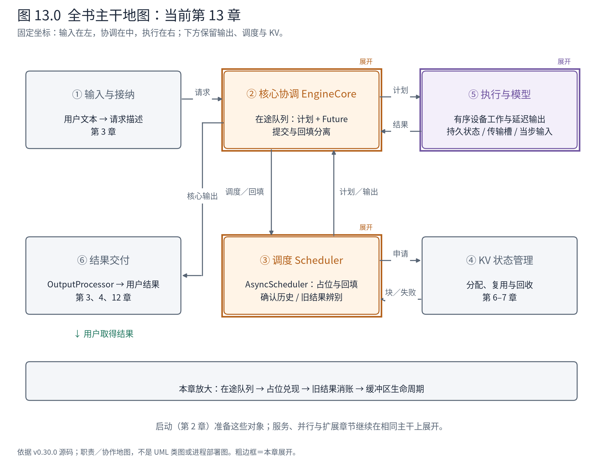
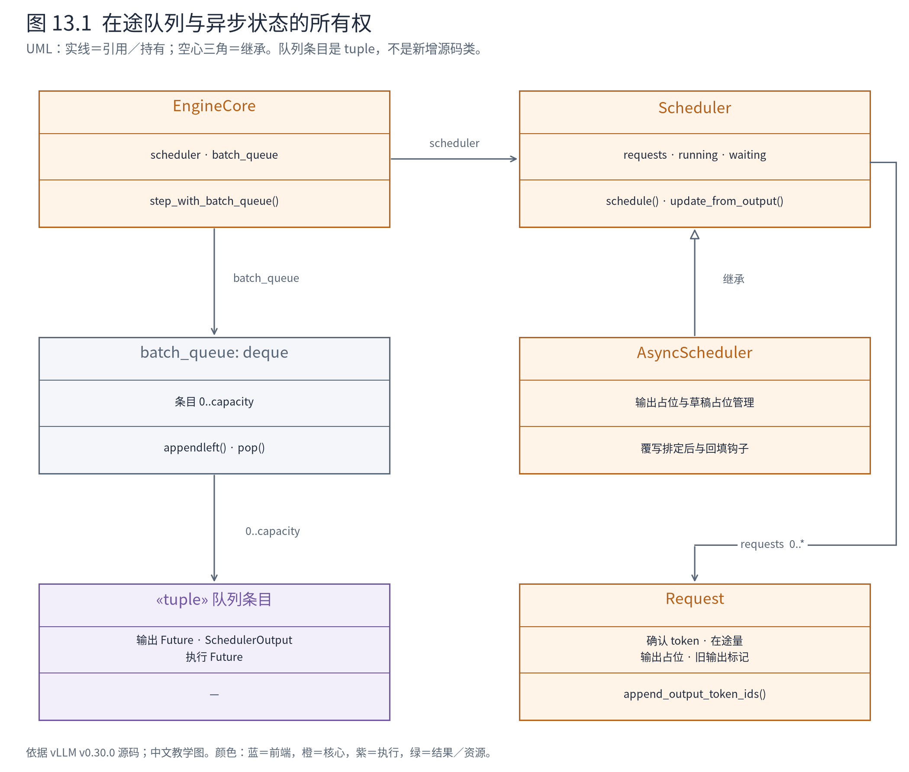
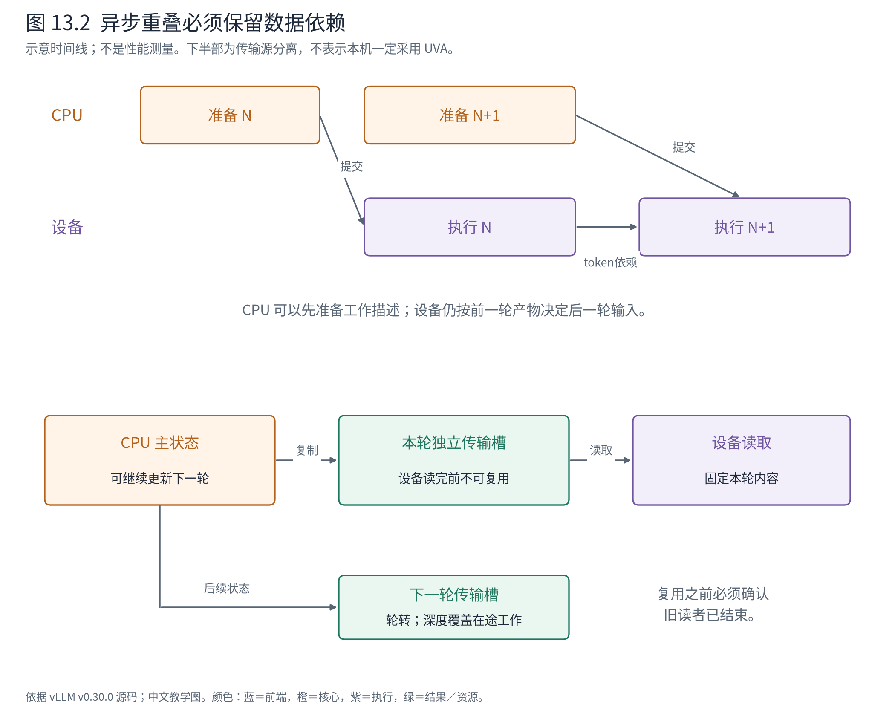

# 第 13 章 异步推进：结果还在途中，下一轮怎样开始

前十二章用同步调度、eager 与进程内客户端把职责闭环看清楚。现在保留这些组件，改变它们在时间上的配合：CPU 准备下一轮工作时，设备可能仍在执行上一轮；输出复制也可能尚未完成。

这不是把几个函数都改成 async 就能解决的问题。下一轮既依赖上一轮的 token，又希望减少 CPU 等待；同一块输入缓冲还可能被两轮同时使用。真正要读懂的是：哪些事实可以提前知道，哪些值必须等待，哪份状态允许修改。



**先在地图上定位。** 本章同时打开②的在途队列、③的占位计数和⑤的输入／输出缓冲。职责边界保持原位，新增的是跨迭代依赖。第 12 章已确认的用户结果仍是最终交付契约，异步不会允许未确认 token 冒充最终输出。

## 13.1 提前准备工作，不代表跳过自回归依赖

A 的第一个生成 token 是 12095，第二轮需要把它作为输入。CPU 若尚未收到 12095，如何先计划“下一轮再给 A 算一个 token”？因为计划可以先知道工作量与位置，而不必先知道该 token 的具体数值。实际数值已经或即将在执行侧产生，可由有序设备工作传给下一轮输入准备。

这里有三层不同的“异步”。调用返回 Future，表示调用者可稍后取得结果；核心保持多个在途批次，表示提交与回填不总是紧挨；设备流按依赖执行，表示 CPU 提交后不必立刻等待设备完成。它们能够配合，但不能相互代替。第 8 章已经指出，UniProcExecutor 的 non_block 标志并不自动创建后台 Python 线程。

官方 MRV2 设计文档明确把异步优先与减少 CPU 同步作为目标，并将持久状态和当步输入分离作为支撑。这是维护者说明的设计动机；下面以本版队列、占位和缓冲代码说明它如何成立。[官方 MRV2 设计](https://docs.vllm.ai/en/v0.30.0/design/model_runner_v2/)

## 13.2 在途队列保存的不只是一个 Future



**图 13.1 怎样读。** EngineCore 引用 Scheduler 契约，也持有 batch_queue。队列元素把输出 Future、当轮 SchedulerOutput 和执行 Future 放在一起。AsyncScheduler 继承 Scheduler，复用普通请求决策与结果接纳，在排定和回填时补充占位逻辑。Request 中的长期状态不属于某一个队列元素。

为什么必须一起保存原计划？返回的 token 告诉我们“算出了什么”，原计划告诉我们“这是哪一轮为哪些请求排定了多少工作”。回填、统计以及在途计数都要对齐这两个事实。只保留结果而丢掉计划，会让并发迭代之间的归属变得含糊。

EngineCore 采用 batch queue 时，先尝试提交计划，随后可能暂不等待其结果：

<!-- book:ch13-queue:start -->
源码教学注释版，vllm v0.30.0：[原文件 L684–L692](https://github.com/vllm-project/vllm/blob/ced6857afa0ea7b2e3f0846a62e1394e90f15607/vllm/v1/engine/core.py#L684-L692)。仅新增 `# 【解读】`，其他内容保留原文。

```python
            # 【解读】不需要等待前轮语法推进时，将这轮结果句柄和原计划一起登记。
            if not deferred_scheduler_output:
                # Add this step's future to the queue.
                # 【解读】左侧入队，后文从右侧取最早一轮，保证回填能找到对应计划。
                batch_queue.appendleft((future, scheduler_output, exec_future))
                # 【解读】容量尚有余量且仍有工作时，先返回控制权，让后续调用继续提交。
                if len(batch_queue) < self.batch_queue_size and (
                    model_executed or self.scheduler.has_requests()
                ):
                    # Don't block on next worker response unless the queue is full
                    # or there are no more requests to schedule.
                    # 【解读】没有用户结果不表示没有执行；这里返回本次是否提交了模型工作的标志。
                    return None, model_executed
```
<!-- book:ch13-queue:end -->

后续从队列另一端取最早登记的条目，再调用 `future.result()`。若采样结果异常地为空，还会检查原 execute Future，以传播真正的执行异常。结果回填之前先处理期间到达的取消请求，防止把已经取消的请求当作普通活跃请求继续推进。

条件路径可以整理为：

```text
EngineCore.step_with_batch_queue
├─ Scheduler.schedule → 当轮计划
├─ Executor.execute_model(non_block=True)
├─ 若不依赖前轮语法推进：sample_tokens(non_block=True)
├─ 将 (输出Future, 原计划, 执行Future) 入队
├─ 有容量且仍能提交：返回，下一次继续推进
└─ 需要取得结果
   ├─ 取最早条目 → future.result()
   ├─ 处理期间到达的 abort
   ├─ Scheduler.update_from_output(原计划, 结果)
   └─ 若有延后的语法采样：推进语法后再提交
```

这是源码控制流，不是一次运行的活动调用栈。队列大小、请求可调度性和语法依赖都会限制重叠程度；不能从“有队列”推断设备上始终有固定数量的批次同时计算。

## 13.3 占位计数表达尚未兑现的输出

普通 Request 的确认历史只包含已经接纳的 token。异步调度还维护 `num_output_placeholders`：预计会由在途工作带来的输出位置。调度器可以依据这些位置继续计划，但不能把它们当成用户已经收到的 token。

AsyncScheduler 在排定非中间 prefill chunk 时增加占位；普通自回归每步通常对应一个采样 token，投机、扩散等路径有另外的数量规则。草稿占位与真实草稿值也分开处理。代码中的占位值 -1 是控制侧标记，不是要送入模型词表 embedding 的有效 token。

输出到达时，AsyncScheduler 复用父类的追加与停止逻辑，再处理占位和缓存：

<!-- book:ch13-fill:start -->
源码教学注释版，vllm v0.30.0：[原文件 L51–L70](https://github.com/vllm-project/vllm/blob/ced6857afa0ea7b2e3f0846a62e1394e90f15607/vllm/v1/core/sched/async_scheduler.py#L51-L70)。仅新增 `# 【解读】`，其他内容保留原文。

```python
    def _update_request_with_output(
        self, request: Request, new_token_ids: list[int], is_stale: bool = False
    ) -> tuple[list[int], bool]:
        # 【解读】保留回填前状态，避免把已抢占请求误当成仍活跃的缓存拥有者。
        status_before_update = request.status
        # 【解读】复用普通Scheduler的确认token与停止检查，异步类只补时间相关状态。
        new_token_ids, stopped = super()._update_request_with_output(
            request, new_token_ids
        )

        # Placeholders were zeroed at preemption; a stale delivery must not
        # decrement them (it would underflow).
        # 【解读】抢占已清零占位，旧结果不能再扣一次。
        if not is_stale:
            # 【解读】正常结果兑现相应占位；计数不允许为负。
            request.num_output_placeholders -= len(new_token_ids)
            assert request.num_output_placeholders >= 0

        # Cache the new tokens. Preempted requests should be skipped.
        # 【解读】只有回填前仍RUNNING才推进缓存登记，并扣除尚未兑现的占位。
        if status_before_update == RequestStatus.RUNNING:
            self.kv_cache_manager.cache_blocks(
                request, request.num_computed_tokens - request.num_output_placeholders
            )
        return new_token_ids, stopped
```
<!-- book:ch13-fill:end -->

读这个 override，应先辨别继承的职责与新增职责。父类已经负责确认 token 与停止，子类不再复制一份完整停止算法，而是维护异步状态的守恒关系。这样可以减少语义分叉，但也使读者必须同时知道父类方法做了什么；第 12 章的讲解就是这里的前置条件。

为了看见这些字段怎样变化，配套脚本调用真实 AsyncScheduler 回填方法，手工设置一个明确的初态：A 已排定覆盖 6 个输入位置，两份输出仍未在 CPU 确认，故占位为 2。KV 依赖替换为只记录调用的最小对象，完全不分配设备 KV。

<!-- book:ch13-contract:start -->
CPU 方法契约实验：使用真实回填方法，初始状态手工构造，KV 依赖只记录调用；不是异步推理轨迹。来自[原始记录](evidence/metadata-contracts/trace.json)。

```json
{
  "async": {
    "initial": {
      "id": "A-contract",
      "status": "RUNNING",
      "num_computed_tokens": 6,
      "num_output_placeholders": 2,
      "output_token_ids": [],
      "cache_calls": []
    },
    "first_result": {
      "returned": [
        12095
      ],
      "stopped": false,
      "id": "A-contract",
      "status": "RUNNING",
      "num_computed_tokens": 6,
      "num_output_placeholders": 1,
      "output_token_ids": [
        12095
      ],
      "cache_calls": [
        {
          "id": "A-contract",
          "num_tokens": 5
        }
      ]
    },
    "second_result": {
      "returned": [
        13
      ],
      "stopped": true,
      "id": "A-contract",
      "status": "FINISHED_LENGTH_CAPPED",
      "num_computed_tokens": 6,
      "num_output_placeholders": 0,
      "output_token_ids": [
        12095,
        13
      ],
      "cache_calls": [
        {
          "id": "A-contract",
          "num_tokens": 5
        },
        {
          "id": "A-contract",
          "num_tokens": 6
        }
      ]
    }
  }
}
```
<!-- book:ch13-contract:end -->

收到 12095 后，确认历史多一个 token，占位从 2 变 1，cache_blocks 的边界是 6−1=5；再收到 13，占位变 0，边界成为 6，A 达到长度上限。这里的 6 不是已确认输出个数，而是这份构造初态中的计算进度。

这个方法实验展示了接口实物与算术，却没有证明真实异步引擎一定出现相同时间顺序，也没有测量吞吐。基础 NPU 日志仍是同步调度配置；两类证据不能拼成一个运行现场。

## 13.4 抢占之后，旧结果为什么不能再扣占位

第 7 章已读过抢占：请求离开 running，计算进度和输出占位重置，旧在途结果另行标记。若旧结果晚到，再按普通路径减占位，就可能出现负数；若把其缓存登记当成新一轮进度，又可能给恢复请求错误的可复用边界。

因此上面的 `is_stale` 条件与 `status_before_update` 各自解决一个问题：前者阻止重复扣除已清零的占位，后者避免为此前不再 RUNNING 的请求推进缓存登记。并不是看到“旧”就可以随意丢弃所有输出；确认历史、在途消账与资源登记仍各有自己的处理规则。

同一 CPU 驱动构造 PREEMPTED 请求并交付一个旧结果，实际回填后为：

<!-- book:ch13-stale:start -->
CPU 方法契约实验：使用真实回填方法，初始状态手工构造，KV 依赖只记录调用；不是异步推理轨迹。来自[原始记录](evidence/metadata-contracts/trace.json)。

```json
{
  "async": {
    "stale_delivery": {
      "id": "A-stale",
      "status": "PREEMPTED",
      "num_computed_tokens": 0,
      "num_output_placeholders": 0,
      "output_token_ids": [
        12095
      ],
      "cache_calls": [
        {
          "id": "A-contract",
          "num_tokens": 5
        },
        {
          "id": "A-contract",
          "num_tokens": 6
        }
      ]
    }
  }
}
```
<!-- book:ch13-stale:end -->

占位保持 0，没有多出 cache_blocks 调用。这解释了一个通用设计原则：重试或恢复之后，同一逻辑请求可能同时存在旧工作与新状态，必须显式辨别结果属于哪一段执行，不能只看 request_id 相同。

## 13.5 共享可变缓冲区是另一个一致性问题

假设 CPU 把 A/B 的长度写入一块页锁定主机内存，并发起异步复制。复制尚未读完时，CPU 为下一轮覆盖同一块内存，设备就可能收到混合了两轮的数据。数据长度、dtype 都正确，结果却不属于任何一轮合法计划。

本版 `UvaBufferPool` 使用多个传输槽。CPU 维护的主状态与本轮提供给设备读取的缓冲分开，按轮转选择槽位：

<!-- book:ch13-buffer:start -->
源码教学注释版，vllm v0.30.0：[原文件 L85–L97](https://github.com/vllm-project/vllm/blob/ced6857afa0ea7b2e3f0846a62e1394e90f15607/vllm/v1/worker/gpu/buffer_utils.py#L85-L97)。仅新增 `# 【解读】`，其他内容保留原文。

```python
    def copy_to_uva(self, x: torch.Tensor | np.ndarray | list) -> torch.Tensor:
        # Round robin to the next buffer.
        # 【解读】轮转到另一缓冲槽；调用者必须保证再次复用前旧读者已经结束。
        self._curr = (self._curr + 1) % self.max_concurrency
        buf = self._uva_bufs[self._curr]
        n = len(x)
        # 【解读】容量不足时增长为可覆盖输入的大小，不覆盖仍被使用的旧对象。
        if n > buf.cpu.shape[0]:
            capacity = 1 << (n - 1).bit_length()
            buf = self._buffer_cls((capacity, *buf.cpu.shape[1:]), self.dtype)
            self._uva_bufs[self._curr] = buf
        # CPU-to-CPU copy
        # 【解读】把当前CPU状态复制到独立传输槽，而不是让设备一直读可变主账本。
        dst = buf.cpu if isinstance(x, torch.Tensor) else buf.np
        dst[:n] = x
        # 【解读】返回本轮有效范围的设备可访问视图；平台不支持UVA时有显式复制回退。
        return buf.uva(n)
```
<!-- book:ch13-buffer:end -->

轮转本身不是无限安全的证明。类文档明确要求调用者在复用或扩容槽位前，确保旧设备读者已经退休；并发深度必须覆盖在途使用范围。若平台不支持 UVA，代码使用显式复制回退，不能直接把 CUDA 的地址访问机制套到 NPU 上。



**图 13.2 怎样读。** 上半部表示 CPU 可准备 N+1，同时设备执行 N；箭头保留设备内部“前轮 token → 后轮输入”的依赖。下半部表示 CPU 主状态先复制到独立槽，再交给设备读取。两条时间线只是依赖示意，条带长度不代表实测耗时。

对于大块表，整份复制又太昂贵。StagedWriteTensor 先记录差量，稍后批量送入设备并应用：

<!-- book:ch13-staged:start -->
源码教学注释版，vllm v0.30.0：[原文件 L177–L187](https://github.com/vllm-project/vllm/blob/ced6857afa0ea7b2e3f0846a62e1394e90f15607/vllm/v1/worker/gpu/buffer_utils.py#L177-L187)。仅新增 `# 【解读】`，其他内容保留原文。

```python
    def stage_write(
        self, index: int, start: int, x: Iterable[int] | Iterable[float]
    ) -> None:
        # 【解读】先检查目标行与起点有效，空写入直接跳过。
        assert index >= 0
        assert start >= 0
        if not x:
            return
        # 【解读】记录写到哪一行、从哪一列开始。
        self._staged_write_indices.append(index)
        self._staged_write_starts.append(start)
        # 【解读】把不同长度的更新内容串联，并保存累计边界；此时还没有执行设备写入。
        self._staged_write_contents.extend(x)
        self._staged_write_cu_lens.append(len(self._staged_write_contents))
```
<!-- book:ch13-staged:end -->

例如将 `[1]` 写入 A 的持久行 3、起点 0，再将 `[2]` 写入 B 的行 2，暂存表示会记录行号 `[3,2]`、起点 `[0,0]`、内容 `[1,2]`、累计边界 `[1,2]`。这是依据片段构造的教学例，不是新增 NPU 读数。直到 apply_write 执行，才把暂存描述变成设备状态更新。

这种差量协议与第 5 章的新旧请求消息呼应：控制侧只传变化，执行侧保存长期状态。它减少重复搬运，却要求应用顺序、索引与缓冲生命周期全部正确。第 9 章持久行与当步 batch 顺序的分离，也在这里避免了不必要的重排。

本章的异步心智是：让不同阶段重叠，同时把未知值、在途归属和内存读写依赖明确表示。下一章进一步减少 CPU 发射工作：把稳定的模型执行组织成可复用的编译产物和设备图，但动态请求仍必须满足它们的契约。

**源码停点：** [核心队列](https://github.com/vllm-project/vllm/blob/ced6857afa0ea7b2e3f0846a62e1394e90f15607/vllm/v1/engine/core.py#L630-L744)对齐提交与回填；[异步调度器](https://github.com/vllm-project/vllm/blob/ced6857afa0ea7b2e3f0846a62e1394e90f15607/vllm/v1/core/sched/async_scheduler.py#L12-L70)读完整小类；[缓冲协议](https://github.com/vllm-project/vllm/blob/ced6857afa0ea7b2e3f0846a62e1394e90f15607/vllm/v1/worker/gpu/buffer_utils.py#L60-L235)跟状态、传输槽与差量应用。不要用本章教学探针作性能基准。
